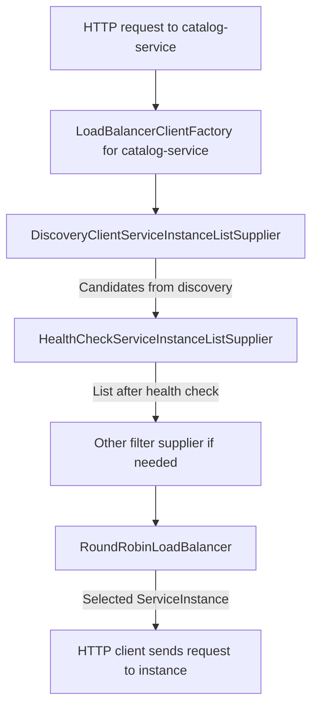

# HealthCheckServiceInstanceListSupplier and Filtering Healthy Instances

In a microservices system, a service ID like `catalog-service` can map to multiple `ServiceInstance` objects. However, an instance still appearing in the discovery list **does not mean** it is ready to receive requests. The process may have lost connectivity, may still be starting up, or may be running yet unable to serve business operations. Spring Cloud LoadBalancer provides `HealthCheckServiceInstanceListSupplier` to periodically check instances and prioritize those evaluated as healthy in the candidate list for the instance selection algorithm.

This lesson focuses on the **client-side** health check mechanism, how to plug it into the `ServiceInstanceListSupplier` chain, configuring the endpoint and check interval, behavior when no healthy instances remain, and common deployment mistakes. It is a protective layer for routing, **not** a complete replacement for discovery, retries, timeouts, or circuit breakers.

## 1. Why Is the Discovery List Not Enough?

Suppose `order-service` calls `catalog-service`, while discovery returns three instances:

| Instance ID | Address | Actual state |
|---|---|---|
| `catalog-a` | `10.0.2.11:8081` | Serving normally |
| `catalog-b` | `10.0.2.12:8081` | Process running, not ready yet |
| `catalog-c` | `10.0.2.13:8081` | Unreachable |

If `RoundRobinLoadBalancer` runs directly on the list of three instances, some requests may go to `catalog-b` or `catalog-c` and fail. Client-side health checking adds an evaluation step before selection:

```text
Discovery: [catalog-a, catalog-b, catalog-c]
    ↓ HTTP health probes
Result: [catalog-a=UP, catalog-b=DOWN, catalog-c=unreachable]
    ↓ HealthCheckServiceInstanceListSupplier
Healthy candidate list: [catalog-a]
    ↓ RoundRobinLoadBalancer
Select catalog-a to send the request
```

LoadBalancer still selects by service ID as before. What changes is that **the input list to the algorithm** is processed through an additional supplier. `HealthCheckServiceInstanceListSupplier` does not send business requests on behalf of the HTTP client; it periodically probes the health endpoint and provides the instance list for the selection step.

## 2. Where HealthCheckServiceInstanceListSupplier Sits

`ServiceInstanceListSupplier` is the abstraction that supplies a list of `ServiceInstance` objects for a service ID. Spring Cloud LoadBalancer allows chaining multiple suppliers: fetch instances from discovery, check health, filter by zone or metadata, and only then let `ReactorLoadBalancer` choose.



In custom configurations, place `HealthCheckServiceInstanceListSupplier` **immediately after the supplier that fetches instances over the network**, such as `DiscoveryClientServiceInstanceListSupplier`, and before request-dependent filters. This matters because health check results apply to the service's instance list, whereas cookie, hint, or zone filters may depend on each individual request.

For `SimpleDiscoveryClient`, the instance list is usually declared statically, so periodic probing is useful: a static configuration list does not automatically remove an address that has stopped running. With Eureka, Consul, or registries that have built-in unhealthy instance eviction, adding a client-side health check layer is sometimes unnecessary because discovery already reflects operational status. Add it only when you need health measurement from the consumer's perspective or the registry does not meet that requirement.

## 3. How Does the Periodic Check Mechanism Work?

`HealthCheckServiceInstanceListSupplier` receives the instance list from the underlying supplier, calls the health endpoint of each instance on a schedule, and updates the candidate set. A simple cycle looks like this:

1. The discovery supplier provides the `ServiceInstance` list for `catalog-service`.
2. The health-check supplier determines the health URL for each instance based on host, port, scheme, and configured path.
3. The client executes HTTP probes against those endpoints.
4. Instances meeting the check criteria are placed into the healthy set.
5. The result is emitted to components consuming the supplier; LoadBalancer picks an instance from this resulting set.
6. On the next scheduled run, the health-check supplier probes again to detect newly recovered or newly failing instances.

Example with an instance using Actuator:

```http
GET /actuator/health HTTP/1.1
Host: 10.0.2.11:8081
```

A healthy endpoint typically returns a successful HTTP response, for example:

```http
HTTP/1.1 200 OK
Content-Type: application/vnd.spring-boot.actuator.v3+json

{"status":"UP"}
```

When the application is not ready, the health endpoint may return an unsuccessful status, such as `503 Service Unavailable`. Exactly how a probe is determined to pass or fail depends on the specific client and implementation; your application should verify the actual behavior for the Spring Cloud version in use.

**Probing is a check from the consumer's perspective.** An instance may be marked alive by the registry while the consumer cannot reach it due to firewalls, DNS, or networking. Conversely, a single transient probe failure is not enough to conclude the process is dead; setting the interval and timeout requires balancing failure-detection speed against the risk of mistakenly excluding instances.

## 4. Special Behavior: What If No Healthy Instances Exist?

The most commonly misunderstood point: `HealthCheckServiceInstanceListSupplier` **is not an absolute filter that always returns only healthy instances**. According to the behavior described by Spring Cloud Commons, if no instance passes the health check, the supplier may **return the entire instance list received from its delegate** rather than returning an empty list.

| List from discovery | Check result | List for selection step |
|---|---|---|
| `[A, B, C]` | A healthy, B/C failing | `[A]` |
| `[A, B, C]` | A/B healthy, C failing | `[A, B]` |
| `[A, B, C]` | All three evaluated as failing | **`[A, B, C]` (fallback)** |
| `[]` | No instances discovered | `[]` |

This fallback behavior avoids having the health filter turn a non-empty list into an empty list when all probes fail. However, the consequence is that **business requests can still reach an instance that was just evaluated as unhealthy** when all instances fail the probe at once. This is not an absolute safety guarantee or a self-healing mechanism.

In a system that requires *fail closed* behavior — strictly never sending requests to instances evaluated as unhealthy — an additional policy must be designed and tested separately. Do not assume that merely enabling the health-check supplier blocks all requests to failing instances.

The same applies when the health endpoint is misconfigured: if all instances return `404`, `401`, or the health endpoint is unreachable, the supplier may fall into the fallback branch. The application keeps sending requests, leading operators to believe health checking is active when in reality it provides no filtering effect.

## 5. Configuring the Supplier for a Service ID

You can register the supplier in a per-service configuration using `@LoadBalancerClient`. For example, `order-service` wants health checks only for `catalog-service`:

```java
package com.example.lbconfig;

import org.springframework.cloud.loadbalancer.core.ServiceInstanceListSupplier;
import org.springframework.context.ConfigurableApplicationContext;
import org.springframework.context.annotation.Bean;
import org.springframework.context.annotation.Configuration;

@Configuration(proxyBeanMethods = false)
public class CatalogHealthCheckConfiguration {

    @Bean
    ServiceInstanceListSupplier catalogInstanceSupplier(
            ConfigurableApplicationContext context) {
        return ServiceInstanceListSupplier.builder()
                .withDiscoveryClient()
                .withHealthChecks()
                .build(context);
    }
}
```

Attach the configuration to the service's logical name:

```java
package com.example.orders;

import com.example.lbconfig.CatalogHealthCheckConfiguration;
import org.springframework.boot.autoconfigure.SpringBootApplication;
import org.springframework.cloud.loadbalancer.annotation.LoadBalancerClient;

@SpringBootApplication
@LoadBalancerClient(
        name = "catalog-service",
        configuration = CatalogHealthCheckConfiguration.class
)
public class OrderApplication {
}
```

In this example, `CatalogHealthCheckConfiguration` resides outside the default component scan of `com.example.orders`, preventing a bean meant exclusively for `catalog-service` from being created in the main application context and unintentionally affecting other services.

The chain `.withDiscoveryClient().withHealthChecks()` expresses two responsibilities: **fetching instances** and **filtering based on health probes**. The builder construction, reactive dependencies, and health-check client must be compatible with the Spring Cloud version used by the project. For applications using a non-reactive stack, Spring Cloud Commons provides `.withBlockingHealthChecks()` and allows using an appropriate HTTP client to perform probes; do not assume every project must use WebClient just because the example above uses `.withHealthChecks()`.

### Example for Applications Using a Blocking HTTP Client

```java
@Bean
ServiceInstanceListSupplier catalogInstanceSupplier(
        ConfigurableApplicationContext context) {
    return ServiceInstanceListSupplier.builder()
            .withDiscoveryClient()
            .withBlockingHealthChecks()
            .build(context);
}
```

Choose **one** way to initialize the supplier that fits your client/stack type and existing dependencies; do not declare two competing `ServiceInstanceListSupplier` beans for the same service without clearly defined scoping.

`HealthCheckServiceInstanceListSupplier` affects only the **candidate list**. It does not change the default algorithm of `RoundRobinLoadBalancer`, does not automatically add HTTP retries, and does not automatically configure timeouts for business requests via `RestClient`, `WebClient`, or OpenFeign.

## 6. Configuring the Health Check Path and Probe Interval

Commonly used properties live under the `spring.cloud.loadbalancer.health-check` prefix. For example:

```yaml
spring:
  cloud:
    loadbalancer:
      health-check:
        initial-delay: 0s
        interval: 15s
        path:
          default: /actuator/health
          catalog-service: /actuator/health/readiness
        refetch-instances: true
        refetch-instances-interval: 30s
        repeat-health-check: true
        update-results-list: false
```

These values are **sample adjustments for a test environment**, not default recommendations for every system. Understand the role of each property:

| Property under `health-check` prefix | Meaning |
|---|---|
| `initial-delay` | Delay before the first scheduled check |
| `interval` | Interval between repeated health check runs |
| `path.default` | Common health path if a service has no service-specific path |
| `path.catalog-service` | Specific health path for service ID `catalog-service` |
| `refetch-instances` | Requests refetching the list from the delegate when the source does not push updated lists automatically |
| `refetch-instances-interval` | Interval for refetching the instance list when refetch is enabled |
| `repeat-health-check` | Controls whether probes keep running repeatedly, including between refetches |
| `update-results-list` | Controls how healthy instance results are emitted per check cycle |

According to Spring Cloud Commons documentation, the default path is `/actuator/health` when no other path is configured. `interval` typically defaults to `25s` in current versions, though you should always check the configuration metadata of your specific release train.

When `update-results-list: false`, the health-check supplier waits to collect the results into a list before emitting; this helps avoid subscribers receiving intermediate lists within the same probe pass. This option does not make probes instantaneous and does not replace HTTP client error-handling strategies.

### When Should You Enable `refetch-instances`?

**Rechecking health status** differs from **refetching the list of existing instances**. If the underlying supplier returns a point-in-time list without automatically emitting changes, you can enable `refetch-instances: true` to pick up newly registered instances or remove instances that left the registry. With an instance source that continuously emits updates, an extra refetch mechanism may not be needed.

In some designs, each refetch also triggers a health check. In that case, `repeat-health-check: false` can help avoid redundant repeated probes, though you must weigh detection speed for failing instances between refetches. Do not shrink the interval excessively just to watch test results change faster; many consumers probing simultaneously will create noticeable background traffic.

## 7. Target Services Must Expose an Appropriate Health Endpoint

Client-side health checks require an endpoint **reachable from the consumer**. If using the default `/actuator/health`, the target service typically adds Spring Boot Actuator:

```xml
<dependency>
    <groupId>org.springframework.boot</groupId>
    <artifactId>spring-boot-starter-actuator</artifactId>
</dependency>
```

This is a dependency of the **checked service**, not automatically a required dependency of the calling application. A custom-implemented health endpoint can also be used as long as it accurately reflects serving status and returns appropriate HTTP statuses.

Distinguish between:

- **Liveness:** whether the process is still running and whether it needs a restart.
- **Readiness:** whether the process is ready to serve new requests.
- **Dependency health:** whether databases, message brokers, or other services are available.

To exclude unready instances from business traffic, a readiness endpoint is usually more suitable than an endpoint that only confirms the process is alive. However, `/actuator/health/readiness` must be configured in Spring Boot so that it actually exists and is reachable in the corresponding environment; do not merely copy the path without verifying it.

If Actuator runs on a **different management port** from the business port, configure the health check port properly according to your version's capabilities and ensure the consumer can reach it. If the endpoint is protected by authentication, probes must also be able to authenticate validly. Avoid exposing all management endpoints to the public Internet just to make health checks work; prefer minimal endpoints, internal networks, and appropriate permissions.

## 8. Why Shouldn't You Layer Additional Caching by Default?

`HealthCheckServiceInstanceListSupplier` already includes a mechanism to store and replay results based on Reactor Flux `replay()`. Therefore, Spring Cloud documentation recommends considering **not wrapping `CachingServiceInstanceListSupplier`** around the health-check supplier. An improperly placed cache can retain a stale list even after probes have already detected an unhealthy instance.

The following two arrangements are not equivalent:

```text
Good direction:
  Discovery → HealthCheck → request-dependent filters → LoadBalancer

Requires careful review:
  Discovery → HealthCheck → Cache list after health check → LoadBalancer
```

In the builder configuration example, do not add `.withCaching()` simply because many discovery articles include caching. If caching is needed for performance reasons, measure its impact on list freshness and test the eviction time for failing instances. **Never cache the filtered result of one request permanently** as a shared list for all other requests.

## 9. Distinguishing Health Checks in LoadBalancer, Registry, and Platform

| Mechanism | Who checks or decides? | Where is the list affected? | Limitation |
|---|---|---|---|
| `HealthCheckServiceInstanceListSupplier` | Calling application probes instances | Client-side supplier | Does not change registry state; falls back when all probes fail |
| Eureka/Consul health or lease | Registry and/or agent per registry model | Discovery data across consumers | Has sync latency and depends on registry configuration |
| Kubernetes readiness probe | Kubelet and control plane/network dataplane | Kubernetes Service endpoints | Does not automatically configure Spring Cloud LoadBalancer's supplier unless using corresponding discovery |
| Spring Boot Actuator | Target service itself provides endpoint and status | Signal source for other mechanisms to check | Having an endpoint does not mean the client is using health filtering |
| HTTP timeout/retry | HTTP client and retry layer | Currently executing request | Only reacts after a connection/request event; does not maintain the candidate set beforehand |

These mechanisms complement one another but are not identical. For example, the registry may not yet have evicted a newly failing instance; the client-side supplier can temporarily exclude it via probes. Conversely, if the registry already returns only healthy instances and the topology changes constantly, adding probes on every consumer may add cost with little benefit.

Do not conclude that having a health endpoint on every instance means LoadBalancer automatically filters by it. A discovery policy or supplier that actually consumes that signal must be in place.

## 10. Testing with SimpleDiscoveryClient: One Healthy, One Failing

An easily reproducible lab runs two `catalog-service` processes on the same machine, one on port `8081` and one on `8082`. The calling application uses static discovery:

```yaml
spring:
  cloud:
    discovery:
      client:
        simple:
          instances:
            catalog-service:
              - uri: http://localhost:8081
              - uri: http://localhost:8082
```

Use `localhost` only when both target processes and the consumer run in the same network context on the development machine. If the consumer runs inside Docker, `localhost` points to the consumer container itself and will not work for calling two processes on the host.

Create a `/whoami` endpoint on both instances to return the instance ID or port, and have each instance expose a health endpoint. Then verify:

1. Start both instances and confirm you can directly call `/actuator/health` or the configured health endpoint.
2. Keep both A and B healthy; wait at least one probe cycle, then send multiple requests through `http://catalog-service/whoami`. Both may appear in the responses if the selection policy permits.
3. Make B's health endpoint return an unhealthy status or stop process B, while **keeping** the static discovery list unchanged.
4. Wait for probe results to update. Resend requests via the service ID and check whether requests still reach B.
5. Restore B, wait for the next check cycle, and verify B can return to the candidate list.
6. Make both A and B unhealthy; observe the supplier's **fallback behavior** instead of assuming the result will be empty.

Testing should distinguish between **right when the failure is introduced** and **after the scheduler updates results**. During the lag window between two probes, a request can still be sent to an instance that just stopped serving. This is normal detection latency for periodic checking, and must be compensated by timeouts, sensible retries, and fault-tolerant business design.

### Verifying the Actual List Returned by the Supplier

Besides inspecting business endpoint responses, you can inspect the supplier directly inside the per-service child context:

```java
@Autowired
LoadBalancerClientFactory clientFactory;

void inspectHealthyInstances() {
    ServiceInstanceListSupplier supplier = clientFactory.getInstance(
            "catalog-service", ServiceInstanceListSupplier.class);

    supplier.get()
            .next()
            .doOnNext(instances -> instances.forEach(instance ->
                    System.out.println(instance.getInstanceId() + " -> "
                            + instance.getHost() + ":" + instance.getPort())))
            .block();
}
```

This is **illustrative diagnostic** code, not logic to run on every request. Because health results are emitted on a schedule, the timing of fetching the list can affect what is observed. Do not use `block()` on a reactive/event-loop processing thread in a production application.

## 11. Common Issues and How to Diagnose Them

| Symptom | Possible cause | What to check |
|---|---|---|
| Supplier always returns both A and B even when B fails | Health supplier not enabled, or all probes fail triggering fallback | Inspect actual bean, probe directly from consumer, confirm A returns healthy |
| All instances evaluated as failing | Wrong `path`, health endpoint requires auth, different management port, or invalid HTTPS/TLS | Check probe URL, HTTP status, certificates, and network |
| B has recovered but receives no traffic | Next check cycle not reached yet, discovery list not refreshed, or stale cache | Check interval, `refetch-instances`, registration timing, and supplier ordering |
| New instance does not appear | Delegate is not emitting updated lists | Check discovery source and `refetch-instances` mechanism |
| When all are unhealthy, requests still get sent | Fallback behavior returns the full list from delegate | Design fail-closed handling or a separate circuit breaker if business requires it |
| One service is affected by another service's config | `@Configuration` class picked up by component scan into shared context | Move config out of scan path and attach `@LoadBalancerClient(name=...)` properly |
| Health endpoint returns UP but business requests fail | Health does not reflect real readiness, or failure is specific to one API | Check health indicators, business dependencies, client responses, and timeouts |
| Probes generate heavy load | Interval too short or too many consumers and instances | Measure probe traffic, balance interval, and use registry signals if sufficient |

When investigating, walk through four layers: **does discovery return the right instances? → what does each instance's health endpoint return from the consumer's perspective? → which list is the supplier emitting? → which instance did the HTTP client actually call and what error did it receive?** Do not look only at a `503` from a business endpoint and conclude the health supplier is broken.

## 12. Safe Operating Principles

1. Enable the health-check supplier only when additional client-side checks are needed; if the registry already evicts failing instances accurately and promptly, weigh the extra probe cost.
2. Choose an endpoint representing **readiness** to accept requests, not merely process liveness.
3. Place the health supplier immediately after the discovery source and before request-dependent filters; consider avoiding wrapping this supplier in a cache.
4. Set the probe interval based on desired failure detection time and acceptable probe load.
5. Verify `path`, port, scheme, TLS, and endpoint reachability from the consumer itself.
6. Understand the fallback branch: **all instances failing health does not mean zero instances are returned**.
7. Combine timeouts, bounded retries, circuit breakers, and business error handling instead of placing all recovery expectations on health checks.
8. Measure the time from when an instance fails until it is removed from the list, then check again when it recovers.
9. Avoid exposing sensitive management endpoints; use minimal health endpoints and appropriate networking/access controls.
10. When configuring multiple services, ensure each child context receives only its designated supplier bean.

`HealthCheckServiceInstanceListSupplier` clarifies an important boundary in Spring Cloud LoadBalancer: **discovery decides which instances are known, health checks evaluate which instances should be prioritized as candidates, and LoadBalancer picks one candidate to send the request to**. Stable operation comes from ordering suppliers properly, probing the right endpoint, understanding fallback when no healthy instances remain, and testing alongside the HTTP client's timeout/retry layers.
