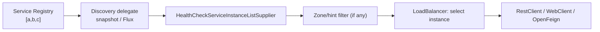

# Refetching the Instance List Source and Detecting New Replicas

## 1. The Problem: New Instance Registered, Yet LoadBalancer Doesn't See It

In the **Instance Health** chapter of the `SPRING_CLOUD_SERVICE_COMMUNICATION_LOAD_BALANCING` module, `order-service` calls `inventory-service` by service ID. Spring Cloud LoadBalancer fetches `ServiceInstance` objects from discovery, optionally performs health checks, and picks an instance for `RestClient`, `WebClient`, or OpenFeign to send requests to.

Suppose at 10:00 the registry has two instances, `inventory-a` and `inventory-b`. At 10:05 the system scales out by adding `inventory-c`: the new instance has started, registered successfully, and its readiness endpoint returns HTTP 200, yet requests from `order-service` still go only to the two older instances. At least three possibilities must be distinguished:

1. **Discovery does not know the new instance yet:** registration or registry-side synchronization has not completed.
2. **The client-side list source has not refreshed:** `ServiceInstanceListSupplier` keeps replaying the old list; it may not emit events when the registry changes.
3. **The instance is in the list but not yet eligible or not yet selected:** health check has not marked it healthy, another supplier filtered it by zone/hint, or the selection policy has not picked the new instance yet.

**Rechecking the health of existing instances will not necessarily discover a new instance.** To detect `inventory-c`, LoadBalancer must receive a **new candidate list** from the discovery source or a refetch. This lesson explains when and why the list source must be refetched, how to configure `HealthCheckServiceInstanceListSupplier`, how to measure replica-discovery latency, and how to find bottlenecks.

### Learning Objectives

After this lesson, you should be able to:

- Separate **membership refresh** (updating the instance list) from **health probing** (checking an already-known instance).
- Explain the meaning of `refetch-instances`, `refetch-instances-interval`, `repeat-health-check`, `interval`, `initial-delay`, and `update-results-list`.
- Recognize when a delegate `ServiceInstanceListSupplier` already provides a continuous update stream and when proactive refetching is needed.
- Place the health-check supplier at the right position within discovery, caching, and filters; configure it specifically for the service ID being monitored.
- Verify the full timeline from replica registration until LoadBalancer sees it, marks it healthy, and actually routes requests to it.
- Handle scale-out, scale-in, restarts, readiness failures, and all-unhealthy situations without drawing wrong conclusions from HTTP logs.

## 2. Distinguishing Three Lists and One Selection

A request is not sent straight from the registry to the server. It passes through state layers that can change at different times:

| Layer | Sample data | Source/mechanism | Diagnostic question |
|---|---|---|---|
| **List in registry** | `[a,b,c]` | Eureka, Consul, Kubernetes, or other discovery | Has the registry received and published `c`? |
| **List from delegate supplier** | `[a,b]` or `[a,b,c]` | `DiscoveryClientServiceInstanceListSupplier` or `ReactiveDiscoveryClientServiceInstanceListSupplier` | Is the delegate invoked again or emitting a new snapshot? |
| **List after health check** | `[a,b]` or `[a,b,c]` | `HealthCheckServiceInstanceListSupplier` | Was `c` probed and evaluated as healthy? |
| **Selected instance** | `a`, `b`, or `c` | Round Robin, Random, or custom policy | Who did this request actually choose, and were there retries/timeouts? |

Overall flow:



The arrows show the flow of information; they **do not** imply every step updates simultaneously or every application has a health supplier. Suppliers such as cache, zone preference, hint, or sticky session are present only when configured.

### 2.1. “Healthy” and “Discovered” Are Two Different Things

- **Membership:** does instance `c` belong to the `inventory-service` list?
- **Reachability/readiness:** when calling `c`'s health endpoint, is the application ready to receive traffic?
- **Selection:** once `c` is in the eligible set, does the algorithm choose `c` on a given call?

A health-check scheduler that only knows about `a` and `b` can continue confirming both are healthy, yet it has no way to discover `c` on its own if its list source is never updated. Conversely, a new instance returned by the registry whose readiness endpoint still fails can be excluded from the selection list by the health-check supplier.

## 3. How Does HealthCheckServiceInstanceListSupplier Work?

Spring Cloud Commons provides `HealthCheckServiceInstanceListSupplier` to periodically probe the health of instances supplied by a delegate `ServiceInstanceListSupplier`. It normally returns the instances that pass the probe.

According to Spring Cloud Commons documentation, there is an important exception to know: **when no healthy instances are found, the default implementation may return all received instances**, rather than returning an empty list. This is a fallback behavior you must verify with your version; never treat the default health supplier as an absolute “fail-closed” filter. If every instance of a service dies, a request can still be routed to a broken instance and fail with a connection/timeout error.

The health-check mechanism is helpful when using `SimpleDiscoveryClient` or a source that does not provide reliable health information. With a service registry that already returns readiness/health-vetted instances, adding a separate HTTP health-check layer may be unnecessary and increases probe volume. The choice must be based on actual discovery characteristics.

### 3.1. Two Different Timers

The **health probe schedule** checks the status of known instances:

- `spring.cloud.loadbalancer.health-check.initial-delay`: delay before the first check; Commons 4.3 docs state default `0`.
- `spring.cloud.loadbalancer.health-check.interval`: health check repeat interval; default `25s`.
- `spring.cloud.loadbalancer.health-check.repeat-health-check`: whether to keep running repeated probe cycles; default `true`.

The **list refetch schedule** proactively retrieves the instance set again from the delegate:

- `spring.cloud.loadbalancer.health-check.refetch-instances`: allows the health supplier to proactively call the delegate again to fetch the list; default `false`.
- `spring.cloud.loadbalancer.health-check.refetch-instances-interval`: refetch interval if enabled; default `25s`.

A refetch **also triggers a health check** for the retrieved instances. Therefore the documentation suggests setting `repeat-health-check=false` if you want to rely on the refetch cycle for probing as well. However, setting **both** `refetch-instances=false` and `repeat-health-check=false` may prevent repeated checks from running; do not choose that combination if your goal is continuous health monitoring.

### 3.2. Core Properties Table

| Property (prefix `spring.cloud.loadbalancer.health-check.`) | Default listed by Commons 4.3 docs | Meaning and limitations |
|---|---|---|
| `initial-delay` | `0` | Wait time before the health scheduler starts |
| `interval` | `25s` | Health probe repeat interval when repeat mode is active |
| `refetch-instances` | `false` | Whether to proactively fetch the instance list again from the delegate |
| `refetch-instances-interval` | `25s` | Refetch interval when `refetch-instances=true` |
| `repeat-health-check` | `true` | Whether to repeat health probes independently; each refetch still triggers a health check |
| `update-results-list` | `true` | `true`: may emit results per healthy instance; `false`: waits to collect the healthy list before emitting |
| `path` | `/actuator/health` if unconfigured | Configurable as a map per service ID plus `default` |
| `port` | Port of `ServiceInstance` if unconfigured | Specifies the health check port when different from the service port |

**Note:** this information is for learning and experimentation based on Spring Cloud Commons 4.3 docs; check the metadata and binding behavior of your **actual Spring Cloud Release Train** before adopting it in a project. Do not assume every property is supported or behaves identically across other versions.

### 3.3. What Source Does “Refetch” Refresh?

Depending on the delegate type:

1. **Delegate emits a continuous update stream:** if the registry changes and the delegate pushes the new list itself, the health supplier can receive updates without proactively refetching. Enabling refetch here may simply generate extra queries.
2. **Delegate emits only one snapshot on subscription:** once the registry adds a new instance, the health supplier may receive no further emissions. `refetch-instances=true` is used to re-invoke the delegate periodically.
3. **Delegate refetches the list but returns cached data:** refetching can still hit an old snapshot; check registry/client caching and TTLs.
4. **Delegate uses static `SimpleDiscoveryClient` configuration:** a refetch cannot make new instances appear if the static configuration list has not changed. For a dynamic scaling lab, use a registry with runtime registration or a test delegate whose list can change.

**Principle:** refetch can only retrieve what the delegate **can provide at the moment it is called**. It does not register new instances, fix service IDs, turn an unready instance healthy, or guarantee the next request will pick the new instance.

## 4. Configurations That Help Detect New Replicas

### 4.1. Enabling Refetch Along with Health Checks

Example on `order-service`, when using a delegate that **does not push updates automatically** yet returns an updated list on each query:

```yaml
spring:
  cloud:
    loadbalancer:
      health-check:
        initial-delay: 0s
        interval: 10s
        refetch-instances: true
        refetch-instances-interval: 8s
        repeat-health-check: false
        update-results-list: false
        path:
          default: /actuator/health
          inventory-service: /actuator/health/readiness
```

Meaning of this example:

- Every refetch cycle of about `8s`, the health supplier re-fetches the instance set from the delegate and checks the health of the returned instances.
- `repeat-health-check=false` avoids adding an independent probe schedule; **it does not disable health checks triggered by refetch**.
- `interval=10s` is set to illustrate the distinction from the refetch interval; once independent repeated health probing is disabled, do not use `10s` to estimate actual probe frequency.
- `update-results-list=false` waits to gather healthy results into a list before emitting, instead of emitting individual healthy instances to the Flux at intermediate points.
- `inventory-service` must have a working `/actuator/health/readiness` endpoint on the checked port; if only `/actuator/health` exists, update the path accordingly.

**Property configuration only takes effect when `HealthCheckServiceInstanceListSupplier` is actually in the supplier chain.** Placing `health-check.*` keys in YAML does not automatically ensure the application uses this supplier.

### 4.2. Creating a Supplier Specifically for inventory-service

Example using Java configuration, configuring a service-ID-based `RestClient` and a health supplier in `inventory-service`'s child context:

```java
@Configuration(proxyBeanMethods = false)
@LoadBalancerClient(
        name = "inventory-service",
        configuration = InventoryHealthLoadBalancerConfiguration.class)
class InventoryClientConfiguration {

    @Bean
    @LoadBalanced
    RestClient.Builder inventoryRestClientBuilder() {
        return RestClient.builder();
    }
}

// This class has no @Configuration and is not registered in global component scan.
class InventoryHealthLoadBalancerConfiguration {

    @Bean
    ServiceInstanceListSupplier inventoryInstanceListSupplier(
            ConfigurableApplicationContext context) {
        return ServiceInstanceListSupplier.builder()
                .withDiscoveryClient()
                .withBlockingHealthChecks()
                .build(context);
    }
}
```

In a **WebClient/reactive-only** application, you can use the builder variant:

```java
@Bean
ServiceInstanceListSupplier inventoryInstanceListSupplier(
        ConfigurableApplicationContext context) {
    return ServiceInstanceListSupplier.builder()
            .withDiscoveryClient()
            .withHealthChecks()
            .build(context);
}
```

The two supplier snippets are **alternatives**; do not register both at once for the same client. According to Commons documentation, `withHealthChecks()` uses reactive-stack health checking, while `withBlockingHealthChecks()` fits blocking HTTP mechanisms. You can provide an appropriate `WebClient`, `RestTemplate`, or `RestClient` as the probe tool according to the API of your version. Add the appropriate LoadBalancer and DiscoveryClient dependencies.

When using OpenFeign, Feign itself can route through Spring Cloud LoadBalancer with the proper dependencies/configuration; however, the **HTTP health-check** mechanism handled by the supplier must be designed to match your stack, rather than assuming Feign provides a scheduler itself.

### 4.3. Do Not Misplace Caching

Recommended order:

```text
DiscoveryClientServiceInstanceListSupplier
    -> HealthCheckServiceInstanceListSupplier
    -> (zone/hint filter suppliers if needed)
    -> LoadBalancer selects instance
```

Spring Cloud Commons recommends placing the health supplier **immediately after the component that retrieves instances over the network**, before request-based filter suppliers. `HealthCheckServiceInstanceListSupplier` has an internal replay/caching mechanism based on Reactor Flux; do not arbitrarily wrap it in `CachingServiceInstanceListSupplier`.

A hard-to-diagnose chain is:

```text
Discovery -> CachingServiceInstanceListSupplier
          -> HealthCheckServiceInstanceListSupplier
```

In that case, even if the health supplier is configured to refetch, its nearest delegate may still return the stale cached copy. If the cache holds snapshot `[a,b]`, new instance `c` may not appear until the cache expires or is invalidated. Do not conclude “refetch is broken” without checking the supplier chain and cache TTL.

### 4.4. Per-Service-ID Configuration

When an application calls multiple services, only `inventory-service` needs aggressive refetching; other services whose registry already provides a strong update stream can keep normal settings:

```yaml
spring:
  cloud:
    loadbalancer:
      health-check:
        refetch-instances: false
      clients:
        inventory-service:
          health-check:
            refetch-instances: true
            refetch-instances-interval: 8s
            repeat-health-check: false
```

Under Spring Cloud Commons 4.3's per-`LoadBalancerClient` configuration mechanism, properties supporting overrides under `spring.cloud.loadbalancer.clients.<clientId>.` merge with the shared defaults, giving precedence to that specific client. Here `clientId` is the `inventory-service` service ID called by `RestClient`/`WebClient`/OpenFeign via LoadBalancer, **not** the caller's application name `order-service`. Still verify that properties bind properly in your actual version.

## 5. Building a Scale-Out Lab to Observe New Replicas

### 5.1. Topology and Input Conditions

Use a registry that supports runtime instance registration/deregistration, such as Eureka or Consul in a lab environment. You can substitute a custom discovery delegate returning a mutable list, provided that **each fresh read reflects the updated registry**.

| Component | Configuration | Purpose |
|---|---|---|
| `order-service` | Calls `http://inventory-service/api/inventory/{sku}` via LoadBalancer | Observe selected instance |
| `inventory-a` | Service ID `inventory-service`, port `8081`, unique instance ID | Initial instance |
| `inventory-b` | Same service ID, port `8082` | Initial instance |
| `inventory-c` | Same service ID, port `8083`, started later | New replica to detect |
| Registry | Supports runtime instance addition/removal | List source |
| Actuator on inventory | Readiness/health endpoint returning real status | For health-check supplier to probe |

If the registry already pushes a continuous list stream to the supplier, the experiment may prove **refetch is unnecessary**. To verify the exact difference between `refetch-instances=false` and `true`, you need a delegate that does not push new lists automatically yet **can return a fresh snapshot when invoked again**. Do not use an unchanging static `SimpleDiscoveryClient` configuration as evidence of dynamic discovery.

### 5.2. Endpoint to Identify the Instance

On each `inventory-service` instance, return the instance ID with the response:

```java
@RestController
class InventoryController {
    private final Environment environment;

    InventoryController(Environment environment) {
        this.environment = environment;
    }

    @GetMapping("/api/inventory/{sku}")
    Map<String, String> inventory(@PathVariable String sku) {
        return Map.of(
                "sku", sku,
                "instanceId", environment.getProperty(
                        "app.instance-id", "unknown"));
    }
}
```

The example above uses Spring MVC. Each process has its own `app.instance-id` and shares `spring.application.name=inventory-service`. When called through LoadBalancer, the response identifies which server **successfully handled** the request. Add caller-side logging if you also want to know which instance was **selected but failed to connect**.

### 5.3. Experiment Sequence

1. Start the registry, `order-service`, `inventory-a`, and `inventory-b`. Verify the registry currently shows only two instances.
2. Check `/actuator/health/readiness` on each instance; confirm the endpoint returns a success status code and truly reflects readiness.
3. Send requests through `order-service`, logging instance ID and timestamp. Confirm only `a` and `b` are chosen.
4. Enable logging or metrics for the list **before the health filter** and the list **after the health filter**. Record `refetch-instances`, intervals, library versions, and supplier ordering.
5. Start `inventory-c`. Record `T_register` when the registry publishes `c` (not just when the process started).
6. Wait for logs showing the delegate fetching the new list, and record `T_discover` when `c` actually appears in the delegate's list.
7. Record `T_healthy` when the health supplier emits a list containing `c`.
8. Send requests steadily; record `T_first_selected` when LoadBalancer picks `c`, and `T_first_success` when an HTTP response succeeds from `c`.
9. Stop `inventory-c` or make its readiness report unhealthy, and continue observing how `c` is removed and any fallback conditions.
10. Repeat with `refetch-instances=false` and `true` **on the same deterministic delegate**; be sure to restart or reset state between runs so stale caches do not skew results.

When testing `refetch-instances=false`, instance `c` **may still appear** if the delegate pushes new lists automatically. When testing `true`, instance `c` may still appear slowly if registry propagation lags, caches have not updated, or health checks have not succeeded yet. Those are observations to analyze, not grounds to assume a configuration is right or wrong by default.

## 6. Measuring Convergence Time Properly

Do not lump all delays into a single claim that “LoadBalancer detects slowly”:

| Milestone | What is recorded | Involved system |
|---|---|---|
| `T_start` | Process `inventory-c` starts | Server/startup |
| `T_ready` | `c`'s readiness reports success | Server and dependencies |
| `T_register` | Registry shows `c` eligible for discovery | Service registry |
| `T_discover` | Caller's delegate supplier returns list with `c` | Discovery client, refresh, cache |
| `T_healthy` | Health supplier emits eligible list containing `c` | Health probe, refetch schedule |
| `T_first_selected` | LoadBalancer actually chooses `c` | Selection algorithm and request traffic |
| `T_first_success` | Valid HTTP response received from `c` | Network, HTTP client, server |

Useful deltas:

\[
\begin{aligned}
\Delta_{\text{discovery}} &= T_{\text{discover}} - T_{\text{register}},\\
\Delta_{\text{health}} &= T_{\text{healthy}} - T_{\text{discover}},\\
\Delta_{\text{selection}} &= T_{\text{first selected}} - T_{\text{healthy}},\\
\Delta_{\text{end-to-end}} &= T_{\text{first success}} - T_{\text{register}}.
\end{aligned}
\]

These deltas are meaningful only when timestamps are recorded on the same caller or component clocks are sufficiently synchronized. In distributed systems, use tracing or monotonic clocks/logs within the same process when high precision is needed.

**Do not treat `refetch-instances-interval=8s` as an SLA that “the instance is guaranteed to be used within 8 seconds.”** It is merely the scheduled interval at which list refetching is attempted. Registry propagation, discovery call latency, timeouts, probes, caches, selection policy, and request rate all affect when a new instance begins serving. If `RoundRobinLoadBalancer` has three instances, once `c` becomes eligible it still has to wait its turn; if no traffic arrives, `T_first_selected` will never occur even after the supplier updates.

### 6.1. Hypothetical Results Table

Below are illustrative numbers only, **not an executed benchmark**:

| Milestone | Time | Interpretation |
|---|---|---|
| `T_start` | 10:05:00 | `c` begins startup |
| `T_ready` | 10:05:04 | Readiness endpoint ready |
| `T_register` | 10:05:05 | Registry publishes `c` |
| `T_discover` | 10:05:12 | Delegate receives list `[a,b,c]` |
| `T_healthy` | 10:05:13 | Health supplier confirms `c` |
| `T_first_selected` | 10:05:14 | LoadBalancer picks `c` |
| `T_first_success` | 10:05:14.035 | HTTP response from `c` |

In this table `\Delta_{\text{discovery}}=7s`; that is where to inspect the refetch schedule, registry, and caches. `\Delta_{\text{health}}=1s` may come from probe duration or result-collection time. Looking only at the first response timestamp does not reveal which stage caused the delay.

## 7. Three Configuration Mistakes That Keep New Replicas Unselected

### 7.1. Delegate Does Not Update While Refetch Is Disabled

**Symptom:** registry has `[a,b,c]` while the supplier snapshot remains `[a,b]` indefinitely, even as health checks on `a` and `b` keep running on schedule.

**Check:** determine whether the delegate emits a continuous Flux or emits once; inspect `refetch-instances` and list-fetch logs. If needed and the delegate can read a fresh snapshot on demand, enable refetch with an appropriate interval.

### 7.2. Refetch Enabled Yet Still Seeing Stale Snapshots

**Symptom:** the health supplier refetches periodically, yet the pre-health-check list still lacks `c`.

**Check:** whether the registry has actually published `c`; whether the delegate queries fresh data or only reads a cache; whether `CachingServiceInstanceListSupplier` sits between network discovery and the health supplier; what cache TTL applies; and whether multiple caller replicas hold separate contexts/cached lists. Refetch does not invalidate caches in other layers.

### 7.3. Delegate Has c, Yet Health Supplier Does Not Return c

**Symptom:** `c` appears in discovery data but is missing from the health-filtered list.

**Check:** port, health path, HTTP status, readiness configuration, TLS, permissions, DNS, and timeout of the HTTP client used for probing. If `inventory-c` is still `STARTING` or its readiness endpoint returns an error, you should not force the supplier to pick it just to “scale fast.”

Another case is having a **zone preference**, **hint**, or **metadata filter** supplier downstream of health checks: `c` may be healthy yet not match the routing policy. In that case `c` will not appear in the final candidate set despite being completely healthy.

## 8. During Scale-In and When All Instances Are Unhealthy

Refetch is not only for adding instances. It also helps detect deregistered instances when the delegate does not push updates itself. However:

- A recently stopped instance may remain in the registry until its heartbeat/lease/TTL expires; refetching during that window still returns the old instance.
- Health checks can exclude an unresponsive instance **before** the registry removes it. As long as healthy instances remain, the healthy list usually omits the failed one.
- When all instances are deemed unhealthy, `HealthCheckServiceInstanceListSupplier` by default has a fallback that returns **the entire retrieved list**, so requests can still hit failing instances. Add logging and design `503` handling, timeouts, circuit breakers, and bounded retries. Never treat health checks as an absolute guarantee against calling failing instances.
- An instance disappearing mid-selection can still cause an in-flight request to fail; discovery and health checks cannot prevent every race condition between selection and connection.

### 8.1. Why Shouldn't Both Schedules Run at Very High Frequency?

If `refetch-instances-interval` is short and `repeat-health-check=true` with a short `interval`, the system generates two concurrent streams of activity: frequent refetches and frequent health probes. With `M` caller replicas, `S` services, and `K` instances per service, total probe traffic can grow quickly with caller–service–instance combinations.

In production environments, balance fast detection requirements against registry and readiness endpoint limits. If the registry already verifies health, you can rely on discovery alone without adding an extra health scheduler; if health checks are needed for only a few services, configure them per `clientId` instead of across every service.

## 9. Observing Through Logs and Metrics

Useful lab logs should distinguish three moments:

```text
10:05:12.000 serviceId=inventory-service stage=delegate
              instances=[a,b,c]
10:05:13.010 serviceId=inventory-service stage=healthy
              instances=[a,b,c]
10:05:14.000 serviceId=inventory-service stage=selected
              instanceId=c requestId=R-42
```

The lines above are a **suggested format**, not default logs that Spring Cloud LoadBalancer always prints. You can add instrumentation in `ServiceInstanceListSupplier`, `LoadBalancerLifecycle` callbacks, and the HTTP-handling instance. Never log raw tokens, cookies, or sensitive information.

Minimum items to track:

| Metric / log | Question answered |
|---|---|
| `registry_instance_count` per service ID | How many replicas does the registry know? |
| `delegate_instance_count` | Has the caller seen the new replica yet? |
| `healthy_instance_count` | How many instances pass the health check? |
| `candidate_instance_count` after filters | How many instances are eligible for selection? |
| `refetch_count`, `refetch_duration`, `refetch_error_count` | Is list refetching running and succeeding? |
| `health_probe_success/failure` | Is the readiness endpoint responding properly? |
| `selected_instance_id`, HTTP status, retry attempts | Is the new instance actually being called? |
| `discovery_to_selection_delay` | How long from when the registry has the replica until first selection? |

Names in the table are **internal metric suggestions for custom instrumentation**, not a claim that Spring Cloud always produces these exact metric names out of the box. When using Micrometer/Actuator, check built-in metrics for your version and add custom metrics if needed.

## 10. Extended Practice Exercises

### Exercise 1 — Health Probe Only, Without Refetch

Keep a delegate that emits only one snapshot on subscriber registration, while capable of returning a fresh snapshot if invoked again. Start with `[a,b]`, then add `c` to the source. Set `refetch-instances=false`, `repeat-health-check=true`, and observe:

- Health checks continue probing `a` and `b`.
- `c` does not appear if the delegate emits no further lists.
- Lowering `health-check.interval` still does not discover `c` on its own.

Explain why health probing and membership refresh are different.

### Exercise 2 — Enable Refetch and Measure Convergence Latency

Keep the same delegate from Exercise 1. Enable `refetch-instances=true`, `refetch-instances-interval=8s`, `repeat-health-check=false`. Add `c` and record the four milestones from registry to first response; repeat at least three times. Explain variation between runs based on refetch schedule, registration timing, and request rate.

### Exercise 3 — Inspect a Supplier Chain with Caching

Add a cache before the health supplier (solely to demonstrate the misconfiguration), keep a sufficiently long TTL, and add `c`. Compare lists from the registry, delegate/cache, and health supplier. Then switch back to the recommended chain `Discovery -> HealthCheck -> filter` and verify again. Do not change the cache TTL mid-test without recording it, as that introduces confounding noise.

### Exercise 4 — New Instance Not Ready Yet

Add `c` to the registry while its readiness endpoint still returns errors. Confirm `c` is in the delegate list yet is not selected while healthy instances remain. Transition `c` to passing readiness and observe when it enters the healthy list. If the health supplier emits incremental updates per probe, record the `update-results-list` behavior of your running version.

### Exercise 5 — Scale-In and All-Unhealthy

Stop `b`, keeping `a`/`c` running; then make both remaining instances return unhealthy status. Observe differences between the registry list, the healthy list, and the set returned by LoadBalancer when no healthy instances exist. State why the default health supplier cannot be treated as a fail-closed mechanism.

## 11. Completion Checklist

- [ ] Recorded the actual Spring Boot version, Spring Cloud Release Train, `spring-cloud-commons`, and `spring-cloud-loadbalancer` versions.
- [ ] Confirmed `inventory-service` is the service ID used in HTTP client URIs and in `clients.inventory-service` configuration.
- [ ] Verified `HealthCheckServiceInstanceListSupplier` is in the chain if intending to use `health-check.*`.
- [ ] Distinguished delegates that **push** new snapshots from delegates that need **pull/refetch**.
- [ ] Tested before/after enabling `refetch-instances` with the same mutable source.
- [ ] Measured `T_register`, `T_discover`, `T_healthy`, and `T_first_selected` individually.
- [ ] Ensured the health/readiness endpoint and port of the new replica are accurate.
- [ ] Checked caching/supplier chain and any zone/hint filters downstream of health checks.
- [ ] Tested scale-in, unready instances, all-unhealthy cases, and fallback behavior.
- [ ] Separated logs for selection attempts, HTTP responses, timeouts, retries, and eligible instance count.

## Official References

- [Spring Cloud Commons 4.3 — Spring Cloud LoadBalancer](https://docs.spring.io/spring-cloud-commons/reference/4.3/spring-cloud-commons/loadbalancer.html), section **Instance Health-Check for LoadBalancer**: purpose of `HealthCheckServiceInstanceListSupplier`, `refetch-instances`, `repeat-health-check`, builder configuration, and supplier ordering.
- [Spring Cloud Commons 4.3 — Configuration Properties](https://docs.spring.io/spring-cloud-commons/reference/4.3/configprops.html): property names and defaults for `spring.cloud.loadbalancer.health-check.*`.
- [Spring Cloud Commons — Stable Documentation](https://docs.spring.io/spring-cloud-commons/reference/spring-cloud-commons/loadbalancer.html): compare with newer branches; always verify the version at the top of the page.
- [Spring Cloud project — Release Train](https://spring.io/projects/spring-cloud/): cross-check Spring Cloud against Spring Boot before copying configuration to another system.

**Key takeaway:** health answers “can known instances still serve?”, whereas refetch answers “has the list of known instances changed?”. For a new replica to be chosen, the full chain must succeed: **registry updates → delegate emits or is refetched with the new list → health/filters accept the instance → LoadBalancer selects it → HTTP request succeeds**.
