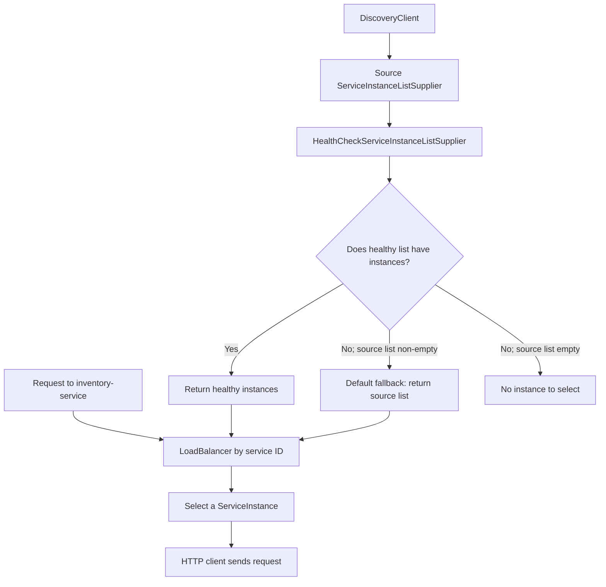
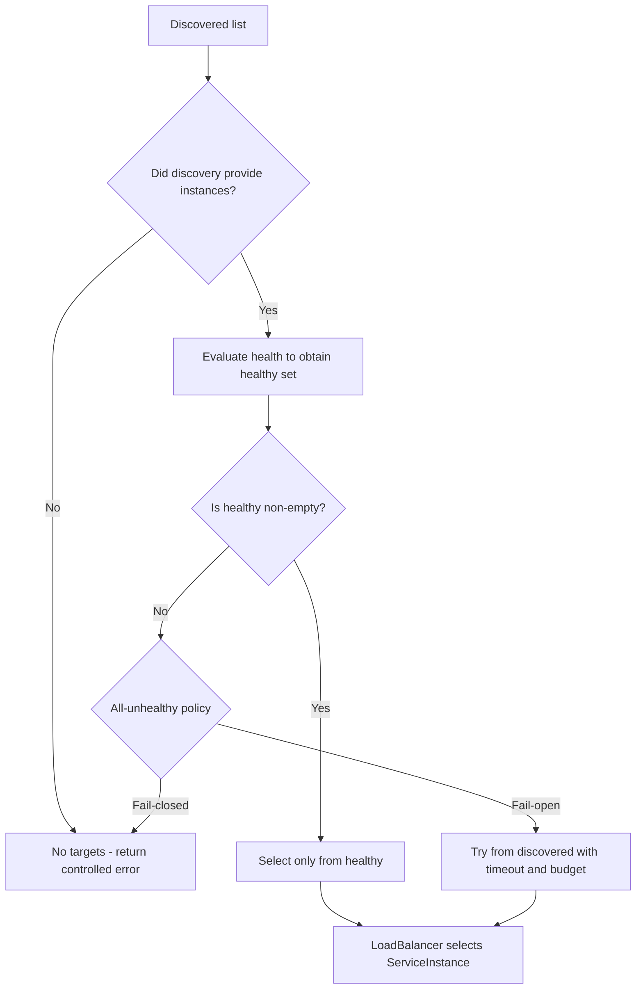

# Policy When All Instances Are Marked Unhealthy

Spring Cloud LoadBalancer selects a `ServiceInstance` by **service ID** from the list provided by `ServiceInstanceListSupplier`. When health checking is integrated, instances that fail the health check are normally excluded from the candidate set. But what happens if **all** instances are marked unhealthy? Should requests be sent to a potentially failing instance, or rejected immediately to protect the system?

This is not merely a scenario for the Round Robin or Random algorithm. It is an **availability, safety, and recovery policy**: attempt to serve using the original list (**fail-open**) or select no target when no healthy instance exists (**fail-closed**). Spring Cloud LoadBalancer has an important default behavior in `HealthCheckServiceInstanceListSupplier`: when no instances pass the check, the supplier may **return all instances supplied by its delegate**, rather than returning an empty list. Understanding this behavior prevents the misconception that enabling health checks always blocks every unhealthy instance.

## 1. Three Data Sets to Distinguish

Assume `order-service` calls `inventory-service` through the logical URL:

```text
http://inventory-service/api/v1/items/42
```

In this lesson, we use three terms:

- **Discovered**: the instance list returned by discovery or the source supplier, e.g., `[A, B, C]`. The source can be `SimpleDiscoveryClient`, Eureka, Consul, or another discovery mechanism.
- **Healthy**: the subset of `discovered` that passes the health checks performed by the supplier, e.g., `[A, C]`.
- **Candidates**: the list that actually reaches the instance selection algorithm after applying health policy and other filters.

| Situation | Discovered | Healthy | Meaning |
|---|---|---|---|
| All instances healthy | [A, B, C] | [A, B, C] | Multiple normal targets available |
| One instance failing | [A, B, C] | [A, C] | Can avoid B |
| All marked failing | [A, B, C] | [] | Policy needed when all healthy instances are lost |
| Service not found | [] | [] | No source instances to fall back to |

**All instances marked unhealthy** differs from an **empty discovery list**. Both states can cause requests to fail, yet their root causes and fallback policies differ. Do not treat them as a single case.



The diagram depicts the behavior of the health-check supplier as stated in Spring Cloud Commons documentation. If **other filtering layers** exist after health checks, they may exclude further instances. In addition, how the system responds when no instance is available depends on the HTTP client and LoadBalancer integration; not every client throws the exact same exception type.

## 2. Default Behavior of HealthCheckServiceInstanceListSupplier

`HealthCheckServiceInstanceListSupplier` is an optional component of Spring Cloud LoadBalancer. It periodically checks instances returned by its delegate, keeps the list of live instances, and **when no healthy instance is found, returns all instances received from the delegate**. This favors availability when health information may be unreliable or all probes hit transient failures.

For example, when the source returns `[A, B, C]`:

| Health check result | List typically supplied by supplier | What can happen |
|---|---|---|
| A, B, C all healthy | [A, B, C] | LoadBalancer chooses among all three |
| Only B unhealthy | [A, C] | B is absent from the health-check supplier's set |
| A, B, C all unhealthy | [A, B, C] | **Fallback to original list**; unhealthy instances can still be chosen |
| Delegate returns [] | [] | No target to fall back to |

If A, B, and C are genuinely down, fallback will not make the service work again; requests will still hit `Connection refused`, connect timeouts, or read timeouts. If health probes returned false negatives due to transient connectivity loss or misconfiguration, some business requests **may** still succeed when trying an instance from the original list. That is why “marked unhealthy” must be separated from “guaranteed incapable of processing requests.”

**Do not misunderstand:** this behavior does not mean health checking is useless. When **at least one healthy instance remains**, the health-check supplier narrows the candidate set to the healthy ones. Notable fallback occurs mainly when **no healthy instances remain in the source set**.

A note on versions: health check properties, supplier chains, and list handling can vary across Spring Cloud release trains. Use a Spring Cloud BOM compatible with Spring Boot and inspect the docs or source code for your exact deployment version, especially if your system requires fail-closed behavior.

## 3. Fail-Open vs. Fail-Closed: Two Different Policies

**Fail-open** means that when all healthy instances are gone, trying an instance from the original list is still allowed. **Fail-closed** means never sending requests to targets marked invalid; report that no usable target remains and let upper layers handle it.

| Criterion | Fail-open when all-unhealthy | Fail-closed when all-unhealthy |
|---|---|---|
| Candidate list | Reverts to source list if non-empty | Empty |
| Goal | Prioritize chance of serving when health may be wrong or transient | Prioritize safety, fault isolation, and correctness |
| Chance of success | Still possible, but not guaranteed | Never tries excluded instances |
| Risk | Sends traffic to broken instances, increases timeouts/retries, causes overload | Rejects requests that might have succeeded if health checks were wrong |
| Probe fault visibility | Can be masked because some requests succeed | Clearer in responses/metrics |
| Suitable when | Idempotent read paths, probes risk false negatives, tight availability budget | Sensitive transactions, residency/safety constraints, or readiness is mandatory |

No single policy fits every system. For example:

- Product catalog lookups may accept trying a slow instance to improve availability, provided timeouts, retry budgets, and circuit breakers are in place.
- Financial writes or strictly controlled data mutations may choose fail-closed to avoid hitting unready instances or risking consistency guarantees.
- Multi-region systems may use a backup group of instances in another region **only if that region still satisfies all security and compliance constraints**. Never use “fallback” to bypass mandatory constraints.

**Principle:** distinguish **health as a preference signal** from **hard constraints**. The health-check supplier's default fallback must never be used to bypass authorization, tenant isolation, data versioning, or data residency requirements. Those constraints must be enforced separately and never relaxed when healthy instances are empty.

## 4. Choosing a Policy Based on Health Signal Reliability

Health checks usually send an HTTP request to an endpoint like `/actuator/health` or `/actuator/health/readiness`. An unhealthy result can have many causes:

1. The instance is genuinely down, hung, out of connections, or shutting down.
2. The instance can still serve certain requests, but readiness is DOWN because a dependency not required for every request type is failing.
3. The health check path is wrong and always returns 404.
4. The endpoint requires authentication, returning 401/403 to the health checker.
5. A proxy, DNS, TLS, or firewall prevents the health checker from reaching the endpoint even though the business HTTP client uses a different path.
6. The health probe timeout is too short or the probe interval creates heavy load.

A policy might be sensible for case 2 or 5 yet dangerous for case 1. Therefore answer three questions: **does the probe accurately reflect capability to serve this request type?**, **is lacking healthy instances a transient glitch or a real outage?**, and **what are the consequences of trying an unhealthy instance?**

### Readiness Differs from Liveness

- **Liveness** typically answers whether the process should keep running or be restarted.
- **Readiness** answers whether the instance is ready to accept traffic.

For routing, readiness is usually more appropriate than liveness: a running process that is still warming caches, opening database connections, or gracefully shutting down may not be ready for requests. However, if readiness depends on too many unrelated services, a shared outage can mark all instances unhealthy even while some endpoints remain functional.

**Do not** handle an “all instances unhealthy” symptom by arbitrarily making the health endpoint return HTTP 200 regardless of actual state. That destroys monitoring signals and lets traffic hit unready instances.

## 5. Configuring Health Checks in Spring Cloud LoadBalancer

On the client application, you need the `spring-cloud-starter-loadbalancer` dependency and a Spring Cloud BOM compatible with Spring Boot. For a Spring Boot provider, `spring-boot-starter-actuator` can supply the health endpoint. In a lab exercise, keep the health endpoint on the same port where the instance receives requests to avoid confusion.

Example client using `SimpleDiscoveryClient` providing two instances:

```yaml
spring:
  cloud:
    discovery:
      client:
        simple:
          instances:
            inventory-service:
              - uri: http://localhost:8091
              - uri: http://localhost:8092
    loadbalancer:
      health-check:
        path:
          inventory-service: /actuator/health/readiness
        interval: 10s
        initial-delay: 2s
```

The values `10s` and `2s` are **lab settings**, not recommendations to copy straight into production. Choose interval, timeout, and initial delay based on traffic load, instance count, and system recovery time. The readiness path must actually be supported by the provider; otherwise every probe fails and inadvertently triggers fallback.

On the provider side, you can enable Spring Boot Actuator health probes when they are not already enabled in your environment:

```yaml
management:
  endpoint:
    health:
      probes:
        enabled: true
```

After configuring and starting the provider, test directly:

```bash
curl -i http://localhost:8091/actuator/health/readiness
curl -i http://localhost:8092/actuator/health/readiness
```

Expect HTTP 2xx when the provider is ready; depending on Spring Boot's health status mapping, unready states usually return HTTP 503. Endpoints may need security rules aligned with your infrastructure; **do not publicly expose sensitive operational details just for health checker access**.

### 5.1. Don't Just Declare Properties: Attach the Health-Check Supplier

The `spring.cloud.loadbalancer.health-check.*` properties do not automatically ensure every HTTP client uses `HealthCheckServiceInstanceListSupplier`. In the per-service-ID configuration, build the corresponding supplier chain. For a blocking application and a Spring Cloud version supporting the builder API, you can use:

```java
import org.springframework.cloud.loadbalancer.core.ServiceInstanceListSupplier;
import org.springframework.context.annotation.Bean;
import org.springframework.context.annotation.Configuration;
import org.springframework.context.ConfigurableApplicationContext;

@Configuration(proxyBeanMethods = false)
public class InventoryLoadBalancerConfiguration {

    @Bean
    ServiceInstanceListSupplier inventorySupplier(
            ConfigurableApplicationContext context) {
        return ServiceInstanceListSupplier.builder()
                .withDiscoveryClient()
                .withBlockingHealthChecks()
                .build(context);
    }
}
```

Attach the configuration to the target service ID:

```java
import org.springframework.boot.SpringApplication;
import org.springframework.boot.autoconfigure.SpringBootApplication;
import org.springframework.cloud.loadbalancer.annotation.LoadBalancerClient;

@SpringBootApplication
@LoadBalancerClient(
        name = "inventory-service",
        configuration = InventoryLoadBalancerConfiguration.class)
public class OrderApplication {
    public static void main(String[] args) {
        SpringApplication.run(OrderApplication.class, args);
    }
}
```

**Important:** place `InventoryLoadBalancerConfiguration` **outside the default component scan** of the main application context, or structure packages so that this configuration is only loaded into `inventory-service`'s child context. If accidentally scanned into the main context, its specialized beans can affect other service IDs.

For reactive applications, the builder offers `withHealthChecks()`. Use a configuration matching your HTTP stack and Spring Cloud version; the example above illustrates a blocking stack.

### 5.2. Refreshing Instances and Avoiding Unnecessary Cache Layers

The health-check supplier needs the current instance list. If the delegate does not push a new list when discovery changes, consider:

```yaml
spring:
  cloud:
    loadbalancer:
      health-check:
        refetch-instances: true
        refetch-instances-interval: 30s
        repeat-health-check: true
```

These options apply according to the `HealthCheckServiceInstanceListSupplier` implementation and may interact with its scheduler. If the delegate already pushes updates automatically, enabling refetch is not necessarily required. Distinguish **instance list refresh frequency** from **health check frequency**.

The health-check supplier keeps and replays emitted results to subscribers via Reactor `replay()`. Therefore, Spring Cloud documentation recommends considering **not wrapping** this supplier inside `CachingServiceInstanceListSupplier` unnecessarily; multiple cache layers can introduce hard-to-explain staleness. Also place the health-check supplier right after the supplier that reads instances from the network, before other filters, following your version's guidance.

## 6. Designing Fail-Closed or Controlled Fallback

If business requirements dictate **never calling an instance marked unhealthy**, you cannot just enable default health checks and assume the final list is fail-closed. You must apply an explicit policy capable of distinguishing the original list from probe results.

The following pure Java helper expresses the **candidate set selection rule**. It illustrates the policy only, **not a supplier bean ready to plug directly** into Spring Cloud LoadBalancer:

```java
import java.util.List;
import org.springframework.cloud.client.ServiceInstance;

enum AllUnhealthyPolicy {
    FAIL_OPEN,
    FAIL_CLOSED
}

final class HealthRoutingPolicy {

    private HealthRoutingPolicy() {
    }

    static List<ServiceInstance> candidates(
            List<ServiceInstance> discovered,
            List<ServiceInstance> healthy,
            AllUnhealthyPolicy policy) {

        if (discovered == null || discovered.isEmpty()) {
            return List.of();
        }
        if (healthy != null && !healthy.isEmpty()) {
            return healthy;
        }
        if (policy == AllUnhealthyPolicy.FAIL_OPEN) {
            return discovered;
        }
        return List.of();
    }
}
```

This rule has three invariants:

1. No instances from discovery ⇒ targets cannot be conjured out of thin air.
2. Healthy instances exist ⇒ use only the verified healthy set.
3. All unhealthy ⇒ policy decides whether to revert to discovered or return an empty list.

In production code, **never trust an arbitrary external `healthy` list**: ensure it is a verified subset of discovered from the same snapshot or under clear snapshot rules. If fail-closed is needed, a custom supplier must observe **probe results before the default fallback** or manage health state itself; wrapping a filter downstream of `HealthCheckServiceInstanceListSupplier` is usually insufficient, because by then the distinction between “all instances healthy” and “all instances unhealthy after fallback” may already be lost.



### An Intermediate Policy

A system may adopt a **degraded mode** rather than unbounded fail-open or strict fail-closed:

- Allow only bounded retries within a short window and an explicit total timeout.
- Retry only operations confirmed to be idempotent; use an idempotency key where appropriate.
- Prefer valid cached results or return a degraded response with a transparent contract if business rules allow.
- Shift to a backup instance group/zone **confirmed to be eligible**, without bypassing tenant, permission, or residency constraints.
- Stop further attempts when a circuit breaker opens or the retry budget is exhausted.

These behaviors **do not appear automatically just from health check configuration**. They must be designed at the application layer, policy supplier, or corresponding resilience component.

## 7. Retries, Timeouts, and Resource Protection When All-Unhealthy

When every instance is experiencing an outage, unbounded fail-open can turn a bad situation into a failing request loop:

```text
Caller -> LoadBalancer -> instance A (timeout)
       -> retry -> instance B (timeout)
       -> retry -> instance A (timeout)
       -> holds threads/connections, adding load to already failing service
```

Combine protective layers:

| Mechanism | Role |
|---|---|
| Connect timeout | Bounds time to establish a TCP connection |
| Read/response timeout | Bounds time waiting for a response |
| Overall deadline | Ensures retry chains do not exceed the business request's time budget |
| Retry budget | Caps retry count or ratio, preventing retry storms |
| Circuit breaker | Temporarily halts calls when a target/service repeatedly fails per policy |
| Bulkhead / concurrency limit | Bounds concurrent requests to preserve client resources |
| Backoff and jitter | Prevents many clients from retrying at the exact same instant |
| Graceful degradation | Returns cached data or a valid degraded notice when appropriate |

In particular, **retries do not automatically pick a different instance**. Whether another instance is chosen or the same instance is kept depends on the integration and retry configuration of `RestClient`, `RestTemplate`, OpenFeign, or Spring Cloud LoadBalancer extension points. Do not rely on a promise that “it will switch instances” without verifying traces.

For write requests, a timeout does not prove the server failed to process the request. Retrying without idempotency can create duplicate transactions. During a widespread outage, do not allow unlimited retries just to boost success odds.

## 8. Hands-on Practice: Testing Health States

Suppose `inventory-service` has two instances, A at `localhost:8091` and B at `localhost:8092`. Each instance exposes:

- `GET /actuator/health/readiness` to check readiness.
- `GET /api/v1/items/{id}` returning a response with a `servedBy` field showing which instance handled the request.

The client application uses `RestClient` or `RestTemplate` annotated with `@LoadBalanced`, calls `http://inventory-service/api/v1/items/42`, and has enabled the health-check supplier for this service ID.

### 8.1. Test Matrix

| Scenario | Probe A | Probe B | Discovered | Expected health-check supplier set |
|---|---|---|---|---|
| Both healthy | Healthy | Healthy | [A, B] | [A, B] |
| A healthy, B failing | Healthy | Unhealthy | [A, B] | [A] |
| A failing, B healthy | Unhealthy | Healthy | [A, B] | [B] |
| Both marked failing | Unhealthy | Unhealthy | [A, B] | **[A, B] per default fallback** |
| Discovery has no instances | None | None | [] | [] |

Note that these lists are what to expect **after the health-check cycle has updated stably**. During startup or mid-check, the supplier may emit intermediate results depending on options and implementation. Wait enough health-check cycles before drawing conclusions from a single request.

### 8.2. Test Steps

1. Start A and B, and verify both readiness endpoints return a healthy status.
2. Send multiple requests from the client; observe the `servedBy` field to confirm both can be selected.
3. Put B into a **not ready** state in your test profile while keeping the process running. Wait for the supplier to update, then check whether requests shift to A.
4. Put both A and B into **not ready**. Observe that with the default supplier, both instances from the source list can still become selection candidates. Business requests may succeed or fail depending on the provider, so record both **instance selection** and HTTP outcomes.
5. Test the case where source discovery returns `[]`. Expect no targets; compare with the all-unhealthy case in step 4.
6. Restore readiness one instance at a time; observe the time from when probes return healthy until the client starts choosing that instance.
7. If your application has a custom fail-closed policy, repeat step 4: expect the policy to return `[]` rather than falling back to A/B.

Example readiness check:

```bash
curl -i http://localhost:8091/actuator/health/readiness
curl -i http://localhost:8092/actuator/health/readiness
```

**Do not intentionally break connectivity or disable readiness in a production environment just for learning.** Operations that alter health states should take place in a lab environment with two controllable, recoverable instances.

### 8.3. Misconfigured Health Endpoint Scenario

A helpful diagnostic test is intentionally misconfiguring the probe path in a test environment, such as using `/wrong-health-path`. When both providers return 404, the client may treat all instances as unhealthy and trigger fallback to the original list; requests to `/api/v1/items/42` will sometimes still return 200. Watching only business responses makes it easy to falsely conclude health checks are working fine.

Observe both **health request** status and **business request** status together. After confirming the behavior, restore the correct `/actuator/health/readiness` path.

## 9. Logs, Metrics, and Alerts Must Distinguish Fallback from Normal Operation

In an all-unhealthy state, HTTP request success rate alone **is not enough to assess system health**. If the supplier falls back to all instances and some requests still succeed, probe or dependency problems can remain hidden.

Useful observability fields:

| Field/metric | Question to answer |
|---|---|
| `serviceId` | Which service is being load balanced? |
| `discoveredCount` | How many instances are in the registry/source supplier? |
| `healthyCount` | How many instances pass the probe? |
| `allUnhealthy` | Are all instances in the source list marked failing? |
| `fallbackPolicy` | Fail-open, fail-closed, or degraded mode? |
| `fallbackActivated` | Has fallback to the original list triggered? |
| `selectedInstance` | Where was the request actually routed? |
| `probeStatus` and `probeDuration` | What did the health endpoint return and how long did it take? |
| `httpStatus`, `exception`, `latency` | Did the business request succeed, or at which step did it fail? |
| `retryCount` and total duration | Is there a retry storm or deadline breach? |

If you want to add metrics like `healthyCount` or `fallbackActivated`, custom instrumentation or a custom supplier may be required; **do not assume** the names above are default metrics exposed out of the box by Spring Cloud.

Alert when `discoveredCount > 0` yet `healthyCount = 0` over multiple cycles, especially if `fallbackActivated` persists. Combine alerts with failed request counts, rising timeouts, latency, and provider load to prioritize remediation. Limit metric label cardinality and never put tokens, cookies, or user data into logs.

### Short Diagnostic Workflow

1. Check whether source discovery has instances.
2. Check direct probe results to each instance with the right URL, port, TLS, and permissions.
3. Verify `HealthCheckServiceInstanceListSupplier` configuration is actually active for the right service ID.
4. Distinguish between some healthy remaining, all unhealthy, and empty discovery.
5. Observe whether default fallback or a custom policy is active, then log the selected instance.
6. If requests fail after instance selection, inspect connect/read timeouts, circuit breakers, retries, and provider logs.
7. After fixing the root issue, confirm health probes recover and the healthy list updates, rather than only seeing business requests return 200.

## 10. Key Points to Remember

1. `HealthCheckServiceInstanceListSupplier` filters out unhealthy instances **while at least one healthy instance remains**; when none remain healthy, documented behavior is to **fall back to all instances from the delegate**.
2. **All-unhealthy differs from discovery-empty**: with no source instances, there are no targets to fall back to.
3. Default fallback leans toward **fail-open**, increasing chances of attempting requests while potentially raising timeouts and load on failing instances.
4. If business rules require fail-closed, design the policy explicitly and capture health state before the default supplier erases the all-unhealthy distinction.
5. Health checks do not replace proper readiness, up-to-date discovery, timeouts, bounded retries, circuit breakers, and graceful shutdown.
6. Misconfigured probes can cause **all instances to be falsely marked failing**, while business requests still succeed intermittently due to fallback.
7. Always measure **source instance count, healthy instance count, fallback state, selected instance, and HTTP outcome** when evaluating incidents.

When every replica is marked unhealthy, the crucial question is not merely “who does Round Robin pick?”, but **“should selecting anyone still be allowed?”**. Spring Cloud LoadBalancer provides availability-oriented fallback behavior, yet your application must define safety boundaries, time and retry limits, and build tests and monitoring to choose accurately between fail-open and fail-closed.

**Reference:** [Spring Cloud Commons — Spring Cloud LoadBalancer, Instance Health-Check](https://docs.spring.io/spring-cloud-commons/reference/spring-cloud-commons/loadbalancer.html).
