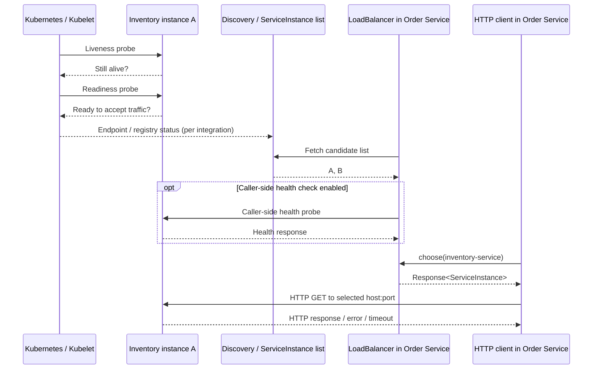
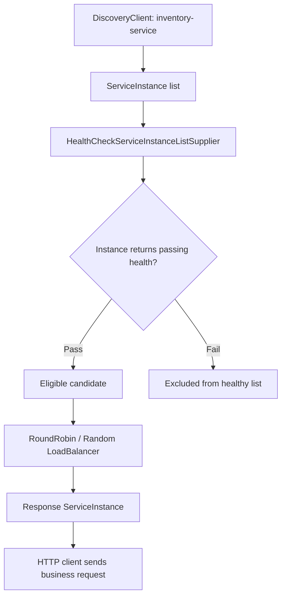

# Distinguishing Liveness, Readiness, and Caller-Side Health Checks

In a microservices architecture, an instance can be **still running**, **not yet ready for new requests**, or **unreachable from a specific caller**. These three states are related yet distinct. When using Spring Cloud LoadBalancer, confusing them can cause puzzling incidents: Pods keep restarting just because the database is slow, unready instances still get chosen, or every request reports no available server even though the target application is running.

This lesson belongs to the **Instance Health** chapter of the Spring Cloud LoadBalancer module. The goal is to clearly separate:

- **Liveness:** is the process healthy enough to keep running, or does it need to be restarted?
- **Readiness:** should the instance accept new business traffic right now?
- **Caller-side health check:** from the caller's position, is an instance in the `ServiceInstance` list still a suitable target to try connecting to?

The three signals have different subjects of observation, execution mechanisms, and consequences. They should work together with discovery, `ServiceInstanceListSupplier`, routing policies, `RestClient`/`WebClient`/OpenFeign timeouts and retries, and observability; never use a single health endpoint for every decision without understanding its meaning.

## 1. Quick Comparison Table of the Three Check Types

| Criterion | Liveness | Readiness | Caller-side health check |
|---|---|---|---|
| **Primary question** | Does the process/container need to be restarted? | Should new requests be sent to this instance? | Should this caller treat the instance as an available candidate? |
| **Who usually checks?** | Kubelet or process supervisor. | Kubelet, orchestrator, or traffic controller. | The caller application itself, via Spring Cloud LoadBalancer and its supplier when enabled. |
| **Perspective** | Local process vitality. | Application serving readiness. | Connectivity/health response from the caller's network path and current discovery list. |
| **On failure** | Orchestrator may restart the container after probe thresholds. | Instance marked NotReady; in Kubernetes, Pod typically stops receiving traffic from Service endpoints. | Supplier can exclude the instance from the candidate list used by LoadBalancer. |
| **What does it guarantee by default?** | Does not guarantee healthy downstreams or good business latency. | Does not guarantee every API and dependency responds on time. | Does not guarantee subsequent business requests will succeed. |
| **Risk if misused** | Mass restarts when a shared dependency has an outage. | Removes all replicas from traffic even when partial business operations still work. | Increases probe load, stale health, false negatives, or eliminates all candidates per caller. |

Core point: **liveness serves restart decisions; readiness serves traffic-acceptance decisions; caller-side health checks serve target-selection decisions from the caller's viewpoint**.

## 2. Separating Three Perspectives Within One Request

Suppose `order-service` calls `inventory-service` using the logical URI:

```http
GET http://inventory-service/api/items/42
```

The inventory application runs two instances, A and B. Kubernetes monitors the Pods; the discovery system supplies the instance list; Spring Cloud LoadBalancer in `order-service` fetches the list and picks a target; HTTP transport connects and sends the request.



The diagram describes **logical responsibilities**; it does not imply Kubernetes always updates the exact same registry used by the application directly. In Kubernetes, Service/EndpointSlice reflects readiness via its own mechanism; in Eureka/Consul or static discovery, list data depends on specific integrations and configurations. Caller-side health checking is an **optional** step, not enabled by default for every `@LoadBalanced` client.

## 3. Liveness: Does the Process Need to Be Restarted?

**Liveness** answers whether the process remains in a state capable of continuing to run. For example, a permanently stuck JVM, severe deadlock, or failure to respond to check endpoints within the configured window. Enough consecutive liveness probe failures can cause Kubernetes to restart the container.

Liveness **should not directly reflect the state of a shared dependency** such as a database or message broker. If the DB has a transient outage and every Pod fails liveness, the orchestrator may restart all Pods simultaneously. That spikes startup load, fails to fix the DB outage, and can even prolong recovery time.

Examples:

| Situation | How should liveness behave? | Reason |
|---|---|---|
| JVM and event loop still running, DB is failing | Usually stay `UP` if the process can self-recover when DB returns. | Restarting the JVM does not fix DB outages. |
| Process enters an unrecoverable stuck state | Can report `DOWN`. | A restart may be the recovery action. |
| Application starting up and needs warm-up | Use a startup probe or adequate startup budget. | Avoid liveness restarts before the application has a chance to become ready. |
| A business endpoint returns `500` | Not necessarily `DOWN`. | A business error does not mean the process is dead. |

**Liveness is not an API SLA.** Returning `200 OK` on liveness does not guarantee all business requests succeed or run fast.

## 4. Readiness: Should the Instance Accept New Traffic?

**Readiness** indicates whether the application is ready to serve requests. A Pod can be running yet unready: just started, warming caches, not finished essential initialization, or preparing for shutdown to drain requests.

In Kubernetes, when a readiness probe fails, the Pod is marked **NotReady**. Kubernetes updates endpoint status to avoid sending **new traffic through normal Kubernetes Services** to unready Pods. This does not completely block direct connections to the Pod IP or traffic traversing a separate discovery mechanism that does not reflect readiness.

Common cases:

- **Startup:** Pod is alive but readiness is not yet met; do not send requests until mandatory resources are ready.
- **Graceful shutdown:** switch to not-ready before stopping to reduce new requests while giving in-flight requests time to complete.
- **Missing essential resource:** temporarily stop accepting traffic if continuing to accept it would cause continuous failures.
- **Shared dependency failure:** evaluate whether all replicas should be marked NotReady. If every Pod is removed from the Service, the system may lose all serving paths, including endpoints that could operate independently.

How deep readiness checks dependencies should reflect **actual business serving capability**. Do not automatically put every secondary dependency into readiness; a non-mandatory Redis cache can fail while requests still succeed via fallback. Conversely, if the application truly cannot handle any request when an essential dependency is lost, readiness may need to reflect that.

### Liveness and Readiness Can Differ Simultaneously

| State | Liveness | Readiness | Interpretation |
|---|---|---|---|
| Application just starting | `UP` or startup probe still checking | `DOWN`/NotReady | Alive, not accepting traffic yet. |
| Application serving normally | `UP` | `UP` | Ready to receive traffic. |
| Draining for shutdown | May still be `UP` | `DOWN`/NotReady | Continues finishing in-flight requests, limits new ones. |
| Process stuck unrecoverably | `DOWN` per probe | Usually no longer ready | May require restart per orchestrator policy. |
| Downstream temporarily slow | Usually still `UP` | Depends on impact and policy | Should not be blindly folded into liveness. |

## 5. Spring Boot Actuator: Endpoints for Liveness and Readiness

With Spring Boot Actuator, commonly used health groups are:

- `/actuator/health/liveness`: reflects the liveness status group.
- `/actuator/health/readiness`: reflects the readiness status group.

When health probes are configured and the endpoints are requested on the **main application HTTP port**, additional paths `/livez` and `/readyz` can be used depending on support in your Spring Boot version.

Example in **inventory-service**:

```yaml
# application.yml of inventory-service
management:
  endpoint:
    health:
      probes:
        enabled: true
        add-additional-paths: true
```

With that configuration and a supporting version, you can check on the application port:

```http
GET http://inventory-instance:8080/livez
GET http://inventory-instance:8080/readyz
```

Key requirement: **path and port must match the actual exposed endpoint**. If Actuator runs on a separate management port, probes hitting only the management port can succeed even when the business port is down. Enabling additional paths on the main port helps catch certain failures on the request-serving port. Verify mappings and security on your actual Spring Boot version rather than assuming `/livez` and `/readyz` always exist without configuration.

Abbreviated example of probes on a Kubernetes container once those paths are exposed:

```yaml
# Excerpt of container configuration in a Kubernetes workload
containers:
  - name: inventory-service
    image: example/inventory-service:demo
    ports:
      - containerPort: 8080
    startupProbe:
      httpGet:
        path: /livez
        port: 8080
      periodSeconds: 2
      failureThreshold: 30
    livenessProbe:
      httpGet:
        path: /livez
        port: 8080
      periodSeconds: 10
      failureThreshold: 3
    readinessProbe:
      httpGet:
        path: /readyz
        port: 8080
      periodSeconds: 5
      failureThreshold: 3
```

These intervals/thresholds are **illustrative only**, not optimal parameters for every system. `startupProbe` gives the application time to start before the remaining probes take effect; it is especially helpful when warm-up takes a long time. Design `initialDelaySeconds`, `periodSeconds`, `timeoutSeconds`, `failureThreshold`, and `successThreshold` based on real behavior—avoiding excessive sensitivity to brief spikes or excessive lag when an instance truly fails.

**Do not make liveness depend on the DB merely because the aggregate `/actuator/health` endpoint includes DB checks.** The liveness and readiness groups serve distinct goals and can have contents different from aggregate health.

## 6. Caller-Side Health Checks in Spring Cloud LoadBalancer

When `order-service` calls `inventory-service`, the caller normally only knows the `ServiceInstance` list received from discovery. A **caller-side health check** is a mechanism where the caller actively checks instances in that list and uses the results to decide the candidate set for LoadBalancer.

In Spring Cloud LoadBalancer, the relevant component is `HealthCheckServiceInstanceListSupplier`. It can be wired into the `ServiceInstanceListSupplier` chain to check the health of instances supplied by discovery and emit an eligible list to the target-selection algorithm. The mechanism, probe interval, and result retention depend on configuration, version, and how the supplier chain is built.



An illustrative per-service-ID configuration in **order-service**:

```java
@Configuration
@LoadBalancerClient(
    name = "inventory-service",
    configuration = InventoryLoadBalancerConfig.class
)
class InventoryLoadBalancerRegistration {
}

// Place this configuration class outside normal component scan.
class InventoryLoadBalancerConfig {

    @Bean
    ServiceInstanceListSupplier inventorySupplier(
            ConfigurableApplicationContext context) {

        return ServiceInstanceListSupplier.builder()
            .withDiscoveryClient()
            .withHealthChecks()
            .build(context);
    }
}
```

Example configuring the probe path for the service ID, assuming `inventory-service` exposes `/readyz` on the port advertised by discovery:

```yaml
# application.yml of order-service (caller)
spring:
  cloud:
    loadbalancer:
      health-check:
        path:
          inventory-service: /readyz
```

This is an **integration pattern**, not a guarantee that every Spring Cloud version shares identical auto-configuration and defaults. Verify dependencies, property names, and supplier builder order against your application's Spring Cloud BOM. `InventoryLoadBalancerConfig` must be structured so it applies only inside the LoadBalancer context for `inventory-service`, never accidentally picked up globally by component scan. When adding caching or other supplier decorators, understand ordering and refresh mechanics; `HealthCheckServiceInstanceListSupplier` has its own result retention/replay mechanism in certain versions, so do not add caching arbitrarily.

### Crucial Difference: Pod Readiness vs. Caller-Side Health

Kubernetes may report a Pod as Ready, yet `order-service` still cannot connect to the Pod due to:

- A NetworkPolicy or firewall between two namespaces/zones.
- Misconfigured DNS, routes, TLS, or proxy on the caller.
- Discovery providing the wrong address/port from the caller's perspective.
- Application port reachable inside the cluster yet unreachable from the calling environment.

Conversely, `order-service` may call the health endpoint successfully while business requests still time out or fail because of a different API route, slow database, or load spikes after the probe timestamp.

**A passing health check is a signal at check time, not a promise the next request will succeed.** Health checks also do not turn Round Robin into an algorithm that favors instances with lower CPU or fewer in-flight requests.

## 7. Choosing Caller-Side Check Endpoint: Aggregate Health or Readiness?

`/actuator/health` is not always the best endpoint. Aggregate health may include indicators irrelevant to a specific business call; the readiness health group aligns much closer with capacity to accept new traffic. Still, when using readiness, verify it reflects the caller's needs.

| Endpoint / check approach | Benefit | Risk to watch |
|---|---|---|
| `/actuator/health` | Can reflect many system components. | A secondary dependency going DOWN can evict replicas even while the target API works. |
| `/actuator/health/readiness` | Closer to “should new requests be accepted?”. | If readiness lacks essential indicators or aggregates too broadly, results still mislead. |
| `/readyz` on application port | Tests an HTTP route closer to real requests when additional paths are enabled. | Exists only when supported/configured; does not directly measure every business API. |
| Custom endpoint for the use case | Can reflect specific dependencies and serving readiness. | Must keep probes lightweight, fast, and side-effect-free; avoid costly business work. |

A good health endpoint must be lightweight enough for periodic checks, have a timeout shorter than business budgets, mutate no data, and carry clear response semantics. Never use order creation, payment deduction, or state-mutating operations as health probes. If the caller needs to call the endpoint, configure appropriate access permissions and network paths; a `401`/`403` due to missing probe authorization does not mean the instance is dead.

## 8. When No Healthy Instances Remain

When `HealthCheckServiceInstanceListSupplier` has no candidates passing checks, the LoadBalancer algorithm may receive an empty list and return no server, or behave differently depending on how the supplier is configured. Verify this case on your running version rather than assuming it manifests identically to HTTP `503` returned by the target application.

Three cases to distinguish:

| Case | Symptom | What to inspect |
|---|---|---|
| **No instance found** | Discovery returns an empty list. | Service ID, registry, registration/deregistration, readiness, and discovery source. |
| **Instances exist but health check fails** | Initial list has instances; supplier filters all out or marks none healthy. | Path, port, security, response status, health timeout, reachability from caller. |
| **Instance selected yet business request fails** | `Response<ServiceInstance>` contains a server; HTTP client sees timeout, connection refused, or HTTP `5xx`. | Network, TLS, API, downstream latency, connection pool, and retry policy. |

When no instance can be selected, some HTTP clients/integrations convert that situation into an exception or error status. That is fundamentally different from **an instance actually returning HTTP `503`** for a business request. Log which stage failed rather than jumping to conclusions mechanically from the final status code.

Never fail over automatically to another zone if data, tenant, or security policy constraints apply. Being allowed to prefer a nearby zone (soft preference) differs from being restricted to a specific region (hard constraint); lacking instances in the allowed region does not authorize ignoring constraints.

## 9. When the Three States Contradict One Another

Consider these realistic situations:

| Liveness | Readiness | Caller health result | What may be happening |
|---|---|---|---|
| `UP` | `UP` | Good | Instance satisfies checks right now, though APIs can still error. |
| `UP` | `DOWN` | May be good | Pod is draining or readiness requires more conditions than the endpoint the caller checks. |
| `UP` | `UP` | Unreachable | Caller-specific network fault, wrong discovery address, wrong port, or blocked health endpoint. |
| `DOWN` | `DOWN` | May still show old result | Probe/registry/supplier do not update simultaneously; state lags. |
| `UP` | `UP` | Good yet requests time out | Health check is too shallow, traffic spiked, or business endpoint depends on another component. |

As this table shows, there is no `liveness == readiness == callerHealthy` formula. Each signal has its own goal and lag. When investigating, capture timestamps and network scope for each measurement.

### Incident Example: Database Outage

Suppose all `inventory-service` replicas share a failing database.

1. If liveness checks the DB connection, every Pod may restart repeatedly; restarting does not recover the database.
2. If readiness checks the DB and all inventory endpoints require the DB, all Pods may flip NotReady, leaving the service with zero endpoints; this may accurately signal inability to serve, so prepare caller responses/fallbacks.
3. If only certain APIs require the DB, putting the DB into global readiness can take down APIs that still work; consider splitting services, health groups, or proper degradation design.
4. Caller-side health checks only verify responsiveness from an endpoint; if that endpoint does not reflect DB health, the caller may still pick an instance whose business endpoint errors.

The lesson is to define readiness around the **serving contract** and design graceful degradation, rather than turning every downstream failure into a restart trigger.

## 10. Health Checks Do Not Replace Timeouts, Retries, and Circuit Breakers

Suppose at time T, a caller health check gets `200 OK` from A. At T+100 ms, A hits a GC pause or loses DB connectivity; business requests can still time out. This is the gap between check and use (*time-of-check to time-of-use*).

Stable communication requires coordination across:

- **HTTP timeouts:** connect timeout, response/read timeout, and overall deadline designed around the business nature of `RestClient`, `WebClient`, or OpenFeign.
- **Bounded retries:** retry only transient errors and safe-to-repeat requests; retries may reselect an instance depending on LoadBalancer integration and configuration.
- **Idempotency:** state-changing operations, especially `POST`, need deduplication mechanisms before allowing retries after timeouts.
- **Circuit breaker/bulkhead:** protect caller and downstream when errors rise or resources saturate; passing liveness does not prevent overload.
- **Discovery and health refresh:** accept the inherent delay between actual state changes and list updates.

A common mistake is infinitely retrying against a slow instance simply because its prior health check was `UP`. That amplifies load and prolongs outages. Likewise, if health probe timeouts are too short for real network latency, all callers may simultaneously exclude healthy instances.

## 11. Watching the Operational Cost of Caller-Side Checks

Caller-side health checks carry operational cost: every caller probes the instance list it knows about. With many callers, a single upstream instance can receive a high volume of probes.

Illustrative calculation: 100 callers, each knowing 20 instances, probing each instance once every 10 seconds:

```text
Average probes ≈ (100 callers × 20 instances) / 10 seconds
               = 200 health requests/second
```

This is purely a load estimate when **every caller probes everything independently** at the assumed interval—not a default behavior or default parameter of Spring Cloud LoadBalancer. In real deployments, caching, refreshes, instance sets, caller count, and deduplication affect probe volume.

Risks to manage:

- **Probe storms:** synchronized probe cycles across many callers can create spikes at the exact same instant.
- **False negatives:** an endpoint responds slowly under brief load, causing eviction of instances still capable of serving requests.
- **Stale health:** status from the previous probe no longer reflects conditions at request time.
- **Health flapping:** instances repeatedly enter and leave the list, causing traffic oscillation and difficult incident analysis.
- **Wrong target info:** discovery port points to the application port while health is exposed only on a separate management port.
- **Inconsistent data:** Kubernetes has removed a NotReady Pod while a separate registry still advertises a stale record.

If the platform/discovery already provides a reliable list of only Ready instances, every caller may not need to re-probe all instances. Deciding whether to enable `HealthCheckServiceInstanceListSupplier` should weigh added value against probe cost, environment type, and discovery freshness.

## 12. Example Using WebClient on the Caller Side

Example `WebClient.Builder` bean integrated with Spring Cloud LoadBalancer:

```java
@Configuration
class HttpClientConfiguration {

    @Bean
    @LoadBalanced
    WebClient.Builder loadBalancedWebClientBuilder() {
        return WebClient.builder();
    }
}

@Service
class InventoryGateway {

    private final WebClient client;

    InventoryGateway(@LoadBalanced WebClient.Builder builder) {
        this.client = builder
            .baseUrl("http://inventory-service")
            .build();
    }

    Mono<Item> getItem(String id) {
        return client.get()
            .uri("/api/items/{id}", id)
            .retrieve()
            .bodyToMono(Item.class);
    }
}
```

`Item` is an application DTO; imports are omitted. The example illustrates **calling by service ID** only; whether caller-side health checks run still depends on the supplier chain configured in `order-service`. Once LoadBalancer selects an instance, the HTTP client remains responsible for timeouts, TLS, pooling, status handling, and body parsing. With `RestClient` or OpenFeign, the same separation of responsibilities holds even though transport configuration APIs differ.

When adding retries, observe **logical requests**, **HTTP attempts**, and **LoadBalancer selections** rather than treating every retry as a brand-new independent request. If all instances are excluded from the list, raising the read timeout will not restore the candidate set.

## 13. Hands-on Practice: Identifying the Right Health Signal

Set up two `inventory-service` replicas, A and B, in a test environment. Have each replica expose an endpoint returning `instanceId` so the actual target is visible. You can use Kubernetes with Spring Boot Actuator or a simulated environment with independent health states.

| Test | Action | What to observe |
|---|---|---|
| **Slow startup** | Delay B's warm-up while keeping the process alive. | Liveness should not trigger pointless restarts; readiness prevents B from taking new traffic before ready. |
| **Drain B** | Flip B's readiness to NotReady before stopping. | Discovery endpoints update and new requests to B drop, while in-flight requests can finish. |
| **Wrong probe path** | Point caller health to a nonexistent path. | Caller may exclude Ready instances; logs show path/port errors. |
| **Block path from one caller** | Use a test network policy to block reachability to A from caller X alone. | Kubernetes can still report A Ready; X's probes fail while caller Y still succeeds. |
| **Slow API, fast health** | Make B's business endpoint hang long while `/readyz` replies fast. | Caller can still pick B; business requests time out, showing health is no latency guarantee. |
| **Shared dependency fails** | Take down the test DB. | Observe the difference between liveness and readiness; avoid needless restart loops. |
| **Retry after selection** | Simulate a connection error on an idempotent endpoint. | Attempt count, reselected instance, overall deadline, and failure reason. |

In each experiment, track timestamps, probe outcomes, discovery lists before/after filtering, selected instances, HTTP client status/exceptions, and processing duration. Verify behavior only on your exact Spring Boot, Spring Cloud, and orchestrator versions; do not draw conclusions from a single `200` log line.

## 14. Pre-Deployment Checklist

- **Liveness:** decides only whether the process needs a restart; do not unconditionally fold DB or downstream failures into liveness.
- **Readiness:** reflects ability to accept new traffic; accounts for startup, shutdown/draining, and dependencies essential to the serving contract.
- **Caller health:** enable only when extra visibility from the caller's perspective is needed; verify path, port, security, and probe interval.
- **Actuator:** verify `/actuator/health/liveness`, `/actuator/health/readiness`, or `/livez`, `/readyz` are exposed with proper semantics.
- **Kubernetes:** check `startupProbe`, `livenessProbe`, `readinessProbe`, and EndpointSlice/Service propagation delay when Pod readiness changes.
- **Discovery/supplier:** understand `ServiceInstance` sources, caching, refreshes, and `HealthCheckServiceInstanceListSupplier` ordering in the chain.
- **No candidates:** distinguish empty discovery, all filtered by health, and transport failures after instance selection.
- **Routing safety:** never fall back to a prohibited zone/tenant when no valid instances remain.
- **Probe load:** monitor total probe count, false negatives, health flapping, and multi-caller impact.
- **Resilience:** timeouts, bounded retries, idempotency, and circuit breakers are still needed; health checks do not replace them.
- **Observability:** correlate traces across caller, discovery/selection, health, and HTTP status; never log or tag tokens, cookies, or sensitive data in logs/metrics.

**Key takeaway:** **liveness** supports deciding *whether to restart*, **readiness** supports deciding *whether to accept new requests*, and **caller-side health checks** support deciding *which instance in the current list this caller should choose*. They do not share the same meaning, do not update simultaneously, and do not replace real error handling. Clearly separating these three perspectives helps Spring Cloud LoadBalancer select `ServiceInstance` instances intentionally, reduces picking unavailable replicas, and prevents cascading restart/retry overload loops.
