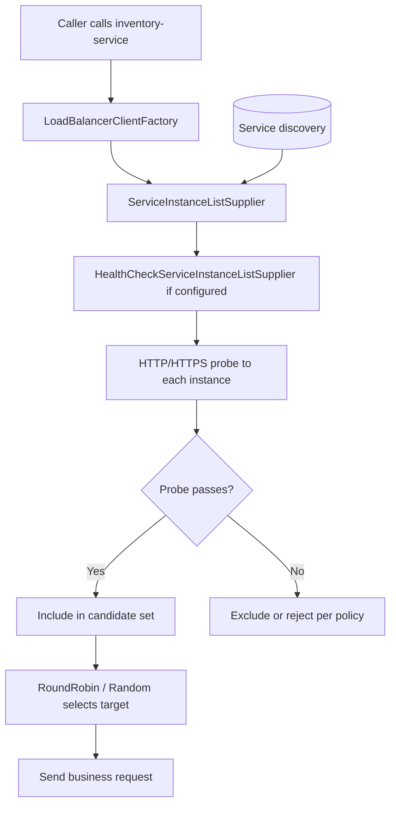
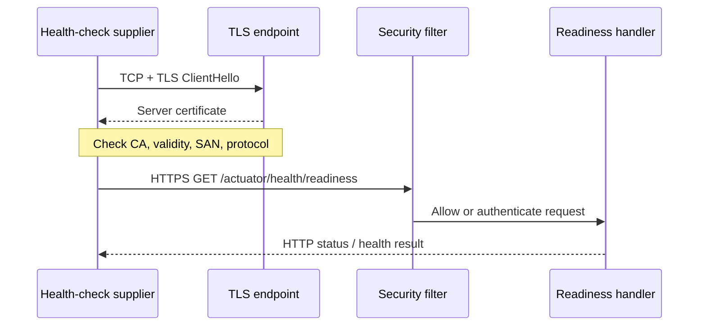

# Impact of Health Check Endpoints Requiring Authentication or HTTPS

An instance can be running normally yet still be treated as **unhealthy** if the health check client is unauthorized to access the endpoint or fails to establish an HTTPS connection. For example, `inventory-service` returns `200 OK` for business requests carrying a valid token, while the default probe calls `/actuator/health/readiness` without a token and receives `401 Unauthorized`. In that situation, a health-check filter can exclude the instance from the candidate list even though the application is not actually broken.

In Spring Cloud LoadBalancer, the `ServiceInstance` list is supplied by `ServiceInstanceListSupplier`; `HealthCheckServiceInstanceListSupplier` can check instance reachability and return the filtered list. Authentication, HTTPS, certificates, and the **health probe** path therefore directly affect target selection for `RestClient`, `WebClient`, or OpenFeign when these clients share the configured supplier chain.

This lesson belongs to the **Instance Health** chapter and focuses on distinguishing **a genuinely failing service** from **a probe lacking authorization or failing the TLS handshake**, along with how to implement a health endpoint that is both secure and probeable.

## 1. Where Does Health Checking Sit in the LoadBalancer Flow?

Suppose `order-service` calls the logical URL:

```text
GET http://inventory-service/api/products/P-1001
```

Discovery returns three instances of `inventory-service`. A health-check-enabled supplier can send check requests to each instance and include only targets passing the check policy in the list for the instance selection algorithm.



**Two different request types** must be distinguished:

- **Business request:** sent by the caller to `/api/products/P-1001` via a LoadBalancer-integrated HTTP client; may carry tokens, cookies, and business headers.
- **Health probe request:** issued by the health-check component to the check endpoint, e.g., `/actuator/health/readiness`. It does not automatically carry all authentication headers from business requests.

A health-check supplier policy is not necessarily enabled merely because the application has Actuator. An appropriate supplier chain configuration and required dependencies must be present. Conversely, service discovery or infrastructure like Kubernetes may run its own health/readiness checks, which does not mean `HealthCheckServiceInstanceListSupplier` itself is active.

## 2. Why Can Authenticated Endpoints Cause False Negatives?

A health endpoint can be protected by Spring Security, a gateway, reverse proxy, service mesh, or other middleware. If the probe lacks valid credentials, the security layer can return:

| Response or symptom | Common meaning | Potential impact on health check |
|---|---|---|
| `200 OK` with appropriate readiness status | Endpoint permits the probe and reports success. | Instance is deemed valid if it satisfies the health check predicate. |
| `401 Unauthorized` | Missing or invalid credentials. | Probe may mark the instance unhealthy even while APIs work. |
| `403 Forbidden` | Identity present but lacks permissions, or blocked by policy. | Probe fails; instance may be filtered out of the list. |
| `302 Found` redirect to login page | Security requires interactive login. | Outcome depends on redirect handling; usually unsuitable for machine-to-machine probes. |
| `404 Not Found` | Wrong path, context-path, or management port. | Probe cannot verify the instance at the expected endpoint. |
| `503 Service Unavailable` from readiness endpoint | Application may not be ready to serve yet. | This can be a valid signal to exclude the instance. |
| Timeout or TLS error | Probe received no valid HTTP response. | May be treated as a connection failure rather than a business health error. |

In particular, `401` and `403` prove **the check request was rejected**, not that the business API is broken. If all three instances enforce the same policy requiring a Bearer token while the probe has no token, the entire group can be judged invalid. The caller may then receive a no-target error, `503`, or a related error depending on version and integration; do not assume a single error code across every client type.

### False Negatives and False Positives

**False negative:** an instance is serving normally yet marked unhealthy, such as when a probe gets `401` or `SSLHandshakeException`.

**False positive:** a probe returns success while the instance cannot process business work. For example, a `/health` endpoint always returns `200`, while a connection pool or required database is exhausted. A login page or fallback page returning `200` can also produce a false signal if the check only inspects the HTTP status code.

Therefore, choosing the right endpoint and defining “healthy” are just as important as granting access to it.

## 3. How Does Readiness Differ from Liveness?

Spring Boot Actuator is commonly used to expose health information. In versions supporting health probe groups, two common concepts are:

| Check type | Question | Suitable for filtering request-receiving instances? |
|---|---|---|
| **Liveness** | Is the process still alive and does it need a restart? | Not sufficient to determine ability to accept business traffic. |
| **Readiness** | Is the instance currently ready to accept requests? | Usually better suited for target selection, if the signal is designed properly. |

For instance, an application starting up and still initializing essential connections may be “alive” yet not “ready.” If the health-check supplier only queries liveness, business requests can reach the instance too early.

When using Spring Boot Actuator, endpoints are typically referenced as:

```text
/actuator/health/liveness
/actuator/health/readiness
```

In environments that do not auto-enable probes, depending on your Spring Boot version you may need:

```yaml
management:
  endpoint:
    health:
      probes:
        enabled: true
```

**Note:** readiness should not indiscriminately include every shared dependency. If all instances are marked unready solely because one shared dependency temporarily errors, the system can lose its entire candidate set even when some APIs still work. Design health indicators around the service's serving contract and fault-tolerance strategy.

## 4. Configuring the Right Health Check Path per Service ID

The default endpoint a Spring Cloud LoadBalancer version probes may not match the Actuator readiness endpoint. Do not assume enabling `spring-boot-starter-actuator` automatically points probes to `/actuator/health/readiness`.

In Spring Cloud LoadBalancer versions supporting per-service-ID health check paths, you can declare:

```yaml
spring:
  cloud:
    loadbalancer:
      health-check:
        path:
          inventory-service: /actuator/health/readiness
          payment-service: /internal/ready
```

The names `inventory-service` and `payment-service` must match the **service ID** the caller uses to resolve logical URLs. Verify property names and support in your actual release train.

Several reasons a configured path may still not work:

- The service has an unexpected `server.servlet.context-path` or WebFlux base path.
- Actuator uses a custom base path or readiness endpoints are not enabled.
- A security filter or gateway redirects probes to another path.
- Actuator runs on a **separate management port**, while `ServiceInstance` points to the application port.
- An HTTPS instance uses a different scheme/port than registered in discovery.

**Path is a URL path, not a TLS configuration.** Putting `https://host/...` into the path field is generally not how an HTTP probe becomes HTTPS; inspect the URI/scheme, port, and how the supplier constructs requests.

### Management Port Different from Application Port

Suppose the API runs on `https://inventory.internal:8443` while Actuator runs on `https://inventory.internal:9443`. If the health-check supplier appends the health path onto `ServiceInstance`'s main URI, it tries port 8443 instead of 9443. The result can be 404 or a connection error even while the endpoint on 9443 is healthy.

In that situation, choose an intentional approach: expose a minimal readiness endpoint on the application port over an allowed internal route; register/represent the appropriate probe address if supported by the provider; or build a custom health check function using the management address. Never try to “fix” a wrong-port error merely by changing TTL, retries, or selection algorithms.

## 5. Strategies to Protect Endpoints Without Breaking Probes

A health endpoint should expose the **minimum information necessary** while still allowing authorized checkers to reach it.

### Approach A: Minimal Readiness Endpoint and Network Restrictions

You can allow requests without an application token to hit a readiness endpoint that **contains only aggregate status** (such as status and HTTP status code), while restricting access via private networks, firewalls, security groups, network policies, or internal ingress.

With modern Spring Security, an illustrative configuration snippet is:

```java
@Bean
SecurityFilterChain securityFilterChain(HttpSecurity http) throws Exception {
    return http
            .authorizeHttpRequests(authorize -> authorize
                    .requestMatchers("/actuator/health/readiness").permitAll()
                    .anyRequest().authenticated())
            .build();
}
```

This snippet only illustrates an **authorization rule for one path**, not a complete production security configuration. Keep the application's other rules, account for the ordering of multiple `SecurityFilterChain` beans, Actuator base path, management port, and actual setup. `permitAll()` **does not** restrict IPs on its own; when opening an unauthenticated path, protect it with network boundaries and limit health response details.

In Spring Boot, showing health details can be configured separately. Avoid exposing database names, connection info, internal components, or detailed exceptions solely for LoadBalancer.

### Approach B: Authenticating Probes with a Service Identity

If policy mandates authentication, probes need a valid identity: for instance, a service principal scoped to `health:read`, a token issued with the proper audience, or an equivalent internal mechanism.

Principles:

1. Grant access only to the check endpoint; do not use credentials with broad business privileges.
2. Rotate/refresh tokens or certificates according to lifecycle rules; never hard-code tokens in source code.
3. Store credentials in a secret manager or infrastructure secret-injection mechanism.
4. Handle `401`, `403`, and token-acquisition failures explicitly; do not treat them as equivalent to a dead business instance.
5. Never log Authorization headers or client secrets in diagnostic logs.

**Do not assume** default `HealthCheckServiceInstanceListSupplier` automatically copies Bearer tokens from business requests, performs OAuth2 login, or injects API keys into probes. If authentication at this level is needed, configure a dedicated HTTP client/check function supported in your version. Using a `WebClient` for probes must be designed carefully: do not use a `@LoadBalanced` WebClient to probe the same service ID, to avoid creating a circular dependency in instance selection.

### Approach C: Using mTLS for Internal Channels

Some organizations require **mutual TLS (mTLS)** so both sides verify identity. The health endpoint server only accepts trusted client certificates. Probes must then be configured with an SSL context holding a valid client certificate and private key, in addition to trusting the server certificate.

If the client certificate is missing or its CA is untrusted, the TLS handshake fails before any HTTP response is returned. Adjusting authorization rules in Spring Security is not enough to fix an mTLS error happening at the transport layer.

## 6. How Does HTTPS Impact Health Checks?

When a service uses HTTPS, probes must connect with the right **scheme**, **port**, **hostname**, and establish TLS using a valid certificate chain.



**TLS happens before HTTP.** If the handshake fails, the endpoint never gets a chance to return `401` or `200`; probes typically record a connection or SSL error.

| Error | Common cause | Verification step |
|---|---|---|
| `SSLHandshakeException` / `PKIX path building failed` | Truststore lacks the right CA or is missing an intermediate certificate. | Inspect certificate chain and truststore of the probe runtime. |
| Hostname verification failed | Discovery URI uses an IP or name not listed in the cert's SAN. | Compare hostname in `ServiceInstance` against SAN entries on the certificate. |
| Certificate expired / not yet valid | Certificate expired, not yet active, or system clock is skewed. | Check validity dates and system clocks. |
| Handshake failure due to mTLS | Server requires a client certificate but probe sends none or an invalid one. | Check trust, key material, and mutual TLS policy. |
| Protocol/cipher negotiation failure | Both sides fail to agree on TLS version or cipher suite. | Compare client and server TLS configurations. |
| `Connection refused` / timeout | Wrong port, listener not running, firewall or network policy blocking. | Check port, discovery address, and network path. |
| `401`/`403` after handshake | TLS succeeded but HTTP authorization rejected the request. | Inspect credentials, roles/scopes, or filter chains. |

### Scenario: Discovery Registers an IP While the Cert Uses DNS

The registry may return instance `10.0.10.12:8443`, while the certificate only contains DNS SAN `inventory.internal`. If the probe uses `https://10.0.10.12:8443`, hostname verification can fail. Never “quick-fix” this by disabling hostname verification; align the registered name, certificate SAN, and connection path the application actually uses.

### Scenario: HTTP and HTTPS Mixed Up

If an instance is registered as `http://inventory.internal:8443` while port 8443 expects TLS only, the client sends plaintext HTTP to an HTTPS listener, causing protocol errors. Conversely, sending HTTPS to an HTTP port also fails. Inspect `ServiceInstance.getUri()` and `isSecure()` per provider/version rather than looking only at `health-check.path`.

## 7. Configuring Health Checks in Spring Cloud LoadBalancer

When building a custom supplier chain, an illustrative pattern uses the builder API in supported versions:

```java
@Configuration(proxyBeanMethods = false)
public class InventoryHealthLoadBalancerConfiguration {

    @Bean
    ServiceInstanceListSupplier serviceInstanceListSupplier(
            ConfigurableApplicationContext context) {
        return ServiceInstanceListSupplier.builder()
                .withDiscoveryClient()
                .withHealthChecks()
                .build(context);
    }
}
```

Register specifically for the service ID:

```java
@SpringBootApplication
@LoadBalancerClient(
        name = "inventory-service",
        configuration = InventoryHealthLoadBalancerConfiguration.class)
public class OrderApplication {
    public static void main(String[] args) {
        SpringApplication.run(OrderApplication.class, args);
    }
}
```

`InventoryHealthLoadBalancerConfiguration` should be placed **outside the main application's component scan** to avoid accidentally creating a global supplier. Verify the builder API, required dependencies, discovery source, and cache/health behavior against your actual release train.

**Note:** this example builds only a standard health-check supplier. If the endpoint requires a Bearer token, custom truststore, mTLS, or a separate management URL, this builder snippet **does not automatically solve** those needs. Configure a probe client/health check function supported by your version, or choose an internal readiness endpoint that can be accessed safely.

A health-check supplier can maintain its own results and schedule; wrapping it with `CachingServiceInstanceListSupplier` is not necessarily required. Stacking two cache layers in the wrong order can hold unhealthy or healthy lists longer than expected. Read your version's documentation before adding caching.

## 8. Verifying the Endpoint from the Caller's Exact Location

An endpoint reachable from a developer's machine does not guarantee probes running inside `order-service` can reach it. DNS, routing, firewalls, truststores, service identities, and network policies can differ across environments.

Testing should be run from a network environment matching the caller, in this order:

1. Check the service ID and `ServiceInstance` list returned by discovery.
2. Identify the actual URI/port the probe uses, plus the health path.
3. Verify DNS, TCP connectivity, and TLS handshake.
4. Send an HTTP request to that exact endpoint; record status code and latency.
5. If the endpoint requires auth, test all three cases: no credentials, invalid credentials, and valid credentials.
6. Compare against the output of `HealthCheckServiceInstanceListSupplier` and the instance picked by LoadBalancer.

Example testing an HTTPS endpoint signed by an internal CA:

```bash
curl -i --cacert /path/to/internal-ca.pem \
  https://inventory.internal:8443/actuator/health/readiness
```

If you need to validate a server using DNS `inventory.internal` while connecting to a specific IP, you can run:

```bash
curl -i --resolve inventory.internal:8443:10.0.10.12 \
  --cacert /path/to/internal-ca.pem \
  https://inventory.internal:8443/actuator/health/readiness
```

In an mTLS environment where test certificates are permitted:

```bash
curl -i --cacert /path/to/internal-ca.pem \
  --cert /path/to/client.crt \
  --key /path/to/client.key \
  https://inventory.internal:8443/actuator/health/readiness
```

The certificate paths above are placeholders. Protect private keys and never commit them to logs or repositories. Never use `curl -k` or disable certificate verification as a permanent production configuration; doing so masks real trust/hostname failures.

When an endpoint requires a Bearer token, use only properly provisioned test tokens, never put tokens in URLs, and never paste tokens into logging systems. To verify accurately, compare **the exact request sent by the probe**, not only a `curl` command carrying different credentials.

## 9. Auth and TLS Test Matrix

| Case | Expected outcome at endpoint | What to observe in LoadBalancer |
|---|---|---|
| No token, endpoint requires Bearer | `401`. | Probe rejected; instance may be treated as unhealthy. |
| Expired token or insufficient scope | `401` or `403`. | Once valid credentials are supplied, probe result must flip on the next check cycle. |
| Valid server cert and trusted CA | TLS succeeds; endpoint returns health status. | Instance can enter the list if readiness passes. |
| CA not trusted | Certificate verification error, no HTTP status. | Diagnose SSL/trust rather than readiness. |
| Hostname mismatches SAN | Hostname verification failure. | Check host from registry and probe URL. |
| mTLS enabled without client cert | TLS handshake rejected. | Do not try to fix with `permitAll()` alone. |
| Wrong management port or path | Connection error or `404`. | Align app port, management port, and context path. |
| Readiness is `OUT_OF_SERVICE` | Typically unsuccessful HTTP status per health mapping. | Instance excluded if supplier genuinely checks readiness. |
| Readiness recovers | Returns success once ready. | Measure time until instance re-enters the list. |

When designing test scenarios, hold other assumptions constant: service ID, discovery instances, health path, TLS material, and interval settings. Changing certificates, service registry, and retries simultaneously makes it very hard to isolate root causes.

## 10. When All Instances Are Marked Unhealthy

Suppose all three instances require a token at `/actuator/health/readiness` while the probe sends no token:

```text
inventory-1 -> 401
inventory-2 -> 401
inventory-3 -> 401
```

If the filter only retains instances with passing probes, the candidate set may become empty. LoadBalancer may then fail to pick any instance even though all three business endpoints work when clients supply credentials. Depending on version, supplier implementation, and fallback policy, empty-set handling can differ; observe actual behavior rather than asserting one fixed outcome.

To remediate:

- Inspect probe status and failure cause before restarting all instances.
- Verify an allowed readiness endpoint from the exact probe source.
- If auth applies, provision the proper service identity/token or client certificate.
- Cross-check URL/hostname/CA if HTTPS is enabled.
- Verify whether the supplier filtered everyone out due to health or discovery itself was already empty.
- Verify that instances **return to the list** after fixing configuration, as waiting until the next poll/refresh cycle may be needed.

**Never solve this by blindly disabling health checks or TLS.** Turning off health checks can route requests to genuinely broken instances; turning off certificate verification opens the risk of connecting to spoofed endpoints.

## 11. Avoid Confusing Probe HTTPS Errors with Business Request HTTPS Errors

A business client and a probe client can use **two different TLS configurations**:

| Component | May use separate configuration |
|---|---|
| `RestClient` or `WebClient` calling business APIs | Connection pool, truststore, SSL context, client certificate, timeout. |
| `WebClient`/HTTP client used for health probes | Probe's truststore, client identity, URI, timeout, and headers. |
| Service mesh or sidecar | mTLS policy, upstream identity, internal connections, and health-check bypass. |

As a result, a business API call can succeed over HTTPS while probes fail due to a missing CA or missing client certificate. The reverse also happens: probes succeed while the business HTTP client does not trust the same certificate or uses a different hostname.

When configuring a custom HTTP client for health checks, ensure it calls the instance URI directly. Do not use a service-ID-bound `@LoadBalanced` client to probe target selection for that same service if it creates an undesirable circular dependency.

## 12. Relationship with Retries, Timeouts, and Instance List Caching

Authentication and TLS errors can surface alongside caching, timeouts, or retries, yet these mechanisms solve different problems:

- **Health-check interval/timeout:** determines when checks run and how long they wait; too short a timeout can cause false negatives on slow networks.
- **Instance cache:** can keep serving stale snapshots; the ordering of cache and health suppliers affects list updates.
- **HTTP client timeout:** bounds how long a business request waits on a selected instance.
- **Retry:** retries requests under defined rules; it does not supply valid credentials or fix TLS certificates.
- **Discovery updates:** inform callers when instances register/deregister; not equivalent to probes having permission to hit the endpoint.

In particular, endlessly retrying when all probes fail auth/TLS only adds load without fixing the cause. For `POST` or write operations, blind retries can also cause duplicate side effects if the backend already succeeded and the response was lost. Combine bounded retries with idempotency.

## 13. Monitoring to Distinguish Service Outages from Config Errors

In logs/metrics, separate the causes of `unhealthy`:

| Signal | Meaning to analyze |
|---|---|
| HTTP `401`/`403` from health path | Wrong/missing credentials or authorization policy. |
| HTTP `404` | Wrong path, base path, management port, or route. |
| TLS handshake/PKIX/hostname error | Wrong truststore, certificate, scheme, or service discovery metadata. |
| Readiness `503` | Application or essential dependency not yet ready per health indicator. |
| Connection timeout | Network fault, overload, firewall, or overly tight timeout. |
| Drop in instances returned by supplier | Determine whether fault lies in health, cache, or discovery. |
| Recovery time after fix | Inspect interval, timeout, refresh, and post-filter list. |

Useful log fields include `serviceId`, `instanceId`, hostname or route pattern, scheme, health path, HTTP status, exception type, duration, and timestamp. Never log Bearer tokens, cookies, private keys, secret certificate material, or user data. When exporting metrics, cap label cardinality so dynamic hostnames do not create unbounded label series.

If using Spring Boot Actuator, Micrometer, and tracing, built-in health supplier metrics depend on starters and versions. Do not assume every error type is recorded into a single default metric; controlled custom logs/instrumentation may be needed.

## 14. Hands-on Practice: Two Instances, One Locked Endpoint

Prepare two mock servers sharing service ID `inventory-service`, running on ports 8081 and 8082. Each server exposes `GET /api/debug/instance` returning the instance ID and a readiness endpoint. You can use `SimpleDiscoveryClient` for local registration:

```yaml
spring:
  cloud:
    discovery:
      client:
        simple:
          instances:
            inventory-service:
              - uri: http://localhost:8081
              - uri: http://localhost:8082
    loadbalancer:
      health-check:
        path:
          inventory-service: /actuator/health/readiness
```

This example shows only the instance list and health path; `HealthCheckServiceInstanceListSupplier` must be registered in the supplier chain if you want to verify actual health filtering.

**Scenario 1 — Baseline:** Both readiness endpoints return success; send multiple requests through `@LoadBalanced RestClient` or `WebClient` and observe the candidate set and selected targets.

**Scenario 2 — Lock the endpoint:** Enable authentication on `inventory-2` alone so unauthenticated probes get `401`. Verify `inventory-2` still serves business APIs with a valid token yet can be excluded by the health supplier. This demonstrates an **auth-induced false negative**.

**Scenario 3 — Fix access permissions:** Allow internal probes to reach readiness under a safe policy, or configure probes with a valid identity. Observe how long it takes for `inventory-2` to re-enter the list after health checks succeed.

**Scenario 4 — HTTPS:** Switch the test instances to HTTPS using certificates issued for matching hostnames. Configure truststores and, if needed, mTLS for probes. Then intentionally simulate a missing CA or wrong hostname in the lab to distinguish TLS errors from `401`/`403`.

**Scenario 5 — Wrong port/path:** Run Actuator on a different management port. Check whether probes reach the right endpoint; adjust how the health endpoint is published/routed and compare results.

Each step can be executed independently. Never intentionally break certificates, lock endpoints, or open `permitAll()` on a production system serving live users.

## 15. Quick Troubleshooting Table

| Symptom | Primary hypothesis | How to check |
|---|---|---|
| All instances suddenly unhealthy after enabling Spring Security | Probes lack permissions or get redirected. | Check `401`, `403`, `302` from the caller's location. |
| Business API works fine yet health check reports SSL failure | Probe uses a different SSL context/truststore. | Compare TLS settings of both HTTP clients. |
| After switching HTTP to HTTPS, no instances remain | Discovery still registers old scheme/port. | Inspect `ServiceInstance.getUri()`, `isSecure()`, and actual listener. |
| Valid cert yet probe reports hostname mismatch | Registry uses IP while certificate only has DNS SAN. | Compare instance URI with SAN entries. |
| Enabled mTLS and probes fail handshake | Probe lacks a valid client certificate. | Inspect client key/cert and mutual trusted CAs. |
| Health endpoint returns `404` even though browser opens it | Browser hits a different management port/path. | Check host, port, base path matching the probe's URI. |
| Readiness returns `200` yet API frequently throws `500` | Health indicator does not reflect API serving readiness. | Review readiness indicators and essential dependencies. |
| Auth fixed yet instance does not return immediately | Health check schedule, cache, or discovery lags. | Observe refresh timing and supplier output. |
| No health probes observed at all | Health-check supplier not registered, or no request/trigger yet. | Check beans and supplier chain in the child context. |

## 16. Secure Health Endpoint Configuration Checklist

- [ ] Choose a readiness endpoint that accurately reflects request-handling capability, not just liveness.
- [ ] Verify service ID, URI, scheme, port, and path used by probes.
- [ ] Ensure probes have valid access rights; do not assume business requests forward tokens to probes.
- [ ] If the endpoint requires no token, restrict network access and limit response details.
- [ ] For HTTPS, verify CA, certificate chain, validity dates, and SAN matching hostname.
- [ ] For mTLS, configure client certificate and trust chain for the probe runtime itself.
- [ ] Never disable TLS verification or weaken security merely to make health checks pass.
- [ ] Check the path when Actuator runs on a separate management port or base path.
- [ ] Ensure the health-check supplier is actually enabled, not merely the Actuator dependency.
- [ ] Check interactions with caching, intervals, timeouts, and selected instance lists.
- [ ] Distinguish `401`/`403`, TLS handshakes, and readiness `503` when diagnosing.
- [ ] Test the failure–recovery cycle in a lab environment and observe instance return time.

**Conclusion:** A health endpoint requiring authentication or HTTPS is not inherently a problem; problems arise when **health probes are not configured to match security and TLS boundaries**. Spring Cloud LoadBalancer can only trust the check signals its supplier receives. To avoid mistakenly excluding healthy instances, combine a true readiness endpoint, least-privilege access, accurate certificates/truststores, clear path configuration, and verification from the caller's own environment.
