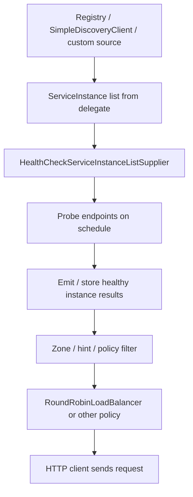

# Combining Health Checks with Caching and List Refresh

In a microservices system, a service's `ServiceInstance` list is not static. Pods may be replaced, a host may lose connectivity, new instances need startup time, and client-side caches may retain stale discovery data. Spring Cloud LoadBalancer supports `HealthCheckServiceInstanceListSupplier` to periodically check instances supplied by the list source and reduce the chance of selecting a target that is no longer serving well.

However, **health checks, caching, and topology updates are three distinct concerns**. Health checks answer *is the instance responding to probes?*; caching answers *should we avoid re-reading the list from the source?*; refresh mechanics answer *when are new instances or evicted instances recognized?*. Combining them poorly can leave dead endpoints in rotation, run redundant health probes too often, or accidentally route requests back to recently failed instances.

This lesson belongs to the **Instance Health** chapter and explains this processing chain in Spring Cloud LoadBalancer, practical configuration with Spring Boot and `RestClient`/`WebClient`, limitations of default behavior, and testing methods when instances drop out or return.

## 1. Three Questions to Keep Separate

Suppose `order-service` needs to call `inventory-service` with three instances:

| Instance | Endpoint | State at a point in time |
|---|---|---|
| `inventory-a` | `10.0.1.10:8080` | Ready to accept requests |
| `inventory-b` | `10.0.1.11:8080` | Starting up, not ready yet |
| `inventory-c` | `10.0.1.12:8080` | Just disconnected |

The application calls by service ID:

```text
GET http://inventory-service/api/items/42
```

Each mechanism has its own responsibility:

| Mechanism | Question it handles | What it does not guarantee |
|---|---|---|
| **Discovery / registry** | Which instances are registered for `inventory-service`? | Does not guarantee every instance can handle requests right now |
| **Instance list cache** | Can a fetched list be reused to reduce lookup overhead? | Does not detect dead sockets or unready apps on its own |
| **Health check** | Did the checked endpoint respond successfully on the latest probe? | Does not guarantee the instance stays healthy for the next request |
| **LoadBalancer** | Which instance should be selected from the current candidate list? | Does not fix network errors or retry business operations itself |
| **HTTP client** | How are requests sent, and how are connections, timeouts, and retries managed? | Does not necessarily update the discovery list when a request fails |

**Core point:** an instance still listed in the registry while failing its readiness probe should not be considered a healthy target; conversely, a newly ready instance not yet present in the source list cannot be selected by LoadBalancer either.

## 2. Coordination Flow of Discovery, Caching, and Health Checks

Spring Cloud LoadBalancer receives candidates from `ServiceInstanceListSupplier`. The supplier may draw data from `DiscoveryClient`, `ReactiveDiscoveryClient`, `SimpleDiscoveryClient`, or a custom source. When adding `HealthCheckServiceInstanceListSupplier`, it wraps that source to probe endpoints.



The diagram shows the **recommended** chain: place the health-check supplier immediately after the list-fetching source, before request-based filters. In practice, there are also internal discovery client caches, registry update intervals, and deployment-platform readiness states.

### 2.1. Distinguishing Two Directions of Change

Two kinds of changes must be handled independently:

1. **Health changes on known instances:** `inventory-a` remains registered, but its health endpoint starts failing. The next health check can update the client's assessment without waiting for the registry to change the list.
2. **Membership list changes:** `inventory-d` was just created, or `inventory-b` was decommissioned. Health checks cannot probe `inventory-d` if the delegate source has not added it to the list yet. Refreshing/refetching the instance source is needed.

Therefore, shortening only the **health check interval** does not guarantee fast discovery of new instances. Conversely, shortening only the **discovery cache TTL** does not guarantee an already-discovered instance is evaluated for health promptly.

## 3. How Does HealthCheckServiceInstanceListSupplier Work?

`org.springframework.cloud.loadbalancer.core.HealthCheckServiceInstanceListSupplier` is a decorator around `ServiceInstanceListSupplier`. It receives the list from its delegate, periodically sends health probes to instances, and emits the resulting list to the target-selection component.

Components of this flow include:

- **Delegate supplier:** provides addresses/metadata of discovered instances.
- **Health-check scheduler:** determines when probes start and how often they repeat.
- **HTTP health probe:** checks an endpoint such as `/actuator/health` or a configured readiness path.
- **Reactor Flux `replay()`:** retains and replays results to subscribers so the entire check chain does not rerun for every single request.
- **Downstream supplier/LoadBalancer:** consumes the processed list and picks an instance.

Checking is **periodic and asynchronous relative to business requests**. A `RestClient` call to `inventory-service` does not send a health request to every instance before issuing the main request. Target selection relies on the latest result emitted by the supplier.

### 3.1. Difference Between Health Endpoints and Business Endpoints

An HTTP `200 OK` from `/actuator/health` indicates the health endpoint responded according to its configured indicators; it does not prove every feature works. An endpoint checking only whether the process is alive can return OK even when thread pools are saturated, database write permissions are lost, or data loading has not finished.

When using health checks to decide whether to send new traffic, prefer **readiness** over checking liveness alone:

| Probe | Common meaning | Purpose |
|---|---|---|
| Liveness | Process is running and not stuck unrecoverably | Supports process restart decisions |
| Readiness | Instance is capable of accepting new requests | Decides whether to include in the traffic-receiving pool |
| Sample business API | Whether a specific feature flow works | Deep monitoring; usually unsuitable for frequent probing |

Readiness should be kept lightweight and faithful to serving requirements. If the endpoint calls a battery of heavy dependencies on every probe, callers multiplied by instances can create substantial load.

## 4. Crucial Behavior: When No Instance Is Healthy

According to Spring Cloud Commons documentation, `HealthCheckServiceInstanceListSupplier` normally **returns only healthy instances, except when none pass the check; in that case it returns all instances retrieved from its delegate**.

Consider source instance set `[a, b, c]`:

| Latest health result | List returned by supplier under default behavior |
|---|---|
| `a`, `b` healthy; `c` failing | `[a, b]` |
| Only `b` healthy | `[b]` |
| All `a`, `b`, `c` failing | **`[a, b, c]`** — falls back to entire source list |
| Discovery source returns empty list | `[]` — no source instances to fall back to |

This behavior prevents the system from losing its entire candidate set merely because health endpoints experienced a simultaneous hiccup or temporary probe misconfiguration. Yet **this is fail-open with respect to health results**, not a safety guarantee for every business requirement.

For instance, if all three instances are genuinely down, falling back to the full list still causes the HTTP client to try connecting and fail. If the mandatory requirement is **never send traffic to instances marked unready**, you must implement a custom policy/supplier with fail-closed behavior and test it carefully; do not assume the built-in health-check supplier always returns an empty list when all probes fail.

> Never treat health check results as proof of authentication or authorization. Hard constraints such as data residency, tenant isolation, API versions, and execution capability must still be verified separately. Even if the health supplier fails open, a downstream safety filter must still exclude targets failing mandatory constraints.

## 5. Why Shouldn't You Mechanically Stack Health Checks and Caching?

Spring Cloud provides `CachingServiceInstanceListSupplier` to reduce how often lists are fetched from discovery. However, `HealthCheckServiceInstanceListSupplier` already has a result retention/replay mechanism built on Reactor `replay()`.

A confusing chain looks like:

```text
DiscoveryClient
    -> CachingServiceInstanceListSupplier (TTL)
    -> HealthCheckServiceInstanceListSupplier (probe + replay)
    -> LoadBalancer
```

In this combination, the health supplier may refetch only a **stale snapshot from the cache layer**; after the real list changes, health probes keep operating on an incomplete instance set. Two data-retention mechanisms also make it hard to tell when an instance was actually updated.

Spring Cloud documentation advises **using one of `CachingServiceInstanceListSupplier` or `HealthCheckServiceInstanceListSupplier`**, rather than stacking both by default, and placing it **immediately after** the network instance-fetching supplier, before other filters.

### 5.1. Recommended Arrangements

When intentionally using health checks:

```text
DiscoveryClientServiceInstanceListSupplier
    -> HealthCheckServiceInstanceListSupplier
    -> ZonePreferenceServiceInstanceListSupplier
    -> RoundRobinLoadBalancer
```

When intentionally using caching without active health probing:

```text
DiscoveryClientServiceInstanceListSupplier
    -> CachingServiceInstanceListSupplier
    -> ZonePreferenceServiceInstanceListSupplier
    -> RoundRobinLoadBalancer
```

If the discovery client—such as a Eureka client—**already caches and filters instance status itself**, adding both LoadBalancer caching and health checks may add little value. Before making changes, inspect registry mechanics, refresh timing, readiness, and actual instance counts.

### 5.2. Two Retention Layers with Different Purposes

| Characteristic | `CachingServiceInstanceListSupplier` | `HealthCheckServiceInstanceListSupplier` |
|---|---|---|
| Primary goal | Reuse lists from the source | Probe instances and output lists per probe results |
| Storage mechanism | LoadBalancer cache provider; configurable TTL and capacity | Flux `replay()` and health/refetch schedules |
| When source topology changes | Usually waits for TTL expiration/invalidation to re-read | Needs delegate to emit a new list or refetch enabled |
| When an instance starts failing health | Does not run probes itself | Probes can detect it on the next check cycle |
| Should stack together by default? | No | No |

Note: setting `spring.cloud.loadbalancer.cache.enabled=false` only disables the **configured LoadBalancer cache**; it does not disable the health supplier's `replay()` mechanism and does not force the discovery client to drop its own internal cache.

## 6. Configuring Health Checks for a Service ID

The following examples use Spring Cloud LoadBalancer, a discovery source, and the health-check supplier. You need `org.springframework.cloud:spring-cloud-starter-loadbalancer` along with a discovery adapter or configured `SimpleDiscoveryClient`.

### 6.1. Reactive Supplier Configuration

Create a dedicated configuration class for `inventory-service`:

```java
import org.springframework.beans.factory.annotation.Bean;
import org.springframework.cloud.loadbalancer.core.ServiceInstanceListSupplier;
import org.springframework.context.ConfigurableApplicationContext;

public class InventoryHealthLoadBalancerConfiguration {

    @Bean
    ServiceInstanceListSupplier inventorySupplier(
            ConfigurableApplicationContext context) {

        return ServiceInstanceListSupplier.builder()
                .withDiscoveryClient()
                .withHealthChecks()
                .withZonePreference()
                .build(context);
    }
}
```

Register it for the exact service ID from the calling application:

```java
@SpringBootApplication
@LoadBalancerClient(
        name = "inventory-service",
        configuration = InventoryHealthLoadBalancerConfiguration.class)
public class OrderServiceApplication {
    public static void main(String[] args) {
        SpringApplication.run(OrderServiceApplication.class, args);
    }
}
```

The two classes in this example belong in **two separate Java files**; imports in `OrderServiceApplication` are omitted to focus on LoadBalancer configuration.

`withDiscoveryClient()` obtains the appropriate discovery source, `withHealthChecks()` adds the health supplier, and `withZonePreference()` filters by zone preference after health checks. `InventoryHealthLoadBalancerConfiguration` should be placed outside normal component scan or omit `@Configuration`, preventing a bean meant for one service ID from being mistakenly registered into the shared context.

### 6.2. Configuration for a Blocking Stack

If the application uses `RestClient` or a blocking stack and wants health checks over a compatible blocking client, the builder has a corresponding API:

```java
@Bean
ServiceInstanceListSupplier inventorySupplier(
        ConfigurableApplicationContext context) {

    return ServiceInstanceListSupplier.builder()
            .withBlockingDiscoveryClient()
            .withBlockingHealthChecks()
            .withZonePreference()
            .build(context);
}
```

This is an **alternative** to the reactive bean snippet above, not an additional bean of the same type competing for registration. According to Spring Cloud docs, you can supply a dedicated `WebClient`, `RestTemplate`, or `RestClient` as the transport for sending health probes. Choose the stack based on your dependencies and operational reality; do not assume having `WebClient` automatically makes both the discovery client and probes reactive.

### 6.3. Configuring Check Schedule and Readiness Endpoint

Example `application.yml` for an experiment:

```yaml
spring:
  cloud:
    loadbalancer:
      cache:
        enabled: false
      health-check:
        initial-delay: 2s
        interval: 10s
        path:
          default: /actuator/health/readiness
          inventory-service: /actuator/health/readiness
```

The values `2s` and `10s` here are **examples only**, not mandatory timings or universal recommendations. `initial-delay` controls delay before the check schedule starts; `interval` controls probe frequency. `path.default` sets the shared fallback path; `path.inventory-service` overrides per service ID. Without a matching path configured, Spring Cloud defaults to `/actuator/health`.

For the target application to expose a readiness endpoint via Spring Boot Actuator, add the `spring-boot-starter-actuator` dependency. In environments that do not auto-enable probes, configure on the **target application**:

```yaml
management:
  endpoint:
    health:
      probes:
        enabled: true
```

Verify in practice that `/actuator/health/readiness` returns an HTTP status aligned with traffic readiness; the endpoint might use a custom path, require authentication, or run on a separate management port. If the health port differs from the service port, Spring Cloud supports `spring.cloud.loadbalancer.health-check.port`; configure a single shared port only when it fits all instances being checked. Avoid accidentally exposing sensitive health details to the public Internet to serve internal clients.

**Note:** if a service's path is set to empty/null in configurations supported by the framework, health checks for that service may be skipped. Understand the fallback outcome before using this trick, rather than assuming an empty path automatically reverts to `/actuator/health`.

## 7. List Refresh Differs from Repeated Health Probing

This is the most confusing part when combining health checks with caching and discovery.

### 7.1. `refetch-instances`: Refetching the Member List

`HealthCheckServiceInstanceListSupplier` depends on the `ServiceInstance` list emitted by its delegate. Some delegates may only return a snapshot when queried rather than emitting a fresh value each time topology changes. Spring Cloud documentation cites `DiscoveryClientServiceInstanceListSupplier` as a case where enabling refetch should be considered if the list changes yet the delegate does not continuously emit updates.

To have the health supplier proactively refetch the list from its delegate:

```yaml
spring:
  cloud:
    loadbalancer:
      health-check:
        refetch-instances: true
        refetch-instances-interval: 20s
```

`refetch-instances=true` causes the health supplier to periodically re-fetch the list. `refetch-instances-interval` controls the member-set refresh cycle; do not interpret this as a guaranteed SLA for detecting a new replica, since the discovery client/registry may still lag in updating.

### 7.2. `repeat-health-check`: Run Additional Probe Cycles or Not?

Each list refetch also triggers a health check. If regular refetching is already enabled and you want to cut redundant repeated checks, you can set:

```yaml
spring:
  cloud:
    loadbalancer:
      health-check:
        refetch-instances: true
        refetch-instances-interval: 15s
        repeat-health-check: false
```

When `repeat-health-check=false`, understand that health updates when refetch events trigger checks, rather than relying on a separate continuously repeating probe cycle. Never disable repeated probing if the source is not refetched promptly: an instance may change health state without being rechecked within the desired window.

### 7.3. Two Independent Update Cadences

If both refetch and repeat health checks are enabled:

```text
Illustrative timeline (does not depict exact actual scheduler ticks)

t=0       t=10       t=20       t=30       t=40
 |----------|----------|----------|----------|
 Health:  probe      probe      probe      probe
 Refetch:            refetch               refetch

Event A: an existing instance suddenly becomes unready
  -> the next health cycle can detect it

Event B: a new instance is registered
  -> can only be probed after the source includes it
     and the health supplier refetches / receives the update
```

Hence there are two latencies to measure: **detection time for health changes on known instances** and **discovery time for newly added/removed instances in the list**. Never use a single `interval` or TTL figure to explain total convergence time.

### 7.4. `update-results-list`: Emit Results Incrementally or per Batch

According to Spring Cloud docs, by default the health-check Flux can re-emit the list as each healthy instance is confirmed. When you want to finish probing the entire candidate set and emit only the consolidated result after each pass, set:

```yaml
spring:
  cloud:
    loadbalancer:
      health-check:
        update-results-list: false
```

| Value | Behavior seen from downstream supplier |
|---|---|
| `true` (default) | May see intermediate updates as each healthy instance completes probing |
| `false` | Waits to collect the pass's healthy instance list before emitting; no intermediate result sets emitted mid-pass |

Depending on application traits, incremental updates can surface a healthy instance sooner while also causing the candidate set to fluctuate mid-probe. Batch updates are cleaner when you want consistent lists per check pass. Either way, do not confuse this setting with `refetch-instances` or cache TTL.

## 8. Discovery Caches Can Still Hold Stale Topology

Suppose `inventory-c` is decommissioned from the registry, while the caller uses a discovery client with a local registry cache. The health supplier can detect `inventory-c` is unresponsive and drop it from the healthy set. Yet the delegate source may keep returning a list containing `inventory-c` until the discovery cache updates.

```mermaid
sequenceDiagram
    participant Registry as Registry
    participant Discovery as DiscoveryClient cache
    participant Health as HealthCheck supplier
    participant LB as LoadBalancer
    Registry->>Registry: Deregister inventory-c
    Note over Discovery: Still holds stale snapshot
    Health->>Discovery: Refetch instances
    Discovery-->>Health: [a, b, c] (stale)
    Health->>Health: Probe; c fails
    Health-->>LB: [a, b] (while healthy instances exist)
    Discovery->>Registry: Refresh on own schedule
    Registry-->>Discovery: [a, b]
    Health->>Discovery: Next refetch
    Discovery-->>Health: [a, b]
```

**Two different situations:**

- **Old instance fails:** health checks can mitigate impact before the registry cache converges, provided at least one healthy instance remains.
- **New instance becomes ready:** health checks cannot discover an endpoint absent from the source list on their own. Refetching and waiting for discovery updates are required.

Thus lowering `health-check.interval` does not solve every staleness symptom. If the registry or discovery takes 30 seconds to advertise a new instance, probing every 2 seconds still cannot make that instance appear in LoadBalancer.

### 8.1. When Is the LoadBalancer Cache Needed?

If you only want to cut list-fetching overhead and the registry already provides reliable health status, the simpler option can be discovery + caching or simply a discovery client with its own cache. When already using the health-check supplier, favor its own replay/refetch mechanics and avoid adding a caching supplier unless you have a clear reason, tested correctness, and understand update ordering.

Spring Cloud LoadBalancer offers `spring.cloud.loadbalancer.cache.ttl` (commonly defaulting to `35s`) and `spring.cloud.loadbalancer.cache.capacity` (default initial capacity `256`) for standard list caching. These two properties **are not** health check schedules and do not replace `refetch-instances-interval`. `capacity=256` does not mean a hard limit of 256 instances.

## 9. Balancing Health Probe Cost Against Freshness

A health probe is an extra HTTP request. If many callers run health checks independently, total probe load grows with both instance count and caller count.

Suppose:

- `N` = number of service instances a caller must probe.
- `I` = time between probe cycles, in seconds.
- `C` = number of callers with the health supplier enabled.

In a steady model where each cycle probes each instance once, ideal probe load is approximately:

\[
Q_{health} \approx \frac{C \times N}{I}
\quad \text{requests/second}
\]

For example, `C=50`, `N=20`, `I=10s` yields roughly 100 HTTP health requests/second across the instance group. Cutting the probe interval from 10 seconds to 2 seconds increases ideal load fivefold. This is only an estimate: actual scheduling, healthy instance counts, incremental result updates, refetches, and probe mechanics can alter actual traffic.

| Configuration | Upside | Risk/cost |
|---|---|---|
| Very frequent probes | Detects certain failures faster | Raises endpoint, socket, and CPU load, plus false-negative risk under contention |
| Infrequent probes | Lower overhead, simpler | Retains stale health assessments longer between rounds |
| Fast refetch | Sees new topology sooner if discovery updated | Increases list-fetch frequency and triggered health checks |
| `update-results-list=false` | Observes cleaner full-batch lists | May slightly delay admitting an instance that just passed its probe |

Never choose a probe interval based solely on fastest-possible failure detection. Check health endpoint capacity, probe HTTP client timeouts, registry latency, SLO targets, cross-zone costs, and transient error profiles.

## 10. Impact on RestClient, WebClient, and OpenFeign

The health supplier runs at the **instance selection layer**, independent of specific business endpoints. Once a `ServiceInstanceListSupplier` bean is bound to a service ID, LoadBalancer-integrated HTTP clients calling that service can use the resulting candidate list.

Example with `RestClient`:

```java
@Configuration
class ClientConfiguration {

    @Bean
    @LoadBalanced
    RestClient.Builder inventoryRestClientBuilder() {
        return RestClient.builder();
    }
}

@Service
class InventoryGateway {
    private final RestClient client;

    InventoryGateway(@LoadBalanced RestClient.Builder builder) {
        this.client = builder.build();
    }

    String findItem(long id) {
        return client.get()
                .uri("http://inventory-service/api/items/{id}", id)
                .retrieve()
                .body(String.class);
    }
}
```

`WebClient.Builder` can be annotated with `@LoadBalanced` similarly to call services by service ID. OpenFeign uses `@FeignClient(name = "inventory-service")` and integrates with LoadBalancer when matching dependencies are present.

### 10.1. HTTP Timeouts Still Need Configuration

A previous passing health probe does not guarantee the current request succeeds. An instance can fail between probe and call, suffer a network partition, or refuse connections under overload. HTTP clients still need:

- **Connect timeout:** avoids waiting indefinitely when a host/port is unreachable.
- **Read/response timeout:** bounds how long to wait for results.
- **Appropriate connection pooling:** reuses TCP/TLS without treating old sockets as fresh proof of readiness.
- **Bounded retries:** retry only safe failure types and requests, considering avoiding the instance that just failed.

Retrying after a timeout does not guarantee the prior request never executed. For side-effecting `POST` requests, require an idempotency key or business deduplication. Never enable unlimited retries to mask slow health/registry updates.

### 10.2. Target Changes During Shutdown

When an instance begins graceful shutdown, the ideal operational sequence is flipping readiness to unready, allowing registry and health suppliers to converge, stopping new request intake, and only then closing the process. Do not assume `health-check.interval=10s` means waiting exactly 10 seconds suffices: discovery refreshes, probe timeouts, refetches, and individual callers can all be out of phase.

## 11. Observing and Diagnosing When Lists Are Wrong

Separating three metric layers speeds up root-cause analysis:

1. **Source:** how many `ServiceInstance` objects registry/discovery returns, with snapshot timestamps.
2. **Health supplier:** what probes return; how many instances remain after checking; whether all-unhealthy fallback is active.
3. **HTTP client:** which instance LoadBalancer selected, whether requests succeeded or failed, and how many timeouts/retries occurred.

| Symptom | Possibility to examine | How to verify |
|---|---|---|
| Dead instance keeps getting selected briefly | Probe turn not reached, timeout still pending, or stale result replayed | Compare failure timestamp, probe time, and healthy list |
| New instance is ready yet receives no traffic | Delegate does not emit new list; refetch disabled or discovery cache stale | Check `refetch-instances`, registry, and source list |
| All probes fail yet requests still hit backend | Health supplier's all-unhealthy fallback behavior | Inspect probe status, source list, and desired fail-closed policy |
| Requests bunch onto one instance mid-check | Healthy list updated incrementally | Consider `update-results-list=false` and measure results |
| Health endpoint returns `404` | Wrong path, Actuator not enabled, or separate management context | Check path/port directly from caller |
| Probe returns `401/403` | Health endpoint requires auth not configured on probes | Align internal security and probe HTTP client credentials |
| Probes fail sporadically under rising load | Heavy health endpoint, overly tight timeout, or network congestion | Measure probe latency, saturation, and per-caller load |
| Changed cache TTL yet topology still lags | Discovery/registry/refetch is the actual bottleneck | Measure chain registry → discovery → supplier → request |
| Health stacked doubly with caching | Wrapped two retaining suppliers or multiple health providers | Inspect actual beans/supplier chain |

### 11.1. Recommended Metrics and Logging

- Service ID, instance count returned by delegate, and instance count after health checks.
- Probe successes/failures, probe duration, and HTTP status codes per service.
- Refetch timestamps and time from topology event until instance appears/disappears.
- Fallback activation counts when zero instances pass probes.
- Connect/read timeout request counts and retry counts by service/cause group.
- Business request p95/p99 latency and active request counts per service.

Spring Cloud LoadBalancer supports statistics via Micrometer when enabled with a corresponding `MeterRegistry`. However, **do not assume every health probe or refetch metric is available out of the box**: for unexported data, add controlled instrumentation, structured logs, or metrics at the HTTP/Actuator layer.

Avoid using tokens, cookies, tenant IDs, request IDs, or dynamic path parameters as unbounded metric labels. If instance-level analysis is needed, define a cardinality strategy and log access controls.

## 12. Hands-on Practice: Testing Health as the List Changes

Set up `inventory-service` running on two ports, `8081` and `8082`, and a client using service ID `inventory-service`. You can use `SimpleDiscoveryClient` to test health for a fixed instance set:

```yaml
spring:
  cloud:
    discovery:
      client:
        simple:
          instances:
            inventory-service:
              - uri: http://127.0.0.1:8081
              - uri: http://127.0.0.1:8082
    loadbalancer:
      cache:
        enabled: false
      health-check:
        interval: 5s
        path:
          default: /actuator/health/readiness
        update-results-list: false
```

Both instances must expose the readiness endpoint at that exact path and run on the machine `127.0.0.1` resolves to. Inside a container, `127.0.0.1` points to that container itself, not to another container.

Follow this sequence:

1. Enable the health-check supplier via per-service configuration; confirm both instances start ready.
2. Call `/whoami` repeatedly through the `@LoadBalanced` HTTP client; record which instance answers.
3. Make `8081`'s readiness fail while keeping `8082` healthy. Observe after a probe cycle that the preferred candidate list narrows to `8082` alone.
4. Make `8082`'s readiness fail as well. **Verify fallback behavior:** the supplier may return both instances from the source list instead of an empty list. Record failed requests and differences from fail-closed expectations.
5. Restore `8081`'s readiness; measure how long it takes to return to the selected list.
6. Rerun with `update-results-list` set to `true` and `false` in turn, checking whether intermediate results affect request distribution.
7. With a dynamic discovery source, add instance `8083`, enable `refetch-instances`, and measure how long it takes for the new instance to enter the source list and get probed. The fixed `SimpleDiscoveryClient` setup from the earlier step cannot discover new replicas automatically.
8. Compare `5s` and `15s` probe frequencies under the same workload; monitor health request counts, p95/p99 latency, and error rates.

Save a results table per run with timestamps for: instance turning unready, registry change, delegate refresh, health supplier list change, and first request switching target. This data pinpoints the **true bottleneck**, instead of tuning TTLs or health intervals by guesswork.

## 13. Safe Deployment Checklist

- **Pick the right instance source:** dynamic registry/discovery or static source; determine whether the source pushes new lists itself.
- **Add the health supplier only when needed:** registry-based discovery that already supplies health status may not need extra checks.
- **Do not stack caching and health suppliers by default:** the health supplier already includes replay; place it directly after the list-fetching source.
- **Use appropriate readiness:** verify path, HTTP status, security, and port from the caller's environment.
- **Consider refetch:** enable `refetch-instances` and choose an interval if the source does not push topology updates itself.
- **Separate refetch cadence from probe cadence:** `repeat-health-check=false` makes sense only when refetching suffices for your needs.
- **Choose list emission behavior:** understand `update-results-list` to avoid surprises from intermediate results.
- **Explicitly test all-unhealthy:** default behavior can return the entire source list; fail-closed requires dedicated design.
- **Measure probe cost by caller count:** avoid having each client flood instances with excessive health requests.
- **Keep timeouts, retries, and graceful shutdown:** health checks do not guarantee the next request will succeed.
- **Collect metrics across all three layers—source, supplier, and HTTP:** know whether failures stem from refresh, health, or business connections.
- **Never put data/permission constraints into health fallback mechanics:** hard constraints must be enforced independently.

**Conclusion:** combining health checks with caching and list refresh means controlling both **the set of known instances** and **their serving availability**. In Spring Cloud LoadBalancer, `HealthCheckServiceInstanceListSupplier` already includes a result replay mechanism, so layering an extra cache is usually unnecessary. To detect new replicas, ensure the delegate refreshes or enable `refetch-instances`; to detect failures in known instances, tune the probe schedule. Above all, understand all-unhealthy fallback and test the zero-healthy-targets case before going to production.

## References

- [Spring Cloud Commons — Spring Cloud LoadBalancer](https://docs.spring.io/spring-cloud-commons/reference/spring-cloud-commons/loadbalancer.html): `HealthCheckServiceInstanceListSupplier`, caching, refetch, repeat, `update-results-list`, and supplier ordering.
- [Spring Boot Actuator — Kubernetes Probes](https://docs.spring.io/spring-boot/reference/actuator/endpoints.html#actuator.endpoints.kubernetes-probes): readiness/liveness probes, configuration, and health endpoint semantics.
