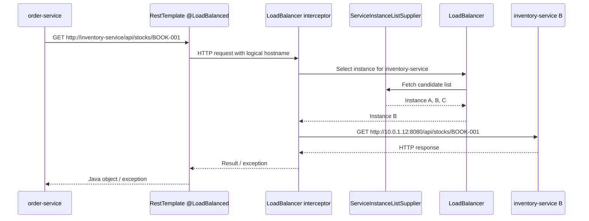

# Declaring a RestTemplate with @LoadBalanced

In a microservices system, `order-service` needs to call `inventory-service` without hardcoding the IP address and port of each replica. When `inventory-service` has multiple instances, the calling application can use **Spring Cloud LoadBalancer** to select a `ServiceInstance` by service ID, and then send the HTTP request to the actual address of the selected instance.

With **`RestTemplate`**, the common integration pattern is declaring a Spring bean annotated with **`@LoadBalanced`**. When the appropriate Spring Cloud LoadBalancer dependencies and configuration are present, this bean receives a request-interception mechanism that translates the logical hostname in the URL into a concrete instance. As a result, business code can still call `http://inventory-service/...` instead of fetching the replica list manually or writing its own Round Robin algorithm.

This lesson belongs to the **RestTemplate** chapter of the `SPRING_CLOUD_SERVICE_COMMUNICATION_LOAD_BALANCING` module. The focus is on declaring the bean correctly, using service IDs, testing behavior with multiple replicas, and handling failure scenarios. Topics such as discovery, health checks, retries, timeouts, and request observability are connected directly so you understand what `@LoadBalanced` solves and what it **does not** solve in inter-service communication.

## 1. RestTemplate and Client-Side Load Balancing

`RestTemplate` is Spring Framework's synchronous HTTP client. A method call such as `getForObject(...)` or `exchange(...)` sends a request and waits for a result or exception before returning control to the calling thread.

In standard usage, the URL contains a target address resolved via normal networking mechanisms:

```java
RestTemplate plain = new RestTemplate();
String result = plain.getForObject(
        "http://localhost:8081/api/stocks/BOOK-001", String.class);
```

This request goes directly to `localhost:8081`; Spring Cloud LoadBalancer does not participate in instance selection merely because its dependency is on the project classpath.

Conversely, a `RestTemplate` configured with `@LoadBalanced` can use a **service ID as a logical hostname**:

```java
String result = loadBalancedRestTemplate.getForObject(
        "http://inventory-service/api/stocks/BOOK-001", String.class);
```

Here, `inventory-service` must be recognized by the instance provider. It does not have to be an OS-resolvable DNS name: for a LoadBalancer-integrated bean, this hostname is used to look up and choose a replica before sending the HTTP request.

### Two URL Patterns to Distinguish

| URL | Interpretation | Does LoadBalancer participate? |
| --- | --- | --- |
| `http://localhost:8081/api/stocks/BOOK-001` via plain RestTemplate | Target is a specific host and port | No |
| `http://inventory-service/api/stocks/BOOK-001` via `@LoadBalanced` RestTemplate | Logical hostname is a service ID | Yes, if integration is properly configured |
| `http://inventory-service/api/stocks/BOOK-001` via plain RestTemplate | System tries resolving hostname via normal networking | Not automatically |
| `http://10.0.1.12:8080/api/stocks/BOOK-001` | Concrete instance address; service ID selection step no longer needed | Should not be used to verify replica selection |

In RestTemplate integration, the standard syntax is **`http://<service-id>/path`**, not the `lb://...` URI commonly seen in Spring Cloud Gateway configurations. If you genuinely want to call a specific host or IP directly, use a plain `RestTemplate`: the `@LoadBalanced` bean's interceptor may still interpret a hostname/IP in the URL as a service ID to look up instead of automatically bypassing load balancing.

## 2. Preparing Dependencies

Minimal Maven example for a Spring Boot application with an HTTP client and Spring Cloud LoadBalancer:

```xml
<dependencies>
    <dependency>
        <groupId>org.springframework.boot</groupId>
        <artifactId>spring-boot-starter-web</artifactId>
    </dependency>

    <dependency>
        <groupId>org.springframework.cloud</groupId>
        <artifactId>spring-cloud-starter-loadbalancer</artifactId>
    </dependency>
</dependencies>
```

This example assumes the project already manages **compatible Spring Boot and Spring Cloud versions** through a parent/BOM or corresponding dependency management setup. Do not copy an arbitrary Spring Cloud version into a project without checking the compatibility matrix against the Spring Boot version in use.

The `spring-cloud-starter-loadbalancer` dependency supplies the components needed to pick an instance on the client side. **The source of the instance list is a separate responsibility.** In production, the system may use Eureka, Consul, Kubernetes, or another discovery source. In a test environment, you can use `SimpleDiscoveryClient` with a statically declared URI list.

Without a mechanism supplying the instance list for `inventory-service`, declaring a syntactically valid `@LoadBalanced` bean is still insufficient to route requests to the target service.

## 3. Declaring a @LoadBalanced RestTemplate Bean

The most basic declaration creates a `RestTemplate` inside a Spring configuration class and annotates the `@Bean` method with `@LoadBalanced`:

```java
import org.springframework.cloud.client.loadbalancer.LoadBalanced;
import org.springframework.context.annotation.Bean;
import org.springframework.context.annotation.Configuration;
import org.springframework.web.client.RestTemplate;

@Configuration
public class HttpClientConfiguration {

    @Bean
    @LoadBalanced
    public RestTemplate loadBalancedRestTemplate() {
        return new RestTemplate();
    }
}
```

Meaning of each element:

1. `@Configuration` registers the configuration class in the Spring application context.
2. `@Bean` registers the `RestTemplate` object so Spring manages it and other beans can inject it.
3. `@LoadBalanced` marks **this specific RestTemplate bean** as an HTTP client requiring LoadBalancer integration.
4. `new RestTemplate()` creates the synchronous client; LoadBalancer configuration is added by Spring Cloud through the corresponding auto-configuration mechanism.

Key point: `@LoadBalanced` **does not create a discovery registry**, does not self-register replicas, and does not turn every object created with `new RestTemplate()` into a load-balanced client. It only takes effect when used on the proper bean and when Spring Cloud LoadBalancer integration is configured in the application.

### 3.1. Why Use @Bean Instead of Instantiating with `new` in Business Classes?

The example below **does not** use the bean annotated with `@LoadBalanced`:

```java
// Do not use this approach when calling by service ID through Spring Cloud LoadBalancer.
class InventoryClient {

    String getStock() {
        RestTemplate restTemplate = new RestTemplate();
        return restTemplate.getForObject(
                "http://inventory-service/api/stocks/BOOK-001",
                String.class);
    }
}
```

Because the object is instantiated directly and does not go through bean configuration, the request may try to resolve `inventory-service` as a normal hostname and fail with DNS or connection errors. This is easily mistaken for an empty registry, when the real cause is that the caller used the wrong `RestTemplate`.

## 4. How Spring Cloud Handles the Call

Once `RestTemplate` is integrated with LoadBalancer, the request flows through these high-level steps:



The diagram shows a typical successful path. Depending on version and configuration, RestTemplate may use `LoadBalancerInterceptor`, `RetryLoadBalancerInterceptor`, or an equivalent integration class. The conceptual invariant is that **the logical hostname is used to pick an instance**, while the actual HTTP request is sent to **the selected instance's host and port**.

`ServiceInstanceListSupplier` may fetch the list from discovery, apply caching, run health checks, or filter by zone/hint. An algorithm such as `RoundRobinLoadBalancer` selects an instance from the final candidate list. `@LoadBalanced` does not mean the application automatically enables every filter or guarantees the chosen replica is healthy.

## 5. Using RestTemplate in a Business Client

Once the bean exists, inject it into an inter-service communication adapter. Example fetching stock by SKU:

```java
import org.springframework.beans.factory.annotation.Qualifier;
import org.springframework.stereotype.Service;
import org.springframework.web.client.RestTemplate;

@Service
public class InventoryClient {

    private final RestTemplate restTemplate;

    public InventoryClient(
            @Qualifier("loadBalancedRestTemplate") RestTemplate restTemplate) {
        this.restTemplate = restTemplate;
    }

    public StockResponse getStock(String sku) {
        StockResponse response = restTemplate.getForObject(
                "http://inventory-service/api/stocks/{sku}",
                StockResponse.class,
                sku);

        if (response == null) {
            throw new IllegalStateException("Inventory API returned an empty body");
        }

        return response;
    }
}

// Illustrative DTO; Java 17+.
record StockResponse(String sku, int available, String instance) {}
```

In the code above, `@Qualifier("loadBalancedRestTemplate")` identifies the exact bean to inject. The `{sku}` URI template lets Spring handle parameter substitution instead of concatenating URL strings manually. `StockResponse` is an illustrative DTO; its structure must match the JSON actually returned by `inventory-service`.

If the project has only one `RestTemplate` bean, the constructor can inject directly by type. Using an explicit bean name remains useful when the project later adds another client serving URLs outside the microservices system.

### 5.1. Sending Headers or Using Another HTTP Method

`RestTemplate` can call `exchange(...)` when control over HTTP method and headers is required:

```java
import org.springframework.http.HttpEntity;
import org.springframework.http.HttpHeaders;
import org.springframework.http.HttpMethod;
import org.springframework.http.MediaType;
import org.springframework.http.ResponseEntity;

HttpHeaders headers = new HttpHeaders();
headers.setAccept(java.util.List.of(MediaType.APPLICATION_JSON));

HttpEntity<Void> request = new HttpEntity<>(headers);

ResponseEntity<StockResponse> response = restTemplate.exchange(
        "http://inventory-service/api/stocks/{sku}",
        HttpMethod.GET,
        request,
        StockResponse.class,
        "BOOK-001");

StockResponse stock = response.getBody();
```

When using `exchange(...)`, the load-balanced bean's interceptor still participates because the request passes through the same configured `RestTemplate` instance. Protect tokens and sensitive headers when logging; never log the entire request just to inspect which instance was chosen.

## 6. When Both Plain and Load-Balanced RestTemplates Are Needed

An application may call both microservices by service ID and external APIs using real hostnames. Define two beans with explicit names to prevent accidental mis-injection:

```java
import org.springframework.cloud.client.loadbalancer.LoadBalanced;
import org.springframework.context.annotation.Bean;
import org.springframework.context.annotation.Configuration;
import org.springframework.web.client.RestTemplate;

@Configuration
class DualRestTemplateConfiguration {

    @Bean("loadBalancedRestTemplate")
    @LoadBalanced
    RestTemplate loadBalancedRestTemplate() {
        return new RestTemplate();
    }

    @Bean("directRestTemplate")
    RestTemplate directRestTemplate() {
        return new RestTemplate();
    }
}
```

In the consuming class, inject by name:

```java
public ExternalApiClient(
        @Qualifier("directRestTemplate") RestTemplate directRestTemplate) {
    this.restTemplate = directRestTemplate;
}
```

This configuration is an **alternative** to the single-bean configuration in section 3, not an instruction to register both configuration classes in the same application. Registering multiple beans with colliding names can cause startup failures or bean overriding depending on the bean overriding mode.

Do not default to using a `@LoadBalanced` bean for every external URL: the URL's hostname may be treated as a service ID and routed through LoadBalancer. A plain `RestTemplate` keeps direct connections to external APIs cleanly separated from internal calls using service discovery.

## 7. Testing Without an External Service Registry

To clearly observe replica selection, you can use `SimpleDiscoveryClient` with a static instance list in **`order-service`**. This is suitable for learning or lightweight testing; it does not dynamically detect replicas being created or terminated.

```yaml
# application.yml of order-service
spring:
  application:
    name: order-service
  cloud:
    discovery:
      client:
        simple:
          instances:
            inventory-service:
              - uri: http://localhost:8081
              - uri: http://localhost:8082
```

Assume two `inventory-service` processes are running on the same machine as the caller, listening on ports `8081` and `8082` respectively. These are **localhost demo addresses**; if services run inside containers or across different hosts, `localhost` inside the caller usually does not refer to the target containers/hosts. In that case, use addresses genuinely reachable from `order-service`.

To identify which instance handled a request, the target service can include port information in its response:

```java
import org.springframework.beans.factory.annotation.Value;
import org.springframework.web.bind.annotation.GetMapping;
import org.springframework.web.bind.annotation.PathVariable;
import org.springframework.web.bind.annotation.RestController;

@RestController
class InventoryController {

    @Value("${server.port}")
    private int port;

    @GetMapping("/api/stocks/{sku}")
    StockResponse stock(@PathVariable String sku) {
        return new StockResponse(sku, 15, "inventory:" + port);
    }
}

record StockResponse(String sku, int available, String instance) {}
```

Run **two independent processes** of the target application, one with `--server.port=8081` and one with `--server.port=8082`. Then invoke `InventoryClient.getStock("BOOK-001")` multiple times from `order-service` and observe the returned `instance` field.

If the active algorithm is Round Robin and the candidate list is stable, results may alternate between `inventory:8081` and `inventory:8082`. This is an **illustrative** outcome, not a guarantee that every request sequence always splits strictly 50/50 when multiple callers, retries, or instance list changes are present.

### 7.1. Manual Verification Flow

1. Start an `inventory-service` instance on port `8081`.
2. Start a second `inventory-service` instance on port `8082`.
3. Start `order-service` with the `SimpleDiscoveryClient` configuration above and the `@LoadBalanced RestTemplate` bean.
4. Invoke `getStock("BOOK-001")` several times and record the `instance` field.
5. Stop the instance on port `8082` and retry calls to observe the error when the static list still holds the stale address.

The final step teaches an essential lesson: **a static list does not automatically remove a stopped instance**. LoadBalancer can continue picking `localhost:8082` even though no process is listening, resulting in connection errors. With dynamic service discovery, the registry, cache freshness, and health checks affect when a failed instance disappears from the candidate list.

## 8. Configuring Timeouts for a Load-Balanced RestTemplate

`@LoadBalanced` determines how the target is resolved, not how quickly requests must finish. For a synchronous client, timeouts are crucial because an overly slow request holds the caller's processing thread.

Example declaring the bean with `SimpleClientHttpRequestFactory`:

```java
import org.springframework.cloud.client.loadbalancer.LoadBalanced;
import org.springframework.context.annotation.Bean;
import org.springframework.context.annotation.Configuration;
import org.springframework.http.client.SimpleClientHttpRequestFactory;
import org.springframework.web.client.RestTemplate;

@Configuration
class TimedRestTemplateConfiguration {

    @Bean
    @LoadBalanced
    RestTemplate loadBalancedRestTemplate() {
        SimpleClientHttpRequestFactory requestFactory =
                new SimpleClientHttpRequestFactory();

        requestFactory.setConnectTimeout(2_000);
        requestFactory.setReadTimeout(4_000);

        return new RestTemplate(requestFactory);
    }
}
```

This is an **alternative** to the simple bean in section 3; do not activate two configurations registering the same bean name simultaneously. Timeout values in this example are illustrative only; choose values based on SLAs, downstream response times, total deadline, and retry counts.

| Timeout type | Explanation |
| --- | --- |
| Connect timeout | Limit on time spent establishing a connection to the selected instance according to the HTTP transport |
| Read timeout | Limit on time spent waiting to read data from the connection, depending on the HTTP transport |
| Overall business deadline | End-to-end time limit for the operation, covering discovery, selection, request execution, and any retries |

`SimpleClientHttpRequestFactory` uses the JDK transport, suitable for basic examples. Other HTTP clients may provide connection pooling, TLS, and additional timeout settings. When switching transports, use the corresponding configuration API rather than assuming every factory shares identical timeout behavior.

**A read timeout does not prove the server failed to process the request.** For a state-mutating `POST`, the server may have committed the operation while the client did not receive the response in time. Retries must consider idempotency keys or status-lookup mechanisms to avoid duplicate side effects.

## 9. Distinguishing LoadBalancer Errors, Connection Errors, and HTTP Errors

When a `RestTemplate` request fails, the first step is determining whether the request reached an instance and whether the client received a valid HTTP response.

| Symptom | Common problem category | What to check |
| --- | --- | --- |
| No instance found for `inventory-service` | Discovery/supplier/LoadBalancer has no candidates | Service ID, discovery config, registry, cache, filters, and health checks |
| `UnknownHostException` with service ID URL | Likely calling via plain RestTemplate or LB configuration not applied | Whether injected bean has `@LoadBalanced`, and whether starter and auto-configuration are active |
| `Connection refused` | Selected instance has no process listening on host/port | Instance address, port, replica status, and stale discovery data |
| Connect/read timeout | Slow network or downstream, or resource exhaustion | Actual timeouts, network, server-side logs/traces, total elapsed time, and retries |
| HTTP `404`, `409`, `429`, `500`, `503` | HTTP response received indicating failure | Status, headers, response body, API contract, and upstream health |
| HTTP `200` with `success=false` | HTTP request succeeded but business logic rejected it | Business error code in body; do not retry just because the business action failed |

Note: when the instance list is empty, different Spring Cloud versions and integration paths may throw different exceptions or produce different synthetic responses. **Do not assume an HTTP `503` always came from `inventory-service`**: if the request never reached the target server, any status code, if present, may have been generated on the caller side.

### 9.1. Catching Exceptions by Responsibility

The following example illustrates separating I/O failures from HTTP response errors:

```java
import org.springframework.web.client.ResourceAccessException;
import org.springframework.web.client.RestClientResponseException;

try {
    StockResponse stock = restTemplate.getForObject(
            "http://inventory-service/api/stocks/{sku}",
            StockResponse.class,
            "BOOK-001");
} catch (ResourceAccessException ex) {
    // Check cause: DNS, connect timeout, read timeout, TLS...
    log.warn("inventory connection failure", ex);
} catch (RestClientResponseException ex) {
    // Server/proxy returned an HTTP error status response.
    log.warn("inventory HTTP error status={}", ex.getStatusCode().value());
}
```

`log` in the example represents the application class logger. Exact exception categorization depends on the HTTP transport and library version. Missing-instance errors or body conversion errors may surface as different exception types; inspect the root cause instead of catching only these two groups and treating everything else as success.

Some APIs return `409` or `422` for domain errors; others return `200` with an error code in the body. Callers must interpret responses according to the **API contract**, not solely by HTTP status.

## 10. Retry Is a Separate Mechanism, Not a @LoadBalanced Default

`@LoadBalanced` enables the client to choose an instance by service ID. Whether **retries** happen, which errors are retried, whether another instance is picked, and the attempt limit are all governed by retry integration and configuration.

In some Spring Cloud LoadBalancer setups for RestTemplate, retries can work with Spring Retry and `RetryLoadBalancerInterceptor` when the matching dependencies and conditions are satisfied. Do not assume that adding `@LoadBalanced` automatically retries every `5xx` or timeout.

Key principles:

- For read-only `GET` calls, bounded retries on connection resets or transient failures can be appropriate if the overall deadline allows.
- For order-creating `POST` calls, retrying after a read timeout can duplicate effects; design idempotency or operation status lookups.
- For HTTP `400`, `401`, `403`, and explicit business errors, retrying the identical request rarely helps.
- For `429`, `502`, `503`, `504`, check the API contract, `Retry-After` if present, backoff, jitter, and total attempt limits.
- When retries may select another instance, measure each attempt individually instead of inferring from the final business request outcome.

Do not enable uncontrolled retries across multiple layers: gateway, caller, and HTTP client retrying together can amplify one initial request into a surge of downstream traffic.

## 11. How Discovery, Health Checks, Zones, and Caches Affect Behavior

For a `@LoadBalanced` RestTemplate, **instance selection is only as good as the candidate list LoadBalancer receives**.

**Discovery** determines which instances are advertised for a service ID. If Eureka, Consul, Kubernetes, or SimpleDiscoveryClient is misconfigured, `RestTemplate` cannot locate target addresses on its own.

**Caching** can retain an instance list for a period of time. Newly registered replicas may not appear immediately; stopped replicas may remain in the local view. Some discovery clients maintain their own caches, so avoid adding redundant LoadBalancer caching unnecessarily.

**Health checks** can be added via `HealthCheckServiceInstanceListSupplier` in the instance supplier chain. They do not guarantee every subsequent request will succeed; a passing probe and an actual request happen at different moments.

**Zone/metadata routing** can be implemented with appropriate suppliers, such as preferring instances whose zone metadata matches the caller. `@LoadBalanced` does not enable all these policies automatically: they depend on `ServiceInstanceListSupplier` and LoadBalancer configuration.

**Selection algorithms**, such as Round Robin, only choose from the candidate list received. If the list contains a dead instance, the algorithm can still pick it. To investigate failures, inspect the registry list, discovery list, post-supplier/filter list, and the final selected instance separately.

## 12. Common Declaration Mistakes

### 12.1. Placing @LoadBalanced in the Wrong Location

Annotate the `RestTemplate` bean with `@LoadBalanced`, rather than putting the annotation on a business method hoping Spring will rewrite logical URLs. The bean must reside in an application context processed by Spring Cloud.

### 12.2. Instantiating RestTemplate Outside the Spring Context

Calling `new RestTemplate()` inside `InventoryClient` bypasses the configured bean. Inject the annotated bean and disambiguate with `@Qualifier` when multiple beans exist.

### 12.3. Wrong Service ID

If discovery registers `inventory-service` but the URL says `http://inventories/...`, LoadBalancer looks up the wrong logical hostname. Match the name against the service ID published by the discovery source, rather than guessing from Java class names or Maven artifact names.

### 12.4. Missing Instance Source

Having the LoadBalancer dependency and `@LoadBalanced` bean does not mean a registry is configured. When no instances are found, inspect `DiscoveryClient.getInstances("inventory-service")` or the supplier source and registry connection settings.

### 12.5. Using localhost from Inside a Container

`localhost` inside the `order-service` container refers to that container itself, not the host running `inventory-service` externally. Across multiple hosts or containers, `ServiceInstance` URIs must be addresses actually reachable by the caller.

### 12.6. Confusing Business Errors with Load Balancing Errors

If `inventory-service` returned an HTTP response with a business error code, switching instances usually will not resolve conditions like "out of stock," especially when replicas share state. Retry only when the cause is likely transient and the operation is safe.

## 13. Observing Requests from Caller to Instance

To confirm RestTemplate actually routes through LoadBalancer, observe both the caller side and the target side:

| Location | Information to capture |
| --- | --- |
| Caller | Logical service ID, method, sanitized path, trace ID, total duration, status/exception |
| LoadBalancer | Selected instance ID/host/port, candidate count, retry count if supported |
| Destination instance | Instance ID, actual port, trace ID, processing time, and HTTP/business result |

Desired log example:

```text
traceId=4de8... caller=order-service serviceId=inventory-service
event=loadbalancer.selected host=10.0.1.12 port=8080
method=GET path=/api/stocks/BOOK-001 httpStatus=200 durationMs=38
```

The `loadbalancer.selected` log line is illustrative; producing such a record requires configuring logging/observation or appropriate callbacks in your version, such as `LoadBalancerLifecycle`. It does not appear automatically simply by adding `@LoadBalanced`.

Do not log tokens, cookies, credentials, or entire payloads containing sensitive data. For metrics, avoid using URLs/paths with arbitrary IDs or high-cardinality instance IDs as labels without controlling label cardinality.

## 14. Pre-Production Verification Checklist

1. **Dependencies:** `spring-cloud-starter-loadbalancer` is present and Spring Boot/Spring Cloud versions are compatible.
2. **Bean:** The application declares the intended load-balanced bean or injects it explicitly via qualifier.
3. **Injection:** Business classes do not call `new RestTemplate()` in place of the configured bean.
4. **Service ID:** The logical hostname in URLs matches the service name provided by discovery.
5. **Instance source:** Discovery or static configuration returns at least one valid `ServiceInstance`.
6. **Network reachability:** Each instance's host/port is reachable from the caller, especially in containerized environments.
7. **Timeouts:** Connect/read timeouts fit SLAs and the actual transport.
8. **Retries:** Do not rely on implicit assumptions; verify policies and idempotency for write APIs.
9. **Observability:** Verify the selected instance, HTTP status, and root cause of errors; do not guess solely from business outcomes.
10. **Topology changes:** Stop a replica and measure the delay for discovery/cache/health checks to refresh the list.

## 15. Self-Check Questions

1. Why does a `RestTemplate` created with `new` inside a business class normally fail to load-balance by service ID?
2. Where must `@LoadBalanced` be placed in bean configuration, and what conditions are required for Spring Cloud to process logical URLs?
3. Distinguish between `http://inventory-service/...` and `http://localhost:8081/...` in a multi-replica environment.
4. Why is adding `spring-cloud-starter-loadbalancer` without discovery insufficient to call a service ID?
5. What should you do when an application calls both external APIs by real hostname and microservices by logical name?
6. If `inventory-service` on port `8082` has stopped while `SimpleDiscoveryClient` still lists it, what error might the caller encounter?
7. Does `@LoadBalanced` automatically enable health checks, timeouts, retries, and zone preference? Explain the responsibility of each component.
8. After a read timeout when creating an order, why should you not retry unconditionally?
9. How can you verify a request actually went to an instance chosen by LoadBalancer rather than checking only the final HTTP status?

## 16. Summary

Declaring a `@Bean @LoadBalanced RestTemplate` is the foundational integration step to **call services by service ID using a synchronous HTTP client**. Once the right dependencies and `ServiceInstance` source are configured, Spring Cloud LoadBalancer helps pick a replica and translate the logical URI into an actual target address. Business code does not need to know the IPs of A, B, or C ahead of time.

However, `@LoadBalanced` **does not mean a system is ready for safe production operation**: discovery must supply accurate lists, replicas must be reachable, timeouts and retries must be bounded, health checks/caches can affect list freshness, and HTTP errors and business errors must be classified independently. Understanding these boundaries lets you run RestTemplate reliably and recognize when to consider newer HTTP clients like `RestClient` or `WebClient` for future needs.
