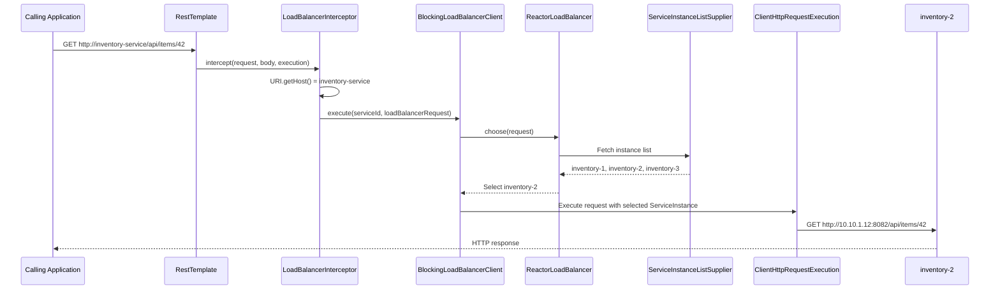

# LoadBalancerInterceptor and the URI Replacement Process

## Objectives

When calling a microservice with `RestTemplate`, you normally want to use a logical name like `inventory-service` instead of hardcoding the IP and port of a specific replica. In Spring Cloud LoadBalancer, `LoadBalancerInterceptor` acts as the bridge between `RestTemplate`'s synchronous HTTP call and `ServiceInstance` selection.

This lesson centers on the question: **why does a request written with the URI `http://inventory-service/...` end up being sent to `http://10.10.1.12:8082/...`?** This is not simple string replacement or mandatory DNS magic; it is an instance-selection and URI-reconstruction process inside Spring Cloud's request pipeline.

After this lesson, you will be able to:

- Understand the roles of `@LoadBalanced`, `RestTemplate`, `LoadBalancerInterceptor`, and `BlockingLoadBalancerClient`.
- Trace how the service ID is extracted, the instance list is fetched, a replica is selected, and the physical URI is reconstructed.
- Distinguish between the logical URI, the selected `ServiceInstance`, and the actual URI sent over HTTP.
- Explain the roles of `LoadBalancerRequestFactory`, `ServiceRequestWrapper`, and `LoadBalancerUriTools`.
- Handle malformed URIs, missing instances, scheme mismatches, and stale cache/discovery state.
- Practice with two backends and `SimpleDiscoveryClient`, observing how requests are distributed.

## 1. How a Logical URI Differs from a Physical URI

Suppose `order-service` wants to query inventory:

```java
String result = restTemplate.getForObject(
        "http://inventory-service/api/items/42?include=stock",
        String.class
);
```

In the call above:

| URI Part | Value | Role |
|---|---|---|
| Scheme | `http` | Protocol declared in the initial logical URI. |
| Host | `inventory-service` | **Service ID** to be resolved by LoadBalancer. |
| Path | `/api/items/42` | Business endpoint on the target service. |
| Query | `include=stock` | Request query parameter. |

Suppose discovery returns:

| Instance | Host | Port | Secure |
|---|---|---:|---|
| inventory-1 | `10.10.1.11` | 8081 | `false` |
| inventory-2 | `10.10.1.12` | 8082 | `false` |
| inventory-3 | `10.10.1.13` | 8083 | `false` |

If LoadBalancer selects `inventory-2`, the typical physical URI is:

```text
http://10.10.1.12:8082/api/items/42?include=stock
```

**The service ID in the host segment is replaced by the address of the chosen instance.** The path and query continue describing the resource being requested. This replacement only occurs when `RestTemplate` uses the LoadBalancer mechanism; a plain `RestTemplate` tries to treat `inventory-service` as a network hostname.

Do not hardcode `10.10.1.x` addresses in business code. When the replica count changes, discovery supplies the updated list and LoadBalancer chooses from it according to the configured policy.

## 2. Enabling LoadBalancer for RestTemplate

### 2.1. Required Dependencies

The project must choose a compatible Spring Boot and Spring Cloud Release Train pair, and use the Spring Cloud BOM to manage Cloud module versions. In Maven, declare:

```xml
<dependencies>
    <!-- Spring MVC for a demo app with HTTP endpoints (Spring Boot 4.x) -->
    <dependency>
        <groupId>org.springframework.boot</groupId>
        <artifactId>spring-boot-starter-webmvc</artifactId>
    </dependency>

    <dependency>
        <groupId>org.springframework.cloud</groupId>
        <artifactId>spring-cloud-starter-loadbalancer</artifactId>
    </dependency>
</dependencies>
```

`spring-boot-starter-webmvc` is the appropriate starter for a Spring Boot 4.x example with an MVC controller. A project making only outbound HTTP calls can use the appropriate HTTP client starter without pulling in a web server. In Spring Boot 3.x, web starter naming may differ; follow the version you are using.

### 2.2. Declaring the `@LoadBalanced` Bean

`RestTemplate` is not auto-created as a bean just by adding the starter. You must register a bean and annotate it with `@LoadBalanced`:

```java
import org.springframework.cloud.client.loadbalancer.LoadBalanced;
import org.springframework.context.annotation.Bean;
import org.springframework.context.annotation.Configuration;
import org.springframework.web.client.RestTemplate;

@Configuration(proxyBeanMethods = false)
class HttpClientConfiguration {

    @Bean
    @LoadBalanced
    RestTemplate loadBalancedRestTemplate() {
        return new RestTemplate();
    }
}
```

Spring Cloud detects beans qualified with `@LoadBalanced` and configures the appropriate interceptor to resolve service IDs. In modern versions, the interceptor chain may contain `DeferringLoadBalancerInterceptor` before delegating to the actual `LoadBalancerInterceptor`. When LoadBalancer retries are enabled and integration conditions are met, a retry-capable interceptor may also be used.

**You do not need to manually instantiate `LoadBalancerInterceptor`** or rewrite URI-replacement logic when auto-configuration is set up properly. The simplest and safest approach is declaring `@LoadBalanced` on the bean your application uses.

### 2.3. Using the Bean in Business Code

```java
import org.springframework.cloud.client.loadbalancer.LoadBalanced;
import org.springframework.stereotype.Service;
import org.springframework.web.client.RestTemplate;

@Service
class InventoryGateway {

    private final RestTemplate restTemplate;

    InventoryGateway(@LoadBalanced RestTemplate restTemplate) {
        this.restTemplate = restTemplate;
    }

    String findItem(int itemId) {
        return restTemplate.getForObject(
                "http://inventory-service/api/items/{id}",
                String.class,
                itemId
        );
    }
}
```

`@LoadBalanced` on the constructor parameter selects the right bean when the application defines multiple `RestTemplate` beans. `{id}` is expanded as a URI variable by `RestTemplate` before executing the request.

### 2.4. When a Direct RestTemplate Is Also Needed

Some URLs such as `https://api.example.org/v1` must be called directly without discovery. When an application needs both, declare them separately:

```java
@Bean
@LoadBalanced
RestTemplate loadBalancedRestTemplate() {
    return new RestTemplate();
}

@Bean
@Primary
RestTemplate directRestTemplate() {
    return new RestTemplate();
}
```

In real code, both beans sit inside a `@Configuration` class and require importing `org.springframework.context.annotation.Primary`. `@Primary` designates the direct HTTP bean for unqualified injections; to load-balance, inject with `@LoadBalanced`.

If you pass `http://localhost:8081` to a **`@LoadBalanced` bean**, the `localhost` host segment may be interpreted as **service ID `localhost`**. The call may therefore report `No instances available for localhost` instead of reaching localhost as intended. Use the direct bean for concrete server URLs.

## 3. What Does LoadBalancerInterceptor Do in the RestTemplate Chain?

`LoadBalancerInterceptor` is a Spring Framework `ClientHttpRequestInterceptor` implementation responsible for handing off `RestTemplate` requests to `LoadBalancerClient`.

High-level flow:



Steps from a developer's perspective:

1. `RestTemplate` receives the logical URL, HTTP method, headers, and body.
2. The `ClientHttpRequestInterceptor` chain is triggered. `LoadBalancerInterceptor` reads the current URI via `HttpRequest.getURI()`.
3. The interceptor reads `originalUri.getHost()` and treats it as the **service ID**.
4. The interceptor uses `LoadBalancerRequestFactory` to create a `LoadBalancerRequest` encapsulating the request, body, and `ClientHttpRequestExecution`.
5. `BlockingLoadBalancerClient.execute(serviceId, request)` performs instance selection via the load balancer for that service ID.
6. `ReactorLoadBalancer`—typically `RoundRobinLoadBalancer` if uncustomized—fetches candidates from `ServiceInstanceListSupplier`; the supplier may use discovery, caching, health checks, zones, or hints.
7. Once a `ServiceInstance` is chosen, the request executes via a wrapper providing the physical URI, optionally transformed further by `LoadBalancerRequestTransformer`.
8. `ClientHttpRequestExecution` sends the HTTP call to the chosen instance and returns `ClientHttpResponse` for `RestTemplate` to process.

The diagram and sequence above describe the logical flow. Certain auto-configuration or retry details vary by Spring Cloud version and application dependencies, but **logical host → service ID → instance selection → physical URI** is the essential core to understand.

## 4. Inside the Interceptor: Service ID Extracted from Host

The decision point mirrors the following pseudocode:

```java
// Pseudocode for explanation, not the full library source.
URI originalUri = request.getURI();
String serviceId = originalUri.getHost();

if (serviceId == null) {
    throw new IllegalStateException(
            "Request URI does not contain a valid hostname");
}

LoadBalancerRequest<ClientHttpResponse> lbRequest =
        requestFactory.createRequest(request, body, execution);

return loadBalancer.execute(serviceId, lbRequest);
```

There is no step that extracts `service ID` from the path. For `http://inventory-service/api/items/42`, the service ID is `inventory-service`, not `api` or `items`.

Because it uses `URI.getHost()`, the URL must have a **valid host**. Common mistakes include:

| Initial URI | What LoadBalancer receives |
|---|---|
| `http://inventory-service/api/items` | Host = `inventory-service`; valid. |
| `https://inventory-service/api/items` | Host = `inventory-service`; usable with compatible HTTPS instances. |
| `http://localhost:8081/api/items` | Host = `localhost`; treated as a service ID if the bean is load-balanced. |
| `/api/items` | Relative URI without a host; insufficient info to determine a service ID. |
| `http:///api/items` | URI lacks a valid host; fix the URL. |
| `http://inventory_service/api/items` | Host may not be recognized by Java `URI` as a valid DNS hostname; use a hostname-compliant service ID. |

`LoadBalancerInterceptor` does not automatically fix malformed URLs. A URI missing a hostname usually fails in the interceptor or request creation layer; a syntactically valid URL whose service ID has no instances is a separate error.

**Rule:** in a load-balanced `RestTemplate`, the host is a logical name; in a direct `RestTemplate`, the host is the DNS name or IP to connect to.

## 5. ServiceInstance Selection Happens Before URI Replacement

Once the service ID is known, `BlockingLoadBalancerClient` invokes the instance selection mechanism. The system may use one of these policies:

| Policy | Impact on outcome |
|---|---|
| Round robin | Alternates through the candidate list. |
| Random | Picks an instance at random. |
| Zone preference | Prefers instances whose zone metadata matches the caller. |
| Weighted | Distributes according to relative instance weights. |
| Hint/metadata filtering | Narrows or prioritizes instances prior to selection. |
| Health check | Uses instances passing health status checks, subject to supplier fallback behavior. |

For example, having `RoundRobinLoadBalancer` as the default does not mean every request always cycles across **all instances in the registry**. If an upstream supplier already filtered the list by zone or hint, the algorithm only picks from the remaining candidates.

The selected `ServiceInstance` carries minimal metadata such as:

```text
serviceId  = inventory-service
instanceId = inventory-2
host       = 10.10.1.12
port       = 8082
secure     = false
metadata   = {zone=zone-a, weight=2}
```

LoadBalancer does not "go through a new gateway" just because it selected an instance. In client-side load balancing, the HTTP client normally connects directly to the instance's host and port. However, network proxies, service meshes, or gateways may still lie along the path depending on deployment architecture.

If no instance is available, `BlockingLoadBalancerClient` may throw an `IllegalStateException` with a message such as:

```text
No instances available for inventory-service
```

This is a **caller-side** failure before reaching any backend. It does not automatically mean the backend returned HTTP `404` or `503`. The application or gateway may decide how to translate this error into a user-facing response.

## 6. Reconstructing the URI: ServiceRequestWrapper and reconstructURI

### 6.1. Not Modifying the Original URL String Directly

Once an instance is chosen, `LoadBalancerRequestFactory` builds a request callback to execute the call. In the default flow, `ServiceRequestWrapper` wraps the original `HttpRequest` and overrides `getURI()`.

Conceptually, the wrapper returns:

```java
// Pseudocode close to the API structure: illustrative only.
URI getURI() {
    return loadBalancer.reconstructURI(
            selectedInstance,
            originalRequest.getURI()
    );
}
```

`LoadBalancerClient.reconstructURI(instance, original)` builds a URI matching the physical endpoint. In Spring Cloud LoadBalancer's `BlockingLoadBalancerClient`, URI reconstruction relies on `LoadBalancerUriTools`.

In our running example:

```text
Logical URI:
  http://inventory-service/api/items/42?include=stock

Selected instance:
  inventory-2 { host=10.10.1.12, port=8082, secure=false }

Physical URI:
  http://10.10.1.12:8082/api/items/42?include=stock
```

Using `HttpRequestWrapper` lets downstream HTTP execution see the reconstructed URI while business code only ever sees the logical URI. You should never replace `inventory-service` with an IP address using `String.replace(...)` in the business layer.

### 6.2. What Changes and What Is Preserved?

| Request part | Behavior |
|---|---|
| Host in URI | Replaces the service ID with the chosen `ServiceInstance`'s host. |
| Port in URI | Uses the `ServiceInstance`'s port. |
| Scheme (`http`/`https`) | May be re-determined from `ServiceInstance.getScheme()` and `isSecure()`. |
| Path | Preserves the resource path from the logical URI unless a custom request transformer alters it. |
| Query | Preserves query parameters and encoding from the validly constructed URI. |
| HTTP method | Never changed simply because LoadBalancer chose an instance. |
| Body and headers | Forwarded through execution; may be modified by custom transformers/interceptors. |

A secure `ServiceInstance` can produce a final URI starting with `https://...` even if the original logical URI used `http://inventory-service/...`. Never assume the scheme always stays 100% unchanged; check the discovery implementation's metadata/`getScheme()`/`isSecure()` and the backend's TLS support.

Example of a secure case:

```text
Logical URI:
  http://inventory-service/api/items/42

Selected instance:
  host=inventory.internal.example
  port=8443
  secure=true

Typical physical URI:
  https://inventory.internal.example:8443/api/items/42
```

If metadata declares the wrong scheme or port, the client may hit connection or TLS errors. Do not try to work around it by rewriting `http` in the URL string yourself; fix the instance configuration and inspect the actual URI.

### 6.3. Encoding, Query Strings, and Fragments

For requests containing special characters, construct URIs properly using URI builder/`RestTemplate` APIs. Avoid arbitrary string concatenation:

```java
String result = restTemplate.getForObject(
        "http://inventory-service/api/search?keyword={keyword}",
        String.class,
        "café & tea"
);
```

The call above uses a URI variable so `RestTemplate` encodes the parameter rather than splicing `"&"` straight into the URL. If you pass an already-encoded `URI` object yourself, avoid double-encoding the query string.

`LoadBalancerUriTools` reconstructs a URI from an already valid URI; it does not replace input validation or fix malformed URLs.

Fragments like `#section` may appear in URI representations, but **are not transmitted on the HTTP request line**. Do not use fragments to pass business data to a backend.

## 7. What Are LoadBalancerRequestFactory and Transformers Responsible For?

`LoadBalancerRequestFactory` creates a `LoadBalancerRequest<ClientHttpResponse>` from:

- The original `HttpRequest`.
- The request's `byte[] body`.
- The `ClientHttpRequestExecution` used to continue sending HTTP after an instance is selected.

When executing the callback with a `ServiceInstance`, the request is wrapped in `ServiceRequestWrapper`, passed through configured `LoadBalancerRequestTransformer` beans (if any), and then sent via `execution.execute(...)`.

This is the proper extension point when you want to attach information about the selected instance as headers for internal diagnostics.

Example adding a replica-identifying header in a test environment:

```java
import org.springframework.cloud.client.loadbalancer.LoadBalancerRequestTransformer;
import org.springframework.http.HttpHeaders;
import org.springframework.http.client.support.HttpRequestWrapper;
import org.springframework.context.annotation.Bean;
import org.springframework.context.annotation.Configuration;

@Configuration(proxyBeanMethods = false)
class LoadBalancerDiagnosticsConfiguration {

    @Bean
    LoadBalancerRequestTransformer instanceHeaderTransformer() {
        return (request, instance) -> new HttpRequestWrapper(request) {
            @Override
            public HttpHeaders getHeaders() {
                HttpHeaders headers = new HttpHeaders();
                headers.putAll(super.getHeaders());
                if (instance != null && instance.getInstanceId() != null) {
                    headers.set("X-Debug-Instance-Id", instance.getInstanceId());
                }
                return headers;
            }
        };
    }
}
```

The transformer here does not pick the instance and does not rebuild the URI itself. It uses the chosen `ServiceInstance` metadata to enrich request headers. Do not send sensitive internal metadata to untrusted services; enable diagnostic headers only when there is a clear operational reason.

For WebClient, Spring Cloud provides a different transformer API designed for the reactive HTTP client. This lesson examines `RestTemplate`'s **blocking** execution path.

## 8. Hands-On: RestTemplate Calling Two Instances via One Service ID

Objective of this example: prove that the calling app only writes `http://inventory-service/whoami`, yet requests are sent across different physical instances.

### Step 1. Prepare Two Backends

Create a simple `inventory-service` application with an endpoint:

```java
import org.springframework.core.env.Environment;
import org.springframework.web.bind.annotation.GetMapping;
import org.springframework.web.bind.annotation.RestController;

@RestController
class WhoAmIController {

    private final Environment environment;

    WhoAmIController(Environment environment) {
        this.environment = environment;
    }

    @GetMapping("/whoami")
    String whoAmI() {
        return environment.getProperty("demo.instance-id", "unknown");
    }
}
```

Run two replicas with distinct configurations:

```text
Backend A: server.port=8081, demo.instance-id=inventory-A
Backend B: server.port=8082, demo.instance-id=inventory-B
```

Both backends must actually listen on those two ports. When using an IDE or two Java processes, pass `--server.port=8081 --demo.instance-id=inventory-A` to the first process and the corresponding values to the second.

### Step 2. Declare Static Instances in the Caller

To stay focused on the interceptor, we do not need Eureka yet. In the caller application's `application.yml`, use `SimpleDiscoveryClient`:

```yaml
server:
  port: 8080

spring:
  application:
    name: order-service
  cloud:
    discovery:
      client:
        simple:
          instances:
            inventory-service:
              - uri: http://localhost:8081
              - uri: http://localhost:8082
```

This is a demo list. In real deployments, the instance list can come from Eureka, Consul, Spring Cloud Kubernetes, or another discovery implementation. If backends are not discovered or are not actually running, LoadBalancer cannot establish successful connections from URI config alone.

### Step 3. Create the RestTemplate and Caller Endpoint

Use the `@LoadBalanced RestTemplate` bean from section 2. Create a demo endpoint:

```java
import org.springframework.cloud.client.loadbalancer.LoadBalanced;
import org.springframework.web.bind.annotation.GetMapping;
import org.springframework.web.bind.annotation.RestController;
import org.springframework.web.client.RestTemplate;

@RestController
class DemoController {

    private final RestTemplate inventoryRestTemplate;

    DemoController(@LoadBalanced RestTemplate restTemplate) {
        this.inventoryRestTemplate = restTemplate;
    }

    @GetMapping("/demo/inventory")
    String callInventory() {
        return inventoryRestTemplate.getForObject(
                "http://inventory-service/whoami",
                String.class
        );
    }
}
```

Here `@LoadBalanced` on the constructor selects the bean with the interceptor, and `inventory-service` in the URL is used as the service ID.

### Step 4. Send Multiple Requests

From a terminal, call:

```bash
curl "http://localhost:8080/demo/inventory"
curl "http://localhost:8080/demo/inventory"
curl "http://localhost:8080/demo/inventory"
curl "http://localhost:8080/demo/inventory"
```

With the default `RoundRobinLoadBalancer`, stable discovery data, and no instance-filtering policies, responses normally alternate between `inventory-A` and `inventory-B`. Which instance is picked first should not be treated as fixed; with multiple callers, concurrent requests, retries, or custom configuration, the observed sequence may vary.

### Step 5. Compare Logical URI vs. Physical URI

| Component | Value |
|---|---|
| URI in `DemoController` | `http://inventory-service/whoami` |
| Service ID from `getHost()` | `inventory-service` |
| List from `SimpleDiscoveryClient` | `localhost:8081`, `localhost:8082` |
| Selected `ServiceInstance` | One of the two instances above |
| Actual URI when A is chosen | `http://localhost:8081/whoami` |
| Actual URI when B is chosen | `http://localhost:8082/whoami` |

This directly demonstrates `LoadBalancerInterceptor` and `reconstructURI`: the application calls by service ID, while the backend receives an HTTP request on the corresponding physical port.

### Step 6. Test Failure Scenarios

1. Stop both backends while keeping the static discovery config: the instance list may still exist, yet connecting to the ports will fail; this is **not necessarily** a "No instances available" error.
2. Delete or misspell the `inventory-service` key in discovery config: LoadBalancer cannot find instances and reports a service-selection failure.
3. Call `http://localhost:8081/whoami` with the `@LoadBalanced` bean: LoadBalancer may look up service ID `localhost` and fail.
4. Use a `RestTemplate` without the interceptor to call `http://inventory-service/whoami`: the system attempts DNS hostname resolution; without a matching DNS record, it fails with a host resolution error.

These cases separate **no instance found**, **instance selected but HTTP connection failed**, and **RestTemplate not configured with LoadBalancer**.

## 9. Observing the Interceptor and URI Replacement

### 9.1. Checking Whether RestTemplate Has the Interceptor

In development, you can print the bean's interceptor list:

```java
@Bean
ApplicationRunner inspectRestTemplate(
        @LoadBalanced RestTemplate restTemplate) {
    return args -> restTemplate.getInterceptors()
            .forEach(interceptor ->
                    System.out.println(interceptor.getClass().getName()));
}
```

Import `org.springframework.boot.ApplicationRunner`, `org.springframework.context.annotation.Bean`, and the corresponding `RestTemplate` and `LoadBalanced` types. The actual interceptor class name may be `LoadBalancerInterceptor`, `DeferringLoadBalancerInterceptor`, or a retry variant depending on version and configuration.

If the list lacks the expected LoadBalancer interceptor, check dependencies, the `@LoadBalanced` qualifier, whether the bean is Spring-managed, and auto-configuration settings. Calling `new RestTemplate()` inside a business method **does not** cause that object to receive interceptors from a bean post-processor.

### 9.2. Enabling Logs in Development

```yaml
logging:
  level:
    org.springframework.cloud.client.loadbalancer: DEBUG
    org.springframework.cloud.loadbalancer: DEBUG
```

Logs help surface instance-selection failures and LoadBalancer component activity, though exact log entries vary by version and configuration. Do not assume every request automatically logs the full physical URI. You can supplement diagnostics with backend logs (`/whoami`), `LoadBalancerLifecycle`, or a request transformer.

### 9.3. Inspecting with a Debugger

To trace execution directly, set breakpoints at:

1. `LoadBalancerInterceptor.intercept(...)`: inspect initial `request.getURI()` and `originalUri.getHost()`.
2. `BlockingLoadBalancerClient.execute(...)`: inspect the service ID, candidate list, and selected `ServiceInstance`.
3. `ServiceRequestWrapper.getURI()`: compare the logical URI with `reconstructURI(...)`.
4. `ClientHttpRequestExecution.execute(...)`: inspect the actual URI used by the request factory during execution.

You do not need to modify library source code to debug. Attach the source JAR matching the Spring Cloud version on the classpath. Breakpoints and class names may vary by version, especially when retries or deferred interceptors are active.

## 10. Common Errors

| Symptom | Possible cause | How to resolve |
|---|---|---|
| `No instances available for inventory-service` | Wrong service ID, empty discovery, or supplier filtered all candidates | Check service name, registry, and final `ServiceInstance` list. |
| `No instances available for localhost` | Calling a physical URL with a `@LoadBalanced RestTemplate` | Use a direct `RestTemplate` or a valid service ID URL. |
| `UnknownHostException: inventory-service` | RestTemplate lacks LoadBalancer or app uses DNS instead of discovery | Check `@LoadBalanced`, auto-configuration, and `getInterceptors()`. |
| `Request URI does not contain a valid hostname` | Relative URI or invalid host | Use an absolute URI with a valid scheme and service ID. |
| `Connection refused` after selecting instance | Wrong port, stopped backend, or stale cache/discovery entry | Check host, port, readiness, cache, and backend status. |
| SSL/TLS handshake failure | Scheme/port/secure metadata does not match backend TLS | Check `getScheme()`, `isSecure()`, certificates, and actual port. |
| Query mangled or double-encoded | URI concatenated/encoded improperly before reconstruction | Use URI templates/builders properly and inspect the URI before the interceptor. |
| Requests routed to wrong stable/canary group | Missing hint supplier, mismatched metadata, or filter fallback | Inspect the supplier chain and metadata per service ID. |
| Requests not split evenly | List caching, filters, retries, or non-round-robin algorithm | Compare supplier, algorithm, request counts, and actual traffic per instance. |
| Manual interceptor config causes unexpected behavior | Multiple LoadBalancer interceptors on one bean or wrong ordering | Prefer auto-configuration and avoid adding duplicate interceptors manually. |

## 11. Retries, Timeouts, and Health Checks in This Flow

`LoadBalancerInterceptor` is primarily responsible for routing requests through **instance selection and LoadBalancer execution**. It does not replace other reliability layers:

- **Discovery:** must publish live instances with accurate metadata.
- **Caching:** may keep stale instance lists around until the next refresh cycle.
- **Health checks:** can filter out unhealthy instances, subject to supplier limits and fallback behavior.
- **Retries:** can pick another instance according to policy, but not every request is safe to repeat.
- **Timeouts:** must be configured on the HTTP request factory/client; do not expect LoadBalancer to set timeouts for connections automatically.
- **Circuit breakers:** are a separate mechanism and are not enabled simply by adding the LoadBalancer starter.

For instance, for a side-effect-free `GET` read, bounded retries to another instance can help survive an instance that just shut down. However, for a payment or order-creation `POST`, auto-retrying without an idempotency key can cause duplicate processing. Coordinate retries across LoadBalancer, the HTTP client, and the gateway so total attempts stay within budget.

**When no instances exist:** failure can occur before any physical HTTP request is made. **When an instance exists but is dead:** instance selection succeeds and the failure appears at the connection layer. Monitor and handle these two failure modes separately.

## 12. Checklist for Understanding URI Replacement Correctly

- [ ] The `RestTemplate` used in business code is a Spring-managed bean annotated with `@LoadBalanced`.
- [ ] `spring-cloud-starter-loadbalancer` and compatible Spring Boot/Spring Cloud versions are present.
- [ ] The logical URI includes a scheme and a host containing the exact service ID.
- [ ] The service ID matches the discovery name; instances have accurate host/port/scheme metadata.
- [ ] Instance selection is clearly distinguished from HTTP request execution.
- [ ] Understand that `LoadBalancerInterceptor` extracts the service ID from `URI.getHost()`.
- [ ] Understand the roles of `LoadBalancerRequestFactory` and `ServiceRequestWrapper`.
- [ ] Know that `LoadBalancerClient.reconstructURI(...)` builds the physical URI from `ServiceInstance`.
- [ ] Verify path and query still describe the right endpoint after reconstruction.
- [ ] Do not use a `@LoadBalanced` bean to call `localhost` or raw IPs directly without a matching service ID.
- [ ] Distinguish between no-instance errors and connection errors to a selected instance.
- [ ] Configure timeouts, retries, and caching at the proper layers and verify against real backends.
- [ ] Have a way to inspect interceptors, logs, or breakpoints to confirm where requests are actually sent.

## Conclusion

`LoadBalancerInterceptor` enables `RestTemplate` to call services using a **logical URI** without knowing individual replica addresses. The interceptor extracts the service ID from the URI host and delegates the request to `BlockingLoadBalancerClient`. After LoadBalancer picks a `ServiceInstance` from candidates, `ServiceRequestWrapper` supplies the physical URI via `LoadBalancerClient.reconstructURI(...)`, and `ClientHttpRequestExecution` sends the actual HTTP request.

The most important point is that **URIs are not arbitrarily rewritten before calling RestTemplate**: the final address emerges as the result of discovery → instance selection → URI reconstruction → HTTP execution. Understanding this boundary lets you accurately debug missing-service errors, scheme/port mismatches, stale caches, and timeouts.

## References

- [Spring Cloud Commons — Spring RestTemplate as a LoadBalancer Client](https://docs.spring.io/spring-cloud-commons/reference/spring-cloud-commons/common-abstractions.html)
- [Spring Cloud Commons 5.0.4 — Spring Cloud LoadBalancer](https://docs.spring.io/spring-cloud-commons/reference/spring-cloud-commons/loadbalancer.html)
- [Spring Cloud Commons source — LoadBalancerInterceptor](https://github.com/spring-cloud/spring-cloud-commons/blob/main/spring-cloud-commons/src/main/java/org/springframework/cloud/client/loadbalancer/LoadBalancerInterceptor.java)
- [Spring Cloud Commons source — ServiceRequestWrapper](https://github.com/spring-cloud/spring-cloud-commons/blob/main/spring-cloud-commons/src/main/java/org/springframework/cloud/client/loadbalancer/ServiceRequestWrapper.java)
- [Spring Cloud Commons source — LoadBalancerClient](https://github.com/spring-cloud/spring-cloud-commons/blob/main/spring-cloud-commons/src/main/java/org/springframework/cloud/client/loadbalancer/LoadBalancerClient.java)
- [Spring Cloud Commons source — LoadBalancerRequestFactory](https://github.com/spring-cloud/spring-cloud-commons/blob/main/spring-cloud-commons/src/main/java/org/springframework/cloud/client/loadbalancer/LoadBalancerRequestFactory.java)
- [Spring Boot 4 — Spring MVC starter and dependency management](https://docs.spring.io/spring-boot/4.0/tutorial/first-application/index.html)
