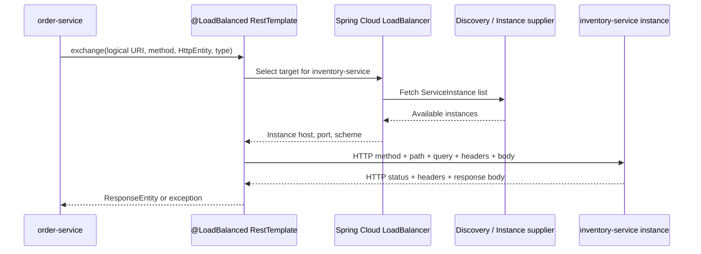

# Sending Path, Query, Headers, and Body in Load-Balanced Calls

An HTTP call between microservices usually contains more than a simple URL: **path variables** identify resources, **query parameters** express filter criteria, **headers** carry authentication or correlation IDs, and the **body** carries business payloads. When using Spring Cloud LoadBalancer with `RestTemplate`, these components are still transmitted through standard HTTP mechanics; the difference is that **the initial URL's host is a service ID**, not a replica's physical address.

This lesson belongs to the **RestTemplate** chapter of the `SPRING_CLOUD_SERVICE_COMMUNICATION_LOAD_BALANCING` module. We will build a client for `inventory-service`, using `@LoadBalanced RestTemplate` to send GET and POST requests, preserving path/query/headers/body while LoadBalancer selects a `ServiceInstance` based on discovery and routing policies. The final sections cover encoding, error handling, timeouts/retries, and testing that a call genuinely routes through LoadBalancer.

## 1. From Service ID to Complete HTTP Request

Suppose `order-service` wants to read inventory for SKU `SKU-001` at warehouse `hcm-01`. The target API expects:

```http
GET /api/v1/items/SKU-001?warehouse=hcm-01 HTTP/1.1
Accept: application/json
Authorization: Bearer <access-token>
X-Correlation-ID: req-2042
```

`order-service` uses the logical URI:

```text
http://inventory-service/api/v1/items/SKU-001?warehouse=hcm-01
       └── service ID ──┘
```

Suppose discovery returns two instances:

| Service ID | Instance | Host | Port |
|---|---|---|---:|
| `inventory-service` | `inventory-1` | `10.0.2.11` | 8081 |
| `inventory-service` | `inventory-2` | `10.0.2.12` | 8082 |

LoadBalancer picks an instance and replaces the logical destination with that instance's address. For example, the request may be sent to:

```text
http://10.0.2.12:8082/api/v1/items/SKU-001?warehouse=hcm-01
```

**Path, query, headers, and body are not modified by the default round-robin or random algorithms.** The algorithm primarily selects the instance; HTTP parts are preserved by the client as constructed in the request. If the project installs a request-aware routing supplier, headers or hints may **be used to determine the eligible instance subset**, though that does not mean LoadBalancer generates or rewrites every header on its own.



On the no-instance branch, the failure occurs during target selection or client integration; do not assume an HTTP request ever reached the target service.

## 2. Requirements for a Load-Balanced RestTemplate

You need:

1. A Spring Boot application using Spring Web or the dependencies needed to create a `RestTemplate`.
2. `spring-cloud-starter-loadbalancer` compatible with the active Spring Boot and Spring Cloud BOM.
3. A `ServiceInstance` provider, such as Eureka/Consul/Kubernetes discovery or `SimpleDiscoveryClient`.
4. A `RestTemplate` bean annotated with `@LoadBalanced`.
5. URLs using the exact registered **service ID**.

Example Maven dependencies required for a synchronous client:

```xml
<dependencies>
    <dependency>
        <groupId>org.springframework.boot</groupId>
        <artifactId>spring-boot-starter-web</artifactId>
    </dependency>

    <dependency>
        <groupId>org.springframework.cloud</groupId>
        <artifactId>spring-cloud-starter-loadbalancer</artifactId>
    </dependency>

    <!-- Only add the matching discovery starter if using a registry.
         For example, when using Eureka:
    <dependency>
        <groupId>org.springframework.cloud</groupId>
        <artifactId>spring-cloud-starter-netflix-eureka-client</artifactId>
    </dependency>
    -->
</dependencies>
```

The example assumes the project already imports the `org.springframework.cloud:spring-cloud-dependencies` BOM in `dependencyManagement`, so explicit versions are not needed for BOM-managed Spring Cloud starters.

### 2.1. Registering the @LoadBalanced RestTemplate Bean

```java
import org.springframework.cloud.client.loadbalancer.LoadBalanced;
import org.springframework.context.annotation.Bean;
import org.springframework.context.annotation.Configuration;
import org.springframework.web.client.RestTemplate;

@Configuration(proxyBeanMethods = false)
public class HttpClientConfiguration {

    @Bean("loadBalancedRestTemplate")
    @LoadBalanced
    RestTemplate loadBalancedRestTemplate() {
        return new RestTemplate();
    }
}
```

Spring Boot **does not automatically create a `RestTemplate` bean** for injection; declare the bean as shown above. The `@LoadBalanced` annotation tells Spring Cloud to attach instance-selection integration to that bean when the required dependencies are present.

If a separate `RestTemplate` is needed for fixed external URLs, declare a second bean:

```java
@Bean("plainRestTemplate")
RestTemplate plainRestTemplate() {
    return new RestTemplate();
}
```

When injecting, use `@Qualifier("loadBalancedRestTemplate")` or the `@LoadBalanced` qualifier to avoid picking up the plain bean by mistake. Do not assume every `RestTemplate` bean is load-balanced merely because the application includes a Spring Cloud starter.

### 2.2. Logical URI vs. Physical URI

| URI | Meaning |
|---|---|
| `http://inventory-service/api/v1/items` | Logical URI: host is a service ID, routed via LoadBalancer |
| `http://10.0.2.12:8082/api/v1/items` | Physical URI: points to a concrete target; no service ID discovery benefits |
| `http://localhost:8081/api/v1/items` | Local URI, commonly used for testing a single instance |
| `https://inventory-service/api/v1/items` | Logical URI using HTTPS; actual scheme must match instance security config |

Do not manually resolve DNS for `inventory-service` before calling and rewrite the URL to an IP if the goal is selecting instances via Spring Cloud LoadBalancer. Also avoid hardcoding host/port values in controllers or gateways when services can scale.

## 3. RestTemplate.exchange Is the General-Purpose Method

`RestTemplate` offers shortcuts such as `getForObject`, `getForEntity`, and `postForEntity`. However, when sending **custom headers and a body in the same call**, `exchange` is usually clearer:

```java
<T> ResponseEntity<T> exchange(
        URI url,
        HttpMethod method,
        HttpEntity<?> requestEntity,
        Class<T> responseType);
```

Parameters:

| Parameter | Role |
|---|---|
| `URI url` | Constructed and encoded scheme, service ID, path, and query |
| `HttpMethod method` | `GET`, `POST`, `PUT`, `PATCH`, `DELETE`, ... |
| `HttpEntity<?> requestEntity` | Outbound headers and body |
| `Class<T> responseType` | Response data type converted from JSON/XML/... by message converters |

The returned `ResponseEntity<T>` lets you inspect `getStatusCode()`, `getHeaders()`, and `getBody()` together.

For a standard GET, use `HttpEntity<Void>` holding only headers. For POST/PUT, use `HttpEntity<Payload>` with a DTO as the body.

**Note:** `exchange` does not automatically retry or configure timeouts just because the caller passes richer HTTP components. Configure those separately.

## 4. Sending Path Variables Safely

A concise call uses a URI template:

```java
ResponseEntity<ItemView> response = restTemplate.getForEntity(
        "http://inventory-service/api/v1/items/{sku}",
        ItemView.class,
        "SKU-001");
```

Or using named variables:

```java
Map<String, ?> values = Map.of("sku", "SKU-001");

ResponseEntity<ItemView> response = restTemplate.getForEntity(
        "http://inventory-service/api/v1/items/{sku}",
        ItemView.class,
        values);
```

Spring substitutes `{sku}` with the appropriate value. However, when values contain special characters such as spaces, `/`, or `+`, you need to understand the URI encoding mode in use.

### 4.1. Building URIs with UriComponentsBuilder

A clear way to control encoding is **encoding the template first, then expanding variables**:

```java
import java.net.URI;
import org.springframework.web.util.UriComponentsBuilder;

String sku = "SKU/2026";

URI uri = UriComponentsBuilder
        .fromUriString("http://inventory-service")
        .path("/api/v1/items/{sku}")
        .encode()
        .buildAndExpand(sku)
        .toUri();

// Expected raw path:
// /api/v1/items/SKU%2F2026
```

Calling `UriComponentsBuilder.encode()` before `buildAndExpand(...)` ensures reserved characters inside **variable values** are encoded as data. If you concatenate `sku` into the URL prior to encoding, `/` may be interpreted as a path segment delimiter.

Avoid raw string concatenation:

```java
// Avoid: lacks encoding and path-segmentation control.
String url = "http://inventory-service/api/v1/items/" + sku;
```

You can use `pathSegment("api", "v1", "items", "{sku}")` when you want explicit segment-by-segment path construction. Still, whether the target servlet or gateway permits encoded slashes (`%2F`) depends on server and security configuration; proper encoding does not mean every router accepts a SKU containing a slash.

## 5. Sending Query Parameters

Query parameters belong to the URI after `?`. Example endpoint with filter parameters:

```http
GET /api/v1/items/SKU-001?warehouse=hcm-01&includeReserved=true HTTP/1.1
```

Using the builder:

```java
URI uri = UriComponentsBuilder
        .fromUriString("http://inventory-service")
        .path("/api/v1/items/{sku}")
        .queryParam("warehouse", "{warehouse}")
        .queryParam("includeReserved", "{reserved}")
        .encode()
        .buildAndExpand(
                Map.of(
                        "sku", "SKU-001",
                        "warehouse", "hcm-01",
                        "reserved", true))
        .toUri();
```

The result preserves the logical host `inventory-service`, expands the path, and serializes the query with the request.

### 5.1. Queries Containing Spaces, &, +, or Vietnamese Characters

Example searching with keyword `áo + đỏ&xanh`:

```java
URI uri = UriComponentsBuilder
        .fromUriString("http://catalog-service")
        .path("/api/v1/search")
        .queryParam("q", "{keyword}")
        .encode()
        .buildAndExpand("áo + đỏ&xanh")
        .toUri();
```

When the template is encoded before expansion, `+` and `&` inside **variable values** are encoded so they are not parsed as query syntax. Never manually replace spaces with `+` and then encode a second time.

Once you have a properly built and encoded `java.net.URI`, pass the **URI object** directly to the `RestTemplate.exchange(URI, ...)` or `getForEntity(URI, ...)` overload. This prevents `RestTemplate` from treating a string as another URI template requiring re-encoding.

### 5.2. Repeated and Optional Query Parameters

An API can accept multiple tags:

```java
URI uri = UriComponentsBuilder
        .fromUriString("http://catalog-service")
        .path("/api/v1/items")
        .queryParam("tag", "sale", "featured")
        .queryParam("page", 2)
        .build()
        .toUri();
```

The query can contain `tag=sale&tag=featured&page=2`. If an optional parameter is absent, add `queryParam` only when a valid value is present rather than passing `null` to the builder; the target API contract should agree on whether an omitted parameter differs from an empty string.

### 5.3. Keep Secrets Out of Query Strings

Avoid placing access tokens, passwords, secret API keys, or sensitive data in query strings whenever possible. URIs frequently appear in access logs, metrics, tracing, or proxies. Tokens normally belong in the `Authorization` header per API authentication design.

## 6. Sending Headers via HttpHeaders

Headers carry metadata outside the URI, such as:

- `Accept: application/json`: client expects JSON.
- `Authorization: Bearer ...`: authentication for the target service.
- `X-Correlation-ID` or `traceparent`: tracing a transaction.
- `X-Request-Source`: business context if defined.
- `Idempotency-Key`: protecting write operations when retries may occur.
- `Content-Type: application/json`: format of the outbound body.

Example creating headers:

```java
import java.util.List;
import org.springframework.http.HttpHeaders;
import org.springframework.http.MediaType;

HttpHeaders headers = new HttpHeaders();
headers.setAccept(List.of(MediaType.APPLICATION_JSON));
headers.setBearerAuth(accessToken);
headers.set("X-Correlation-ID", correlationId);
```

`setBearerAuth(accessToken)` takes the **raw token**, not `"Bearer <token>"`, because the method prepends the `Bearer` scheme for you.

**Headers are not automatically forwarded from inbound requests.** If `order-service`'s controller receives `X-Correlation-ID` from a caller, the gateway must explicitly read, validate, and attach the outbound header. Forward only allowlisted headers; avoid copying all headers containing cookies or `Authorization` not intended for the target service.

### 6.1. Sending a GET with Headers

```java
HttpEntity<Void> request =
        new HttpEntity<>(null, headers);

ResponseEntity<ItemView> response = restTemplate.exchange(
        uri,
        HttpMethod.GET,
        request,
        ItemView.class);
```

For this GET request, `request` carries only headers. `HttpEntity<Void>` has no body; the response can contain status, response headers, and DTO.

### 6.2. Adding Dynamic Headers Without Leaking Data

Never log full `Authorization` headers. When analyzing a request, log `correlationId`, service ID, path template, status, duration, and error code instead of raw tokens.

Do not let external users arbitrarily dictate internal headers like zone, hint, or tenant if those values influence routing or security policies. Enforce allowlists and authorization checks before promoting them to outbound headers.

## 7. Sending a JSON Body with HttpEntity

For a stock reservation, `order-service` calls:

```http
POST /api/v1/reservations?source=checkout HTTP/1.1
Content-Type: application/json
Accept: application/json
Authorization: Bearer <access-token>
Idempotency-Key: checkout-evt-2042

{
  "sku": "SKU-001",
  "quantity": 2
}
```

The body is an object serialized into JSON by a Spring message converter (typically Jackson when Spring Web/Jackson is present).

Illustrative DTOs using Java records:

```java
public record ReserveStockRequest(
        String sku,
        int quantity) {
}

public record ReserveStockResponse(
        String reservationId,
        String status) {
}
```

Building the URI and entity:

```java
URI uri = UriComponentsBuilder
        .fromUriString("http://inventory-service")
        .path("/api/v1/reservations")
        .queryParam("source", "{source}")
        .encode()
        .buildAndExpand("checkout")
        .toUri();

HttpHeaders headers = new HttpHeaders();
headers.setContentType(MediaType.APPLICATION_JSON);
headers.setAccept(List.of(MediaType.APPLICATION_JSON));
headers.setBearerAuth(accessToken);
headers.set("Idempotency-Key", idempotencyKey);

ReserveStockRequest body =
        new ReserveStockRequest("SKU-001", 2);

HttpEntity<ReserveStockRequest> request =
        new HttpEntity<>(body, headers);

ResponseEntity<ReserveStockResponse> response =
        restTemplate.exchange(
                uri,
                HttpMethod.POST,
                request,
                ReserveStockResponse.class);
```

In this example:

| Part | Value | Source |
|---|---|---|
| Service ID | `inventory-service` | URI logical host |
| Path | `/api/v1/reservations` | `UriComponentsBuilder.path(...)` |
| Query | `source=checkout` | `queryParam(...)` |
| Headers | `Authorization`, `Content-Type`, `Idempotency-Key` | `HttpHeaders` |
| Body | JSON containing `sku` and `quantity` | `HttpEntity<ReserveStockRequest>` |
| Physical target | An available `ServiceInstance` | Spring Cloud LoadBalancer |

**Do not manually set the `Host` header to an instance IP**, and do not hardcode physical URIs. LoadBalancer handles target selection, and the HTTP client sends the request to that chosen target.

### 7.1. PUT, PATCH, and DELETE

`exchange` also supports `HttpMethod.PUT`, `HttpMethod.PATCH`, and `HttpMethod.DELETE`, depending on the request factory and target server. Example updating a resource:

```java
HttpEntity<UpdateItemRequest> request =
        new HttpEntity<>(updateBody, headers);

restTemplate.exchange(
        "http://inventory-service/api/v1/items/{sku}",
        HttpMethod.PUT,
        request,
        Void.class,
        sku);
```

This illustrates the syntax. If `sku` contains special characters, use the URI builder as shown earlier. `PATCH` support can depend on the underlying HTTP client/request factory; do not assume every JDK implementation handles `PATCH` identically.

`DELETE` typically has no body, though if a target API requires one, `exchange` lets you model the request entity subject to HTTP client support and the API contract. Do not rely on `DELETE` bodies unless agreed upon with the server and intermediary proxies.

## 8. Complete Example: Gateway Sending Path, Query, Headers, and Body

A gateway class injects the load-balanced `RestTemplate` bean via qualifier and exposes two methods: reading an item and creating a stock reservation.

```java
package com.example.order.inventory;

import java.net.URI;
import java.util.List;
import java.util.Map;
import java.util.Objects;

import org.springframework.beans.factory.annotation.Qualifier;
import org.springframework.http.HttpEntity;
import org.springframework.http.HttpHeaders;
import org.springframework.http.HttpMethod;
import org.springframework.http.MediaType;
import org.springframework.http.ResponseEntity;
import org.springframework.stereotype.Service;
import org.springframework.web.client.RestTemplate;
import org.springframework.web.util.UriComponentsBuilder;

@Service
public class InventoryGateway {

    private final RestTemplate restTemplate;

    public InventoryGateway(
            @Qualifier("loadBalancedRestTemplate")
            RestTemplate restTemplate) {
        this.restTemplate = restTemplate;
    }

    public ItemView findItem(
            String sku,
            String warehouse,
            String accessToken,
            String correlationId) {

        URI uri = UriComponentsBuilder
                .fromUriString("http://inventory-service")
                .path("/api/v1/items/{sku}")
                .queryParam("warehouse", "{warehouse}")
                .encode()
                .buildAndExpand(
                        Map.of(
                                "sku", sku,
                                "warehouse", warehouse))
                .toUri();

        HttpHeaders headers = new HttpHeaders();
        headers.setAccept(List.of(MediaType.APPLICATION_JSON));
        headers.setBearerAuth(accessToken);
        headers.set("X-Correlation-ID", correlationId);

        HttpEntity<Void> request =
                new HttpEntity<>(null, headers);

        ResponseEntity<ItemView> response =
                restTemplate.exchange(
                        uri,
                        HttpMethod.GET,
                        request,
                        ItemView.class);

        return Objects.requireNonNull(
                response.getBody(),
                "Inventory response body is empty");
    }

    public ReserveStockResponse reserve(
            String sku,
            int quantity,
            String accessToken,
            String idempotencyKey) {

        URI uri = UriComponentsBuilder
                .fromUriString("http://inventory-service")
                .path("/api/v1/reservations")
                .queryParam("source", "{source}")
                .encode()
                .buildAndExpand("checkout")
                .toUri();

        HttpHeaders headers = new HttpHeaders();
        headers.setContentType(MediaType.APPLICATION_JSON);
        headers.setAccept(List.of(MediaType.APPLICATION_JSON));
        headers.setBearerAuth(accessToken);
        headers.set("Idempotency-Key", idempotencyKey);

        ReserveStockRequest body =
                new ReserveStockRequest(sku, quantity);

        HttpEntity<ReserveStockRequest> request =
                new HttpEntity<>(body, headers);

        ResponseEntity<ReserveStockResponse> response =
                restTemplate.exchange(
                        uri,
                        HttpMethod.POST,
                        request,
                        ReserveStockResponse.class);

        return Objects.requireNonNull(
                response.getBody(),
                "Reservation response body is empty");
    }
}
```

The illustrative DTO types must be declared in the project, for example:

```java
package com.example.order.inventory;

public record ItemView(
        String sku,
        int available,
        String servedBy) {
}

public record ReserveStockRequest(
        String sku,
        int quantity) {
}

public record ReserveStockResponse(
        String reservationId,
        String status) {
}
```

This sample code uses Java with `record` support (such as Java 17+), with Spring Web and Spring Cloud Commons/LoadBalancer configured. On the `inventory-service` side, matching API endpoints and message converters are required.

Inside the gateway class, never call `new RestTemplate()` because that newly created object will not receive the LoadBalancer interceptor from Spring Cloud like the configured bean. Likewise, never embed `10.0.2.x` instance addresses there.

### 8.1. ResponseEntity and Empty Response Bodies

`getBody()` can return `null` if the API responds with a bodyless status such as `204 No Content`. The complete example uses `Objects.requireNonNull` to enforce the contract that **a JSON body is mandatory**. In production code, translate this condition into a typed error or return `Optional` depending on API design, rather than leaving an ambiguous exception.

## 9. Path and Query with Lists or Complex Response Types

When an API returns a list of DTOs, generic type info is erased at runtime if you only pass `List.class`. Use `ParameterizedTypeReference`:

```java
import java.net.URI;
import java.util.List;

import org.springframework.core.ParameterizedTypeReference;
import org.springframework.http.HttpEntity;
import org.springframework.http.HttpMethod;
import org.springframework.http.ResponseEntity;

URI uri = UriComponentsBuilder
        .fromUriString("http://inventory-service")
        .path("/api/v1/items")
        .queryParam("warehouse", "{warehouse}")
        .encode()
        .buildAndExpand("hcm-01")
        .toUri();

ResponseEntity<List<ItemView>> response =
        restTemplate.exchange(
                uri,
                HttpMethod.GET,
                new HttpEntity<Void>(null, headers),
                new ParameterizedTypeReference<List<ItemView>>() {});
```

This informs Jackson and `RestTemplate` of the element type inside the list instead of a raw `List`.

If the API returns paginated data, declare a DTO like `PageResponse<ItemView>` or an appropriate wrapper record, and use `ParameterizedTypeReference<PageResponse<ItemView>>`.

### 9.1. Preserving the Service ID When Building Dynamic URIs

Even as paths or queries vary, the **logical base URI** must stay consistent:

```text
http://inventory-service
  ├─ /api/v1/items/{sku}?warehouse={warehouse}
  └─ /api/v1/reservations?source={source}
```

Never build the host from untrusted user-supplied parameters. If a caller can alter the scheme or host, requests can be redirected outside discovery policy and introduce SSRF risks. Permit only service IDs and endpoints defined by the application.

## 10. Setting Timeouts for Synchronous Calls

`RestTemplate` is a synchronous client: the calling thread waits until a response arrives or an error/timeout occurs. Load balancing does not replace connect timeouts or read timeouts.

Example using `SimpleClientHttpRequestFactory`:

```java
import org.springframework.cloud.client.loadbalancer.LoadBalanced;
import org.springframework.context.annotation.Bean;
import org.springframework.context.annotation.Configuration;
import org.springframework.http.client.SimpleClientHttpRequestFactory;
import org.springframework.web.client.RestTemplate;

@Configuration(proxyBeanMethods = false)
class TimedRestTemplateConfiguration {

    @Bean("loadBalancedRestTemplate")
    @LoadBalanced
    RestTemplate loadBalancedRestTemplate() {
        SimpleClientHttpRequestFactory factory =
                new SimpleClientHttpRequestFactory();

        factory.setConnectTimeout(2_000);
        factory.setReadTimeout(5_000);

        return new RestTemplate(factory);
    }
}
```

The millisecond values here are illustrative only. Use **either** the `loadBalancedRestTemplate` bean configuration from section 2 or section 10; do not declare duplicate beans with the same name in one application.

In real systems, use a request factory with connection pooling and proper TLS support. Configure connect/read timeouts according to the underlying HTTP library and verify against your Spring Boot/Spring Framework version. Connect/read timeouts do not inherently enforce an **overall deadline across multiple retries**.

If a request goes through service discovery, instance selection, HTTP connection, and retries, budget the end-to-end execution time. Avoid letting a single request pin a thread too long or stacking timeouts across multiple layers.

## 11. Handling Errors at the Layer Where They Occur

A request can fail across several layers:

| Scenario | Layer | Possible symptom |
|---|---|---|
| Wrong service ID | Discovery/supplier | No candidates for service name |
| No valid instances left | LoadBalancer | Target selection error or error response depending on integration |
| Stopped instance | Network | Connection refused or timeout |
| Expired token | Target service | HTTP 401/403 |
| SKU does not exist | Target service | HTTP 404 |
| Target service overloaded | Target service | HTTP 429/503 |
| DTO/JSON contract mismatch | Message converter | Parse/serialization error |
| Empty response body | API contract | `getBody() == null` |

By default, `RestTemplate` throws exceptions on 4xx or 5xx status codes:

- `HttpClientErrorException` for 4xx.
- `HttpServerErrorException` for 5xx.
- `ResourceAccessException` for certain I/O errors, including connection/timeout failures.
- `RestClientException` is the parent type of many RestTemplate exceptions.

Classification example:

```java
try {
    ItemView item = inventoryGateway.findItem(
            sku, warehouse, accessToken, correlationId);
    return item;
} catch (HttpClientErrorException.NotFound ex) {
    // SKU absent on target service; handle according to business logic.
    throw new ItemUnavailableException(sku, ex);
} catch (HttpServerErrorException ex) {
    // Target service returned 5xx; record dependency failure.
    throw new DependencyUnavailableException(
            "inventory-service returned 5xx", ex);
} catch (ResourceAccessException ex) {
    // May be a timeout or network I/O failure.
    throw new DependencyUnavailableException(
            "inventory-service transport failure", ex);
}
```

`ItemUnavailableException` and `DependencyUnavailableException` above are **application-defined exceptions**, not built-in Spring classes. To use this snippet, create those classes and import the appropriate `org.springframework.web.client.*` exceptions.

**Important:** when LoadBalancer has no instances, how the error manifests can vary by `BlockingLoadBalancerClient` version/integration and error handler. Do not assume every case throws `HttpServerErrorException` or the exact same exception; verify with project integration tests.

### 11.1. Never Swallow Errors to Return Fabricated Data

If no instance exists or a dependency times out, do not return "0 in stock" just to avoid reporting an error. Fabricated values may be interpreted as real business outcomes, leading to order cancellations or wrong decisions.

When a fallback exists, clearly define the data source, maximum data age, and `degraded` state. For reservation writes, failing fast is usually safer than pretending the reservation succeeded.

## 12. Retries and Body Safety

A read-only `GET` request is generally far more suitable for controlled retries than a reservation-creating `POST`. For `POST`, the client can time out **after the server has already completed processing**, so retrying risks creating duplicate reservations.

When designing retries:

1. Classify likely transient failures, such as connection resets or specific 5xx statuses.
2. Bound retry attempts, backoff, and total deadline.
3. Avoid retrying authentication errors or configuration errors like a wrong service ID.
4. For write requests, require an **idempotency key** and server-side deduplication before enabling automatic retries.
5. Inspect retry policies across LoadBalancer, the HTTP client, and other layers to avoid stacked retries.
6. Observe retry count, selected instance, final status, and total latency.

Spring Cloud LoadBalancer offers retry support depending on version and dependencies. For blocking `RestTemplate`, Spring Cloud docs describe Spring Retry integration when the required library is on the classpath; do not assume requests retry automatically by default. LoadBalancer retries can be disabled via configuration:

```yaml
spring:
  cloud:
    loadbalancer:
      retry:
        enabled: false
```

Choose retry policies aligned with your application's Spring Cloud BOM; do not supply the body using a stream or resource that cannot be re-read on a retry attempt. Standard JSON DTOs are easier to resend than input streams, yet **being able to resend the body does not mean the business operation is safe to repeat**.

## 13. Testing Path, Query, Headers, Body, and Instance Selection

Hands-on verification should test two layers: **building a valid HTTP request** and **going through LoadBalancer to pick a real instance**.

### 13.1. Checking URI Encoding with a Unit Test

```java
import java.net.URI;

import org.junit.jupiter.api.Test;
import org.springframework.web.util.UriComponentsBuilder;

import static org.junit.jupiter.api.Assertions.assertEquals;

class InventoryUriTest {

    @Test
    void pathAndQueryAreEncodedAsValues() {
        URI uri = UriComponentsBuilder
                .fromUriString("http://inventory-service")
                .path("/api/v1/items/{sku}")
                .queryParam("warehouse", "{warehouse}")
                .encode()
                .buildAndExpand("SKU/2026", "HCM + 01")
                .toUri();

        assertEquals("inventory-service", uri.getHost());
        assertEquals(
                "/api/v1/items/SKU%2F2026",
                uri.getRawPath());
        assertEquals(
                "warehouse=HCM%20%2B%2001",
                uri.getRawQuery());
    }
}
```

This test verifies the URI is constructed properly; it does not prove LoadBalancer picked an instance. It separates URI encoding bugs from service discovery bugs.

### 13.2. Testing LoadBalancer Without a Real Registry

Without Eureka/Consul, you can use `SimpleDiscoveryClient` to declare static instances. Example in the **client's** properties file:

```properties
spring.cloud.discovery.client.simple.instances.inventory-service[0].uri=http://localhost:8081
spring.cloud.discovery.client.simple.instances.inventory-service[1].uri=http://localhost:8082
```

Run two `inventory-service` instances on ports 8081 and 8082 exposing the same `/api/v1/items/{sku}` and `/api/v1/reservations` APIs, then start `order-service` on another port.

Send multiple requests through the gateway:

- Verify the target server receives the properly **decoded SKU** and `warehouse` query parameter.
- Verify `Authorization` and correlation ID headers arrive per contract, without printing raw tokens into logs.
- For POST, verify the server receives JSON `sku` and `quantity`, plus `Idempotency-Key`.
- Record the returned instance ID (such as the `servedBy` field) to confirm requests hit different replicas.
- Stop one instance and observe changes in instance source/health checks and errors; do not assume round robin removes dead instances automatically unless the input list is updated.

**SimpleDiscoveryClient is a static list source.** It does not provide the full registration, deregistration, or health lifecycle of a real service registry. When testing discovery recovery, use a real registry environment or a mock supplier capable of updating the list.

### 13.3. Why Mocking HTTP Alone Is Insufficient to Prove Load Balancing

`MockRestServiceServer` or directly mocking `RestTemplate.exchange(...)` can verify URI/headers/body at the client layer, but does not necessarily verify that Spring Cloud executed `ServiceInstance` selection. If a test replaces the entire request execution chain, it may bypass the LoadBalancer interceptor altogether.

Separate your tests:

| Test type | Verifies |
|---|---|
| URI unit test | Path and query are expanded and encoded properly |
| HTTP request test | Headers, Content-Type, JSON body, and status/response mapping are right |
| LoadBalancer integration test | Service ID resolves to an instance's host/port |
| Failure/retry test | App handles missing instances or endpoint timeouts properly |
| Observability test | Service ID, selection count, outcome, and errors are recorded without leaking tokens |

If the system selects instances with round robin, run a sufficiently long sequential batch of requests to observe distribution. Avoid hardcoding strict A/B alternating assertions in tests involving multiple clients, retries, concurrent requests, or changing suppliers.

## 14. Observing Load-Balanced RestTemplate Calls

During troubleshooting, you need to know which request is running, which service ID was looked up, and which final instance was chosen. Combine Spring Cloud LoadBalancer metrics/lifecycle hooks with controlled HTTP logging.

Recommended fields:

| Field | Meaning |
|---|---|
| `serviceId` | `inventory-service` |
| `httpMethod` | GET/POST/PUT |
| `pathTemplate` | `/api/v1/items/{sku}` instead of logging raw SKUs as labels |
| `requestId` / `traceId` | Correlates logs across services |
| `selectionOutcome` | Whether an instance was selected |
| `selectedInstanceId` | Chosen target (controlled log/trace) |
| `responseStatus` | HTTP status from dependency |
| `elapsedMillis` | HTTP call latency |
| `retryAttempts` | Number of retry attempts |
| `failureCategory` | No instance, timeout, network, 4xx, 5xx, conversion |

Avoid putting every individual SKU or complete URI into metric tags if values are unbounded, as that spikes cardinality. For Spring Cloud LoadBalancer with RestTemplate, official documentation recommends considering:

```yaml
spring:
  cloud:
    loadbalancer:
      stats:
        include-path: false
```

This property prevents high-cardinality paths from being recorded into certain LoadBalancer metric labels when those statistics are enabled.

### 14.1. Connecting Tracing with Request Headers

If the system already uses Micrometer Tracing or another tracing stack, prefer standard propagation mechanisms instead of inventing custom trace IDs. The `X-Correlation-ID` header in this article is merely an example linking inbound/outbound requests; it does not provide full end-to-end distributed tracing without proper instrumentation.

## 15. Common Errors

| Symptom | Possible cause | How to check |
|---|---|---|
| `UnknownHostException: inventory-service` | Plain RestTemplate injected by mistake or LoadBalancer interceptor missing | Check `@LoadBalanced` bean and `@Qualifier` |
| "No instances available" | Wrong service ID, discovery has no replicas, or supplier filtered all | Check service name and `ServiceInstance` list |
| Path containing `/` creates extra segments | String concatenation or wrong encoding order | Use `UriComponentsBuilder.encode().buildAndExpand(...)` |
| Query `+` or `&` misinterpreted | Improper query concatenation/encoding | Use `queryParam` and a `URI` object |
| Header missing on target service | `HttpHeaders` created but omitted from `HttpEntity`, or inbound header not forwarded | Inspect `exchange` call and actual wire request |
| Server receives empty body | Passed only headers, omitted DTO from `HttpEntity` | Inspect payload and Content-Type |
| HTTP 400/415 | Wrong JSON fields or incorrect Content-Type | Compare DTO contract and message converter |
| 404/500 response throws exception | `RestTemplate`'s `DefaultResponseErrorHandler` | Catch expected exceptions or configure an intentional error handler |
| Timeout when an instance dies | Discovery/cache/health hasn't evicted instance or request timeout unconfigured | Check supplier, freshness, and request factory |
| POST creates duplicate reservations | Write operation retried without idempotency | Use idempotency key and server-side deduplication |
| Works in some test runs, fails in others | Discovery/health/cache changing or concurrent requests | Capture the instance list and filtering steps |

An issue that only surfaces after many calls is not necessarily caused by `RestTemplate.exchange(...)`. If the instance list contains a broken replica, the exact same code succeeds when picking a healthy replica and times out when picking the broken one. Inspect **the instance source and selection algorithm** before rewriting path/query/header/body logic.

## 16. Implementation Checklist

Before promoting a RestTemplate client to production, verify:

1. `RestTemplate` is declared as a `@LoadBalanced` bean.
2. The project includes `spring-cloud-starter-loadbalancer` and an appropriate `ServiceInstance` source.
3. URLs use service IDs without hardcoding an instance host.
4. Path and query are built via URI templates or `UriComponentsBuilder` with verified encoding.
5. Required headers are placed in `HttpHeaders` and sent through `HttpEntity`.
6. POST/PUT bodies match the `Content-Type` and DTO expected by the target service.
7. Empty response bodies, 4xx/5xx responses, and network exceptions are handled per API contract.
8. Connect/read timeouts and total retry duration are appropriately bounded.
9. Write operations are retried only when deduplication or an idempotent contract is in place.
10. Integration tests prove service IDs resolve to instances and HTTP payloads arrive intact.
11. Logs and metrics capture request context for diagnostics without leaking tokens or exploding cardinality.

## 17. Conclusion

`@LoadBalanced RestTemplate` lets applications call `http://inventory-service/...` without knowing individual replica hosts or ports. Spring Cloud LoadBalancer selects a `ServiceInstance` from the service ID and discovery/supplier list, while `RestTemplate` transmits the **HTTP method, path, query, headers, and body** from the constructed request.

When sending multiple components in a single call, build the `URI` safely with `UriComponentsBuilder`, use `HttpHeaders` for headers, `HttpEntity` for headers and body, and invoke `exchange(...)` to obtain a `ResponseEntity`. Combining encoding tests, LoadBalancer integration tests, bounded timeouts/retries, and observability makes synchronous inter-service calls far more reliable.

In new Spring projects, you can prefer `RestClient` for a modern synchronous API; `RestTemplate` remains important for understanding and maintaining existing systems that rely on it. The principles of service IDs, encoding, and separating instance selection from HTTP payloads apply equally when moving to newer clients.

### References

- [Spring Cloud Commons — Spring RestTemplate as a LoadBalancer Client](https://docs.spring.io/spring-cloud-commons/reference/spring-cloud-commons/common-abstractions.html) — configuring `@LoadBalanced RestTemplate`, service IDs, and retries.
- [Spring Framework — REST Clients](https://docs.spring.io/spring-framework/reference/integration/rest-clients.html) — `RestTemplate` API, `HttpEntity`, `ResponseEntity`, and HTTP client behavior.
- [Spring Framework — URI Links](https://docs.spring.io/spring-framework/reference/web/webmvc/mvc-uri-building.html) — `UriComponentsBuilder`, encoding URI templates, and variable values.
- [Spring Cloud Commons — SimpleDiscoveryClient](https://docs.spring.io/spring-cloud-commons/reference/spring-cloud-commons/common-abstractions.html) — declaring static instances via properties for testing.
