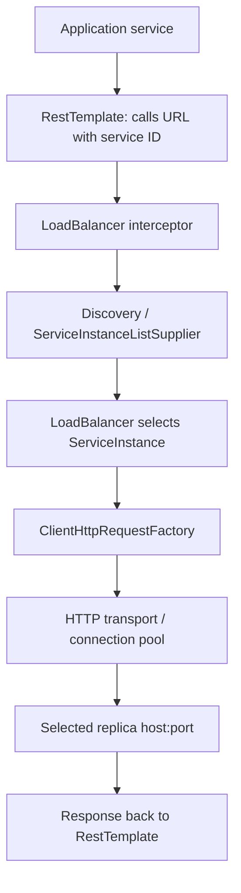

# Configuring Request Factory, Timeouts, and Connection Pools

When using `RestTemplate` to call a service through Spring Cloud LoadBalancer, selecting the right `ServiceInstance` only resolves the **destination** of the HTTP request. For a request to actually complete, the application also needs a network connection, must wait for the server's response, and must manage socket resources when many requests run concurrently. Those three concerns live in the **HTTP transport** layer, where `ClientHttpRequestFactory`, timeouts, and connection pools play the leading roles.

In the `SPRING_CLOUD_SERVICE_COMMUNICATION_LOAD_BALANCING` module, the goal is not merely calling `http://catalog-service/...` by service name. The application also needs to bound wait times when an instance fails, avoid opening too many fresh connections, detect pool saturation, and coordinate sensibly with discovery, health checks, and retries. This lesson focuses on configuring those mechanisms for `RestTemplate` without confusing them with Spring Cloud LoadBalancer's selection algorithms.

## 1. Where the Request Factory Sits in the LoadBalancer Flow

`RestTemplate` is Spring Framework's synchronous HTTP client. The application invokes methods like `getForObject`, `exchange`, or `execute`; underneath, `RestTemplate` uses a `ClientHttpRequestFactory` to create the actual HTTP request.

In an application configured with `@LoadBalanced`, an extra step resolves the service ID to an instance:



For example, the application calls:

```java
Product product = restTemplate.getForObject(
        "http://catalog-service/api/products/{id}",
        Product.class,
        productId);
```

LoadBalancer may select instance `catalog-b` at `10.20.1.12:8081`. After selection, the request factory connects to `10.20.1.12:8081`, rather than searching for another instance on its own. Keep these layers clearly separated:

| Layer | Question it answers | Example issue |
|---|---|---|
| Discovery and `ServiceInstanceListSupplier` | Which instances are eligible? | Registry retains stale addresses |
| `ReactorLoadBalancer<ServiceInstance>` | Which instance from the list should be chosen? | Round robin, random, zone |
| LoadBalancer interceptor | How is the logical URL mapped to an actual target? | Missing `@LoadBalanced`, service ID unresolved |
| `ClientHttpRequestFactory` | Which HTTP transport creates and sends the request? | Default factory lacks desired pooling |
| HTTP client / connection manager | How are connections opened, awaited, and sockets reused? | Timeouts, pool exhaustion, idle connections closed |

**Adding a connection pool does not replace Spring Cloud LoadBalancer.** The pool reuses TCP connections to already chosen addresses; it does not decide which instance `catalog-service` should use.

## 2. What Is `ClientHttpRequestFactory`?

`ClientHttpRequestFactory` is the interface `RestTemplate` uses to create an HTTP request. Common implementations include:

| Factory | Characteristics | When to consider |
|---|---|---|
| `SimpleClientHttpRequestFactory` | Uses JDK HTTP facilities; relatively simple configuration | Small examples, simple connectivity needs |
| `HttpComponentsClientHttpRequestFactory` | Integrates Apache HttpClient; supports pooling and detailed connection policies | High concurrency or explicit pool management |
| `JdkClientHttpRequestFactory` | Backed by modern JDK `java.net.http.HttpClient` | Wanting JDK transport with matching configuration |

Do not assume every factory exposes identical APIs for timeouts, connection pools, or TLS. **Exact configuration capabilities depend on the implementation and Spring Framework/HTTP client version.** The examples below use `HttpComponentsClientHttpRequestFactory` with **Apache HttpClient 5**, suited for Spring Framework 6 / Spring Boot 3.x projects.

By default, `RestTemplate` may pick a request factory based on how it was constructed and configured. If an application needs a pool with explicit bounds, **configure the factory explicitly** and verify the live client rather than assuming "adding a library guarantees pooling is enabled as intended."

## 3. Three Timeouts You Must Not Confuse

Suppose a request connects to `catalog-b` through Apache HttpClient with a connection pool. There are at least three distinct waiting phases:

```text
Request starts
  │
  ├─ [A] Wait to borrow a connection from the pool
  │         connection request / pool lease timeout
  │
  ├─ [B] Open a new connection to host:port if needed
  │         connect timeout
  │
  ├─ [C] Send request and wait for data from server
  │         response timeout / socket read timeout
  │
  └─ Receive response or raise error
```

| Timeout type | What it bounds | When an error can occur |
|---|---|---|
| **Connection request timeout** | Time spent waiting to obtain a connection from the pool | All eligible connections are busy; pool hit its limit |
| **Connect timeout** | Time allowed to establish a new network connection | Instance unreachable; TCP SYN handshake fails to finish in time |
| **Response / socket timeout** | Time waiting for a response or socket data per HTTP client semantics | Server slow to respond; socket stalls waiting for bytes |

In Apache HttpClient 5, `RequestConfig` configures `connectionRequestTimeout` and `responseTimeout`; `ConnectionConfig` configures `connectTimeout` and socket timeout. Exact timing semantics depend on the transport: response timeout is not necessarily an **end-to-end deadline for the entire call**, and socket read timeout typically bounds individual read operations rather than total business processing time.

### Examples Distinguishing Failures

- The pool already has 25 busy connections to `catalog-b`, and a new request waits too long for a pool slot: **connection request timeout**.
- The pool has capacity, but opening a TCP connection to `catalog-b`'s IP fails within the limit: **connect timeout** or immediate connection error.
- Connection succeeds and the request is sent, but the server fails to send data in time: **response/socket timeout**.
- LoadBalancer finds no `ServiceInstance` for `catalog-service`: **instance resolution/selection error**, not a connect timeout.
- The server returns `503 Service Unavailable` immediately: **HTTP error response**, not a timeout.

These cases require different metrics and remediation. Raising connect timeout will not cure pool exhaustion; enlarging the pool will not fix a bad instance IP; retrying every `503` will not guarantee service recovery.

## 4. Why Connection Pooling Matters

Every new TCP connection incurs setup overhead; HTTPS adds TLS handshake overhead. Opening a fresh connection per request increases latency, consumes sockets/CPU, and risks creating excessive short-lived connections.

A connection pool keeps reusable connections ready for subsequent requests. In Apache HttpClient, the pool is managed **per route** to each HTTP target (e.g., scheme + host + port) alongside a global cap.

Suppose `catalog-service` has two replicas:

```text
catalog-service
  ├─ catalog-a = http://10.20.1.11:8081
  └─ catalog-b = http://10.20.1.12:8081

Shared pool of RestTemplate
  ├─ Route http://10.20.1.11:8081  → reusable connections
  └─ Route http://10.20.1.12:8081  → reusable connections
```

When LoadBalancer selects `catalog-a`, the transport reuses or opens a connection for A's route. When B is selected, it uses B's route. **Having a pool does not make the client sticky to the replica whose connection was used previously.** LoadBalancer still picks an instance on each selection step; pooling merely reuses connections efficiently to whichever target was chosen.

Two critical limits:

- **Maximum total connections:** total connections the manager allows across all routes combined.
- **Maximum connections per route:** maximum connections allowed for a single target route.

If per-route is too small, a busy replica can become a bottleneck even when global pool capacity remains. If total is too small, multiple services and instances sharing the pool compete for slots. If limits are set too high, the application may open more sockets than the OS or target server can sustain.

## 5. Required Project Dependencies

With Spring Boot 3.x and Maven, start with:

```xml
<dependencies>
    <dependency>
        <groupId>org.springframework.boot</groupId>
        <artifactId>spring-boot-starter-web</artifactId>
    </dependency>

    <dependency>
        <groupId>org.springframework.cloud</groupId>
        <artifactId>spring-cloud-starter-loadbalancer</artifactId>
    </dependency>

    <dependency>
        <groupId>org.apache.httpcomponents.client5</groupId>
        <artifactId>httpclient5</artifactId>
    </dependency>
</dependencies>
```

`spring-boot-starter-web` provides Spring Web including `RestTemplate`. `spring-cloud-starter-loadbalancer` provides client-side load balancing integration. `httpclient5` enables Apache HttpClient 5 with connection pooling. Library versions should be managed by compatible **Spring Boot dependency management** and the **Spring Cloud BOM**; avoid mixing versions from mismatched generations.

Eureka/Consul are unnecessary if the lab loads instances via `SimpleDiscoveryClient`; in environments with a dynamic registry, add the discovery starter matching your infrastructure.

## 6. Configuring Apache HttpClient 5 with Pool and Timeouts

The following example explicitly constructs a pooled HTTP client and supplies it to `HttpComponentsClientHttpRequestFactory`. The values are **suggestions for hands-on practice**, not parameters to copy blindly into production.

```java
package com.example.orders.config;

import org.apache.hc.client5.http.config.ConnectionConfig;
import org.apache.hc.client5.http.config.RequestConfig;
import org.apache.hc.client5.http.impl.classic.CloseableHttpClient;
import org.apache.hc.client5.http.impl.classic.HttpClients;
import org.apache.hc.client5.http.impl.io.PoolingHttpClientConnectionManager;
import org.apache.hc.client5.http.impl.io.PoolingHttpClientConnectionManagerBuilder;
import org.apache.hc.core5.util.TimeValue;
import org.apache.hc.core5.util.Timeout;
import org.springframework.boot.web.client.RestTemplateBuilder;
import org.springframework.cloud.client.loadbalancer.LoadBalanced;
import org.springframework.context.annotation.Bean;
import org.springframework.context.annotation.Configuration;
import org.springframework.http.client.HttpComponentsClientHttpRequestFactory;
import org.springframework.web.client.RestTemplate;

@Configuration(proxyBeanMethods = false)
public class OutboundHttpConfiguration {

    @Bean(destroyMethod = "close")
    CloseableHttpClient pooledHttpClient() {
        ConnectionConfig connectionConfig = ConnectionConfig.custom()
                .setConnectTimeout(Timeout.ofSeconds(2))
                .setSocketTimeout(Timeout.ofSeconds(5))
                .build();

        PoolingHttpClientConnectionManager connectionManager =
                PoolingHttpClientConnectionManagerBuilder.create()
                        .setMaxConnTotal(100)
                        .setMaxConnPerRoute(25)
                        .setDefaultConnectionConfig(connectionConfig)
                        .build();

        RequestConfig requestConfig = RequestConfig.custom()
                .setConnectionRequestTimeout(Timeout.ofSeconds(1))
                .setResponseTimeout(Timeout.ofSeconds(5))
                .build();

        return HttpClients.custom()
                .setConnectionManager(connectionManager)
                .setDefaultRequestConfig(requestConfig)
                .evictExpiredConnections()
                .evictIdleConnections(TimeValue.ofSeconds(30))
                .build();
    }

    @Bean
    @LoadBalanced
    RestTemplate loadBalancedRestTemplate(
            RestTemplateBuilder builder,
            CloseableHttpClient pooledHttpClient) {

        return builder
                .requestFactory(() ->
                        new HttpComponentsClientHttpRequestFactory(
                                pooledHttpClient))
                .build();
    }
}
```

The code separates distinct responsibilities:

1. `PoolingHttpClientConnectionManager` manages the pool and total/per-route limits.
2. `ConnectionConfig` configures new-connection timeout and socket timeout.
3. `RequestConfig` configures pool-lease wait timeout and response timeout.
4. `HttpClients.custom()` builds `CloseableHttpClient` with expired/idle connection eviction policies.
5. `HttpComponentsClientHttpRequestFactory` wires this client as the transport for `RestTemplate`.
6. `RestTemplateBuilder` preserves Spring Boot auto-configured converters/customizers for `RestTemplate`.
7. `@LoadBalanced` marks `RestTemplate` so Spring Cloud attaches service ID resolution.

**Compatibility note:** builder APIs and timeout methods can change across Spring Boot/Spring Framework/Apache HttpClient versions. This example targets Spring Boot 3.x, Spring Framework 6.x, and HttpClient 5; verify against your project's actual dependencies before copying to another release train. When global `RestTemplateCustomizer` beans or extra `RestTemplateBuilder` timeout settings exist, check application order to avoid overriding intended values.

### Pool Lifecycle

The `CloseableHttpClient` bean is Spring-managed with `destroyMethod = "close"`, ensuring connection resources are released when the application context shuts down. Never construct a new `CloseableHttpClient` per business method or per request: doing so defeats connection reuse and can exhaust sockets.

A fully configured `RestTemplate` can be shared safely across concurrent calls in the application. Avoid mutating interceptors, request factory, or internal configuration on `RestTemplate` while threads are actively using it. For applications calling multiple services that share a pool, a singleton `CloseableHttpClient` backing one or more `RestTemplate` beans is a common pattern.

### Why Configure Both Socket Timeout and Response Timeout?

These two parameters live at different configuration layers in Apache HttpClient 5. `responseTimeout` bounds waiting for a request's response; socket timeout governs I/O wait behavior. Do not treat them as interchangeable "overall deadlines." If business requirements enforce an **end-to-end operation time limit** covering instance selection, pool wait, connection, retries, and body reading, add a deadline/budget mechanism at the appropriate calling layer.

## 7. Using the Load-Balanced `RestTemplate`

Once the bean is registered, business services can inject and use it:

```java
package com.example.orders.client;

import org.springframework.cloud.client.loadbalancer.LoadBalanced;
import org.springframework.stereotype.Component;
import org.springframework.web.client.RestTemplate;

@Component
public class CatalogClient {

    private final RestTemplate restTemplate;

    public CatalogClient(@LoadBalanced RestTemplate restTemplate) {
        this.restTemplate = restTemplate;
    }

    public Product getProduct(String id) {
        return restTemplate.getForObject(
                "http://catalog-service/api/products/{id}",
                Product.class,
                id);
    }
}
```

`Product` in this example is an application DTO you define yourself. When multiple `RestTemplate` beans exist, use `@Qualifier` with the exact bean name to avoid ambiguity; `@LoadBalanced` is used at declaration/injection points per your Spring Cloud setup.

To test without a registry, declare two static instances:

```yaml
spring:
  cloud:
    discovery:
      client:
        simple:
          instances:
            catalog-service:
              - uri: http://localhost:8081
              - uri: http://localhost:8082
```

Run `catalog-service` on both ports and have each replica return its `instanceId` or `server.port` so you can see which instance handled each request. When `CatalogClient` calls the logical URL, Spring Cloud LoadBalancer picks an instance and the factory/pool executes the request. With `SimpleDiscoveryClient`, stopping a process does not automatically remove its address from configuration; use health checks, update the list, or combine appropriate retry/failover logic to avoid repeatedly calling a stopped replica.

## 8. Tuning the Pool for Real Traffic

Never size a pool solely from total requests per second. Consider **concurrency** and **number of target routes**. Intuitively, the longer requests stay open, the more requests overlap in flight, increasing concurrent connections needed.

Illustrative cases:

| Case | Observation to verify |
|---|---|
| Low traffic, few instances | Small pool may suffice; favor simple configuration |
| One hot instance, high concurrency | `maxConnPerRoute` may bottleneck before `maxConnTotal` |
| Many service IDs and instances | `maxConnTotal` may create contention across routes |
| Slow responses or slow streaming | Connections stay leased longer; enlarging the pool alone does not fix slowness |
| Scaling from 2 to 20 replicas | Route count changes; monitor connection reuse efficiency |
| Rolling deployments changing instance IPs | Evict idle/expired connections and ensure discovery does not hold stale IPs too long |

A practical tuning workflow:

1. Measure peak concurrency, p50/p95/p99 latency, and target instance count.
2. Set `maxConnPerRoute` high enough for single-instance traffic under skewed load.
3. Set `maxConnTotal` to match combined multi-route traffic and OS limits.
4. Set `connectionRequestTimeout` so threads never block indefinitely when the pool is full.
5. Monitor leased, available, and pending connection counts (when metrics are exposed).
6. Verify the target server can handle the concurrent connections the client is permitted to open.
7. Load-test fast, slow, and failing endpoints; tune from metrics instead of blindly raising all limits together.

In Apache HttpClient 5, the pool manager exposes statistics such as `leased`, `available`, `pending`, and `max` (for instance via `getTotalStats()` when holding a reference to the manager). Expose observable metrics or controlled logs in real environments. Never log every connection borrow/release under heavy load if logging itself adds overhead.

## 9. Connection Reuse, Keep-Alive, and Stale Connections

Connection pooling works only when connections are reusable and not closed prematurely by the server. Key details:

- **HTTP keep-alive:** allows sequential requests to share a single TCP connection when protocol rules allow.
- **Idle eviction:** reclaims connections left idle too long, avoiding holding unused sockets.
- **Expired eviction / time-to-live:** caps connection lifetime; essential when networks, proxies, or servers periodically close sockets.
- **Stale connections:** a previously valid connection may have been closed by the server or network while idle. Subsequent requests must detect the failure and handle it per policy.
- **Connection release:** responses must be fully consumed and closed. When using `execute` with streams or a custom `ResponseExtractor`, close resources properly so connections return to the pool.

With standard `getForObject()` or `exchange()`, Spring handles closing responses inside the execution flow. If you interact with streams directly or install custom request factories, inspect resource lifecycles closely. **Pool exhaustion** is sometimes a symptom of leaked responses rather than high traffic.

Do not rely on TCP keep-alive to prove an instance is still healthy at the business layer. Keep-alive and health checks solve different layers; a live TCP connection does not guarantee an endpoint returns valid responses.

## 10. Transport Timeouts Differ from LoadBalancer and Discovery Timeouts

When calling `http://catalog-service/api/products/42`, time is spent across several steps:

```text
T1: HTTP client invoked
T2: Supplier/discovery provides instance list
T3: LoadBalancer selects instance
T4: Wait for connection from pool
T5: Establish TCP/TLS if needed
T6: Send request and wait for response
T7: Read body / deserialize
T8: Return result to caller
```

`connectTimeout` primarily affects step T5; `connectionRequestTimeout` affects T4; response/socket timeout affects waiting for data during T6–T7 per HTTP client semantics. They **do not necessarily** bound everything from T1 through T8.

For example, discovery delays, retry backoff, or thread-pool queuing can inflate total latency without triggering a transport timeout at the expected point. To protect caller API SLAs, design an **overall time budget** and align individual timeouts with it.

Specifically, a request timeout does not prove the server never executed the work. A `POST` that succeeded on the server while the response was lost in transit must be handled via idempotency keys, transactions, or deduplication; never assume retrying is automatically safe.

## 11. Interaction with Spring Cloud LoadBalancer Retries

Spring Cloud LoadBalancer and HTTP clients can each have their own retry mechanisms. Apache HttpClient also includes transport-level retry policies. Enabling retries at multiple layers simultaneously can multiply actual outgoing requests far beyond expectations.

For instance, if one layer retries and another layer also retries, a single call can be sent repeatedly to the same or different instances. Clarify:

| Question | Why it matters |
|---|---|
| Which layer owns retries? | Prevents stacked retries |
| Is another `ServiceInstance` chosen after failure? | Distinguishes same-instance retry vs. cross-instance retry |
| Which failures are retried? | Connect errors, timeouts, and HTTP 5xx carry different semantics |
| Is the HTTP method idempotent? | Prevents duplicate write execution |
| What are the attempt and total time caps? | Keeps within the caller's time budget |
| Are health checks / circuit breakers active? | Reduces repeated retries against failing replicas |

If you want one authoritative retry layer, inspect and optionally disable Apache HttpClient's automatic retries (e.g., `HttpClients.custom().disableAutomaticRetries()`), then configure retries centrally at the service-selection/invocation layer. This is a **design decision**, not mandatory in every system.

Timeouts should neither be set so high that they mask failing instances nor so low that they drop valid requests during peak traffic. Measure real latencies and test failure modes before choosing thresholds.

## 12. Diagnosis: Identifying the Exact Failing Layer

`RestTemplate` typically wraps I/O failures in `ResourceAccessException`. Meanwhile, HTTP 4xx/5xx responses with the default error handler throw `HttpClientErrorException` or `HttpServerErrorException`. You cannot pinpoint the root cause from the outer exception type alone; inspect the **cause** and connection details.

| Symptom | Likely cause | What to check |
|---|---|---|
| `No instances available` or service ID unresolved | Empty discovery, supplier filtered all instances, or missing LoadBalancer wiring | `ServiceInstance` list, `@LoadBalanced` bean, service ID |
| `Connection refused` | Address/port reachable, but no process listening | Instance host/port, target process, firewall |
| `Connect timed out` | Unable to open connection within deadline | IP, routing, ACLs, connect timeout |
| Long wait followed by pool lease failure | Pool exhausted or low per-route limit | `leased`, `pending`, `maxConnPerRoute`, connection request timeout |
| Socket/read/response timeout | Slow instance response or flaky network | Response timeout, socket timeout, slow endpoint |
| HTTP `503`, `500` | Target server returned an error response | Status, response body, trace ID, instance health |
| Sporadic socket errors after rollout | Stale connections or discovery holding old IPs | Idle eviction, TTL, registry refresh, and DNS |
| Only one service fails while others succeed | Specific target or route pool saturated | Route stats, instance ID, per-route metrics |

An effective root-cause checklist:

1. Record the service ID, logical URL, and selected `ServiceInstance` (when available).
2. Verify the request passed through the LoadBalancer interceptor.
3. From the **consumer** runtime environment, test direct connectivity to the host/port published by discovery.
4. Determine whether failure occurred before connecting, while leasing a connection, or after sending the request.
5. Inspect pool `leased`/`available`/`pending` counts and per-route stats.
6. Compare time-to-failure against configured timeouts and actual retry counts.
7. If the server returned an HTTP response, inspect status/body/traces instead of blaming the connection pool.

Avoid putting auth tokens, cookies, or sensitive payload contents into debug logs. Record service ID, instance ID, route, duration, outcome, and exception type to diagnose without exposing user data.

## 13. Hands-On Exercise: One Fast Instance, One Slow Instance

**Objective:** distinguish a response timeout from a pool-lease failure and prove LoadBalancer keeps working when the transport uses pooling.

Prepare a `catalog-service` exposing `/api/products/{id}` and a `/whoami` endpoint returning the instance name. Run two replicas:

- `catalog-a` on `localhost:8081`, responding quickly.
- `catalog-b` on `localhost:8082`, with an added test delay to simulate a slow server.

The consumer application uses a `@LoadBalanced RestTemplate`, static instances as in section 7, and Apache HttpClient 5 configuration as in section 6.

### Scenario A — Verify Instance Selection

Send multiple requests to `http://catalog-service/whoami` and record the returned instance IDs. With default round robin and a stable instance list, you should see alternation between replicas. The connection pool reuses sockets per route and **does not** alter the selection algorithm.

### Scenario B — Verify Response Timeout

Set `catalog-b`'s delay higher than the response timeout while keeping `catalog-a` fast. Send multiple requests and log the intended instance ID, exception class, and elapsed wait time. Requests routed to B fail with a response timeout; requests routed to A succeed. If retries are enabled, observed results will differ because a request may retry onto another instance; explicitly disable retries during dedicated timeout measurements to avoid confusion.

### Scenario C — Verify Pool Slot Exhaustion

To make exhaustion easy to observe in a **test** environment, lower `maxConnPerRoute` to a small value such as `1` while holding one request open waiting for a response on a route. Fire several concurrent requests to the same route with a short `connectionRequestTimeout`. Some requests will fail to borrow a connection in time even though the server is still reachable.

Because LoadBalancer can distribute requests across multiple instances, verifying a **per-route** limit requires knowing which requests hit which route; test with a single instance or a test client targeting one address directly. Never use aggregate request volume alone as proof that a single route is saturated.

### Scenario D — Verify Connection Lifecycle

Stop `catalog-b`, wait for discovery/health updates if configured, and restart it. Verify stale connections are evicted and subsequent requests reconnect cleanly. Also verify whether failure duration stemmed from discovery/instance selection or transport. With static `SimpleDiscoveryClient`, B's address remains listed even after the process stops unless another filtering mechanism is present.

After the lab, tabulate connection-lease wait time, new-connection time, response wait time, selected instance, retry count, and pool state. That data is far more actionable than a vague conclusion that "RestTemplate is slow."

## 14. Production Readiness Checklist

1. Is `RestTemplate` built with the intended request factory and annotated with `@LoadBalanced` when calling by service ID?
2. Are Apache HttpClient 5 and Spring Boot/Spring Cloud versions compatible?
3. Is the HTTP client bean reused and closed cleanly on application shutdown?
4. Have you separated connection-lease timeout, connect timeout, and response/socket timeout?
5. Have `maxConnTotal` and `maxConnPerRoute` been validated under realistic load?
6. Are stale/idle/expired connections evicted, and are responses released properly?
7. Do transport timeouts fit within the overall time budget covering discovery, retries, and body processing?
8. Across how many layers are retries configured, are attempts bounded, and are write requests safe?
9. Are metrics exposed for pool state, latency, timeouts, and selected instances to separate transport bottlenecks from discovery issues?
10. Have you tested sudden instance shutdowns, slow responses, pool exhaustion, and address changes during rollouts?

When deploying `RestTemplate` with Spring Cloud LoadBalancer, treat **LoadBalancer as the target-selection layer** and the **request factory and connection pool as the HTTP execution layer**. Configuring the right timeouts, managing pool lifecycles cleanly, and tracking per-route metrics allow applications to scale across instances without turning network glitches or connection saturation into cascading inter-service failures.
