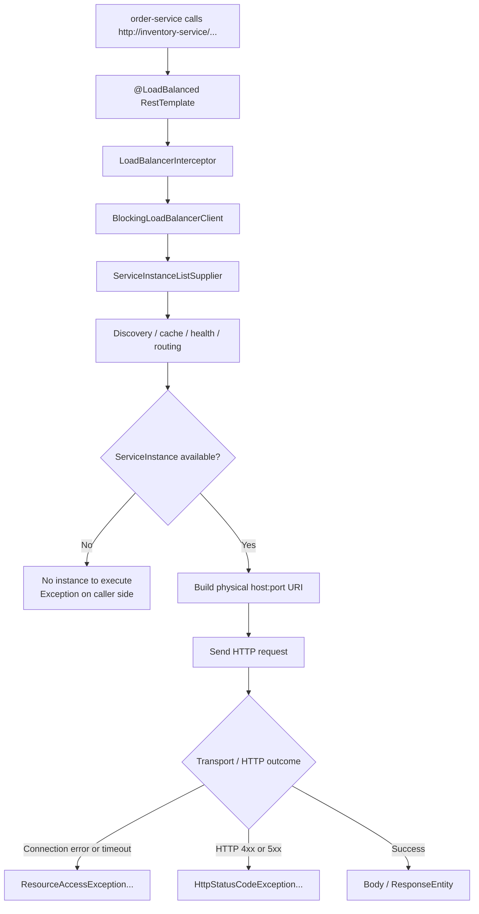

# Handling Missing Service IDs or Replicas

## 1. Context and Learning Outcomes

In the **RestTemplate** chapter of the `SPRING_CLOUD_SERVICE_COMMUNICATION_LOAD_BALANCING` module, the calling application uses Spring Cloud LoadBalancer to look up and select a `ServiceInstance` by **service ID**. Discovery can be backed by Eureka, Consul, Kubernetes, or `SimpleDiscoveryClient`; before sending HTTP traffic, the list may be cached, health-checked, and filtered by zone or routing policy.

Consider this system:

- `order-service` receives a request to look up inventory.
- `order-service` uses a `@LoadBalanced RestTemplate` to call `http://inventory-service/api/inventory/ABC-1`.
- `inventory-service` may have multiple instances, such as `inventory-a` on port `8081` and `inventory-b` on `8082`.

Normally, LoadBalancer picks an instance and `RestTemplate` sends the HTTP request. But what happens if `inventory-service` is misspelled in config, the registry has zero replicas left, or registered instances cannot be reached? These three situations produce **failures with distinct meanings**.

After this lesson, you will be able to:

1. Describe the flow `RestTemplate → LoadBalancerInterceptor → BlockingLoadBalancerClient → ServiceInstanceListSupplier`.
2. Explain why "service ID not found" and "service ID exists but has no eligible instances" often yield the same result at the instance-selection layer.
3. Distinguish between **no instance selected**, **instance selected but connection failed**, and **server returned an HTTP error code**.
4. Handle exceptions at the proper boundary, converting missing-downstream errors into controlled application responses without masking programming bugs.
5. Configure timeouts, bounded retries, and log/metric observability, and verify behavior with a lab exercise.
6. Pinpoint whether an issue stems from the service ID, discovery, caching, health checks, selection policy, or the network layer.

## 2. Request Flow and Where Failures Occur

To load-balance `RestTemplate`, declare a bean annotated with `@LoadBalanced`. In modern Spring Cloud Commons releases, `LoadBalancerInterceptor` and `BlockingLoadBalancerClient` select an instance and replace the URI containing the service ID with the real instance address.



**Key takeaway:** on the **no `ServiceInstance`** branch, no HTTP request to `inventory-service` **was ever sent**. There is no downstream HTTP response for `RestTemplate` to read. Returning HTTP 503 to an *external client* is `order-service`'s own decision while handling the exception, not a status returned by `inventory-service`.

### 2.1. Three Layers of "Not Found"

| Situation | Data / condition | Detection stage | Typical outcome |
|---|---|---|---|
| Misspelled or unregistered **service ID** | `inventory-servcie` has no entries in discovery | Lookup instance by name | Empty list; LoadBalancer cannot pick an instance |
| Service ID exists but **no available replicas** | Registry empty, scaled to zero, or supplier filtered out all candidates | Build list and pick instance | Also returns empty list / `EmptyResponse` |
| Instance selected but **unreachable** | Registry/cached list still has `host:port`, but pod died, DNS/network failed, or server stalled | Connect and read HTTP | I/O error or timeout; usually wrapped by `RestTemplate` in `ResourceAccessException` |
| Instance returns **HTTP 404** | Specific endpoint missing or SKU does not exist | After server processes HTTP | `HttpClientErrorException.NotFound` under default error handler |
| Instance returns **HTTP 503** | Server received request and explicitly reported unavailable | After server processes HTTP | `HttpServerErrorException.ServiceUnavailable` under default error handler |

The first two rows **cannot be reliably distinguished solely from a "No instances available" exception**. The instance-selection layer only knows no suitable target exists for that service ID. To find the root cause, inspect the name in the URI, the registry, the supplier list, caches, health checks, and per-request filters.

### 2.2. What Does BlockingLoadBalancerClient Do When No Instance Is Selected?

In common `BlockingLoadBalancerClient` implementations in Spring Cloud Commons, `RoundRobinLoadBalancer` receives an empty list and returns `EmptyResponse`; `BlockingLoadBalancerClient` obtains no `ServiceInstance` and may throw:

```text
java.lang.IllegalStateException:
    No instances available for inventory-service
```

This is an example of a **Java-layer symptom**, not an HTTP 503 response. Behavior, exception class, and message wording can change across Release Trains or other LoadBalancer implementations. Check resolved dependencies, running library source code, and real stack traces before writing logic coupled to message strings.

**Difference from Spring Cloud Gateway:** a Gateway LoadBalancer filter may automatically turn a missing-instance case into HTTP 503. That **does not mean** every application using `@LoadBalanced RestTemplate` automatically generates HTTP 503. If an exception goes unhandled in a controller, Spring MVC typically returns a server error per application exception policy (e.g., HTTP 500). The calling application itself must define the error contract for its clients.

## 3. Configuring RestTemplate Properly for Service-ID Calls

A minimal example in `order-service`:

```java
@Configuration(proxyBeanMethods = false)
class InventoryRestTemplateConfig {

    @Bean
    @LoadBalanced
    RestTemplate inventoryRestTemplate() {
        SimpleClientHttpRequestFactory requestFactory =
                new SimpleClientHttpRequestFactory();
        requestFactory.setConnectTimeout(1_000); // ms
        requestFactory.setReadTimeout(2_000);    // ms

        return new RestTemplate(requestFactory);
    }
}
```

In the snippet above:

- `@LoadBalanced` enables Spring Cloud to attach the load-balancing interceptor to the `RestTemplate` bean; the application must include `spring-cloud-starter-loadbalancer`.
- URIs take the form `http://inventory-service/...`; the host segment is the **service ID**, not a real network address.
- Both timeouts belong to the HTTP request factory, **not** to service ID lookup. They apply after a target has been chosen or when opening a connection, depending on the transport.
- In real applications, build `RestTemplate` through Spring Boot's configured `RestTemplateBuilder` to retain customizers, metrics, tracing, and suitable HTTP transports.

A service using this `RestTemplate`:

```java
@Service
class InventoryReader {

    private final RestTemplate restTemplate;

    InventoryReader(@LoadBalanced RestTemplate restTemplate) {
        this.restTemplate = restTemplate;
    }

    InventoryStock read(String sku) {
        return restTemplate.getForObject(
                "http://inventory-service/api/inventory/{sku}",
                InventoryStock.class,
                sku);
    }
}

record InventoryStock(String sku, int available) {}
```

`InventoryStock` is an illustrative DTO; `inventory-service`'s JSON structure must match its field names and types. Use `getForEntity(...)` if you need the status and headers of successful responses. Note that `getForObject(...)` can return `null` on a successful response with no body; that is a data-contract issue distinct from a missing-instance failure.

### 3.1. Distinguishing Plain RestTemplate from Load-Balanced RestTemplate

If the same application calls both external URLs and internal service-ID URLs, declare two beans:

```java
@Configuration(proxyBeanMethods = false)
class RestTemplateBeans {

    @Bean
    @LoadBalanced
    RestTemplate serviceRestTemplate() {
        return new RestTemplate();
    }

    @Bean
    @Primary
    RestTemplate plainRestTemplate() {
        return new RestTemplate();
    }
}
```

Inject `@LoadBalanced RestTemplate` wherever `inventory-service` is called to avoid picking up the wrong bean. Calling `http://inventory-service/...` with a plain `RestTemplate` makes the OS attempt DNS resolution for `inventory-service`; if DNS lacks that name, you may see `UnknownHostException` wrapped in `ResourceAccessException`, which is **different** from discovery having no instances.

Conversely, calling `http://localhost:8081` with a `@LoadBalanced RestTemplate` can treat `localhost` as a **service ID** to look up in discovery, resulting in `No instances available for localhost`. Use a plain RestTemplate for fixed URLs and a load-balanced RestTemplate for URIs containing logical service names. Do not invent `lb://...` URIs for `RestTemplate` when the actual integration expects a service ID in the host with an HTTP/HTTPS scheme.

### 3.2. Dependencies and Discovery

At minimum, the caller needs Spring Web (for `RestTemplate`), a Spring Cloud BOM compatible with Spring Boot, and `spring-cloud-starter-loadbalancer`. Add a matching discovery starter (Eureka/Consul/Kubernetes...) or use `SimpleDiscoveryClient` to define a static list for labs.

**Always check the real version:** a project may run Spring Cloud Commons 4.1, 4.2, 4.3, or 5.0 depending on its Spring Boot/Release Train. Do not copy dependency versions or configuration keys from "latest" docs if your project uses a different branch.

## 4. Error-Handling Strategy at the Service-Call Boundary

A practical approach is translating errors inside the `InventoryReader` adapter into domain-meaningful exceptions, then letting a controller/advice decide the HTTP response. Never catch broad `Exception` or `RuntimeException` and return default data that hides failures.

Error groups to distinguish:

| Group | Symptom in caller | Policy guidance |
|---|---|---|
| No instance to select | `IllegalStateException` with message `No instances available for ...` in verified implementations | Mark downstream unavailable, return HTTP 503 at edge API, log service ID and discovery state |
| Connection / timeout error after selection | `ResourceAccessException`; root cause may be `ConnectException`, `SocketTimeoutException`, `UnknownHostException` | Enforce timeouts, bounded retry if safe, check registry/health/network |
| Downstream returns HTTP 503/500 | `HttpServerErrorException` or subclass from default error handler | Check error contract; possibly map to 502/503 or selective retry |
| Downstream returns HTTP 404 | `HttpClientErrorException.NotFound` | Usually missing data/endpoint; do not conclude the service ID vanished |
| 2xx response with empty body or schema mismatch | `null` or JSON parse error | Report data contract error; do not disguise as a discovery failure |
| Misconfigured bean/interceptor | Request bypasses LoadBalancer or context fails to initialize | Fix wiring/dependencies instead of increasing retries |

### 4.1. Minimal Error-Catching Example Without Masking Other Bugs

In the following example, `order-service` translates **only known errors** for `inventory-service` into `DownstreamUnavailableException`:

```java
final class DownstreamUnavailableException extends RuntimeException {

    private final String serviceId;

    DownstreamUnavailableException(String serviceId, Throwable cause) {
        super("Dependent service temporarily unavailable: " + serviceId, cause);
        this.serviceId = serviceId;
    }

    String serviceId() {
        return serviceId;
    }
}
```

```java
@Service
class InventoryGateway {

    private static final String SERVICE_ID = "inventory-service";
    private final RestTemplate restTemplate;

    InventoryGateway(@LoadBalanced RestTemplate restTemplate) {
        this.restTemplate = restTemplate;
    }

    InventoryStock read(String sku) {
        try {
            return restTemplate.getForObject(
                    "http://inventory-service/api/inventory/{sku}",
                    InventoryStock.class,
                    sku);
        } catch (ResourceAccessException ex) {
            // Connection, DNS, TLS, or read timeout after target selection.
            throw new DownstreamUnavailableException(SERVICE_ID, ex);
        } catch (IllegalStateException ex) {
            // Classify only the verified message for this LoadBalancer version.
            if (isNoInstanceException(ex)) {
                throw new DownstreamUnavailableException(SERVICE_ID, ex);
            }
            throw ex; // Another IllegalStateException may indicate a programming bug.
        }
    }

    private boolean isNoInstanceException(IllegalStateException ex) {
        return ("No instances available for " + SERVICE_ID)
                .equals(ex.getMessage());
    }
}
```

In production, **do not treat `getMessage()` matching as a stable API**. This snippet illustrates isolating version-verified compatibility logic inside a single adapter. When upgrading Release Trains or swapping implementations:

1. Inspect stack traces/exception types and update the adapter if needed.
2. You can wrap `LoadBalancerClient` directly or use a verified error-reporting hook to detect the no-instance branch without relying on message text.
3. Never convert every `IllegalStateException` into HTTP 503, as doing so can hide serious programming errors.
4. Emit metrics/logs by service ID and categorized cause; avoid logging secrets or endpoints containing tokens.

If downstream returns an actual HTTP 503, `RestTemplate` with the default error handler throws `HttpServerErrorException.ServiceUnavailable`; the `InventoryGateway` snippet above **does not catch that error**. Handle HTTP status failures separately per your API contract rather than lumping them with "no instances available." If business logic needs to distinguish missing instances from connection failures, define separate domain exceptions (e.g., `NoCandidateInstanceException`, `DownstreamTransportException`) instead of reusing a single `DownstreamUnavailableException` as in this minimal example.

### 4.2. Returning HTTP 503 at the Edge API

Example mapping the domain exception to a structured response in Spring MVC:

```java
@RestControllerAdvice
class DownstreamExceptionAdvice {

    @ExceptionHandler(DownstreamUnavailableException.class)
    ResponseEntity<ProblemDetail> onUnavailable(
            DownstreamUnavailableException ex) {
        ProblemDetail detail = ProblemDetail.forStatusAndDetail(
                HttpStatus.SERVICE_UNAVAILABLE,
                "A dependent service is temporarily unavailable.");
        detail.setTitle("Temporarily unable to process request");

        return ResponseEntity.status(HttpStatus.SERVICE_UNAVAILABLE)
                .body(detail);
    }
}
```

Sample controller:

```java
@RestController
@RequestMapping("/orders")
class OrderController {

    private final InventoryGateway inventory;

    OrderController(InventoryGateway inventory) {
        this.inventory = inventory;
    }

    @GetMapping("/inventory/{sku}")
    InventoryStock stock(@PathVariable String sku) {
        return inventory.read(sku);
    }
}
```

If the service has no instances or connectivity fails and the adapter translates the error, the API returns HTTP **503 Service Unavailable** with a `ProblemDetail` body. Never return raw stack traces or internal hosts/ports in the body. You can include a correlation ID to assist operations.

**Contract note:** HTTP 503 indicates the system cannot serve the request because a dependency is temporarily unavailable. If the cause is a service ID typo, missing discovery config, or bad build, the root cause is a configuration incident requiring immediate alerting and fixing, even though the API temporarily returns 503 to inform clients the request could not finish. An HTTP code never replaces root-cause diagnosis.

### 4.3. Should `ResponseErrorHandler` Handle "No Instances Available"?

`RestTemplate`'s `ResponseErrorHandler` handles **received HTTP responses** (such as 404, 500, 503). When LoadBalancer fails to select an instance, no response exists yet, so there is no status for `ResponseErrorHandler` to inspect. Handle that exception in the adapter, LoadBalancer integration, or controller boundary instead.

Never build a `ResponseErrorHandler` that "fakes an HTTP 503" for cases where no HTTP request was ever sent, making it look like the request reached `inventory-service`.

## 5. Reproducible Lab with SimpleDiscoveryClient

Use `SimpleDiscoveryClient` to deterministically create scenarios with or without instances, without waiting on registry refresh cycles.

Assume `order-service` runs on port `8080` and `inventory-service` runs on port `8081`. Configure one instance in **`order-service`**'s `application.yml`:

```yaml
spring:
  application:
    name: order-service
  cloud:
    discovery:
      client:
        simple:
          instances:
            inventory-service:
              - uri: http://localhost:8081
    loadbalancer:
      retry:
        enabled: false
      cache:
        enabled: false

server:
  port: 8080
```

`retry.enabled=false` and `cache.enabled=false` make the baseline experiment easy to interpret. Any `localhost` URLs in config apply only when caller and inventory run on the same host/network namespace; in Docker or Kubernetes, use instance addresses reachable from the caller.

Ensure the application uses `InventoryGateway` and `DownstreamExceptionAdvice` above. If another Eureka/Consul client is active in the project, it may supply discovery entries alongside `SimpleDiscoveryClient`; use an isolated lab environment for clean results.

### 5.1. Scenario A: Service ID Exists, Instance Healthy

1. Run an `inventory-service` on `8081` exposing `GET /api/inventory/{sku}` returning JSON compatible with `InventoryStock`.
2. Start `order-service` with the configuration above.
3. Call:

```bash
curl -i http://localhost:8080/orders/inventory/ABC-1
```

Expected: `RestTemplate` selects the declared instance and receives the body from `inventory-service`; the API returns 2xx per controller. Inventory logs confirm the request arrived on `8081`.

### 5.2. Scenario B: Service ID Does Not Exist at All

1. Keep `order-service` running, but temporarily change the URI in the adapter to `http://inventory-service-missing/...`; or add a separate test endpoint using a nonexistent service ID.
2. Do not register `inventory-service-missing` in discovery.
3. Send a request and record the stack trace (in dev) and API response.

With standard `BlockingLoadBalancerClient`, instance selection may throw:

```text
IllegalStateException: No instances available for inventory-service-missing
```

**Note:** the illustrative `isNoInstanceException(...)` helper above matches only `inventory-service`. If you change the service ID in code to test another service ID, update the service ID in the adapter or create a separate adapter for that service. Never infer from the helper not recognizing the error that LoadBalancer threw no error at all.

When the helper matches the ID, the controller advice returns **503**. When it does not match, the original exception propagates so unrelated bugs are not turned into "service unavailable."

### 5.3. Scenario C: Service ID Correct, Empty Instance List

1. Revert to calling `inventory-service` as in the initial example.
2. Delete the `inventory-service` entry under `spring.cloud.discovery.client.simple.instances` in your lab config and restart `order-service`.
3. Call `/orders/inventory/ABC-1`.

Expected at the selection layer: no candidates exist for `inventory-service`, yielding the same selection outcome as a misspelled service ID. This is why **looking at the exception alone cannot tell you whether the name has a typo or the service scaled to zero**.

With dynamic discovery, you can stop/unregister all instances and wait for the registry and cache/supplier to update; however, do not treat the exact instant a process exits as proof that LoadBalancer already sees an empty list.

### 5.4. Scenario D: Instance Selected, No Server Listening on Port

1. Restore the `inventory-service` entry with URI `http://localhost:8081`.
2. Run no process listening on port `8081`.
3. Call the API.

Expected: **a `ServiceInstance` is still available** to select; failure occurs while opening the connection, typically wrapped by `RestTemplate` in `ResourceAccessException` with root cause `ConnectException`. This is not a "no instances available" scenario. Because the adapter maps both failure groups to `DownstreamUnavailableException`, the API still returns 503, yet **logs/metrics for the root cause must differ**.

### 5.5. Scenario E: Instance Returns HTTP 503

1. Run `inventory-service`, but make the test endpoint intentionally return HTTP 503.
2. Call through `order-service` via `RestTemplate`.

Expected: the request reached the server, the response has status **503**, and `RestTemplate` with the default error handler throws `HttpServerErrorException.ServiceUnavailable`. In the minimal adapter example, this error is not converted to `DownstreamUnavailableException`. To have the outer API return 503 or 502 per policy, add a dedicated upstream HTTP error branch and record how it differs from "no instance selected."

### 5.6. Scenario F: One Instance Dead, Another Healthy

Update static configuration to list two URIs under the same service ID:

```yaml
spring:
  cloud:
    discovery:
      client:
        simple:
          instances:
            inventory-service:
              - uri: http://localhost:8081
              - uri: http://localhost:8082
```

Start only the server on `8082` and send consecutive requests. Without a health-check supplier filtering out `8081`, Round Robin can pick both the broken port and the healthy port. Results will alternate between successes and connection errors. **Adding a healthy replica does not guarantee every request succeeds** while a dead instance remains in the list.

In another environment, configure `HealthCheckServiceInstanceListSupplier` or discovery health filtering to verify dead instances are removed from eligible candidates. Pay attention to refresh/cache lag and how your version's health supplier behaves when all instances are unhealthy.

## 6. What Retries Help With—and What They Cannot Fix

Spring Cloud LoadBalancer supports retries for blocking `RestTemplate` clients when a compatible retry component (typically Spring Retry) is present. Configuration and defaults depend on the Release Train and classpath; in some branches, merely having Spring Retry on the classpath activates retry logic unless disabled via property. **To avoid confusion while learning**, the baseline sets `spring.cloud.loadbalancer.retry.enabled=false`.

When practicing retries, check the `spring-retry` dependency and the official properties for your version. Example configuration for an idempotent GET test:

```yaml
spring:
  cloud:
    loadbalancer:
      retry:
        enabled: true
        max-retries-on-same-service-instance: 0
        max-retries-on-next-service-instance: 1
        retryable-status-codes:
          - 503
```

Intended semantics: zero retries on the same instance; up to one retry on another instance when supported; HTTP 503 is listed as retryable. Actual runtime behavior also depends on retry beans, exception types, `ServiceInstanceListSupplier`, and whether policies avoid the instance that just failed.

**Do not expect retries to solve every case:**

- **No instances:** there is no valid target to retry; repeating selection does not make an instance appear in the registry. Some versions/paths abort immediately or throw another exception.
- **One dead instance, one healthy instance:** retrying onto another instance can let read requests succeed if avoiding the failed instance works.
- **All instances dead:** retries merely increase attempt count and wait time, easily worsening an outage.
- **HTTP 404:** usually missing data or endpoint; do not retry unless an explicit contract specifies it.
- **Order-creation / payment POST:** never auto-retry without an idempotency key and transaction controls; a timeout does not prove the server never processed the request.
- **Multi-layer retries:** RestTemplate/LoadBalancer, Spring Retry, Resilience4j, gateways, or HTTP clients might all retry simultaneously; cap the **total** attempt budget.

For read-only requests, test 1 retry and inspect logs from both instances. If the goal is handling "missing service ID," the reliable strategy is clear error handling, inspecting discovery, and restoring needed instances.

## 7. Timeouts, Fail-Fast, and Fallbacks

### 7.1. Setting Meaningful Timeouts

The `SimpleClientHttpRequestFactory` example in section 3 sets `connectTimeout=1000ms` and `readTimeout=2000ms`. These timeouts prevent waiting indefinitely once a target is chosen and the network/server stalls. They **do not govern** how long discovery or health suppliers take to find an instance.

A request through `order-service` can consist of:

```text
Total API duration
  = instance list lookup / selection time
  + connection establishment time
  + response read time
  + retry / backoff time (if enabled)
  + remaining order-service processing time
```

This breakdown is for planning a **time budget**, not a rigid formula across every HTTP transport. Configure a business-flow deadline if you want to cap total elapsed time, and measure latency and timeouts at each layer.

### 7.2. Fallbacks Must Make Business Sense

When `inventory-service` is unavailable, returning a fake response with `available=0` can be misinterpreted as "out of stock," even though the system actually **does not know** the stock level. Likewise, never mark an order paid if `payment-service` failed to respond.

Appropriate options depending on contract:

- Return HTTP 503 with a stable error code and correlation ID so callers know the request did not finish.
- Serve cached data with clear TTL/staleness semantics for read-only features, flagged as potentially stale.
- Enqueue retryable work if business rules support eventual consistency and idempotency.
- For optional features, skip the non-essential part while still recording that the dependency was unavailable.

Never fabricate a "successful" fallback solely to lower error counts on a dashboard.

## 8. Observing LoadBalancer-Layer Failures Properly

A no-instance failure occurs **before HTTP transport**; consequently, `inventory-service` server logs may show zero requests. Inspect caller-side telemetry in `order-service`:

| Observed data | Helps determine |
|---|---|
| `serviceId` extracted from URI | Was `inventory-service` spelled right? |
| Registry instance list | How many replicas does the registry know? |
| `ServiceInstanceListSupplier` output | Did caching, zone, health, or request hints filter all candidates? |
| Selection events and `LoadBalancerLifecycle` outcomes | Was an instance selected or discarded? |
| Exception type/cause | Missing instance, I/O failure, or HTTP status error? |
| Retry count and instance ID per attempt | Retried on the same instance or a different one? |
| Caller latency/timeouts | Issue in discovery, connect, or response? |
| Server logs and trace ID | Did the request actually reach downstream? |

You can raise log levels by package in development:

```yaml
logging:
  level:
    org.springframework.cloud.loadbalancer: DEBUG
    org.springframework.cloud.client.loadbalancer: DEBUG
```

**Not every version logs the full instance list at DEBUG by default.** When high precision is needed, instrument `ServiceInstanceListSupplier`, `LoadBalancerLifecycle`, and the HTTP adapter to emit structured data. Never log tokens, session cookies, URIs containing sensitive parameters, or personal payloads.

### 8.1. Micrometer Metrics for Unselected Instances

Several Spring Cloud Commons branches provide metrics such as:

- `loadbalancer.requests.success`: duration of requests handled through LoadBalancer that succeeded per instrumentation semantics.
- `loadbalancer.requests.failed`: duration of requests ending in failure.
- `loadbalancer.requests.discard`: counts requests where no instance could be obtained to run the request.

Receiving these metrics requires Micrometer/`MeterRegistry` dependencies and enabling integration per your Spring Cloud version, e.g., `spring.cloud.loadbalancer.stats.micrometer.enabled=true` on supported branches. Do not assume metrics exist until verified in `/actuator/metrics`; metric names and tags can vary across Release Trains.

When measuring missing service IDs, the `discard` metric is especially helpful if emitted by your implementation; always distinguish it from genuine HTTP 5xx responses returned by downstream. Never treat an HTTP 503 returned by your controller advice as proof that `inventory-service` returned an HTTP response.

## 9. Ordered Diagnostic Workflow

When encountering an error such as `No instances available for inventory-service`:

1. **Read the actual service ID** from the `RestTemplate` URL and stack trace; check casing, aliases, DNS-like names, and registry config. A small typo empties the list.
2. **Verify the client bean:** is `RestTemplate` a `@LoadBalanced` bean, is `spring-cloud-starter-loadbalancer` present, and was a plain RestTemplate injected by mistake?
3. **Inspect the registry:** is `inventory-service` registered, how many replicas exist, and are host/port/zone/metadata/readiness/leases valid?
4. **Inspect supplier and cache:** what list does the caller actually see? Is a cache holding stale data or is registry propagation lagging?
5. **Inspect health/filters:** are instances dropped by readiness, zone, hints, or a custom supplier? Some health suppliers fall back when all instances are unhealthy; know your version's behavior.
6. **Inspect network layer once an instance is chosen:** port, DNS, TLS, routing, firewall, connect timeout, and read timeout.
7. **Inspect retries/fallbacks:** are multiple attempts happening, or is an exception wrapper hiding the root cause?
8. **Classify and respond:** translate dependency errors per API contract, log service ID safely, and avoid exposing internal topology externally.

### 9.1. "Symptom → First Place to Check" Table

| Symptom | Check first | Why |
|---|---|---|
| `No instances available for inventory-servcie` | Host string in URI | Likely a service ID typo |
| Registry does not list `inventory-service` | App registration, service ID, lease | Discovery does not know the service yet |
| Registry has two instances but caller sees 0 | Supplier, cache, health, zone/hint filters | Lists observed differ across layers |
| `No instances available for localhost` | Calling a physical URL via `@LoadBalanced RestTemplate`? | `localhost` may be treated as a service ID |
| `UnknownHostException: inventory-service` | Plain RestTemplate injected by mistake? | DNS is resolving the host instead of LoadBalancer |
| `Connection refused` after instance selection | Actual port, server process, stale cache/discovery | Instance picked, but connection failed |
| `HttpServerErrorException.ServiceUnavailable` | Inventory response, server logs | A server genuinely returned HTTP 503 |
| Only some requests succeed with 2 instances | Health/filters, retries, distribution | One replica may be dead while still listed |
| Raising retries does not reduce errors | Empty list or all replicas dead | No healthy target exists to retry against |

## 10. Comprehensive Hands-On Exercises

### Exercise 1 — Distinguish Missing Service ID from DNS Errors

Create one plain `RestTemplate` and one `@LoadBalanced RestTemplate`. Call the same URL `http://inventory-service-missing/api/inventory/ABC-1`:

- With the load-balanced client and no registration, observe the `No instances available...` branch (per active implementation).
- With the plain client, observe DNS/transport resolution. If the name does not exist in DNS, a DNS/I/O error appears.
- Explain why the two exceptions point to two different layers.

### Exercise 2 — Distinguish "No Instance" from "Dead Instance"

Keep the service ID valid. Run A: leave the `inventory-service` list empty. Run B: register `localhost:8081` with no server running. Run C: start the server and make it return HTTP 503. Record the root exception, wrapper exception, whether any HTTP request reached the server, and the HTTP status returned by `order-service` to its client.

### Exercise 3 — Multiple Replicas and Retries

Run two instances, shut one down with retries disabled, and count successes/failures. Enable bounded retries for `GET`, tracking each attempt and selected instance. Do not rely on 10 requests to claim stable distribution ratios; record sufficient samples, health states, and list changes.

### Exercise 4 — From Exception to HTTP 503 Contract

Apply `InventoryGateway` and `DownstreamExceptionAdvice`. Verify that a **version-classified** no-instance error makes the API return 503 with a `ProblemDetail` body, while an unrelated programming `IllegalStateException` still propagates. Do not simulate programming bugs in production; perform this in a test environment.

### Exercise 5 — Measure Discovery Update Latency

With dynamic discovery, start two instances, scale to 0, then scale back up to 1. Record when the registry updates, when the caller receives the new list, and when requests succeed again. Compare the delay against cache TTL, health-check intervals, and discovery refresh cycles. Tune retries/timeouts only after pinpointing where the delay resides.

## 11. Pre-Completion Checklist

- [ ] `RestTemplate` uses the right `@LoadBalanced` bean and is not misused for fixed `host:port` URLs.
- [ ] `spring-cloud-starter-loadbalancer` and an appropriate discovery mechanism are on the classpath.
- [ ] The URL host is the exact service ID, with no alias or naming typos.
- [ ] Empty lists are clearly distinguished from selected instances that fail to connect.
- [ ] `BlockingLoadBalancerClient` behavior is verified for your actual Spring Cloud Release Train.
- [ ] Exception mapping catches only known error cases without masking arbitrary `IllegalStateException` bugs.
- [ ] Edge-API HTTP 503 responses are not confused with downstream-returned HTTP 503 responses.
- [ ] HTTP timeouts, retries, and end-to-end request time budgets have clear bounds.
- [ ] Write operations retry only when proper idempotency guarantees exist.
- [ ] Caller logs/metrics capture service ID, instance selection, discards, and transport failures.
- [ ] Tested every scenario: wrong service ID, empty list, dead instance, genuine HTTP 503, and recovery.

## References

- [Spring Cloud Commons 4.3 — Common Abstractions, RestTemplate as a LoadBalancer Client](https://docs.spring.io/spring-cloud-commons/reference/4.3/spring-cloud-commons/common-abstractions.html): creating `@LoadBalanced RestTemplate`, distinguishing plain vs. load-balanced beans, retries.
- [Spring Cloud Commons 4.3 — Spring Cloud LoadBalancer](https://docs.spring.io/spring-cloud-commons/reference/4.3/spring-cloud-commons/loadbalancer.html): `ServiceInstanceListSupplier`, `BlockingLoadBalancerClient`, lifecycle, health checks, caching, and Micrometer.
- [Spring Cloud Commons 4.3 — Configuration Properties](https://docs.spring.io/spring-cloud-commons/reference/4.3/configprops.html): checking property names and defaults by version.
- [Spring Framework — RestTemplate](https://docs.spring.io/spring-framework/reference/integration/rest-clients.html#rest-resttemplate): `RestTemplate`, response error handling, and HTTP clients.
- [Spring Cloud — Release Train](https://spring.io/projects/spring-cloud/): checking Spring Cloud versions compatible with Spring Boot.

**Key takeaway:** "service ID not found" and "no eligible replicas" can both lead to **no `ServiceInstance` selected**. In that case `RestTemplate` never sent an HTTP request; handle the exception in the caller and diagnose discovery/suppliers. Once an instance is chosen, connection failures and HTTP statuses are **separate error categories** requiring appropriate timeouts, retries, metrics, and API contracts.
