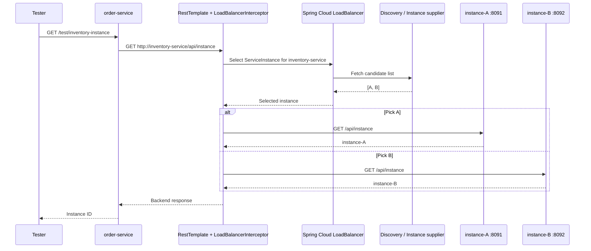

# Testing Call Distribution Across Multiple Replicas

In a microservices architecture, `RestTemplate` can call a service by **service ID** rather than hardcoding a single replica's host and port. When a `RestTemplate` bean is annotated with `@LoadBalanced`, Spring Cloud LoadBalancer looks up the `ServiceInstance` list for that service ID, chooses one instance, and routes the HTTP request to that concrete address. But how do you verify requests are genuinely distributed across multiple replicas instead of always landing on the same one?

This lesson shows how to **test RestTemplate request distribution** in two ways: manual testing across running Spring Boot processes, and writing a JUnit integration test that sends real HTTP requests to two embedded backends on dynamic ports. You will observe which instance receives each call, aggregate counts, identify skew caused by discovery, caches, retries, and backend state, and understand why near-even distribution does not guarantee balanced CPU or latency.

## 1. Objectives and Testing Principles

After this lesson, you should be able to:

1. Configure a `@LoadBalanced RestTemplate` calling a service ID.
2. Start two replicas exposing the same endpoint while returning distinct **replica identifiers**.
3. Count requests routed to each instance and observe Round Robin.
4. Write an integration test backed by real HTTP servers without mocking away instance selection.
5. Distinguish between no-instance failures, connection failures, HTTP errors, and unexpected distribution.
6. State the limitations of counting responses to evaluate load balancing.

**Core principle:** you must know **which backend actually processed each call**. Seeing 20 requests all return HTTP 200 proves nothing about load balancing; all 20 might have hit a single instance. Conversely, counting only successful responses hides instances that were selected yet failed to connect.

In this learning setup, each backend returns `instance-A` or `instance-B`. This string is strictly for testing; in production, use traces, metrics, or load-balancing-layer logs instead of injecting infrastructure metadata into business responses.

## 2. Request Flow of a Load-Balanced RestTemplate

Suppose `order-service` queries `inventory-service`:

```text
GET http://inventory-service/api/instance
```

For a `@LoadBalanced RestTemplate`, the `inventory-service` host is a **logical service ID**. It is not a DNS call forcing that hostname to resolve via DNS. LoadBalancer looks up instances through discovery and reconstructs the URI with the selected instance's host and port.



Under standard default settings, Spring Cloud LoadBalancer uses `RoundRobinLoadBalancer` to cycle through the current instance list. An illustrative selection sequence might look like:

```text
Request 01 -> A
Request 02 -> B
Request 03 -> A
Request 04 -> B
...
```

This **does not guarantee the first request always picks A**. The counter may start at a different index, and concurrent clients or interleaved calls can alter the observed sequence. With two stable instances and 40 sequential selections from one client, the split is typically very close to 20/20.

## 3. Preparing Projects and Dependencies

This example uses two Spring Boot applications:

| Application | Role | Port |
|---|---|---:|
| `inventory-service`, instance A | Backend exposing the same endpoint as replica B | 8091 |
| `inventory-service`, instance B | Backend exposing the same endpoint as replica A | 8092 |
| `order-service` | Client calling by service ID and exposing a test endpoint | 8080 |

With Maven, the **client** application needs at least:

```xml
<dependencies>
    <dependency>
        <groupId>org.springframework.boot</groupId>
        <artifactId>spring-boot-starter-web</artifactId>
    </dependency>
    <dependency>
        <groupId>org.springframework.cloud</groupId>
        <artifactId>spring-cloud-starter-loadbalancer</artifactId>
    </dependency>
    <dependency>
        <groupId>org.springframework.boot</groupId>
        <artifactId>spring-boot-starter-test</artifactId>
        <scope>test</scope>
    </dependency>
</dependencies>
```

This snippet shows only the **dependencies block**, not a full `pom.xml`. The project must use the Spring Boot parent or matching dependency management and import the `spring-cloud-dependencies` BOM in `dependencyManagement` with a **release train compatible with your Spring Boot version**. Choose concrete versions from the Spring Cloud compatibility matrix; do not mix arbitrary starter versions with random Spring Boot releases.

The **provider** application only needs `spring-boot-starter-web` for this lab. Eureka or Consul are not required: the client can use `SimpleDiscoveryClient` with a static URI list to observe LoadBalancer. Static configuration is solely for learning; when extending the test to dynamic discovery, use an instance source capable of live updates.

## 4. Creating Two Identifiable Backends

In `inventory-service`, declare a simple endpoint:

```java
import org.springframework.web.bind.annotation.GetMapping;
import org.springframework.web.bind.annotation.RestController;

@RestController
class InstanceController {

    @GetMapping("/api/instance")
    String instance() {
        return System.getProperty("instance.label", "unknown");
    }
}
```

Both processes run the same JAR with different system properties and ports. After building, open **two terminals**:

```bash
# Terminal A
java -Dinstance.label=instance-A -jar inventory-service.jar --server.port=8091
```

```bash
# Terminal B
java -Dinstance.label=instance-B -jar inventory-service.jar --server.port=8092
```

Note: `-Dinstance.label=...` is a JVM option and must appear **before** `-jar`. `--server.port` is a Spring Boot argument. If either terminal A or B fails to start, fix the provider before investigating LoadBalancer.

Verify both backends with direct calls:

```bash
curl http://localhost:8091/api/instance
curl http://localhost:8092/api/instance
```

The responses must be:

```text
instance-A
instance-B
```

If both return `unknown` or the same label, client-side distribution measurements cannot distinguish instances. Do not proceed with LoadBalancer testing until this precondition holds.

## 5. Configuring the Instance List in `order-service`

Place the following configuration in the **client application's** `application-lab.yml`:

```yaml
server:
  port: 8080

spring:
  application:
    name: order-service
  cloud:
    discovery:
      client:
        simple:
          instances:
            inventory-service:
              - uri: http://localhost:8091
              - uri: http://localhost:8092
```

The `spring.cloud.discovery.client.simple.instances` property maps a **service ID** to a static list of `ServiceInstance` entries. Both URIs belong under the `inventory-service` key; do not create two service IDs `inventory-A` and `inventory-B` because they are two replicas of the same logical service.

Activate the profile when starting the client:

```bash
java -jar order-service.jar --spring.profiles.active=lab
```

`localhost` only works when client and providers run on the same host or network namespace. If the client runs inside a Docker container, `localhost` refers to that client container rather than the host or provider containers; use hostnames/addresses reachable from inside the container.

### 5.1. Registering the Right RestTemplate Bean

Spring Cloud does not automatically turn every `RestTemplate` in the application into a load-balanced client. Mark the specific bean:

```java
import org.springframework.boot.web.client.RestTemplateBuilder;
import org.springframework.cloud.client.loadbalancer.LoadBalanced;
import org.springframework.context.annotation.Bean;
import org.springframework.context.annotation.Configuration;
import org.springframework.web.client.RestTemplate;

@Configuration
class RestTemplateConfiguration {

    @Bean
    @LoadBalanced
    RestTemplate loadBalancedRestTemplate(RestTemplateBuilder builder) {
        return builder.build();
    }
}
```

`@LoadBalanced` lets Spring Cloud attach the interceptor that replaces the service ID with the selected instance's URI. In applications with multiple `RestTemplate` beans, inject the right bean using `@Qualifier`:

```java
import org.springframework.beans.factory.annotation.Qualifier;
import org.springframework.stereotype.Service;
import org.springframework.web.client.RestTemplate;

@Service
class InventoryGateway {

    private final RestTemplate restTemplate;

    InventoryGateway(
            @Qualifier("loadBalancedRestTemplate") RestTemplate restTemplate) {
        this.restTemplate = restTemplate;
    }

    String selectedInstance() {
        return restTemplate.getForObject(
                "http://inventory-service/api/instance",
                String.class);
    }
}
```

For easy observation from a terminal, add a proxy endpoint in the client:

```java
import org.springframework.web.bind.annotation.GetMapping;
import org.springframework.web.bind.annotation.RestController;

@RestController
class DistributionDemoController {

    private final InventoryGateway gateway;

    DistributionDemoController(InventoryGateway gateway) {
        this.gateway = gateway;
    }

    @GetMapping("/test/inventory-instance")
    String instance() {
        return gateway.selectedInstance();
    }
}
```

Requests sent to `http://localhost:8080/test/inventory-instance` invoke the backend through the `@LoadBalanced RestTemplate` and return the instance label. This keeps the service ID inside the gateway without writing manual port-selection `if` or `Random` logic in the controller.

## 6. Manual Testing and Counting Requests per Replica

First send a few calls:

```bash
curl http://localhost:8080/test/inventory-instance
curl http://localhost:8080/test/inventory-instance
curl http://localhost:8080/test/inventory-instance
curl http://localhost:8080/test/inventory-instance
```

If everything works, responses indicate requests hitting `instance-A` or `instance-B`. To evaluate distribution, **count a batch of requests**, rather than checking just two or three calls.

### 6.1. In PowerShell

Send 40 sequential requests and group the responses:

```powershell
1..40 |
  ForEach-Object {
    $result = curl.exe --silent --show-error --fail http://localhost:8080/test/inventory-instance
    if ($LASTEXITCODE -ne 0) {
      throw "Request $_ failed; do not count this as a backend response"
    }
    $result
  } |
  Group-Object |
  Select-Object Name, Count
```

This script checks `curl.exe`'s exit code after each request and stops on HTTP or connection errors. Never let empty error responses get tallied as a "third instance" in the summary table.

### 6.2. On Linux/macOS

```bash
set -euo pipefail
for i in $(seq 1 40); do
  curl --silent --show-error --fail \
    http://localhost:8080/test/inventory-instance
  printf '\n'
done | sort | uniq -c
```

Example **illustrative expected outcome** when the list is stable and a single client sends sequential requests:

| Instance | Responses out of 40 requests | Share |
|---|---:|---:|
| `instance-A` | 20 | 50% |
| `instance-B` | 20 | 50% |

Do not treat an exact 20/20 split as an invariant across every environment. Spring Cloud LoadBalancer normally defaults to Round Robin, yet initial counter state, concurrent traffic, list updates, retries, and supplier settings can shift the numbers.

### 6.3. Measure Percentages, Not Just Counts

With `N` total labeled responses and `c_i` responses from instance `i`, the observed ratio is:

\[
r_i = \frac{c_i}{N}\times 100\%.
\]

For example, if A gets 22 and B gets 18 responses out of 40 calls, `r_A=55%` and `r_B=45%`. That is not necessarily a bug: before drawing conclusions, verify how many valid instances existed at selection time, whether other requests interleaved, whether any requests failed, and whether traffic passed through a single load balancer.

## 7. JUnit Integration Test with Two Real HTTP Servers

Manual checks work well for labs, but to make this repeatable in CI, spin up embedded backends inside the test. A clean option is using the JDK's `HttpServer` to run two HTTP servers on **dynamic ports**, then registering their URIs for `SimpleDiscoveryClient` via `@DynamicPropertySource`.

Advantages:

- The test does not depend on external provider processes running outside the test.
- Each instance returns its own label, verifying **real requests** flow through RestTemplate and LoadBalancer.
- Dynamic ports prevent port collisions with other processes locally or in CI.
- No HTTP request mock sits **before** the interceptor, so instance selection and real network I/O still run.

The example below uses JUnit Jupiter and Spring Boot Test. Assuming the client app already has `@SpringBootApplication` and the `loadBalancedRestTemplate` bean from section 5, create `InstanceDistributionTest`:

```java
import static org.junit.jupiter.api.Assertions.assertEquals;
import static org.junit.jupiter.api.Assertions.assertTrue;

import java.io.IOException;
import java.io.OutputStream;
import java.io.UncheckedIOException;
import java.net.InetSocketAddress;
import java.nio.charset.StandardCharsets;
import java.util.HashMap;
import java.util.Map;

import com.sun.net.httpserver.HttpServer;
import org.junit.jupiter.api.AfterAll;
import org.junit.jupiter.api.Test;
import org.springframework.beans.factory.annotation.Autowired;
import org.springframework.beans.factory.annotation.Qualifier;
import org.springframework.boot.test.context.SpringBootTest;
import org.springframework.test.context.DynamicPropertyRegistry;
import org.springframework.test.context.DynamicPropertySource;
import org.springframework.web.client.RestTemplate;

@SpringBootTest(webEnvironment = SpringBootTest.WebEnvironment.NONE)
class InstanceDistributionTest {

    private static final HttpServer SERVER_A = startServer("instance-A");
    private static final HttpServer SERVER_B = startServer("instance-B");

    @DynamicPropertySource
    static void configureInstances(DynamicPropertyRegistry properties) {
        properties.add(
                "spring.cloud.discovery.client.simple.instances.inventory-service[0].uri",
                () -> "http://127.0.0.1:" + SERVER_A.getAddress().getPort());

        properties.add(
                "spring.cloud.discovery.client.simple.instances.inventory-service[1].uri",
                () -> "http://127.0.0.1:" + SERVER_B.getAddress().getPort());
    }

    @Autowired
    @Qualifier("loadBalancedRestTemplate")
    private RestTemplate restTemplate;

    @Test
    void distributesCallsAcrossBothInstances() {
        Map<String, Integer> counts = new HashMap<>();

        for (int i = 0; i < 40; i++) {
            String instance = restTemplate.getForObject(
                    "http://inventory-service/api/instance",
                    String.class);
            counts.merge(instance, 1, Integer::sum);
        }

        assertEquals(40, counts.values().stream()
                .mapToInt(Integer::intValue).sum());
        assertEquals(2, counts.size(),
                "Must see responses from both replicas");
        assertTrue(counts.getOrDefault("instance-A", 0) >= 10,
                "Instance A must not receive too few requests");
        assertTrue(counts.getOrDefault("instance-B", 0) >= 10,
                "Instance B must not receive too few requests");
    }

    @AfterAll
    static void stopServers() {
        SERVER_A.stop(0);
        SERVER_B.stop(0);
    }

    private static HttpServer startServer(String instanceId) {
        try {
            HttpServer server = HttpServer.create(
                    new InetSocketAddress("127.0.0.1", 0), 0);

            server.createContext("/api/instance", exchange -> {
                byte[] body = instanceId.getBytes(StandardCharsets.UTF_8);
                exchange.getResponseHeaders().set(
                        "Content-Type", "text/plain; charset=UTF-8");
                exchange.sendResponseHeaders(200, body.length);

                try (OutputStream output = exchange.getResponseBody()) {
                    output.write(body);
                }
            });

            server.start();
            return server;
        } catch (IOException exception) {
            throw new UncheckedIOException(exception);
        }
    }
}
```

On JDK 17, `com.sun.net.httpserver.HttpServer` lives in the `jdk.httpserver` JDK module; if your project uses an explicit Java module descriptor, declare a dependency on that module. This test uses standard JDK utilities without requiring extra mock HTTP server libraries.

Run via Maven (adjust the command to match your project wrapper):

```bash
./mvnw -Dtest=InstanceDistributionTest test
```

On Windows PowerShell, if the project includes the Maven Wrapper:

```powershell
.\mvnw.cmd -Dtest=InstanceDistributionTest test
```

**Test preconditions:** the test app must have the LoadBalancer dependency, a `@LoadBalanced` RestTemplate bean configuration, and no other discovery source overriding the `inventory-service` list. `@DynamicPropertySource` registers the URIs into the Spring Environment **before the test context is built**; both servers start when the test class initializes and shut down in `@AfterAll`.

### Why Not Assert Exactly 20/20?

The integration test aims to catch misconfigurations where **all requests go to a single instance** or bypass LoadBalancer. Accordingly, the test verifies:

1. All 40 calls receive a classified response.
2. Both declared instance labels appear.
3. Each instance receives at least 10 responses in a sequential run with a stable two-instance list and default algorithm.

The 10/40 threshold is a choice **for this specific fixture**, not an SLA or definition of Round Robin. To verify exact algorithmic decisions step by step, write dedicated unit tests for `RoundRobinLoadBalancer` with controlled suppliers and counters instead of depending on context startup timing or HTTP call interleaving.

Never use `MockRestServiceServer` to replace the entire HTTP execution path in an **end-to-end distribution test** if it prevents requests from traversing LoadBalancer. Mocking is great for unit-testing a gateway, but proving selection across real URIs requires keeping the interceptor and HTTP execution intact or intentionally mocking below the selection layer.

## 8. Testing Abnormal Scenarios

A thorough test suite does not measure only the case where both instances are healthy.

| Scenario | Observable symptom | What to check |
|---|---|---|
| Both instances healthy | Responses from both A and B | Correct service ID, correct RestTemplate bean, list contains both URIs |
| Only A declared | All requests go to A | Valid behavior when the list genuinely contains only A |
| B stopped while static list still holds B | Some requests hit connection errors or timeouts | Static instance list does not remove B automatically |
| Discovery returns no instances | Target selection fails; error depends on integration | Service ID key, registry, supplier, and current list |
| Instance returns HTTP 500 | Default RestTemplate throws HTTP exception | Separate backend errors from selection algorithm bugs |
| Switching to list A, B, C | Distribution across three instances after list refresh | Discovery/cache data, refresh timing, and 3 live providers |
| B unhealthy without health filtering enabled | B can still be selected | Health checks are not enabled automatically by adding the LoadBalancer starter |
| Concurrent requests from multiple clients | Sequence rarely alternates strictly | Each client application holds its own selection state and instance snapshot |

### 8.1. Shutting Down One Provider: Why Is It Still Chosen?

When running the static `SimpleDiscoveryClient` example and stopping backend B, the client's list still contains `http://localhost:8092`. Round Robin can still pick B, after which the **HTTP transport** reports `Connection refused`. That is not evidence that LoadBalancer stopped working; it means LoadBalancer picked an instance not yet removed from the candidate list.

To evict failing instances, use dynamic discovery updates or configure `HealthCheckServiceInstanceListSupplier` appropriately. Health checks also operate on a detection interval; an instance can crash right after being selected. Retries are a separate mechanism and are neither enabled nor guaranteed to pick another instance merely by adding `@LoadBalanced`.

### 8.2. Scaling Out and Scaling In

With `SimpleDiscoveryClient` loaded from `application-lab.yml`, editing the YAML file on disk does not immediately update the running application's list. To simulate growing from A/B to A/B/C:

- In a basic lab: update the static list, start C, and **restart the client** before measuring.
- In an advanced lab: use dynamic discovery or a mutable test supplier that updates data while the app runs; record when the client observes the new list.

When instance count changes from `n=2` to `n=3`, Round Robin computes the next index against the **current list length**. The transition therefore does not instantly produce a clean A/B/C cycle, especially when caches and multiple clients hold different snapshots.

## 9. Separating Selection Counts, Successful Responses, and Actual Load

In any distribution test, at least four distinct quantities exist:

| Metric | Meaning | Are they equal? |
|---|---|---|
| Selection count | How many times LoadBalancer picked a target | Can exceed business requests if retries occur |
| Requests sent to instance | Attempts made by the HTTP transport | Can differ from selections if failures happen before connecting |
| Successful responses from instance | Success responses returned by backend to client | Can be lower than attempted requests |
| Actual instance load | CPU, memory, active connections, processing time, and business work | Cannot be inferred directly from response counts |

For instance, one replica may receive 50 cheap requests while another receives 50 heavy data-query requests: request counts are equal, yet CPU load and latency differ sharply. Round Robin balances **selection turns** over the list, not processing time or remaining capacity on each instance.

For deeper verification, observe both client and backend:

- On the client: service ID, selected instance, target URI, processing time, exceptions, and retry count.
- On the backend: instance ID, total incoming requests, error rate, request duration, and resource usage.
- In discovery: registered instance count, health transitions, cache TTL, or supplier refresh timestamps.

In real environments, never log tokens, cookies, personal data, or full response bodies solely to measure distribution. Use tracing or metrics tagged with normalized service ID and instance ID labels.

## 10. Common Testing Mistakes

| Symptom | Common cause | How to fix |
|---|---|---|
| `UnknownHostException: inventory-service` | RestTemplate lacks LoadBalancer interceptor, or real instance hostname cannot resolve | Check `@LoadBalanced` bean, `@Qualifier`, and selected URIs |
| Only `instance-A` appears | Single URI configured, wrong bean, provider B returns wrong label, or another path hits B | Call both providers directly; inspect discovery and REST client |
| `Connection refused` | Provider not running, wrong port, or container cannot reach host `localhost` | Verify ports and call provider URIs directly from the client environment |
| Many empty responses in script | HTTP errors ignored while grouping outputs | Check `curl` exit code and separate failed calls from valid responses |
| Round Robin not strictly 50/50 | Concurrent calls, changing list, filters, retries, or tiny sample size | Count selections; stabilize the list and check configuration |
| `No instances available` or HTTP 503 | Discovery/supplier provides no eligible instances | Match URL service ID against instance list key and active profile |
| Integration test fails randomly due to port in use | Hardcoded ports in test | Use port `0` and `@DynamicPropertySource` as in section 7 |
| Tests pass locally but production fails | Test used static list without verifying real registry/network/health | Add smoke tests and tracing in a production-like environment |

When diagnosing, follow the chain **service ID → instance list → selected instance → target URI → HTTP connection → response**. Whichever step fails reveals the layer to fix; do not rush to change algorithms when the bug is simply a RestTemplate bean missing LoadBalancer integration.

## 11. Completion Checklist

- [ ] Two backends expose the same endpoint and return distinct instance labels.
- [ ] Both A and B can be called directly on their separate ports.
- [ ] The client application includes `spring-cloud-starter-loadbalancer` and a compatible Spring Cloud BOM.
- [ ] `SimpleDiscoveryClient` declares service ID `inventory-service` with both URIs.
- [ ] `RestTemplate` is annotated with `@LoadBalanced` and the right bean is injected.
- [ ] Business code calls the logical URL `http://inventory-service/api/instance` instead of hardcoding a port.
- [ ] Manual testing counts responses from both replicas.
- [ ] The JUnit integration test uses two real HTTP servers and verifies distribution counts.
- [ ] Measurements cleanly separate failed requests, retries, selection counts, and successful responses.
- [ ] You can explain why a stopped instance can still be chosen while discovery remains stale.

**Conclusion:** testing `RestTemplate` call distribution requires proving **which instance** handled each request, not merely checking that requests returned 200. With two distinctively labeled backends, a `@LoadBalanced RestTemplate`, an explicit instance list, and a real integration test, you can verify Spring Cloud LoadBalancer target selection while surfacing config mistakes, discovery propagation delays, and the limits of request-count balancing.
