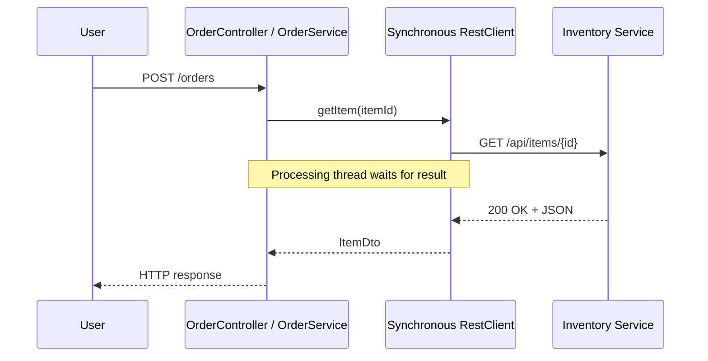
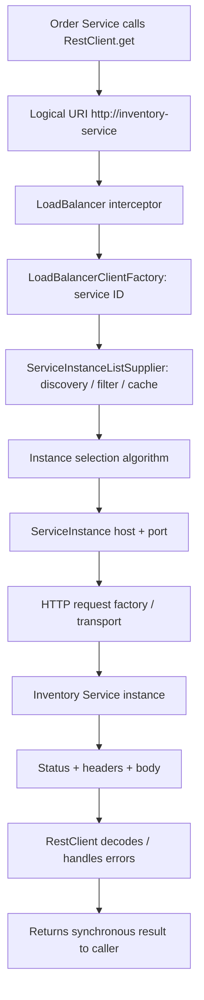

# Synchronous Call Model with RestClient

In a microservice architecture, one service often has to call another service to complete a business operation. For example, when creating an order, `order-service` needs to ask `inventory-service` whether an item is in stock. With **Spring Framework RestClient**, you can write HTTP calls in a fluent, readable style, yet **this is still a synchronous (blocking) execution model**: the calling thread waits until the full result arrives or an error/timeout occurs.

When integrated with **Spring Cloud LoadBalancer**, the caller does not need to hard-code individual replica addresses. The caller uses a service ID such as `http://inventory-service`, while LoadBalancer looks up the list of `ServiceInstance` entries and selects an instance before the HTTP transport connects to the target.

This lesson presents the exact path of a synchronous `RestClient` call, how to initialize a `@LoadBalanced RestClient.Builder`, how to distinguish instance selection from HTTP sending, how to handle errors, timeouts, and retries, and the operational risks under high concurrent requests. This is the foundation for using RestClient reliably in the Spring Cloud LoadBalancer module, while understanding how it differs from `WebClient` and OpenFeign.

## 1. What is RestClient?

`RestClient` is Spring Framework's synchronous HTTP client, featuring a fluent API to build requests, send them over an HTTP transport, and read responses. It was introduced in **Spring Framework 6.1** and is typically available in Spring Boot 3.2 and later applications when using compatible versions.

Example calling a specific URL, **without LoadBalancer integration**:

```java
RestClient client = RestClient.create();

String body = client.get()
    .uri("http://localhost:8081/api/hello")
    .retrieve()
    .body(String.class);

System.out.println(body);
```

In this snippet:

1. `get()` specifies the HTTP method.
2. `uri(...)` specifies the target and path.
3. `retrieve()` initiates the response retrieval flow according to the `RestClient` API.
4. `body(String.class)` executes the operation to return the body converted to `String`; **the calling thread waits** while the HTTP request completes.

`RestClient` is not RestTemplate, although both support synchronous HTTP calls. `RestClient` uses a fluent API; `RestTemplate` has method-based APIs such as `getForObject(...)` or `exchange(...)`. `WebClient` is the reactive option, returning `Mono`/`Flux` when used in an appropriate non-blocking model.

## 2. What does “Synchronous” mean in practice?

With RestClient, the HTTP call statement executes on the **current thread** and does not return control to subsequent code until the request completes, fails, or times out. For example:

```java
public OrderView createOrder(String itemId) {
    ItemDto item = inventoryClient.getItem(itemId); // Wait for HTTP result
    return new OrderView(item.id(), item.name());
}
```

If calling inventory takes 800 ms, the thread running `createOrder` can be occupied for most of that duration, even though the thread's CPU is not actually busy computing. If called on a request-handling thread of a servlet application, the capacity to accept more requests depends on the remaining threads, connection pool, timeouts, and other resources.



**Blocking does not mean the CPU is always active.** Most of the time may be spent waiting on sockets, TLS, upstream databases, or the network. However, in a traditional platform-thread model, each waiting call still holds a thread. If the application uses virtual threads, the cost of holding a thread may be lower in many scenarios, but the semantics of `RestClient` remain **synchronous**: the subsequent code does not continue until the call method finishes.

### Example of concurrency impact

Suppose an `order-service` endpoint has 100 concurrent requests, each calling `inventory-service` and waiting 500 ms on average. When using RestClient, there may be 100 HTTP calls waiting simultaneously (depending on the number of request-handling threads/virtual threads and other limits).

According to Little's Law in steady state:

```text
average in-flight ≈ throughput × average response time
Example: 200 requests/s × 0.5 s ≈ 100 in-flight requests
```

This is only an illustration of concurrency; it is not the mandatory actual thread count of every configuration. If timeouts are too long or upstream is congested, the number of waiting requests can grow and saturate caller resources.

## 3. Where does Spring Cloud LoadBalancer fit in?

Suppose `inventory-service` has three instances published by discovery:

| Service ID | Host | Port | Notes |
|---|---|---:|---|
| `inventory-service` | `10.0.1.11` | 8080 | Replica A |
| `inventory-service` | `10.0.1.12` | 8080 | Replica B |
| `inventory-service` | `10.0.1.13` | 8080 | Replica C |

The caller wants to call `GET http://inventory-service/api/items/42` without knowing which replica is currently available. When `RestClient.Builder` is integrated with Spring Cloud LoadBalancer via `@LoadBalanced`, the LoadBalancer interceptor extracts the service ID from the logical URI host, asks LoadBalancer to select a `ServiceInstance`, and replaces the logical target with the actual address for the transport.



Each layer has its own responsibility:

| Component | Responsibility |
|---|---|
| `RestClient` | Builds requests, sends them over the HTTP transport, converts responses, and reports errors. |
| `@LoadBalanced RestClient.Builder` | A builder configured so that requests using a service ID pass through LoadBalancer integration. |
| `LoadBalancerClientFactory` | Accesses LoadBalancer configuration per service ID. |
| `ServiceInstanceListSupplier` | Provides the candidate instance set from discovery or configured sources, optionally applying health checks, caching, and zone/hint filters. |
| LoadBalancer instance selector | Applies round robin, random, or another policy to the candidate list. |
| `ServiceInstance` | Describes the host, port, URI, secure flag, and metadata of the selected replica. |
| HTTP transport | Performs TCP/TLS connections, connection pooling, and timeouts according to how the transport is configured. |

**Key distinction:** selecting a `ServiceInstance` does not guarantee that the HTTP request will succeed. After selecting a target, connection refused, TLS errors, timeouts, or HTTP `5xx` can still occur.

## 4. Preparing necessary dependencies and configuration

To run the example in a suitable Spring Boot application, you typically need:

- Spring Web for `RestClient` and HTTP request handling.
- Spring Cloud LoadBalancer to use `@LoadBalanced` with the `ServiceInstance` selection mechanism.
- A discovery source such as Eureka/Consul/Kubernetes or a static instance configuration suitable for a test environment.
- A compatible Spring Boot/Spring Cloud version set according to the project's BOM.

Example Maven dependency declaration, omitting version numbers as they are managed by the active dependency management/BOM:

```xml
<dependencies>
    <dependency>
        <groupId>org.springframework.boot</groupId>
        <artifactId>spring-boot-starter-web</artifactId>
    </dependency>
    <dependency>
        <groupId>org.springframework.cloud</groupId>
        <artifactId>spring-cloud-starter-loadbalancer</artifactId>
    </dependency>
</dependencies>
```

These two dependencies **do not automatically create an instance list** for any service ID if no discovery or instance source is provided. If you only write `http://inventory-service` without registering `inventory-service` in an appropriate discovery/static source, LoadBalancer may fail to find an instance to call.

In Spring Boot, you can also inject the default builder configured by Boot. However, a regular builder **does not automatically carry instance selection capability**; you should explicitly declare a `@LoadBalanced` builder bean when making requests by service ID.

## 5. Creating a @LoadBalanced RestClient.Builder

Example in `order-service`:

```java
import org.springframework.cloud.client.loadbalancer.LoadBalanced;
import org.springframework.context.annotation.Bean;
import org.springframework.context.annotation.Configuration;
import org.springframework.web.client.RestClient;

@Configuration
class RestClientConfiguration {

    @Bean
    @LoadBalanced
    RestClient.Builder loadBalancedRestClientBuilder() {
        return RestClient.builder();
    }

    @Bean
    RestClient inventoryRestClient(
            @LoadBalanced RestClient.Builder builder) {
        return builder.clone()
            .baseUrl("http://inventory-service")
            .build();
    }
}
```

Explanation:

1. The `loadBalancedRestClientBuilder` bean is annotated with `@LoadBalanced` so Spring Cloud configures LoadBalancer integration for this builder.
2. The `inventoryRestClient` bean takes the appropriate builder, clones its configuration, and sets `baseUrl` to the **service ID**, not a fixed replica IP.
3. When calling `/api/items/42`, the client resolves the URI based on `http://inventory-service` and the integration selects an appropriate instance.

If there are multiple `RestClient.Builder` or `RestClient` beans, use explicit qualifiers/`@LoadBalanced` so Spring knows the exact bean to inject. Using `builder.clone()` avoids mutating a shared builder configuration when setting a base URL for one service, as that builder might be used to create other clients.

**Note:** `@LoadBalanced` does not apply to every `RestClient` created via `RestClient.create()`. To select instances by service ID, you must use the integrated builder; an ordinary client may try to resolve `inventory-service` as a DNS hostname.

## 6. Writing a gateway to call inventory-service

To decouple HTTP details from business logic, create a dedicated gateway for calling inventory:

```java
import org.springframework.beans.factory.annotation.Qualifier;
import org.springframework.stereotype.Service;
import org.springframework.web.client.RestClient;

record ItemDto(String id, String name, int available) {
}

@Service
class InventoryGateway {

    private final RestClient restClient;

    InventoryGateway(@Qualifier("inventoryRestClient") RestClient restClient) {
        this.restClient = restClient;
    }

    ItemDto findItem(String id) {
        return restClient.get()
            .uri("/api/items/{id}", id)
            .retrieve()
            .body(ItemDto.class);
    }
}
```

The caller uses the gateway:

```java
@Service
class OrderService {

    private final InventoryGateway inventory;

    OrderService(InventoryGateway inventory) {
        this.inventory = inventory;
    }

    OrderView previewOrder(String itemId) {
        ItemDto item = inventory.findItem(itemId);
        if (item == null) {
            throw new IllegalStateException("Empty inventory response");
        }
        return new OrderView(item.id(), item.available());
    }
}

record OrderView(String itemId, int available) {
}
```

The execution flow is:

1. `OrderService` calls `InventoryGateway.findItem(id)`.
2. `RestClient` builds `GET /api/items/{id}` based on the base URL `http://inventory-service`.
3. The LoadBalancer integration resolves `inventory-service` to an instance and passes the request to the HTTP transport.
4. The HTTP client waits for the response; if successful, JSON is deserialized into `ItemDto`.
5. The `findItem` method returns `ItemDto` to `OrderService`; the calling thread only continues once the preceding step finishes.

The example uses Java records and omits imports in the `OrderService` snippet. In production, you must handle empty bodies, HTTP errors, and invalid data rather than assuming an `ItemDto` is always present.

## 7. Reading the response: status, headers, and body

`RestClient` supports multiple ways to receive results:

```java
// Get body only
ItemDto item = restClient.get()
    .uri("/api/items/{id}", id)
    .retrieve()
    .body(ItemDto.class);

// Get status, headers, and body via ResponseEntity
ResponseEntity<ItemDto> result = restClient.get()
    .uri("/api/items/{id}", id)
    .retrieve()
    .toEntity(ItemDto.class);

HttpStatusCode status = result.getStatusCode();
HttpHeaders headers = result.getHeaders();
ItemDto value = result.getBody();
```

With `retrieve()`, Spring applies `RestClient` status handling. By default, `4xx`/`5xx` responses usually throw the corresponding HTTP status exception rather than automatically returning a DTO body like a successful response. `toEntity(...)` still uses the `retrieve()` mechanism and that status handling.

If you need to customize handling for a group of statuses:

```java
ItemDto item = restClient.get()
    .uri("/api/items/{id}", id)
    .retrieve()
    .onStatus(
        code -> code.value() == 503,
        (request, response) -> {
            throw new IllegalStateException(
                "Inventory replied 503 Service Unavailable");
        })
    .body(ItemDto.class);
```

Decide which errors should be translated into business exceptions, which should go through the retry/resilience layer, and which should be returned to the caller. Do not use a broad `catch (Exception)` block to turn all connection errors, instance resolution failures, and data errors into “out of stock”.

Besides `retrieve()`, the `exchange(...)` API lets you handle requests/responses at a lower level. With `exchange(...)`, the status handlers of `retrieve()` are not automatically applied in the same way; the developer is responsible for checking the HTTP status and reading/closing the response properly. Use it only when lower-level response access is genuinely required.

## 8. Three error groups that must not be mixed

In a RestClient + LoadBalancer integration, a single request can fail at three layers:

| Stage | Symptoms | Causes to inspect |
|---|---|---|
| **Before an instance is selected** | No server available for `inventory-service`; integration throws an exception or error depending on version. | Wrong service ID, empty discovery, metadata/zone filters eliminating all candidates, failing health checks. |
| **Instance selected, connection failed** | `ResourceAccessException`, connection refused, socket timeout, TLS handshake error, or similar transport error. | Wrong address/port, network, TLS, proxy, timeout, server went down after selection. |
| **Upstream HTTP returned an error** | Response status `404`, `409`, `429`, `500`, `503`... | API contract, missing resource, rate limit, target application error or overload. |

**An HTTP 503 from upstream does not mean “no instance found”.** Depending on the integration, some pre-connection errors may be mapped to a similar status or exception. You must observe where the error originated and whether an instance had already been selected.

An intentional way to handle `404`:

```java
import org.springframework.web.client.HttpClientErrorException;
import java.util.Optional;

Optional<ItemDto> findOptional(String id) {
    try {
        return Optional.ofNullable(restClient.get()
            .uri("/api/items/{id}", id)
            .retrieve()
            .body(ItemDto.class));
    } catch (HttpClientErrorException.NotFound e) {
        return Optional.empty();
    }
}
```

Here, only `404 Not Found` is interpreted as the resource not existing. `401`, `403`, `429`, `5xx`, and connection errors are not swallowed. That is an important distinction when the caller needs to diagnose root causes and decide whether to retry.

## 9. HTTP client timeouts are not target-selection algorithm timeouts

`RestClient` is a high-level API; timeouts depend on `ClientHttpRequestFactory` and the chosen HTTP engine. Example using a simple request factory for a demo application:

```java
@Bean
RestClient inventoryRestClient(@LoadBalanced RestClient.Builder builder) {
    SimpleClientHttpRequestFactory factory =
        new SimpleClientHttpRequestFactory();

    factory.setConnectTimeout(1_000);
    factory.setReadTimeout(3_000);

    return builder.clone()
        .baseUrl("http://inventory-service")
        .requestFactory(factory)
        .build();
}
```

The numbers `1_000` and `3_000` are milliseconds in the integer-parameter API of supporting Spring Framework versions. When using a version with overloads accepting `Duration`, you can set equivalent values via that API. Do not copy-paste without checking the actual version.

| Timeout | Typical scope | What it does not solve |
|---|---|---|
| Connect timeout | Time to wait for establishing a connection to the selected `host:port`. | Discovery having no instances, empty health filter. |
| Read timeout | Time to wait for reading data from the connection per the HTTP engine's semantics. | Upstream CPU/DB overload, business error-handling logic. |
| Overall request deadline | Time budget for the entire business call, potentially covering instance selection, connection, response processing, and retries. | Does not come automatically from configuring connect/read timeouts alone; must be designed at the appropriate layer. |

This simple example does not use a dedicated connection pool; high-traffic environments should consider an HTTP engine with pooling, idle connection timeouts, pool limits, and TLS/proxy configuration. **Adjusting timeouts is HTTP transport configuration**, not changing `RoundRobinLoadBalancer` or `ServiceInstanceListSupplier`.

## 10. Retries in synchronous calls

A synchronous call may fail transiently and the caller may want to retry. However:

- **Not every error should be retried:** `400`, `401`, `403`, `404` usually do not benefit from sending the exact same request again. Certain `502`, `503`, `504`, connection errors, and timeouts may be retried conditionally.
- **Not every method is safe to retry:** `GET` is typically safe/idempotent; `PUT` and `DELETE` have idempotent semantics in HTTP, though the API contract still must be verified. A `POST` that creates a transaction may have been executed once even if the response was lost; retrying requires an idempotency key or duplicate-prevention guarantees.
- **Do not assume a retry will switch instances:** if retries run inside the HTTP engine after a host has been chosen, the next attempt might still hit the same address. Depending on where retry sits in the Spring Cloud LoadBalancer integration and the re-selection policy, a different instance may be picked.
- **Bound attempt count and duration:** retries must have backoff, jitter, and an overall deadline. If RestClient, LoadBalancer, and the business layer all retry without coordination, the number of HTTP attempts can multiply.

Time-budget example: if a single attempt waits up to 1 second to connect, up to 3 seconds to read, allows two attempts, and adds backoff, the total duration can exceed 8 seconds, not counting other stages. **A 3-second read timeout cannot be treated as a 3-second overall deadline.**

A common incident scenario is `POST /api/orders`: the server created the order, but the client lost the connection before receiving the response. A timeout does not tell you whether the transaction committed. Automatically retrying a `POST` without an idempotency key risks creating duplicate orders and increasing system load.

## 11. When to choose blocking RestClient vs. WebClient?

| Criterion | RestClient | WebClient |
|---|---|---|
| Programming model | Synchronous, sequential code execution. | Reactive, can be non-blocking when used properly. |
| Typical return values | `ItemDto`, `ResponseEntity<ItemDto>`. | `Mono<ItemDto>`, `Flux<ItemDto>`. |
| During I/O wait | The calling thread waits until the result arrives. | Can free the event loop from blocking; the reactive chain resumes on signal. |
| Ease of integration with synchronous Spring MVC services | Convenient. | Requires understanding reactive/blocking coordination to avoid calling `block()` in the wrong place. |
| How LoadBalancer integrates | `@LoadBalanced RestClient.Builder` bean. | `@LoadBalanced WebClient.Builder` bean. |
| Guarantees speed/reliability automatically? | No. | Also no; still requires timeouts, bulkheads, backpressure/concurrency limits, and error handling. |

You do not need to rewrite an entire application as reactive just to use a client-side LoadBalancer. For moderate request workloads and synchronous service code, RestClient can be a clear choice. For many concurrent I/O calls at large scale, WebClient may fit better if the **entire processing pipeline** is designed reactively; using WebClient and calling `block()` inside an event loop does not yield the expected non-blocking benefits.

OpenFeign is also commonly used for synchronous-style calls while declaring APIs via interfaces. Even though the API looks different, it still requires distinguishing the **service ID for instance selection** from the **HTTP client transport and retry/timeout**.

## 12. Observability: tracking instance selection and HTTP calls

When investigating a slow caller, logging only “HTTP request failed” is insufficient. You should correlate:

| Signal | Question to answer |
|---|---|
| Service ID | Which logical service did the request intend to call? |
| Selected instance | Which host/port or instance ID was selected, if selection succeeded? |
| Discovery/health | Is the candidate list empty, stale, or filtered down to nothing? |
| Instance selection time | Was time spent in discovery or the supplier? |
| Connection and HTTP response | Were there connect timeouts, read timeouts, TLS errors, or `5xx` statuses? |
| Latency p50/p95/p99 | Did latency increase due to the caller, network, or upstream? |
| HTTP attempts and retries | How many times was a single logical request retried? |
| Thread/connection pool metrics | Is the caller congested due to too many waiting synchronous calls? |

Add trace/correlation IDs to link timings from `order-service` to `inventory-service`; observability configuration and HTTP client instrumentation depend on Spring Boot, Micrometer, and transport versions. Avoid putting tokens, cookies, sensitive data, or arbitrary user headers into logs or metric tags. High-cardinality values such as continuously changing instance IDs must also be managed carefully.

## 13. Hands-on exercise: two replicas and one RestClient

Goal: observe the synchronous model and the instance selection mechanism.

### Preparation

Create two `inventory-service` instances in a test environment with the same service ID but different ports. Each instance has an endpoint returning its instance identity:

```json
{
  "instanceId": "inventory-8081",
  "itemId": "42",
  "available": 12
}
```

Register both instances using an appropriate discovery provider or use Spring Cloud LoadBalancer's static list mechanism according to the running version's configuration. You do not need to run a separate Eureka server if you want to start with a minimal test.

### Steps

1. **Without LoadBalancer enabled:** try `RestClient.create().get().uri("http://inventory-service/...")`; observe what happens when `inventory-service` is not a DNS-resolvable hostname.
2. **Enable the `@LoadBalanced` builder:** call multiple times using the base URL `http://inventory-service`; record the returned instance IDs.
3. **Observe selection:** with a stable instance set and round robin, selection counts are typically near even. Do not infer that CPU or latency is also evenly distributed.
4. **Simulate a slow request:** make one replica delay for 4 seconds and set a 3-second read timeout; record the wait duration and exception type on the caller side.
5. **Stop one replica:** observe discovery/cache update lag, the possibility that a request still selects the stale record, and the resulting transport errors.
6. **Remove all instances:** determine the error shape when no candidates remain; distinguish it from an HTTP `503` actually returned by upstream.
7. **Test `404` handling:** verify that only Not Found is converted into `Optional.empty()` if business rules specify it; other errors must not be masked.
8. **Test bounded concurrency:** send multiple parallel requests to `order-service` and observe wait times, thread counts, connection pool usage, and p95 latency. Only test in a test environment, rate-limited to avoid congesting shared systems.

### Questions to explain afterward

After the experiment, you should be able to answer:

- When does `RestClient` block the execution thread and when does it resume?
- At which step is the service ID resolved into a host/port?
- Does a no-instance error happen before or after the HTTP connection?
- Which two layers do HTTP client timeouts and LoadBalancer policies belong to?
- Why does a nearly even selection count not guarantee nearly even processing time or CPU load?
- Does a retry actually re-select an instance, and where is the attempt count bounded?

## 14. Checklist before using RestClient in production

- Use a compatible Spring Framework/Spring Boot/Spring Cloud set; ensure `RestClient` and the LoadBalancer starter are present.
- Have a real `ServiceInstance` source for the service ID used in the URI.
- For URIs like `http://inventory-service`, use the proper `@LoadBalanced RestClient.Builder` rather than a plain client.
- Separate the shared builder from per-service clients; consider `clone()` before setting base URLs and transport.
- Set appropriate connect/read timeouts and overall deadlines; choose a request factory/connection pool suited to the load level.
- Distinguish discovery/instance-selection errors, connection/transport errors, and HTTP `4xx`/`5xx`.
- Handle `404` or `409` according to business semantics; do not swallow all exceptions into a generic fallback.
- Use bounded retries with backoff, avoiding stacked multi-layer retries; only retry write operations when duplicate prevention is guaranteed.
- Monitor in-flight requests, thread pools, connection pools, p95/p99 latency, and timeout rates at the caller.
- Inspect `ServiceInstanceListSupplier`, health checks, and zone/hint policies when no-instance or misrouting scenarios occur.
- Do not assume `@LoadBalanced` automatically provides circuit breaking, authentication, or concurrency limits.
- Test shutdown/drain, replica deregistration, and stale cache behavior before real deployment.

**Key takeaway:** `RestClient` lets you write HTTP calls with a fluent API, but **the execution model is synchronous**. Spring Cloud LoadBalancer selects a `ServiceInstance` by service ID before the HTTP client sends the request; it does not turn RestClient into non-blocking, nor does it automatically manage all timeouts, retries, or business health. A stable integration requires **the right `@LoadBalanced` builder, a discovery source, budgeted timeouts, clear error handling, and observability from caller to target instance**.
