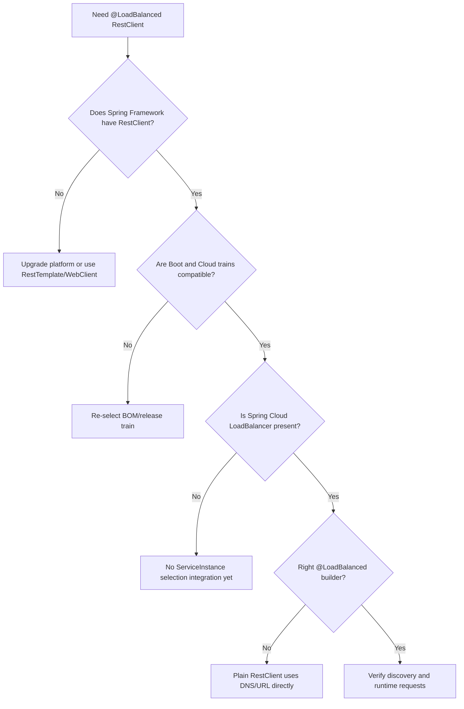
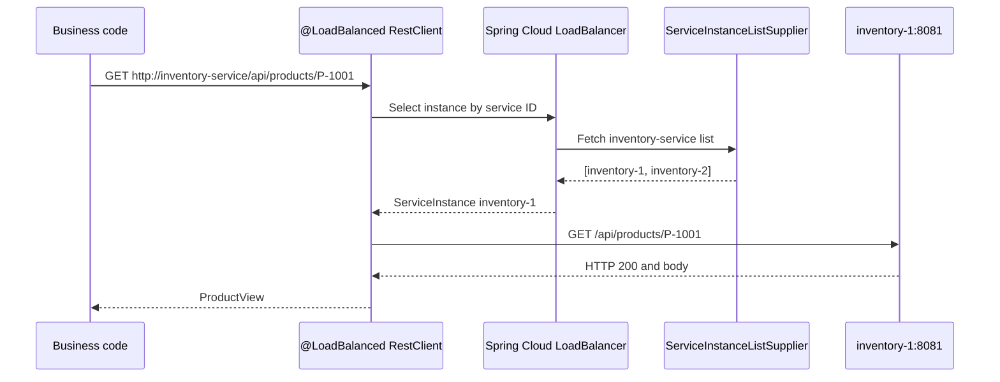

# Version Requirements for Spring Cloud LoadBalancer Integration

`RestClient` is Spring Framework's synchronous (blocking) HTTP client with a fluent API. However, **having the `RestClient` class does not mean URLs using a service ID are automatically load-balanced**. For an application to call `http://inventory-service/api/products/P-1001` and select a `ServiceInstance` from service discovery, requirements for versions, libraries, bean configuration, and an actual instance list must all be met simultaneously.

This lesson belongs to the **RestClient** chapter in the Spring Cloud LoadBalancer module. The focus is on determining whether a project meets the integration requirements, how to avoid mixing incompatible versions of Spring Framework, Spring Boot, and Spring Cloud, and how to verify that `@LoadBalanced RestClient.Builder` actually selects instances. The examples apply when calling internal services with RestClient, while laying the groundwork for comparisons with WebClient or OpenFeign in other lessons.

## 1. Three version layers must be compatible

| Component | Role | Key feature milestones |
|---|---|---|
| **Spring Framework** | Provides `org.springframework.web.client.RestClient`, request-building APIs, and HTTP request factories. | `RestClient` was introduced in **Spring Framework 6.1**. |
| **Spring Boot** | Manages Framework versions, auto-configuration, builders/customizers, and application configuration. | **Spring Boot 3.2** is the first Boot line using Spring Framework 6.1 and supporting `RestClient`. |
| **Spring Cloud** | Integrates `@LoadBalanced`, client-side interceptors, service discovery, and `ReactorLoadBalancer<ServiceInstance>`. | Load-balanced `RestClient.Builder` integration began being supported from the **Spring Cloud 2023.0 / Spring Cloud Commons 4.1** generation. |

These milestones explain **when the API and integration capability appeared**; they do not mean every Boot 3.2 patch matches every Cloud 2023.0 patch, nor that Cloud 2023.0 fits all newer Boot lines. When choosing actual versions, always cross-check the compatibility matrix and release notes of the exact **Spring Cloud release train** and **Spring Boot patch** being deployed.



**Do not treat a successful compile as proof of full compatibility.** Binary compatibility errors may only surface when Spring creates auto-configured beans or when the first request passes through the interceptor.

## 2. Identifying supported and unsupported cases

| Case | Conclusion to draw |
|---|---|
| **Spring Boot 3.1 / Framework 6.0** with the standard dependency set | Framework 6.1's `RestClient` does not exist yet; upgrade Boot to a supported combination or use another HTTP client. |
| **Boot 3.2 / Framework 6.1** without the LoadBalancer starter | `RestClient` exists, but the Spring Cloud LoadBalancer mechanism for resolving service IDs is not yet present. |
| **Boot 3.2 + Cloud 2023.0** at compatible patches, with the starter | Belongs to the generation supporting load-balanced `RestClient.Builder`; still requires proper bean and discovery configuration. |
| **Boot 3.3 or newer** | Use the matching Cloud release train and patch per the compatibility matrix; do not assume every 2023.0 configuration carries over unchanged. |
| Manually forcing `spring-web` or `spring-cloud-commons` off the BOM | May compile on a local machine yet hit `NoSuchMethodError` or auto-configuration failures at runtime. |

**"Having the API" and "having LoadBalancer integrated" are two different claims.** For example:

```java
RestClient plainClient = RestClient.create();
```

This snippet only proves the class exists. A plain client resolves hosts via the URL/HTTP transport; if `inventory-service` is not a real DNS name, the request can fail with `UnknownHostException`. It does not prove that `ServiceInstanceListSupplier` or LoadBalancer was used.

## 3. Required dependencies and version management

Typically, an application making synchronous HTTP calls with `RestClient` needs:

1. **Spring Web** for `RestClient`, usually via `spring-boot-starter-web`.
2. **Spring Cloud LoadBalancer starter** for the `ServiceInstance` selection integration.
3. **An instance source**: `SimpleDiscoveryClient` with static instances in lab exercises, or a real discovery provider in deployment.
4. **Spring Boot BOM/parent and Spring Cloud BOM** to keep Framework–Boot–Cloud artifacts synchronized.

Abbreviated `pom.xml` example for a Spring Boot project that already configures the Boot parent or Boot BOM:

```xml
<dependencyManagement>
    <dependencies>
        <dependency>
            <groupId>org.springframework.cloud</groupId>
            <artifactId>spring-cloud-dependencies</artifactId>
            <version>REPLACE_WITH_COMPATIBLE_CLOUD_VERSION</version>
            <type>pom</type>
            <scope>import</scope>
        </dependency>
    </dependencies>
</dependencyManagement>

<dependencies>
    <dependency>
        <groupId>org.springframework.boot</groupId>
        <artifactId>spring-boot-starter-web</artifactId>
    </dependency>

    <dependency>
        <groupId>org.springframework.cloud</groupId>
        <artifactId>spring-cloud-starter-loadbalancer</artifactId>
    </dependency>
</dependencies>
```

The string `REPLACE_WITH_COMPATIBLE_CLOUD_VERSION` is a **placeholder** and must be replaced with an actual release train compatible with the project's Boot version; Maven cannot run this example as-is without replacing it. With Gradle, use the Boot plugin and the appropriate dependency management/platform mechanism to achieve the same version alignment.

Do not manually override individual versions of `spring-web`, `spring-context`, `spring-cloud-commons`, or `spring-cloud-loadbalancer` to work around an isolated compile error. Doing so can break the dependency set tested together through the BOM.

### Is Eureka/Consul required?

**Not mandatory for learning or local testing.** You can use `SimpleDiscoveryClient` with a static list. When a production application uses Eureka, Consul, Kubernetes discovery, or another provider, the appropriate dependencies and configuration are required. LoadBalancer does not generate instances from a service ID alone.

## 4. Example of a LoadBalancer-managed RestClient

Assume Boot and Cloud are at compatible versions, and Spring Web, Spring Cloud LoadBalancer, and the required annotations are present.

### 4.1. Create a `@LoadBalanced` builder

```java
import org.springframework.cloud.client.loadbalancer.LoadBalanced;
import org.springframework.context.annotation.Bean;
import org.springframework.context.annotation.Configuration;
import org.springframework.web.client.RestClient;

@Configuration(proxyBeanMethods = false)
public class OutboundHttpConfiguration {

    @Bean
    @LoadBalanced
    RestClient.Builder loadBalancedRestClientBuilder() {
        return RestClient.builder();
    }
}
```

`@LoadBalanced` marks the builder so Spring Cloud auto-configuration recognizes it and adds instance-selection capability when compatible. The marker by itself does not create a registry, configure health checks, or guarantee that the target endpoint is up.

### 4.2. Inject the right builder into the gateway

```java
import org.springframework.cloud.client.loadbalancer.LoadBalanced;
import org.springframework.stereotype.Service;
import org.springframework.web.client.RestClient;

@Service
public class InventoryClient {

    private final RestClient client;

    public InventoryClient(@LoadBalanced RestClient.Builder builder) {
        this.client = builder
                .baseUrl("http://inventory-service")
                .build();
    }

    public ProductView findProduct(String productId) {
        return client.get()
                .uri("/api/products/{id}", productId)
                .retrieve()
                .body(ProductView.class);
    }
}
```

`ProductView` is the example application's DTO. The URL in `baseUrl` uses the logical host `inventory-service`. When LoadBalancer is active, this service ID is mapped to a `ServiceInstance` and the request goes to the actual host and port. If there are multiple `RestClient.Builder` beans, inject the bean annotated with `@LoadBalanced` rather than a builder intended for direct URLs.

### 4.3. Provide static instances for testing

```yaml
spring:
  cloud:
    discovery:
      client:
        simple:
          instances:
            inventory-service:
              - uri: http://localhost:8081
              - uri: http://localhost:8082
```

Both servers at 8081 and 8082 must actually be running and serving `/api/products/{id}`. If the YAML defines instances but the backends are not running, LoadBalancer can still **select** a target and then fail with `Connection refused`.

## 5. Runtime flow when conditions are satisfied



`RestClient` is a **blocking HTTP client**. Synchronous calls wait for a response or a timeout. Although some LoadBalancer components use reactive APIs internally, `RestClient` does not turn into `WebClient`, and the timeout/transport settings of the two clients are not automatically identical.

## 6. Why `@LoadBalanced` alone is not enough

A bean carrying the `@LoadBalanced` marker is only **one of several requirements**:

| Condition | When unmet |
|---|---|
| Spring Framework includes `RestClient` | Compile error or missing class at runtime. |
| Compatible Boot/Cloud release train | Auto-configuration may be skipped or fail with class/method errors. |
| LoadBalancer starter and matching interceptor mechanism present | The builder is not augmented with the instance-selection step properly. |
| Using the right marked `RestClient.Builder` bean | HTTP requests go through DNS hosts instead of service discovery. |
| Supplier has instances for the service ID | No candidates are available for LoadBalancer to choose from. |
| HTTP transport connects to the selected backend | Instance selection succeeds, yet requests can time out, fail TLS, or hit connection refused. |

An application starting up cleanly does not guarantee all `RestClient` auto-configuration branches were exercised. Many issues only appear on the first HTTP call.

## 7. Inspect the dependency tree, not just build files

To know which libraries are actually loaded, inspect **resolved dependencies**, not only declarations in `pom.xml` or `build.gradle`.

Illustrative Maven commands:

```bash
./mvnw dependency:tree -Dincludes=org.springframework:spring-web
./mvnw dependency:tree -Dincludes=org.springframework.cloud:spring-cloud-commons
./mvnw dependency:tree -Dincludes=org.springframework.cloud:spring-cloud-loadbalancer
```

Equivalent Gradle commands:

```bash
./gradlew dependencyInsight --dependency spring-web --configuration runtimeClasspath
./gradlew dependencyInsight --dependency spring-cloud-commons --configuration runtimeClasspath
./gradlew dependencyInsight --dependency spring-cloud-loadbalancer --configuration runtimeClasspath
```

These are commands learners can run in their own projects, **not build steps to run while authoring this lesson**. When reading the output, verify that the `spring-web` version includes `RestClient`, that Cloud artifacts belong to the right train, that there are no unexpected overrides, and that the JDK runtime meets the chosen Boot/Framework requirements.

## 8. Verify Spring Boot auto-configuration is active

When the code compiles but service-ID URLs are not load-balanced, inspect beans and auto-configuration conditions. In a development environment, you can enable the Condition Evaluation Report:

```bash
java -jar order-service.jar --debug
```

Or, if `spring-boot-starter-actuator` is present, in a secured environment only, expose two diagnostic endpoints:

```yaml
management:
  endpoints:
    web:
      exposure:
        include: health,conditions,beans
```

Then inspect `/actuator/conditions` and `/actuator/beans`. Conditions affecting load-balanced RestClient may relate to the classpath, existence of builder beans, beans annotated with `@LoadBalanced`, HTTP request factories, or load-balancing components. Bean/post-processor names can change across release trains; verify **actual bean behavior** rather than writing diagnostic logic tied strictly to an internal class name.

An easy oversight: creating a `RestClient` via `RestClient.create()` or `RestClient.builder()` inside the business layer **does not automatically use the builder bean configured in the Spring context**. You must inject the builder from Spring and call `build()`, as shown in section 4.

### Distinguishing two types of errors after calling

If the HTTP stack reports:

```text
UnknownHostException: inventory-service
```

then a primary hypothesis is that the request is using a plain RestClient and the system tried to resolve the service ID as a DNS hostname. Before touching DNS, check the `@LoadBalanced` builder, auto-configuration, and logical URL.

If LoadBalancer actually resolves by service ID but the supplier returns an empty list, the error relates to **no available instances**, which may surface as a `503` status or another exception depending on the HTTP client and version. That is different from `UnknownHostException`. If a selected instance's URI is `localhost:8081` yet no server listens on that port, the cause is **connecting to the backend**, not a version compatibility issue.

## 9. Version and configuration error categories

| Symptom | Possible cause | Priority check |
|---|---|---|
| Compile: `cannot find symbol: RestClient` | Spring Framework/Web is too old or `spring-web` dependency is missing. | Check Spring Boot, resolved `spring-web`, and imports. |
| `ClassNotFoundException` or `NoClassDefFoundError` for Spring classes | Missing dependency during packaging, runtime classpath differs from compile, or mixed versions. | Compare compile/runtime dependency trees, BOM, and packaged JAR. |
| `NoSuchMethodError` involving Spring Framework/Cloud | Binary incompatibility from forcing an artifact off the release train. | Remove core version overrides and pick a compatible BOM. |
| `NoSuchBeanDefinitionException` for builder | Suitable bean not declared or wrong qualifier. | Inspect bean definitions and `@LoadBalanced` annotation placement. |
| `UnknownHostException: inventory-service` | RestClient is not LoadBalancer-integrated or URL bypasses the interceptor. | Check injected builder, auto-configuration, and client construction. |
| No instance for service ID | Wrong service ID, empty registry, or supplier filtered everything out. | Check discovery and `ServiceInstanceListSupplier`. |
| `Connection refused` after target selection | Instance address or port is not serving HTTP. | Test calling the URI directly in a lab environment. |
| `SSLHandshakeException` | TLS truststore, certificate, SAN, or mTLS mismatch. | Diagnose HTTP transport/certs; do not disable TLS verification. |
| Works locally, fails in CI | Different JDK, resolved dependencies, profiles, or packaging. | Compare Java runtime, dependency lock/BOM, and runtime config. |

Do not conclude “Spring Cloud does not support RestClient” just because an HTTP request failed. Identify **which layer failed**: compilation/classpath, bean creation, instance selection, connection establishment, or response handling.

## 10. Boot customizations and custom RestClient.Builder

Spring Boot can customize a builder when the application declares components such as message converters, observation/tracing, HTTP transport, SSL, or customizers. The pattern:

```java
@Bean
@LoadBalanced
RestClient.Builder loadBalancedRestClientBuilder() {
    return RestClient.builder();
}
```

is a minimal example illustrating the LoadBalancer marker. It **does not implicitly guarantee** that all customizations Boot applies to another auto-configured builder will be inherited. Depending on project needs, you must use configurers/customizers supported by the **exact Spring Boot version** to combine HTTP client settings with `@LoadBalanced`.

Two requirements must be verified independently:

- **Load balancing:** The builder must be recognized by Spring Cloud, with `ServiceInstance` selection occurring before executing HTTP.
- **HTTP client configuration:** Request factory, timeouts, TLS, proxy, authentication, headers, codecs/message converters, observation, and logging must match the application contract.

Do not assume migrating from `RestTemplate` to `RestClient` automatically copies `ClientHttpRequestInterceptor`s, timeouts, and all previously configured transport customizations.

### Avoid confusing a plain RestClient with a LoadBalanced RestClient

In an application calling both public APIs via real URLs and microservices via service IDs, **two kinds of builders** may be needed. Use clear bean names/qualifiers and inject with `@LoadBalanced` for clients calling service IDs. Do not apply LoadBalancer to every client indiscriminately: a request to an external DNS hostname will not necessarily have a matching service ID in discovery.

## 11. Timeouts, retries, and HTTP transport are not decided by version milestones

Once load-balanced `RestClient` is supported, the following mechanisms remain separate layers:

| Component | Responsibility |
|---|---|
| HTTP request factory/transport | Establishes connections, applies connect/read/response timeouts, TLS, proxy. |
| Spring Cloud LoadBalancer | Gets instances from the supplier and selects one `ServiceInstance` by service ID. |
| Retry layer (if present) | Decides whether to resend a request after failure, attempt count, backoff, and retry conditions. |
| `ServiceInstanceListSupplier` | Provides/filters the instance list; may combine caching and health checks. |

Therefore, **upgrading Boot/Cloud to get RestClient integration does not automatically generate suitable retry/timeout settings**. Details of timeout configuration depend on the actual HTTP transport chosen (e.g., JDK HTTP client, Apache HttpComponents, or another request factory) and the Boot version in use. Do not copy a timeout property from another client and assume RestClient will read it.

If the application calls `POST /orders`, retrying on timeout can create duplicate writes if the backend already committed but the response was lost. Before enabling retries for operations with side effects, ensure an idempotency key or equivalent business safeguard. Having LoadBalancer does not make write requests safe to retry.

## 12. HTTPS can fail requests even when integration is valid

Example `SimpleDiscoveryClient` declaring an HTTPS instance:

```yaml
spring:
  cloud:
    discovery:
      client:
        simple:
          instances:
            inventory-service:
              - uri: https://inventory.internal:8443
```

The YAML above describes the instance address; it **does not configure a truststore, client certificate, or hostname verification**. Even when RestClient selects the right instance, the HTTP transport can fail on CA verification, hostname/SAN checks, expired certificates, or mTLS.

Do not “quick-fix” by disabling TLS verification. Instead, configure the proper scheme, port, and certificate-verified name, while using an SSL bundle/truststore suited to the active Boot and transport versions.

Similarly, changing the logical URL to `https://inventory-service` is not necessarily the right fix: the scheme and URI supplied by discovery, the client's URL construction, and the backend's TLS policy must all be consistent.

## 13. Layer-by-layer verification procedure

A verification exercise should progress from static conditions to runtime behavior so that when an error occurs, you know which layer caused it:

### Layer A — Versions and dependencies

Record the project's Spring Boot, Spring Framework, Spring Cloud release train, and JDK runtime. Read the dependency tree to confirm `spring-web` includes `RestClient` and Cloud artifacts come from a compatible BOM. Do not rely on IDE version views if CI/production resolves a different classpath.

### Layer B — Beans and auto-configuration

Create a `@LoadBalanced` `RestClient.Builder`, inject it properly into the gateway, and enable the Condition Evaluation Report when needed. Watch for bean creation errors and distinguish clients built through the bean from those created directly via `RestClient.create()`.

### Layer C — Discovery

Prepare two local servers returning different responses on the same route:

```json
{"instance":"inventory-1","productId":"P-1001"}
```

and:

```json
{"instance":"inventory-2","productId":"P-1001"}
```

Register both URIs in `SimpleDiscoveryClient` under the **same service ID**. Verify that the service ID appearing in the logical URL matches the configuration key exactly.

### Layer D — Actual HTTP calls

Send multiple consecutive requests through the gateway:

```text
GET http://inventory-service/api/products/P-1001
GET http://inventory-service/api/products/P-1001
GET http://inventory-service/api/products/P-1001
```

If the supplier yields two instances and the policy is round robin, selections can alternate. Do not conclude which algorithm is running based solely on a few requests; inspect the algorithm bean, instance list, and backend logs.

### Layer E — Fault simulation

Shut down the second backend in a lab environment and observe the selected instance info, `Connection refused`/timeouts, health checks, caching, and retries. A dead backend may remain in discovery/cache for some time; this is not automatically a version compatibility bug. Never test duplicate-data scenarios in production.

## 14. Common mistakes during upgrades

**Upgrading only Spring Framework:** forcing `spring-web` to 6.1 while keeping older Boot/Cloud can expose the API while breaking auto-configuration compatibility. Upgrade according to a published supported combination.

**Upgrading only Spring Cloud:** a newer Cloud release will not give an overly old Boot/Framework the `RestClient` API. The Spring Web foundation must satisfy the requirement first.

**Creating RestClient outside the Spring context:** `RestClient.create()` does not automatically use a `@LoadBalanced` builder bean. For service IDs, inject the proper builder.

**Having the marker without discovery:** `@LoadBalanced` does not create `ServiceInstance` entries. A registry, supplier, or static list must provide real data.

**Forcing a single artifact off the BOM:** easily leads to `NoSuchMethodError` and runtime-only failures.

**Assuming a successful request means load balancing happened:** if `inventory-service` happens to also be a valid DNS host, a plain RestClient can succeed without LoadBalancer. Observe actual instance selection from Spring Cloud.

**Copying all timeout/SSL configs from another client:** RestClient, WebClient, and OpenFeign may use different HTTP transports or configuration properties. Verify timeouts/SSL on the **running** client.

## 15. Checklist before using RestClient with LoadBalancer

- [ ] Active Spring Framework includes `RestClient` (6.1+), with corresponding Spring Boot support (3.2+).
- [ ] Spring Cloud release train supports load-balanced RestClient and is **compatible with the exact Boot patch**.
- [ ] Spring Boot parent/BOM and Spring Cloud BOM manage core dependencies.
- [ ] No manual overrides of `spring-web`/`spring-cloud-commons` off the release train.
- [ ] `spring-web` or `spring-boot-starter-web` and `spring-cloud-starter-loadbalancer` are present.
- [ ] A discovery provider or `SimpleDiscoveryClient` supplies instances for the right service ID.
- [ ] A `RestClient.Builder` bean marked with `@LoadBalanced` is registered and properly injected.
- [ ] Clients are not created directly with `RestClient.create()` when service-ID routing is needed.
- [ ] Know how to inspect the resolved dependency tree and Condition Evaluation Report if auto-configuration fails.
- [ ] Observed at least two backends selected at runtime, not just configured in `application.yml`.
- [ ] Verified timeouts, SSL/TLS, health checks, caching, and retries for the exact HTTP transport.
- [ ] Checked retry risks for write requests and ensured idempotency where needed.
- [ ] Regression tests are in place when changing Boot, Cloud, JDK, or HTTP transport.

**Conclusion:** RestClient support in Spring Cloud LoadBalancer is not an isolated flag. You need **a Framework with the RestClient API**, **compatible Boot–Cloud release trains and patches**, **the LoadBalancer starter**, **a `@LoadBalanced`-annotated builder**, and **discovery supplying valid instances**. Verifying along the chain *dependencies → beans → instance list → HTTP requests* helps cleanly separate version errors, configuration errors, and infrastructure failures.
