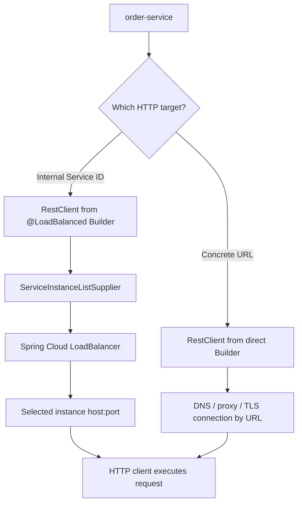

# Separating Load-Balanced and Direct-URL Builders

`RestClient` is Spring Framework's synchronous (imperative) HTTP client. In a Spring Cloud application, not every HTTP request needs to go through Spring Cloud LoadBalancer: calls between microservices typically use a **service ID**, whereas calls to external systems, fixed endpoints, or partner APIs typically use a **real URL**. Configuring a single `RestClient.Builder` for both target types easily causes routing errors and leaks customizations such as headers or timeouts to unintended clients.

This lesson in the **RestClient** chapter presents how to separate two builders: one annotated with `@LoadBalanced` so Spring Cloud selects a `ServiceInstance` by service ID, and a plain builder for calling direct URLs. We will look at how to declare `@Bean`s, select the right builder at injection time, preserve Spring Boot's auto-configuration, test, and handle common errors. This separation lets you apply discovery, health checks, and target-selection policies internally without imposing them on external APIs.

## 1. Two address types, two processing paths

Suppose `order-service` needs to:

- Call `inventory-service` through discovery to check stock. Multiple instances may exist at different hosts/ports.
- Call a partner API at `https://api.partner.example` using a real hostname, with its own DNS/TLS and security policy. The `.example` domain is an illustrative address, not an endpoint usable in production.



The difference does not lie in the `get()`, `post()`, or `retrieve()` API; both `RestClient` instances can use the exact same call style. The difference lies in **how the hostname in the URI is interpreted** before the HTTP request is sent.

| Call type | URI example | Builder to use | How is the connection target determined? |
|---|---|---|---|
| Logical service via discovery | `http://inventory-service/api/items/42` | `@LoadBalanced` | `inventory-service` is treated as a **service ID**; LoadBalancer selects an instance |
| External API | `https://api.partner.example/v1/rates` | Direct | Host `api.partner.example` is resolved/connected per HTTP client configuration |
| URL with explicit host and port | `http://10.0.2.15:9090/health` | Direct | Connects directly to the specified endpoint |
| Endpoint with existing DNS load balancing | `https://internal-api.example/` | Usually direct | Infrastructure-level DNS, proxy, or load balancer chooses the target |

**Rule of thumb:** use `@LoadBalanced` only when the hostname in the URI is truly a service name managed by Spring Cloud's discovery mechanism. A domain-like hostname is not necessarily a service ID, and a service ID can sometimes be resolved by internal DNS; determine the call's intent rather than inferring solely from URI syntax.

## 2. What does @LoadBalanced change in RestClient.Builder?

In Spring Cloud Commons, a `RestClient.Builder` bean annotated with `@LoadBalanced` is configured to integrate with Spring Cloud LoadBalancer. When a `RestClient` is built from this builder and sends a request to a URI with a service ID, the integration extracts the service ID, queries `ServiceInstanceListSupplier`, selects an instance, and constructs the target URI before the HTTP client opens the connection.

```text
RestClient using @LoadBalanced builder
  -> http://inventory-service/api/items/42
  -> LoadBalancer selects inventory-b (10.0.1.11:8080)
  -> http://10.0.1.11:8080/api/items/42
  -> Actual HTTP request
```

A builder **without** `@LoadBalanced` keeps normal HTTP behavior: the hostname in the URL is handled by DNS/proxy/request factory mechanisms. It does not check whether a service registry contains `inventory-service`.

Note: `@LoadBalanced` on a builder bean is a qualifier and a signal for Spring Cloud to attach the interceptor. Calling `RestClient.builder()` alone **does not automatically** include instance selection. Likewise, putting `@LoadBalanced` on a local variable or passing the string `http://service-id` does not replace proper bean declarations and LoadBalancer dependencies.

### 2.1. Required dependencies

With a compatible Spring Boot/Spring Cloud version line, you need:

- `spring-boot-starter-web` or a matching dependency set providing `RestClient`/Spring Web.
- `spring-cloud-starter-loadbalancer` to use Spring Cloud LoadBalancer.
- A `ServiceInstance` source: Eureka, Consul, Kubernetes discovery, `SimpleDiscoveryClient`, or a custom supplier.

Example Maven dependency for LoadBalancer:

```xml
<dependency>
    <groupId>org.springframework.cloud</groupId>
    <artifactId>spring-cloud-starter-loadbalancer</artifactId>
</dependency>
```

The Spring Cloud version should be managed by a BOM compatible with Spring Boot; do not pick an arbitrary standalone starter version just for this example. RestClient exists from Spring Framework 6.1/Spring Boot 3.2 onward; for older projects, verify the available API and suitable client options.

## 3. Configuring two separate RestClient.Builder beans

The clearest approach is declaring **two beans of the same type** with distinct qualifiers and precedence:

```java
import org.springframework.cloud.client.loadbalancer.LoadBalanced;
import org.springframework.context.annotation.Bean;
import org.springframework.context.annotation.Configuration;
import org.springframework.context.annotation.Primary;
import org.springframework.web.client.RestClient;

@Configuration(proxyBeanMethods = false)
public class RestClientBuildersConfiguration {

    @Bean
    @LoadBalanced
    RestClient.Builder loadBalancedRestClientBuilder() {
        return RestClient.builder();
    }

    @Bean
    @Primary
    RestClient.Builder directRestClientBuilder() {
        return RestClient.builder();
    }
}
```

| Component | Meaning |
|---|---|
| `@Bean` | Registers the builder into the Spring IoC container for other components to inject |
| `@LoadBalanced` | Marks the builder configured by Spring Cloud for service-ID calls |
| `@Primary` on the direct builder | When injecting `RestClient.Builder` **without a qualifier**, prefers the direct-URL builder |
| Distinct bean names | Distinguishes beans when `@Qualifier` by name is needed; avoids relying on parameter-name matching |

**Why is `@Primary` on the direct builder?** If another component requests `RestClient.Builder` without specifying `@LoadBalanced`, the safe and predictable default is ordinary HTTP. Callers expecting discovery should express intent with the `@LoadBalanced` qualifier.

The configuration above is a minimal example per Spring Cloud documentation. In a real Spring Boot application, it has one area to improve: calling raw `RestClient.builder()` can skip customizations that Boot normally applies to its auto-configured builder, such as message converters, request factories, and observability. The following section adds `RestClientBuilderConfigurer` to address this.

## 4. Injecting the right builder into the right client

Create two `RestClient` instances for two different targets in one service:

```java
import org.springframework.beans.factory.annotation.Value;
import org.springframework.cloud.client.loadbalancer.LoadBalanced;
import org.springframework.stereotype.Service;
import org.springframework.web.client.RestClient;

@Service
public class InventoryAndPartnerGateway {

    private final RestClient inventoryClient;
    private final RestClient partnerClient;

    public InventoryAndPartnerGateway(
            @LoadBalanced RestClient.Builder loadBalancedBuilder,
            RestClient.Builder directBuilder,
            @Value("${clients.partner.base-url}") String partnerBaseUrl) {

        this.inventoryClient = loadBalancedBuilder
                .baseUrl("http://inventory-service")
                .build();

        this.partnerClient = directBuilder
                .baseUrl(partnerBaseUrl)
                .build();
    }

    public Item getInventoryItem(long itemId) {
        return inventoryClient.get()
                .uri("/api/items/{id}", itemId)
                .retrieve()
                .body(Item.class);
    }

    public PartnerRate getPartnerRate(String currencyCode) {
        return partnerClient.get()
                .uri("/v1/rates/{code}", currencyCode)
                .retrieve()
                .body(PartnerRate.class);
    }
}
```

In this example:

1. The constructor injects `loadBalancedBuilder` **with** `@LoadBalanced`, so the `inventory-service` hostname is treated as a service ID.
2. The constructor injects `directBuilder` **without** a qualifier; because of `@Primary`, Spring supplies the direct builder.
3. Both builders are used only during initialization of their respective `RestClient` instances. Business requests reuse the built clients, avoiding mutating builders per request.
4. `Item` and `PartnerRate` are placeholder DTOs in the application and must be defined according to the actual API contract.

Place the external URL in `application.yml`, not hard-coded in the service:

```yaml
clients:
  partner:
    base-url: https://api.partner.example
```

In production, use the partner's real URL from controlled configuration. If the endpoint requires a token or API key, retrieve secrets from an appropriate secret manager/environment rather than committing raw secret values into Markdown, source code, or YAML in the repository.

### 4.1. Can you inject by bean name instead of @Primary?

Yes, Spring supports `@Qualifier`, for example:

```java
public SomeGateway(
        @Qualifier("loadBalancedRestClientBuilder") RestClient.Builder lb,
        @Qualifier("directRestClientBuilder") RestClient.Builder direct) {
    // ...
}
```

However, for the load-balanced bean, using `@LoadBalanced` directly at the injection point expresses intent clearly and stays consistent with Spring Cloud documentation. If using name-based qualifiers, ensure bean names match exactly. Do not mix multiple conventions in the same codebase without shared guidelines.

### 4.2. Defining RestClient instances as meaningful beans

When multiple gateways share one built client configuration, you can register `RestClient` beans by purpose:

```java
@Configuration(proxyBeanMethods = false)
class ServiceClientsConfiguration {

    @Bean("inventoryRestClient")
    RestClient inventoryRestClient(
            @LoadBalanced RestClient.Builder builder) {
        return builder.baseUrl("http://inventory-service").build();
    }

    @Bean("partnerRestClient")
    RestClient partnerRestClient(
            RestClient.Builder builder,
            @Value("${clients.partner.base-url}") String url) {
        return builder.baseUrl(url).build();
    }
}
```

If injecting both `RestClient` beans directly into another class, use `@Qualifier("inventoryRestClient")` and `@Qualifier("partnerRestClient")` to distinguish them. `@Primary` on the **builder** does not automatically disambiguate the **built `RestClient`** beans.

## 5. Preserving Spring Boot's auto-configured customizations

In Spring Boot, the auto-configured builder is typically pre-configured with message converters, an HTTP request factory, applicable `RestClientCustomizer` beans, and observability support. When explicitly declaring a new builder to attach `@LoadBalanced`, do not assume raw `RestClient.builder()` retains those settings.

Spring Boot provides `RestClientBuilderConfigurer` to apply the same defaults as Boot's auto-configured builder. A practical configuration is:

```java
import org.springframework.beans.factory.config.ConfigurableBeanFactory;
import org.springframework.boot.autoconfigure.web.client.RestClientBuilderConfigurer;
import org.springframework.cloud.client.loadbalancer.LoadBalanced;
import org.springframework.context.annotation.Bean;
import org.springframework.context.annotation.Configuration;
import org.springframework.context.annotation.Primary;
import org.springframework.context.annotation.Scope;
import org.springframework.web.client.RestClient;

@Configuration(proxyBeanMethods = false)
public class RestClientBuildersConfiguration {

    @Bean
    @Primary
    @Scope(ConfigurableBeanFactory.SCOPE_PROTOTYPE)
    RestClient.Builder directRestClientBuilder(
            RestClientBuilderConfigurer configurer) {
        return configurer.configure(RestClient.builder());
    }

    @Bean
    @LoadBalanced
    @Scope(ConfigurableBeanFactory.SCOPE_PROTOTYPE)
    RestClient.Builder loadBalancedRestClientBuilder(
            RestClientBuilderConfigurer configurer) {
        return configurer.configure(RestClient.builder());
    }
}
```

**API version note:** the `RestClientBuilderConfigurer` import above is for **Spring Boot 3.2–3.5** (`org.springframework.boot.autoconfigure.web.client`). In **Spring Boot 4.x**, this class lives in `org.springframework.boot.restclient.autoconfigure.RestClientBuilderConfigurer`. Choose the exact import matching your project's locked Spring Boot version; do not mix classes from both versions.

The two builders are created independently yet receive the same Spring Boot defaults. Only the `@LoadBalanced` bean receives Spring Cloud service-discovery integration. This setup makes it easy to manage HTTPS, timeouts, observability, and serializers without manually duplicating Boot's customizations onto each builder.

### 5.1. Why use prototype scope for builders?

`RestClient.Builder` is **mutable**: calling `.baseUrl(...)`, `.defaultHeader(...)`, `.requestInterceptor(...)`, or `.requestFactory(...)` mutates builder state. If a builder is a singleton and multiple components customize it, one component's modifications can affect clients built later by another component.

`@Scope(ConfigurableBeanFactory.SCOPE_PROTOTYPE)` makes Spring create a fresh builder each time the bean is resolved/injected. This closely matches how Spring Boot provides its auto-configured builder as a prototype, reducing configuration leakage across gateways. Prototype scope does **not** allocate a new builder per HTTP request if a service injects it once at initialization.

If you receive one builder to build multiple clients within the same component, copy it with `.clone()` before applying per-client settings:

```java
RestClient inventory = loadBalancedBuilder.clone()
        .baseUrl("http://inventory-service")
        .build();

RestClient billing = loadBalancedBuilder.clone()
        .baseUrl("http://billing-service")
        .build();
```

Both clients above **still** use LoadBalancer because they were cloned from the integrated builder. Cloning does not convert a load-balanced builder into a direct one. To call real URLs, obtain a client from the **direct builder**. Also never mutate a builder concurrently from multiple threads; create, configure, and `build()` clients at application startup.

### 5.2. Shared customizations vs. per-client customizations

A `RestClientCustomizer` in Spring Boot can apply to builders processed by the configurer. Shared customizers should be reserved for target-agnostic settings, such as message converters or common observation conventions. Client-specific settings such as:

- Partner `Authorization` headers or API keys.
- Internet or egress-network proxies.
- Internal TLS truststores/mTLS.
- Target-specific connect/read timeouts and connection pools.
- Specific base URLs and retry policies.

should be applied **only to the corresponding builder/client**. Placing a partner token in a global customizer can leak that token to internal services. Conversely, internal mTLS settings may not be compatible with external servers.

## 6. URI and baseUrl: errors from mixing service IDs with real URLs

`baseUrl()` determines the root URI for relative paths. The exact same `.uri("/api/items/{id}", id)` call can go to completely different targets depending on the builder:

| Builder | `baseUrl` | `.uri(...)` | Expected behavior |
|---|---|---|---|
| Load-balanced | `http://inventory-service` | `/api/items/42` | Resolves an instance from discovery for `inventory-service` |
| Direct | `https://api.partner.example` | `/v1/rates/USD` | Sends to hostname `api.partner.example` |
| Direct | `http://10.0.2.15:9090` | `/health` | Sends straight to IP/port |

**Error 1: External URL passed through the load-balanced builder.**

```java
RestClient wrong = loadBalancedBuilder
        .baseUrl("https://api.partner.example")
        .build();
```

The integration can treat `api.partner.example` as a service ID and try to look up instances in discovery. Without a registration under that name, the call fails at target selection even when external DNS works fine. Use the direct builder for this case.

**Error 2: Service ID passed through the direct builder.**

```java
RestClient wrong = directBuilder
        .baseUrl("http://inventory-service")
        .build();
```

The HTTP client tries to resolve `inventory-service` via DNS. In environments without a matching DNS record, name resolution fails. In some Kubernetes environments, service names resolve via DNS and the request may even succeed, yet it **does not use Spring Cloud LoadBalancer's instance-selection policy** as expected.

**Error 3: Using an absolute URI with a different host than `baseUrl`.** An absolute URI can override the `baseUrl` host at request time. Therefore, do not treat `.baseUrl("http://inventory-service")` as a guardrail preventing calls to other endpoints. Audit the code, URI inputs, and injected client type.

### 6.1. Do not pass user-supplied URLs directly to a direct client

If an API takes a URL directly from user input and passes it to a direct RestClient, the application risks **SSRF (Server-Side Request Forgery)**, such as reaching cloud metadata endpoints or internal networks. When a feature requires calling dynamic URLs, enforce host/scheme/port allowlists, control redirects, restrict egress networking, and never send shared secrets to untrusted hosts.

Separating the two builders solves routing separation; it **does not replace** URL safety validation or authentication/authorization.

## 7. Timeouts, retries, and connections are not identical by default

Separating builders allows applying tailored policies to each target group. For example:

| Policy | Service-ID client | Direct-URL client |
|---|---|---|
| Discovery and instance selection | Yes, via Spring Cloud LoadBalancer | No, uses DNS/proxy/real URL |
| Connect timeout | Tuned for internal network and failover timing | Tuned for Internet/partner latency |
| Read/response timeout | Balances downstream SLO and caller deadline | Matches partner SLA, capped within overall deadline |
| Retries | Can coordinate retry-aware selection; must consider idempotency | Direct HTTP retry per policy; do not expect LoadBalancer to switch instances |
| TLS/mTLS | Can use internal certificates or dedicated truststore | Verifies partner hostname/certificate; dedicated proxy/CA if needed |
| Connection pool | Per actual selected endpoint | Per host and HTTP request factory config |

`@LoadBalanced` only governs **endpoint selection**; it does not set timeouts or guarantee retries. Retry configuration in Spring Cloud LoadBalancer vs. the HTTP client can vary by version and dependencies. Do not enable multiple stacked retry layers without calculating total call count and deadlines.

### 7.1. Calculating deadlines with retries

Suppose a request has a response timeout of `2s` and allows up to 3 attempts. If every attempt exhausts the timeout, total elapsed time can exceed `6s` once connection setup, instance lookup, backoff, and overhead are added. Therefore:

\[
T_{total} \approx \sum_{attempt=1}^{N}
  (T_{connect} + T_{response}) + T_{backoff} + T_{overhead}
\]

This is a **time-budget estimate**, not how every HTTP client enforces timeouts. Some clients cap an overall deadline, while others only bound individual phases. Inspect the actual request factory, retry integration, and system deadlines.

For a `POST` that creates an order, a timeout **does not prove** the server failed to process the operation. When retrying requests with side effects, use an idempotency key or business mechanism to prevent duplicate execution.

### 7.2. Request factory and connection pool

`RestClient` can use different `ClientHttpRequestFactory` implementations depending on configuration and dependencies, such as JDK HTTP client or Apache HttpComponents. Connection pooling, keep-alive, proxies, and timeouts are largely handled by the underlying request factory/HTTP client, not by `@LoadBalanced`.

To configure internal and partner traffic separately, construct the respective request factories and apply them to the matching builder:

```java
RestClient internal = loadBalancedBuilder
        .requestFactory(internalRequestFactory)
        .baseUrl("http://inventory-service")
        .build();

RestClient external = directBuilder
        .requestFactory(partnerRequestFactory)
        .baseUrl("https://api.partner.example")
        .build();
```

`internalRequestFactory` and `partnerRequestFactory` in this example are beans/objects configured elsewhere, not built-in Spring classes. Calling `.requestFactory(...)` **overrides** the builder's request factory selection; preserve any required settings such as TLS, timeouts, proxies, or observability. Do not share one connection pool across clients with different security requirements without understanding the implications.

## 8. Observability: measuring the two distinct paths

When investigating a failure, you need to know whether the request went through LoadBalancer or directly. For instance, both paths can throw `ResourceAccessException`, yet for different root causes:

- **Load-balanced:** wrong service ID, discovery returned empty, stale instances, health filter excluded candidates, or connection to the instance failed.
- **Direct:** external DNS failure, invalid TLS certificate, proxy rejection, partner HTTP 5xx, or no response before timeout.

Record structured telemetry: client group (`internal-load-balanced`/`external-direct`), service ID or normalized provider name, HTTP method, error category, retry count, and latency. For internal calls, you can observe the selected instance via Spring Cloud LoadBalancer's metrics/lifecycle integration when enabled; direct calls have no Spring Cloud `ServiceInstance` selection decision to record.

`RestClientBuilderConfigurer` preserves Boot's observation setup in supported versions, though meters/tracing appear only when the corresponding observability dependencies and configurations are enabled. Do not assume declaring a builder automatically produces traces and metrics.

Avoid putting bearer tokens, cookies, API keys, full URLs with sensitive queries, or user IDs into logs/metric labels. Labels such as request ID or tenant ID typically have high cardinality and can overload monitoring backends.

## 9. Testing the separation of the two builders

Tests must verify that the two call paths are **genuinely distinct**, not merely that the application starts up.

### 9.1. Minimal test environment

Run two test instances of `inventory-service` on `8081` and `8082`, each exposing `/whoami` returning its own name. Use `SimpleDiscoveryClient` to provide a static list:

```yaml
spring:
  cloud:
    discovery:
      client:
        simple:
          instances:
            inventory-service:
              - uri: http://127.0.0.1:8081
              - uri: http://127.0.0.1:8082

clients:
  partner:
    base-url: http://127.0.0.1:9090
```

In this test, `9090` is a stub HTTP server simulating the partner API, unregistered in discovery. The three `127.0.0.1` addresses work only when the processes run on the same host as the caller. Inside containers, use addresses reachable from the caller container.

### 9.2. Cases to test

| Scenario | Expected result |
|---|---|
| Call `http://inventory-service/whoami` using the load-balanced builder | Request reaches either `8081` or `8082` per selection policy |
| Send multiple requests to the service ID | Selection distribution can be observed when source/health/retries are unchanged |
| Call stub URL `http://127.0.0.1:9090` using the direct builder | Request reaches the stub directly without discovery registration |
| Try calling `api.partner.example` via the load-balanced builder | Likely fails with no instance found for the hostname treated as a service ID |
| Call `inventory-service` via the direct builder when DNS has no record | Name resolution error; bypasses Spring Cloud discovery |
| Omit `@LoadBalanced` at the injection point | Spring prefers the `@Primary` direct bean rather than auto-picking the LB builder |
| Missing direct bean or two beans without proper qualifier/primary | Injection/ambiguity failure or wrong builder injected |
| Add a partner-specific header | Header appears only on requests to the partner stub, never leaking to internal services |
| Stop one inventory instance | Failover behavior depends on discovery/health/timeouts/retries, not the direct builder |

To verify specific headers, timeouts, or exceptions, use a mock HTTP server or WireMock at the stub endpoint. Inspect **what the server actually received**; checking bean names or logged URIs alone does not prove LoadBalancer selected the right instance.

### 9.3. Unit test for bean wiring

In an application test with a Spring context, verify that the container holds both builders:

```java
@SpringBootTest
class RestClientBuilderWiringTest {

    @Autowired
    @LoadBalanced
    RestClient.Builder loadBalancedBuilder;

    @Autowired
    RestClient.Builder defaultBuilder;

    @Test
    void beansAreAvailable() {
        assertNotNull(loadBalancedBuilder);
        assertNotNull(defaultBuilder);
        assertNotSame(loadBalancedBuilder, defaultBuilder);
    }
}
```

This check confirms only the wiring and distinctness of the two builder objects when using prototype scope; **it does not verify the network path**. You still need at least one integration test calling a service ID and one calling a direct URL as listed in the table above.

## 10. Common errors and diagnostic guide

| Symptom | Possible cause | Resolution |
|---|---|---|
| Partner call reports `No instances available` | External URL routed through `@LoadBalanced` builder | Use the direct builder; check constructor qualifiers |
| Internal service call reports `UnknownHostException` | Direct builder is used so service ID goes to DNS | Inject `@LoadBalanced RestClient.Builder` |
| `NoUniqueBeanDefinitionException` when injecting builder | Two beans of the same type without precedence | Mark the direct bean `@Primary`; use `@LoadBalanced` at injection points |
| JSON deserialization differs from expectations | Raw builder skips Boot converters/configurer | Use `RestClientBuilderConfigurer`; inspect customizers |
| Missing observation/tracing on one client | Custom builder missed Boot configuration or instrumentation | Apply configurer to both; verify observation dependencies |
| Partner header appears on internal calls | Reusing a mutated builder or using a global default header | Use prototype/clone; scope headers to the intended client |
| Unexpected internal or partner timeouts | Overriding request factory or sharing timeouts across both target types | Configure separate request factories and timeouts per SLA |
| Service-ID call succeeds without metadata routing | DNS or direct builder handled the call, or supplier lacks policy | Verify traffic passes through LoadBalancer and the `ServiceInstanceListSupplier` chain |
| Too many retries | Retries enabled at both client and LoadBalancer layers | Calculate max attempts, backoff, and total deadline |
| Builder config changes unpredictably | Shared mutable singleton builder modified by multiple components | Use prototype beans, `.clone()`, or build clients once |

### 10.1. Quick diagnostic checklist

1. Verify whether the actual URI hostname is a service ID or a real URL.
2. Verify the load-balanced builder bean has `@LoadBalanced` on its definition **and** at the injection point.
3. Verify the direct bean has `@Primary` and does not carry `@LoadBalanced`.
4. Verify the Spring Cloud LoadBalancer starter is on the classpath and a matching instance source exists for the service ID.
5. Verify `RestClientBuilderConfigurer` and Boot customizers are not bypassed.
6. Verify request factories, TLS, proxies, timeouts, retries, and mutable builder usage.
7. Cross-check LoadBalancer logs/metrics against requests actually received by the backend.

## 11. Step-by-step migration from one builder to two builders

If an application currently uses a single `@LoadBalanced` builder bean for every request, migrate incrementally in this order:

1. **Classify targets:** list calls by service ID (`inventory-service`, `billing-service`) and calls by real URL (partner APIs, fixed host endpoints).
2. **Declare two beans:** keep the `@LoadBalanced` bean and add a `@Primary` direct bean, preferring `RestClientBuilderConfigurer` with prototype scope.
3. **Update injection points:** specify `@LoadBalanced` for internal gateways and use the direct builder for external gateways.
4. **Separate base URLs and secrets:** move partner URLs to configuration, keep credentials in a secret store, and avoid global `defaultHeader` entries containing sensitive data.
5. **Separate timeouts/request factories:** pick policies tailored to internal network vs. Internet and business deadlines.
6. **Test:** use simulated discovery and a stub server; verify both internal and direct paths.
7. **Observe and roll out:** monitor discovery errors, DNS, TLS, latency, and retries; roll back if error rates exceed thresholds.

### 11.1. Long-term principles to maintain

- Use `@LoadBalanced RestClient.Builder` **only** for service IDs managed through Spring Cloud discovery.
- Use the direct `RestClient.Builder` for absolute URLs, specific hostnames/IPs, or DNS/proxy-based routing that does not require Spring Cloud LoadBalancer.
- Place `@Primary` on the direct bean so unqualified injections never accidentally route through LoadBalancer.
- Use `RestClientBuilderConfigurer` when defining custom builders to retain Boot settings; pick the right package import for Spring Boot 3.x vs. 4.x.
- Treat `RestClient.Builder` as mutable; use prototype scope or `.clone()` before applying per-client changes.
- Scope URLs, tokens, TLS, request factories, timeouts, retries, and logging strictly to each target group.
- Do not treat discovery/health results as a guarantee that the next HTTP request will succeed; still enforce timeouts, bounded retries, and idempotency.
- Test with real requests to confirm service IDs route via LoadBalancer while external URLs connect directly.

**Conclusion:** an application often needs Spring Cloud LoadBalancer for internal calls while still needing a plain HTTP client for partner APIs. Two `RestClient.Builder` beans separated by `@LoadBalanced` and `@Primary` establish a clear routing boundary; using the configurer and prototype scope preserves Spring Boot defaults without state leakage. This design ensures discovery, health checks, and `ServiceInstance` selection policies affect only the calls that actually need them.

## References

- [Spring Cloud Commons — Common Abstractions](https://docs.spring.io/spring-cloud-commons/reference/spring-cloud-commons/common-abstractions.html): `@LoadBalanced RestClient.Builder`, using multiple builders, and `@Primary`.
- [Spring Cloud Commons — Spring Cloud LoadBalancer](https://docs.spring.io/spring-cloud-commons/reference/spring-cloud-commons/loadbalancer.html): discovery, `ServiceInstanceListSupplier`, and instance selection mechanics.
- [Spring Boot — Calling REST Services](https://docs.spring.io/spring-boot/reference/io/rest-client.html): auto-configured `RestClient.Builder`, customizers, and `.clone()`.
- [Spring Boot 3.5 — RestClientBuilderConfigurer API](https://docs.spring.io/spring-boot/3.5/api/java/org/springframework/boot/autoconfigure/web/client/RestClientBuilderConfigurer.html) and [Spring Boot 4 — RestClientBuilderConfigurer API](https://docs.spring.io/spring-boot/4.0/api/java/org/springframework/boot/restclient/autoconfigure/RestClientBuilderConfigurer.html): version-specific packages and `configure(...)`.
