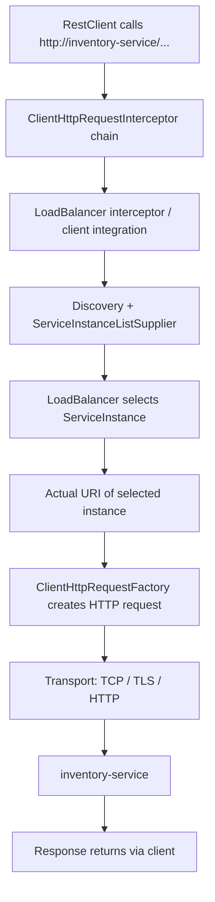

# RestClient Interceptors and Request Factories

In Spring Framework, **`RestClient`** is a synchronous HTTP client with a fluent API. When integrated with Spring Cloud LoadBalancer, `RestClient` can call services by **service ID** instead of knowing the IP and port of every replica beforehand. For example, `order-service` calls `http://inventory-service/api/stocks/BOOK-001`; Spring Cloud LoadBalancer looks up and selects a `ServiceInstance`, and only then is the request sent to the target machine.

Two key extension points on this path are **`ClientHttpRequestInterceptor`** and **`ClientHttpRequestFactory`**. They are often confused as doing the same job of sending requests, whereas in reality they solve two distinct concerns:

- **Interceptor** hooks into the execution of an HTTP request: adding headers, measuring duration, logging, or participating in converting a service ID into an instance address when Spring Cloud integrates LoadBalancer.
- **Request factory** creates the low-level HTTP request using a specific transport mechanism: JDK HTTP Client, Apache HttpComponents, or another implementation. It governs capabilities such as connections, timeouts, and underlying HTTP client resources.

This lesson explains the boundary of responsibilities, how to combine both components with `@LoadBalanced RestClient.Builder`, interceptor ordering, timeout configuration, error classification, and common scenarios in microservices systems. The content aligns with the reliable communication goal of the `SPRING_CLOUD_SERVICE_COMMUNICATION_LOAD_BALANCING` module.

## 1. Looking at the full path of a RestClient call

Suppose `inventory-service` has three replicas:

| Instance | Host and port | Assumed state |
| --- | --- | --- |
| A | `10.0.1.11:8080` | Serving |
| B | `10.0.1.12:8080` | Serving |
| C | `10.0.1.13:8080` | Serving |

Business code calls the logical URL:

```java
StockResponse response = restClient.get()
        .uri("http://inventory-service/api/stocks/{sku}", "BOOK-001")
        .retrieve()
        .body(StockResponse.class);
```

If `RestClient` was built from a builder integrated with Spring Cloud LoadBalancer, the conceptual flow is:



The diagram illustrates the role of each step, **not a guarantee of exact ordering for every interceptor**. Interceptors registered by the application and framework form a chain; each interceptor's position in the chain depends on how the builder is configured and integrated in the active version.

A core point: **the request factory does not select replicas**, and **a logging interceptor does not automatically load-balance**. Instance selection happens only when the HTTP client is wired with the proper Spring Cloud LoadBalancer mechanism.

## 2. Three easily confused concepts

| Component | Ecosystem | Primary responsibility |
| --- | --- | --- |
| `ClientHttpRequestInterceptor` | Spring Framework | Wraps an HTTP execution; can inspect/modify the request and process the response |
| `ClientHttpRequestFactory` | Spring Framework | Creates the HTTP request at the transport layer using a concrete HTTP client |
| `LoadBalancerRequestFactory` | Spring Cloud Commons | Creates the request object for the `LoadBalancerClient` path in integrations using that adapter; not a network request factory |

`LoadBalancerRequestFactory` and `ClientHttpRequestFactory` have similar names but are **two distinct abstractions**. `LoadBalancerRequestFactory` links instance selection to executing a call in Spring Cloud. `ClientHttpRequestFactory` ultimately handles creating requests and communicating over HTTP.

In most application code, you directly configure **`RestClient.Builder`**, `ClientHttpRequestInterceptor`, and `ClientHttpRequestFactory`; Spring Cloud's internal adapter details are only needed during deep investigations.

## 3. Integrating Spring Cloud LoadBalancer with RestClient.Builder

To use `http://inventory-service/...` as a logical URL, the application needs a Spring Cloud LoadBalancer dependency compatible with the running Spring Boot/Spring Cloud versions and an instance-list source. Common Maven dependency example:

```xml
<dependency>
    <groupId>org.springframework.cloud</groupId>
    <artifactId>spring-cloud-starter-loadbalancer</artifactId>
</dependency>
```

Spring Boot must include the appropriate Spring Web dependency to use `RestClient`. Spring Cloud versions should be managed by a BOM compatible with Spring Boot; do not mix arbitrary versions manually.

### 3.1. Declaring a LoadBalanced builder

```java
import org.springframework.cloud.client.loadbalancer.LoadBalanced;
import org.springframework.context.annotation.Bean;
import org.springframework.context.annotation.Configuration;
import org.springframework.web.client.RestClient;

@Configuration
class RestClientConfiguration {

    @Bean
    @LoadBalanced
    RestClient.Builder loadBalancedRestClientBuilder() {
        return RestClient.builder();
    }
}
```

`@LoadBalanced` is placed on the **`RestClient.Builder` bean** so Spring Cloud can customize the builder with load-balancing capability when auto-configuration conditions are met. This annotation does not create a registry, register instances, or turn a standalone `RestClient` created via `RestClient.create()` into a client capable of resolving service IDs.

Next, the service caller receives the matching builder:

```java
import org.springframework.cloud.client.loadbalancer.LoadBalanced;
import org.springframework.stereotype.Service;
import org.springframework.web.client.RestClient;

@Service
class InventoryGateway {
    private final RestClient restClient;

    InventoryGateway(@LoadBalanced RestClient.Builder builder) {
        this.restClient = builder.build();
    }

    StockResponse getStock(String sku) {
        return restClient.get()
                .uri("http://inventory-service/api/stocks/{sku}", sku)
                .retrieve()
                .body(StockResponse.class);
    }
}
```

Here `StockResponse` is an application-defined DTO matching the API contract. The URL uses the logical host `inventory-service`; the LoadBalancer-integrated HTTP client executes instance selection before sending the request. For the code to work, a matching instance list must be supplied by a discovery client or static source.

**Do not mix plain builders with `@LoadBalanced` builders.** If an application calls both service IDs and direct Internet URLs, keep two clearly named builders/beans and inject with appropriate qualifiers. Never reuse a single builder arbitrarily across all address types without controlling which interceptors are attached to it.

### 3.2. Why is `RestClient.create()` not equivalent?

```java
// Does not automatically get Spring Cloud LoadBalancer just from a service-ID-like URL.
RestClient plainClient = RestClient.create();

plainClient.get()
        .uri("http://inventory-service/api/stocks/BOOK-001")
        .retrieve()
        .body(String.class);
```

In the snippet above, without an external DNS or proxy mechanism resolving hostname `inventory-service`, the HTTP transport will report host-not-found errors. Even if DNS resolves the host, that **does not prove** Spring Cloud LoadBalancer performed `ServiceInstance` selection. To use Spring Cloud client-side load balancing, verify the builder was integrated properly.

## 4. ClientHttpRequestInterceptor: extension point around a request

`ClientHttpRequestInterceptor` is a Spring Framework interface. An interceptor receives:

- `HttpRequest request`: method, URI, and headers that can be inspected or adjusted per API contract.
- `byte[] body`: the prepared request payload for that execution.
- `ClientHttpRequestExecution execution`: object allowing execution to proceed to the next component in the chain.

Main signature:

```java
ClientHttpResponse intercept(
        HttpRequest request,
        byte[] body,
        ClientHttpRequestExecution execution
) throws IOException;
```

An interceptor typically invokes `execution.execute(request, body)` **once** and returns the response to outer layers. It can record timing, add headers, or handle cross-cutting checks, but should not implement retries simply by calling `execute(...)` multiple times without considering idempotency and response closing semantics.

### 4.1. Example timing and logging interceptor

```java
import java.io.IOException;
import java.util.concurrent.TimeUnit;

import org.slf4j.Logger;
import org.slf4j.LoggerFactory;
import org.springframework.http.HttpRequest;
import org.springframework.http.client.ClientHttpRequestExecution;
import org.springframework.http.client.ClientHttpRequestInterceptor;
import org.springframework.http.client.ClientHttpResponse;

class SafeTimingInterceptor implements ClientHttpRequestInterceptor {

    private static final Logger log =
            LoggerFactory.getLogger(SafeTimingInterceptor.class);

    @Override
    public ClientHttpResponse intercept(
            HttpRequest request,
            byte[] body,
            ClientHttpRequestExecution execution) throws IOException {

        long startNanos = System.nanoTime();

        try {
            ClientHttpResponse response = execution.execute(request, body);
            long durationMs = TimeUnit.NANOSECONDS.toMillis(
                    System.nanoTime() - startNanos);

            log.info("http.client method={} status={} durationMs={}",
                    request.getMethod(),
                    response.getStatusCode().value(),
                    durationMs);

            return response;
        } catch (IOException ex) {
            long durationMs = TimeUnit.NANOSECONDS.toMillis(
                    System.nanoTime() - startNanos);

            log.warn("http.client method={} errorType={} durationMs={}",
                    request.getMethod(),
                    ex.getClass().getSimpleName(),
                    durationMs);
            throw ex;
        }
    }
}
```

The example avoids logging tokens, bodies, query strings, or full URIs to prevent sensitive data leaks. When logging paths, normalize path templates or strip sensitive IDs. The interceptor **does not close the response** before returning it because calling layers must still read the response; lifecycle management and resource closing belong to the HTTP client/integration.

An easy point of confusion: this interceptor can log `status=404` and return `ClientHttpResponse` normally. Only after the interceptor chain returns the response does `RestClient`'s `retrieve()` apply status handling and potentially throw exceptions for `4xx`/`5xx`. Therefore, `catch (IOException)` in an interceptor is **not** where all HTTP error statuses are caught.

### 4.2. Attaching an interceptor to RestClient.Builder

```java
@Bean
@LoadBalanced
RestClient.Builder loadBalancedRestClientBuilder() {
    return RestClient.builder()
            .requestInterceptor(new SafeTimingInterceptor());
}
```

An application can attach multiple interceptors, such as correlation IDs, logging, authentication, or custom policies. However, interceptors must stay lightweight, avoid unnecessary blocking operations, and never trigger accidental recursive HTTP call loops.

For requests with large payloads or bodies containing sensitive data, avoid copying, logging, or retaining the entire `byte[] body`. Contents like tokens, cookies, and personal data should not be written directly to logs.

## 5. What does the Spring Cloud LoadBalancer interceptor do?

In Spring Cloud's synchronous integration, the LoadBalancer mechanism can be wired into the request chain via a **load-balancing interceptor**. This component reads the service ID from the logical URL host, asks LoadBalancer to select a `ServiceInstance`, and forwards execution to the chosen instance's address.

Example:

```text
URI requested by application:
  http://inventory-service/api/stocks/BOOK-001

Service ID:
  inventory-service

Instance list provided by supplier:
  10.0.1.11:8080
  10.0.1.12:8080

Selection result (example):
  10.0.1.12:8080

Final HTTP address:
  http://10.0.1.12:8080/api/stocks/BOOK-001
```

This integration uses Spring Cloud classes such as `LoadBalancerClient`, `ServiceInstanceListSupplier`, and appropriate request adapters. It **does not turn an HTTP factory into a registry**: the request factory only knows how to execute requests to a supplied address, not how to look up service IDs from Eureka, Consul, or other discovery sources.

### 5.1. Interceptor order affects observability

If an application has both `SafeTimingInterceptor` and the LoadBalancer interceptor, an important question is **which interceptor runs outside the other**.

```text
Conceptual Case A:
  Timing -> LoadBalancer -> HTTP transport

Conceptual Case B:
  LoadBalancer -> Timing -> HTTP transport
```

The two arrangements lead to different timing scopes and observed URIs. For example, an interceptor outside load balancing sees the logical URI, whereas an interceptor inside URI rewriting may see the physical URI, depending on how the implementation wraps the request.

**Never assume `request.getURI()` in every interceptor is always the physical URI.** When you need to know the exact selected replica, use LoadBalancer observation points such as `LoadBalancerLifecycle`, combined with trace/correlation IDs or logging at boundaries suited to your running version.

If an interceptor adds a header for a supplier to read as a hint, verify the header is added **before LoadBalancer constructs its request context**. Adding a header at a point running after instance selection cannot retroactively affect the selection that already occurred.

## 6. ClientHttpRequestFactory: the underlying HTTP execution layer

`ClientHttpRequestFactory` is the abstraction creating `ClientHttpRequest` for a concrete address and method. Common implementations include:

| Implementation | HTTP foundation | Key considerations |
| --- | --- | --- |
| `JdkClientHttpRequestFactory` | JDK `java.net.http.HttpClient` | Easy to use on modern JDKs; clear client and timeout configuration |
| `HttpComponentsClientHttpRequestFactory` | Apache HttpComponents Client 5 | Suitable when connection pooling and rich transport options are needed; requires matching dependency |
| `JettyClientHttpRequestFactory` | Jetty HTTP Client | For environments already adopting Jetty client as transport |
| `SimpleClientHttpRequestFactory` | Basic JDK HTTP mechanism | Limited advanced tuning; use with awareness of transport limits |

None of the request factories in this table **automatically turns host `inventory-service` into a `ServiceInstance`**. That is the job of the LoadBalancer mechanism or another name-resolution system.

When an application does not specify a request factory explicitly, `RestClient` can auto-select an implementation based on available libraries and JDK. Changing dependencies can silently change the active transport; to keep timeouts, TLS, and connection pools consistent across environments, configure the factory explicitly when needed.

## 7. Configuring JdkClientHttpRequestFactory and timeouts

The following example illustrates `RestClient` with LoadBalancer while using JDK HTTP Client for actual HTTP sending:

```java
import java.net.http.HttpClient;
import java.time.Duration;

import org.springframework.beans.factory.annotation.Qualifier;
import org.springframework.cloud.client.loadbalancer.LoadBalanced;
import org.springframework.context.annotation.Bean;
import org.springframework.context.annotation.Configuration;
import org.springframework.http.client.ClientHttpRequestFactory;
import org.springframework.http.client.JdkClientHttpRequestFactory;
import org.springframework.web.client.RestClient;

@Configuration
class InventoryRestClientConfig {

    @Bean("inventoryHttpRequestFactory")
    ClientHttpRequestFactory inventoryHttpRequestFactory() {
        HttpClient httpClient = HttpClient.newBuilder()
                .connectTimeout(Duration.ofSeconds(2))
                .build();

        JdkClientHttpRequestFactory factory =
                new JdkClientHttpRequestFactory(httpClient);
        factory.setReadTimeout(Duration.ofSeconds(5));
        return factory;
    }

    @Bean
    @LoadBalanced
    RestClient.Builder inventoryRestClientBuilder(
            @Qualifier("inventoryHttpRequestFactory")
            ClientHttpRequestFactory factory) {

        return RestClient.builder()
                .requestFactory(factory)
                .requestInterceptor(new SafeTimingInterceptor());
    }
}
```

In this example:

- `connectTimeout(Duration.ofSeconds(2))` sets the connection establishment deadline on JDK `HttpClient`.
- `setReadTimeout(Duration.ofSeconds(5))` sets the response read/wait timeout on the factory per implementation contract.
- `requestFactory(factory)` instructs `RestClient` to use the configured transport.
- `requestInterceptor(...)` adds observation logic; it does **not** replace the transport.
- `@LoadBalanced` allows Spring Cloud to customize the builder to resolve service IDs to instances when compatible dependencies and an instance source exist.

`connectTimeout` and `readTimeout` have distinct meanings. If a connection to the selected replica cannot be opened within the configured window, the client reports a connection error. If the connection opened and the server responds too slowly, the client reports a response-wait error. **A read timeout does not prove the server did not process the request**: for write operations, the server may have completed execution before the client timed out.

The timeouts above are illustrative, not universal recommendations for every domain. You also need to design an **overall request deadline**, retry count, and per-attempt time limits; real elapsed time can include discovery, instance selection, waiting for a pooled connection, and server processing.

### 7.1. Connection pools belong to the underlying factory/client

When using Apache HttpComponents or a pooling transport, the connection pool is usually managed by the underlying HTTP client—for example, a pooled `CloseableHttpClient` passed into `HttpComponentsClientHttpRequestFactory`.

The `ServiceInstance` cache and the connection pool are two separate mechanisms. LoadBalancer picks an instance from the candidate list; the transport then reuses eligible connections to that target address. Changing LoadBalancer's cache TTL is not equivalent to closing all old connections or tuning pool acquisition timeouts.

If you manually create an HTTP client with its own resource pool and lifecycle, ensure resources are closed on application shutdown per the implementation's guidance. Never create a new HTTP client/pool per business request.

## 8. Distinguishing LoadBalancer, HTTP transport, and business errors

A failed call can stop at several layers:

| Symptom | Layer to investigate | Meaning |
| --- | --- | --- |
| No `ServiceInstance` available | Discovery, supplier, LoadBalancer | No eligible target address exists to send the request |
| Cannot resolve physical hostname | DNS/transport | A URI existed to call, yet the hostname failed resolution |
| Connection refused or connect timeout | TCP/network/request factory | Client failed to establish a connection to the target |
| Read timeout or connection reset | Transport/server/proxy | Request may have been sent, yet a complete response was not received |
| `HTTP 401`, `404`, `429`, `503` | HTTP response and API contract | Server or gateway returned a concrete HTTP status |
| `HTTP 200` with `success=false` | Business layer | HTTP exchange succeeded, yet the action was rejected by domain rules |

With `RestClient.retrieve()`, HTTP `4xx`/`5xx` is mapped by default to exceptions in the `RestClientResponseException` hierarchy. I/O failures during execution are typically wrapped in `ResourceAccessException`. Specific exceptions depend on the underlying request factory and HTTP client; inspect the **root cause** to separate connect timeouts, TLS handshakes, and read timeouts.

```java
import org.springframework.web.client.ResourceAccessException;
import org.springframework.web.client.RestClientResponseException;

try {
    StockResponse stock = inventoryGateway.getStock("BOOK-001");
    // Inspect business fields in StockResponse if required by API.
} catch (ResourceAccessException ex) {
    // Investigate connection, TLS, timeouts, and cause from underlying HTTP client.
} catch (RestClientResponseException ex) {
    // An HTTP response with an error status was received (per default retrieve behavior).
    int status = ex.getStatusCode().value();
    String errorBody = ex.getResponseBodyAsString();
    // Map to domain error based on status + error code in body.
}
```

If the application configures `.onStatus(...)` or a custom error handler, status mapping can differ. An interceptor only observes statuses at the HTTP execution layer; logic deciding whether a business request succeeded or failed must follow the API contract, not infer solely from `2xx`.

## 9. Do not place arbitrary retry policies inside an interceptor

An error-prone implementation is calling `execution.execute(request, body)` multiple times on exception:

```java
// Do not use as a general-purpose retry policy:
try {
    return execution.execute(request, body);
} catch (IOException ex) {
    return execution.execute(request, body); // uncontrolled retry
}
```

The snippet above is an anti-pattern **not to adopt**. A read timeout does not prove the server failed to process the request. Uncontrolled retries can cause duplicate operations; an interceptor also does not inherently know whether a request is idempotent, whether the body can be safely re-sent, or how much overall deadline remains.

When retries are needed, define an explicit policy at the HTTP client or Spring Cloud LoadBalancer integration layer:

1. Specify which failures are retryable, such as transient connection errors or specific HTTP statuses.
2. Verify whether the operation can be repeated; for write APIs, consider idempotency keys or status-lookup mechanisms.
3. Cap total attempts, wait time between attempts, and total business duration.
4. Define whether to retry the same instance or select another instance.
5. Record every attempt and instance so root causes are not hidden.

Note that retry configurations can exist at multiple layers: gateway, service adapter, Spring Cloud LoadBalancer, and underlying HTTP client. If each layer retries independently, actual request volume can multiply far beyond expectations. Place retries only at layers with clear ownership and strict bounds.

## 10. Tracing and metrics: interceptors observe HTTP, lifecycle observes selection

An interceptor can measure elapsed time from when it starts until `execution.execute(...)` returns a response or throws. However, that duration **may or may not include** part of instance selection depending on where the interceptor sits in the chain.

For full visibility, distinguish:

| Observation point | Information to collect |
| --- | --- |
| RestClient interceptor | HTTP method, normalized path, status, duration, I/O error category |
| `LoadBalancerLifecycle` | Load balancing start time, selected instance, completion status |
| Discovery / supplier | Candidate list, instance counts before/after cache, health checks and filters |
| Server / gateway | Actual response status, processing time, and downstream errors |
| Business layer | Business error code, final outcome, and idempotency status |

Example log lines aiding traceability:

```text
traceId=c8a2... serviceId=inventory-service event=lb.selected instance=10.0.1.12:8080
traceId=c8a2... event=http.client method=GET status=503 durationMs=311
traceId=c8a2... event=inventory.response category=upstream-unavailable
```

Trace IDs connect layers together. Never log access tokens, cookies, bodies, or queries containing sensitive data. For metrics, avoid high-cardinality labels like dynamic URIs or instance IDs; prefer path templates, methods, service IDs, and stable outcome categories.

When Micrometer and Spring Observability are already present, leverage built-in instrumentation rather than building duplicate meters. Custom interceptors remain useful for domain-specific context, while taking care not to double-count a single call across layers.

## 11. Common configuration mistakes

| Symptom | Possible cause | How to check |
| --- | --- | --- |
| Calling `http://inventory-service/...` reports unknown host | `RestClient` was not built from a `@LoadBalanced` builder or DNS does not know the service ID | Check the builder bean and LoadBalancer interceptor integration |
| Discovery has three instances yet only one is picked | Supplier filter, zone, cache, or selection algorithm | Inspect the list after supplier filtering and selection results |
| Configured `connectTimeout` yet still getting read timeouts | The two timeouts govern different phases | Check the active request factory and downstream processing duration |
| Configured factory yet timeouts did not change | Active bean/builder does not use the configured factory | Verify injected builder, `requestFactory(...)`, auto-configuration, and classpath |
| Interceptor logs logical URI instead of target IP | Interceptor position relative to LoadBalancer interceptor | Check chain order and use lifecycle hooks for selected instance |
| `retrieve()` throws for `404` even though interceptor logged normally | `retrieve()` processes status after the HTTP response leaves the interceptor chain | Separate I/O interceptors from response status handlers |
| More logs or attempts than business requests | Retries or interceptors applied at multiple layers | Attach trace IDs, attempt indices, and verify each metric's scope |
| Direct HTTP client affected by LoadBalancer policy | Wrong builder injected or shared interceptor | Separate builder beans for service IDs vs. physical URLs |

One noteworthy pitfall involves Spring Boot's built-in configuration for `RestClient.Builder`. If you declare a new builder bean with raw `RestClient.builder()`, customizers that Boot normally applies to its auto-configured builder may no longer be present as expected. Therefore check how Boot configures the builder in your current version and ensure critical settings (observability, codecs, request factory, headers) are not inadvertently dropped.

## 12. Testing the coordination between interceptor and request factory

To test not just code but also wiring, you can spin up two `inventory-service` instances in a test environment and use a static instance source when no real registry is needed. Example configuration **for test environments only**:

```yaml
spring:
  cloud:
    discovery:
      client:
        simple:
          instances:
            inventory-service:
              - uri: http://localhost:18081
              - uri: http://localhost:18082
```

This static list works only when the corresponding discovery integration is enabled and both test servers are actually listening on the declared ports. Do not treat it as a full substitute for testing registries, health checks, and caching in real deployment environments.

A useful test matrix:

| Test | What to verify |
| --- | --- |
| `@LoadBalanced` builder calls service ID | Request reaches one of the configured instances, not accidental DNS resolution of the service ID |
| Plain builder calls physical URL | Not unexpectedly rewritten by load-balancing interceptors |
| Interceptor logs a normal call | Includes method, status, duration; no sensitive data leaked |
| Server returns `404` | Interceptor observes HTTP response; `retrieve()` applies status handler as expected |
| Instance not listening | Recognizes connection-layer exception and selected instance |
| Server responds very slowly | Request factory enforces configured response timeout |
| Retries enabled at appropriate layer | Counts attempts accurately, no infinite retries or duplicates on unsafe operations |
| Instance list changes | LoadBalancer picks up new topology per discovery/cache policy |

For unit tests without real networking, you can mock the HTTP response layer and verify that interceptors add headers, log, or leave bodies intact. However, to prove **a service ID resolves to a real instance**, run integration tests with a Spring context containing Spring Cloud LoadBalancer and a proper `ServiceInstance` source.

## 13. Diagnostic workflow for a failed request

When a `RestClient` call does not behave as expected, inspect from the outside in:

1. **Confirm client type:** which builder produced the `RestClient` instance? Does the `RestClient.Builder` bean have `@LoadBalanced`?
2. **Check the URL:** is the URI host a service ID (`inventory-service`) or a physical IP/hostname? Are there conflicting base URL settings?
3. **Check the instance source:** do DiscoveryClient and `ServiceInstanceListSupplier` return a valid list for the service ID?
4. **Check selection:** which instance did LoadBalancer pick? Was it filtered by health, zone, or cache?
5. **Check interceptors:** which interceptors are registered and in what order? Are headers, timing, or logged URIs accurate?
6. **Check request factory:** which JDK/Apache/Jetty/Simple implementation is active? Do connect/read timeouts and connection pools match effective configuration?
7. **Classify the error:** no instance yet, connection failure, HTTP status error, or business-level rejection?
8. **Verify retries and deadlines:** was any operation re-sent, how many attempts occurred, and is there a duplicate business risk?

If the failure occurs only when using a service ID while direct IP/port calls succeed, prioritize checking **LoadBalancer wiring, service ID, and instance list**. If both logical and physical URLs hit connect/read timeouts, check **transport, network, request factory, and server**. If an HTTP response arrives yet business logic rejects it, handle by **status and error code** instead of changing the load-balancing algorithm.

## 14. Self-check questions

1. How do `ClientHttpRequestInterceptor` and `ClientHttpRequestFactory` differ in responsibility?
2. Why does `RestClient.create()` not automatically become a Spring Cloud LoadBalancer client?
3. On which component should `@LoadBalanced` be placed when integrating `RestClient.Builder`?
4. Is `LoadBalancerRequestFactory` a transport request factory like `JdkClientHttpRequestFactory`?
5. Why can the same interceptor see a logical URI in one environment yet a physical URI in another?
6. Does an interceptor catching `IOException` automatically catch `HTTP 404` errors handled by `retrieve()`?
7. How do `connectTimeout` and `readTimeout` differ? Why does a read timeout not prove the server has not processed the request?
8. If discovery returns valid instances yet RestClient still reports unknown host for the service ID, what should you check first?
9. Why should you not implement retries by calling `execution.execute(...)` a second time inside a generic interceptor?
10. Which data fields should be observed to separate LoadBalancer errors, HTTP transport errors, and business errors?

**Conclusion:** `RestClient` handles the HTTP calling API; interceptors provide extension hooks around the call; Spring Cloud LoadBalancer provides `ServiceInstance` selection; and the request factory determines how requests run over the network. Separating these four responsibilities puts timeouts, retries, tracing, and service-ID routing in their proper places, while shortening diagnostic time when inter-service communication fails.
