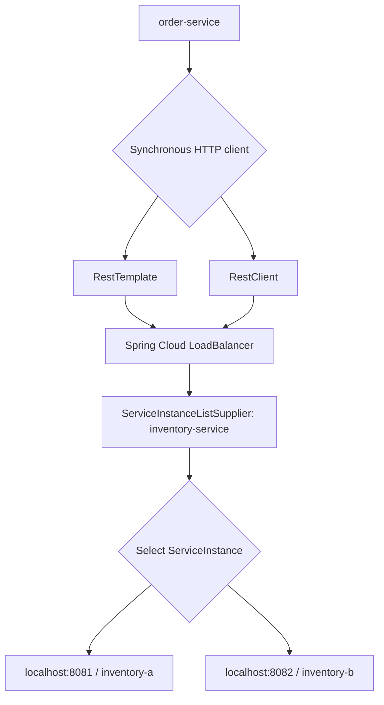
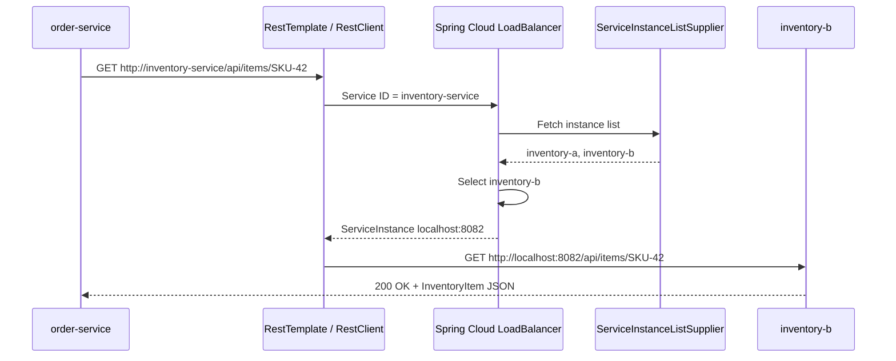

# Comparing RestClient and RestTemplate in the Same Scenario

## Objectives

Spring Cloud LoadBalancer lets an application call other services by **service ID** instead of knowing the IP or port of every replica. For synchronous (blocking) HTTP, two common choices in the Spring ecosystem are `RestTemplate` and `RestClient`.

Both clients can execute **the exact same call to the exact same service ID**, using the same discovery and Spring Cloud LoadBalancer mechanisms, while differing in how beans are declared, how requests are built, and how responses are handled. Understanding this difference helps when maintaining legacy applications using `RestTemplate`, writing new features with `RestClient`, or migrating gradually between the two APIs.

After this lesson, you will be able to:

- Build a scenario calling `inventory-service` with both `RestTemplate` and `RestClient`.
- Distinguish `@LoadBalanced RestTemplate` from `@LoadBalanced RestClient.Builder`.
- Compare `RestTemplate`'s `getForEntity()`/`exchange()` with `RestClient`'s `get().uri().retrieve().toEntity()` chain.
- Understand that both still require a valid service ID, discovery, and `ServiceInstance` entries to perform client-side load balancing.
- Send headers, read status/headers/body, handle HTTP 4xx/5xx, and configure timeouts in the same scenario.
- Recognize the difference between **no instance available**, **HTTP errors from backend**, and **connection errors**.
- Choose the right tool for a new project or plan a migration from legacy code.

## 1. Shared scenario: order-service calls inventory-service

Suppose `order-service` needs to read the stock count of an item from `inventory-service`. The inventory service has two replicas:

| Instance ID | Host | Port | Role |
|---|---|---:|---|
| `inventory-a` | `localhost` | 8081 | First inventory backend |
| `inventory-b` | `localhost` | 8082 | Second inventory backend |

Both expose the endpoint:

```http
GET /api/items/SKU-42
Accept: application/json
```

Sample response from the first replica:

```json
{
  "sku": "SKU-42",
  "available": 12,
  "instanceId": "inventory-a"
}
```

To see which replica handled the request, the response includes `instanceId`. In real applications, this field should only be included for diagnostic or testing purposes.

The caller uses **the same logical URL** for both HTTP clients:

```text
http://inventory-service/api/items/{sku}
```

The host `inventory-service` does not have to be a physical DNS address. With a bean annotated with `@LoadBalanced`, Spring Cloud LoadBalancer interprets this host as a **service ID**, fetches the replica list from discovery, picks an instance such as `http://localhost:8082`, and executes the HTTP request.



**Important point:** this lesson compares **caller-side APIs**, not two different load-balancing algorithms. When using the same service ID and the same LoadBalancer configuration, both select from the same pool of valid instances.

## 2. RestTemplate and RestClient: similarities and differences

Spring Framework provides both APIs for executing synchronous HTTP requests. `RestTemplate` uses template-method calls such as `getForObject()`, `postForEntity()`, and `exchange()`. `RestClient` uses a fluent API: pick the HTTP method, configure URI/headers/body, then call `retrieve()` to handle the response.

| Criterion | RestTemplate | RestClient |
|---|---|---|
| Execution model | Synchronous, blocking | Synchronous, blocking |
| API style | Template methods | Fluent, step-by-step chaining |
| Example GET for body | `getForObject(...)` | `get().uri(...).retrieve().body(...)` |
| Example GET for status and headers | `getForEntity(...)` | `get().uri(...).retrieve().toEntity(...)` |
| Per-request headers | Usually `HttpEntity` and `exchange(...)` | `header(...)` or `headers(...)` on request spec |
| POST with body | `postForEntity(...)` or `exchange(...)` | `post().body(...).retrieve()` |
| Error status handling | `ResponseErrorHandler`, or catch exceptions | `onStatus(...)`, `defaultStatusHandler(...)`, or catch exceptions |
| LoadBalancer configuration | `@LoadBalanced` `RestTemplate` bean | `@LoadBalanced` `RestClient.Builder` bean |
| Usage in legacy projects | Very common | Suitable for new code or migrations |
| Spring Framework direction | Legacy API; deprecated as of Spring Framework 7 | Preferred synchronous API for new code |

Per current Spring Framework documentation, `RestTemplate` is marked **deprecated in Spring Framework 7**, with `RestClient` as its replacement. That does not mean every existing application must be rewritten immediately. If legacy code is stable and well-tested, you can migrate gateway by gateway or service by service instead of changing everything at once.

`RestClient` is **not** `WebClient`. Despite having a similar fluent API, `RestClient` remains blocking; `WebClient` uses the reactive style and can execute non-blockingly. Switching from `RestTemplate` to `RestClient` does not automatically make an application reactive.

## 3. Preparing the project with Spring Cloud LoadBalancer

The illustrative example uses **Spring Boot 4.x** with a **compatible Spring Cloud Release Train** (such as Spring Cloud `2025.1.x` for Spring Boot `4.0.x` or supported Boot `4.1.x` lines). When deploying, always check the release notes and BOM of the exact release.

In Maven, use the Spring Boot parent/BOM and import the matching Spring Cloud BOM; then declare:

```xml
<dependencies>
    <!-- Includes Spring MVC for the demo application exposing endpoints. -->
    <dependency>
        <groupId>org.springframework.boot</groupId>
        <artifactId>spring-boot-starter-webmvc</artifactId>
    </dependency>

    <dependency>
        <groupId>org.springframework.cloud</groupId>
        <artifactId>spring-cloud-starter-loadbalancer</artifactId>
    </dependency>
</dependencies>
```

Because the example uses Spring Boot 4.x, it uses `spring-boot-starter-webmvc`. With Spring Boot 3.x, starters and some auto-configuration packages may differ; do not copy Boot 4 imports into a Boot 3 project without verifying versions.

`spring-cloud-starter-loadbalancer` adds client-side load-balancing components. For dynamic discovery from Eureka, Consul, or Spring Cloud Kubernetes, add the corresponding discovery provider. In this lab, we use `SimpleDiscoveryClient` with two static addresses to separate HTTP API concerns from operating a service registry.

### 3.1. Configuring SimpleDiscoveryClient in the caller

`order-service`'s `application.yml`:

```yaml
server:
  port: 8080

spring:
  application:
    name: order-service
  cloud:
    discovery:
      client:
        simple:
          instances:
            inventory-service:
              - uri: http://localhost:8081
              - uri: http://localhost:8082
```

When code calls `http://inventory-service/...`, LoadBalancer can choose either of these instances. If `inventory-a` or `inventory-b` is not running yet, having URIs in configuration **does not guarantee** HTTP requests succeed: the client will still encounter `Connection refused` or timeouts.

### 3.2. Defining a shared DTO

Both HTTP clients read the same JSON into the same Java data type:

```java
public record InventoryItem(
        String sku,
        int available,
        String instanceId
) {
}
```

The examples below assume `InventoryItem` is in an appropriate package and both applications agree on this JSON contract. `record` expresses the data concisely in modern Java.

## 4. Configuring both load-balanced HTTP clients

### 4.1. RestTemplate: annotate the bean directly

`RestTemplate` is already a complete HTTP client object, so `@LoadBalanced` is placed directly on the bean:

```java
import org.springframework.cloud.client.loadbalancer.LoadBalanced;
import org.springframework.context.annotation.Bean;
import org.springframework.context.annotation.Configuration;
import org.springframework.web.client.RestTemplate;

@Configuration(proxyBeanMethods = false)
class RestTemplateConfiguration {

    @Bean
    @LoadBalanced
    RestTemplate loadBalancedRestTemplate() {
        return new RestTemplate();
    }
}
```

Spring Cloud configures the LoadBalancer interceptor on the Spring-managed `RestTemplate` bean. When calling a logical URI, the interceptor extracts the host as the service ID, uses `BlockingLoadBalancerClient` to pick a `ServiceInstance`, and executes the request against the physical URI.

If you manually instantiate `new RestTemplate()` inside a business method, that instance **does not automatically receive the interceptor** just because the LoadBalancer starter is present. You must use the Spring-configured bean.

### 4.2. RestClient: annotate RestClient.Builder

Unlike `RestTemplate`, Spring Cloud instructs declaring a **`RestClient.Builder`** bean annotated with `@LoadBalanced`. From that builder, the application builds `RestClient`:

```java
import org.springframework.cloud.client.loadbalancer.LoadBalanced;
import org.springframework.context.annotation.Bean;
import org.springframework.context.annotation.Configuration;
import org.springframework.web.client.RestClient;

@Configuration(proxyBeanMethods = false)
class RestClientConfiguration {

    @Bean
    @LoadBalanced
    RestClient.Builder loadBalancedRestClientBuilder() {
        return RestClient.builder();
    }
}
```

You can use the Spring Boot-integrated variant to retain default customizers/observability when declaring a custom builder:

```java
import org.springframework.boot.restclient.autoconfigure.RestClientBuilderConfigurer;
import org.springframework.cloud.client.loadbalancer.LoadBalanced;
import org.springframework.context.annotation.Bean;
import org.springframework.context.annotation.Configuration;
import org.springframework.web.client.RestClient;

@Configuration(proxyBeanMethods = false)
class RestClientConfiguration {

    @Bean
    @LoadBalanced
    RestClient.Builder loadBalancedRestClientBuilder(
            RestClientBuilderConfigurer configurer) {
        return configurer.configure(RestClient.builder());
    }
}
```

**Choose one of the two `RestClientConfiguration` declarations**; do not register two beans of the same name simultaneously. `RestClientBuilderConfigurer` in the snippet above belongs to the **Spring Boot 4.x** package; on other Boot versions, the package may differ. In real applications, using the configurer preserves many Spring Boot pre-configured capabilities rather than initializing a completely standalone builder.

### 4.3. Why is the annotation in different places?

| API | Object receiving `@LoadBalanced` | Object injected into business code |
|---|---|---|
| RestTemplate | `@Bean RestTemplate` | The `RestTemplate` bean itself |
| RestClient | `@Bean RestClient.Builder` | `RestClient` created via `builder.build()` |

This is the most memorable difference when migrating source code. Calling `RestClient.create()` inside a business class does not automatically opt that client into Spring Cloud LoadBalancer based on a builder bean annotation declared elsewhere.

When an application has both load-balanced HTTP clients and direct HTTP clients, distinguish beans with `@LoadBalanced` and `@Primary`/`@Qualifier`. Physical URLs like `http://localhost:8081` normally need a **non-load-balanced** HTTP client; using a `@LoadBalanced` client can cause `localhost` to be treated as service ID `localhost`.

## 5. Same GET call: RestTemplate and RestClient

We implement two separate gateways, both querying the same data from `inventory-service`.

### 5.1. Using RestTemplate

```java
import org.springframework.cloud.client.loadbalancer.LoadBalanced;
import org.springframework.http.ResponseEntity;
import org.springframework.stereotype.Component;
import org.springframework.web.client.RestTemplate;

@Component
class InventoryRestTemplateGateway {

    private final RestTemplate restTemplate;

    InventoryRestTemplateGateway(
            @LoadBalanced RestTemplate restTemplate) {
        this.restTemplate = restTemplate;
    }

    ResponseEntity<InventoryItem> getItem(String sku) {
        return restTemplate.getForEntity(
                "http://inventory-service/api/items/{sku}",
                InventoryItem.class,
                sku
        );
    }
}
```

Calling `getForEntity(...)` executes an HTTP GET and returns `ResponseEntity<InventoryItem>`. From there you can extract:

```java
ResponseEntity<InventoryItem> response = gateway.getItem("SKU-42");

int status = response.getStatusCode().value();
String contentType = String.valueOf(response.getHeaders().getContentType());
InventoryItem item = response.getBody();
```

If you only need the body and do not care about status/headers, `RestTemplate` can use `getForObject(...)`. In this comparison, we use `ResponseEntity` to inspect the full response.

### 5.2. Using RestClient

```java
import org.springframework.cloud.client.loadbalancer.LoadBalanced;
import org.springframework.http.MediaType;
import org.springframework.http.ResponseEntity;
import org.springframework.stereotype.Component;
import org.springframework.web.client.RestClient;

@Component
class InventoryRestClientGateway {

    private final RestClient restClient;

    InventoryRestClientGateway(
            @LoadBalanced RestClient.Builder builder) {
        this.restClient = builder
                .baseUrl("http://inventory-service")
                .build();
    }

    ResponseEntity<InventoryItem> getItem(String sku) {
        return restClient.get()
                .uri("/api/items/{sku}", sku)
                .accept(MediaType.APPLICATION_JSON)
                .retrieve()
                .toEntity(InventoryItem.class);
    }
}
```

Here:

1. `baseUrl("http://inventory-service")` sets the shared logical URI for the gateway.
2. `get()` chooses the HTTP method.
3. `uri("/api/items/{sku}", sku)` expands the URI variable with the SKU.
4. `accept(...)` declares the expected response media type.
5. `retrieve()` enters the response-handling API.
6. `toEntity(InventoryItem.class)` returns status, headers, and body in one `ResponseEntity`.

The result can be processed identically to `RestTemplate`:

```java
ResponseEntity<InventoryItem> response = gateway.getItem("SKU-42");

int status = response.getStatusCode().value();
String contentType = String.valueOf(response.getHeaders().getContentType());
InventoryItem item = response.getBody();
```

Only **how the HTTP request is built** differs, not the data types or target HTTP contract.

### 5.3. Line-by-line comparison

| Intent | RestTemplate | RestClient |
|---|---|---|
| Use service ID | URL `http://inventory-service/...` | `baseUrl("http://inventory-service")` |
| GET method | `getForEntity(...)` | `get()` |
| Path and parameters | `".../{sku}", sku` | `uri("/.../{sku}", sku)` |
| Accept JSON | Set via `HttpEntity`/`exchange(...)` | `accept(MediaType.APPLICATION_JSON)` |
| Get full response | `getForEntity(...)` | `retrieve().toEntity(...)` |
| Get body only | `getForObject(...)` | `retrieve().body(...)` |
| Instance selection | Spring Cloud LoadBalancer | Spring Cloud LoadBalancer |

`RestClient` is generally easier to extend when requests need multiple headers, bodies, cookies, or per-call status rules. `RestTemplate` can still do all of these, though it typically requires preparing `HttpHeaders`, `HttpEntity`, and picking the right `exchange(...)` overload.

## 6. Comparing per-request headers

Suppose the caller needs to pass `X-Request-Id` to trace a request across services. That value should be validated/normalized by the system; the examples below assume the request ID is already safe to put in a header.

### 6.1. RestTemplate: HttpHeaders + HttpEntity + exchange

```java
import org.springframework.http.HttpEntity;
import org.springframework.http.HttpHeaders;
import org.springframework.http.HttpMethod;
import org.springframework.http.MediaType;
import org.springframework.http.ResponseEntity;

ResponseEntity<InventoryItem> getItemWithRequestId(
        String sku, String requestId) {

    HttpHeaders headers = new HttpHeaders();
    headers.setAccept(List.of(MediaType.APPLICATION_JSON));
    headers.set("X-Request-Id", requestId);

    HttpEntity<Void> entity = new HttpEntity<>(headers);

    return restTemplate.exchange(
            "http://inventory-service/api/items/{sku}",
            HttpMethod.GET,
            entity,
            InventoryItem.class,
            sku
    );
}
```

This snippet requires importing `java.util.List` in addition to the listed imports. `RestTemplate.exchange(...)` lets you customize HTTP method, headers, body, and response type via `HttpEntity`.

### 6.2. RestClient: fluent headers

```java
ResponseEntity<InventoryItem> getItemWithRequestId(
        String sku, String requestId) {

    return restClient.get()
            .uri("/api/items/{sku}", sku)
            .accept(MediaType.APPLICATION_JSON)
            .header("X-Request-Id", requestId)
            .retrieve()
            .toEntity(InventoryItem.class);
}
```

`RestClient` attaches headers directly in the request spec without creating an `HttpEntity` for standard GETs. This is especially clean for requests with multiple optional headers.

If a header must be sent on **every** request of a `RestClient`, configure `defaultHeader(...)` on the builder instead of repeating `header(...)` in every method. Never place a single user's fixed token onto a builder shared across multiple users; per-request credentials must be supplied per context.

### 6.3. When POST with a body is needed

For the same JSON body, the typical calls are:

| RestTemplate | RestClient |
|---|---|
| `postForEntity(url, requestBody, ResponseType.class)` | `post().uri(path).body(requestBody).retrieve().toEntity(ResponseType.class)` |

`RestClient` example:

```java
ResponseEntity<ReservationResult> response = restClient.post()
        .uri("/api/reservations")
        .contentType(MediaType.APPLICATION_JSON)
        .body(new ReservationRequest("SKU-42", 2))
        .retrieve()
        .toEntity(ReservationResult.class);
```

`ReservationRequest` and `ReservationResult` here are illustrative DTOs for a reservation API and must be defined in the project. For POST operations with side effects, never enable blind retries if the backend does not support idempotency keys/deduplication.

## 7. Handling HTTP statuses: 404, 500, and network errors

A meaningful difference during migration is how the two APIs customize error handling.

### 7.1. Default behavior is quite similar

By default, `RestTemplate` with its standard error handler and `RestClient.retrieve()` both throw exceptions for HTTP 4xx or 5xx statuses. Both belong to the `RestClientException` family and can expose status/body details via the corresponding exception classes.

An important point is not confusing **HTTP 404 returned by the backend** with **no `ServiceInstance` found**:

- **HTTP 404:** an instance was selected and the backend replied that the resource does not exist.
- **No instance:** discovery/supplier had no backend to choose from; the error can happen **before any HTTP response exists**.
- **Connection refused/timeout:** an instance was selected yet connecting or receiving the response failed.

### 7.2. RestTemplate: catch exception or configure error handler

```java
import org.springframework.web.client.HttpClientErrorException;

InventoryItem findOrNull(String sku) {
    try {
        return restTemplate.getForObject(
                "http://inventory-service/api/items/{sku}",
                InventoryItem.class,
                sku
        );
    }
    catch (HttpClientErrorException.NotFound ex) {
        return null;
    }
}
```

In production applications, you might return `Optional<InventoryItem>` or an explicit result type rather than `null`. With `RestTemplate`, you can customize `ResponseErrorHandler` via `setErrorHandler(...)`, though that applies across all requests of that client. In Spring Framework 7, `RestTemplate`-bound APIs are in the legacy branch, so consider migrating rather than adding heavy new customizations there.

### 7.3. RestClient: per-request onStatus

```java
import org.springframework.web.client.RestClientResponseException;

InventoryItem findOrNull(String sku) {
    try {
        return restClient.get()
                .uri("/api/items/{sku}", sku)
                .retrieve()
                .onStatus(
                        status -> status.value() == 404,
                        (request, response) -> {
                            throw new ItemNotFoundException(sku);
                        }
                )
                .body(InventoryItem.class);
    }
    catch (ItemNotFoundException ex) {
        return null;
    }
}
```

In this example, `ItemNotFoundException` is an application-defined exception:

```java
class ItemNotFoundException extends RuntimeException {
    ItemNotFoundException(String sku) {
        super("Item not found: " + sku);
    }
}
```

`onStatus(...)` handles only statuses matching the predicate—here HTTP 404. Other error statuses continue using the default policy or other status handlers. You can set `defaultStatusHandler(...)` on `RestClient.Builder` when consistent rules across multiple methods are needed.

Never catch all `RestClientException` instances and treat them as “item does not exist”. Network failures, discovery misconfigurations, and HTTP 500s must stay distinct so real incidents are not masked.

### 7.4. The two exchange methods are not fully equivalent

This is an easy pitfall when reading API names:

- `RestTemplate.exchange(...)`: a high-level method that normally converts the body and applies `RestTemplate`'s `ResponseErrorHandler`.
- `RestClient.exchange((request, response) -> ...)`: a lower-level request/response callback; **`retrieve()`'s status handlers are not automatically applied** in this branch. The application must inspect status and handle the response itself.

Therefore, when migrating typical `RestTemplate.exchange(...)` code to `RestClient`, the usual equivalent is `method(...).uri(...).retrieve().toEntity(...)`, not necessarily `RestClient.exchange(...)`.

## 8. Same ServiceInstance selection, different request-building API

With `@LoadBalanced` beans declared properly, the logical flow of both calls is nearly identical:



`RestTemplate` uses the LoadBalancer interceptor in its `ClientHttpRequestInterceptor` chain. A `@LoadBalanced` `RestClient.Builder` likewise integrates service-ID resolution and instance selection when executing requests. For synchronous HTTP clients, Spring Cloud uses `BlockingLoadBalancerClient` to turn the service ID into a physical endpoint.

Policies such as round robin, random, zone preference, hint filtering, health checks, and caching live in the **per-service-ID LoadBalancer configuration**, not as an exclusive advantage of `RestClient`.

Therefore:

- Migrating code from `RestTemplate` to `RestClient` **does not automatically increase** backend count or improve discovery freshness.
- Both gateways can call `inventory-service` and share the instance-selection policy for that service ID.
- You cannot expect the two clients to always receive the same instance on consecutive calls; the algorithm can pick differently based on internal state and timing.
- If `inventory-a` fails, both still need proper timeouts/retries—changing the HTTP API alone will not auto-recover.

## 9. Timeout configuration: must be placed at the right layer

Spring Cloud LoadBalancer is responsible for **instance selection**; connection wait times and response wait times are the responsibility of the respective HTTP client/request factory.

For an easy comparison, you can share `SimpleClientHttpRequestFactory` across both clients:

```java
import org.springframework.http.client.SimpleClientHttpRequestFactory;

static SimpleClientHttpRequestFactory requestFactory() {
    SimpleClientHttpRequestFactory factory =
            new SimpleClientHttpRequestFactory();
    factory.setConnectTimeout(2_000);
    factory.setReadTimeout(3_000);
    return factory;
}
```

This is an example factory with roughly a 2-second connect timeout and a 3-second read timeout. You can declare it in a shared configuration class and pass it to each client:

```java
@Bean
@LoadBalanced
RestTemplate timedRestTemplate() {
    return new RestTemplate(requestFactory());
}

@Bean
@LoadBalanced
RestClient.Builder timedRestClientBuilder(
        RestClientBuilderConfigurer configurer) {
    return configurer.configure(RestClient.builder())
            .requestFactory(requestFactory());
}
```

These two beans **are an alternative configuration** to the `@LoadBalanced` beans in section 4; do not register all of them at once without clear bean names/qualifiers. `SimpleClientHttpRequestFactory` works well for illustration; in production, evaluate HTTP clients with connection pooling, TLS, proxies, and timeouts tuned for traffic.

Do not place OpenFeign's `connectTimeout` under `spring.cloud.loadbalancer.clients.inventory-service` expecting `RestClient` and `RestTemplate` to automatically honor it. If using different HTTP clients/request factories, configure timeouts via their actual APIs.

To determine effective timeouts, measure real latency, caller/gateway time limits, and retry budgets. Timeouts that are too long tie up requests on dead backends; timeouts that are too short trigger errors when backends are only momentarily slow.

## 10. Retries, health checks, and observability

### 10.1. Retries are not identical just from sharing LoadBalancer

Spring Cloud provides retry mechanisms for multiple HTTP client types, though activation conditions and library dependencies can differ. Per Spring Cloud Commons documentation, for blocking load-balanced `RestTemplate`, Spring Retry integration requires **Spring Retry on the classpath**. Verify the retry policy of your exact Spring Cloud Release Train and active client; do not assume flipping one property makes `RestClient` and `RestTemplate` retry identically.

Example LoadBalancer parameters:

```yaml
spring:
  cloud:
    loadbalancer:
      retry:
        enabled: true
        max-retries-on-same-service-instance: 0
        max-retries-on-next-service-instance: 1
```

The configuration above expresses the intent of at most one retry on another instance; actual behavior also depends on the retry integration and which errors count as retryable. For stock-lookup `GET`s, retrying can be helpful. For order-creating or reservation `POST`s, an idempotency key/deduplication safeguard is required to retry safely.

### 10.2. Health checks and caching sit outside the RestClient/RestTemplate choice

Policies such as:

- `HealthCheckServiceInstanceListSupplier` to evaluate instance health.
- `CachingServiceInstanceListSupplier` to reduce discovery lookup overhead.
- `ZonePreferenceServiceInstanceListSupplier` to prefer same-zone replicas.
- `HintBasedServiceInstanceListSupplier` to filter by hint.

are configured per service ID in Spring Cloud LoadBalancer. Changing the API from `RestTemplate` to `RestClient` does not refresh stale discovery data or pick a different supplier.

When assembling a custom supplier chain, caching or health-check suppliers should sit right after the discovery source and before per-request filters. Never accidentally cache a list already filtered by caller/hint.

### 10.3. Observability

If tracing/metrics matter, declaring `RestClient.Builder` via raw `RestClient.builder()` can skip helpful Spring Boot configurations. Use `RestClientBuilderConfigurer` (Boot 4) as shown in section 4 to keep pre-configured customizers/observability.

For `RestTemplate`, similarly consider configuring through `RestTemplateBuilder`/Spring Boot customizers if the project relies on default request instrumentation.

In practice, measure at least:

| Signal | Meaning |
|---|---|
| `serviceId` | Logical service being called. |
| `instanceId` | Which replica processed the request. |
| HTTP status | Distinguish 2xx, 4xx, and 5xx. |
| Duration/latency | Measure latency and detect timeouts. |
| Retry count | Detect excessive request resends. |
| Error class | Separate HTTP, discovery, and connection errors. |
| Trace/correlation ID | Stitch logs between caller and backend. |

Never log authentication tokens, cookies, or personal data. For metrics, keep tag cardinality bounded.

## 11. Hands-on: testing both APIs against the same backend contract

### Step 1. Create the inventory backend

In `inventory-service`, expose an endpoint:

```java
import org.springframework.core.env.Environment;
import org.springframework.web.bind.annotation.GetMapping;
import org.springframework.web.bind.annotation.PathVariable;
import org.springframework.web.bind.annotation.RestController;

@RestController
class InventoryController {

    private final Environment environment;

    InventoryController(Environment environment) {
        this.environment = environment;
    }

    @GetMapping("/api/items/{sku}")
    InventoryItem getItem(@PathVariable String sku) {
        return new InventoryItem(
                sku,
                12,
                environment.getProperty("demo.instance-id", "unknown")
        );
    }
}
```

Run two instances:

```text
instance inventory-a:
  --server.port=8081 --demo.instance-id=inventory-a

instance inventory-b:
  --server.port=8082 --demo.instance-id=inventory-b
```

Ensure both are actually running and returning valid JSON. The `InventoryItem` record must be available on both backend and caller, either via a shared contract module or two DTOs with matching JSON schemas.

### Step 2. Start order-service

Run the caller application on port 8080 with `SimpleDiscoveryClient` from section 3. Register:

- `@LoadBalanced RestTemplate` bean.
- `@LoadBalanced RestClient.Builder` bean.
- Both gateways: `InventoryRestTemplateGateway` and `InventoryRestClientGateway`.

If using the `RestClientBuilderConfigurer` setup, declare only one `@LoadBalanced` builder bean and confirm Boot auto-configuration provides the configurer.

### Step 3. Create two demo endpoints in the caller

```java
import org.springframework.http.ResponseEntity;
import org.springframework.web.bind.annotation.GetMapping;
import org.springframework.web.bind.annotation.PathVariable;
import org.springframework.web.bind.annotation.RestController;

@RestController
class DemoController {

    private final InventoryRestTemplateGateway templateGateway;
    private final InventoryRestClientGateway clientGateway;

    DemoController(
            InventoryRestTemplateGateway templateGateway,
            InventoryRestClientGateway clientGateway) {
        this.templateGateway = templateGateway;
        this.clientGateway = clientGateway;
    }

    @GetMapping("/demo/template/{sku}")
    ResponseEntity<InventoryItem> viaTemplate(
            @PathVariable String sku) {
        return templateGateway.getItem(sku);
    }

    @GetMapping("/demo/client/{sku}")
    ResponseEntity<InventoryItem> viaRestClient(
            @PathVariable String sku) {
        return clientGateway.getItem(sku);
    }
}
```

The two endpoints differ only in which HTTP gateway is called, while service ID and JSON contract remain identical.

### Step 4. Send alternating requests

```bash
curl "http://localhost:8080/demo/template/SKU-42"
curl "http://localhost:8080/demo/client/SKU-42"
curl "http://localhost:8080/demo/template/SKU-42"
curl "http://localhost:8080/demo/client/SKU-42"
```

Expected output is JSON responses with identical structure, `sku`, and `available`. The `instanceId` field may be `inventory-a` or `inventory-b` depending on LoadBalancer's pick.

**Do not expect both APIs to always hit the exact same instance.** If `RoundRobinLoadBalancer` is alternating, interleaved calls can land on different instances. With caching, retries, multiple callers, or custom policies, actual ordering can also vary.

### Step 5. Compare scenarios

| Scenario | RestTemplate | RestClient | Takeaway |
|---|---|---|---|
| Both instances ready | `getForEntity(...)` returns response | `retrieve().toEntity(...)` returns response | Equivalent HTTP contract. |
| One instance stops while still in discovery | Connection error if that instance is picked | Connection error if that instance is picked | Changing APIs does not fix stale discovery. |
| Service ID does not exist | Fails before sending HTTP | Fails before sending HTTP | Check discovery/supplier. |
| Backend returns HTTP 404 | Throws HTTP status exception by default | `retrieve()` throws HTTP status exception by default | Can be customized per handler. |
| Per-request headers needed | `HttpEntity`/`exchange(...)` | `header(...)` | `RestClient`'s fluent API is more concise. |
| Status and headers needed | `ResponseEntity` | `toEntity(...)` | Both support it. |
| Timeouts needed | Request factory / client | Request factory / client | Same responsibility at HTTP layer. |

### Step 6. Trigger intentional failures

1. Shut down both backends while keeping static URIs in discovery: LoadBalancer can still pick an instance, yet the HTTP connection will fail.
2. Change `inventory-service` in the URL to a service ID with no instances: separate discovery/selection errors from connection errors.
3. Call `http://localhost:8081` using a `@LoadBalanced` bean: `localhost` can be interpreted as a service ID and fail with no instances found.
4. Add logic so the backend returns 404 when a SKU is missing, then observe how `RestTemplate` and `RestClient.retrieve()` handle the status.
5. Set a low timeout in a demo environment with artificial delay to verify timeout errors; never do this in production.

## 12. When to use RestClient, and when to keep RestTemplate?

For a new project on Spring Framework 7, **`RestClient` is the preferred synchronous choice** thanks to its fluent API, flexible status handling, and current support direction. For legacy applications using `RestTemplate`:

- If existing code is stable, tested, and needs no immediate API changes, you can continue maintaining it within the supported version window.
- When upgrading to Spring Framework 7 or writing new gateways, plan a gradual migration to `RestClient`.
- If the application is reactive and needs non-blocking HTTP calls, evaluate `WebClient` instead of treating `RestClient` as non-blocking.
- If a service's API is called across many places, consider Spring HTTP Interface Clients to decouple service contracts from HTTP call code; they can use an appropriate adapter underneath.

### 12.1. Suggested migration workflow

1. Identify whether each `RestTemplate` bean uses LoadBalancer or calls directly.
2. Inventory existing capabilities: interceptors, error handlers, request factory, timeouts, message converters, tracing, authentication, and retries.
3. Create a `@LoadBalanced RestClient.Builder` and configure `RestClientBuilderConfigurer` matching your Boot version.
4. Migrate one small gateway from `getForEntity`/`exchange` to `get().uri().retrieve().toEntity()`.
5. Verify status, headers, body, JSON mapping, and exception policies remain unchanged unintentionally.
6. Run unit tests for HTTP contracts and real integration tests with two instances/discovery.
7. Monitor latency, error rate, and retries before and after switching.
8. Remove the old `RestTemplate` bean only once no callers depend on it.

Avoid accidentally double-wrapping HTTP calls during migration: some gateways already wrap `RestTemplate` with custom retry/circuit-breaker logic. Keeping that wrapper while adding new retries on `RestClient` can sharply multiply total attempts.

## 13. Checklist

- [ ] Both clients invoke **the same API** and share the same response contract.
- [ ] `RestTemplate` is a Spring-managed `@LoadBalanced` bean.
- [ ] `RestClient` is built from a `@LoadBalanced RestClient.Builder` bean.
- [ ] The host in the logical URI matches the exact service ID in discovery.
- [ ] Load-balanced beans and direct physical-URL beans are clearly separated.
- [ ] DTOs and JSON serialization/deserialization rules are compatible.
- [ ] Both body and status/headers can be read from `ResponseEntity`.
- [ ] `RestTemplate.exchange(...)` is not confused with the `RestClient.exchange(...)` callback.
- [ ] HTTP 404/500, no-instance errors, and connection errors are distinguished.
- [ ] Timeouts are configured on the appropriate HTTP request factory layer.
- [ ] Retries are bounded and guarded for idempotency.
- [ ] Boot customizers/observability were accounted for when declaring a custom `RestClient.Builder`.
- [ ] Multi-instance integration tests confirm both clients genuinely use LoadBalancer.
- [ ] New projects favor `RestClient`; legacy projects have a gateway-by-gateway migration plan.

## Conclusion

`RestTemplate` and `RestClient` can both call `inventory-service` through Spring Cloud LoadBalancer using a **logical URI containing the service ID**. They share the same `ServiceInstance` selection mechanism while differing in programming style:

- `RestTemplate` fits maintaining legacy code using `getForEntity()`, `postForEntity()`, and `exchange()`.
- `RestClient` offers the fluent `get().uri().retrieve().toEntity()` API, simplifies per-request header/body/status configuration, and is the preferred direction for new blocking code.

Migrating from `RestTemplate` to `RestClient` primarily changes **how HTTP requests are constructed and responses are handled**; it does not automatically alter discovery, load-balancing algorithms, caching, retries, or timeouts. The clearest way to evaluate both is placing them in the same scenario, comparing responses, and measuring which instances requests actually reach.

## References

- [Spring Cloud Commons — Spring RestTemplate and Spring RestClient as a LoadBalancer Client](https://docs.spring.io/spring-cloud-commons/reference/spring-cloud-commons/common-abstractions.html)
- [Spring Cloud Commons — Spring Cloud LoadBalancer](https://docs.spring.io/spring-cloud-commons/reference/spring-cloud-commons/loadbalancer.html)
- [Spring Framework — REST Clients: RestClient, RestTemplate, exchange and error handling](https://docs.spring.io/spring-framework/reference/integration/rest-clients.html)
- [Spring Boot 4 — RestClientBuilderConfigurer API](https://docs.spring.io/spring-boot/api/java/org/springframework/boot/restclient/autoconfigure/RestClientBuilderConfigurer.html)
- [Spring Cloud Commons source — LoadBalanced annotation](https://github.com/spring-cloud/spring-cloud-commons/blob/main/spring-cloud-commons/src/main/java/org/springframework/cloud/client/loadbalancer/LoadBalanced.java)
