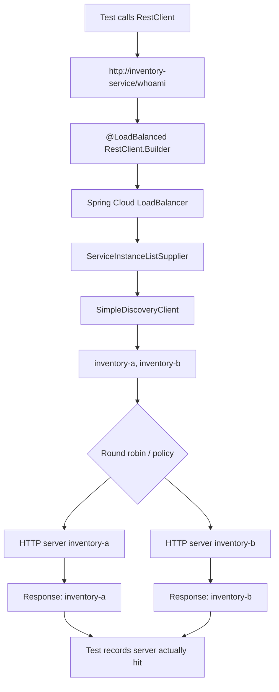
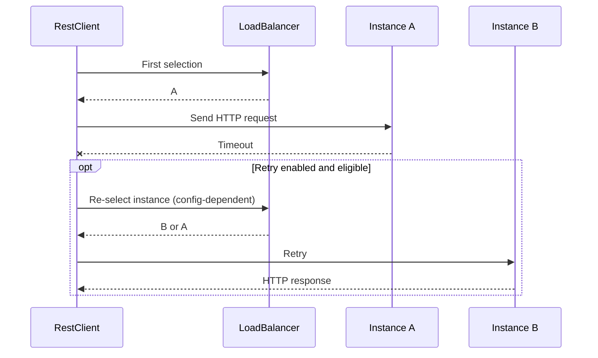

# Testing Calls and Verifying Selected Replicas

When an application uses Spring Cloud LoadBalancer to call `http://inventory-service/api/items`, the program does not connect directly to a host named `inventory-service` via ordinary DNS resolution. A `RestClient` built from a `@LoadBalanced RestClient.Builder` uses this logical name to pick a `ServiceInstance`, then sends the HTTP request to the selected instance's host, port, and scheme.

A successful test does more than prove an API returns `200 OK`. It must also answer: **Did the request actually pass through LoadBalancer? Which instances were selected? When no instances exist or an instance fails, how does the application respond?** That is the focus of this lesson in the **RestClient** chapter of the `SPRING_CLOUD_SERVICE_COMMUNICATION_LOAD_BALANCING` module.

The article guides you through testing from unit to integration levels: how to declare a `@LoadBalanced RestClient.Builder` bean, use two stub HTTP servers as instances of the same service ID, publish them via `SimpleDiscoveryClient`, observe the instance ID in responses, and write reliable assertions. The final sections show how to inspect discovery, health checks, caching, retries/timeouts, and metrics to pinpoint root causes when instance selection behaves unexpectedly.

## 1. What exactly are we testing?

Suppose `order-service` calls `inventory-service`, and discovery provides two replicas:

| Property | Instance A | Instance B |
|---|---|---|
| Service ID | `inventory-service` | `inventory-service` |
| Instance ID | `inventory-a` | `inventory-b` |
| Host | `127.0.0.1` | `127.0.0.1` |
| Port | Dynamic port A | Dynamic port B |
| Endpoint | `GET /whoami` | `GET /whoami` |
| Response body | `inventory-a` | `inventory-b` |

The client always calls **a single logical URL**:

```text
http://inventory-service/whoami
```

Spring Cloud LoadBalancer is responsible for looking up the instance list by service ID and selecting one of the two real endpoints.



Verifiable test objectives:

1. **Selection by service ID:** the client calls `inventory-service` instead of a hardcoded IP/port.
2. **At least one instance actually receives the request:** body or headers reflect the handling instance.
3. **Only valid candidates are picked:** never connects to instances outside the list.
4. **Selection policy works:** round robin normally causes both instances to appear under stable conditions.
5. **Missing candidates handled properly:** does not try sending to a guessed address.
6. **Connection errors are distinguished:** separate no-instance, network failure, and HTTP errors returned by the target service.

Do not verify only identical business payloads across both instances: if both return `{"stock": 10}`, the test cannot tell which machine received the request unless the server attaches an identifying test marker.

## 2. Testing layers and what each proves

| Test type | Tooling example | What it proves | What it does not prove |
|---|---|---|---|
| Request-building unit test | `MockRestServiceServer` bound to a non-LoadBalanced builder | HTTP method, URI, headers, body, and response mapping | Discovery or real instance selection |
| Algorithm unit test | Mock supplier + `ReactorServiceInstanceLoadBalancer` | Selection logic over an input list | Successful HTTP request delivery |
| Integration test with two HTTP servers | `@SpringBootTest` + `SimpleDiscoveryClient` + `@LoadBalanced RestClient` | Service name resolves to real endpoints; target receipt observed | External registry synchronization |
| Integration test with Eureka/Consul | Controllable registry and target services | Registration, deregistration, caching, instance selection, and connections | Absolute reliability of every production environment |
| Resilience test | Stop one instance, alter list, cap retries | Application response when data/targets change | Every real-world race condition or network latency |

**Pick the test layer to match the question.** If you only need to know whether `RestClient` sends the `X-Correlation-ID` header properly, HTTP mocking is sufficient. If you need to prove `RoundRobinLoadBalancer` truly routes requests across two replicas, the request must traverse the LoadBalancer integration and at least a real HTTP transport or equivalent instrumentation at selection time.

## 3. Minimal configuration for load-balanced RestClient

Spring Framework supports `RestClient` in modern releases (e.g., Spring Framework 6.1 and later). In a compatible Spring Boot/Spring Cloud project, you need:

- Spring Web for `RestClient` and required HTTP APIs.
- `spring-cloud-starter-loadbalancer` for Spring Cloud LoadBalancer.
- A `ServiceInstance` source: `SimpleDiscoveryClient` for simple tests, or a real discovery provider.
- A `RestClient.Builder` bean annotated with `@LoadBalanced`.
- Outbound URLs using the exact service ID.

Example Maven dependencies, assuming a Spring Cloud BOM is imported:

```xml
<dependencies>
    <dependency>
        <groupId>org.springframework.boot</groupId>
        <artifactId>spring-boot-starter-web</artifactId>
    </dependency>

    <dependency>
        <groupId>org.springframework.cloud</groupId>
        <artifactId>spring-cloud-starter-loadbalancer</artifactId>
    </dependency>

    <dependency>
        <groupId>org.springframework.boot</groupId>
        <artifactId>spring-boot-starter-test</artifactId>
        <scope>test</scope>
    </dependency>
</dependencies>
```

`SimpleDiscoveryClient` can be created by Spring Cloud from properties when no real discovery provider is present. For the integration test example below, we do not need to start Eureka or Consul.

### 3.1. The RestClient.Builder bean must carry @LoadBalanced

```java
import org.springframework.cloud.client.loadbalancer.LoadBalanced;
import org.springframework.context.annotation.Bean;
import org.springframework.context.annotation.Configuration;
import org.springframework.web.client.RestClient;

@Configuration(proxyBeanMethods = false)
public class LoadBalancedHttpClientConfiguration {

    @Bean("loadBalancedRestClientBuilder")
    @LoadBalanced
    RestClient.Builder loadBalancedRestClientBuilder() {
        return RestClient.builder();
    }
}
```

Use the Spring-managed builder to create the client:

```java
@Service
public class InventoryGateway {

    private final RestClient client;

    public InventoryGateway(
            @Qualifier("loadBalancedRestClientBuilder")
            RestClient.Builder builder) {

        this.client = builder.build();
    }

    public String selectedInstance() {
        return client.get()
                .uri("http://inventory-service/whoami")
                .retrieve()
                .body(String.class);
    }
}
```

Here `@Qualifier` points to the load-balanced builder bean. A builder instantiated directly via `RestClient.builder()` outside the container does not inherit this configuration.

For the logical URI, `inventory-service` must match the service ID in discovery. Using a fixed URL like `http://127.0.0.1:8081` sends requests to one specific endpoint; that test does not verify service-ID selection.

## 4. Designing stub servers to identify instances

If both instances return identical JSON, the result offers no proof of which target was selected. A test endpoint should self-identify:

```http
GET /whoami HTTP/1.1
Host: inventory-service
```

Example response from instance A:

```http
HTTP/1.1 200 OK
Content-Type: text/plain; charset=UTF-8
X-Instance-Id: inventory-a

inventory-a
```

Instance B returns `inventory-b` in its body and header.

Benefits:

- The test observes the **actual server handling** the request rather than only inspecting the discovery list.
- Instance IDs in body and header can be cross-checked to detect endpoint mix-ups.
- Hit counts per instance can be tallied to measure distribution.
- During failure tests, one server can be stopped individually to observe application behavior.

The `X-Instance-Id` header in this example is a **custom test header**, not a default header automatically added by Spring Cloud LoadBalancer. In production, avoid exposing internal hostnames or instance IDs publicly if infrastructure details risk leaking; you can enable identification headers strictly under test profiles.

## 5. Complete integration test with two local HTTP servers

You can use Testcontainers, WireMock, or another HTTP stub; to keep this lesson registry-independent without extra HTTP mock dependencies beyond JUnit/Spring Boot Test, the example below uses the JDK's `com.sun.net.httpserver.HttpServer`.

Scenario:

1. Start two HTTP servers on `127.0.0.1` with **dynamic** ports.
2. Supply both server URIs to `SimpleDiscoveryClient` via `@DynamicPropertySource`.
3. Boot a Spring context with a `@LoadBalanced RestClient.Builder` bean.
4. Send eight **sequential** requests to `http://inventory-service/whoami`.
5. Collect bodies/`X-Instance-Id` headers and confirm both A and B are chosen under default round robin.
6. Call an unregistered service ID to confirm the no-instance branch.

### 5.1. Illustrative test code

```java
import java.io.IOException;
import java.io.OutputStream;
import java.io.UncheckedIOException;
import java.net.InetSocketAddress;
import java.nio.charset.StandardCharsets;
import java.util.HashSet;
import java.util.Set;

import com.sun.net.httpserver.HttpServer;
import org.junit.jupiter.api.AfterAll;
import org.junit.jupiter.api.Test;
import org.springframework.beans.factory.annotation.Autowired;
import org.springframework.beans.factory.annotation.Qualifier;
import org.springframework.boot.SpringBootConfiguration;
import org.springframework.boot.autoconfigure.EnableAutoConfiguration;
import org.springframework.boot.test.context.SpringBootTest;
import org.springframework.cloud.client.loadbalancer.LoadBalanced;
import org.springframework.context.annotation.Bean;
import org.springframework.http.ResponseEntity;
import org.springframework.test.context.DynamicPropertyRegistry;
import org.springframework.test.context.DynamicPropertySource;
import org.springframework.web.client.RestClient;

import static org.junit.jupiter.api.Assertions.assertEquals;
import static org.junit.jupiter.api.Assertions.assertThrows;
import static org.junit.jupiter.api.Assertions.assertTrue;

@SpringBootTest(
        classes = RestClientSelectionTest.TestApplication.class,
        webEnvironment = SpringBootTest.WebEnvironment.NONE,
        properties = {
                "spring.cloud.loadbalancer.cache.enabled=false",
                "spring.cloud.loadbalancer.retry.enabled=false"
        }
)
class RestClientSelectionTest {

    private static final HttpServer INSTANCE_A =
            createServer("inventory-a");

    private static final HttpServer INSTANCE_B =
            createServer("inventory-b");

    @DynamicPropertySource
    static void registerInstances(DynamicPropertyRegistry registry) {
        registry.add(
                "spring.cloud.discovery.client.simple.instances."
                        + "inventory-service[0].uri",
                () -> "http://127.0.0.1:"
                        + INSTANCE_A.getAddress().getPort());

        registry.add(
                "spring.cloud.discovery.client.simple.instances."
                        + "inventory-service[1].uri",
                () -> "http://127.0.0.1:"
                        + INSTANCE_B.getAddress().getPort());
    }

    @Autowired
    @Qualifier("loadBalancedBuilder")
    private RestClient.Builder loadBalancedBuilder;

    @Test
    void requestGoesToBothRegisteredInstances() {
        RestClient client = loadBalancedBuilder.build();
        Set<String> observed = new HashSet<>();

        for (int i = 0; i < 8; i++) {
            ResponseEntity<String> response = client.get()
                    .uri("http://inventory-service/whoami")
                    .retrieve()
                    .toEntity(String.class);

            assertTrue(response.getStatusCode().is2xxSuccessful());

            String id = response.getBody();
            assertTrue(Set.of("inventory-a", "inventory-b")
                    .contains(id));

            assertEquals(
                    id,
                    response.getHeaders()
                            .getFirst("X-Instance-Id"));

            observed.add(id);
        }

        assertEquals(
                Set.of("inventory-a", "inventory-b"),
                observed);
    }

    @Test
    void unknownServiceDoesNotUseAnArbitraryEndpoint() {
        RestClient client = loadBalancedBuilder.build();

        // Exact exception/response type depends on
        // client integration and Spring Cloud release train.
        assertThrows(RuntimeException.class, () ->
                client.get()
                        .uri("http://not-registered-service/whoami")
                        .retrieve()
                        .toBodilessEntity());
    }

    @AfterAll
    static void stopServers() {
        INSTANCE_A.stop(0);
        INSTANCE_B.stop(0);
    }

    private static HttpServer createServer(String instanceId) {
        try {
            HttpServer server = HttpServer.create(
                    new InetSocketAddress("127.0.0.1", 0),
                    0);

            server.createContext("/whoami", exchange -> {
                byte[] body =
                        instanceId.getBytes(StandardCharsets.UTF_8);

                exchange.getResponseHeaders()
                        .set("Content-Type",
                                "text/plain; charset=UTF-8");

                exchange.getResponseHeaders()
                        .set("X-Instance-Id", instanceId);

                exchange.sendResponseHeaders(200, body.length);

                try (OutputStream out =
                             exchange.getResponseBody()) {
                    out.write(body);
                }
            });

            server.start();
            return server;
        } catch (IOException ex) {
            throw new UncheckedIOException(ex);
        }
    }

    @SpringBootConfiguration
    @EnableAutoConfiguration
    static class TestApplication {

        @Bean("loadBalancedBuilder")
        @LoadBalanced
        RestClient.Builder loadBalancedBuilder() {
            return RestClient.builder();
        }
    }
}
```

### 5.2. Why is this test better than calling instance addresses directly?

- Both servers start on **dynamic ports**, avoiding port conflicts with other processes.
- `@DynamicPropertySource` registers the real URIs as Spring Test initializes the context.
- `SimpleDiscoveryClient` provides two URIs under the same service ID `inventory-service`.
- `RestClient` sends requests to the **logical hostname**, without knowing A's or B's address beforehand.
- Each HTTP server echoes its own ID, allowing the test to verify **which target actually received the request**.
- No external discovery server is needed, keeping registry/lease flakiness out of this foundational test.

The snippet is an integration test example meant for `src/test/java` in a project with compatible Spring Boot Test. On Java module-path projects, ensure the `jdk.httpserver` module is available. If your test infrastructure disallows `HttpServer`, swap in WireMock or MockWebServer while keeping the exact same principle: **two real endpoints and a logical URI routed through LoadBalancer**.

### 5.3. Notes on instance selection order

With default configuration, Spring Cloud LoadBalancer normally uses `RoundRobinLoadBalancer`. When exactly two healthy instances exist and requests are sent sequentially, **both are expected to appear** across multiple selections.

However, avoid brittle assertions tied to an exact sequence:

```text
A, B, A, B, A, B, A, B
```

because the initial round-robin index, context initialization, retries, or other calls can shift the starting offset. Asserting the set `Set.of("inventory-a", "inventory-b")` is far more stable when the goal is proving both instances are used.

If the algorithm is switched to `RandomLoadBalancer`, seeing both instances within eight picks is **not guaranteed**. For random selection, assert that every pick belongs to the valid candidate set; if testing statistical distribution, run many samples with proper statistical checks rather than expecting a fixed sequence.

### 5.4. About disabling cache and retry in tests

These two properties in `@SpringBootTest` reduce confounding variables:

```properties
spring.cloud.loadbalancer.cache.enabled=false
spring.cloud.loadbalancer.retry.enabled=false
```

An instance-selection test does not need to test TTLs or retries. When you need to test those, write **dedicated tests** instead of letting one test be influenced by too many policies simultaneously.

In a project with custom discovery, supplier, or algorithm configurations, verify that `TestApplication` and auto-configuration actually use Simple Discovery and Round Robin as expected. If health/zone filters are active, the candidate set may be altered.

## 6. Difference between MockRestServiceServer and LoadBalancer tests

`MockRestServiceServer` is great for verifying the requests `RestClient` builds: method, URI, headers, body, and response parsing.

Example unit test using a builder **without LoadBalancer**:

```java
import org.junit.jupiter.api.Test;
import org.springframework.http.HttpMethod;
import org.springframework.http.MediaType;
import org.springframework.test.web.client.MockRestServiceServer;
import org.springframework.web.client.RestClient;

import static org.springframework.test.web.client.match
        .MockRestRequestMatchers.method;
import static org.springframework.test.web.client.match
        .MockRestRequestMatchers.requestTo;
import static org.springframework.test.web.client.match
        .MockRestRequestMatchers.header;
import static org.springframework.test.web.client.response
        .MockRestResponseCreators.withSuccess;

class RestClientRequestUnitTest {

    @Test
    void buildsHttpRequestCorrectly() {
        RestClient.Builder builder = RestClient.builder();
        MockRestServiceServer server =
                MockRestServiceServer.bindTo(builder).build();

        server.expect(requestTo(
                        "http://inventory-service/api/items/SKU-001"
                                + "?warehouse=hcm"))
                .andExpect(method(HttpMethod.GET))
                .andExpect(header("X-Correlation-ID", "req-42"))
                .andRespond(withSuccess(
                        "{\"sku\":\"SKU-001\"}",
                        MediaType.APPLICATION_JSON));

        RestClient client = builder.build();

        String response = client.get()
                .uri("http://inventory-service/api/items/{sku}"
                                + "?warehouse={warehouse}",
                        "SKU-001", "hcm")
                .header("X-Correlation-ID", "req-42")
                .retrieve()
                .body(String.class);

        server.verify();
    }
}
```

This test proves `RestClient` constructs requests with the expected URI and headers. **It does not prove** that the service ID was resolved, because the mock request factory answers immediately without using discovery or a real target server.

For tests checking only request formatting, avoid booting full Spring Boot discovery. Conversely, for tests confirming instance selection, use a context with real load balancing and observable servers.

### 6.1. How can an HTTP mock test give misleading results?

Suppose a REST mock returns `200 OK` for the logical URI `http://inventory-service/whoami`. The test still passes even if the application lacks `spring-cloud-starter-loadbalancer` or the `RestClient.Builder` bean is missing `@LoadBalanced`.

That is not a bug in `MockRestServiceServer`: it is doing its job of mocking HTTP. The problem is that the test did not place an assertion on **the behavior needing proof**.

## 7. Directly inspecting the candidate list and selection algorithm

Observing responses from HTTP servers is a practical way to see where **actual requests** landed. When you need to explain why a particular instance was picked, inspect deeper inside LoadBalancer.

Class relationships:

```text
ServiceInstanceListSupplier
    → [inventory-a, inventory-b]
           ↓
ReactorServiceInstanceLoadBalancer
    → choose(...)
           ↓
Response<ServiceInstance>
    → inventory-a or inventory-b
           ↓
RestClient sends HTTP
           ↓
Response body/header from target server
```

Observation levels:

| Observation point | What you learn | What you cannot tell |
|---|---|---|
| Supplier returns list | Which instances are eligible | Which one the algorithm picked |
| `ReactorServiceInstanceLoadBalancer` returns `ServiceInstance` | Intended selected target | Whether the server actually received the request successfully |
| HTTP server returns `X-Instance-Id` | Real target that processed the request | Why the supplier excluded other instances |
| LoadBalancer lifecycle/metrics | Selection outcome, timing, some context | Full transport details without extra instrumentation |

### 7.1. Checking the LoadBalancer bean for a service ID

In an integration test, you can confirm the bean serving `inventory-service`'s client context:

```java
@Autowired
LoadBalancerClientFactory factory;

@Test
void loadBalancerExistsForInventoryService() {
    ReactorServiceInstanceLoadBalancer loadBalancer =
            factory.getInstance(
                    "inventory-service",
                    ReactorServiceInstanceLoadBalancer.class);

    assertNotNull(loadBalancer);
}
```

This illustration requires appropriate imports from Spring Cloud LoadBalancer and JUnit inside a test context. Lookup APIs and bean types can vary across release trains; in some setups beans are declared as `ReactorLoadBalancer<ServiceInstance>`.

**Do not invoke `choose()` extra times in the same test measuring HTTP distribution without accounting for them.** Extra selections advance the round-robin counter and can break assertions like “the first HTTP request must hit A” even when the system works fine.

### 7.2. Checking the service ID

The strings must match exactly:

```text
RestClient calls:
    http://inventory-service/whoami

SimpleDiscoveryClient:
    spring.cloud.discovery.client.simple.instances.inventory-service[0].uri
    spring.cloud.discovery.client.simple.instances.inventory-service[1].uri

@LoadBalancerClient if present:
    name = "inventory-service"
```

A mismatch in any of these causes the client context to query a different service or find zero instances. Never blame round robin if the supplier received an empty list due to a mismatched service ID.

## 8. Testing an unregistered service ID

When no instances exist for `not-registered-service`, the load balancer cannot pick an endpoint. The test should confirm:

- No new requests arrive at server A or B.
- The caller receives a failure signal with no synthetic success response.
- Logs or metrics show zero candidates for that service ID.
- The application does not silently fall back to a hardcoded address outside discovery.

The example in section 5 uses `assertThrows(RuntimeException.class, ...)` to avoid locking onto a single concrete exception across versions/integrations. In real projects, **narrow the assertion** once you confirm the exact failure type returned by RestClient + Spring Cloud LoadBalancer in your chosen release train.

Some integrations surface “no instance” errors as a 503 response passed through `RestClient`; with `retrieve()`, `RestClient` turns HTTP 4xx/5xx into exceptions by default. Other integrations or custom error handlers may behave differently, so verify the actual code and application contract rather than assuming all cases raise one exception class.

If you want to test no-instance handling independently, write a dedicated test using a service ID present only on the client with no discovery entries. You do not have to stop both `inventory-service` servers just to simulate an empty list.

## 9. Testing when one instance stops serving

The baseline test has two running instances and a fixed list. Another real production scenario is **an instance remaining in the supplier while the server process is dead**.

Example:

```text
Discovery:
    inventory-a -> 127.0.0.1:18081
    inventory-b -> 127.0.0.1:18082

Actual:
    inventory-a -> running
    inventory-b -> stopped
```

When the load balancer selects B, the request gets `connection refused` or a timeout. This is **not the same as the supplier returning an empty list**. LoadBalancer successfully picked an instance, yet the transport failed.

Test steps:

1. Start both instances; verify requests reach both A and B.
2. Stop B, **without updating the instance list yet**, to simulate stale discovery data.
3. Send several requests and record outcomes: requests picking A succeed, while picks of B fail.
4. Next, update discovery/supplier to remove B or enable an appropriate health check.
5. Verify requests after the update go only to A.
6. Distinguish selection counts, retry counts, and transport failures.

`SimpleDiscoveryClient` reads static properties; **it does not automatically deregister B** just because the HTTP server stopped. To test dynamic instance removal, use an updatable list source, real discovery, or a mock supplier that actively mutates the list. Never expect round robin to infer a dead replica from one `connection refused` if the candidate list has not changed.

### 9.1. Should you assert strictly A/B after stopping B?

Only assert “every subsequent request picks A” **after** confirming the supplier has actually excluded B. If only server B was stopped while the registry still holds two instances, that assertion contradicts LoadBalancer's normal design.

## 10. Caching and instance-list freshness during tests

Caching suppliers reduce discovery reads yet introduce lag before newly added or removed instances take effect. When testing list changes, track:

- Whether `spring.cloud.loadbalancer.cache.enabled` is on or off.
- What the cache TTL is.
- Whether the discovery client has its own cache (such as Eureka).
- Whether the supplier chain includes health check, zone, or hint filters.
- How many client application instances exist and whether each process maintains its own cache.

Example expanded test timeline:

| Time | Discovery/source returns | Client-side cache may still hold | Outcome |
|---|---|---|---|
| `t0` | A, B | A, B | May pick A/B |
| `t1` | A, B, C | A, B | C does not appear yet |
| `t2` after refresh | A, B, C | A, B, C | May pick C |
| `t3` B removed | A, C | A, B, C | B may still be picked |
| `t4` after refresh | A, C | A, C | B is no longer a candidate |

If you only want to test the selection algorithm, disable caching or use a fixed snapshot for repeatability. If you want to test consistency during scale up/down, enable caching with an intentional TTL and measure **time-to-converge** instead of expecting instant updates.

## 11. Testing zone, metadata, and hint routing policies

The two-instance test only distinguishes A/B. In real systems, suppliers can filter by zone, health, or metadata before LoadBalancer selects.

Example:

| Instance | Zone | Metadata hint | Healthy |
|---|---|---|---|
| A | `zone-a` | `stable` | Yes |
| B | `zone-b` | `stable` | Yes |
| C | `zone-a` | `canary` | No |

With a health-filtering supplier, C is excluded before selection. With a zone-preference policy, A is preferred. With hint `canary`, outcomes depend on decorator order and whether any matching instance exists.

Testing principles:

1. Verify **the list before and after each filter**.
2. Verify metadata is actually present in `ServiceInstance.getMetadata()`, not just in the server's YAML file.
3. Distinguish **soft preferences** from **hard constraints**; some suppliers fall back to the delegate list when nothing matches.
4. For request-aware suppliers, verify headers/hints actually propagated into the LoadBalancer context.
5. For health checks, wait for or explicitly drive the health-evaluation cycle.
6. Write assertions matching the configured policy; never assume every supplier fails closed when no candidate matches.

Concrete example: when using `HintBasedServiceInstanceListSupplier`, if a request carries `X-SC-LB-Hint: canary` yet no instance has `metadata.hint=canary`, the default implementation may fall back to the delegate list. A test asserting that unmatched hints **always fail** would mismatch a soft-preference default hint supplier.

## 12. Testing retries and timeouts without miscounting selections

One initial HTTP call does not necessarily equal one instance selection when retries are enabled.



This is a conceptual diagram: actual re-selection and retry counts depend on version, retry dependencies, and application policy.

When testing retries:

- Separate **logical requests** issued by business code from **HTTP attempts**.
- Record the **instance ID of every attempt**, not just the final response.
- Set bounded max retries and timeouts so tests cannot hang.
- When B returns 500, distinguish HTTP 5xx from connection refused.
- For write operations like POST, never auto-retry without an idempotent contract or deduplication mechanism.
- Do not conclude “LoadBalancer never picked B” solely because the final response came from A after a retry chain.

For idempotent GET requests, retries can be more appropriate. Even then, retries in RestClient, Spring Cloud LoadBalancer, and another resilience library can stack if uncoordinated. In the baseline A/B test in section 5, retries are turned off so selection counts stay clear.

## 13. Verifying which instance actually received the request

Besides response body/headers from target servers, instrumentation can be placed at other layers:

| Evidence | Pros | Limitations |
|---|---|---|
| Response body `inventory-a`/`inventory-b` | Easy to observe, simple tests | Requires designing an identification endpoint |
| Response header `X-Instance-Id` | Keeps body schema unchanged | Custom header; must be controlled in production |
| Counters on HTTP servers A/B | Accurately counts requests reaching each stub | Does not capture pre-HTTP selection failures |
| `LoadBalancerLifecycle`/metrics | Observes selection flow, outcome, and latency | Version-dependent; instrumentation must be enabled |
| Supplier and algorithm logs | Reveals candidate counts and chosen instance | Can generate heavy logs under load |
| Distributed tracing with service ID/instance | Follows one request across services | Requires aligned tracing config and propagation |

In production, avoid returning internal hosts/private IPs or internal IDs in public responses purely for diagnostics. Log instance IDs in server logs or internal traces instead, while restricting identification headers to integration tests under a test profile.

### 13.1. An illustrative log record

```text
event=loadbalancer.selection
serviceId=inventory-service
requestPathTemplate=/whoami
candidateCount=2
selectedInstanceId=inventory-b
attempt=1
outcome=SUCCESS
elapsedMs=12
```

These fields are **illustrative logging conventions**, not exhaustive built-in Spring Cloud metrics. When using Micrometer, avoid attaching high-cardinality tags like request IDs, full URIs, or instance IDs as metric tags.

## 14. Testing when the HTTP client builds the wrong URL

Many “LoadBalancer doesn't work” test failures turn out to be misconstructed clients.

| Symptom | Common cause | Where to check |
|---|---|---|
| `UnknownHostException: inventory-service` | Using `RestClient.create()` or a builder without `@LoadBalanced` | Inject the Spring-managed builder properly |
| Requests always hit one fixed port | URI uses physical host/port | Switch to service-ID URI |
| No instance found | Wrong service ID, empty supplier, or missing discovery | Check registry/properties and supplier bean |
| Both A/B answer yet test cannot tell which | Identical responses with no instance marker | Add header/body echo in test |
| Mock test passes, integration fails | Mock bypassed LoadBalancer or transport | Run real test against two HTTP stubs |
| Random test flakes pass/fail | Ordering assertion or too-small sample size | Assert valid candidate set, not fixed sequence |
| Stopped B yet errors still hit B | Source list/cache not updated yet | Check cache/health/deregistration |
| One request hits multiple servers | Retries or redirects enabled | Count attempts and check HTTP client config |
| Request gets 503 without hitting A/B | No instance or client-layer failure | Check `candidateCount` and exception origin |

Keep the service name in the URI distinct from the post-load-balancing HTTP host. The logical URI is the input; the physical URL is the selection result. Tests must make both clear to avoid misdiagnosis.

## 15. Minimum checklist for the hands-on exercise

Before marking the test suite complete, verify:

- [ ] Tests call `http://inventory-service/whoami` rather than direct IP/port.
- [ ] The `RestClient.Builder` bean carries `@LoadBalanced` and is injected properly.
- [ ] At least two `ServiceInstance` entries share the service ID with distinct endpoints.
- [ ] Both HTTP servers are genuinely listening, returning distinguishing instance markers.
- [ ] Tests verify success status, body marker, and header marker consistently.
- [ ] Under default round robin, sequential calls across multiple requests observe both instances.
- [ ] Assertions do not enforce strict A/B ordering without controlling all load-balancer state.
- [ ] An unregistered service ID test verifies failure handling.
- [ ] Caching, retries, and extra decorators are disabled or intentionally configured for repeatability.
- [ ] Request-mock tests are separated from instance-selection integration tests.
- [ ] For dead-instance tests, discovery/health list updates are confirmed before asserting exclusion.
- [ ] No tokens, passwords, or URIs with sensitive data are logged during tracing.

## 16. Self-check questions

**1. Why isn't calling `http://localhost:8081/whoami` directly sufficient?** Because the request does not use a service ID, bypassing proof that Spring Cloud LoadBalancer selects instances.

**2. Why isn't asserting `status=200` enough?** A single instance, a mock response, or a physical URL can also return 200. You need proof of which server received the request.

**3. If two instances exist yet eight requests all hit A, what should you inspect?** First verify whether the supplier actually returns both A and B, which algorithm bean is active, and whether health/zone/hint filters, caching/sticky routing, or custom policies apply. With random selection, eight hits to A is improbable yet possible; with default sequential round robin, investigate deeper.

**4. Why isn't stopping B enough for the load balancer to exclude B?** Because the algorithm only inspects the instance list provided by the supplier. If the registry/cache still returns B, selection can still land on B.

**5. Is Eureka required to test instance selection?** No. `SimpleDiscoveryClient` or a stub supplier can supply a static list. Eureka/Consul is useful when testing registration and dynamic list updates as well.

**6. Can you rely on `MockRestServiceServer` to verify round robin?** Not if you only mock transport on a plain builder. The test must actually go through LoadBalancer with an instance set and proof of target selection.

**7. Is “the second request always picks B” part of RoundRobin's contract?** Do not turn that into an integration-test contract unless you control the starting index and every prior selection. Verify behavior against the candidate set and explicit conditions.

## 17. Conclusion

To test `@LoadBalanced RestClient` meaningfully, separate two tasks: **verifying HTTP request contents** and **verifying `ServiceInstance` selection for the service ID**. HTTP mocking excels at validating methods, paths, queries, headers, and bodies; integration tests with two local servers and `SimpleDiscoveryClient` provide real evidence that a logical URL was resolved into calls to concrete instances.

Use response markers or counters on target servers to see which replica handled each request, avoid brittle strict-order assertions, and test no-instance cases, stopped instances, stale caches, health checks, retries, and timeouts separately. Test results are most valuable when they clearly trace **supplier input, selection policy, target reached, and HTTP outcome**. That is the foundation for maintaining reliable communication across microservices using Spring Cloud LoadBalancer.

### References

- [Spring Cloud Commons — RestClient as a LoadBalancer Client](https://docs.spring.io/spring-cloud-commons/reference/spring-cloud-commons/common-abstractions.html) — `@LoadBalanced RestClient.Builder` and client integrations.
- [Spring Cloud Commons — Spring Cloud LoadBalancer](https://docs.spring.io/spring-cloud-commons/reference/spring-cloud-commons/loadbalancer.html) — algorithms, `ServiceInstanceListSupplier`, and instance selection mechanics.
- [Spring Cloud Commons — SimpleDiscoveryClient](https://docs.spring.io/spring-cloud-commons/reference/spring-cloud-commons/common-abstractions.html) — static instance configuration via properties.
- [Spring Framework — REST Clients](https://docs.spring.io/spring-framework/reference/integration/rest-clients.html) — `RestClient`, request and response APIs.
- [Spring Framework — MockRestServiceServer](https://docs.spring.io/spring-framework/reference/testing/spring-mvc-test-client.html) — testing client-side HTTP request contents without a real server.
