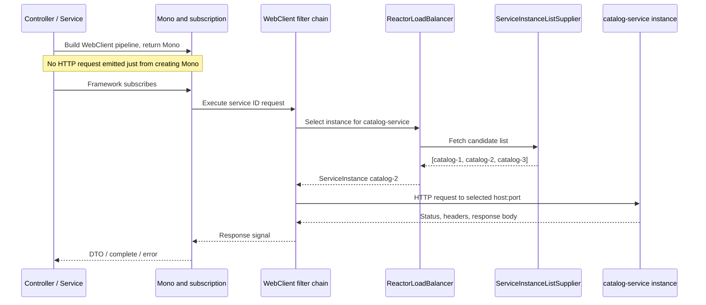

# Reactive Model and Processing Flow of WebClient

`WebClient` is the HTTP client in Spring WebFlux, built on the **reactive** model with Project Reactor's `Mono` and `Flux` types. Unlike the synchronous invocation model commonly seen with `RestTemplate`, a WebClient method can declare a sequence of HTTP operations upfront and return a `Publisher`; sending the request and consuming the response happen when there is a **subscription**. In a non-blocking I/O model, a small number of processing threads can serve many connections waiting for data without holding a dedicated thread waiting for each request.

When combined with **Spring Cloud LoadBalancer**, WebClient can also call a **service ID** such as `http://catalog-service` instead of a fixed host and port. During request execution, the LoadBalancer filter retrieves the list of `ServiceInstance`s, applies the instance selection policy, and forwards the request to the actual address. This lesson explains the lifecycle from creating a `Mono` to receiving a response, mapping data, handling errors, and observing HTTP client activity.

## 1. Reactive Is More Than Returning `Mono` or `Flux`

A synchronous code snippet might make an HTTP call and wait immediately for the result:

```java
ProductResponse product = restTemplate.getForObject(
        "http://catalog-service/api/products/{id}",
        ProductResponse.class,
        "42");
```

Meanwhile, WebClient typically builds a pipeline that returns `Mono<ProductResponse>`:

```java
Mono<ProductResponse> productMono = webClient.get()
        .uri("http://catalog-service/api/products/{id}", "42")
        .retrieve()
        .bodyToMono(ProductResponse.class);
```

In the second example, `productMono` is **not yet** a `ProductResponse`. It is an object describing an asynchronous computation that can emit at most one value, complete without a value, or emit an error signal. In typical WebClient usage, this pipeline **does not send an HTTP request at the time it is declared**; the request is started when a subscriber subscribes.

Core characteristics:

- **Asynchronous:** the caller can continue doing work, while the result arrives later via Publisher signals.
- **Non-blocking I/O:** while waiting for connections and network data, a thread does not necessarily have to be held solely to wait. This depends on the actual HTTP client connector; Reactor Netty is a common choice.
- **Reactive composition:** operations such as `map`, `flatMap`, `filter`, `onErrorResume`, and `timeout` are declared as a pipeline rather than waiting for values step by step.
- **Backpressure:** reactive streams allow the subscriber to signal demand for more data; this is especially useful when processing a stream of multiple elements. This mechanism does not mean every upstream HTTP server will automatically slow down precisely item by item.

The reactive model helps manage many I/O-waiting tasks efficiently, but **it does not automatically turn blocking operations such as synchronous JDBC, blocking file reads, or `Thread.sleep()` into non-blocking ones**. Placing blocking operations on the event loop can degrade application throughput and increase latency.

## 2. `Mono`, `Flux`, and Signals in Reactor

`Mono<T>` is a Publisher that emits at most one element `T`; `Flux<T>` emits from zero to many elements. Both use Reactive Streams signals:

| Signal | Meaning | WebClient Example |
|---|---|---|
| `onSubscribe` | Starts the subscription; the subscriber receives the ability to request data | Controller or framework begins processing the pipeline |
| `onNext` | Emits a value | Emits `ProductResponse` after parsing JSON |
| `onComplete` | Completes successfully | Empty body or the entire data stream has been read |
| `onError` | Terminates with an error | HTTP 5xx mapped to an exception, timeout, or connection error |
| `cancel` | Subscriber cancels consumption | Client disconnects or the reactive stream is cancelled |

Example with a JSON product list returned at once:

```java
Mono<List<ProductResponse>> products = webClient.get()
        .uri("http://catalog-service/api/products")
        .retrieve()
        .bodyToMono(new ParameterizedTypeReference<List<ProductResponse>>() {});
```

If an endpoint provides streaming data such as Server-Sent Events (SSE), multiple elements can be read with `Flux`:

```java
Flux<ProductEvent> events = webClient.get()
        .uri("http://catalog-service/api/events")
        .accept(MediaType.TEXT_EVENT_STREAM)
        .retrieve()
        .bodyToFlux(ProductEvent.class);
```

These snippets assume an appropriately configured `webClient`, the `ProductResponse` and `ProductEvent` DTOs, and the corresponding imports for `Mono`, `Flux`, `ParameterizedTypeReference`, and `MediaType`. Choosing `bodyToMono` or `bodyToFlux` depends on the **HTTP contract and return data type**, not merely on whether the API contains one or many business records.

## 3. Laziness: Assembling a Pipeline Does Not Mean Executing a Request

Consider the following method:

```java
Mono<ProductResponse> getProduct(String id) {
    return webClient.get()
            .uri("http://catalog-service/api/products/{id}", id)
            .retrieve()
            .bodyToMono(ProductResponse.class)
            .doOnSubscribe(subscription ->
                    log.debug("Starting HTTP request: productId={}", id))
            .doOnNext(product ->
                    log.debug("Received productId={}", product.id()))
            .doOnError(error ->
                    log.warn("Catalog call failed: {}", error.toString()));
}
```

When simply calling `Mono<ProductResponse> publisher = getProduct("42")`, the application does not necessarily send a request yet. When Spring WebFlux receives a `Mono` as the return value of a controller, **the framework performs the subscription** and manages the signals to produce the HTTP response for the caller. With a typical cold WebClient pipeline (cold Publisher), **each independent subscription can trigger a new HTTP request**, so care must be taken when reusing the same Publisher.

Example:

```java
Mono<ProductResponse> result = getProduct("42");

// Two subscriptions may trigger two independent HTTP calls.
result.subscribe(product -> log.info("A: {}", product.id()));
result.subscribe(product -> log.info("B: {}", product.id()));
```

The `subscribe()` snippet is for illustration only. In standard Spring WebFlux, **do not manually call `subscribe()` in a service/controller** and bypass the framework-managed subscription. Doing so easily causes errors to be lost, requests to run outside the original HTTP lifecycle, and tracing/transaction context not to propagate as expected.

`cache()` or sharing a Publisher can change result reuse, but you must consider lifetime, cached errors, and data freshness requirements. Do not add caching just to avoid two requests without understanding the business semantics.

## 4. WebClient Processing Flow Through Spring Cloud LoadBalancer

With a LoadBalancer-integrated WebClient, a request to `http://catalog-service/api/products/42` is not sent directly to a DNS host named `catalog-service` in the usual way. LoadBalancer treats `catalog-service` as a service ID, looks up the list of instances, and selects the real target.



General sequence:

1. **Pipeline creation:** `webClient.get().uri(...).retrieve().bodyToMono(...)` creates a Publisher describing the request.
2. **Subscription:** the application or WebFlux runtime begins consuming the Publisher; filters are executed within this processing flow.
3. **Service ID resolution:** the LoadBalancer exchange filter extracts the service name from the URI and interacts with the corresponding `ReactorLoadBalancer`.
4. **Instance retrieval:** the selector reads the list from `ServiceInstanceListSupplier`, which may have passed through discovery, cache, health checks, zone filtering, or custom policies.
5. **Target selection:** LoadBalancer decides the instance; the filter transforms the logical URI into an actual HTTP address.
6. **Send and receive I/O:** the HTTP connector opens or reuses a connection, sends the request, and receives status, headers, and body.
7. **Response handling:** operators such as `retrieve`, `bodyToMono`/`bodyToFlux`, `onStatus`, `timeout`, and error handling emit signals to the subscriber.

If the candidate list is empty, there is no instance to call. Depending on the LoadBalancer version and configuration, the HTTP integration layer may represent that case as a corresponding error response or exception; it should not be equated with a `404` for a resource inside `catalog-service`. If an instance was selected but the connection is refused, the issue lies at a different layer.

## 5. Configuring `@LoadBalanced WebClient.Builder`

A common Spring Boot setup uses `spring-boot-starter-webflux`, `spring-cloud-starter-loadbalancer`, and an appropriate `ServiceInstance` source (for example, a discovery client). Declare a builder annotated with `@LoadBalanced`:

```java
package com.example.orders.config;

import org.springframework.cloud.client.loadbalancer.LoadBalanced;
import org.springframework.context.annotation.Bean;
import org.springframework.context.annotation.Configuration;
import org.springframework.web.reactive.function.client.WebClient;

@Configuration(proxyBeanMethods = false)
public class WebClientConfiguration {

    @Bean
    @LoadBalanced
    WebClient.Builder loadBalancedWebClientBuilder() {
        return WebClient.builder();
    }
}
```

Using the builder in a service client:

```java
package com.example.orders.client;

import org.springframework.beans.factory.annotation.Qualifier;
import org.springframework.stereotype.Component;
import org.springframework.web.reactive.function.client.WebClient;
import reactor.core.publisher.Mono;

@Component
public class CatalogClient {
    private final WebClient webClient;

    public CatalogClient(
            @Qualifier("loadBalancedWebClientBuilder") WebClient.Builder builder) {
        this.webClient = builder.baseUrl("http://catalog-service").build();
    }

    public Mono<ProductResponse> getProduct(String id) {
        return webClient.get()
                .uri("/api/products/{id}", id)
                .retrieve()
                .bodyToMono(ProductResponse.class);
    }
}
```

Example DTO (placed in an appropriate package for the client):

```java
public record ProductResponse(String id, String name) { }
```

`@LoadBalanced` marks the builder so Spring Cloud configures the exchange filter needed for service-ID-style URLs; this annotation **does not** generate the list of instances by itself. If the registry has no `catalog-service`, changing WebClient alone will not fix the error. When an application calls both physical URLs and service IDs, you should declare a regular builder and a `@LoadBalanced` builder separately, then inject them explicitly with `@Qualifier`.

There is no need to manually register `ReactorLoadBalancerExchangeFilterFunction` if Spring Cloud auto-configuration already configures the builder; avoid attaching the same filter multiple times, which can cause unexpected resolution behavior.

## 6. Composing Publishers in Services and Controllers

To take advantage of the reactive flow, a service should **return a Publisher** instead of subscribing on its own and holding the result in a local variable. Example controller using `CatalogClient` above:

```java
package com.example.orders.api;

import com.example.orders.client.CatalogClient;
import com.example.orders.client.ProductResponse;
import org.springframework.web.bind.annotation.GetMapping;
import org.springframework.web.bind.annotation.PathVariable;
import org.springframework.web.bind.annotation.RequestMapping;
import org.springframework.web.bind.annotation.RestController;
import reactor.core.publisher.Mono;

@RestController
@RequestMapping("/orders")
public class OrderLookupController {

    private final CatalogClient catalogClient;

    public OrderLookupController(CatalogClient catalogClient) {
        this.catalogClient = catalogClient;
    }

    @GetMapping("/products/{id}")
    public Mono<ProductResponse> lookupProduct(@PathVariable String id) {
        return catalogClient.getProduct(id);
    }
}
```

In this example, Spring WebFlux handles the subscription and turns the data into a response; the service/controller code only describes the pipeline. WebClient can also be used in a Spring MVC application, but the server-side model and how results are consumed must be clearly designed. **Using WebClient does not automatically turn an entire blocking application into an end-to-end reactive one.**

If you need to call two independent services and combine the results:

```java
Mono<ProductResponse> product = catalogClient.getProduct("42");
Mono<StockResponse> stock = inventoryClient.getStock("42");

Mono<ProductView> combined = Mono.zip(product, stock)
        .map(tuple -> new ProductView(tuple.getT1(), tuple.getT2()));
```

`InventoryClient`, `StockResponse`, and `ProductView` are hypothetical application components. `Mono.zip` combines both results when both sources provide values; if one source errors, the combined pipeline typically terminates with an error. If a `Mono` completes empty, a separate handling policy is needed because `zip` may complete without emitting a `ProductView`.

## 7. Threads, Event Loops, and Blocking Boundaries

A common connector for WebClient is Reactor Netty. It handles I/O through an event loop; callbacks in a reactive pipeline **are not guaranteed to always run on the same thread**, and you should not assume `ThreadLocal` or MDC automatically propagates completely across processing steps.

| Pattern | Impact | Recommendation |
|---|---|---|
| Return `Mono<T>` from service/controller | Lets the framework manage subscription and I/O | Common usage in WebFlux |
| Use `map` for short, non-blocking data transformation | Lightweight synchronous processing on `onNext` | Appropriate |
| Use `flatMap` for subsequent reactive calls | Chains asynchronous operations | Appropriate |
| Call `.block()` on the event loop | Blocks the thread, may cause runtime errors or bottlenecks | Avoid in WebFlux flows |
| Call blocking JDBC or `Thread.sleep()` inside `map` | Holds the thread while waiting, breaks non-blocking benefits | Prefer reactive APIs or isolate blocking work |
| Use `subscribe()` and discard the result | Loses error management and request lifecycle | Return a Publisher instead of self-subscribing |

When you must integrate a blocking API and cannot replace it yet, you can isolate it on a scheduler designed for blocking tasks:

```java
Mono<LegacyResult> fromLegacy = Mono.fromCallable(() -> legacyClient.fetch())
        .subscribeOn(Schedulers.boundedElastic());
```

The snippet above assumes `legacyClient.fetch()` is a synchronous call and that `Mono` and `Schedulers` are imported. `boundedElastic()` helps avoid blocking the I/O event loop, **but it does not change the nature of the API into non-blocking**; it still uses thread resources to wait. Do not arbitrarily add `publishOn` or `subscribeOn` to every WebClient request because schedulers change where operators execute, not automatically speed up HTTP.

## 8. Reading HTTP Responses and Handling Errors with Reactive Operators

`retrieve()` provides a convenient API for receiving the body; by default, 4xx/5xx responses are represented as error signals, typically `WebClientResponseException` or a corresponding subtype. Cases where the request does not receive an HTTP response due to connection/TLS/DNS issues can produce `WebClientRequestException`. JSON parsing or schema errors are a different issue from connection errors.

Example mapping a `404` from catalog to a business error that preserves the root cause:

```java
public Mono<ProductResponse> getRequiredProduct(String id) {
    return webClient.get()
            .uri("/api/products/{id}", id)
            .retrieve()
            .onStatus(status -> status.value() == 404,
                    response -> response.createException()
                            .map(cause -> new ProductNotFoundException(id, cause)))
            .bodyToMono(ProductResponse.class);
}
```

`ProductNotFoundException` is an application-defined `RuntimeException`. Other statuses still follow default handling if no corresponding handler is configured. With `exchangeToMono`, the caller can inspect status and headers and handle the body per branch, while still properly consuming/releasing the body according to the API contract:

```java
Mono<ProductResponse> result = webClient.get()
        .uri("/api/products/{id}", id)
        .exchangeToMono(response -> {
            if (response.statusCode().is2xxSuccessful()) {
                return response.bodyToMono(ProductResponse.class);
            }
            return response.createException().flatMap(Mono::error);
        });
```

The example above illustrates branching for success and error. When receiving `204 No Content`, `bodyToMono(ProductResponse.class)` may complete empty; if business logic requires returning a body, handle it with `switchIfEmpty(Mono.error(...))` per application policy.

Do not use `onErrorResume` to silently turn every error into a dummy product: a `404` due to non-existence differs from a `503` due to a temporarily unavailable service. If you want a fallback, limit it to **appropriate error types** and preserve traces of the original error for monitoring.

## 9. Timeout, Retry, and Request Cancellation

A reactive call can wait a long time due to connection issues, slow server processing, or non-terminating streams. Reactor provides the `timeout` operator, for example:

```java
Mono<ProductResponse> product = catalogClient.getProduct("42")
        .timeout(Duration.ofSeconds(3));
```

When no appropriate signal arrives within the specified duration, the operator emits a timeout error and can cancel the upstream subscription. A Publisher-level timeout is not necessarily equivalent to the HTTP connector's connect/read timeout; connection release and when I/O is aborted depend on the connector. You should consider DNS, connection, response, and total call timeouts according to system requirements.

Example of a **bounded** retry for a GET considered safe to retry in this API's context:

```java
Mono<ProductResponse> product = catalogClient.getProduct("42")
        .timeout(Duration.ofSeconds(2))
        .retryWhen(Retry.backoff(2, Duration.ofMillis(200))
                .filter(error -> error instanceof TimeoutException
                        || error instanceof WebClientRequestException
                        || (error instanceof WebClientResponseException response
                                && response.getStatusCode().is5xxServerError())));
```

The snippet assumes imports for `Duration`, `TimeoutException`, `Retry`, `WebClientRequestException`, `WebClientResponseException`, and the DTO types. Two retries mean a maximum of three total attempts if those errors occur and the policy does not stop early. Because `timeout` sits **before** `retryWhen`, it applies to each attempt; if you need to limit **total duration**, add a separate deadline for the entire pipeline.

**Do not retry every error:** HTTP `400/401/403/404` are generally not resolved by resending the same request; `POST`/`PUT` operations with side effects require idempotency contracts and dedicated policies. Retry may pick a different instance depending on LoadBalancer configuration, but it does not guarantee that, nor does it replace health checks, appropriate caching, or graceful shutdown.

## 10. Observing the Pipeline and Identifying Which Layer Failed

In the reactive model, logs recorded when **declaring the pipeline** can differ from when the **request actually executes**. To inspect behavior, observe when subscription starts, which instance LoadBalancer selects, and the HTTP response or error signal.

| Symptom | Check First | Possible Cause |
|---|---|---|
| Code creates `Mono` but no request is sent | Does the Publisher have a subscriber? | Caller did not subscribe or return the Publisher to the framework |
| Calls `catalog-service` but no target found | Service ID and `@LoadBalanced WebClient.Builder` | Using a plain builder, missing discovery/instances, or supplier filtered all out |
| Instance exists but connection fails | Instance ID, host:port, DNS/TLS, network | Instance died, advertised wrong address, I/O error |
| HTTP returns `404` | Status, path, resource, and error body | Resource does not exist or wrong route |
| HTTP returns `503` | Distinguish responses from LoadBalancer/gateway/server | No instances, overloaded dependency, or upstream error |
| HTTP `200` but parsing fails | `Content-Type`, JSON, and DTO | Data contract mismatch |
| API called multiple times unexpectedly | Number of subscriptions, retries, `repeat`, and cache | Multiple subscriptions or unexpected retries |
| RPS drops and CPU/threads spike | Event loop, `.block()`, blocking APIs inside operators | I/O threads are blocked |

A useful log or trace should include the service ID, request/trace ID, subscribe time, attempt count, selected instance, HTTP status or error type, duration, and cancellation status. With WebFlux, context is propagated via **Reactor Context** and configured context propagation/tracing mechanisms; do not assume `ThreadLocal` MDC will automatically remain accurate across every callback.

Note that **observability also has a cost**: do not log full bodies, tokens, cookies, or sensitive metadata; avoid high-cardinality metric labels such as `instanceId` or `traceId`. When needing to observe candidate lists before and after health/zone suppliers, inspect `ServiceInstanceListSupplier` at the proper boundary rather than guessing from an isolated HTTP result.

## 11. Practice: Observing from Subscribe to HTTP Response

Set up `catalog-service` with at least two instances, for example `catalog-1` and `catalog-2`, an `order-service` application using `@LoadBalanced WebClient.Builder`, and an endpoint `GET /api/products/{id}` that returns instance identification info in the response or server logs.

1. **Without subscribing:** call the method that creates the `Mono` without subscribing or returning it from the controller; observe that no HTTP request is emitted in the normal pipeline.
2. **Return `Mono` from controller:** call `/orders/products/42`; verify that the framework subscribes, LoadBalancer selects an instance, and WebClient receives the body and emits `ProductResponse`.
3. **Call twice:** send two requests and record the selected instances; do not assume round-robin always produces strict alternation in systems with multiple clients/cache configurations.
4. **Create two subscriptions:** in a test environment, subscribe twice to the same Publisher; observe the actual request count and contrast it with `cache()` if used.
5. **HTTP errors:** have the endpoint return `404` then `503`; verify `onStatus`, `WebClientResponseException`, and business error mapping.
6. **Network errors:** stop one instance before discovery/cache updates; compare instance selection, connection errors, and retry behavior.
7. **Timeout:** create a slow-responding endpoint; measure the duration of each attempt with `timeout` and `retryWhen`, avoiding retrying operations with side effects.
8. **Blocking:** try offloading a blocking call to `boundedElastic()` in a test environment and compare against calling a blocking operation directly on the event loop.

Sample result log table:

| Trace | Subscription | Candidates / Selected Instance | Result | Notes |
|---|---|---|---|---|
| `r-101` | Yes | `1,2` → `1` | `200`, valid body | Normal flow |
| `r-102` | Yes | `1,2` → `2` | `404` | HTTP error, not a discovery error |
| `r-103` | Yes | `1,2` → `2` | Connection refused | Instance unreachable |
| `r-104` | No | Not selected | No HTTP sent | Publisher not yet consumed |

The data in the table is illustrative; in real deployments, statuses and error representations depend on the backend, filters, connector, and retry policy.

## 12. WebClient Design Checklist for Inter-Service Communication

- Use logical URLs and a `@LoadBalanced` builder when resolving service IDs; check discovery, `ServiceInstanceListSupplier`, and the instance selection policy.
- Return `Mono`/`Flux` through reactive layers instead of calling `block()` or manually calling `subscribe()` in controllers/services.
- Use `map` for lightweight synchronous transformations and `flatMap` to compose asynchronous Publishers; avoid blocking on the event loop.
- Distinguish HTTP status errors, connection errors, missing-instance errors, and deserialization errors; map business errors according to the contract.
- Configure bounded timeouts and retries, considering idempotency and overall deadlines.
- Track traces/spans, selected instances, and attempt counts; avoid assuming `ThreadLocal` always follows a reactive pipeline.
- Choose `Mono` or `Flux` based on response semantics; pay attention to empty bodies, buffer limits, streaming, and cancellation.

## 13. Key Takeaways

WebClient **describes HTTP calls using a Publisher**, typically performing no I/O until a subscription occurs. `Mono` represents at most one result, and `Flux` represents a stream of multiple results; Reactor operators compose data processing, error signals, timeouts, and retries without forcing the caller to block. With `@LoadBalanced WebClient.Builder`, upon subscription, Spring Cloud LoadBalancer resolves the service ID, obtains the `ServiceInstance` list, selects an instance, and forwards the HTTP request to the appropriate `host:port`. Understanding **subscription → LoadBalancer → HTTP I/O → response/exception → subscriber** is the foundation for configuring and diagnosing reliable service-to-service communication.
