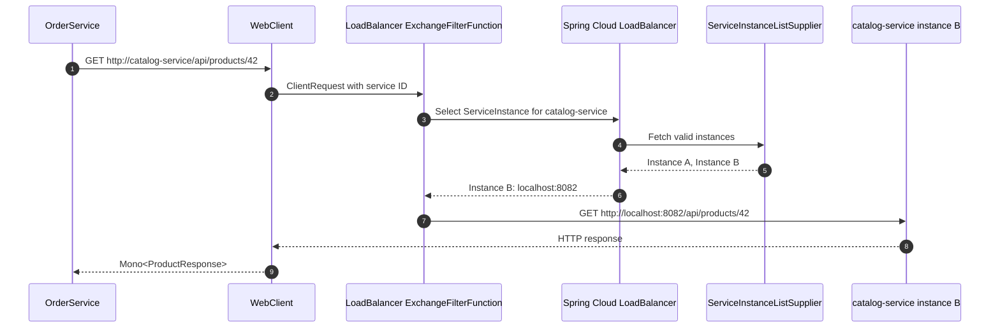

# Declaring a @LoadBalanced WebClient.Builder

In a Spring Boot application, `WebClient` is the HTTP client with a reactive API for calling other services without blocking threads while waiting for I/O. However, a standard `WebClient` **does not automatically know** that `catalog-service` in the URL `http://catalog-service/api/products/42` is a **service ID** to look up through Spring Cloud LoadBalancer. To call by service name and select a `ServiceInstance`, you need to create a `WebClient.Builder` recognized by Spring Cloud via `@LoadBalanced` and use that builder to construct `WebClient`.

For the `SPRING_CLOUD_SERVICE_COMMUNICATION_LOAD_BALANCING` module, this configuration connects three parts: **the HTTP client sending the request**, **service discovery providing the list of instances**, and **Spring Cloud LoadBalancer selecting an instance**. This lesson covers how to declare the bean, use it in services, distinguish a load-balanced client from a plain client, and avoid subtle bugs when multiple builders or different network environments exist.

## 1. What Problem Does `@LoadBalanced` Solve?

Suppose `order-service` needs to fetch product information from `catalog-service`, which currently has two replicas:

| Component | Example Value | Role |
|---|---|---|
| Service ID | `catalog-service` | Logical name of the target service to call |
| Instance A | `http://localhost:8081` | One replica of `catalog-service` |
| Instance B | `http://localhost:8082` | Second replica |
| URL used in code | `http://catalog-service/api/products/42` | Independent of each replica's host/port |

If you simply create a client using `WebClient.builder().build()` and send this URL, the HTTP client usually treats `catalog-service` as a **real hostname** to resolve via DNS. If DNS does not know that name, the request fails; if DNS happens to have a record, the request may succeed, **but it does not prove** that Spring Cloud LoadBalancer selected an instance.

When using a `@LoadBalanced` builder, Spring Cloud integrates a filter (*exchange filter*) for requests. The filter interprets the logical URL's host as a service ID, queries LoadBalancer, and routes the request to the selected instance's URI.



`@LoadBalanced` does not alter the servers handling requests, nor does it create instances itself. It marks an HTTP client builder as needing Spring Cloud's LoadBalancer infrastructure. Discovery, suppliers, round-robin/random policies, and network reachability must still be configured properly.

## 2. Minimal Dependencies

For a Maven project using Spring Boot compatible with Spring Cloud, you can declare:

```xml
<dependencies>
    <dependency>
        <groupId>org.springframework.boot</groupId>
        <artifactId>spring-boot-starter-webflux</artifactId>
    </dependency>

    <dependency>
        <groupId>org.springframework.cloud</groupId>
        <artifactId>spring-cloud-starter-loadbalancer</artifactId>
    </dependency>
</dependencies>
```

- `spring-boot-starter-webflux` provides `WebClient` and corresponding reactive components; with the default starter, Reactor Netty is typically included as the HTTP transport.
- `spring-cloud-starter-loadbalancer` provides `ServiceInstance` selection and LoadBalancer integration for the corresponding HTTP clients.
- To fetch instance lists via Eureka, Consul, or Kubernetes, the project also needs the appropriate discovery starter for the platform. In local labs, a static list via `SimpleDiscoveryClient` can be used without an external registry.

Spring Boot and Spring Cloud follow a **compatibility matrix**. Manage Spring Cloud versions using the release-train BOM matching your current Spring Boot version, rather than assigning arbitrary versions to individual starters. The code below illustrates implementation in modern versions supporting `WebClient` and Spring Cloud LoadBalancer.

**`WebClient` can be used in a Spring MVC application.** If an application already uses `spring-boot-starter-web` and only wants to call downstream services with `WebClient`, adding WebFlux for the HTTP client does not force converting all controllers to reactive. However, you must understand the classpath impact and the web application type that Spring Boot auto-configures.

## 3. Declaring the `@LoadBalanced WebClient.Builder` Bean

This is the most basic configuration:

```java
package com.example.orders.config;

import org.springframework.cloud.client.loadbalancer.LoadBalanced;
import org.springframework.context.annotation.Bean;
import org.springframework.context.annotation.Configuration;
import org.springframework.web.reactive.function.client.WebClient;

@Configuration(proxyBeanMethods = false)
public class WebClientConfiguration {

    @Bean
    @LoadBalanced
    WebClient.Builder loadBalancedWebClientBuilder() {
        return WebClient.builder();
    }
}
```

Key points:

1. `@Bean` registers `WebClient.Builder` in the calling application's `ApplicationContext`.
2. `@LoadBalanced` marks the builder for LoadBalancer integration. It is a special qualifier enabling Spring to identify the target bean.
3. Spring Cloud, when appropriate configuration/dependencies are present, adds `ReactorLoadBalancerExchangeFilterFunction` or equivalent integration to the marked builders.
4. The object created by `builder.build()` has the filter configured, so requests using a service ID pass through the instance selection step.
5. This builder typically resides in the **main context**; per-service-ID `ReactorLoadBalancer` policies or `ServiceInstanceListSupplier` instances can reside in **child contexts** managed by `LoadBalancerClientFactory`.

Do not annotate a service class or an HTTP calling method with `@LoadBalanced` expecting every `WebClient` in the application to be load-balanced. What must be marked is the **builder bean** (or an equivalent Spring Cloud-supported integration configuration).

## 4. Injecting the Builder and Building a WebClient for Service-ID Calls

A business component can receive the marked builder via constructor injection and build a `WebClient` during component initialization:

```java
package com.example.orders.client;

import org.springframework.cloud.client.loadbalancer.LoadBalanced;
import org.springframework.stereotype.Component;
import org.springframework.web.reactive.function.client.WebClient;
import reactor.core.publisher.Mono;

@Component
public class CatalogClient {

    private final WebClient webClient;

    public CatalogClient(@LoadBalanced WebClient.Builder builder) {
        this.webClient = builder.clone()
                .baseUrl("http://catalog-service")
                .build();
    }

    public Mono<ProductResponse> findProduct(String id) {
        return webClient.get()
                .uri("/api/products/{id}", id)
                .retrieve()
                .bodyToMono(ProductResponse.class);
    }
}
```

With Java supporting `record`, the DTO can be defined as follows:

```java
package com.example.orders.client;

public record ProductResponse(String id, String name, int available) {
}
```

In `baseUrl`, `catalog-service` is the **service ID**, not an IP address. `WebClient` stores its configuration and can be kept as a field for reuse. Using `builder.clone()` creates an isolated configuration copy for `CatalogClient` instead of mutating `baseUrl` on a builder bean that other components may share.

The `findProduct` method returns `Mono<ProductResponse>`. When subscribed to by a reactive flow, WebClient executes the request asynchronously and emits a result or error. The code above **does not automatically execute the request immediately** upon merely creating the `Mono`; a subscriber is required (for example, Spring WebFlux handling a controller return value).

Example reactive controller:

```java
package com.example.orders.web;

import com.example.orders.client.CatalogClient;
import com.example.orders.client.ProductResponse;
import org.springframework.web.bind.annotation.GetMapping;
import org.springframework.web.bind.annotation.PathVariable;
import org.springframework.web.bind.annotation.RestController;
import reactor.core.publisher.Mono;

@RestController
public class ProductController {
    private final CatalogClient catalogClient;

    public ProductController(CatalogClient catalogClient) {
        this.catalogClient = catalogClient;
    }

    @GetMapping("/orders/products/{id}")
    public Mono<ProductResponse> product(@PathVariable String id) {
        return catalogClient.findProduct(id);
    }
}
```

For services running in reactive flows, do not call `.block()` on an event-loop thread to wait for results. If a Spring MVC application needs to consume WebClient synchronously, blocking can be done at an appropriate synchronous boundary, provided timeouts and concurrency are properly accounted for without undermining non-blocking benefits in reactive flows.

## 5. Using Full URLs vs. `baseUrl`

There are two common approaches; both use the service ID as the logical host.

**Approach A — Full URI per request:**

```java
Mono<ProductResponse> result = webClient.get()
        .uri("http://catalog-service/api/products/{id}", "42")
        .retrieve()
        .bodyToMono(ProductResponse.class);
```

**Approach B — Declare the base URL once:**

```java
WebClient catalogWebClient = loadBalancedBuilder.clone()
        .baseUrl("http://catalog-service")
        .build();

Mono<ProductResponse> result = catalogWebClient.get()
        .uri("/api/products/{id}", "42")
        .retrieve()
        .bodyToMono(ProductResponse.class);
```

Approach B is convenient when a client calls only one downstream service. Approach A suits a general-purpose client that can call multiple service IDs. Whichever approach you use, the URL sent to LoadBalancer needs the proper **scheme and host**, such as `http://catalog-service`; the path and query parameters are preserved when replacing the logical host/port with the selected instance's host/port.

Do not pass `localhost:8081` directly into `baseUrl` of a load-balanced client if the goal is to test distribution across multiple instances. Doing so pins requests to a specific address and no longer exercises service ID resolution.

## 6. If the Application Needs Both Plain and Load-Balanced WebClients

Many applications call both internal microservices by service ID and public APIs using real URLs like `https://api.example.com`. Do not assume every HTTP request must pass through Spring Cloud LoadBalancer. You can declare **two builders**:

```java
package com.example.orders.config;

import org.springframework.cloud.client.loadbalancer.LoadBalanced;
import org.springframework.context.annotation.Bean;
import org.springframework.context.annotation.Configuration;
import org.springframework.context.annotation.Primary;
import org.springframework.web.reactive.function.client.WebClient;

@Configuration(proxyBeanMethods = false)
public class WebClientConfiguration {

    @Bean
    @LoadBalanced
    WebClient.Builder loadBalancedWebClientBuilder() {
        return WebClient.builder();
    }

    @Bean
    @Primary
    WebClient.Builder plainWebClientBuilder() {
        return WebClient.builder();
    }
}
```

Then, inject the exact builder needed:

```java
@Component
class DownstreamClients {
    private final WebClient internal;
    private final WebClient external;

    DownstreamClients(
            @LoadBalanced WebClient.Builder internalBuilder,
            @Qualifier("plainWebClientBuilder") WebClient.Builder externalBuilder) {

        this.internal = internalBuilder.clone()
                .baseUrl("http://catalog-service")
                .build();
        this.external = externalBuilder.clone()
                .baseUrl("https://api.example.com")
                .build();
    }
}
```

In this example, annotations must be imported from the proper Spring packages such as `org.springframework.beans.factory.annotation.Qualifier` and `org.springframework.stereotype.Component`. `@Primary` clarifies the choice when another location injects `WebClient.Builder` without specifying a qualifier; `@LoadBalanced` identifies the bean with load-balancing integration.

If the project already has a `WebClient.Builder` bean provided by Spring Boot auto-configuration, inspect the actual set of beans before adding two builders as above. Avoid creating multiple unqualified beans or accidentally using a plain builder for `http://catalog-service`. The appropriate bean must be chosen **right at the injection point** or via an explicit name/qualifier.

### Why Not Create a New Builder Directly Inside the Calling Method?

The following example bypasses the Spring-configured bean:

```java
// Do not use for calling by service ID via LoadBalancer:
WebClient client = WebClient.builder().build();
client.get().uri("http://catalog-service/api/products/42");
```

This fresh `WebClient.builder()` does not automatically inherit `@LoadBalanced` from another bean. Therefore, even if the application configures a load-balanced builder, requests in the code above can still go straight through DNS and skip the expected LoadBalancer filters.

## 7. Configuring Static Discovery for Local Testing

When Eureka, Consul, or Kubernetes is not yet deployed, `SimpleDiscoveryClient` can provide two instances for a lab. Configuration in the **consumer** application:

```yaml
spring:
  cloud:
    discovery:
      client:
        simple:
          instances:
            catalog-service:
              - uri: http://localhost:8081
              - uri: http://localhost:8082
```

Run two replicas of `catalog-service` on ports 8081 and 8082 respectively. For example, each replica exposes an endpoint:

```java
@RestController
class InstanceController {
    @Value("${server.port}")
    private int port;

    @GetMapping("/whoami")
    String whoami() {
        return "catalog-service:" + port;
    }
}
```

From `order-service`, call it multiple times:

```java
Mono<String> instance = loadBalancedWebClient.get()
        .uri("http://catalog-service/whoami")
        .retrieve()
        .bodyToMono(String.class);
```

With default round robin, a stable instance list, and no retries or extra filters, results **may** show alternating distribution between the two ports. However, in real systems with concurrency, health checks, caching, or retries, response order alone should not be used as sole proof of the selection algorithm.

**Note on `localhost`:** the configuration above only works when the consumer and both replicas share the development machine's network context. If the consumer runs in a container, `localhost` points to that container itself; replace it with an address the consumer can actually reach. On VMs or Kubernetes, the discovery source and published addresses must match the infrastructure.

## 8. Missing Instances or Failing Instances

When a URL containing a service ID passes through the exchange filter, the client requires a list of `ServiceInstance`s. Errors can occur at multiple layers:

| Symptom | Common Cause | What to Check |
|---|---|---|
| DNS cannot resolve `catalog-service` | Using plain WebClient without LoadBalancer filter | Which bean was injected, whether `@LoadBalanced` is present |
| No matching instance | Discovery returned empty, wrong service ID, or supplier filtered all out | Instance list, registry config, metadata |
| `Connection refused` | Address selected, but server is not listening on port | Host/port of `ServiceInstance`, process status |
| Connect/read timeout | Transport failed to connect or wait for response in time | `HttpClient` timeouts, network, server latency |
| HTTP 4xx or 5xx | Downstream returned an error response | Status, response body, business logic |
| Error occurs only in Docker | `localhost`, network namespace, wrong container port | Instance address as seen from consumer container |
| Request goes to wrong service | Plain builder used, wrong base URL, or wrong service ID | Logical URL, qualifier at injection point |

If no instance is available, LoadBalancer integration may generate an error response such as `503 Service Unavailable` depending on version and configuration; `retrieve()` can turn 4xx/5xx responses into exceptions on the reactive pipeline. Do not equate a 503 caused by finding no instances with a 503 returned by a downstream server. Correlate the service ID, discovery list, selected address, and error origin in logs.

When `WebClient` returns a `Mono`, errors are usually propagated via the `onError` signal; they are not necessarily thrown immediately when constructing the `Mono`. Thus error handling must be placed in the reactive flow or at the publisher's consumer.

Example handling 404 as a business case:

```java
Mono<ProductResponse> product = catalogWebClient.get()
        .uri("/api/products/{id}", id)
        .retrieve()
        .onStatus(
                status -> status.value() == 404,
                response -> Mono.error(
                        new ProductNotFoundException("Product " + id)))
        .bodyToMono(ProductResponse.class);
```

`ProductNotFoundException` is an application exception that must be declared. Missing-instance errors, timeouts, or transport failures must be handled with a different policy than a non-existent product.

## 9. `@LoadBalanced` Does Not Automatically Configure Timeouts or Retries

The primary role of `@LoadBalanced` is to insert the **instance selection step** into the HTTP call flow. It does not automatically set connect timeouts, response timeouts, or total duration across retries. For WebClient using Reactor Netty, timeouts must be configured on the HTTP transport or placed on the reactive pipeline depending on the goal.

Example customizing the connector for a LoadBalancer-enabled WebClient:

```java
import io.netty.channel.ChannelOption;
import java.time.Duration;
import org.springframework.http.client.reactive.ReactorClientHttpConnector;
import reactor.netty.http.client.HttpClient;

HttpClient httpClient = HttpClient.create()
        .option(ChannelOption.CONNECT_TIMEOUT_MILLIS, 2_000)
        .responseTimeout(Duration.ofSeconds(5));

WebClient catalogWebClient = loadBalancedBuilder.clone()
        .clientConnector(new ReactorClientHttpConnector(httpClient))
        .baseUrl("http://catalog-service")
        .build();
```

This is an example for WebClient running on Reactor Netty; `ChannelOption.CONNECT_TIMEOUT_MILLIS` bounds part of opening the connection, while `responseTimeout` relates to response wait time according to Reactor Netty semantics. They do not inherently create an **overall deadline** covering discovery, pool wait, and retries. Other client connectors will have different configuration APIs.

Setting `Mono.timeout(Duration.ofSeconds(8))` is a reactive-operator-level timeout when the publisher fails to emit signals on time; it is not directly equivalent to every socket or connect timeout. If you need to bound the entire business operation, balance all layers and test request cancellation behavior upon expiration.

Retries also require deliberate decisions. Spring Cloud LoadBalancer, Reactor (`retryWhen`), gateways, and HTTP clients can have separate retry mechanisms. Enabling multiple retry layers simultaneously risks multiplying call counts. For POST, PATCH, or commands with side effects, only retry when idempotency guarantees or duplicate-execution safeguards are in place.

## 10. Interacting with Per-Service-ID Instance Selection Policies

A `@LoadBalanced`-annotated `WebClient.Builder` can be used to call multiple different service IDs. For example:

```java
Mono<String> catalog = webClient.get()
        .uri("http://catalog-service/status")
        .retrieve()
        .bodyToMono(String.class);

Mono<String> inventory = webClient.get()
        .uri("http://inventory-service/status")
        .retrieve()
        .bodyToMono(String.class);
```

With the same WebClient, requests can still use **different LoadBalancer contexts**: `catalog-service` can be configured for random selection, while `inventory-service` can use round robin and zone filtering. Those configurations bind to service IDs via `@LoadBalancerClient` and `LoadBalancerClientFactory`; they do not require each service to have a different builder annotation type.

Similarly, `ServiceInstanceListSupplier` can add caching, health checks, zone preference, or hints. `@LoadBalanced` routes requests into this mechanism without automatically enabling each capability. Reliable requests require discovery returning reachable instances, suppliers maintaining a valid list, a sound selection algorithm, and transport with appropriate timeouts/connection pooling.

## 11. Safely Managing Builders, Filters, and HTTP Clients

A fully built `WebClient` is suitable for reuse across requests. `WebClient.Builder`, however, **is mutable** for settings like `baseUrl`, `defaultHeader`, `filter`, or `clientConnector`. A shared builder bean can be unintentionally mutated by another component.

Best practices:

- Inject the builder via constructor and build the WebClient during bean initialization.
- Use `builder.clone()` before configuring a custom `baseUrl` or filters for each downstream client.
- Keep `WebClient` as a field and reuse it, avoiding rebuilding the HTTP client on every request.
- When adding logging/authentication/tracing filters, check **filter ordering** and ensure sensitive data is not written to logs.
- When using multiple builders, give beans explicit names and qualifiers to distinguish plain clients from load-balanced ones.
- When customizing TLS, proxies, or connection pools, configure the corresponding HTTP connector rather than treating `@LoadBalanced` as the transport configuration point.

Avoid:

- Calling `WebClient.builder()` inside every method call and expecting it to have LoadBalancer automatically.
- Calling `.block()` on the event loop of a reactive application.
- Hardcoding instance IPs/ports in business code when the goal is service-ID discovery.
- Using single-request response order as proof of round robin or sticky sessions.
- Forwarding user cookies/tokens automatically and indiscriminately to every service.

## 12. Practice: Testing Valid and Invalid Configurations

**Setup:** run `catalog-service` on ports `8081` and `8082`, with each replica exposing `/whoami` returning its name or port; configure `SimpleDiscoveryClient` as in section 7 and declare the builder bean as in section 3.

| Step | Action | Expectation |
|---|---|---|
| 1 | Send multiple requests via `@LoadBalanced WebClient.Builder` to `http://catalog-service/whoami` | Requests reach instances selected by LoadBalancer |
| 2 | Use `WebClient.builder().build()` to call the same logical URL | May hit DNS error or go directly via DNS; cannot be considered client-side LB |
| 3 | Accidentally inject the plain builder in a component | Loses ability to resolve service IDs via Spring Cloud LoadBalancer |
| 4 | Change the service ID in the URL to a name absent from discovery | No instance found or corresponding error received |
| 5 | Stop instance `8082` while keeping the static list | Some requests may fail until filtering/health/retry mechanisms intervene |
| 6 | Restart the instance and send further requests | Instance list and selection operate according to active configuration |
| 7 | Customize `baseUrl` on `builder.clone()` | Does not alter `baseUrl` of other clients sharing the same builder bean |
| 8 | Test a request with latency exceeding response timeout | Receives timeout error from transport/reactive pipeline, not confused with discovery failure |

While observing, record the **service ID**, **selected instance ID/host:port**, HTTP status, processing time, and exception type. Correlate the failure timing with where the request passes through the LoadBalancer filter to distinguish instance-selection errors from DNS/transport errors or business errors.

## 13. Pre-Production Checklist

1. Does the project include `spring-boot-starter-webflux` (or equivalent `WebClient` dependency) and a version-compatible `spring-cloud-starter-loadbalancer`?
2. Does the internal `WebClient.Builder` bean carry `@LoadBalanced` and get injected with the proper qualifier?
3. Do URIs contain service IDs (`http://catalog-service/...`) instead of fixed instance addresses when load balancing is desired?
4. Does discovery return valid `ServiceInstance` entries with addresses reachable from the consumer?
5. If two builders are used, does the code clearly distinguish plain and load-balanced clients at injection sites?
6. Is the builder cloned before customizing per-downstream settings?
7. Does the reactive pipeline avoid `.block()` on event loops and handle `onError` according to error type?
8. Does the HTTP connector have connect/response timeouts, pooling, and TLS aligned with SLOs?
9. Have retries, health checks, zone policies, and per-service-ID filters been tested together?
10. Can you observe service IDs, selected instances, latency, discovery failures, and HTTP/transport errors without logging sensitive data?

In summary, **`@LoadBalanced WebClient.Builder` is the bridge between WebClient and Spring Cloud LoadBalancer**. Using the right bean, service ID, and discovery source allows the application to call multiple replicas by logical name; instance selection belongs to LoadBalancer, while connections, timeouts, and HTTP responses remain the responsibility of the HTTP client. By separating responsibilities clearly and testing failure modes as well, applications achieve more resilient inter-service communication without tightly coupling business code to individual replica addresses.
