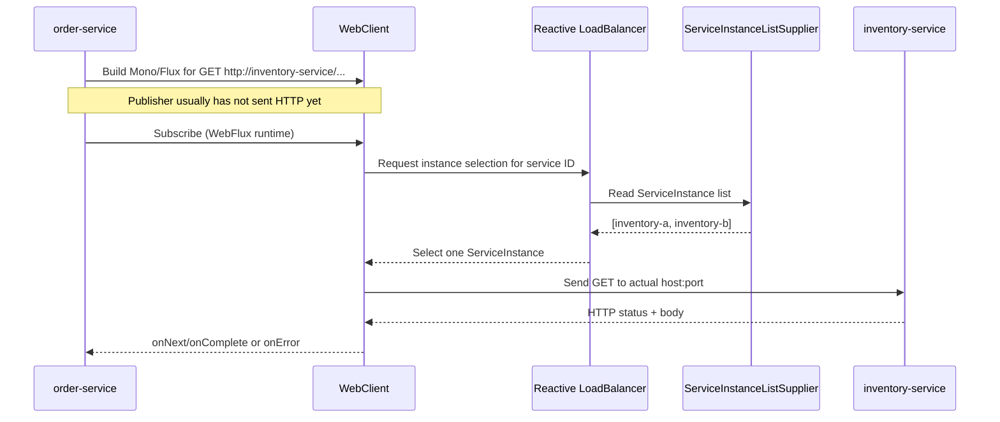

# Calling a Service ID and Mapping Response Mono or Flux

## 1. Context and Objectives

The `SPRING_CLOUD_SERVICE_COMMUNICATION_LOAD_BALANCING` module teaches client-side load balancing with Spring Cloud LoadBalancer: from service IDs and discovery, through `ServiceInstance` selection, health checks, and routing policies, to HTTP client integration, retries/timeouts, and error observability. In the **WebClient** chapter, we combine two independent mechanisms: **instance selection** in Spring Cloud LoadBalancer and **reactive response decoding and processing** in WebClient/Reactor.

Ongoing scenario:

- `order-service` is the calling service, running on port `8080`.
- `inventory-service` is the target service, with two replicas `inventory-a:8081` and `inventory-b:8082`.
- `order-service` calls the logical URL `http://inventory-service/api/inventory/ABC-1`. The host `inventory-service` is a **service ID**, not a physical hostname to be resolved by DNS.
- Endpoints can return a JSON object, a JSON array, or an NDJSON stream. `WebClient` decodes these into `Mono<T>` or `Flux<T>` respectively.

Expected outcomes:

1. Create a `@LoadBalanced WebClient.Builder` and verify requests reach instances discovered by service ID.
2. Choose `bodyToMono` when the HTTP response carries a single object; choose `bodyToFlux` when the body has multiple elements.
3. Distinguish a single HTTP request returning a multi-element `Flux` from a `Flux` that triggers **multiple HTTP requests**.
4. Transform data with `map`, `flatMap`, `filter`, `collectList`, and control concurrency with `flatMap`/`concatMap`.
5. Handle 404, 503, connection errors, timeouts, and retries according to business semantics.
6. Trace requests to the service ID, specific instance, and response, including when discovery or health checks change.

## 2. Role of Spring Cloud LoadBalancer in WebClient



With `spring-cloud-starter-loadbalancer` and Spring WebFlux on the classpath, Spring Cloud can configure `ReactorLoadBalancerExchangeFilterFunction`. The filter extracts the hostname from the logical URL to look up the LoadBalancer client, fetches the instance list, and rewrites the URL to the physical address. `ServiceInstanceListSupplier` can pull data from a registry, cache, filter by health/zone/hint, or use a custom supplier.

**Two core notes:**

- LoadBalancer normally selects **one instance per HTTP exchange**. If one HTTP response returns 100 items and `bodyToFlux` emits 100 `onNext` signals, those 100 items **do not cause LoadBalancer to select 100 instances**.
- Most publishers created by `WebClient` are **cold**. Building a `Mono`/`Flux` does not necessarily send an HTTP request; subscribing executes the request. Re-subscribing to an unshared/uncached publisher can send another request and select a different instance.

### 2.1. Mono and Flux as Response Data Types

| Type | Semantics | Example Response | Instance Selections in One GET |
|---|---|---|---|
| `Mono<InventoryItem>` | Zero or one value, then completes; or may error | A JSON object | Typically one |
| `Flux<InventoryItem>` | Zero to many values, finite or infinite | A JSON array | Still typically one |
| `Flux<InventoryEvent>` | Stream of events over time | NDJSON or SSE | One when opening the HTTP stream |
| `Flux.fromIterable(skus).flatMap(this::findOne)` | Merges results of multiple publishers | Each SKU triggers a separate HTTP GET | Potentially one selection per GET |

A `Mono` publisher does not mean the backend always returns exactly one object; a successful response with an empty body can produce `Mono.empty()`. Likewise, a `Flux` publisher does not automatically imply real-time streaming: a JSON array may be buffered by the server or proxy.

## 3. Dependencies and Practice Topology

The calling application needs Spring WebFlux for `WebClient` and Spring Cloud LoadBalancer to resolve service IDs. Illustrative Maven dependencies (compatible Spring Boot and Spring Cloud BOMs must be declared):

```xml
<dependencies>
    <dependency>
        <groupId>org.springframework.boot</groupId>
        <artifactId>spring-boot-starter-webflux</artifactId>
    </dependency>
    <dependency>
        <groupId>org.springframework.cloud</groupId>
        <artifactId>spring-cloud-starter-loadbalancer</artifactId>
    </dependency>
</dependencies>
```

Use a Spring Cloud Release Train compatible with the resolved Spring Boot version. In real environments, add the discovery starter matching Eureka, Consul, or Kubernetes. For a fixed local lab, `SimpleDiscoveryClient` can be used without running a separate registry.

`application.yml` configuration on **order-service**:

```yaml
spring:
  application:
    name: order-service
  cloud:
    discovery:
      client:
        simple:
          instances:
            inventory-service:
              - uri: http://localhost:8081
                instance-id: inventory-a
              - uri: http://localhost:8082
                instance-id: inventory-b
    loadbalancer:
      retry:
        enabled: false
server:
  port: 8080
```

On **inventory-service**, two replicas sharing the same logical name:

```yaml
spring:
  application:
    name: inventory-service
server:
  port: 8081
app:
  instance-id: inventory-a
```

Run instance B with `server.port=8082` and `app.instance-id=inventory-b`. These `localhost` URIs apply only when the caller and instances share the same machine/network namespace; in containers/Kubernetes you must use a hostname/IP reachable by the **caller**. If using a real registry, verify both `ServiceInstance` entries are registered under the same service ID.

## 4. Creating a `@LoadBalanced` WebClient

In `order-service`, declare the bean:

```java
import org.springframework.cloud.client.loadbalancer.LoadBalanced;
import org.springframework.context.annotation.Bean;
import org.springframework.context.annotation.Configuration;
import org.springframework.web.reactive.function.client.WebClient;

@Configuration(proxyBeanMethods = false)
class InventoryWebClientConfig {

    @Bean
    @LoadBalanced
    WebClient.Builder loadBalancedWebClientBuilder() {
        return WebClient.builder();
    }
}
```

Create a reusable client inside a gateway service:

```java
@Service
class InventoryGateway {
    private final WebClient client;

    InventoryGateway(@LoadBalanced WebClient.Builder builder) {
        this.client = builder.clone()
                .baseUrl("http://inventory-service")
                .build();
    }

    // Add reactive methods in the next sections.
}
```

`builder.clone()` sets `baseUrl` for this gateway without mutating the builder used by other beans. The hostname `inventory-service` is handled by the LoadBalancer filter; the actual request URL depends on the chosen `ServiceInstance`.

**Do not assume** `WebClient.create("http://inventory-service")` includes LoadBalancer. `WebClient.create` does not automatically attach the `@LoadBalanced` exchange filter; without the filter, the service name can go to DNS as a regular hostname and fail with `UnknownHostException`.

### 4.1. When Both Load-Balanced and Plain Clients Are Needed

If the application also calls physical URLs or external APIs, you can create two builders:

```java
@Configuration(proxyBeanMethods = false)
class WebClientBuilders {
    @Bean
    @LoadBalanced
    WebClient.Builder serviceWebClientBuilder() {
        return WebClient.builder();
    }

    @Bean
    @Primary
    WebClient.Builder plainWebClientBuilder() {
        return WebClient.builder();
    }
}
```

This is an **alternative** to the bean in section 4; do not register both sample configurations at once. Internal client injection must carry `@LoadBalanced` so it does not accidentally pick up the plain builder. Another option is injecting `ReactorLoadBalancerExchangeFilterFunction` and calling `.filter(lbFunction)` on a dedicated builder; add only **one** LoadBalancer filter mechanism.

Spring Boot may provide `WebClientCustomizer` beans for observability, codecs, and connectors. If creating `WebClient.builder()` manually, check your running Boot version to ensure required customizers are applied so you do not accidentally lose Boot tracing/metrics.

## 5. Defining DTOs and Observable Response Endpoints

Illustrative contract:

```java
record InventoryItem(String sku, int available, String instanceId) {}

record InventoryEvent(
        String sku, int available, String instanceId, long sequence) {}
```

In **inventory-service** using Spring WebFlux, create a simple controller:

```java
@RestController
@RequestMapping("/api/inventory")
class InventoryController {

    @Value("${app.instance-id}")
    private String instanceId;

    @GetMapping("/{sku}")
    Mono<InventoryItem> find(@PathVariable String sku) {
        return Mono.just(new InventoryItem(sku, 12, instanceId));
    }

    @GetMapping
    Flux<InventoryItem> all() {
        return Flux.just(
                new InventoryItem("ABC-1", 12, instanceId),
                new InventoryItem("XYZ-2", 5, instanceId));
    }

    @GetMapping(value = "/events",
                produces = MediaType.APPLICATION_NDJSON_VALUE)
    Flux<InventoryEvent> events() {
        return Flux.interval(Duration.ofSeconds(1))
                .take(5)
                .map(sequence ->
                        new InventoryEvent(
                                "ABC-1", 12, instanceId, sequence));
    }
}
```

This example uses Java 17+ `record`s; imports for Spring MVC annotations, WebFlux media types, Reactor `Mono`/`Flux`, and Java `Duration` are omitted for brevity. Server and caller DTOs must have compatible JSON schemas, whether in separate packages or a shared contract module. These endpoints provide mock data solely to observe instances; they do not simulate real inventory state.

The endpoint `/api/inventory/{sku}` returns **one object**; `/api/inventory` returns **a JSON array**; `/api/inventory/events` returns an **NDJSON stream** emitting 5 events roughly one second apart.

## 6. Calling One SKU and Mapping `bodyToMono`

Add a method to `InventoryGateway`:

```java
Mono<InventoryItem> findOne(String sku) {
    return client.get()
            .uri("/api/inventory/{sku}", sku)
            .accept(MediaType.APPLICATION_JSON)
            .retrieve()
            .bodyToMono(InventoryItem.class);
}
```

Example response:

```json
{
  "sku": "ABC-1",
  "available": 12,
  "instanceId": "inventory-a"
}
```

`bodyToMono(InventoryItem.class)` decodes the body into at most one object. `findOne` returns a `Mono<InventoryItem>` publisher so callers can continue transforming asynchronously. It does **not** send a new GET merely because you called `findOne`; the actual HTTP exchange happens when the publisher is subscribed to in the pipeline.

### 6.1. `map` Transforms Synchronously Without Extra HTTP Calls

```java
record Availability(String sku, boolean inStock, String instanceId) {}

Mono<Availability> checkAvailability(String sku) {
    return findOne(sku)
            .map(item -> new Availability(
                    item.sku(),
                    item.available() > 0,
                    item.instanceId()));
}
```

`map` transforms `InventoryItem` into `Availability`. It does not invoke LoadBalancer again. If upstream is `Mono.empty()`, the lambda inside `map` does not execute.

### 6.2. `flatMap` Composes Another Asynchronous Operation

```java
record StockAndPrice(String sku, int available, long price) {}

// priceGateway.findPrice(sku) is defined to return Mono<Long>.
Mono<StockAndPrice> withPrice(String sku) {
    return findOne(sku)
            .flatMap(item -> priceGateway.findPrice(item.sku())
                    .map(price -> new StockAndPrice(
                            item.sku(), item.available(), price)));
}
```

`flatMap` is appropriate when the inner function already returns a `Mono`; using `map` would produce `Mono<Mono<StockAndPrice>>`. Here `priceGateway` is an illustrative dependency not declared in the snippet, assumed to be configured separately for `pricing-service`. If `priceGateway` also uses LoadBalancer, its HTTP call selects an instance **independently**, unrelated to `findOne`'s selection.

### 6.3. `Mono.empty` Differs from HTTP 404

| Mono Signal | Example | Meaning |
|---|---|---|
| `onNext(item)` then `onComplete` | HTTP 200 with JSON object | Decoded one value |
| `onComplete`, without `onNext` | 204/empty-body response | Empty publisher; do not automatically infer 404 |
| `onError(error)` | HTTP 404/503, connection/decode error | Operation failed |

`retrieve()` with its default error handler turns HTTP 4xx/5xx responses into `WebClientResponseException`. HTTP 404 does **not** automatically become `Mono.empty()`. If the contract specifies that 404 means the SKU does not exist:

```java
Mono<InventoryItem> findOptional(String sku) {
    return findOne(sku)
            .onErrorResume(
                    WebClientResponseException.NotFound.class,
                    error -> Mono.empty());
}
```

Convert 404 specifically to empty only when the contract permits it. Do not convert 503 or timeouts into zero stock: doing so conflates "unknown" with "out of stock."

## 7. Calling a List and Mapping `bodyToFlux`

### 7.1. One GET, Multiple JSON Objects

```java
Flux<InventoryItem> findAll() {
    return client.get()
            .uri("/api/inventory")
            .accept(MediaType.APPLICATION_JSON)
            .retrieve()
            .bodyToFlux(InventoryItem.class);
}
```

An example response:

```json
[
  {"sku":"ABC-1","available":12,"instanceId":"inventory-b"},
  {"sku":"XYZ-2","available":5,"instanceId":"inventory-b"}
]
```

Even though the `Flux` has two elements, both come from **one HTTP GET** handled by **one instance**; decoding the second element does not trigger another instance selection. For a JSON array, the codec may emit items one by one, but servers/proxies may also buffer, so you should not automatically assume real-time streaming.

### 7.2. True NDJSON to Observe a Stream Over Time

```java
Flux<InventoryEvent> watchEvents() {
    return client.get()
            .uri("/api/inventory/events")
            .accept(MediaType.APPLICATION_NDJSON)
            .retrieve()
            .bodyToFlux(InventoryEvent.class);
}
```

The `/events` endpoint in section 5 emits five NDJSON events. One subscription opens one HTTP stream, and LoadBalancer picks one instance at the start. All five events typically carry the same `instanceId` on that connection. If the instance stops mid-stream, the active stream may error or disconnect; LoadBalancer does not seamlessly migrate a live connection to another instance.

Server-Sent Events can be used when the server actually returns `text/event-stream`, provided the right contract/codec (for instance `ServerSentEvent<T>`) is defined rather than just changing the Accept header.

### 7.3. `collectList` Produces `Mono<List<T>>`

```java
Mono<List<InventoryItem>> allAsList() {
    return findAll().collectList();
}
```

`collectList()` only emits a `List` when the `Flux` **completes**. On an infinite stream it may never complete and will keep consuming memory. Do not apply this operator arbitrarily to unbounded event streams.

| Operator | Typical Output | Usage |
|---|---|---|
| `map` | `Flux<R>` or `Mono<R>` | Synchronously transform each element |
| `filter` | `Flux<T>` | Keep elements matching a predicate |
| `take(10)` | `Flux<T>` | Take at most 10 elements then complete |
| `collectList` | `Mono<List<T>>` | Gather a finite stream into one list |
| `flatMap` | `Mono<R>` or `Flux<R>` | Merge asynchronous publishers; may reorder |
| `flatMapMany` | `Flux<R>` | Expand one `Mono` into multiple elements |
| `concatMap` | `Flux<R>` | Merge sequentially, preserving inner publisher order |

## 8. One Response Flux vs. a Flux of Multiple HTTP Requests

**Case A — one GET, multiple body elements:**

```java
Flux<InventoryItem> items = client.get()
        .uri("/api/inventory")
        .retrieve()
        .bodyToFlux(InventoryItem.class);
```

One subscription causes **one request**, and LoadBalancer selects **one instance**.

**Case B — three distinct GETs merged into one Flux:**

```java
Flux<InventoryItem> items = Flux.fromIterable(
        List.of("ABC-1", "XYZ-2", "LMN-3"))
        .flatMap(this::findOne, 3);
```

`findOne` creates one GET per SKU. There are three HTTP requests, and **each request** may select a different instance. `flatMap(...,3)` limits how many inner publishers are subscribed concurrently, though result order may differ from input order.

If ordering must be preserved, use:

```java
Flux<InventoryItem> ordered = Flux.fromIterable(
        List.of("ABC-1", "XYZ-2", "LMN-3"))
        .concatMap(this::findOne);
```

`concatMap` waits for the previous inner publisher to complete before starting the next; this typically reduces throughput for network calls. For large SKU lists, always bound concurrency and consider connection pool and downstream capacity.

### 8.1. Subscriptions and Caching Change HTTP Attempt Counts

```java
Mono<InventoryItem> query = findOne("ABC-1");

// Illustrates cold behavior only; do not apply arbitrarily in services.
query.subscribe();
query.subscribe();
```

Two subscriptions to a cold publisher typically produce two HTTP requests, resulting in two LoadBalancer selections. With `query.cache()`, subsequent subscribers can receive cached signals instead of issuing new requests. Consider TTL and inventory freshness carefully. In WebFlux applications, generally **return the publisher** so the framework manages subscriptions instead of calling `subscribe()` manually without proper error/cancellation handling.

## 9. HTTP Status Mapping and Error Handling

### 9.1. Outcome Categories to Distinguish

| Scenario | Stage | Observable Behavior |
|---|---|---|
| HTTP 200 + JSON object | Response decoder | `Mono<InventoryItem>` emits value |
| HTTP 200 + JSON array | Response decoder | `Flux<InventoryItem>` emits objects |
| HTTP 204/empty body | Response decoder | `Mono.empty()` or `Flux.empty()` |
| Server returns 404 | HTTP status | `WebClientResponseException.NotFound` by default |
| Server returns 503 | HTTP status | `WebClientResponseException.ServiceUnavailable` by default |
| Instance selected but connection fails | Connector | Usually `WebClientRequestException`/related cause |
| No instance for service ID | LoadBalancer filter | In many versions, the reactive filter generates a 503 response (configurable to 404); `retrieve` turns it into an HTTP error |
| Body incompatible with DTO | Decoder | Decoding/contract error; not a discovery error |

**A 503 observed from WebClient does not prove `inventory-service` received the request.** When no instances exist, the reactive LoadBalancer can generate an error response before any HTTP connection occurs. Check LoadBalancer lifecycle/metrics, supplier lists, and server logs to identify the 503 source.

### 9.2. `onErrorResume` Only for Intentional Errors

```java
Mono<InventoryItem> optional(String sku) {
    return findOne(sku)
            .onErrorResume(
                    WebClientResponseException.NotFound.class,
                    ex -> Mono.empty());
}
```

In this example, only HTTP 404 is treated as "SKU absent." 503s, timeouts, certificate errors, and JSON errors remain errors. If using `defaultIfEmpty`, make sure the default value makes business sense; do not silently return `available=0` when stock has not been verified.

### 9.3. `onStatus` Maps HTTP Responses to Custom Exceptions

```java
final class InventoryUnavailableException extends RuntimeException {
    InventoryUnavailableException(String message, Throwable cause) {
        super(message, cause);
    }
}

Mono<InventoryItem> findWithErrorMapping(String sku) {
    return client.get()
            .uri("/api/inventory/{sku}", sku)
            .retrieve()
            .onStatus(
                    code -> code.value() == 503,
                    response -> response.createException()
                            .map(ex -> new InventoryUnavailableException(
                                    "inventory-service is unavailable", ex)))
            .bodyToMono(InventoryItem.class);
}
```

`onStatus` only triggers when a `ClientResponse` exists and its status can be read; it does **not** directly catch connection failures occurring before a response. For transport errors, use `onErrorMap`/`onErrorResume` by exception type. Do not catch broad `Exception` and replace all errors with fake success data.

### 9.4. `exchangeToMono` Must Handle Both Body and Status

When per-branch response control is required:

```java
Mono<InventoryItem> findWithExchange(String sku) {
    return client.get()
            .uri("/api/inventory/{sku}", sku)
            .exchangeToMono(response -> {
                if (response.statusCode().is2xxSuccessful()) {
                    return response.bodyToMono(InventoryItem.class);
                }
                if (response.statusCode().value() == 404) {
                    return Mono.empty();
                }
                return response.createException()
                        .flatMap(ex ->
                                Mono.<InventoryItem>error(ex));
            });
}
```

For collections, `exchangeToFlux` exists and the success branch returns `response.bodyToFlux(InventoryItem.class)`. Spring WebClient releases any remaining response body after the callback's publisher completes; do not retain `ClientResponse` and attempt to decode it later downstream.

## 10. Timeout, Retry, Cancellation, and Backpressure

### 10.1. Reactor Deadlines and HTTP Connector Timeouts

```java
Mono<InventoryItem> findWithDeadline(String sku) {
    return findOne(sku)
            .timeout(Duration.ofSeconds(3));
}
```

`Mono.timeout` ensures the publisher emits a signal before the deadline or errors with `TimeoutException`. It does not replace the HTTP connector's connect timeout/read timeout. With Reactor Netty, these can be configured separately:

```java
HttpClient httpClient = HttpClient.create()
        .option(ChannelOption.CONNECT_TIMEOUT_MILLIS, 1000)
        .responseTimeout(Duration.ofSeconds(2));

WebClient client = loadBalancedBuilder.clone()
        .baseUrl("http://inventory-service")
        .clientConnector(new ReactorClientHttpConnector(httpClient))
        .build();
```

Here `loadBalancedBuilder` is the bean injected with `@LoadBalanced`; cloning retains the filter configuration. Netty, Reactor Netty, and `ReactorClientHttpConnector` imports depend on version. For a long `Flux` stream, `timeout(Duration)` usually measures **time without a subsequent signal** rather than setting a fixed deadline for the entire stream; choose a timeout appropriate for streaming content.

### 10.2. Reactor Retry at the Publisher Layer

```java
Mono<InventoryItem> findWithLimitedRetry(String sku) {
    return findOne(sku)
            .retryWhen(Retry.backoff(
                    2, Duration.ofMillis(100))
                    .filter(error ->
                            error instanceof WebClientRequestException))
            .timeout(Duration.ofSeconds(3));
}
```

`Retry.backoff(2, ...)` permits at most **two retries after the initial attempt**, provided errors match the predicate and the deadline has not elapsed. Re-subscribing can trigger a new HTTP request and another instance selection; it does not guarantee each retry picks a different instance unless configured with an appropriate policy.

Spring Cloud LoadBalancer also has its **own** retry via `spring.cloud.loadbalancer.retry.enabled` and parameters for retries on the same/different instances. Do not stack multiple retry layers (LoadBalancer, Reactor, gateway, resilience library) without calculating total attempts. Retrying read-only GETs can be safer than order/payment POSTs; write operations need idempotency keys and explicit retry contracts.

### 10.3. Cancellation, Backpressure, and Non-Blocking Execution

- `Flux.take(5)` completes after at most five items and can cancel upstream.
- If an external client disconnects while the server is streaming, the downstream subscription is typically cancelled; the HTTP connector needs to release resources properly.
- Reactive Streams backpressure does not guarantee every proxy or upstream throttles at the same granularity; verify buffers, codecs, and memory.
- Calling `collectList()` on an unbounded stream can hold unbounded memory.
- Using `flatMap` to fire thousands of concurrent requests can exhaust connection pools; bound concurrency.

**Avoid calling `block()` or `blockFirst()` directly inside WebFlux event-loop processing.** Doing so breaks non-blocking benefits and can cause errors or bottlenecks. Return publishers directly from controllers or compose via `map`/`flatMap`.

## 11. Controllers Returning Mono and Flux to the WebFlux Runtime

In `order-service`, a controller can return reactive values without subscribing manually:

```java
@RestController
@RequestMapping("/demo/inventory")
class InventoryDemoController {

    private final InventoryGateway gateway;

    InventoryDemoController(InventoryGateway gateway) {
        this.gateway = gateway;
    }

    @GetMapping("/{sku}")
    Mono<InventoryItem> one(@PathVariable String sku) {
        return gateway.findOne(sku);
    }

    @GetMapping
    Flux<InventoryItem> all() {
        return gateway.findAll();
    }

    @GetMapping(value = "/events",
                produces = MediaType.APPLICATION_NDJSON_VALUE)
    Flux<InventoryEvent> events() {
        return gateway.watchEvents();
    }
}
```

Assume `InventoryGateway` already has the three methods `findOne`/`findAll`/`watchEvents` shown earlier. The controller does not need to call `subscribe()`; the framework subscribes when writing the HTTP response and performs cancellation when appropriate.

If the API contract requires 404 when a SKU is absent:

```java
@GetMapping("/{sku}")
Mono<ResponseEntity<InventoryItem>> optionalOne(
        @PathVariable String sku) {
    return gateway.findOptional(sku)
            .map(ResponseEntity::ok)
            .defaultIfEmpty(ResponseEntity.notFound().build());
}
```

This is an **alternative** to the `one` method sharing the same mapping; do not keep both in the controller simultaneously. Only downstream HTTP 404 becomes empty; 503/timeout errors still propagate for boundary error handling.

## 12. Lab: Verifying Mono, Flux, and Instance Selection

### Step 1 — Start Two Replicas

Run `inventory-service` A on `8081` and B on `8082` with distinct `app.instance-id` values and the same `inventory-service` name. Run `order-service` on `8080` with `SimpleDiscoveryClient` as in section 3. Ensure the client uses `@LoadBalanced WebClient.Builder`.

### Step 2 — One Object Returned as Mono

```bash
curl -i http://localhost:8080/demo/inventory/ABC-1
curl -i http://localhost:8080/demo/inventory/ABC-1
curl -i http://localhost:8080/demo/inventory/ABC-1
```

One GET to `order-service` issues one GET to inventory when the publisher is subscribed. The response includes `instanceId` to identify the handling server. With Round Robin and a stable list, selections typically alternate; background requests, retries, or different caches/discovery timing can skew results.

### Step 3 — JSON Array into Flux

```bash
curl -i http://localhost:8080/demo/inventory
```

A single response containing multiple items usually shares the **same `instanceId`**. This confirms `bodyToFlux` decodes multiple elements from one HTTP response rather than distributing elements across replicas.

### Step 4 — NDJSON Stream

```bash
curl -N -i http://localhost:8080/demo/inventory/events
```

In the mock lab, JSON lines typically appear one per second. `curl -N` reduces curl buffering; proxies or servers may still buffer depending on configuration. All five events from one subscription carry the instance ID of the server chosen when opening the stream.

### Step 5 — Multiple GETs in One Flux

Create `Flux.fromIterable(skus).flatMap(this::findOne, 3)` and trace the three requests to inventory. Compare with `concatMap` to observe concurrency and output ordering. Log each request ID and receiving instance; do not just count `onNext` signals.

### Step 6 — Errors, Timeouts, and Health

| Experiment | Expected Observation |
|---|---|
| Non-existent service ID | No `ServiceInstance`; error in reactive filter, potentially turning into 503/404 depending on version/config |
| Instance B stopped while still in discovery | Selecting B can produce connection error/timeout |
| Endpoint returns 404 | `retrieve` emits `WebClientResponseException.NotFound`, unless explicitly mapped |
| Endpoint returns 503 | 503 response from server; inspect server logs to distinguish from LB-generated 503 |
| Response JSON mismatches DTO | Decoder reports contract error, not discovery error |
| Running stream interrupted | Stream errors/cancels; live connection does not migrate automatically to a new replica |
| Health supplier excludes B after refresh | New selections avoid B per actual policy/supplier |
| Retry enabled | Track attempt counts and whether a different instance is chosen; do not equate with logical request count |

## 13. Error Observability and Troubleshooting

### 13.1. What to Measure?

- `service ID` in the logical URL, `ServiceInstance` list from discovery/supplier, and selected instance.
- Number of HTTP exchanges and retry attempts per service; do not use `Flux` element count as request count.
- HTTP status, exception type, timeouts, and decode errors.
- `instanceId` returned from servers to correlate with per-replica logs.
- p50/p95/p99 latency, throughput, in-flight requests, open connections, and stream duration.
- Correlation/trace IDs from caller to downstream. Use `LoadBalancerLifecycle` when precise observation of the instance selection step is needed.

Logging can be enabled in the lab:

```yaml
logging:
  level:
    org.springframework.cloud.loadbalancer: DEBUG
    org.springframework.web.reactive.function.client: DEBUG
```

Do not assume every version logs full instance lists or traces automatically, and never log sensitive tokens, cookies, or bodies.

### 13.2. Common Pitfalls

| Symptom | Likely Cause | Resolution |
|---|---|---|
| `UnknownHostException: inventory-service` | Plain builder missing LoadBalancer filter | Check `@LoadBalanced` on bean/injection and dependencies |
| HTTP 503 with no logs in inventory | No instance found or error before server | Inspect supplier, LoadBalancer lifecycle, distinguish synthetic 503 |
| `Flux` always has the same instance ID | One GET served by one instance | Expected for one body; send multiple GETs to observe distribution |
| `bodyToMono` fails to read array | DTO/response mismatch | Use `bodyToFlux` or a wrapper DTO containing a collection |
| `bodyToFlux` emits all at once | Server/proxy/codec buffered response | Use NDJSON/SSE and check flushing |
| `Mono.empty` treated as 404 | Empty body differs from error status | Handle status before making business decisions |
| `flatMap` returns out-of-order results | Concurrent execution | Use `concatMap` when order is required |
| `collectList` never finishes | Used on an unbounded stream | Limit item count/time or process as a stream |
| Enabling retries multiplies requests | Multiple retry/subscription layers | Configure one retry policy and count attempts |
| `block()` causes errors/high latency | Blocking the WebFlux event loop | Return `Mono`/`Flux` from controllers |
| Dead instance still chosen after scale-down | Registry/cache/health not yet updated | Measure each stage and bound timeouts |

## 14. Exercises and Completion Criteria

**Exercise 1 — Single item:** write `findOne(sku): Mono<InventoryItem>`, transform with `map` into `Availability`, send 20 sequential requests, and record `instanceId`.

**Exercise 2 — Single multi-item response:** write `findAll(): Flux<InventoryItem>`, then `allAsList(): Mono<List<InventoryItem>>`. Record the actual HTTP request count and explain why items share an instance ID.

**Exercise 3 — Stream:** build a five-event NDJSON endpoint and `watchEvents()`, use `curl -N`, cancel mid-stream, and observe resource cleanup.

**Exercise 4 — Multiple requests:** build a Flux of three SKUs via `flatMap` with bounded concurrency; compare with `concatMap` for order, throughput, and instance selection.

**Exercise 5 — Error handling:** simulate 404, 503, no instances, connection timeout, and JSON decode errors; map 404 only when the contract permits, without hiding dependency failures.

**Exercise 6 — Retry/deadline:** set a 3-second timeout and two backoff retries for GET. Count attempts, elapsed time, and distinguish Reactor retry from LoadBalancer retry.

Self-assessment criteria:

- [ ] URIs use service IDs, and `@LoadBalanced WebClient.Builder` is properly configured.
- [ ] `bodyToMono` is used for single-object responses; `bodyToFlux` for arrays or streaming responses.
- [ ] Can explain how a multi-element `Flux` from **one GET** differs from a `Flux` of **multiple GETs**.
- [ ] Uses `map`/`flatMap`/`collectList` appropriately; never blocks the event loop with `block()`.
- [ ] Correlates `instanceId`, HTTP attempts, and response element counts.
- [ ] Tested empty bodies, 404, 503, network/timeout, and decode error cases.
- [ ] Does not retry write operations without idempotency guarantees.
- [ ] Tested changing health/discovery state and measured instance update lag.
- [ ] Has sufficient logs/traces/metrics to diagnose failures.

## Official References

- [Spring Cloud Commons 4.3 — Common Abstractions, Spring WebClient as a LoadBalancer Client](https://docs.spring.io/spring-cloud-commons/reference/4.3/spring-cloud-commons/common-abstractions.html): `@LoadBalanced WebClient.Builder`, logical service names, retries, and reactive filters.
- [Spring Cloud Commons 4.3 — Spring Cloud LoadBalancer](https://docs.spring.io/spring-cloud-commons/reference/4.3/spring-cloud-commons/loadbalancer.html): `ServiceInstanceListSupplier`, instance selection, lifecycle, health/caching, and routing.
- [Spring Framework — WebClient retrieve()](https://docs.spring.io/spring-framework/reference/web/webflux-webclient/client-retrieve.html): `bodyToMono`, `bodyToFlux`, `onStatus`, and 4xx/5xx handling.
- [Spring Framework — WebClient exchange](https://docs.spring.io/spring-framework/reference/web/webflux-webclient/client-exchange.html): `exchangeToMono` and `exchangeToFlux`.
- [Project Reactor — Mono, Flux, Reactive Streams](https://projectreactor.io/docs/core/release/reference/coreFeatures/simple-ways-to-create-a-flux-or-mono-and-subscribe-to-it.html): subscriptions and publisher types.

When applying to a real project, always read documentation matching your resolved **Spring Cloud Release Train**, as default retries, properties, and APIs can vary across branches. **The service ID identifies the logical service for LoadBalancer target selection; `Mono` or `Flux` defines how the application processes data from the HTTP response.**
