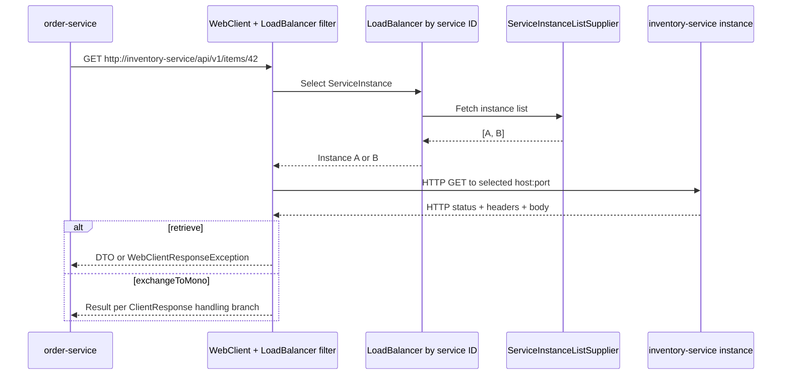

# retrieve, exchangeToMono, and Status Code Handling

In Spring Cloud LoadBalancer, `WebClient` can call a service via its **service ID**, such as `http://inventory-service`, rather than hardcoding a single replica's address. LoadBalancer selects a `ServiceInstance` and the HTTP transport sends the request to that chosen instance. After that step, the backend may still return `200`, `204`, `404`, `429`, `503`, or the connection may fail before any HTTP response arrives.

To write a proper WebClient client, you need to distinguish two Spring WebFlux APIs:

- `retrieve()`: a convenient API for decoding the response body into `Mono<T>` or `Flux<T>`; by default treats HTTP 4xx/5xx as errors and supports customization via `onStatus`.
- `exchangeToMono()`: provides `ClientResponse` directly inside a callback, allowing branching on **status, headers, and body** before deciding whether to emit data, complete empty, or emit an error.

This lesson explains the semantics of both APIs, how to handle common HTTP status codes, network errors, timeouts/retries, and integration with `@LoadBalanced WebClient.Builder`, complete with examples and tests applicable in a lab.

## 1. Separating Instance Selection from HTTP Status Handling

Suppose `order-service` calls `inventory-service`'s API:

```http
GET /api/v1/items/42 HTTP/1.1
Host: inventory-service
```

The host `inventory-service` in the logical URL is a service ID. WebClient's LoadBalancer filter asks the load balancer for a replica from `ServiceInstanceListSupplier`, then rewrites the URI and forwards the request to the target host/port. The backend receives the request and produces an HTTP response. **The target selection algorithm does not decide what 404 or 503 means to business logic.**



If no instance is available, LoadBalancer integration may generate an error response or emit an error before connecting to a provider. Therefore, **do not assume every 503 status comes from the backend**: it may originate from LoadBalancer, a gateway/proxy, or the provider itself. Observe the service ID, selected instance, traces, and logs to identify which layer caused the error.

## 2. Practice Environment

The **client** application needs WebFlux and Spring Cloud LoadBalancer. Maven dependencies section:

```xml
<dependencies>
    <dependency>
        <groupId>org.springframework.boot</groupId>
        <artifactId>spring-boot-starter-webflux</artifactId>
    </dependency>
    <dependency>
        <groupId>org.springframework.cloud</groupId>
        <artifactId>spring-cloud-starter-loadbalancer</artifactId>
    </dependency>
</dependencies>
```

This is not a complete `pom.xml`: the project must include Spring Boot configuration and import the `spring-cloud-dependencies` BOM compatible with the Spring Boot version in use. The Java examples use Java 17+ (`record`).

In the **client**'s `application-lab.yml`, use `SimpleDiscoveryClient` instead of a registry to declare two replicas:

```yaml
server:
  port: 8080

spring:
  application:
    name: order-service
  cloud:
    discovery:
      client:
        simple:
          instances:
            inventory-service:
              - uri: http://localhost:8091
              - uri: http://localhost:8092
```

Both providers expose the same endpoint but run on ports `8091` and `8092`. If the application runs inside a container, `localhost` refers to that container itself, not the host or provider containers; replace it with a hostname reachable within the deployment network.

### 2.1. Provider Endpoint Returning Multiple Statuses

The `inventory-service` application uses Spring Boot Web or WebFlux and provides:

```java
import org.springframework.beans.factory.annotation.Value;
import org.springframework.http.HttpStatus;
import org.springframework.http.ResponseEntity;
import org.springframework.web.bind.annotation.GetMapping;
import org.springframework.web.bind.annotation.PathVariable;
import org.springframework.web.bind.annotation.RestController;

record ItemDto(String id, String name, String servedBy) {
}

@RestController
class InventoryController {
    private final int port;

    InventoryController(@Value("${server.port}") int port) {
        this.port = port;
    }

    @GetMapping("/api/v1/items/{id}")
    ResponseEntity<ItemDto> find(@PathVariable String id) {
        if ("missing".equals(id)) {
            return ResponseEntity.notFound().build();
        }
        if ("empty".equals(id)) {
            return ResponseEntity.noContent().build();
        }
        if ("busy".equals(id)) {
            return ResponseEntity.status(HttpStatus.SERVICE_UNAVAILABLE)
                    .build();
        }
        return ResponseEntity.ok(
                new ItemDto(id, "Item " + id, "inventory-" + port));
    }
}
```

Start two replicas of the same JAR:

```bash
# Terminal A
java -jar inventory-service.jar --server.port=8091

# Terminal B
java -jar inventory-service.jar --server.port=8092
```

Verify the statuses directly:

```bash
curl -i http://localhost:8091/api/v1/items/42
curl -i http://localhost:8092/api/v1/items/missing
curl -i http://localhost:8091/api/v1/items/empty
curl -i http://localhost:8092/api/v1/items/busy
```

The expected results are `200` (JSON with `servedBy`), `404`, `204`, and `503` respectively. If direct endpoint calls are already wrong, fix the provider before analyzing LoadBalancer or WebClient.

## 3. Creating a Load-Balanced `WebClient.Builder`

A standard `WebClient.create("http://inventory-service")` is not automatically configured with the LoadBalancer filter. Define a builder:

```java
import org.springframework.cloud.client.loadbalancer.LoadBalanced;
import org.springframework.context.annotation.Bean;
import org.springframework.context.annotation.Configuration;
import org.springframework.web.reactive.function.client.WebClient;

@Configuration
class WebClientConfiguration {

    @Bean
    @LoadBalanced
    WebClient.Builder loadBalancedWebClientBuilder() {
        return WebClient.builder();
    }
}
```

Create a gateway from that exact builder:

```java
import org.springframework.beans.factory.annotation.Qualifier;
import org.springframework.stereotype.Service;
import org.springframework.web.reactive.function.client.WebClient;

@Service
class InventoryClient {
    private final WebClient client;

    InventoryClient(
            @Qualifier("loadBalancedWebClientBuilder")
            WebClient.Builder builder) {
        this.client = builder
                .baseUrl("http://inventory-service")
                .build();
    }

    // Add the methods from the following sections to this class.
}
```

With supported Spring Cloud versions, `@LoadBalanced WebClient.Builder` is configured with a reactive filter such as `ReactorLoadBalancerExchangeFilterFunction`. This is **not** the `BlockingLoadBalancerClient` path commonly used with `RestTemplate`. Do not call `.block()` on a WebFlux event-loop thread: it blocks the thread and degrades concurrency.

## 4. `retrieve()`: The Simple Way for Normal Responses

`retrieve()` returns a `ResponseSpec`; when the status succeeds, `bodyToMono` decodes the body:

```java
import reactor.core.publisher.Mono;

Mono<ItemDto> getItem(String id) {
    return client.get()
            .uri("/api/v1/items/{id}", id)
            .retrieve()
            .bodyToMono(ItemDto.class);
}
```

`Mono<ItemDto>` describes an asynchronous result. The request is normally executed when the publisher gets a subscriber, such as when a WebFlux controller returns a `Mono` and the runtime subscribes. Building the chain above does not immediately send an HTTP request.

### 4.1. Default Behavior by Status

| Response from HTTP Layer | `retrieve().bodyToMono(ItemDto.class)` |
|---|---|
| `200 OK` + valid JSON | Emits one `ItemDto` then completes |
| `201/206` with body | Still 2xx; decodes into requested body type |
| `204 No Content` | No body; typically completes `Mono.empty()` |
| `404 Not Found` | By default emits `WebClientResponseException.NotFound` |
| `429 Too Many Requests` | By default emits `WebClientResponseException.TooManyRequests` |
| `500/503` | By default emits corresponding `WebClientResponseException` |
| Disconnected before response | Request/transport error, not an HTTP response from provider |

By default `retrieve()` creates exceptions for **4xx/5xx** statuses (400 and above). 404 does not automatically become "no data." Conversely, 204 is a **successful** response with an empty body.

If you need to retain the status and headers of a successful response:

```java
import org.springframework.http.ResponseEntity;

Mono<ResponseEntity<ItemDto>> response = client.get()
        .uri("/api/v1/items/{id}", "42")
        .retrieve()
        .toEntity(ItemDto.class);
```

`toEntity` preserves status/headers, **but still uses the exception mechanism for 4xx/5xx** unless customized.

## 5. `onStatus()`: Turning HTTP Statuses into Business Errors

`retrieve().onStatus(...)` defines how specific status codes map to exceptions; the handler receives `ClientResponse` and returns `Mono<? extends Throwable>`.

Suppose you want to distinguish a non-existent item from an upstream failure:

```java
final class ItemNotFoundException extends RuntimeException {
    ItemNotFoundException(String id, Throwable cause) {
        super("Item not found: " + id, cause);
    }
}

final class InventoryUnavailableException extends RuntimeException {
    InventoryUnavailableException(String message, Throwable cause) {
        super(message, cause);
    }
}
```

Using `onStatus`:

```java
import org.springframework.http.HttpStatusCode;
import reactor.core.publisher.Mono;

Mono<ItemDto> getItemWithBusinessErrors(String id) {
    return client.get()
            .uri("/api/v1/items/{id}", id)
            .retrieve()
            .onStatus(code -> code.value() == 404,
                    response -> response.createException()
                            .map(error -> new ItemNotFoundException(id, error)))
            .onStatus(HttpStatusCode::is5xxServerError,
                    response -> response.createException()
                            .map(error -> new InventoryUnavailableException(
                                    "Inventory service failed", error)))
            .bodyToMono(ItemDto.class);
}
```

`response.createException()` creates a `WebClientResponseException` from the response, which the code then wraps into a business exception preserving the cause. If no `onStatus` predicate matches, the default handling for 4xx/5xx codes still applies.

**Important pitfall:** if an `onStatus` handler returns `Mono.empty()`, that only **suppresses converting the HTTP code into the default error**. It does **not automatically make** `bodyToMono(ItemDto.class)` return `Mono.empty()`. WebClient may still try to decode the 404 response body; if the body is HTML or an incompatible JSON structure, you may get a decode error.

Misleading example:

```java
// Does not guarantee status 404 will become an empty result.
Mono<ItemDto> item = client.get()
        .uri("/api/v1/items/{id}", "missing")
        .retrieve()
        .onStatus(code -> code.value() == 404,
                response -> Mono.empty())
        .bodyToMono(ItemDto.class);
```

To get a clear 404 → "item absent" mapping, either catch `WebClientResponseException.NotFound` specifically after `retrieve()` or use `exchangeToMono()` and handle the 404 branch explicitly.

## 6. `exchangeToMono()`: Branching on `ClientResponse`

`exchangeToMono()` takes a callback receiving `ClientResponse`: the application inspects status/headers and decides how to consume the body. For example, `200` returns a DTO, `204/404` returns empty, and other statuses emit an error:

```java
import reactor.core.publisher.Mono;

Mono<ItemDto> findOptional(String id) {
    return client.get()
            .uri("/api/v1/items/{id}", id)
            .exchangeToMono(response -> {
                int status = response.statusCode().value();

                if (status == 204 || status == 404) {
                    return response.releaseBody()
                            .then(Mono.<ItemDto>empty());
                }
                if (response.statusCode().is2xxSuccessful()) {
                    return response.bodyToMono(ItemDto.class);
                }
                return response.createError();
            });
}
```

Each branch has a specific meaning:

1. `204/404`: the body is unused and released via `releaseBody()`; the method returns `Mono.empty()`. This is the **example's business rule**, not default behavior for every WebClient.
2. Other 2xx statuses: the body is decoded into `ItemDto`.
3. Remaining codes: `response.createError()` emits an error carrying status, headers, and response details.

The advantage is that every branch controls the body and **explicitly differentiates** 404 from 503. Do not use `exchangeToMono()` just to ignore all HTTP errors: without an error branch, a 5xx response could accidentally be treated as success.

### 6.1. Response Body Lifecycle

When the publisher returned by the `exchangeToMono` callback completes, WebClient handles any unconsumed body according to the framework's mechanism. Do not retain `ClientResponse` to read the body **after the callback finishes**, or attempt to read the same body twice.

| Scenario | Appropriate Handling |
|---|---|
| Successful body is a single DTO | `response.bodyToMono(ItemDto.class)` |
| Multi-element stream | `exchangeToFlux()` and `bodyToFlux(...)` |
| Body ignored due to 204/404 | `response.releaseBody().then(Mono.empty())` |
| Error status needing HTTP info | `response.createException()` or `response.createError()` |
| Error JSON has a custom schema | Read body **once** into an error DTO, then create an exception |

The older `exchange()` method is deprecated; for new code, prefer `exchangeToMono()`/`exchangeToFlux()` as they make status-based body handling explicit and less error-prone.

## 7. Handling 429, 503, and `Retry-After`

Error codes differ in business meaning and retryability:

| Status | Typical Scenario | Handling Approach |
|---|---|---|
| `400 Bad Request` | Invalid input data | Return an appropriate error to caller; do not retry identical request |
| `401 Unauthorized` / `403 Forbidden` | Missing authentication or permissions | Check credentials/permissions; avoid unconditional retries |
| `404 Not Found` | Item does not exist | Choose exception or `Mono.empty()` per contract |
| `409 Conflict` | Version/state conflict | Apply business rules; do not retry by default |
| `429 Too Many Requests` | Rate limit exceeded | Inspect `Retry-After` and retry budget |
| `500 Internal Server Error` | Backend processing error | Log/trace, consider conditional retry |
| `502/503/504` | Gateway/target unavailable or timeout | May retry GET with backoff, bounding total duration |

`Retry-After` can be a **number of seconds** or an **HTTP-date formatted timestamp**. Do not parse it blindly as an integer or sleep indefinitely without validating the value. The following example only builds an exception carrying the header info and **does not retry automatically**:

```java
import org.springframework.http.HttpHeaders;
import reactor.core.publisher.Mono;

final class RateLimitedException extends RuntimeException {
    RateLimitedException(String retryAfter) {
        super("Inventory rate limited; Retry-After=" + retryAfter);
    }
}

Mono<ItemDto> getWithRateLimitHandling(String id) {
    return client.get()
            .uri("/api/v1/items/{id}", id)
            .exchangeToMono(response -> {
                int status = response.statusCode().value();

                if (status == 429) {
                    String retryAfter = response.headers()
                            .asHttpHeaders()
                            .getFirst(HttpHeaders.RETRY_AFTER);

                    return response.releaseBody()
                            .then(Mono.<ItemDto>error(
                                    new RateLimitedException(retryAfter)));
                }
                if (response.statusCode().is2xxSuccessful()) {
                    return response.bodyToMono(ItemDto.class);
                }
                return response.createError();
            });
}
```

If the API returns structured JSON errors, you can call `response.bodyToMono(RemoteError.class)` in the error branch and build an exception containing a business code, normalized message, and needed details. Never read the response body twice, and never expose full error bodies or tokens in logs or public responses.

## 8. Distinguishing HTTP Errors, Request Errors, and Decode Errors

`retrieve()` or `exchangeToMono()` can only branch on **HTTP status** once a response reaches WebClient. Many failures occur earlier or during body decoding:

| Symptom | Common Error Type | What to Check |
|---|---|---|
| Received HTTP `404/429/503` | `WebClientResponseException` or business exception per `onStatus` | Status, headers, provider/proxy, traces |
| DNS/connect/TLS failure | `WebClientRequestException` or other transport error | Selected instance, host/port, network, certificates |
| JSON mismatches `ItemDto` | Decode/codec error | Content-Type, response schema, DTO |
| No instance to select | Error/response generated by LoadBalancer integration; sometimes HTTP 503 | Service ID, discovery, supplier, selection logs |
| Exceeded timeout | Timeout exception from Reactor or connector | Deadline, connection, retry/backoff, provider |

To log errors at the right layer:

```java
import org.springframework.web.reactive.function.client.WebClientRequestException;
import org.springframework.web.reactive.function.client.WebClientResponseException;
import reactor.core.publisher.Mono;

Mono<ItemDto> getWithDiagnostics(String id) {
    return client.get()
            .uri("/api/v1/items/{id}", id)
            .retrieve()
            .bodyToMono(ItemDto.class)
            .doOnError(WebClientResponseException.class, error ->
                    System.err.println("Inventory HTTP=" +
                            error.getStatusCode().value()))
            .doOnError(WebClientRequestException.class, error ->
                    System.err.println("Inventory transport=" +
                            error.getClass().getSimpleName()));
}
```

This only illustrates exception classification; in production use centralized logging and tracing without writing sensitive data. `doOnError` only **observes** and does not alter the publisher's outcome. To convert errors into business responses, use `onErrorResume`/exception handlers according to the contract.

### 8.1. Converting 404 to `Mono.empty()` with `retrieve()`

You do not always need `exchangeToMono()` for a single simple exception case:

```java
Mono<ItemDto> findOptionalViaRetrieve(String id) {
    return client.get()
            .uri("/api/v1/items/{id}", id)
            .retrieve()
            .bodyToMono(ItemDto.class)
            .onErrorResume(
                    WebClientResponseException.NotFound.class,
                    error -> Mono.empty());
}
```

This example catches the exact `NotFound` subtype when `retrieve()` retains default 404 handling. If an earlier `onStatus` converted 404 into `ItemNotFoundException`, you must catch that new exception type instead. Avoid an unconditional `onErrorResume(error -> Mono.empty())` because it **masks connection drops, decode errors, and 5xx errors** as "item not found."

## 9. Bounded Timeouts and Retries

For idempotent GETs, certain transient failures can be retried. Reactor lets you combine `retryWhen` with backoff, exception filtering, and a total timeout:

```java
import java.time.Duration;
import org.springframework.web.reactive.function.client.WebClientRequestException;
import org.springframework.web.reactive.function.client.WebClientResponseException;
import reactor.core.publisher.Mono;
import reactor.util.retry.Retry;

Mono<ItemDto> getWithBoundedRetry(String id) {
    return client.get()
            .uri("/api/v1/items/{id}", id)
            .retrieve()
            .bodyToMono(ItemDto.class)
            .retryWhen(Retry.backoff(2, Duration.ofMillis(200))
                    .filter(error -> error instanceof WebClientRequestException
                            || (error instanceof WebClientResponseException http
                                    && (http.getStatusCode().value() == 502
                                    || http.getStatusCode().value() == 503
                                    || http.getStatusCode().value() == 504))))
            .timeout(Duration.ofSeconds(3));
}
```

In this example, up to **two retries** are allowed after the initial call, not two attempts total. `timeout(3s)` sits **outside** `retryWhen` to bound the waiting time of the entire publisher, including attempts and backoff. In real environments, also configure connect/response timeouts on the HTTP connector, because Reactor timeouts do not replace socket and connection-pool limits.

Although a retry re-subscribes the pipeline, **you cannot assume every retry is guaranteed to pick a different instance**: that decision depends on LoadBalancer integration, retry-aware supplier configuration, the instance list, and client version. Retries do not suit all 4xx errors; for write requests, a timeout does not prove the server did not process the transaction. Require idempotency keys or duplicate prevention before retrying.

If you want to handle `429` specifically, combine `Retry-After` with rate-limit policies; the code above **does not retry 429**.

## 10. Comparison Table and API Selection Rules

| Criterion | `retrieve()` | `exchangeToMono()` |
|---|---|---|
| Primary object | `ResponseSpec` | `ClientResponse` inside callback |
| Default 4xx/5xx behavior | Automatically turns into `WebClientResponseException` | Must **explicitly define** how statuses are interpreted |
| Customizing specific errors | `onStatus` | `if`/`switch` branches by status |
| 404 as empty result | `onErrorResume(NotFound.class, ...)` | `releaseBody().then(Mono.empty())` |
| Reading status/headers | `toEntity` for success responses, `onStatus` for errors | Direct access from `ClientResponse` |
| Different body schemas per status | Less convenient | Convenient since each branch reads body independently |
| Managing ignored bodies | High-level API handles most cases | Should explicitly consume/release body |
| Best suited when | 2xx → DTO; HTTP errors → exceptions | Multiple business rules based on status/headers/body |

Choose **`retrieve()` by default** when there is one successful response format and standard exceptions suffice. Choose **`exchangeToMono()`** when 204/404 should become `Mono.empty()`, when handling rate-limit headers, or when decoding distinct body schemas by status. There is no need to rewrite all WebClient code to `exchangeToMono()` merely for a sense of greater control.

## 11. Practice Through a WebFlux Controller

Use the two methods `getItem` and `findOptional` in `InventoryClient` (from sections 4 and 6). For the client to return HTTP responses to callers, add a controller:

```java
import org.springframework.http.ResponseEntity;
import org.springframework.web.bind.annotation.GetMapping;
import org.springframework.web.bind.annotation.PathVariable;
import org.springframework.web.bind.annotation.RestController;
import reactor.core.publisher.Mono;

@RestController
class InventoryProxyController {
    private final InventoryClient inventoryClient;

    InventoryProxyController(InventoryClient inventoryClient) {
        this.inventoryClient = inventoryClient;
    }

    @GetMapping("/items/raw/{id}")
    Mono<ItemDto> raw(@PathVariable String id) {
        return inventoryClient.getItem(id);
    }

    @GetMapping("/items/optional/{id}")
    Mono<ResponseEntity<ItemDto>> optional(@PathVariable String id) {
        return inventoryClient.findOptional(id)
                .map(item -> ResponseEntity.ok(item))
                .defaultIfEmpty(ResponseEntity.notFound().build());
    }
}
```

Note that `ItemDto` needs a compatible structure in **both provider and client**, such as `record ItemDto(String id, String name, String servedBy) {}` in each project (or via a shared contract module). In the client application, the methods from sections 4 and 6 must be placed inside `InventoryClient` so the controller can invoke them.

Start the client application:

```bash
java -jar order-service.jar --spring.profiles.active=lab
```

Then run:

```bash
# HTTP 200, JSON body with servedBy field
curl -i http://localhost:8080/items/optional/42
curl -i http://localhost:8080/items/optional/42

# Provider returns 404 -> findOptional emits Mono.empty
# Controller returns HTTP 404 due to the example's rule
curl -i http://localhost:8080/items/optional/missing

# Provider returns 204 -> findOptional is empty
# Controller also returns 404, not preserving status 204
curl -i http://localhost:8080/items/optional/empty

# Provider returns 503 -> findOptional still emits an error
# HTTP status on proxy depends on order-service's exception handler
curl -i http://localhost:8080/items/optional/busy
```

**Note:** without an appropriate `@RestControllerAdvice`/`onErrorResume`, an upstream `WebClientResponseException` may be rendered as a 500 response by the proxy's default error handler. Provider statuses are **not automatically forwarded verbatim** to callers. Production code needs explicit error-mapping policies and sensitive-data redaction.

### 11.1. Test Matrix

| Provider | `retrieve().bodyToMono` | `exchangeToMono` in Section 6 | Optional Proxy |
|---|---|---|---|
| 200 + JSON | Emits `ItemDto` | Emits `ItemDto` | 200 + JSON |
| 204 | Completes empty | Completes empty | 404 per example contract |
| 404 | Emits `NotFound` exception | Completes empty | 404 per example contract |
| 503 | Emits HTTP exception | Emits HTTP exception | Error bubbles to API layer; needs deliberate mapping |
| Connection refused | Request/transport exception | Request/transport exception | No provider response to read status from |

To automatically verify reactive signals, `StepVerifier` from `reactor-test` can assert that `findOptional` completes empty or emits an item. The following examples are **methods placed inside a test class with `inventoryClient` injected**, with a provider/stub running before the test:

```java
import static org.junit.jupiter.api.Assertions.assertEquals;
import org.junit.jupiter.api.Test;
import reactor.test.StepVerifier;

@Test
void missingItemIsEmpty() {
    StepVerifier.create(inventoryClient.findOptional("missing"))
            .verifyComplete();
}

@Test
void validItemIsDecoded() {
    StepVerifier.create(inventoryClient.findOptional("42"))
            .assertNext(item -> assertEquals("42", item.id()))
            .verifyComplete();
}
```

If a test only mocks WebClient's `ExchangeFunction`, it verifies status logic **but does not prove** load balancing selected among multiple instances. To test discovery, target selection, and HTTP transport together, use real mock servers and a controlled instance list as in the lab.

## 12. Common Issues and Diagnostic Directions

| Symptom | Common Cause | What to Check |
|---|---|---|
| `UnknownHostException` for `inventory-service` | WebClient lacks LoadBalancer filter or real instance host cannot be resolved | `@LoadBalanced` bean, `@Qualifier`, URIs from supplier |
| 404 decoded into a strange error | `onStatus` returned `Mono.empty()` while 404 body mismatches DTO | Use `exchangeToMono` or `onErrorResume(NotFound.class)` |
| 503 treated as normal data | `exchangeToMono` missing error branch | Use `response.createError()` |
| Unclear where 503 came from | Could be from LoadBalancer, proxy, or provider | Trace selected instance, discovery, and HTTP response |
| First request slow, multiple retries | Context startup, DNS/TLS, pool, slow backend, backoff | Measure each stage duration and retry count |
| Unclear how ignored body is released | `exchangeToMono` callback lacks proper consumption branch | `releaseBody()` or read body once in appropriate branch |
| Both 404 and 500 become "not found" | `onErrorResume` too broad | Catch specific exceptions and preserve server errors |
| `block()` causes stalls or errors on WebFlux | Blocking event-loop threads | Keep the pipeline reactive |

When diagnosing, separate the stages in order: **service ID → instance list → selected instance → network connection → HTTP status → body decoding → resulting exception/Mono**. Log/record metrics by service ID and selected instance without exposing tokens, cookies, or sensitive bodies.

## 13. Key Takeaways

1. `@LoadBalanced WebClient.Builder` enables calling by service ID; `ServiceInstance` selection is independent of HTTP status semantics.
2. `retrieve()` fits cases where 2xx returns a DTO and 4xx/5xx emit exceptions. `onStatus` enables custom business error mapping.
3. `onStatus(..., response -> Mono.empty())` does **not** directly turn a 404 body into `Mono.empty()`.
4. `exchangeToMono()` inspects status/headers and explicitly decides how to handle the body; read or release the body properly in every branch.
5. `WebClientResponseException` differs from connection/transport errors and decode errors; fixes differ accordingly.
6. `429`, `503`, and timeouts need bounded retry policies, deadlines, and awareness of idempotency.
7. Never assume retries always pick another instance or that 503 always originates from LoadBalancer.
8. Keep WebFlux call paths reactive; avoid `block()` on the event loop, and observe requests via traces/metrics instead of guessing from responses.

**Conclusion:** `retrieve()` is a concise choice for "2xx → DTO, 4xx/5xx → error," while `exchangeToMono()` is useful when individual HTTP statuses must be **interpreted into distinct business outcomes**. When integrating Spring Cloud LoadBalancer, accurate status handling must be paired with control over instance lists, network connections, timeouts, retries, and logging for reliable, diagnosable inter-service communication.
