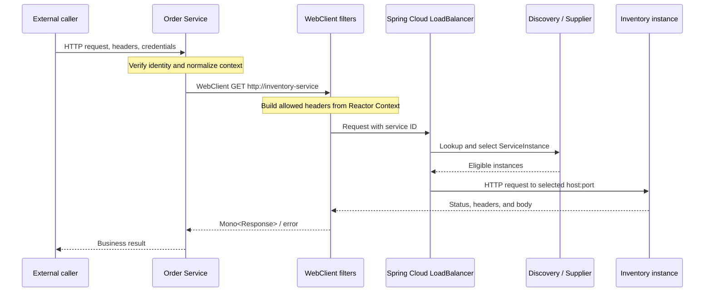

# Propagating Headers, Authentication Credentials, and Reactor Context

In a microservice system using Spring Cloud LoadBalancer, `order-service` can call `inventory-service` via `WebClient` and the service ID `http://inventory-service`. Beyond the HTTP method, URI, and body, the call often needs to carry details like `Accept`, `Authorization`, correlation/trace IDs, or a verified routing hint. With a reactive API, the challenge is not only **which headers to add**, but also **where data comes from, how it crosses trust boundaries, and how context stays intact when a Reactor chain switches execution threads**.

For example, a user sends a request containing `X-Correlation-ID` and a bearer token to `order-service`. Three independent questions arise:

1. Which headers should be forwarded to `inventory-service`, and which must be stripped?
2. Who issues the token permitted for `inventory-service`? Can the inbound token be reused, or must a token dedicated to the target service be obtained?
3. How can an asynchronous `ExchangeFilterFunction` read the correlation ID without relying on `ThreadLocal`?

This lesson belongs to the **WebClient** section of the Spring Cloud LoadBalancer module, connecting knowledge about `ServiceInstance` selection, discovery, zone/hint routing, health checks, and retry/timeout policies. The focus is on propagating **headers, authentication credentials, and Reactor Context** properly, safely, and observably.

## 1. Path of Headers Through WebClient and LoadBalancer

WebClient builds an HTTP request. When integrated with Spring Cloud LoadBalancer via `@LoadBalanced WebClient.Builder`, a URI using a service ID passes through the load-balancing filter, gets mapped to an actual `ServiceInstance`, and is sent by the HTTP connector.



The diagram shows logical steps; the actual execution order of `ExchangeFilterFunction`s, the LoadBalancer filter, and the connector depends on how the builder is configured. A custom filter may observe the logical URI or the resolved URI depending on its position. Do not assume a filter always runs before or after LoadBalancer solely from its name; inspect the actual filter chain during deployment.

**Three responsibilities that must not be conflated:**

| Layer | Responsibility |
|---|---|
| WebClient and filters | Builds requests, attaches headers, handles responses, errors, and HTTP call metadata. |
| Spring Cloud LoadBalancer | Given a service ID, retrieves `ServiceInstance` list, filters, and selects a target; does not decide who is allowed to use a token. |
| Spring Security / business policy | Verifies identity, grants permissions, selects credentials for the right audience, and protects data. |

Having `@LoadBalanced` select the right instance does not mean `Authorization` appears automatically, nor does it prove the outbound token has the right audience or permission scope.

## 2. Distinguishing Data Storage Mechanisms

In a reactive application, "context" can refer to several distinct mechanisms:

| Mechanism | Where Does It Live? | When to Use? |
|---|---|---|
| **HTTP headers** | Inside actual requests/responses sent over the network. | `Authorization`, `Accept`, `Content-Type`, `traceparent`, correlation IDs, etc. |
| **WebClient request attributes** | Data inside `ClientRequest`, existing only internally on the client side. | Passing metadata between WebClient filters; does not automatically become an HTTP header. |
| **Reactor Context** | Context attached to a **subscription**, readable by operators in a Reactor flow. | Carrying correlation IDs, per-request data, or metadata across reactive chains. |
| **Spring Security reactive context** | Security context integrated with Reactor when using Spring Security WebFlux. | Accessing `SecurityContext`/`Authentication` per subscription; does not automatically become outbound HTTP headers. |
| **ThreadLocal/MDC** | Bound to a specific thread. | Traditional logging; not automatically preserved across `publishOn`/`subscribeOn` or callbacks. |

**Reactor Context is not sent over the network.** It only carries data inside the reactive flow; for downstream services to see a correlation ID, an HTTP header must be created (or tracing instrumentation with propagation must be used). Conversely, receiving an HTTP header from a user does not automatically put a trusted value into Reactor Context.

Do not store access tokens, cookies, or personal data in Context unnecessarily: data in Context can be read by internal operators and filters. For authentication credentials, prefer Spring Security and OAuth2 integration over inventing a `token` Context key and copying it everywhere.

## 3. Creating a WebClient Using Spring Cloud LoadBalancer

Example in `order-service` (compatible Spring Boot and Spring Cloud versions):

```java
import org.springframework.cloud.client.loadbalancer.LoadBalanced;
import org.springframework.context.annotation.Bean;
import org.springframework.context.annotation.Configuration;
import org.springframework.web.reactive.function.client.WebClient;

@Configuration
class WebClientConfiguration {

    @Bean
    @LoadBalanced
    WebClient.Builder loadBalancedWebClientBuilder() {
        return WebClient.builder();
    }

    @Bean
    WebClient inventoryWebClient(
            @LoadBalanced WebClient.Builder builder) {

        return builder.clone()
            .baseUrl("http://inventory-service")
            .defaultHeader("Accept", "application/json")
            .build();
    }
}
```

When calling `inventoryWebClient.get().uri("/api/items/{id}", id)`, the host `inventory-service` is a **logical service ID**. Spring Cloud LoadBalancer requires the appropriate starter dependency and an instance source (discovery or static list); if no instance is found, the request can fail **before connecting upstream**.

`builder.clone()` creates a dedicated client without mutating the shared builder. A built WebClient is safe to reuse across many concurrent requests; do not create a new client per call. Socket timeouts, TLS, and connection pooling belong to `ClientHttpConnector`/HTTP transport, not `Reactor Context` or the instance selection algorithm.

Only WebClients built from a `@LoadBalanced`-integrated builder resolve service IDs through LoadBalancer in this way. A plain `WebClient.create()` with `http://inventory-service` may attempt DNS resolution instead.

## 4. Adding Headers Per Request

For headers that vary per request, use `header(...)` or `headers(...)`:

```java
Mono<ItemDto> findItem(WebClient inventoryWebClient, String id) {
    return inventoryWebClient.get()
        .uri("/api/items/{id}", id)
        .accept(MediaType.APPLICATION_JSON)
        .header("X-Caller-Service", "order-service")
        .retrieve()
        .bodyToMono(ItemDto.class);
}
```

`.accept(...)` is the typed way to set `Accept`; `.header(...)` is for custom headers. `ItemDto` is an application-defined DTO; non-essential imports are omitted in examples.

When you want to **overwrite rather than append** values:

```java
return inventoryWebClient.get()
    .uri("/api/items/{id}", id)
    .headers(headers -> {
        headers.set("X-Caller-Service", "order-service");
        headers.setAccept(List.of(MediaType.APPLICATION_JSON));
    })
    .retrieve()
    .bodyToMono(ItemDto.class);
```

Distinctions:

- `header(name, value...)` usually **appends** header values on the request; depending on the header, multiple values may be invalid.
- `headers(h -> h.set(name, value))` replaces that header's current value.
- `defaultHeader(...)` on the builder provides **default values** only if the request has not already set the corresponding header.
- `defaultHeaders(...)` on the builder lets you manipulate the set of default headers.

Never use `defaultHeader("Authorization", token)` with a token taken from a current request on a **shared WebClient bean**: tokens could leak across users or expire. Per-request credentials must be retrieved and attached inside the per-request flow or managed by OAuth2 integration.

## 5. Filters: Injecting Shared Headers and Pre-Send Processing

`ExchangeFilterFunction` can inspect or modify requests and responses for all calls going through a WebClient. Example adding the calling service name without depending on user requests:

```java
ExchangeFilterFunction callerNameFilter = (request, next) -> {
    ClientRequest enriched = ClientRequest.from(request)
        .header("X-Caller-Service", "order-service")
        .build();
    return next.exchange(enriched);
};

WebClient inventoryWebClient = builder.clone()
    .baseUrl("http://inventory-service")
    .filter(callerNameFilter)
    .build();
```

For headers that must **have only a single value**, use `.headers(h -> h.set(...))` instead of `.header(...)` inside the `ClientRequest` builder. Filters should handle data immutably rather than mutating the original request:

```java
ClientRequest enriched = ClientRequest.from(request)
    .headers(headers -> headers.set(
        "X-Caller-Service", "order-service"))
    .build();
```

A filter should never dump the entire `request.headers()` into logs: it may contain `Authorization`, cookies, or service tokens. If logging is required, log only allowlisted fields, redact sensitive values, and avoid placing arbitrary data into metric tags.

## 6. Reactor Context: Per-Subscription Context, Not Per-Thread

In Reactor, `Context` is an **immutable-by-use** key/value store carried along with a subscription. `contextWrite(...)` creates a new context visible to the *upstream* part of the chain; `Mono.deferContextual(...)` reads `ContextView` at **subscription time**, not when the pipeline is assembled.

Small example:

```java
Mono<String> value = Mono.deferContextual(context -> {
    String correlationId =
        context.getOrDefault("correlationId", "missing");
    return Mono.just(correlationId);
});

Mono<String> withContext = value
    .contextWrite(context -> context.put(
        "correlationId", "c74a1e63-3f14-4d45-a7a6-17f9fd2471d0"));
```

When subscribing to `withContext`, `deferContextual` sees `correlationId`. Even across scheduler switches in Reactor-compatible operators, Context stays with the subscription flow; it is not tied to any fixed Java thread.

### Easy-to-Misunderstand Propagation Direction of Context

Context from `contextWrite` flows **from downstream to upstream during subscription**. Therefore, place `contextWrite(...)` around/after the call that needs the Context, after pipeline assembly:

```java
return inventoryGateway.findItem(id)
    .contextWrite(context -> context.put(
        "correlationId", verifiedId));
```

If `contextWrite` is called on an unrelated branch that does not wrap the WebClient subscription, the filter will not see the value. Similarly, putting data in a `ThreadLocal` before `publishOn(...)` does not guarantee that a filter running on the new thread will read it.

**Do not confuse Reactor Context with WebClient request attributes:** `.attribute("key", value)` on a request creates metadata for WebClient filters, not entries in `ContextView`; read attributes with `ClientRequest.attribute(...)` or equivalent APIs. Context and attributes have distinct lifecycles and scopes.

## 7. Moving Correlation ID from Reactor Context to Outbound Headers

A clean approach is having an `ExchangeFilterFunction` read Reactor Context **at subscription time**, then build a new `ClientRequest`. Illustrative code using Java 17 and corresponding WebClient/Reactor APIs:

```java
import org.springframework.web.reactive.function.client.ClientRequest;
import org.springframework.web.reactive.function.client.ExchangeFilterFunction;
import reactor.core.publisher.Mono;

final class CorrelationFilter {

    static final String CONTEXT_KEY = "correlationId";
    static final String HEADER_NAME = "X-Correlation-ID";

    private CorrelationFilter() {
    }

    static ExchangeFilterFunction fromReactorContext() {
        return ExchangeFilterFunction.ofRequestProcessor(request ->
            Mono.deferContextual(context -> {
                String id = context.getOrDefault(CONTEXT_KEY, "");

                ClientRequest.Builder updated =
                    ClientRequest.from(request);

                if (!id.isBlank()) {
                    updated.headers(headers ->
                        headers.set(HEADER_NAME, id));
                }

                return Mono.just(updated.build());
            })
        );
    }
}
```

Attach the filter to the LoadBalancer-enabled client:

```java
@Bean
WebClient inventoryWebClient(
        @LoadBalanced WebClient.Builder builder) {

    return builder.clone()
        .baseUrl("http://inventory-service")
        .filter(CorrelationFilter.fromReactorContext())
        .build();
}
```

Use it in the gateway:

```java
@Service
class InventoryGateway {
    private final WebClient inventoryWebClient;

    InventoryGateway(WebClient inventoryWebClient) {
        this.inventoryWebClient = inventoryWebClient;
    }

    Mono<ItemDto> findItem(String id) {
        return inventoryWebClient.get()
            .uri("/api/items/{id}", id)
            .retrieve()
            .bodyToMono(ItemDto.class);
    }
}
```

Example in a WebFlux controller that only accepts a valid UUID as correlation ID; if the request provides none or provides an invalid value, it generates a new UUID:

```java
@RestController
@RequestMapping("/orders")
class OrderController {

    private final InventoryGateway inventoryGateway;

    OrderController(InventoryGateway inventoryGateway) {
        this.inventoryGateway = inventoryGateway;
    }

    @GetMapping("/preview/{itemId}")
    Mono<ItemDto> preview(
            @PathVariable String itemId,
            @RequestHeader(
                name = "X-Correlation-ID",
                required = false) String incomingId) {

        String correlationId = normalize(incomingId);
        return inventoryGateway.findItem(itemId)
            .contextWrite(context -> context.put(
                CorrelationFilter.CONTEXT_KEY, correlationId));
    }

    private String normalize(String incomingId) {
        if (incomingId != null) {
            try {
                return UUID.fromString(incomingId).toString();
            } catch (IllegalArgumentException ignored) {
                // Do not trust or blindly copy an invalid header.
            }
        }
        return UUID.randomUUID().toString();
    }
}
```

This is a learning example; `UUID` is imported from `java.util.UUID` along with the corresponding DTO/annotation imports. **Correlation IDs are for correlating logs, not for authentication or authorization.** Applications may choose a different ID convention, but must validate length/format and prevent log injection. In production, prefer integrating Micrometer Tracing and W3C `traceparent`/`tracestate` when a distributed tracing system exists; avoid writing filters that duplicate instrumentation.

### What If Context Does Not Contain the Key?

The filter uses `getOrDefault(..., "")`. When the key is absent, it sends the request without `X-Correlation-ID` from this filter; **it does not invent a correlation ID inside the filter**. That keeps ID generation ownership clearly at ingress. If the contract requires an ID to always exist, handle missing values early in the caller rather than silently fabricating context at multiple layers.

## 8. Authentication Credentials: Never Blindly Forward Authorization

`Authorization: Bearer ...` is a security-sensitive credential, completely different from `X-Correlation-ID`. A user may hold a valid access token to call `order-service` that is **not permitted for `inventory-service`**, because tokens have specific audiences, scopes, or authentication policies.

Common patterns:

| Scenario | Appropriate Approach |
|---|---|
| Caller invokes downstream on behalf of the service itself | Issue a **service-to-service** token using OAuth2 client credentials or an appropriate workload identity mechanism. |
| Need to propagate user identity downstream | Use token exchange/delegation/on-behalf-of if supported by infrastructure, with audience/scope matching the receiving service. |
| Same token is legitimately issued for downstream and policy permits relay | Forward only after verifying audience, scope, trust boundary, and security contract. |
| Need correlation/tracing | Never use access tokens in place of trace IDs; use dedicated tracing headers. |

**Do not do the following:**

```java
// DO NOT: blindly copy all user headers to upstream.
// outboundHeaders.addAll(incomingRequest.getHeaders());
```

Such copying can accidentally leak tokens, cookies, `Host`, `X-Forwarded-*`, or untrusted routing hints to another service. It can expose credentials, cause tenant confusion, or bypass routing policies; even inside an internal network, caller-supplied headers are not inherently trustworthy.

### Acquiring a Downstream Token via OAuth2 Client Credentials

In a WebFlux application using Spring Security OAuth2 Client, `ReactiveOAuth2AuthorizedClientManager` can retrieve/refresh an authorized client for a preconfigured `inventory-client` registration. Illustrative gateway method:

```java
private final ReactiveOAuth2AuthorizedClientManager manager;
private final WebClient inventoryWebClient;

Mono<ItemDto> findWithServiceToken(String itemId) {
    OAuth2AuthorizeRequest authRequest =
        OAuth2AuthorizeRequest
            .withClientRegistrationId("inventory-client")
            .principal("order-service")
            .build();

    return manager.authorize(authRequest)
        .switchIfEmpty(Mono.error(
            new IllegalStateException("Cannot authorize inventory client")))
        .flatMap(authorizedClient ->
            inventoryWebClient.get()
                .uri("/api/items/{id}", itemId)
                .headers(headers -> headers.setBearerAuth(
                    authorizedClient.getAccessToken().getTokenValue()))
                .retrieve()
                .bodyToMono(ItemDto.class)
        );
}
```

For this example to run, the application must have the Spring Security OAuth2 Client dependency, a valid registration/provider, and a `ReactiveOAuth2AuthorizedClientManager` bean properly configured for the grant type and runtime environment (it is not automatically present in every application). The example uses a principal representing the application for client credentials, **not impersonating a user identity**. The token must carry an audience and permissions suitable for `inventory-service`; `inventory-service` must still authenticate and authorize on the receiving side.

`ServerOAuth2AuthorizedClientExchangeFilterFunction` is another mechanism integrating Spring Security OAuth2 with `WebClient` in reactive environments: the filter can obtain an authorized client and attach the token once registration/authorized client manager settings are properly configured. Using this integration is usually cleaner than manually reading tokens from request headers and placing them into Reactor Context. Do not enable default token propagation to every downstream target without strictly controlling target endpoints.

### Security Context in WebFlux

When using Spring Security WebFlux, security info can be read inside a reactive chain via `ReactiveSecurityContextHolder.getContext()`:

```java
Mono<String> currentPrincipalName() {
    return ReactiveSecurityContextHolder.getContext()
        .map(context -> context.getAuthentication())
        .filter(authentication -> authentication != null)
        .map(Authentication::getName);
}
```

This snippet only illustrates **reading the principal name**; it does not grant authorization automatically or turn the principal into an outbound access token. In production, authorization checks must rely on Spring Security and resource policies—not merely on `getName()` or a client-declared header.

## 9. Routing Headers and ServiceInstance: Control Trusted Sources

Spring Cloud LoadBalancer can use zones, metadata, or hints to adjust the instance list. However, **attaching a header like `X-Preferred-Zone` to WebClient does not automatically cause LoadBalancer to switch algorithms or pick that zone**: it requires corresponding suppliers, filters, and request-context propagation depending on the Spring Cloud version.

If routing policies read information from requests, distinguish:

- **Client preference:** caller suggestion that can be ignored.
- **Verified routing context:** value computed by the gateway/internal caller from verified identity and server-side policy.
- **Hard constraint:** allowed tenant/region. If no eligible instance exists, it must not silently fall back to a prohibited region.

For example, a user sends `X-Preferred-Zone: zone-b`, while the tenant's policy allows only `zone-a`. Even if a WebClient filter reads that header, the caller **must not pass raw user-supplied values as a hard routing policy**. Keep verified routing context separate from correlation IDs and access tokens. LoadBalancer selects instances, while authorization must be enforced independently downstream.

## 10. HTTP Headers and Reactor Context During Retries or Scheduler Switches

With WebClient, a `retrieve().bodyToMono(...)` chain usually performs the HTTP call only upon subscription. When using `retryWhen(...)`, Reactor can **re-subscribe to the source**, causing requests and filters to execute again. When that happens:

- Correlation ID from Context usually remains the value tied to the same logical request.
- Tokens may need to be re-fetched/refreshed via the authorized client manager if expired; never hardcode tokens in a shared client.
- Retries can lead to a **new instance selection** when the call re-enters the LoadBalancer filter, though switching instances is not guaranteed; it depends on integration and retry configuration.
- One business request can generate multiple HTTP attempts, increasing load; bound retries and total duration.
- A `POST` may already have been processed by the server before the client timed out. Do not retry non-idempotent operations without duplicate-prevention mechanisms.

Example of bounded transient-error handling for `GET`:

```java
return inventoryWebClient.get()
    .uri("/api/items/{id}", id)
    .retrieve()
    .bodyToMono(ItemDto.class)
    .retryWhen(Retry.backoff(2, Duration.ofMillis(150))
        .filter(this::isTransientFailure));
```

`isTransientFailure(Throwable)` in the example is a predicate **that the application must implement**, selecting only retryable error types. Do not retry every exception, especially never turning `401`/`403` into a retry loop. Total deadlines should cover the initial request, retries, and backoff; Reactor Netty connect/response timeouts only bound those respective phases, not automatically the entire deadline.

### Reactor Context Differs from MDC and ThreadLocal

In a reactive chain, `publishOn` and `subscribeOn` can cause code to run on different threads. Reactor Context stays attached to the subscription, whereas MDC/`ThreadLocal` is not automatically safe across asynchronous boundaries. To preserve trace IDs in logs, use context propagation/instrumentation suited to your Reactor and Micrometer versions instead of assuming `MDC.put(...)` in a controller will survive every filter.

**Do not call `block()` on a Reactor Netty event-loop thread.** Doing so can cause errors or stall processing. If unavoidable blocking code exists, isolate it on an appropriate scheduler and architecture while still bounding deadlines and saturation.

## 11. Logging and Tracing Without Exposing Sensitive Data

When `inventory-service` fails, you need to correlate the user request with HTTP attempts and selected instances. Yet logs and metrics are also easy places to leak information.

| Should Observe | Should Not Log Verbatim |
|---|---|
| Normalized `traceId`/`correlationId` | `Authorization` or refresh/access tokens. |
| Logical service ID, HTTP method, route template | Session cookies, API keys, and personal data. |
| HTTP status, exception type, failure stage | URLs with tokens in query strings or sensitive payloads. |
| Retry attempt and total latency | Arbitrary caller-supplied headers as metric labels. |
| LoadBalancer selection result, if permitted | Overly detailed instance/topology identities returned to external clients. |
| p50/p95/p99 latency and timeouts | Unbounded-length/high-cardinality correlation IDs as metric tags. |

Distinguish errors from **no `ServiceInstance`**, **connection failure after selection**, and **HTTP status returned from upstream**. A `503` at the caller can be generated when no instances exist or returned by upstream itself; final status alone is not enough to conclude which.

When Micrometer Observation/Tracing is available, prefer standard instrumentation to propagate trace context and record metrics rather than manually injecting/parsing all trace headers. Any hand-written filter for a custom correlation ID must stay consistent with tracing, without stripping valid `traceparent`/`tracestate` headers or stuffing tokens into baggage.

## 12. Practice: Testing Headers and Context Across Two Replicas

Set up `inventory-service` with two instances A/B under the same service ID, each exposing `GET /api/debug/headers` in a **test environment**. The endpoint should return only observable safe fields: instance ID, validated correlation ID, caller name; **never return tokens, cookies, or credentials**.

Suggested exercises:

1. **Fixed header:** create a `@LoadBalanced WebClient.Builder` and call `http://inventory-service/api/debug/headers` with `X-Caller-Service: order-service`. Verify both instances receive the header when selected.
2. **Per-request headers:** test `header(...)` and `headers(h -> h.set(...))`; check the difference when a header already exists and when multiple values are added.
3. **Reactor Context:** set `correlationId` via `contextWrite(...)` on the reactive call, using a `Mono.deferContextual(...)` filter to create the outbound header. Make concurrent calls with two different UUIDs and confirm subscriptions do not cross-contaminate.
4. **Missing Context:** omit `contextWrite(...)`; observe that the filter does not invent arbitrary headers and the gateway handles missing correlation IDs per contract.
5. **Scheduler switch:** apply `publishOn(Schedulers.parallel())` on an appropriate pipeline segment; confirm Reactor Context remains readable without assuming MDC propagates automatically.
6. **Valid token:** configure a test OAuth2 client registration, obtain an inventory-specific token, and confirm upstream enforces authorization. Send a token lacking audience/scope to verify rejection.
7. **No blind relay:** send `Cookie` and a forged routing header on the inbound HTTP request; verify outbound requests only contain allowlisted headers.
8. **Retry/timeout:** make one instance respond slowly to `GET` with bounded retries; correlate logical requests, HTTP attempts, correlation IDs, selected instances, and total duration.

Credential tests must use a test identity provider and test tokens—never store real tokens in code or logs. Never deploy header-debugging endpoints to public environments.

## 13. Pre-Production Checklist for WebClient

- Use `@LoadBalanced WebClient.Builder`, Spring Cloud LoadBalancer dependencies, and a `ServiceInstance` source for service IDs.
- Use `defaultHeader` for stable values; use `headers(h -> ...)` or filters for per-request values.
- Never store user tokens in singleton `WebClient`/builder instances or static fields.
- Distinguish HTTP headers, `ClientRequest` attributes, Reactor Context, and Spring Security reactive context.
- Put only verified and necessary data into Reactor Context; never use it as an authorization mechanism.
- Read Context with `Mono.deferContextual(...)` inside the subscribed chain; wrap the upstream needing it with `contextWrite(...)`.
- Verify service-to-service or delegated tokens carry valid audience/scope for upstream; never copy raw `Authorization` or cookies from external requests.
- Never trust client-supplied routing hints/zones; hard region/tenant isolation must rely on server-side policies, including during retries/failover.
- Separate instance-selection failures, transport timeouts, and HTTP errors; do not assume `@LoadBalanced` handles authorization, retries, or overall deadlines.
- Retry only appropriate error types and idempotent operations, with backoff/deadlines; never duplicate unsafe `POST` operations.
- Prefer Micrometer Tracing for distributed tracing; log via allowlists without leaking tokens, cookies, or sensitive headers.
- Test concurrent subscriptions, context propagation across schedulers, health/discovery updates, and instance selection results.

**Key takeaway:** HTTP headers are data **sent over the network**; Reactor Context is data **carried with an internal subscription**, not automatically transmitted to other services. `ExchangeFilterFunction` can bridge the two by reading Context at subscribe time and setting headers on `ClientRequest`. Authentication credentials must be issued and forwarded according to **security policies**, never blindly copied from user requests. Spring Cloud LoadBalancer selects a `ServiceInstance` from a service ID; it does not validate tokens, propagate Reactor Context automatically, or replace WebClient and upstream timeouts, retries, or authorization.
