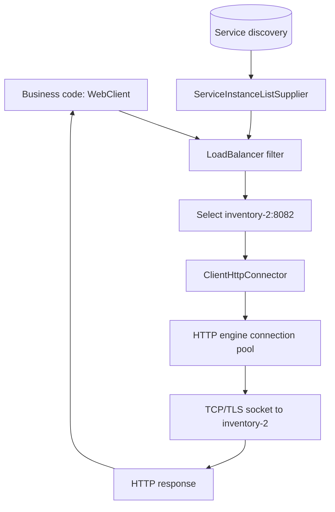
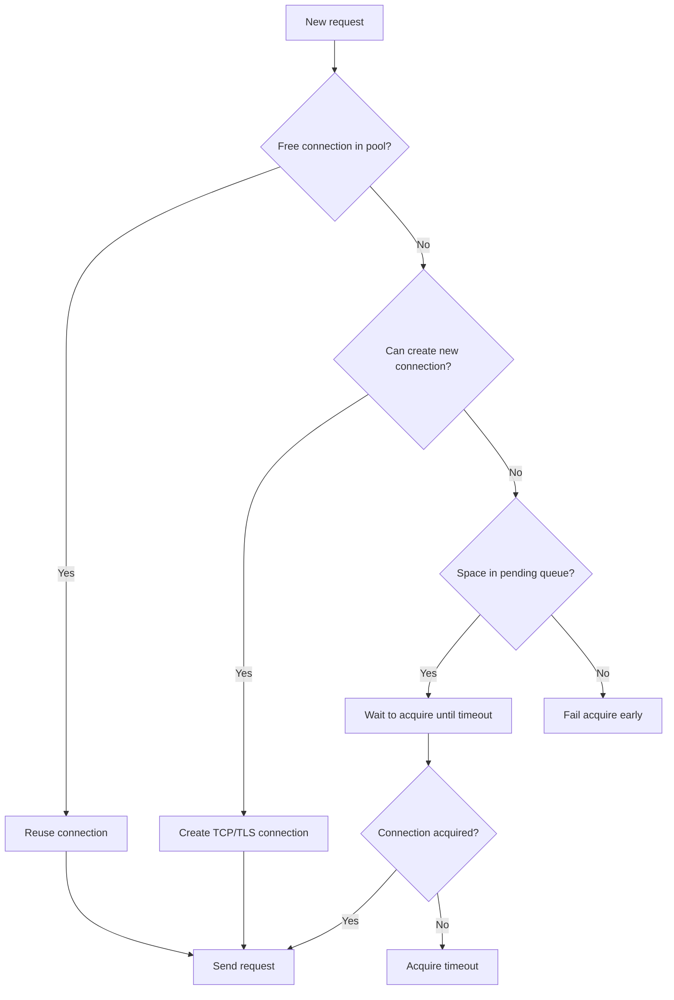

# Selecting an HTTP Connector and Configuring the Connection Pool

In Spring Cloud LoadBalancer, `WebClient` can call a logical URL such as `http://inventory-service/api/products/P-1001`, look up a discovered `ServiceInstance`, and send the request to the corresponding host and port. However, **instance selection is not the same as TCP connection management**. To handle high traffic reliably, WebClient also needs a suitable HTTP connector and connection policy.

A typical scenario: `order-service` uses `@LoadBalanced WebClient.Builder`, discovery returns three instances of `inventory-service`, and round robin alternates among them. Under higher load, the caller encounters `PoolAcquireTimeoutException` or a sharp spike in connection wait times. At that point, changing the load-balancing algorithm will likely not fix the problem: the bottleneck may lie in the **HTTP transport's connection pool** or the level of concurrency generated by the application.

This lesson belongs to the **WebClient** chapter of the Spring Cloud LoadBalancer module, focusing on choosing an HTTP connector, designing a connection pool, bounding timeouts and concurrency, and verifying how the pool interacts with the `ServiceInstance` list.

## 1. Four Layers in a Request's Path

WebClient is an asynchronous, reactive HTTP calling API. In a load-balanced call, there are at least four distinct concerns:

1. **Application layer:** builds the request, chooses method/path/headers, and processes the `Mono` or `Flux` result.
2. **Load-balancing layer:** resolves the service ID via `ReactorLoadBalancerExchangeFilterFunction` or the equivalent mechanism configured on `WebClient.Builder`, then selects a `ServiceInstance`.
3. **HTTP connector:** translates the WebClient request into an actual HTTP call using a specific HTTP client engine.
4. **Connection pool/transport:** reuses or opens TCP connections, manages pending acquisition waits, timeouts, and potentially TLS.



**Separation of responsibilities:** Spring Cloud LoadBalancer picks the instance; the HTTP connector handles connecting to the chosen instance. Having `@LoadBalanced WebClient.Builder` does not mean LoadBalancer automatically configures `maxConnections`, `pendingAcquireTimeout`, or socket lifecycles.

## 2. Common HTTP Connector Options

Spring WebFlux defines the `ClientHttpConnector` interface so WebClient can run on different HTTP engines. Available options depend on Spring Framework, Spring Boot, and dependencies:

| Connector | HTTP Engine | When to Consider | Things to Watch |
|---|---|---|---|
| `ReactorClientHttpConnector` | Reactor Netty `HttpClient` | Popular choice for WebFlux apps needing async I/O performance and explicit pool tuning. | Pool managed by Reactor Netty `ConnectionProvider`. |
| `JdkClientHttpConnector` | JDK `java.net.http.HttpClient` | Prefer using the JDK's built-in HTTP client with fewer extra dependencies. | Connection management and pool knobs differ from Reactor Netty; does not use `ConnectionProvider` API. |
| `JettyClientHttpConnector` | Jetty reactive HTTP client | Project standardizes on Jetty or needs its transport features. | Requires matching Jetty client dependencies and explicit client lifecycle management. |
| `HttpComponentsClientHttpConnector` | Apache HttpComponents async client | Project needs compatibility/features of Apache HttpClient 5 async. | Requires corresponding artifacts and separate connection manager configuration. |

Do not pick a connector solely by library reputation. Evaluate your Spring version, HTTP/1.1 vs. HTTP/2 protocols, TLS, proxies, network conditions, observability, pool tunability, and resource shutdown behavior.

In standard Spring Boot WebFlux setups with `spring-boot-starter-webflux` and Reactor Netty on the classpath, **Reactor Netty is typically the default choice**. Even so, the actual HTTP engine Boot picks depends on classpath and configuration. Inspect the resulting `ClientHttpConnector`/`WebClient.Builder` bean rather than assuming every WebClient application runs on Reactor Netty.

## 3. Required Dependencies

Simple Maven example with Spring Boot WebFlux and Spring Cloud LoadBalancer:

```xml
<dependencies>
    <dependency>
        <groupId>org.springframework.boot</groupId>
        <artifactId>spring-boot-starter-webflux</artifactId>
    </dependency>
    <dependency>
        <groupId>org.springframework.cloud</groupId>
        <artifactId>spring-cloud-starter-loadbalancer</artifactId>
    </dependency>
</dependencies>
```

Use **compatible** Spring Boot and Spring Cloud release trains, managing versions via Boot's BOM/parent and the Spring Cloud BOM. Do not arbitrarily override individual versions of `reactor-netty-http`, `spring-webflux`, or `spring-cloud-loadbalancer` outside the compatible dependency set.

`spring-boot-starter-webflux` brings WebClient and usually Reactor Netty; `spring-cloud-starter-loadbalancer` adds instance selection. To call by service ID in production, you also need a discovery provider or another `ServiceInstance` source. In learning environments, `SimpleDiscoveryClient` can be used.

## 4. How Does the Pool Behave When WebClient Picks Multiple Instances?

For HTTP/1.1 keep-alive, a connection can be reused across multiple **sequential** requests to the same remote endpoint. Under concurrent demand, the client opens additional connections up to pool limits; requests exceeding available connections can queue waiting for a connection lease.

Reactor Netty `ConnectionProvider` manages pools per **target address/remote endpoint** and related configuration. Thus:

```text
order-service
  |
  +-- LoadBalancer -> inventory-1:8081 -> pool for remote 1
  |
  +-- LoadBalancer -> inventory-2:8082 -> pool for remote 2
  |
  +-- LoadBalancer -> inventory-3:8083 -> pool for remote 3
```

A setting like `maxConnections(100)` operates as a limit **per remote-address pool** in Reactor Netty; do not assume it caps total sockets at 100 across **all three instances combined**. With multiple instances, multiple protocols/endpoints, or separate `ConnectionProvider` instances, total potential sockets are higher.

**Important consequence:** round robin distributes selection turns, while pools maintain connections keyed by the actual selected instance address. When a new instance appears, its pool is initially cold; when an old instance leaves, pools may still hold idle connections to the old address until closed or evicted. These are two separate lifecycles.

### Relationship with HTTP/2

HTTP/2 can multiplex multiple streams over a single connection. Concurrent HTTP request count no longer maps simply 1-to-1 with TCP sockets as in HTTP/1.1. With HTTP/2, you must consider engine/server protocol support, max concurrent streams, and HTTP/2-specific pool settings. Do not apply a "one concurrent request equals one connection" rule blindly across protocols.

## 5. Key Pool Parameters in Reactor Netty

| Parameter | Meaning | If Misconfigured |
|---|---|---|
| `maxConnections` | Maximum connections for a remote pool per provider policy. | Too low: requests queue; too high: sockets/file descriptors and backend resource usage grow. |
| `pendingAcquireMaxCount` | Limit on requests waiting to acquire a connection. | Too low: early rejections during bursts; too high: deep backlogs, rising latency and memory. |
| `pendingAcquireTimeout` | Maximum time to wait for a connection from the pool. | Too short: errors under peak load; too long: requests "hang" before connecting. |
| `maxIdleTime` | Duration a connection may stay idle before being considered unfit for reuse. | Idle too long: may hit connections already closed by proxy/server. |
| `maxLifeTime` | Maximum total lifetime of a connection, even if active. | Too short: extra connects/handshakes; too long: holds stale connections unnecessarily. |
| `evictInBackground` | Background eviction interval if supported and enabled. | Slow eviction can retain many idle connections for extended periods. |

These are **Reactor Netty** parameters, not generic Spring Cloud LoadBalancer properties shared across all connectors. Switching to JDK, Jetty, or Apache requires configuring the respective HTTP engine's pool/connection manager API.

Default values depend on the Reactor Netty version and environment. Do not copy an old value assuming it is the guaranteed default across all release trains.

## 6. Example Configuring `@LoadBalanced` WebClient with Reactor Netty

The following example shows how to control pooling and timeouts for an HTTP client calling `inventory-service`. It assumes a compatible Spring Boot/WebFlux and Spring Cloud combination capable of processing `@LoadBalanced WebClient.Builder`.

### 6.1. Configuring a Lifecycle-Managed `ConnectionProvider`

```java
import java.time.Duration;
import io.netty.channel.ChannelOption;
import org.springframework.cloud.client.loadbalancer.LoadBalanced;
import org.springframework.context.annotation.Bean;
import org.springframework.context.annotation.Configuration;
import org.springframework.http.client.reactive.ReactorClientHttpConnector;
import org.springframework.web.reactive.function.client.WebClient;
import reactor.netty.http.client.HttpClient;
import reactor.netty.resources.ConnectionProvider;

@Configuration(proxyBeanMethods = false)
class InventoryWebClientConfiguration {

    @Bean(destroyMethod = "dispose")
    ConnectionProvider inventoryConnectionProvider() {
        return ConnectionProvider.builder("inventory-http-pool")
                .maxConnections(100)
                .pendingAcquireMaxCount(200)
                .pendingAcquireTimeout(Duration.ofMillis(500))
                .maxIdleTime(Duration.ofSeconds(20))
                .maxLifeTime(Duration.ofMinutes(5))
                .evictInBackground(Duration.ofSeconds(30))
                .build();
    }

    @Bean
    @LoadBalanced
    WebClient.Builder inventoryLoadBalancedBuilder(
            ConnectionProvider inventoryConnectionProvider) {

        HttpClient httpClient = HttpClient
                .create(inventoryConnectionProvider)
                .option(ChannelOption.CONNECT_TIMEOUT_MILLIS, 2_000)
                .responseTimeout(Duration.ofSeconds(5));

        return WebClient.builder()
                .clientConnector(new ReactorClientHttpConnector(httpClient));
    }

    @Bean
    WebClient inventoryWebClient(
            @LoadBalanced WebClient.Builder inventoryLoadBalancedBuilder) {
        return inventoryLoadBalancedBuilder
                .baseUrl("http://inventory-service")
                .build();
    }
}
```

`destroyMethod = "dispose"` ensures the `ConnectionProvider` bean **created and owned by this configuration** is released when the Spring context closes. If using application-wide Reactor Netty resources managed by Spring Boot, **do not manually dispose shared library pools/global resources** inside a single service; align on lifecycle ownership.

The values 100 / 200 / 500 ms / 20 s / 5 min above are **illustrative figures**, not standard production defaults. After measuring real load and resources, tune them to backend capacity and response times. Changing the pool without bounding caller concurrency may simply shift the bottleneck to another layer.

### 6.2. Gateway Using a Service ID

```java
import org.springframework.stereotype.Service;
import org.springframework.web.reactive.function.client.WebClient;
import reactor.core.publisher.Mono;

@Service
class InventoryGateway {

    private final WebClient inventoryWebClient;

    InventoryGateway(WebClient inventoryWebClient) {
        this.inventoryWebClient = inventoryWebClient;
    }

    Mono<ProductView> findProduct(String productId) {
        return inventoryWebClient.get()
                .uri("/api/products/{id}", productId)
                .retrieve()
                .bodyToMono(ProductView.class);
    }
}
```

`ProductView` is the example application's DTO. The call returns `Mono<ProductView>`; HTTP executes when the chain is subscribed to. `WebClient` does not automatically send a request merely because a `Mono` object was created.

### 6.3. Configuring the Instance List in the Lab

```yaml
spring:
  cloud:
    discovery:
      client:
        simple:
          instances:
            inventory-service:
              - uri: http://localhost:8081
              - uri: http://localhost:8082
```

Both backends must be running and expose `/api/products/{id}`. Declaring static URIs isolates connection pool issues from registry issues in the lab, **but it does not simulate automatic instance registration/deregistration** unless the data source is updated accordingly.

### 6.4. Note on Spring Boot-Customized Builders

The `WebClient.builder()` snippet above intentionally emphasizes the connector and pool. In production applications, Spring Boot can apply `WebClientCustomizer`s, observation, codecs, SSL, or other HTTP configurations to its managed builder. A manually constructed `WebClient.builder()` does not automatically inherit all those customizations.

When integrating into a real project, consider using customizers/configurers or resource factories compatible with your **running Boot version**, then inspect the final `@LoadBalanced` builder. Two requirements must both hold: **correct instance selection** and **properly configured HTTP connector/observability/SSL**.

## 7. Four Distinct Timeout Layers

A request can wait at multiple stages:


| Timeout | Controlled Stage | Reactor Netty Example |
|---|---|---|
| **Pending acquire timeout** | Waiting for a free connection or slot to create a new connection in the pool. | `pendingAcquireTimeout(...)` |
| **Connect timeout** | Establishing TCP to a new remote endpoint. | `ChannelOption.CONNECT_TIMEOUT_MILLIS` |
| **Response timeout** | Time/latency waiting for response activity per Reactor Netty semantics. | `HttpClient.responseTimeout(...)` |
| **Overall deadline** | Total limit for the logical operation, potentially covering pool acquire, connect, response, and retries. | Reactor `timeout(...)` operator can be applied at the business level. |

**Do not equate response timeout with overall deadline.** A 5-second response limit does not mean total time spent waiting on pool acquire, DNS, TLS, retries, and body streaming will always stay under 5 seconds. For streaming responses, total stream duration needs its own timeout policy.

Example limiting total duration of one call:

```java
Mono<ProductView> result = inventoryWebClient.get()
        .uri("/api/products/{id}", productId)
        .retrieve()
        .bodyToMono(ProductView.class)
        .timeout(Duration.ofSeconds(8));
```

The `timeout` operator bounds the subscribed publisher. If retries or multiple downstream calls exist, design an **overall deadline** at the orchestration layer rather than granting each attempt an unbounded fresh budget.

## 8. When the Pool Is Full: Queue, Timeout, or Fail Fast

Suppose a remote instance is using all 100 HTTP/1.1 connections and the caller continues generating requests. New requests can queue in pending acquisition per `ConnectionProvider` policy.



Maximum connections and concurrent requests are **not the same**: an application can create more than 100 concurrently subscribed `Mono`s; the pool only caps connection resources. If the pending queue is large, users can experience steep latency increases before the client reports errors. Setting `pendingAcquireMaxCount` very high can mask overload and accumulate deep queues.

Tune in parallel:

- **Client concurrency:** limit how many concurrent requests are initiated toward the same downstream.
- **Connection pool size:** sufficient for normal concurrency plus reasonable headroom.
- **Pending queue:** bounded; paired with appropriate fail-fast or backpressure policies.
- **Backend capacity:** worker threads, DB pools, CPU, and real serving capacity of instances.

When all instances are saturated, merely enlarging the caller's pool can overload the backend faster.

## 9. Estimating Concurrency Before Choosing Pool Size

For a system in a relatively steady state, **Little's Law** provides useful intuition:

```text
Average in-flight requests ≈ arrival rate (requests/s) × average duration (s)
```

For example, a caller sees 120 requests/second and each request averages 300 ms:

```text
120 requests/s × 0.3 s ≈ 36 concurrent requests (entire flow)
```

With three instances under roughly even load, average concurrent requests per instance may be around 12, but that is **not the peak ceiling**. Tail latency, bursts, retries, connection handshakes, and selection algorithms can push a single remote pool much higher. When sizing, measure p95/p99, peak concurrency, and response sizes.

With HTTP/2, also account for multiplexed streams rather than assuming one request equals one TCP connection. This is only a principled way to **start measuring**, not a direct formula for picking `maxConnections`.

## 10. Limiting Concurrency at the Reactive Layer

`WebClient` makes issuing many requests easy, yet "non-blocking" does not mean "zero resource cost." Example processing a batch of IDs with bounded concurrency:

```java
Flux<ProductView> products = Flux.fromIterable(productIds)
        .flatMap(
                productId -> inventoryWebClient.get()
                        .uri("/api/products/{id}", productId)
                        .retrieve()
                        .bodyToMono(ProductView.class),
                32
        );
```

`32` is an illustrative concurrency cap. It limits how many inner publishers `flatMap` subscribes to concurrently in this pipeline; other pipelines or caller replicas can still issue additional requests. Without bounds, multiple code paths firing requests concurrently can far exceed both pool and backend capacity.

Never call `.block()` on a Reactor Netty event-loop thread. Misplaced blocking ties up event loops and slows down clients/servers even when the connection pool still has capacity. When blocking code must be integrated, use an appropriate scheduler and bound task counts; keeping the entire chain reactive is preferable whenever possible.

## 11. Connection Reuse, Idle Timeouts, and Server Keep-Alive

An idle connection in the pool can be closed by the server, reverse proxy, service mesh, or infrastructure load balancer due to their own timeouts. If the client tries to reuse it, requests can fail with errors like connection reset or premature close.

The fix is not simply raising `maxConnections`. You should:

1. Identify idle timeouts across the **server**, proxy/ingress, and HTTP client.
2. Set `maxIdleTime` conservatively relative to network-path timeouts.
3. Use background eviction where appropriate to prune aging connections.
4. Monitor closed/reset connections and newly opened connection rates.
5. Ensure backends drain connections during shutdown rather than abruptly severing active sockets.

Capping `maxLifeTime` rotates connections periodically, though setting it too short increases TLS handshakes and TCP setup overhead. Conversely, overly long keep-alive does not guarantee connections remain alive when instances leave the registry.

## 12. Discovery, Health Checks, and Pools Are Three Independent Lifecycles

Spring Cloud LoadBalancer can obtain instance lists from discovery and cache, while filtering via health checks. Reactor Netty manages connection pools to previously selected remote endpoints. These layers **do not stay strictly synchronized automatically**.

For example, when `inventory-2` shuts down:

| Event / Stage | Discovery and Supplier | Connection Pool |
|---|---|---|
| Instance healthy and active | List contains `inventory-2`. | May already hold idle/active connections to it. |
| Instance shuts down or loses network | List may temporarily retain old instance if cache/registry lags. | Connections may close abruptly or fail on reuse. |
| Supplier removes instance | LoadBalancer stops picking `inventory-2` for new requests if filters work properly. | Old pool may persist until connections are released or evicted. |
| New instance registers | Supplier sees it once data refreshes. | Pool for the new remote typically opens connections on first use. |

**Do not expect** "instance removed from discovery" to immediately purge every socket in the HTTP pool; nor should you take "connections still in the pool" as evidence LoadBalancer is still picking that instance.

When DNS, proxies, or a service mesh sit in between, a single remote address may front multiple backends; in that case, mapping pools to instances must be understood according to the **actual connected address** seen by the connector.

## 13. HTTP/2, Streaming, and Response Bodies

Connection pooling behavior depends on how connections are used:

- **HTTP/1.1 keep-alive:** reuses connections across sequential requests; a request receiving a body keeps the connection busy.
- **HTTP/2:** multiplexes streams over a connection; verify support on both client and server and check the actual negotiated protocol.
- **Streaming/chunked responses:** a long-lived stream holds resources for its lifetime, even when application code does not block threads.
- **Server-sent events (SSE):** a persistent stream lacks the quick completion of short JSON requests; budget connections separately.

When handling `ClientResponse` directly through low-level APIs, ensure response bodies are consumed or released according to your WebClient version's API. Common `retrieve().bodyToMono(...)` or `bodyToFlux(...)` manages decoding through the publisher; never abandon a response and hold connections and buffers indefinitely.

For long streams, enforce cancellation, appropriate timeouts, and concurrent stream limits. Stream lifetime must be factored into downstream capacity planning, not just RPS.

## 14. Impact of Retries on the Pool and Backend

Suppose a failed request can retry up to two more times. One logical operation can generate **up to three attempts**. Each attempt may select an instance and re-acquire a connection, depending on the pipeline and retry configuration.

```text
1 logical request
  ├─ attempt 1 -> timeout
  ├─ attempt 2 -> acquire new connection or wait in pool again
  └─ attempt 3 -> response / error
```

When the pool is saturated, uncontrolled retries inflate the pending queue; when the backend is saturated, retries hit downstream harder right when it is weakest. Bound attempts, apply jittered backoff as needed, filter which error types are retryable, and maintain an **overall deadline** for the logical request.

Never blindly retry `POST`/`PUT` requests with side effects unless the backend guarantees idempotency. Losing a response after the server committed can execute the operation twice. Neither the connection pool nor LoadBalancer makes write requests automatically safe.

## 15. Observing Pools, Latency, and Instance Selection

Key metric groups to monitor:

| Metric / Signal | Question to Answer |
|---|---|
| Active/idle connections per remote | How many connections is the pool using? Are too many sitting idle? |
| Pending acquire count/time | How long are requests queuing for the pool? |
| Acquire timeouts/failures | Is the pool a bottleneck before even connecting to instances? |
| Connection create/close/reset | Is there TCP/TLS churn or keep-alive mismatch? |
| DNS/connect/TLS/response latency | Which phase of the call path consumes the time? |
| HTTP p50/p95/p99 and error ratio | Is the client meeting its latency budget? |
| Selected `serviceId`/`instanceId` | Which remotes is LoadBalancer distributing traffic across? |
| Event-loop CPU/lag and GC | Is anything blocking or overloaded? |

Reactor Netty supports Micrometer instrumentation for connection providers and HTTP clients when enabled and configured accordingly; exact metric names vary by version. Spring Boot Actuator and tracing can also add WebClient/LoadBalancer observability. **Do not assume** all pool metrics appear automatically just by adding `spring-boot-starter-actuator`; verify meters and tags for your running version.

Control cardinality: service IDs and route templates are much safer than full URLs containing product IDs or tokens. Avoid logging `Authorization`, cookies, or sensitive bodies when enabling HTTP debug/wiretap logs.

### Three Distinct Timings Often Conflated

```text
Logical request latency
  = instance selection / discovery time (if any)
  + waiting for connection acquire
  + new TCP/TLS handshake (if needed)
  + sending request and receiving response
  + processing and possible retries
```

This is a conceptual breakdown; several phases can overlap depending on the HTTP engine and instrumentation. When p99 spikes, do not blindly raise `maxConnections` if 90% of the time is actually spent in the target service's database.

## 16. Practice Lab: Comparing Pools and Load

Prepare two separate `inventory-service` servers at `localhost:8081` and `localhost:8082`. Each server exposes:

- `GET /api/debug/instance` returning the instance ID.
- `GET /api/lab/fast` returning small data immediately.
- `GET /api/lab/slow` simulating **controlled** slow I/O in the lab environment.

The caller uses `@LoadBalanced WebClient` and `SimpleDiscoveryClient` from section 6. Log service ID, selected instance, and duration; enable Reactor Netty metrics if available.

### Scenario A — Light-Load Baseline

Send a batch of `/api/lab/fast` requests at low concurrency. Observe round robin (if active), initial connection creation, and subsequent connection reuse rate. Compare the first request against subsequent requests to identify TCP/TLS warm-up cost.

### Scenario B — Small Pool and High Load

Test `maxConnections(2)`, `pendingAcquireMaxCount(4)`, and higher concurrency in a **test environment**. With HTTP/1.1 and slow requests, observe pending acquires and failures when the queue fills or times out. Then increase the pool in a controlled step and compare latency, active connections, and backend impact.

### Scenario C — Increasing Concurrency Without Increasing Pool

Keep the pool fixed and raise `flatMap` concurrency from low to high. Observe whether requests queue, time out, or saturate the backend. This illustrates why **pool size does not replace concurrency limits**.

### Scenario D — One Instance Disappears

Stop `inventory-2` and inspect the list returned by the supplier, attempts hitting the old remote, pending acquisitions, connection resets, and how long it takes for the instance to be excluded. Do not mistake HTTP pool connection errors for instance-selection algorithm bugs.

### Scenario E — Streaming / HTTP/2

If the system genuinely supports streaming or HTTP/2, run a dedicated workload with those characteristics. Compare connection counts and concurrent request counts; do not extrapolate HTTP/1.1 results directly to HTTP/2 sizing.

Each scenario should vary only one main set of variables while keeping instance count, hardware, and remaining workload constant. Never run stress tests against production backends holding user data.

## 17. Troubleshooting Matrix

| Symptom | Possible Cause | How to Verify |
|---|---|---|
| `PoolAcquireTimeoutException` as RPS rises | Pending queue waiting too long for connections or pool capacity exhausted. | Inspect active/idle/pending metrics for that remote pool; check concurrency and backend latency. |
| Frequently opening new TCP connections | `maxIdleTime` too low, server/proxy closing keep-alive, or lack of reuse. | Check connection churn, idle timeouts, and proxy policies. |
| Socket count higher than `maxConnections` | Limit applies per remote pool; multiple instances/providers or other connectors exist. | Group sockets by remote `host:port` and count clients/providers. |
| Round robin even, yet one instance slow | Heavy backend load, cache/data differences, or that remote pool is saturated. | Compare latency, pending acquire, and CPU per instance. |
| After scale-up, new instance is slow on first requests | New pool not warmed up, discovery/cache lag, or TLS handshakes. | Correlate registry update timestamps with connection creation times. |
| Requests fail after scale-down | Old instance still in supplier/cache or socket abruptly closed. | Inspect selected instance, refresh timing, and connection resets. |
| `UnknownHostException` for service ID | WebClient not using `@LoadBalanced` builder or missing instance selection config. | Verify bean, LoadBalancer filter, and discovery. |
| `503` / no instances | Empty supplier, wrong service ID, or health filter excluded all. | Inspect instance list; enlarging the pool will not fix this. |
| `SSLHandshakeException` | Truststore, certificate, SNI/hostname, or mTLS mismatch. | Inspect connector TLS config; never disable verification. |
| High CPU and rising latency despite idle pool | Blocking event loop, heavy processing, or GC. | Profile event loop and threads; look for `block()` or blocking I/O. |
| Out of memory while streaming | Unbounded streams/concurrency or excessive body buffering. | Inspect active stream count, buffer limits, and cancellation. |

## 18. Pre-Operations Checklist for WebClient

- [ ] Identify the exact HTTP connector actually running; do not guess from the `WebClient` API.
- [ ] Choose Reactor Netty/JDK/Jetty/Apache based on protocol needs, infrastructure, and existing libraries.
- [ ] Use compatible Spring Boot/Spring Cloud release trains and a consistent BOM.
- [ ] Register/inject `@LoadBalanced WebClient.Builder` properly so service IDs resolve through LoadBalancer.
- [ ] Understand that Reactor Netty's `maxConnections` and pending queue apply per remote pool.
- [ ] Bound concurrency at the application layer instead of issuing unbounded requests.
- [ ] Configure pending acquire, connect, response timeouts, and overall deadlines separately.
- [ ] Choose `maxIdleTime`/`maxLifeTime` based on server/proxy keep-alive settings.
- [ ] Never dispose shared Reactor Netty resources; manage lifecycle properly for custom pools.
- [ ] Review HTTP/2 and streaming policies if workloads use them.
- [ ] Collect metrics for active/idle/pending connections, client latency, and selected instances.
- [ ] Remember that health checks/discovery/cache and connection pools have independent lifecycles.
- [ ] Bound retries and protect idempotency for requests with side effects.
- [ ] Test overload, scale-down, TCP resets, and TLS in a lab environment before production.

**Conclusion:** Spring Cloud LoadBalancer enables `WebClient` to select the right `ServiceInstance`, while the HTTP connector and connection pool govern **actual connectivity** to the chosen instance. A resilient system balances both: an accurate instance list, a well-matched HTTP engine, bounded pools and timeouts, concurrency aligned with backend capacity, and sufficiently detailed metrics to pinpoint bottlenecks.
