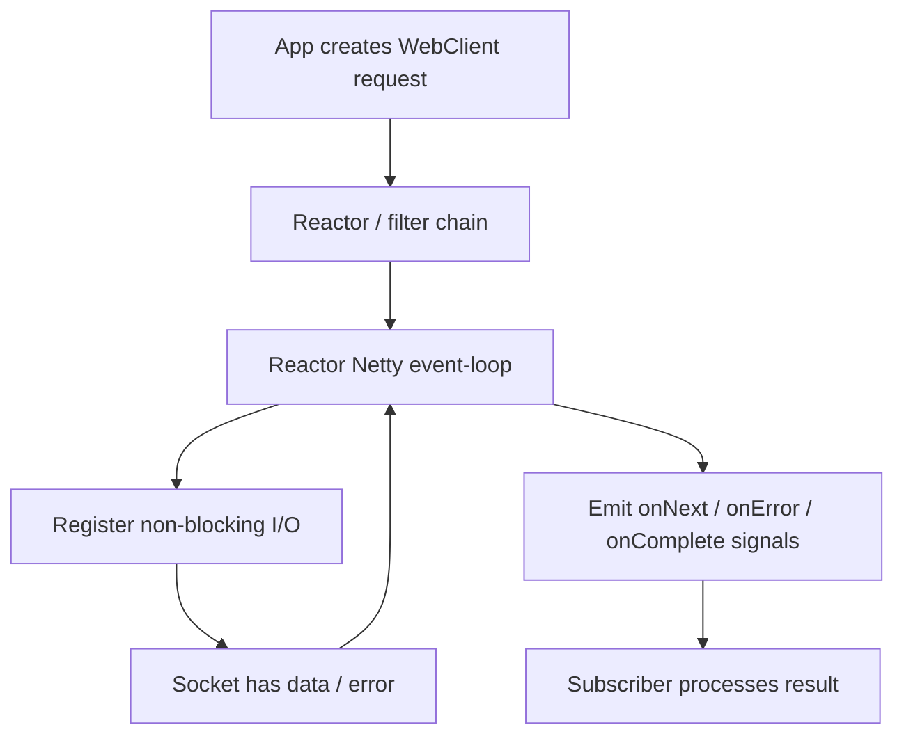
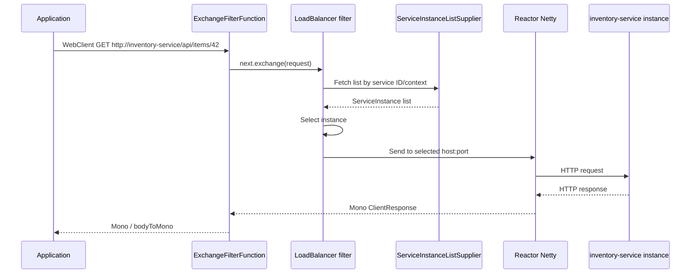

# Avoiding Blocking on the Event Loop and Thread-Blocking Calls in Filters

`WebClient` is Spring WebFlux's reactive HTTP client. When combining `WebClient` with **Spring Cloud LoadBalancer**, requests can pass through one or more `ExchangeFilterFunction`s, after which LoadBalancer picks a `ServiceInstance` based on service ID, discovery, health checks, and routing policies. An easily overlooked design bug is invoking a **blocking** API directly inside a filter or inside the Reactor chain processing the request. The code may work fine under light load yet cause many other requests to slow down or stall under real traffic.

This lesson in the **WebClient** chapter explains what the event loop is, why `.block()`, `Thread.sleep()`, JDBC, file I/O, and other synchronous APIs cause problems in filters, how to replace them with `Mono`/`Flux` composition, how to offload unavoidable blocking work to `Schedulers.boundedElastic()`, and how to verify the impact with tests and metrics. The scope centers on **client-side load balancing**; going reactive does not by itself solve every HTTP timeout, retry, or connection pool issue.

## 1. What Is the Event Loop in WebClient?

In Spring WebFlux using Reactor Netty, HTTP I/O typically runs on a small group of event-loop threads. These threads handle many connections by reacting to read/write events rather than dedicating a thread to sit idle waiting for each request.



One crucial point: **reactive does not mean every piece of Java code automatically runs on its own thread**. Operators like `map`, `flatMap`, `doOnNext`, and code called inside filters can run on whichever thread emits the current signal, including an event-loop thread, unless an appropriate scheduler boundary is introduced.

### 1.1. How Do Blocking and Non-Blocking Differ?

| Behavior | Example | Impact on Current Thread |
|---|---|---|
| **Blocking** | `Thread.sleep(500)`, `Future.get()`, `RestTemplate.getForObject(...)` | Thread must wait until the operation finishes |
| **Blocking bridge** | Calling `.block()` on a `Mono` to get a value immediately | Waits synchronously; unsuitable on the event loop |
| **Non-blocking I/O** | `WebClient.get().retrieve().bodyToMono(...)` | Represents result asynchronously; does not hold a thread waiting on sockets |
| **Reactive composition** | `tokenMono.flatMap(token -> callApi(token))` | Chains steps as data arrives without needing `block()` |
| **Controlled offload** | `Mono.fromCallable(...).subscribeOn(Schedulers.boundedElastic())` | Moves blocking work onto a scheduler built for thread-blocking tasks |

An HTTP request can take 300 ms to complete **without blocking the event loop for 300 ms**. Long request duration does not mean a thread is continuously occupied. By contrast, `Thread.sleep(300)` inside a filter holds a thread hostage, forcing all other sockets managed by that thread to wait.

### 1.2. Why Can a Single Slow Filter Affect Many Requests?

Suppose the event loop has only a few threads and every request goes through a filter calling a token management system via a synchronous API taking 200 ms. If 100 requests arrive concurrently, many calls queue up because event-loop threads are limited. The symptoms typically show up as surging p95/p99 latency, cascading timeouts, connection errors, or collapsing throughput even while downstream services remain healthy.

```text
Unsuitable:
event-loop-1: filter(req A) -- wait 200ms -- filter(req B) -- wait 200ms -- ...

Better suited:
event-loop-1: schedule task A -> schedule task B -> continue handling I/O
boundedElastic: run synchronous API A / B with bounded threads and queue
```

Offloading still consumes real threads and resources; it merely **avoids occupying the event loop** while waiting. If too many blocking tasks arrive simultaneously, `boundedElastic` can saturate too. The best solution, whenever feasible, remains an asynchronous API end to end.

## 2. Where Do Filters Sit in the Spring Cloud LoadBalancer Flow?

A `@LoadBalanced`-annotated `WebClient.Builder` can be configured by Spring Cloud with a LoadBalancer exchange filter. With reactive LoadBalancer, the common component is `ReactorLoadBalancerExchangeFilterFunction` or a deferred variant (`DeferringReactiveLoadBalancerExchangeFilterFunction`) depending on configuration and version.



A filter's job is to add headers, authenticate, log, or adjust requests/responses per the `ExchangeFilterFunction` contract: given `ClientRequest` and `ExchangeFunction`, return **`Mono<ClientResponse>`**. Filters do not need to make synchronous HTTP calls to obtain results before proceeding.

**Note on ordering:** filter ordering on the builder determines whether a filter sees the logical URI (`http://inventory-service`) or the URI already rewritten to a specific instance. Never write filters relying on implicit ordering. Verify the chain on your running version, especially when custom filters read hosts, service IDs, or headers for logging and security.

## 3. Anti-Patterns to Avoid Inside Filters

### 3.1. Calling `.block()` to Fetch a Token Before the Request

Example **not to use**:

```java
// WRONG: Do not use inside ExchangeFilterFunction.
ExchangeFilterFunction blockingAuthFilter(WebClient authClient) {
    return (request, next) -> {
        String token = authClient.post()
                .uri("/oauth/token")
                .retrieve()
                .bodyToMono(String.class)
                .block(); // Synchronous wait inside filter.

        ClientRequest changed = ClientRequest.from(request)
                .headers(headers -> headers.setBearerAuth(token))
                .build();

        return next.exchange(changed);
    };
}
```

`.block()` bridges reactive to synchronous. If executed on an event-loop thread (such as `reactor-http-nio-*`), Reactor can even throw `IllegalStateException: block()/blockFirst()/blockLast() are blocking, which is not supported in thread ...`. Even if called on another thread where it is not forbidden, it still occupies that thread while waiting and risks deadlocks or reduced scalability.

**Do not "fix" it by moving `.block()` inside `Mono.defer(...)` and still calling it on the same event loop.** `defer` only delays execution time; it does not automatically switch work to another scheduler.

### 3.2. Other Thread-Blocking Operations That Can Hide in Filters

| Task in Filter or Operator | Why Can It Block? | How to Handle |
|---|---|---|
| `Thread.sleep(...)` | Holds the thread while sleeping | Use `Mono.delay(...)` for non-blocking waits or Reactor backoff |
| `CompletableFuture.get()` / `.join()` | Waits synchronously on Future | Use `Mono.fromFuture(...)` or equivalent async API |
| JDBC/JPA calls | Standard drivers block threads during queries | Prefer R2DBC; if unchanged, offload and bound concurrency |
| `RestClient` / `RestTemplate` | Synchronous HTTP I/O | Use `WebClient` or an async client |
| `Files.readAllBytes(...)` on large files | Synchronous disk I/O | Offload to `boundedElastic` or switch to async APIs |
| Synchronous SDKs for credentials/metadata | May perform I/O, DNS, or lock waits | Use async SDKs, cache tokens, or offload with bounds |
| `CountDownLatch.await()` / long locks | Holds thread waiting for condition | Use reactive/async primitives; avoid locking around I/O |
| Heavy synchronous logging | May wait on disk/network appenders | Configure logging sensibly, use async appenders, cap payload size |

Not every CPU operation in `map` is blocking I/O, yet very heavy CPU computation still occupies the event loop and causes similar symptoms. For long pure-CPU tasks, consider an appropriate scheduler/executor and bound concurrency; **do not treat `boundedElastic` as the default answer for all CPU work**.

### 3.3. `.subscribe()` Inside a Filter Is Also Wrong Flow Control

The following example has broken flow control:

```java
// WRONG: Fire-and-forget does not guarantee the token exists before the HTTP request.
return (request, next) -> {
    refreshTokenAsync().subscribe();
    return next.exchange(request);
};
```

Calling `.subscribe()` manually spawns a branch **outside** the original request chain, breaking error propagation, cancellation, tracing, and sequencing. It can allow `next.exchange(...)` to run before the refresh completes. Instead, return a composed `Mono` via `flatMap` or `then` so the caller manages the full lifecycle.

## 4. Best Solution: Compose `Mono`/`Flux` Without Synchronous Waiting

If the token issuer has a reactive API, have the filter **return** the `Mono` chain:

```java
public interface ReactiveTokenProvider {
    Mono<String> getAccessToken();
}

@Bean
ExchangeFilterFunction reactiveAuthFilter(ReactiveTokenProvider tokens) {
    return (request, next) -> tokens.getAccessToken()
            .switchIfEmpty(Mono.error(
                    new IllegalStateException("Failed to obtain token")))
            .flatMap(token -> {
                ClientRequest updated = ClientRequest.from(request)
                        .headers(headers -> headers.setBearerAuth(token))
                        .build();
                return next.exchange(updated);
            });
}
```

In this example:

1. `getAccessToken()` returns `Mono<String>`; `.block()` is never called.
2. `flatMap` waits for the token emission before sending the request enriched with `Authorization`.
3. If the token provider errors, the request flow receives `onError` instead of silently using an empty token.
4. Subscription cancellation, timeouts, and context propagate through the entire chain.

If the token provider also uses `WebClient`, configure a **separate authentication client** (typically direct, or another internal client without this filter attached). If the same filter is registered on the HTTP client used to fetch tokens, recursive call loops happen easily: the token request itself requests a token.

Apply filters carrying secrets only to **trusted targets**. Do not attach a partner's `Authorization` header onto a builder shared across arbitrary hostnames. Never write tokens to logs or metric labels.

### 4.1. Example Non-Blocking Response-Reading Filter

`ExchangeFilterFunction` can inspect response metadata without forcing synchronous execution:

```java
ExchangeFilterFunction statusLoggingFilter() {
    return (request, next) -> next.exchange(request)
            .doOnNext(response -> {
                HttpStatusCode status = response.statusCode();
                log.debug("method={} status={}", request.method(), status);
            });
}
```

`doOnNext` should perform **lightweight, short, non-blocking** work. In practice, logging appenders must also avoid prolonged disk/network waits. If body inspection is needed, use appropriate stream operators; never call `.block()` or consume the body twice in a filter.

## 5. When Synchronous APIs Cannot Be Removed Yet: Offload with `boundedElastic`

Not every project can migrate JDBC, SDKs, or token issuers to async right away. When forced to call a blocking API, **wrap the blocking call in a publisher executed under controlled bounds**:

```java
@Bean
ExchangeFilterFunction legacyTokenFilter(BlockingTokenService tokenService) {
    return (request, next) -> Mono.fromCallable(() -> {
                String token = tokenService.getToken(); // Synchronous API.
                if (token == null || token.isBlank()) {
                    throw new IllegalStateException("Empty token");
                }
                return token;
            })
            .subscribeOn(Schedulers.boundedElastic())
            .flatMap(token -> {
                ClientRequest updated = ClientRequest.from(request)
                        .headers(headers -> headers.setBearerAuth(token))
                        .build();
                return next.exchange(updated);
            });
}
```

`BlockingTokenService` is a hypothetical class with a **synchronous** method `String getToken()`. What each piece does:

- `Mono.fromCallable(...)` defers running `getToken()` until subscription; omitting this wrapper and calling the method while building the `Mono` would still run it on the event loop.
- `.subscribeOn(Schedulers.boundedElastic())` runs the blocking source on a scheduler designed for I/O-waiting work with bounded threads and queues.
- `.flatMap(...)` proceeds to build and send the HTTP request via `next.exchange(...)` without calling `.block()`.
- Exceptions in the `Callable` turn into `onError` signals for retry/timeout/error handlers per policy.

**Important limitation:** offloading does not make a blocking API truly non-blocking; it only shifts wait time to another thread pool. If 1,000 requests wait concurrently on the token service, `boundedElastic` can also queue up, raise latency, or exhaust resources. Cache tokens appropriately within their lifetime, bound concurrent calls, and prefer async SDKs whenever possible.

### 5.1. Why Is `subscribeOn` Appropriate Here?

Reactor distinguishes two key scheduler operators:

| Operator | Primary Meaning | When to Use? |
|---|---|---|
| `subscribeOn(scheduler)` | Schedules upstream subscription and data source on the scheduler | Wrapping blocking sources such as `Mono.fromCallable(...)` |
| `publishOn(scheduler)` | Switches the thread handling signals **from that point downward** | Moving downstream processing onto an appropriate scheduler |

To offload a blocking `Callable`, use the pattern:

```java
Mono<Result> result = Mono.fromCallable(() -> blockingService.load())
        .subscribeOn(Schedulers.boundedElastic());
```

Do not treat `publishOn` as a universal cure for blocking code. If a blocking call already ran **before** `publishOn`, adding `publishOn` afterward does not fix the blocked segment. Even when `publishOn` is placed properly, hopping a long chain onto another scheduler can add unnecessary overhead.

### 5.2. `Schedulers.parallel()` Is Not for Blocking I/O

`Schedulers.parallel()` is tuned for short/pure CPU tasks and has a small fixed thread count. Running JDBC calls or `Thread.sleep()` on `parallel` starves compute threads. `Schedulers.boundedElastic()` is better suited for **temporary blocking I/O**, while high-volume workloads warrant dedicated pools/limits and replacing synchronous APIs.

Some Reactor versions support using Java 21 virtual threads for `boundedElastic` when properly configured. That **does not** eliminate limits in underlying databases, connection pools, or SDKs, nor does it make calling `.block()` on the event loop valid.

### 5.3. Bounding Time and Concurrent Offloaded Tasks

A slow token provider or data store can still delay WebClient requests even when the event loop is unblocked. Set timeouts on the blocking API itself (if supported) as well as pipeline deadlines:

```java
Mono<String> token = Mono.fromCallable(tokenService::getToken)
        .subscribeOn(Schedulers.boundedElastic())
        .timeout(Duration.ofSeconds(2));
```

`Mono.timeout` ends **waiting for the response in the pipeline**; it does not guarantee halting an in-flight blocking call if the SDK ignores interrupts or lacks cancellation support. Therefore, HTTP client/database driver timeouts remain essential; never use Reactor `timeout` as a substitute for socket timeouts.

To protect downstreams under load, add bulkheads, semaphores, or rate limiters capping concurrent blocking operations. Never automatically retry all timeout errors infinitely; retries multiply waiting requests and can amplify outages.

## 6. Configuring Load-Balanced WebClient by Service ID

Minimal example of a builder bean integrated with Spring Cloud LoadBalancer:

```java
import org.springframework.cloud.client.loadbalancer.LoadBalanced;
import org.springframework.context.annotation.Bean;
import org.springframework.context.annotation.Configuration;
import org.springframework.web.reactive.function.client.WebClient;

@Configuration(proxyBeanMethods = false)
class InventoryWebClientConfiguration {

    @Bean
    @LoadBalanced
    WebClient.Builder loadBalancedWebClientBuilder() {
        return WebClient.builder();
    }
}
```

Using that builder in a reactive gateway:

```java
@Service
class InventoryGateway {
    private final WebClient inventory;

    InventoryGateway(@LoadBalanced WebClient.Builder builder) {
        this.inventory = builder
                .baseUrl("http://inventory-service")
                .build();
    }

    Mono<Item> findItem(long id) {
        return inventory.get()
                .uri("/api/items/{id}", id)
                .retrieve()
                .bodyToMono(Item.class);
    }
}
```

`Item` is a DTO matching the service's API contract. `inventory-service` in the base URL is a **service ID**, not necessarily a DNS hostname. LoadBalancer integration selects a `ServiceInstance` from the supplier chain and sends the request to the corresponding host/port. The project requires `spring-cloud-starter-loadbalancer` plus a discovery source (`Eureka`, `Consul`, `SimpleDiscoveryClient`, etc.) or a custom supplier.

This example assumes reactive LoadBalancer integration is present. When using Spring Boot auto-configuration, preserve WebClient settings for codecs, connectors, and observability, and distinguish load-balanced builders from direct builders to avoid applying LoadBalancer to external URLs.

### 6.1. Attaching a Non-Blocking Filter to the Client

```java
@Bean
@LoadBalanced
WebClient.Builder loadBalancedWebClientBuilder(
        ReactiveTokenProvider tokenProvider) {

    return WebClient.builder()
            .filter((request, next) -> tokenProvider.getAccessToken()
                    .flatMap(token -> next.exchange(
                            ClientRequest.from(request)
                                    .headers(h -> h.setBearerAuth(token))
                                    .build())));
}
```

This is an **alternative** to the `loadBalancedWebClientBuilder` bean above, not a second bean with the same name in the same configuration. The filter uses `Mono` so it never calls `.block()`. If the application calls multiple service IDs, attach token filters only to the clients that need those specific tokens. The token provider must not use this same builder to call the token endpoint, or filter recursion can occur.

### 6.2. Why Must `ServiceInstance` Selection Also Be Non-Blocking?

Even if application filters never call `.block()`, a custom `ServiceInstanceListSupplier` can cause bottlenecks if it queries a database or synchronous HTTP endpoint inside `get(Request)`. The supplier chain participates in per-request target selection; if it blocks, many requests can stall before Netty even begins sending HTTP.

```java
// DO NOT: Blocking I/O inside get(Request).
@Override
public Flux<List<ServiceInstance>> get(Request request) {
    List<ServiceInstance> instances = legacyRegistry.fetchBlocking();
    return Flux.just(instances);
}
```

A transitional workaround when forced to use a blocking API:

```java
@Override
public Flux<List<ServiceInstance>> get(Request request) {
    return Mono.fromCallable(() -> legacyRegistry.fetchBlocking())
            .subscribeOn(Schedulers.boundedElastic())
            .flux();
}
```

The second example offloads the query **but still risks querying the source on every request**. If instance lists change infrequently, use a proper discovery client, cache, or periodically refreshed immutable snapshot, letting `get(Request)` read the snapshot quickly and non-blockingly. Be careful to place caches before request-dependent filters so you do not reuse the wrong list across tenants, zones, or versions.

## 7. Other Blocking Spots in the Pipeline to Watch

### 7.1. Blocking Doesn't Live Only in `ExchangeFilterFunction`

```java
// WRONG: doOnNext still runs on the current signal-emitting thread.
Mono<Item> item = inventory.get()
        .uri("/api/items/42")
        .retrieve()
        .bodyToMono(Item.class)
        .doOnNext(value -> auditRepository.save(value)); // Blocking JDBC.
```

`doOnNext` suits quick side effects, not synchronous repository calls. If auditing is a required step in the business flow, use a reactive repository or offload and **compose** the result:

```java
Mono<Item> item = inventory.get()
        .uri("/api/items/42")
        .retrieve()
        .bodyToMono(Item.class)
        .flatMap(value -> Mono.fromCallable(() -> {
                    auditRepository.save(value); // Blocking; no async API available yet.
                    return value;
                })
                .subscribeOn(Schedulers.boundedElastic()));
```

If auditing fails, the pipeline above errors; if auditing is purely best-effort, design a separate retry/queue flow rather than firing `.subscribe()` inside `doOnNext`. Where appropriate, use a message broker or outbox so audit writes are guaranteed without holding the request waiting.

### 7.2. Never Assume `map`/`filter` Always Run Off the Event Loop

```java
// WRONG: map may run on the event loop.
Mono<Report> report = webClient.get()
        .uri("/reports/42")
        .retrieve()
        .bodyToMono(Report.class)
        .map(data -> blockingReportEnrichment.enrich(data));
```

If `enrich` performs synchronous HTTP/JDBC, replace it with an async API or:

```java
Mono<Report> report = webClient.get()
        .uri("/reports/42")
        .retrieve()
        .bodyToMono(Report.class)
        .flatMap(data -> Mono.fromCallable(
                        () -> blockingReportEnrichment.enrich(data))
                .subscribeOn(Schedulers.boundedElastic()));
```

Do not offload every `map` unconditionally: small type conversions, reading metadata, or formatting headers should usually execute inline without thread hops.

### 7.3. `ThreadLocal` Does Not Automatically Cross Schedulers Reliably

If a filter reads `SecurityContextHolder` or MDC via `ThreadLocal`, switching threads inside the pipeline can drop context or pick up stale values. In reactive stacks, use Reactor `Context` and Spring Security/Micrometer context propagation suited to your running versions.

Example reading a routing key safely stored upstream in Reactor Context:

```java
Mono<String> routingKey = Mono.deferContextual(context ->
        Mono.just(context.getOrDefault("routingKey", "default")));
```

`routingKey` must be derived from verified information; never trust raw user-supplied headers if they determine tenant/region or access rights. `Context` in this example belongs to the subscriber, not a global variable shared across requests.

## 8. Timeouts, Retries, and Connection Pools Remain Separate Concerns

A completely non-blocking pipeline can still lag or fail if the server stops responding. WebClient and Reactor Netty still need appropriate timeouts, connection pools, retries, and monitoring.

Example configuring connect/response timeouts on the Reactor Netty connector:

```java
HttpClient httpClient = HttpClient.create()
        .option(ChannelOption.CONNECT_TIMEOUT_MILLIS, 1000)
        .responseTimeout(Duration.ofSeconds(3));

WebClient.Builder builder = WebClient.builder()
        .clientConnector(new ReactorClientHttpConnector(httpClient));
```

`ChannelOption` is `io.netty.channel.ChannelOption`, `HttpClient` is `reactor.netty.http.client.HttpClient`, and `ReactorClientHttpConnector` is from Spring reactive HTTP. If applying this to a load-balanced builder, keep the LoadBalancer integration intact; do not build a direct builder and assume it has `@LoadBalanced` just because it uses a Reactor Netty connector.

| Limit | Role | Does Not Solve |
|---|---|---|
| Connect timeout | Bounds time to open TCP connection | Does not alter the `ServiceInstance` list |
| Response timeout | Bounds response wait per HTTP client mechanism | Does not replace JDBC or blocking SDK timeouts |
| `Mono.timeout(...)` | Bounds pipeline wait for signals | Cannot reliably abort blocking APIs lacking cancellation support |
| Connection pool | Bounds/reuses physical connections | Does not guarantee instances are healthy |
| Retry | Retries selected failures per policy | Does not make `POST`s with side effects safe |

**Retries:** if the pipeline times out after the request reached the server, the server may still finish processing. For requests with side effects, require idempotency keys or duplicate-prevention policies; bound attempt counts and overall deadlines. When Spring Cloud LoadBalancer re-selects an instance, retries may need a previous-instance-aware supplier to avoid hitting the same failed target again. Do not stack multiple retry layers without calculating actual call counts.

### 8.1. `timeout()` in a Filter Is Not a Fix for Blocking Code

Example:

```java
Mono<String> call = Mono.fromCallable(blockingService::slowCall)
        .subscribeOn(Schedulers.boundedElastic())
        .timeout(Duration.ofSeconds(2));
```

This is an **offload + bounded wait** pattern, unlike:

```java
// WRONG: still calls the blocking API immediately when constructing the Mono.
Mono<String> call = Mono.just(blockingService.slowCall())
        .timeout(Duration.ofSeconds(2));
```

In the broken pattern, `slowCall()` runs **before** `Mono.just(...)` even returns, so `.timeout` cannot rescue the thread executing that method. This is why you must distinguish *lazy execution* (`fromCallable`, `defer`) from *thread switching* (`subscribeOn`).

## 9. Observing Signs of a Blocked Event Loop

Do not rely solely on the absence of exceptions. Event-loop starvation can manifest as rising tail latency, connection-pool queues, and falling throughput.

| Symptom | Likely Connection | How to Investigate |
|---|---|---|
| p99 spikes suddenly under added concurrency | Blocking call or heavy CPU work in filter/operator | Profile threads; inspect stack traces on `reactor-http-nio-*` |
| `IllegalStateException: block() ... not supported` | `.block()` called on a thread Reactor marks non-blocking | Search for `.block()`, `.blockFirst()`, `.blockLast()` in filters and reactive chains |
| Low CPU yet requests hang | Threads waiting on I/O/locks or `boundedElastic` saturated | Thread dumps, `WAITING`/`TIMED_WAITING` states, scheduler queues |
| Timeouts cascade across multiple service IDs | Event loop blocked before networking or pool overloaded | Separate filter time, instance selection, connect, and server latency |
| Health checks/discovery slow down under load | Custom supplier doing synchronous I/O | Inspect `get(Request)` implementation and registry calls per request |
| Raising `boundedElastic` still stalls | Underlying blocking source has its own pool/limit or too many tasks created | Measure concurrent executions, queues, DB pools, token service |
| Traces/MDC wrong after scheduler hop | Relying on `ThreadLocal` without context propagation | Inspect Reactor Context and Spring Security/Observability config |

### 9.1. Metrics to Measure

- **p50/p95/p99** for HTTP requests and per downstream service ID.
- **Time spent in filters** if custom instrumentation is added; never attach full headers or dynamic URIs as metric labels.
- **Connection pool active/pending**, connect timeouts, and response timeouts.
- **In-flight request counts**, error rates, retries, and cancellations.
- **`boundedElastic` queued/active tasks**, if scheduler metrics are enabled and provided by your Reactor version.
- **Event-loop thread dumps** and blocked-thread indicators under increasing load.

With Spring Cloud LoadBalancer, service IDs, selected instances, and lifecycle events can be observed when metrics are properly configured. However, requests blocked in a filter **before LoadBalancer selects an instance** may not appear in target-selection metrics yet. Measure both total WebClient-layer time and individual pipeline stages.

Never write access tokens, cookies, unnormalized tenant identifiers, or sensitive request bodies into logs or metrics.

## 10. Testing to Detect Blocking and Verify Fixes

### 10.1. Unit/Integration Tests with `StepVerifier`

`StepVerifier` from `reactor-test` verifies `Mono` signals without calling `.block()` inside application code:

```java
@Test
void inventoryClientEmitsItem() {
    Mono<Item> result = gateway.findItem(42);

    StepVerifier.create(result)
            .assertNext(item -> assertEquals(42L, item.id()))
            .verifyComplete();
}
```

The test needs an HTTP stub or a real instance registered under the discovered service ID. `StepVerifier` runs test assertions; it is not advice to execute synchronous waiting logic inside application filters or controllers.

### 10.2. Using BlockHound to Detect Blocking Calls

In tests or development environments, **BlockHound** can catch certain blocking APIs invoked on threads marked non-blocking by Reactor. Conceptual setup example:

```java
// Illustrative example in test setup; depends on BlockHound integration.
BlockHound.install();
```

Then run a test invoking a filter containing `Thread.sleep()` on a non-blocking scheduler and observe the reported error. Verify Java/Reactor/agent instrumentation compatibility, JVM flags, and appropriate allowlists before adding it to a test suite. BlockHound **does not detect every kind of blocking I/O** and does not replace load tests or thread dumps.

Do not blindly enable BlockHound in production or assume every alert comes from application code; some internal libraries behave differently across versions. Use data to choose what to fix and re-verify.

### 10.3. Practice A/B: Blocking vs. Non-Blocking Filter

Prepare a normal-responding stub API and a simulated token provider with artificial latency. Test two filter versions:

1. **Broken version (test environment only):** `Thread.sleep(200)` or `blockingTokenService.getToken()` directly in the filter, without offloading.
2. **Fixed version:** reactive token provider; if only a blocking API exists, use `Mono.fromCallable(...).subscribeOn(Schedulers.boundedElastic())`.
3. Send many concurrent requests through `@LoadBalanced WebClient.Builder` to `inventory-service`.
4. Compare p95/p99, throughput, thread dumps, connector queues, and pending tasks.
5. Raise concurrency to observe when `boundedElastic` itself or the token issuer hits its limits.
6. Test timeouts/cancellation and token provider failures to confirm the pipeline emits `onError` and never sends requests lacking `Authorization`.
7. Repeat with a custom `ServiceInstanceListSupplier` doing synchronous I/O to see that blocking during instance selection also bottlenecks requests even after the filter is fixed.

Test conclusions must rely on actual measurements and specific configurations. Offloading can improve concurrent I/O serving capacity, yet it cannot guarantee higher throughput if the underlying blocking dependency is the main bottleneck.

## 11. Pre-Production Checklist for WebClient Filters

- **Never call `.block()`, `.blockFirst()`, `.blockLast()`, or `.get()`/`.join()` on Futures** inside filters, suppliers, or reactive handlers running on the event loop.
- **Never call JDBC/JPA, `RestTemplate`/`RestClient`, or synchronous file I/O** directly inside `map`, `doOnNext`, `ExchangeFilterFunction`, or `ServiceInstanceListSupplier.get(Request)`.
- **Prefer reactive/async APIs** for token providers, discovery, HTTP, databases, and enrichment steps.
- **When synchronous APIs cannot yet be replaced**, use `Mono.fromCallable(...).subscribeOn(Schedulers.boundedElastic())` with timeouts, bounded concurrency, and queue/resource metrics.
- **Return `Mono`/`Flux` chains**, rather than fire-and-forget `.subscribe()` inside filters for mandatory pre-request work.
- **Scope filters strictly to intended clients and service IDs**, avoiding token-fetch loops and leaking secrets to unintended hosts.
- **Never assume `defer` switches threads automatically**; understand the difference between `subscribeOn` and `publishOn`.
- **Propagate context cleanly** across schedulers using Reactor Context and proper propagation rather than relying on raw `ThreadLocal`.
- **Keep timeouts, retries, and connection pools configured separately**, without expecting non-blocking execution alone to guarantee request success.
- **Test under realistic concurrency**, alongside thread dumps/BlockHound where appropriate, measuring p95/p99, errors, queues, and filter latency.

**Conclusion:** A `WebClient` integrated with Spring Cloud LoadBalancer performs reliably only when the entire request path—from authentication filters, instance selection, and discovery lookups to response handling—never ties up the event loop with thread-blocking work. **The ideal approach is `Mono`/`Flux` composition; when forced to use blocking libraries, offload with bounded concurrency to `Schedulers.boundedElastic()` and measure under load.** Paired with discovery/health checks, timeouts, retries, and observability, this keeps the client scalable as services and traffic grow.

## References

- [Spring Framework — WebClient Filters](https://docs.spring.io/spring-framework/reference/web/webflux-webclient/client-filter.html): writing `ExchangeFilterFunction` and handling requests/responses.
- [Spring Cloud Commons — Spring Cloud LoadBalancer](https://docs.spring.io/spring-cloud-commons/reference/spring-cloud-commons/loadbalancer.html): WebClient integration, reactive load-balancer filters, and suppliers.
- [Project Reactor — FAQ: Blocking Call](https://projectreactor.io/docs/core/release/reference/faq.html#faq.wrap-blocking): `Mono.fromCallable` combined with `Schedulers.boundedElastic()`.
- [Project Reactor — Threading and Schedulers](https://projectreactor.io/docs/core/release/reference/coreFeatures/schedulers.html): event loops, `subscribeOn`, `publishOn`, `boundedElastic`, and scheduler resources.
