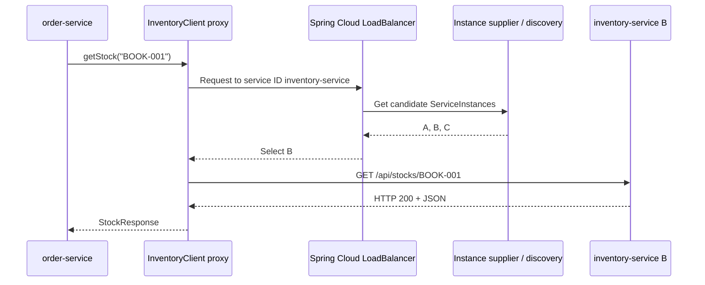

# Declarative HTTP Client with @FeignClient

In a microservices architecture, `order-service` often needs to call `inventory-service` APIs to check stock, while `inventory-service` may run across multiple replicas. When using `RestClient` or `WebClient`, developers explicitly construct calls using builders and URIs. With **Spring Cloud OpenFeign**, you can describe an HTTP API as a **Java interface**, and let the framework generate the implementation at runtime.

The **`@FeignClient`** annotation is the starting point of this approach: the interface declares the target service and the HTTP contract; Spring Cloud OpenFeign creates a proxy so business code invokes a Java method just like a local call. When the client only uses the logical service name and Spring Cloud LoadBalancer is integrated, the proxy can select an appropriate `ServiceInstance` via service discovery/supplier, rather than forcing the application to hard-code IPs and ports.

This lesson belongs to the **OpenFeign** chapter of the `SPRING_CLOUD_SERVICE_COMMUNICATION_LOAD_BALANCING` module. The focus is on declaring and using `@FeignClient`, identifying the components involved in instance selection, configuring timeouts, interpreting HTTP/business errors, and understanding the limits of a declarative HTTP client.

## 1. What Problem Does a Declarative Client Solve?

A typical HTTP call must specify the method, URI, request body, headers, response conversion, and error handling. Repeating request-building code in many places can mix business logic with protocol details.

With a declarative client, you describe the contract in a single interface:

```java
@FeignClient(name = "inventory-service")
interface InventoryClient {
    @GetMapping("/api/stocks/{sku}")
    StockResponse getStock(@PathVariable("sku") String sku);
}
```

Business code simply calls `inventoryClient.getStock("BOOK-001")`. Constructing the HTTP request is handled by the Feign proxy based on metadata from the annotations.

| Approach | Key Highlights | Things to Watch |
| --- | --- | --- |
| `RestClient` | Synchronous fluent API; explicit request building with builders | Manually organize adapters and construct URIs/methods |
| `WebClient` | Reactive API; suited for asynchronous pipelines | Requires understanding `Mono`/`Flux` and the non-blocking model |
| Spring Cloud OpenFeign | Interface describes HTTP API; proxy generated automatically | Requires managing contracts, proxy configuration, timeouts, and error handling |

OpenFeign still sends HTTP requests over an underlying transport. Making the code look like a Java method call **does not turn a network call into an in-memory call**. It still carries latency, timeouts, connection errors, and the possibility of an uncertain outcome when the server has already processed the request but the response does not arrive in time.

## 2. Four Components of a Load-Balanced Feign Call

Suppose `inventory-service` has three instances:

| Instance | Host | Port |
| --- | --- | --- |
| A | `10.0.1.11` | `8080` |
| B | `10.0.1.12` | `8080` |
| C | `10.0.1.13` | `8080` |

Main components:

1. **Feign proxy:** receives the Java method call, translates parameters into an HTTP request, and decodes the response.
2. **Logical service name:** `inventory-service`, declared in `@FeignClient(name = "...")`.
3. **Spring Cloud LoadBalancer:** retrieves the list of replicas from `ServiceInstanceListSupplier`, picks an instance according to a policy such as Round Robin, and routes the request to the selected target.
4. **HTTP transport:** opens the connection, sends the request, receives the response, or throws an exception.



The diagram shows the **typical happy path**. If the registry has no instances, the supplier filters out all candidates, or the connection to B fails, the caller may not receive a `StockResponse`. Feign does not automatically guarantee that every request succeeds just because a client proxy has been created.

## 3. Declaring Dependencies and Enabling Feign

In a Spring Boot project compatible with Spring Cloud OpenFeign, the basic Maven dependencies look like this:

```xml
<dependency>
    <groupId>org.springframework.cloud</groupId>
    <artifactId>spring-cloud-starter-openfeign</artifactId>
</dependency>

<dependency>
    <groupId>org.springframework.cloud</groupId>
    <artifactId>spring-cloud-starter-loadbalancer</artifactId>
</dependency>
```

`spring-cloud-starter-openfeign` provides the Feign integration; `spring-cloud-starter-loadbalancer` provides client-side load balancing when calling by service ID. The instance source can come from Eureka, Consul, Kubernetes, an appropriate `DiscoveryClient`, or a static list used for examples/testing.

Use a Spring Cloud BOM compatible with your project's Spring Boot version; do not arbitrarily pin independent versions on individual starters. If the application already uses your company's dependency management mechanism, follow the supported version.

Enable scanning for Feign interfaces:

```java
import org.springframework.boot.SpringApplication;
import org.springframework.boot.autoconfigure.SpringBootApplication;
import org.springframework.cloud.openfeign.EnableFeignClients;

@SpringBootApplication
@EnableFeignClients(basePackages = "com.example.order.clients")
public class OrderApplication {
    public static void main(String[] args) {
        SpringApplication.run(OrderApplication.class, args);
    }
}
```

`@EnableFeignClients` registers Feign clients discovered in the specified packages. If an interface is outside the scan scope, the proxy may not be created and injection will fail. In an application with a simple package structure, you can use `@EnableFeignClients` without `basePackages` if the default scan scope is appropriate.

**Do not place `@LoadBalanced` on a `@FeignClient` interface the way you attach it to `RestClient.Builder`.** Feign's integration with Spring Cloud LoadBalancer is wired through the Feign client components and related Spring Cloud beans when dependencies and configuration are set up properly.

## 4. Defining the HTTP Contract Between Caller and Destination

Before declaring Feign, you need a clear contract covering the HTTP method, path, status, and JSON. For example, `inventory-service` provides an endpoint to read stock:

```http
GET /api/stocks/BOOK-001 HTTP/1.1
Host: inventory-service
Accept: application/json
```

Successful response:

```http
HTTP/1.1 200 OK
Content-Type: application/json

{
  "sku": "BOOK-001",
  "availableQuantity": 12
}
```

At the target service, the controller can be written as follows:

```java
import org.springframework.web.bind.annotation.GetMapping;
import org.springframework.web.bind.annotation.PathVariable;
import org.springframework.web.bind.annotation.RequestMapping;
import org.springframework.web.bind.annotation.RestController;

@RestController
@RequestMapping("/api/stocks")
class StockController {

    @GetMapping("/{sku}")
    StockResponse getStock(@PathVariable("sku") String sku) {
        // Contract illustration only; actual data comes from service/repository.
        return new StockResponse(sku, 12);
    }
}

record StockResponse(String sku, int availableQuantity) {}
```

The controller and the Feign client are **two components running in two different applications**. They are not required to share the same Java class, but the DTOs and contract must remain compatible in field names, data types, error codes, and versioning rules.

## 5. Declaring @FeignClient on the Calling Service

Example interface in package `com.example.order.clients`:

```java
package com.example.order.clients;

import org.springframework.cloud.openfeign.FeignClient;
import org.springframework.web.bind.annotation.GetMapping;
import org.springframework.web.bind.annotation.PathVariable;

@FeignClient(
        name = "inventory-service",
        path = "/api/stocks"
)
public interface InventoryFeignClient {

    @GetMapping("/{sku}")
    StockResponse getStock(@PathVariable("sku") String sku);
}
```

And a DTO matching the returned JSON:

```java
package com.example.order.clients;

public record StockResponse(String sku, int availableQuantity) {}
```

**How Feign composes the contract:** `path = "/api/stocks"` on the interface combines with `@GetMapping("/{sku}")` on the method to create the request `GET /api/stocks/{sku}`. The `sku` value is inserted into the path variable according to the explicitly declared name.

Common annotations used to describe a contract:

| Annotation | Role | Example |
| --- | --- | --- |
| `@GetMapping` | Invoke HTTP GET | Read inventory stock |
| `@PostMapping` | Invoke HTTP POST | Create a stock reservation request |
| `@PathVariable` | Populate variable in URI path | `{sku}` |
| `@RequestParam` | Add query parameter | `?warehouse=HCM` |
| `@RequestHeader` | Attach specific header | `X-Correlation-ID` |
| `@RequestBody` | Serialize object into request body | JSON for write operations |

Spring Cloud OpenFeign uses the Spring MVC contract under its common default configuration, so Spring MVC annotations on the interface can be used to describe HTTP endpoints. Do not assume every server controller annotation carries the exact same meaning on the client; rely on the contract supported by Feign and verify with tests.

### 5.1. Example with Query Parameter and Header

```java
@FeignClient(name = "inventory-service", path = "/api/stocks")
public interface InventoryFeignClient {

    @GetMapping("/{sku}")
    StockResponse getStock(
            @PathVariable("sku") String sku,
            @RequestParam("warehouse") String warehouse,
            @RequestHeader("X-Correlation-ID") String correlationId);
}
```

Call site:

```java
StockResponse stock =
        inventoryFeignClient.getStock("BOOK-001", "HCM", traceId);
```

The HTTP request may have the following path and query:

```http
GET /api/stocks/BOOK-001?warehouse=HCM HTTP/1.1
X-Correlation-ID: 123e4567-e89b-12d3-a456-426614174000
```

This example describes **a variant of the interface** compared to the `sku`-only example, not a requirement to declare two interfaces with the same name simultaneously. When designing a real API, confirm that the destination supports `warehouse` and the corresponding header.

### 5.2. Example POST with Request Body

```java
@FeignClient(name = "inventory-service", path = "/api/reservations")
public interface InventoryReservationClient {

    @PostMapping
    ReservationResponse reserve(@RequestBody ReservationRequest request);
}

public record ReservationRequest(
        String requestId, String sku, int quantity) {}

public record ReservationResponse(
        String reservationId, String status) {}
```

This method represents an operation that **can mutate state** on the server side. Do not retry automatically just because the connection timed out: the server might already have created the reservation while the response was lost. For write operations, design a `requestId` or idempotency key and duplicate-handling rules on the server before enabling retries.

## 6. Important Attributes of @FeignClient

```java
@FeignClient(
        name = "inventory-service",
        contextId = "inventoryQueryClient",
        path = "/api/stocks"
)
interface InventoryQueryClient {
    @GetMapping("/{sku}")
    StockResponse getStock(@PathVariable("sku") String sku);
}
```

| Attribute | Meaning | Notes |
| --- | --- | --- |
| `name` / `value` | Feign client name and typically the service ID for load balancing | `inventory-service` must match the name in the instance source |
| `contextId` | Client context identifier when distinguishing multiple Feign clients sharing the same `name` | Useful to avoid bean/configuration context collisions |
| `path` | Path prefix for all methods | Not the service name or server address |
| `url` | Explicit target URL if provided | May bypass selection via discovery/LoadBalancer |
| `configuration` | Configuration class dedicated to the Feign client | Avoid accidental global application during component scan |
| `fallback` / `fallbackFactory` | Fallback mechanism when a compatible circuit breaker integration is present | Does not work automatically without supporting dependencies and configuration |

You do not need to declare every attribute above. For the case of **calling a service ID via discovery**, the minimal configuration is usually `name` along with the method mappings. Whether `contextId` and custom client configuration are needed depends on the application structure.

## 7. name vs. url: Load-Balanced or Not?

The following two configurations look similar, yet their request paths differ.

**Case A — specifying only the service ID:**

```java
@FeignClient(name = "inventory-service")
interface InventoryClient {
    @GetMapping("/api/stocks/{sku}")
    StockResponse getStock(@PathVariable("sku") String sku);
}
```

If no fixed URL is configured for the client, Feign uses the name `inventory-service` to call through Spring Cloud LoadBalancer **when this integration is installed and enabled**. The selector fetches the list from discovery/supplier, then chooses an instance.

**Case B — specifying a physical URL:**

```java
@FeignClient(
        name = "inventory-service",
        url = "http://localhost:18081"
)
interface InventoryDirectClient {
    @GetMapping("/api/stocks/{sku}")
    StockResponse getStock(@PathVariable("sku") String sku);
}
```

Here Feign uses the specified URL. It does not need to select an instance via the service ID for this call; Spring Cloud client-side load balancing is typically **not used on an explicit URL path**.

Even when the annotation does not set `url`, a URL can still be supplied via configuration:

```yaml
spring:
  cloud:
    openfeign:
      client:
        config:
          inventory-service:
            url: http://localhost:18081
```

When investigating why LoadBalancer is not being invoked, check both the annotation and the effective configuration properties. Do not conclude anything merely from `name` still having the value `inventory-service`.

## 8. Configuring an Instance Source to Test Multiple Replicas

Feign does not generate an instance list by itself. You can use a real discovery system like Eureka/Consul or use SimpleDiscoveryClient in a demo environment.

Example with two test servers at `localhost:18081` and `localhost:18082`:

```yaml
spring:
  application:
    name: order-service
  cloud:
    discovery:
      client:
        simple:
          instances:
            inventory-service:
              - uri: http://localhost:18081
              - uri: http://localhost:18082
```

Note: this configuration only creates a **static instance source**; it does not start two HTTP servers on its own. You must run two processes or two test servers on the corresponding ports and ensure the Spring context has the appropriate discovery and LoadBalancer integrations.

When the instance source returns both addresses, Spring Cloud LoadBalancer can distribute selections according to the configured policy. When using Round Robin with a stable list, consecutive selections can alternate between the two servers. However, multiple callers or multiple processes maintain separate LoadBalancer state; do not expect a strict global distribution sequence.

## 9. Injecting a Feign Client into a Business Class

Spring Cloud OpenFeign creates a proxy bean from the interface found by `@EnableFeignClients`. Business classes can use constructor injection:

```java
import org.springframework.stereotype.Service;

@Service
class OrderStockService {

    private final InventoryFeignClient inventoryClient;

    OrderStockService(InventoryFeignClient inventoryClient) {
        this.inventoryClient = inventoryClient;
    }

    boolean hasEnoughStock(String sku, int requestedQuantity) {
        StockResponse stock = inventoryClient.getStock(sku);
        return stock.availableQuantity() >= requestedQuantity;
    }
}
```

This example assumes the interface in Section 5 only has the `getStock(String sku)` method. `StockResponse` is the response converted by Feign from JSON into the matching Java record.

**Business outcomes are not identical to HTTP status codes.** If the API returns `200 OK` with `availableQuantity = 0`, Feign still returns the DTO normally, yet `hasEnoughStock(...)` may be `false`. If the API uses `409`/`422` to represent insufficient stock, you need to handle the HTTP error response and read the domain error code per the contract.

## 10. How Does Feign Handle HTTP Responses and Exceptions?

A Feign call can fail at different layers:

| Situation Type | Common Symptoms | Investigation Direction |
| --- | --- | --- |
| No available instance | Feign/LoadBalancer has no target to send to | Service ID, discovery, supplier, health checks, and cache |
| Connection error or timeout | Exception from HTTP client, possibly wrapped in `RetryableException` | Host/port, network, TLS, connect/read timeout, root cause |
| HTTP error response | `FeignException` carrying status and possibly response body | Endpoint, method, authentication, status, and error code |
| Rejected business outcome | Response body/status according to the API contract | Inventory rules, resource state, business error code |

Along Feign's normal processing path, HTTP responses not considered successful by the decoder/error decoder are represented as exceptions such as `FeignException`. `RetryableException` is a Feign exception type related to retryable situations, but **you cannot conclude from the class name alone that every error is safe to retry**.

Example adapter on the caller side:

```java
import feign.FeignException;
import feign.RetryableException;

class InventoryGateway {

    private final InventoryFeignClient client;

    InventoryGateway(InventoryFeignClient client) {
        this.client = client;
    }

    StockResponse loadStock(String sku) {
        try {
            return client.getStock(sku);
        } catch (RetryableException ex) {
            // Inspect root cause and retry policy before deciding to resend.
            throw new InventoryDependencyException(
                    "Inventory request could not be completed", ex);
        } catch (FeignException ex) {
            if (ex.status() == 404) {
                throw new InventoryItemNotFoundException(sku, ex);
            }
            throw new InventoryDependencyException(
                    "Inventory HTTP error: " + ex.status(), ex);
        }
    }
}
```

`InventoryDependencyException` and `InventoryItemNotFoundException` are **illustrative application-defined** exceptions. In practice, HTTP status codes and bodies must be mapped according to the contract: `404` could mean the item does not exist or the endpoint is wrong, `409` could mean a business conflict, and `503` could be a transient error at the target service.

When consistent error mapping is needed, you can configure an `ErrorDecoder` for the Feign client to translate statuses and error codes into appropriate business or infrastructure exceptions. Do not classify errors based on error message strings that can change across languages or versions.

## 11. Configuring Connect Timeout, Read Timeout, and Logging

Configuration can be declared per Feign client name:

```yaml
spring:
  cloud:
    openfeign:
      client:
        config:
          inventory-service:
            connectTimeout: 2000
            readTimeout: 5000
            loggerLevel: basic
```

In common Spring Cloud OpenFeign configurations, `connectTimeout` and `readTimeout` take values in **milliseconds**. For example, `2000` corresponds to 2 seconds and `5000` corresponds to 5 seconds. Check your version and other property sources when you need to determine effective values.

- **Connect timeout** bounds the time allowed to establish a connection. If an instance is unreachable, this may be the direct cause of failure.
- **Read timeout** bounds the time spent waiting for response data as enforced by the transport. A timeout here does not prove the server did not process the request.
- **Feign logger level** controls how much detail Feign can log for requests/responses via its logging mechanism when the corresponding logger configuration is enabled.

With `loggerLevel: basic`, output generally focuses on the basic request and result details. More verbose logging levels can put sensitive headers and bodies into logs, so special care is required when the application handles tokens, cookies, or personal data.

**Per-attempt timeout is not an end-to-end deadline.** Total time also depends on service discovery, connection setup, server processing, and retries if any. If a call makes multiple attempts, total wait time can exceed the read timeout configured for a single attempt.

## 12. Retries Do Not Guarantee Correctness on Their Own

Core OpenFeign has its own retry mechanism, but Spring Cloud OpenFeign typically configures a `Retryer.NEVER_RETRY` bean by default. Therefore, **do not assume Feign always retries by default**. Check the actual retryer, HTTP client, LoadBalancer, and circuit breaker used in your project.

Example of two calls with different risk levels:

| Request | Should Retry? | Conditions |
| --- | --- | --- |
| `GET /api/stocks/BOOK-001` | May consider bounded retries on transient errors | API is a safe read operation, with deadline and backoff |
| `POST /api/reservations` | Do not retry blindly after timeout | Requires idempotency key or ability to query prior outcome |

Suppose the server has already saved the reservation, but the connection drops before returning the response. Feign observes a network error, yet the caller **cannot be certain** whether the operation succeeded. If a retry hits another instance without idempotency protection, the same request could reserve stock twice.

Retries should be designed with an explicit policy: which errors are retried, maximum attempts, backoff, overall deadline, whether to try another instance, and how to prevent duplicates. Avoid having a gateway, a Feign adapter, and an underlying retry library simultaneously repeat requests unexpectedly.

## 13. Per-Client Configuration for a Specific Feign Client

When an application uses multiple Feign clients, you may need to add headers, encoders, decoders, or interceptors specifically for `inventory-service` without affecting other services.

Example configuring a header identifying the caller:

```java
import feign.RequestInterceptor;
import org.springframework.context.annotation.Bean;

class InventoryFeignConfiguration {

    @Bean
    RequestInterceptor callerServiceHeader() {
        return template ->
                template.header("X-Caller-Service", "order-service");
    }
}
```

Attach the configuration to the interface:

```java
@FeignClient(
        name = "inventory-service",
        path = "/api/stocks",
        configuration = InventoryFeignConfiguration.class
)
interface InventoryFeignClient {

    @GetMapping("/{sku}")
    StockResponse getStock(@PathVariable("sku") String sku);
}
```

The configuration class here is an **alternative example to the interface declaration in Section 5**; there is no need to add a second interface with the same name. When using client-specific configuration, place the configuration class where global component scanning will not automatically pick it up, otherwise certain configuration beans may unintentionally affect other Feign clients.

Feign's `RequestInterceptor` prepares HTTP requests **differently from** `RestClient`'s `ClientHttpRequestInterceptor`. Do not swap these two interfaces directly. If you need to attach a bearer token, obtain it from a trusted authentication source—never hard-code credentials in source code or log tokens.

## 14. Observability: Seeing Both Feign and LoadBalancer

A declarative client does not eliminate the need for network observability. Correlate events using a trace ID or correlation ID:

- **Application level:** operation name such as `getStock`, business goal, domain error code.
- **Feign/HTTP level:** method, path template, HTTP status, duration, timeout, or exception.
- **LoadBalancer level:** service ID, candidate list, selected instance, attempt count if retried.
- **Server level:** the actual instance handling the request, processing time, errors from downstream dependencies.

Illustrative log example:

```text
traceId=93ab... client=inventory-service operation=getStock
loadBalancer.selected=10.0.1.12:8080
http.method=GET http.status=200 durationMs=42
business.availableQuantity=12
```

In this example, both Feign and LoadBalancer functioned normally; however, status `200` alone does not mean the final order-creation request will be accepted. If the log only shows `http.status=503`, inspect the HTTP response and target instance rather than concluding that discovery failed.

You can use Micrometer/Observation or tracing if your Spring Boot/Spring Cloud version supports it and the appropriate dependencies are enabled. Do not assume every metric or span appears by default. Avoid logging bodies, authorization headers, cookies, and sensitive IDs. For metrics, avoid high-cardinality labels such as SKU or paths containing dynamic IDs.

## 15. Common Configuration Mistakes

| Symptom | Likely Cause | How to Check |
| --- | --- | --- |
| Cannot inject `InventoryFeignClient` | Missing `@EnableFeignClients` or component scan package does not include the interface | Check packages, annotations, and bean registration |
| Client is created without LoadBalancer | Missing LoadBalancer starter or an explicit `url` is set | Check classpath, `@FeignClient`, and URL properties |
| Reports no instance for `inventory-service` | Service ID does not match registry, discovery has not seen instances yet, or supplier filters to empty | Inspect `ServiceInstance` list on the caller |
| `404` even though service exists | Wrong path/method or resource does not exist | Check `path`, `@GetMapping`, and response body |
| `401`/`403` | Missing token, wrong permissions, or request interceptor fails to attach header | Check auth mechanism and non-sensitive configuration |
| Connect timeout | Instance/port unreachable or network blocked | Inspect selected instance, network, TLS, and timeout |
| Read timeout | Slow server processing, resource contention, or slow dependency | Inspect server traces and timeout policy |
| JSON fails to parse | DTO and JSON contract mismatch | Compare schemas, API versions, and decoder |
| One Feign client affects another | Configuration class picked up by global scan or configuration beans not isolated | Check named client context and component scan |
| More actual requests than expected | Retries in Feign, LoadBalancer, or outer layers | Log attempt index, deadline, retry policy |

Do not use hard-coding a single replica's URL as a workaround whenever LoadBalancer hits an issue. That can help isolate the problem for diagnosis, but it removes replica selection and does not fix the underlying cause in the registry, supplier, or integration configuration.

## 16. Testing a Declarative Client with Multiple Replicas

An integration test can use two test HTTP servers and a static instance source or test registry. Useful checks include:

1. **Proxy bean check:** the Spring context starts and `InventoryFeignClient` can be injected.
2. **Mapping check:** calling `getStock("BOOK-001")` actually generates `GET /api/stocks/BOOK-001`.
3. **DTO check:** response JSON decodes into `StockResponse` with the expected fields.
4. **Service ID check:** when no fixed `url` is set, Feign uses the instance list from LoadBalancer rather than an accidentally DNS-resolved hostname.
5. **Multi-replica check:** requests reach instances from the candidate list and can be distributed according to the policy.
6. **Missing-instance check:** verify the error raised when the list is empty and how the caller responds.
7. **HTTP status check:** test `404`, `409`, `429`, `503` and verify error mapping.
8. **Timeout check:** simulate a slow-responding instance, measure retry count and total call duration.
9. **Non-idempotent POST check:** simulate a lost response after the server has written data, and confirm duplicate-handling protection.
10. **Observability check:** trace ID links the Feign request to the actual instance.

Unit tests with a mocked Feign client can verify the business flow of `OrderStockService`, but they **do not prove** that LoadBalancer selects a replica or that the HTTP request is constructed properly. Those require integration tests with a real client.

## 17. Self-Check Questions

1. What does `@FeignClient` create at runtime? Why can a Java interface still invoke an HTTP API?
2. What role does `name = "inventory-service"` play when `url` is not provided?
3. Where is `@EnableFeignClients` required and why does package scanning matter?
4. Why does a Feign client not need `@LoadBalanced RestClient.Builder` as `RestClient` does?
5. How does `path` in `@FeignClient` differ from `@GetMapping` on a method?
6. When does configuring `url` prevent Spring Cloud LoadBalancer from participating in instance selection?
7. Why must connect timeout and read timeout be distinguished?
8. Does a `200 OK` response always mean the business operation succeeded?
9. Why shouldn't `POST /api/reservations` be retried immediately after a read timeout?
10. When a Feign client fails, which logs should you collect to distinguish missing instances, connection errors, HTTP statuses, and business errors?

**Conclusion:** `@FeignClient` helps describe HTTP calls as a Java interface, reducing request-building boilerplate and centralizing the contract in one place. When no physical URL is specified and Spring Cloud LoadBalancer is properly integrated, the client name can act as a service ID to select an appropriate `ServiceInstance`. Even so, Feign remains a networked HTTP client: you must manage discovery, timeouts, retries, error mapping, and observability to keep inter-service communication reliable.
