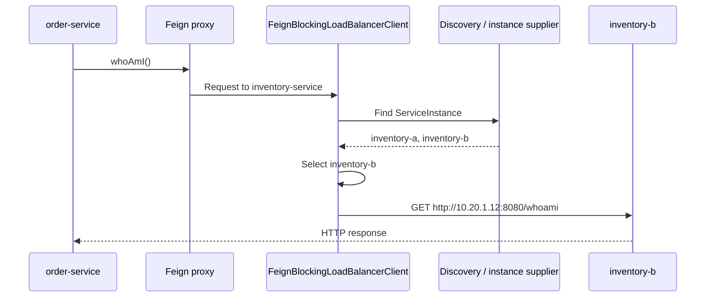

# Distinguishing name, contextId, url, and Service Name

## Objectives

Spring Cloud OpenFeign is a declarative HTTP client: an application defines a Java interface, annotates it with `@FeignClient`, and invokes the interface methods like a regular bean. When using Spring Cloud LoadBalancer, Feign can resolve service replicas via **service ID** and choose a `ServiceInstance` instead of hard-coding IP/port.

The names appearing in Feign configuration are frequently confused: `name`, `contextId`, `url`, interface name, bean qualifier, and the target application's `spring.application.name`. These fields are **not synonymous**. In particular, merely declaring a fixed `url` can completely alter how requests are routed.

After this lesson, you will be able to:

- Distinguish `@FeignClient(name = ...)`, `contextId`, `url`, and the service name in the registry.
- Understand when Feign uses `FeignBlockingLoadBalancerClient` and when it calls an endpoint directly.
- Define multiple Feign clients pointing to the same service ID with independent configurations.
- Declare timeouts and URLs under the correct `spring.cloud.openfeign.client.config.<clientId>` namespace.
- Understand precedence when a URL appears in both the annotation and properties.
- Practice with two discovery-provided instances and one fixed-URL client.
- Diagnose errors involving wrong service names, context collisions, missing instances, and routing to the wrong backend.

## 1. A Scenario with Many Kinds of Names

Suppose `order-service` needs to call `inventory-service`. The inventory service has two instances:

| Service ID | Instance ID | Address |
|---|---|---|
| `inventory-service` | `inventory-a` | `10.20.1.11:8080` |
| `inventory-service` | `inventory-b` | `10.20.1.12:8080` |

The target application may declare:

```yaml
spring:
  application:
    name: inventory-service
```

With common discovery providers, this application name is used during service registration. However, name normalization and metadata handling can differ across Eureka, Consul, Kubernetes, and other discovery clients; confirm the actual service ID in the registry.

In the calling application, we create a Feign interface:

```java
import org.springframework.cloud.openfeign.FeignClient;
import org.springframework.web.bind.annotation.GetMapping;

@FeignClient(
        name = "inventory-service",
        contextId = "inventoryReadClient"
)
public interface InventoryReadClient {

    @GetMapping("/whoami")
    String whoAmI();
}
```

Explanation:

- `inventory-service` in `name` is the logical client name, and **also the service ID** when no fixed URL is provided.
- `inventoryReadClient` in `contextId` distinguishes this Feign client's configuration context.
- `InventoryReadClient` is the Java interface name and the injectable bean type.
- `/whoami` is the HTTP path, not a service ID.
- No `url` is declared, so if Spring Cloud LoadBalancer integration is present, instances are selected based on `name`.

**You do not need to set `contextId` equal to the provider application's name.** Two clients can have different `contextId` values while calling the same service ID.

## 2. Comparing name, contextId, url, path, and Bean Aliases

| Attribute / Identifier | Purpose | Affects Backend Selection? |
|---|---|---|
| `@FeignClient(name = "inventory-service")` | Names the Feign client; acts as service ID if discovery is used | **Yes**, when no fixed URL is set |
| `@FeignClient(value = "inventory-service")` | Alias for `name` | Same as `name` |
| `@FeignClient(contextId = "inventoryReadClient")` | Identifies the configuration/child context | **Does not** change service ID |
| `@FeignClient(url = "http://localhost:8081")` | Sets direct HTTP target | **Yes**, bypasses instance selection |
| `@FeignClient(path = "/api")` | Prepends path prefix to endpoints | Does not change service ID |
| `@FeignClient(qualifiers = "inventoryReader")` | Alias/qualifier for dependency injection | Does not change target |
| `InventoryReadClient` | Java interface name and bean type | Does not change service ID by itself |
| Provider's `spring.application.name` | Application name, typically the basis for discovery registration | Depends on discovery provider |
| `spring.cloud.openfeign.client.config.<clientId>.*` | Configures a Feign context | Can change target if `url` is declared |
| `spring.cloud.loadbalancer.clients.<serviceId>.*` | LoadBalancer policy per service ID | Only when Feign actually uses LoadBalancer |

Rule of thumb: **`name` answers "which logical service?", `contextId` answers "which Feign configuration?", `url` answers "which fixed endpoint?"**.

## 3. name Is the Service ID When Using LoadBalancer

Declaration without a URL:

```java
@FeignClient(name = "inventory-service")
interface InventoryClient {

    @GetMapping("/whoami")
    String whoAmI();
}
```

If `spring-cloud-starter-loadbalancer` is on the classpath, Spring Cloud OpenFeign can use `FeignBlockingLoadBalancerClient`. This client reads the service ID from the logical client name, asks LoadBalancer to pick a `ServiceInstance`, and forwards the request to that instance's host/port.



Steps:

1. Feign uses Spring MVC annotations such as `@GetMapping` to build the HTTP request.
2. Spring Cloud LoadBalancer retrieves the instance list by `name`/service ID.
3. The supplier may apply caching, health checks, zones, weights, or hints before selection.
4. `FeignBlockingLoadBalancerClient` constructs the physical URI from the selected `ServiceInstance`.
5. Feign sends the request and decodes the response into the interface's Java return type.

If the provider registers `inventory-service` while the caller declares `@FeignClient(name = "inventory-api")`, LoadBalancer will search for a **different service ID**. Changing `contextId` to `inventory-service` will not fix a wrong `name`.

`name` is a logical name; do not add a scheme such as `name = "http://inventory-service"`. When you want to specify an absolute endpoint, use `url`.

## 4. contextId Isolates Feign Configuration Without Switching Services

### 4.1. Two Clients Sharing the Same name

An application may need two interfaces calling the same `inventory-service`, yet with different timeouts, loggers, or request interceptors.

```java
import org.springframework.cloud.openfeign.FeignClient;
import org.springframework.web.bind.annotation.GetMapping;

@FeignClient(
        name = "inventory-service",
        contextId = "inventoryReadClient",
        configuration = InventoryReadFeignConfiguration.class
)
public interface InventoryReadClient {

    @GetMapping("/whoami")
    String whoAmI();
}
```

```java
import org.springframework.cloud.openfeign.FeignClient;
import org.springframework.web.bind.annotation.GetMapping;

@FeignClient(
        name = "inventory-service",
        contextId = "inventoryAuditClient",
        configuration = InventoryAuditFeignConfiguration.class
)
public interface InventoryAuditClient {

    @GetMapping("/whoami")
    String whoAmI();
}
```

Both still load-balance via **`inventory-service`**, not two names `inventoryReadClient`/`inventoryAuditClient` in discovery.

Spring Cloud OpenFeign creates a set of beans from `FeignClientsConfiguration` such as decoder, encoder, contract, logger, and custom beans for each client. `contextId` changes the associated configuration context/bean name, avoiding collisions when multiple Feign clients share the same `name`.

### 4.2. Dedicated Java Configuration

Example using a header to distinguish requests in a test environment:

```java
import feign.RequestInterceptor;
import org.springframework.context.annotation.Bean;

class InventoryReadFeignConfiguration {

    @Bean
    RequestInterceptor readRoleHeader() {
        return template -> template.header("X-Client-Role", "read");
    }
}
```

```java
import feign.RequestInterceptor;
import org.springframework.context.annotation.Bean;

class InventoryAuditFeignConfiguration {

    @Bean
    RequestInterceptor auditRoleHeader() {
        return template -> template.header("X-Client-Role", "audit");
    }
}
```

A class passed to `@FeignClient(configuration=...)` **does not have to carry `@Configuration`**. If annotated with `@Configuration` and inside global component scanning, a bean meant for one client can get registered in the parent context and affect other clients. Place configuration classes outside the main scan area or omit `@Configuration` as shown.

An illustrative header is not an access-control credential. The server must enforce authentication and authorization independently.

### 4.3. YAML Configuration by contextId

Once `contextId` is set, use that exact ID as the key under `spring.cloud.openfeign.client.config`:

```yaml
spring:
  cloud:
    openfeign:
      client:
        config:
          default:
            connectTimeout: 2000
            readTimeout: 3000
          inventoryReadClient:
            readTimeout: 1000
            loggerLevel: basic
          inventoryAuditClient:
            readTimeout: 5000
            loggerLevel: basic
```

`connectTimeout` and `readTimeout` in this example are in **milliseconds**. Both clients can use the same service ID and the same instance list while having different timeouts.

For clients with a custom `contextId`, properties under the `inventory-service` key do not automatically apply independently to `inventoryReadClient` and `inventoryAuditClient`. If you rename `contextId`, review the corresponding Feign configuration keys.

When the same setting is declared in both Java beans and properties, Spring Cloud OpenFeign gives precedence to properties by default. You can change this with `spring.cloud.openfeign.client.default-to-properties=false` if truly needed.

## 5. A Fixed url Causes Feign to Skip LoadBalancer Instance Selection

### 5.1. URL in the Annotation

```java
@FeignClient(
        name = "inventory-service",
        contextId = "inventoryDirectClient",
        url = "http://localhost:8081"
)
interface InventoryDirectClient {

    @GetMapping("/whoami")
    String whoAmI();
}
```

Because `url` is specified, the client **calls `localhost:8081` directly** instead of picking `inventory-a` or `inventory-b` via discovery. `name` remains a required client name, yet no longer determines the instance set for this request.

Consequences:

- If `localhost:8081` stops, the direct client can fail even if the registry holds another healthy backend.
- `contextId` is still used to identify its dedicated configuration.
- `spring.cloud.loadbalancer.clients.inventory-service.*` policies will not shift the direct client to another backend.
- Even `url = "http://inventory-service"` is a **direct URL**; that hostname must be resolved by DNS/proxy and does not automatically become a Spring Cloud LoadBalancer `ServiceInstance` lookup.

### 5.2. URL in application.yml

Do not declare a URL on the interface:

```java
@FeignClient(
        name = "inventory-service",
        contextId = "inventoryDirectClient"
)
interface InventoryDirectClient {

    @GetMapping("/whoami")
    String whoAmI();
}
```

Instead, set the URL by `contextId`:

```yaml
spring:
  cloud:
    openfeign:
      client:
        config:
          inventoryDirectClient:
            url: http://localhost:8081
```

The result is still a **direct call**, bypassing LoadBalancer's instance selection step. The benefit of properties is that they can vary across deployment environments. However, modifying YAML while the application runs does not automatically update the client immediately; a refresh mechanism only works if configured and supported.

## 6. Four Precedence Cases for name and url

| `@FeignClient` Annotation | Property `openfeign.client.config.<clientId>.url` | Outcome |
|---|---|---|
| `name` present; `url` absent | Absent | **Load-balanced** by service ID in `name` if LoadBalancer integration is available |
| `name` present; `url` present | Absent | **Direct** to the annotation's URL |
| `name` present; `url` absent | URL present | **Direct** to the URL from property |
| `name` present; `url` present | URL present | **Direct** to the URL **in the annotation**; property URL is ignored |

The two configurations below differ markedly:

```java
// Selects a ServiceInstance via discovery.
@FeignClient(name = "inventory-service")
interface InventoryDiscoveredClient {
    @GetMapping("/whoami")
    String whoAmI();
}
```

```java
// Always calls a fixed physical URL.
@FeignClient(
        name = "inventory-service",
        url = "http://localhost:8081"
)
interface InventoryFixedClient {
    @GetMapping("/whoami")
    String whoAmI();
}
```

These are two **alternative approaches**. If registering both interfaces in the same application, give each interface a unique `contextId` to avoid configuration context collisions.

Current OpenFeign documentation requires `name` **even when `url` is declared**. Do not omit `name` and write only `@FeignClient(url=...)`.

## 7. Bean Names, qualifiers, and contextId Are Different

A Feign proxy bean is registered for the Java interface; the bean name is typically the fully qualified interface name. `qualifiers` provides aliases/qualifiers for dependency injection, rather than deciding where requests are sent.

```java
@FeignClient(
        name = "inventory-service",
        contextId = "inventoryReadClient",
        qualifiers = "inventoryReader"
)
public interface InventoryReadClient {

    @GetMapping("/whoami")
    String whoAmI();
}
```

Inject by type:

```java
import org.springframework.stereotype.Service;

@Service
class InventoryProbe {

    private final InventoryReadClient client;

    InventoryProbe(InventoryReadClient client) {
        this.client = client;
    }

    String whoAmI() {
        return client.whoAmI();
    }
}
```

Or inject using the declared qualifier:

```java
import org.springframework.beans.factory.annotation.Qualifier;

InventoryProbe(@Qualifier("inventoryReader") InventoryReadClient client) {
    this.client = client;
}
```

The second example only illustrates an **alternative constructor**; do not place both constructors in the same class simultaneously. Renaming the interface or `qualifiers` can affect injection, but **does not** redirect requests to a different service ID.

## 8. Feign Configuration and LoadBalancer Configuration Have Two Distinct Scopes

```yaml
spring:
  cloud:
    openfeign:
      client:
        config:
          inventoryReadClient:
            connectTimeout: 1000
            readTimeout: 2000
    loadbalancer:
      clients:
        inventory-service:
          health-check:
            interval: 15s
```

| Namespace | Commonly Used Key | Meaning |
|---|---|---|
| `spring.cloud.openfeign.client.config` | `inventoryReadClient` | Configures Feign context: timeouts, URL, logger, retryer, etc. |
| `spring.cloud.loadbalancer.clients` | `inventory-service` | Configures LoadBalancer per **service ID** |

The `health-check.interval` property only takes effect when the `ServiceInstanceListSupplier` chain includes a health-check supplier. Likewise, placing `connectTimeout` in the LoadBalancer namespace does not configure Feign's HTTP client.

Two clients sharing a service ID can have different timeouts while still sharing the LoadBalancer policy for `inventory-service`. If a client has a fixed URL, LoadBalancer's instance selection policy does not apply to that client's direct call path.

In particular, do not confuse the two retry mechanisms:

- Spring Cloud OpenFeign creates `Retryer.NEVER_RETRY` by default, differing from core Feign's default retries.
- Spring Cloud LoadBalancer may have its own retries for load-balanced calls if the right conditions and integrations are enabled.

When calling a direct URL, LoadBalancer retries cannot pick another instance from the registry because no discovery/selection step exists on that path. For HTTP methods with side effects, control idempotency before allowing retries.

## 9. Placeholders, Profiles, and Refreshing URLs

`name` and `url` support placeholders:

```java
@FeignClient(
        name = "${services.inventory.name}",
        contextId = "inventoryReadClient"
)
interface ConfiguredInventoryClient {
    @GetMapping("/whoami")
    String whoAmI();
}
```

```yaml
services:
  inventory:
    name: inventory-service
```

To load-balance via discovery, **do not set a URL** in either the annotation or properties. If you need a fixed endpoint under a local profile:

```yaml
spring:
  config:
    activate:
      on-profile: local-direct
  cloud:
    openfeign:
      client:
        config:
          inventoryReadClient:
            url: http://localhost:8081
```

When the `local-direct` profile is active, the client calls `localhost:8081` directly; when the profile is inactive and no URL comes from another configuration source, the client uses `name` for discovery lookup. Check environment variables and config servers because they can override properties.

Spring Cloud OpenFeign 4.x/5.x resolves annotation attributes **eagerly** by default. You can opt into `spring.cloud.openfeign.lazy-attributes-resolution=true` in special scenarios, though AOT/native image implications and testability should be considered.

URLs configured via properties can be refreshed when `spring.cloud.openfeign.client.refresh-enabled=true` and an appropriate refresh mechanism is present; Feign client refresh is disabled by default. Do not place `@RefreshScope` directly on a `@FeignClient` interface.

**Security:** only allow URLs from trusted configuration sources. Accepting arbitrary URLs from user requests can expose the system to SSRF risks or unintentionally leak credentials to unauthorized hosts.

## 10. Hands-On: Two contextIds on the Same Service and One Fixed-URL Client

### Step 1. Create Three Feign Interfaces

```java
import org.springframework.cloud.openfeign.FeignClient;
import org.springframework.web.bind.annotation.GetMapping;

@FeignClient(
        name = "inventory-service",
        contextId = "inventoryReadClient"
)
public interface InventoryReadClient {
    @GetMapping("/whoami")
    String whoAmI();
}
```

```java
import org.springframework.cloud.openfeign.FeignClient;
import org.springframework.web.bind.annotation.GetMapping;

@FeignClient(
        name = "inventory-service",
        contextId = "inventoryAuditClient"
)
public interface InventoryAuditClient {
    @GetMapping("/whoami")
    String whoAmI();
}
```

```java
import org.springframework.cloud.openfeign.FeignClient;
import org.springframework.web.bind.annotation.GetMapping;

@FeignClient(
        name = "inventory-service",
        contextId = "inventoryDirectClient",
        url = "${inventory.direct-url}"
)
public interface InventoryDirectClient {
    @GetMapping("/whoami")
    String whoAmI();
}
```

The first two clients have separate `contextId`s but share the same service ID. The third client uses a fixed configured URL, bypassing discovery/LoadBalancer.

### Step 2. Prepare Dependencies and Enable @EnableFeignClients

With Maven, import a Spring Cloud BOM compatible with your Spring Boot version, then declare the starters:

```xml
<dependency>
    <groupId>org.springframework.cloud</groupId>
    <artifactId>spring-cloud-starter-openfeign</artifactId>
</dependency>
<dependency>
    <groupId>org.springframework.cloud</groupId>
    <artifactId>spring-cloud-starter-loadbalancer</artifactId>
</dependency>
```

`spring-cloud-starter-loadbalancer` is an optional dependency for the OpenFeign starter, so you must add it if you want client-side load balancing. If the caller exposes MVC endpoints in a Spring Boot 4.x example, you can add `spring-boot-starter-webmvc`.

```java
import org.springframework.boot.SpringApplication;
import org.springframework.boot.autoconfigure.SpringBootApplication;
import org.springframework.cloud.openfeign.EnableFeignClients;

@SpringBootApplication
@EnableFeignClients(clients = {
        InventoryReadClient.class,
        InventoryAuditClient.class,
        InventoryDirectClient.class
})
public class OrderApplication {

    public static void main(String[] args) {
        SpringApplication.run(OrderApplication.class, args);
    }
}
```

In multi-module projects, specifying `clients = {...}` or `basePackages` tells Spring precisely which interfaces to register.

### Step 3. Declare Two Instances in the Caller

```yaml
server:
  port: 8080

inventory:
  direct-url: http://localhost:8081

spring:
  application:
    name: order-service
  cloud:
    discovery:
      client:
        simple:
          instances:
            inventory-service:
              - uri: http://localhost:8081
              - uri: http://localhost:8082
    openfeign:
      client:
        config:
          default:
            connectTimeout: 2000
            readTimeout: 3000
          inventoryReadClient:
            readTimeout: 1000
          inventoryAuditClient:
            readTimeout: 5000
```

`SimpleDiscoveryClient` returns two instances for `inventory-service`. Configuring timeouts by `contextId` does not alter the discovery list.

On the two `inventory-service` processes, create the endpoint:

```java
import org.springframework.core.env.Environment;
import org.springframework.web.bind.annotation.GetMapping;
import org.springframework.web.bind.annotation.RestController;

@RestController
class WhoAmIController {

    private final Environment env;

    WhoAmIController(Environment env) {
        this.env = env;
    }

    @GetMapping("/whoami")
    String whoAmI() {
        return env.getProperty("demo.instance-id", "unknown");
    }
}
```

Run the two backends:

```text
inventory-a: --server.port=8081 --demo.instance-id=inventory-a
inventory-b: --server.port=8082 --demo.instance-id=inventory-b
```

### Step 4. Create Three Endpoints on the Caller

```java
import org.springframework.web.bind.annotation.GetMapping;
import org.springframework.web.bind.annotation.RestController;

@RestController
class FeignDemoController {

    private final InventoryReadClient readClient;
    private final InventoryAuditClient auditClient;
    private final InventoryDirectClient directClient;

    FeignDemoController(
            InventoryReadClient readClient,
            InventoryAuditClient auditClient,
            InventoryDirectClient directClient) {
        this.readClient = readClient;
        this.auditClient = auditClient;
        this.directClient = directClient;
    }

    @GetMapping("/demo/feign/read")
    String read() {
        return readClient.whoAmI();
    }

    @GetMapping("/demo/feign/audit")
    String audit() {
        return auditClient.whoAmI();
    }

    @GetMapping("/demo/feign/direct")
    String direct() {
        return directClient.whoAmI();
    }
}
```

### Step 5. Send Requests and Compare

```bash
curl "http://localhost:8080/demo/feign/read"
curl "http://localhost:8080/demo/feign/audit"
curl "http://localhost:8080/demo/feign/read"
curl "http://localhost:8080/demo/feign/audit"
curl "http://localhost:8080/demo/feign/direct"
curl "http://localhost:8080/demo/feign/direct"
```

| Caller Endpoint | Feign Context | Backend Receiving Request |
|---|---|---|
| `/demo/feign/read` | `inventoryReadClient` | `inventory-a` or `inventory-b` via LoadBalancer |
| `/demo/feign/audit` | `inventoryAuditClient` | `inventory-a` or `inventory-b` via LoadBalancer |
| `/demo/feign/direct` | `inventoryDirectClient` | Fixed `localhost:8081` |

With default round-robin, requests from the two load-balanced clients generally distribute across both instances, though exact ordering should not be assumed when there are multiple callers or retries. For the direct client, changing the discovery instance list does not change the `localhost:8081` target.

### Step 6. Trigger Intentional Errors

1. Stop backend A: the direct client targeting `localhost:8081` fails; the two load-balanced clients may keep picking A if static discovery still lists A; health checks or an updated list are needed to handle this.
2. Change `name` of the read client to `inventory-api` while the registry only has `inventory-service`: the read client has no instances to select.
3. Rename `contextId` to `inventoryReadV2` without updating the property key: the per-client timeout may stop taking effect.
4. Declare `url` in both the annotation and properties: the annotation's URL is used.
5. Set the same `contextId` on two interfaces sharing the same `name`: configuration/bean collisions can occur.

## 11. Common Mistakes and How to Spot Them

| Symptom | Common Cause | How to Fix |
|---|---|---|
| `No instances available for inventory-service` | Discovery has no instances or supplier filtered them all out | Check service ID, registry, and supplier. |
| `No instances available for inventory-api` | `name` does not match service ID | Fix `name`; changing `contextId` is not enough. |
| Only hits one backend despite multiple replicas | Annotation or properties contain `url` | Check both places and remove URL when discovery is desired. |
| URL in properties is not used | Annotation already specifies a URL, which has higher priority | Remove annotation URL if properties should manage the target. |
| Per-client timeout has no effect | Config key does not match `contextId` | Cross-check `openfeign.client.config.<clientId>`. |
| Multiple clients with same `name` collide in context | Missing distinct `contextId` | Assign unique IDs for distinct Feign interfaces. |
| Header from one client appears on another | Dedicated config bean leaked into parent component scan | Keep dedicated config outside the global scan. |
| `url=http://inventory-service` does not use LoadBalancer | Direct URL relies on DNS | Remove `url` if `ServiceInstance` selection is needed. |
| Feign bean is not created | `@EnableFeignClients` did not scan the interface | Specify `clients` or `basePackages` explicitly. |
| Direct call fails despite other backends in registry | No discovery-based instance re-selection step | Use `name` without URL or implement another controlled failover mechanism. |
| Unexpected retries or missing retries | Confusing Feign Retryer with LoadBalancer retry | Check each layer and idempotency. |

## 12. Implementation Checklist

- [ ] Provider registers the right service ID; caller uses matching `@FeignClient(name = ...)`.
- [ ] Only use `contextId` to differentiate client configuration, never treat it as the backend name.
- [ ] If multiple Feign interfaces share `name`, each interface has a distinct `contextId`.
- [ ] When discovery/LoadBalancer is desired, no `url` exists in the annotation or properties.
- [ ] When using a direct URL, accept that LoadBalancer will not select another replica automatically.
- [ ] Verified that URL in annotation takes precedence over property URL.
- [ ] Feign properties use the right context ID key; LoadBalancer properties use the right service ID.
- [ ] `@EnableFeignClients` scans the right interfaces and the LoadBalancer starter is added if needed.
- [ ] Java configuration for a single Feign client is not scanned as global configuration.
- [ ] Timeouts, retries, and refresh are verified at the proper layer.
- [ ] Tested with two instances to demonstrate the difference between discovery lookup and fixed URL.
- [ ] Target URLs come from trusted configuration sources, never directly from user input.

## Conclusion

In Spring Cloud OpenFeign, **`name` is the service ID used to locate instances when no URL is declared**, **`contextId` only distinguishes a Feign client's configuration context**, and **`url` is a direct address that bypasses LoadBalancer's instance selection step**. The Java interface name, bean qualifier, and discovery registration name belong to different conceptual layers.

Remember the four cases: **no URL → select instance by `name`; annotation URL → direct call; property URL → direct call; both URLs → annotation wins**. When multiple clients target the same service but require separate configurations, assign distinct `contextId`s and verify properties under each context ID. This is the foundation for avoiding misrouted requests when configuring OpenFeign in systems with multiple replicas and routing policies.

## References

- [Spring Cloud OpenFeign 5.0.4 — Declarative REST Client, Feign Defaults, and contextId](https://docs.spring.io/spring-cloud-openfeign/reference/spring-cloud-openfeign.html)
- [Spring Cloud OpenFeign — Supported Ways To Provide URL To A Feign Client](https://docs.spring.io/spring-cloud-openfeign/reference/spring-cloud-openfeign.html#supported-ways-to-provide-url-to-a-feign-client)
- [Spring Cloud OpenFeign — Timeout Handling and Refresh Support](https://docs.spring.io/spring-cloud-openfeign/reference/spring-cloud-openfeign.html)
- [Spring Cloud Commons — Spring Cloud LoadBalancer](https://docs.spring.io/spring-cloud-commons/reference/spring-cloud-commons/loadbalancer.html)
- [Spring Cloud OpenFeign — GitHub source and documentation](https://github.com/spring-cloud/spring-cloud-openfeign)
