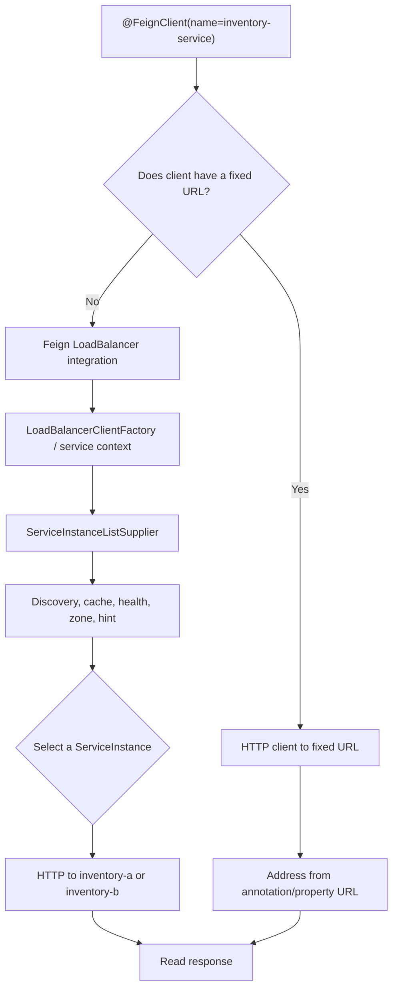

# When Direct URL Configuration Alters the Load-Balancing Path

In a microservices system, Spring Cloud OpenFeign lets you define HTTP clients using Java interfaces. When integrated with Spring Cloud LoadBalancer, Feign can call a service by **service ID**: fetching the list of `ServiceInstance`s from discovery, applying caching/health checks/routing policies, and then selecting an instance to send the request to.

However, a small change such as adding `url` to `@FeignClient` or declaring `spring.cloud.openfeign.client.config.<clientId>.url` can cause Feign to **bypass client-side instance selection** and send requests directly to the configured URL. Calls may still return HTTP 200, so this misconfiguration is easy to miss if you only verify business outcomes.

This lesson belongs to the **OpenFeign** chapter of the `SPRING_CLOUD_SERVICE_COMMUNICATION_LOAD_BALANCING` module. Its focus is analyzing the request path between the two modes, URL configuration precedence rules, consequences for discovery, health checks, load balancing, retries/timeouts, and how to write tests with evidence of which instance actually receives requests.

## 1. Two Very Different Calling Modes

Suppose `order-service` wants to fetch data from `inventory-service`. Two instances exist in discovery:

| Service ID | Instance ID | Host | Port |
|---|---|---|---:|
| `inventory-service` | `inventory-a` | `10.0.1.11` | 8081 |
| `inventory-service` | `inventory-b` | `10.0.1.12` | 8082 |

### 1.1. Service ID and LoadBalancer Mode

Declaration:

```java
@FeignClient(name = "inventory-service")
public interface InventoryClient {

    @GetMapping("/api/v1/stock/{sku}")
    StockResponse getStock(@PathVariable("sku") String sku);
}
```

When no fixed URL is configured for this client and Spring Cloud LoadBalancer integration is present, the name `inventory-service` acts as **the service identifier for instance selection**. Each time a request is sent, the system can choose A or B based on the available list and routing policy.

```text
InventoryClient.getStock("SKU-001")
    ↓
Feign client using name=inventory-service
    ↓
Spring Cloud LoadBalancer
    ↓
ServiceInstanceListSupplier (discovery/cache/health/filters)
    ↓
Select inventory-a or inventory-b
    ↓
HTTP request to the selected host:port
```

### 1.2. Direct URL Mode

Declaration:

```java
@FeignClient(
        name = "inventory-service",
        url = "http://10.0.1.11:8081")
public interface InventoryClient {

    @GetMapping("/api/v1/stock/{sku}")
    StockResponse getStock(@PathVariable("sku") String sku);
}
```

Here `name` is still used to identify/configure the Feign client, but **the URL already fixes the HTTP target**. Requests are sent to `10.0.1.11:8081` without resolving an instance of `inventory-service` through Spring Cloud LoadBalancer.

```text
InventoryClient.getStock("SKU-001")
    ↓
Feign client with url=http://10.0.1.11:8081
    ↓
HTTP client / transport
    ↓
10.0.1.11:8081

No ServiceInstance selection step by service ID is executed.
```

This is a difference **in the request path**, not merely a syntactic difference in writing the URL. You need to inspect whether the application still goes through `LoadBalancerClientFactory` and `ServiceInstanceListSupplier`, rather than only comparing response values.

## 2. Request Flow Comparison Diagram



In Spring Cloud OpenFeign releases that support Spring Cloud LoadBalancer, a common integration component is `FeignBlockingLoadBalancerClient`. This client coordinates with Spring Cloud LoadBalancer to replace the logical host with the selected instance. When Feign is configured with a direct URL, client creation uses the corresponding direct call path and **does not run Spring Cloud LoadBalancer's instance-selection loop** for that URL.

Do not draw conclusions from the Java class name of a single HTTP transport alone; there are multiple client variants, wrappers, and customization mechanisms. The most reliable confirmation is observing **which instance receives requests** and whether the supplier/load balancer participates in an integration test.

## 3. Ways of Declaring a URL That Change Behavior

Spring Cloud OpenFeign allows defining a fixed URL directly on `@FeignClient` or in property configuration. The table below illustrates common cases:

| Declaration | External Property URL | Typical Path Used |
|---|---|---|
| `@FeignClient(name="inventory-service")` | None | Via Spring Cloud LoadBalancer, if integration is present |
| `@FeignClient(name="inventory-service", url="http://host-a:8081")` | None | Direct call to `host-a:8081` |
| `@FeignClient(name="inventory-service")` | `spring.cloud.openfeign.client.config.inventory-service.url` present | Direct call to URL in property |
| `@FeignClient(name="inventory-service", url="http://host-a:8081")` | Different URL in property | Annotation URL takes precedence |
| `@FeignClient(name="inventory-service", url="http://inventory-service")` | None | Still a directly declared URL; **does not turn into service discovery automatically** |

The last row is very easy to misread: it looks like a service ID, yet because `url` is set, Feign treats it as an endpoint URL. The host `inventory-service` must be resolved by DNS/another network mechanism. Without appropriate DNS, calls can fail with `UnknownHostException` even when discovery holds valid instances.

### 3.1. No URL Declared: Uses Discovery

```java
@FeignClient(name = "inventory-service")
public interface InventoryClient {

    @GetMapping("/api/v1/stock/{sku}")
    StockResponse stock(@PathVariable("sku") String sku);
}
```

A `stock("SKU-001")` call is built from the service ID `inventory-service`. With the LoadBalancer starter and an available instance list, the client can pick an instance using round robin or a custom algorithm.

**Note:** omitting `url` is not enough if the application lacks load-balancing dependencies or an instance source. Without Spring Cloud LoadBalancer on the classpath, Feign cannot obtain an instance list from discovery by service name alone.

### 3.2. URL in Annotation: Fixed Target

```java
@FeignClient(
        name = "inventory-service",
        url = "http://127.0.0.1:18081")
public interface InventoryClient {

    @GetMapping("/api/v1/stock/{sku}")
    StockResponse stock(@PathVariable("sku") String sku);
}
```

Every request from this client uses the fixed URL as its base URL. If the application runs inside a container, `127.0.0.1` points to **that container's own** network namespace, not `inventory-service`. Therefore, localhost examples only fit local tests or environments with a co-located proxy; they are not suitable as-is for distributed deployments.

### 3.3. URL in Property: Still a Direct URL

Keep the interface without `url`:

```java
@FeignClient(name = "inventory-service")
public interface InventoryClient {

    @GetMapping("/api/v1/stock/{sku}")
    StockResponse stock(@PathVariable("sku") String sku);
}
```

But configure:

```yaml
spring:
  cloud:
    openfeign:
      client:
        config:
          inventory-service:
            url: http://127.0.0.1:18081
```

When this URL property is applied by Spring Cloud OpenFeign, Feign uses the direct address. Having only `name` on the interface **does not mean** it still passes through LoadBalancer if the environment configures a URL.

Property-based configuration is useful for testing/fixed-target deployments, yet also a source of bugs: the same artifact running under a `dev` profile might call localhost directly while `prod` uses discovery, or vice versa.

### 3.4. URL in Annotation Takes Precedence Over URL in Property

Example:

```java
@FeignClient(
        name = "inventory-service",
        url = "http://host-a:8081")
public interface InventoryClient {
    @GetMapping("/whoami")
    String whoami();
}
```

And:

```yaml
spring:
  cloud:
    openfeign:
      client:
        config:
          inventory-service:
            url: http://host-b:8082
```

In Spring Cloud OpenFeign's URL resolution mechanism, **the annotation URL takes precedence**; the property URL does not change this client's target to `host-b`. Do not try to fix the issue just by changing properties while the annotation still hard-codes a URL.

Other Feign options such as timeouts, logger levels, or error decoders have their own configuration rules; URL precedence does not automatically explain the precedence of every other Feign setting.

## 4. Roles of name and contextId When a URL Is Present

Commonly confused attributes:

| Attribute | Role |
|---|---|
| `name` | Identifies the Feign client; when no direct URL is set, typically also serves as the service ID for instance selection |
| `contextId` | Differentiates Feign client contexts/beans when multiple clients share the same service name |
| `url` | Defines the direct base URL of the HTTP target if provided |
| `path` | Path prefix for the client's endpoints; not a service ID or instance-selection algorithm |
| `qualifiers` | Identifies beans for injection; does not enable load balancing on its own |

Suppose you want the same business contract to support two connection modes in tests:

```java
@FeignClient(
        name = "inventory-service",
        contextId = "discoveredInventory")
public interface DiscoveredInventoryClient {

    @GetMapping("/whoami")
    String whoami();
}

@FeignClient(
        name = "inventory-service",
        contextId = "fixedInventory",
        url = "http://127.0.0.1:18081")
public interface DirectInventoryClient {

    @GetMapping("/whoami")
    String whoami();
}
```

Both share `name` while using different `contextId`s, making it convenient to separate each client's configuration and beans. **Only the client without a direct URL** uses the service ID for instance selection; the client with a fixed URL calls that target directly.

If two clients must use environment-specific URLs, you can use a placeholder in `url`, such as `url = "${inventory.direct-url}"`. However, once the placeholder resolves to a URL, the client remains in **direct URL mode** and is not automatically load-balanced.

### 4.1. Client ID in Properties

For Feign clients with a custom `contextId`, the key in `spring.cloud.openfeign.client.config.<clientId>` relates to the client's context identifier. Check how `name` and `contextId` are used in your current Spring Cloud OpenFeign version; do not assume a single configuration key applies if multiple clients share the same `name`.

In this lesson, simple property configuration examples use a single client with `name="inventory-service"` to avoid noise from multiple Feign contexts.

## 5. Minimal Configuration for Load-Balanced Mode

Maven dependency example (assuming a compatible Spring Cloud BOM is already imported in `dependencyManagement`):

```xml
<dependencies>
    <dependency>
        <groupId>org.springframework.cloud</groupId>
        <artifactId>spring-cloud-starter-web</artifactId>
    </dependency>

    <dependency>
        <groupId>org.springframework.cloud</groupId>
        <artifactId>spring-cloud-starter-openfeign</artifactId>
    </dependency>

    <dependency>
        <groupId>org.springframework.cloud</groupId>
        <artifactId>spring-cloud-starter-loadbalancer</artifactId>
    </dependency>
</dependencies>
```

In the application:

```java
import org.springframework.boot.SpringApplication;
import org.springframework.boot.autoconfigure.SpringBootApplication;
import org.springframework.cloud.openfeign.EnableFeignClients;

@SpringBootApplication
@EnableFeignClients
public class OrderServiceApplication {

    public static void main(String[] args) {
        SpringApplication.run(
                OrderServiceApplication.class, args);
    }
}
```

And the Feign interface:

```java
import org.springframework.cloud.openfeign.FeignClient;
import org.springframework.web.bind.annotation.GetMapping;
import org.springframework.web.bind.annotation.PathVariable;

@FeignClient(name = "inventory-service")
public interface InventoryClient {

    @GetMapping("/api/v1/stock/{sku}")
    StockResponse stock(@PathVariable("sku") String sku);
}
```

Example DTO:

```java
public record StockResponse(
        String sku,
        int available,
        String servedBy) {
}
```

The application also needs an **instance source**: Eureka, Consul, Kubernetes discovery, or a configured `SimpleDiscoveryClient`. `spring-cloud-starter-openfeign` does not register an `inventory-service` instance into discovery by itself.

### 5.1. Declaring Static Instances in a Practice Environment

If a real registry is not needed, you can declare:

```properties
spring.cloud.discovery.client.simple.instances.inventory-service[0].uri=http://localhost:18081
spring.cloud.discovery.client.simple.instances.inventory-service[1].uri=http://localhost:18082
```

Both addresses must actually run HTTP servers serving the same contract. For a Feign client **without a declared URL**, Spring Cloud LoadBalancer can select either of these two instances.

Once the client is given `url="http://localhost:18081"` or the corresponding URL property, the two Simple Discovery entries are no longer used as the instance source for that direct-URL call.

## 6. When a Fixed URL Invalidates Discovery, Health Checks, and Routing

In load-balanced mode, steps like `ServiceInstanceListSupplier`, caching, health checks, and metadata/zone/hint filters can shape the candidate set before selection.

When a direct URL applies, Feign **does not run the selection step from that list** for the corresponding request. Consequences:

| Mechanism | Using Service ID via LoadBalancer | Using Direct URL |
|---|---|---|
| Discovery by service ID | Yes, if a source is configured | Not used to choose the target |
| Selecting across multiple `ServiceInstance`s | By algorithm and list | No instance-selection loop from Spring Cloud LoadBalancer |
| `RoundRobinLoadBalancer` / custom policy | Can apply | Does not apply to direct URL targets |
| Health-aware supplier | Can filter instances | Does not automatically protect a fixed URL |
| LoadBalancer instance-list cache | Can be used | Provides no benefit for selecting this target |
| Zone preference | Can influence the list | Does not automatically prefer another zone |
| Request hints | Can influence if supplier supports them | Does not switch to an instance matching the hint |
| Feign timeouts and HTTP error handling | Still needed | Still needed |
| Authentication, encoder, decoder, headers | Still needed | Still needed |
| DNS/proxy/ingress of target URL | May exist at the physical target | Can still distribute at a separate infrastructure layer |

**Direct URL does not necessarily mean zero load balancing in the system.** If the URL points to a gateway, reverse proxy, DNS load balancer, or cloud load balancer, **that component** can still distribute requests. It is simply not `ServiceInstance` selection performed by **Spring Cloud LoadBalancer on the Feign client side**.

For example, `https://inventory.example.internal` might point to a Kubernetes Service or an internal load balancer and be distributed by the infrastructure. Even with multiple backends behind it, Feign sees a single endpoint URL and does not apply Spring Cloud LoadBalancer's zone/hint filters.

## 7. Two Deployments with Identical HTTP Results but Different Mechanisms

Compare two deployment setups:

**Setup A — discovery + client-side LoadBalancer**

```java
@FeignClient(name = "inventory-service")
interface InventoryClient {
    @GetMapping("/whoami")
    String whoami();
}
```

**Setup B — fixed endpoint**

```java
@FeignClient(
        name = "inventory-service",
        url = "http://inventory-gateway.internal")
interface InventoryClient {
    @GetMapping("/whoami")
    String whoami();
}
```

If the gateway in Setup B distributes requests across A/B, both setups can return `inventory-a` and `inventory-b`. Do not look at alternating responses and conclude that both are using Spring Cloud LoadBalancer.

To know where requests truly travel:

- Measure how many times `ServiceInstanceListSupplier` for that service ID is invoked.
- Inspect load-balancer beans and related logs.
- Observe the target hostname/socket and gateway-layer outcomes.
- Check whether the Feign client's route has a URL property or annotation.
- Inspect the service ID in the URL supplied to Feign and environment variables.

A proxy may handle failover, retries, TLS termination, and health checks **on the proxy side**, yet that policy is independent of the `RoundRobinLoadBalancer` bean in Spring Cloud.

## 8. A Test to Distinguish the Two Paths

The clearest verification creates two local HTTP servers simulating `inventory-service`:

- Instance A returns the string `inventory-a`.
- Instance B returns the string `inventory-b`.
- Discovery registers both under the same service ID.
- Feign client `discoveredInventoryClient` has no `url`.
- Feign client `directInventoryClient` has `url` pointing to instance A.

Under round robin, sequential requests via the first client can reach both A and B. Requests via the second client **reach only A** if the URL points directly to A with no intermediate distributing proxy.

### 8.1. Defining the Two Feign Interfaces

```java
import org.springframework.cloud.openfeign.FeignClient;
import org.springframework.web.bind.annotation.GetMapping;

@FeignClient(
        name = "inventory-service",
        contextId = "discoveredInventory")
interface DiscoveredInventoryClient {
    @GetMapping("/whoami")
    String whoami();
}

@FeignClient(
        name = "inventory-service",
        contextId = "fixedInventory",
        url = "${inventory.fixed-url}")
interface FixedInventoryClient {
    @GetMapping("/whoami")
    String whoami();
}
```

`inventory.fixed-url` is a test-specific property: in the test environment it points to HTTP server A. Using a placeholder does not remove the direct-URL nature of the second client.

### 8.2. Starting Two Servers on Dynamic Ports and Registering with @DynamicPropertySource

The following integration test example uses the JDK's `com.sun.net.httpserver.HttpServer`, without needing Eureka or Consul. With Maven Surefire and JUnit Jupiter, class names ending in `Test` are discovered by default convention.

```java
import java.io.IOException;
import java.io.OutputStream;
import java.io.UncheckedIOException;
import java.net.InetSocketAddress;
import java.nio.charset.StandardCharsets;
import java.util.HashSet;
import java.util.Set;

import com.sun.net.httpserver.HttpServer;
import org.junit.jupiter.api.AfterAll;
import org.junit.jupiter.api.Test;
import org.springframework.beans.factory.annotation.Autowired;
import org.springframework.boot.SpringBootConfiguration;
import org.springframework.boot.autoconfigure.EnableAutoConfiguration;
import org.springframework.boot.test.context.SpringBootTest;
import org.springframework.cloud.openfeign.EnableFeignClients;
import org.springframework.test.context.DynamicPropertyRegistry;
import org.springframework.test.context.DynamicPropertySource;

import static org.junit.jupiter.api.Assertions.assertEquals;

@SpringBootTest(
        classes = FeignUrlRoutingTest.TestApp.class,
        webEnvironment = SpringBootTest.WebEnvironment.NONE,
        properties = {
                "spring.cloud.loadbalancer.cache.enabled=false",
                "spring.cloud.loadbalancer.retry.enabled=false"
        }
)
class FeignUrlRoutingTest {

    private static final HttpServer A = server("inventory-a");
    private static final HttpServer B = server("inventory-b");

    @DynamicPropertySource
    static void targets(DynamicPropertyRegistry properties) {
        properties.add(
                "spring.cloud.discovery.client.simple.instances."
                        + "inventory-service[0].uri",
                () -> "http://127.0.0.1:" + A.getAddress().getPort());

        properties.add(
                "spring.cloud.discovery.client.simple.instances."
                        + "inventory-service[1].uri",
                () -> "http://127.0.0.1:" + B.getAddress().getPort());

        properties.add(
                "inventory.fixed-url",
                () -> "http://127.0.0.1:" + A.getAddress().getPort());
    }

    @Autowired
    DiscoveredInventoryClient discovered;

    @Autowired
    FixedInventoryClient fixed;

    @Test
    void discoveryClientCanReachBothInstances() {
        Set<String> observed = new HashSet<>();

        for (int n = 0; n < 8; n++) {
            observed.add(discovered.whoami());
        }

        assertEquals(
                Set.of("inventory-a", "inventory-b"),
                observed);
    }

    @Test
    void directUrlClientOnlyReachesA() {
        for (int n = 0; n < 8; n++) {
            assertEquals("inventory-a", fixed.whoami());
        }
    }

    @AfterAll
    static void shutdown() {
        A.stop(0);
        B.stop(0);
    }

    private static HttpServer server(String instanceId) {
        try {
            HttpServer server = HttpServer.create(
                    new InetSocketAddress("127.0.0.1", 0), 0);

            server.createContext("/whoami", exchange -> {
                byte[] bytes = instanceId.getBytes(
                        StandardCharsets.UTF_8);

                exchange.getResponseHeaders().set(
                        "Content-Type",
                        "text/plain; charset=UTF-8");

                exchange.sendResponseHeaders(200, bytes.length);

                try (OutputStream body = exchange.getResponseBody()) {
                    body.write(bytes);
                }
            });

            server.start();
            return server;
        } catch (IOException ex) {
            throw new UncheckedIOException(ex);
        }
    }

    @SpringBootConfiguration
    @EnableAutoConfiguration
    @EnableFeignClients(clients = {
            DiscoveredInventoryClient.class,
            FixedInventoryClient.class
    })
    static class TestApp {
    }
}
```

Key points to note:

1. The two Feign interfaces in Section 8.1 are types in the same package as the test and are registered via `@EnableFeignClients(clients = ...)`.
2. `@DynamicPropertySource` supplies server URIs once the dynamic ports are open. It also supplies the value for `inventory.fixed-url`.
3. For the discovery client, the list has A and B; with default round robin, eight sequential requests are enough to observe both instances provided the chain has no other policy.
4. For the direct URL client, the URL points to A; there is no reason for this client to switch to B through LoadBalancer.
5. Caching and retries are disabled to simplify result analysis; separate tests should exercise those mechanisms.
6. The test uses real HTTP over loopback; it does not just mock a `Feign.Client` and fabricate responses.

This snippet is an example following Spring Boot Test/Spring Cloud OpenFeign APIs. The project must include `spring-cloud-starter-openfeign`, `spring-cloud-starter-loadbalancer`, `spring-boot-starter-test`, and Java's `jdk.httpserver` module. Do not use this example to conclude that a version/framework is incompatible if the test fails to compile due to API changes; align the BOM first.

### 8.3. Do Not Assert Strict A, B Ordering

The default is typically `RoundRobinLoadBalancer`. However, the initial round-robin index might not be 0 and the test environment may trigger extra selections. Therefore, assert the **set of observed instances**:

```java
assertEquals(
        Set.of("inventory-a", "inventory-b"),
        observed);
```

Do not enforce that the first request must go to A and the second to B. If `RandomLoadBalancer` is configured, seeing both instances within eight requests is not guaranteed; adjust assertions accordingly or use a deterministic algorithm in tests.

## 9. Testing Property URLs and Precedence

Section 8 tests URLs in annotations. For property URLs, use a dedicated test context:

**Variant without URL in the annotation:**

```java
@FeignClient(name = "inventory-service")
interface InventoryClient {
    @GetMapping("/whoami")
    String whoami();
}
```

**Profile configuring a direct URL:**

```yaml
spring:
  cloud:
    openfeign:
      client:
        config:
          inventory-service:
            url: http://127.0.0.1:18081
```

When testing this client, all requests are expected to reach endpoint 18081, assuming server A runs on that port and there is no proxy. Disable the URL property and restart the context to verify load-balanced mode.

For annotation precedence, create a separate test with the annotation URL pointing to A and the property URL pointing to B. Requests should still go to A. Do not mix multiple identically named Feign configurations in one context and draw conclusions from ambiguous outcomes.

### 9.1. Why Use a Fresh Context?

Feign clients and their configuration beans are typically created when the ApplicationContext starts. If you change a property after the context is built without a supported refresh mechanism, you cannot assume the target URL updates immediately. For A/B experiments, use two profiles or two separate `@SpringBootTest` contexts.

Some Spring Cloud OpenFeign versions support refreshing configured URLs through a dedicated mechanism. If the application enables refresh, verify version-specific constraints and behavior; **do not assume** removing a URL from a config file automatically switches the client back to discovery.

## 10. When Should You Use a Direct URL?

A direct URL is not always wrong. It has valid use cases:

| Situation | Can Direct URL Fit? | Things to Verify |
|---|---|---|
| Calling an external partner with a single base URL | Yes | TLS, DNS, timeouts, rate limits, authentication |
| Calling an API gateway with its own HA/load balancing | Yes | How the gateway handles health and backend distribution |
| Integration test against a specific HTTP stub | Yes | Do not use this test to prove Spring Cloud LoadBalancer |
| Internal service requiring zone/hint-based balancing | Usually no | Prefer service ID and appropriate suppliers |
| Temporarily isolating an issue on one instance | Possible in tests/diagnostics | Do not leave a fixed URL as production config |
| System has a single stable endpoint managed by infrastructure | Possible | Does infrastructure guarantee failover and monitoring? |
| Wanting discovery and client-side retries to re-select instances | Unsuitable for direct URL | LoadBalancer performs no new instance selection for this target |

When using a direct URL to an API gateway, describe the architecture explicitly as **client → gateway → backends**, not **Feign → Spring Cloud LoadBalancer → ServiceInstance**. That helps operations teams pinpoint where to fix health checks or routing.

### 10.1. Do Not Use a Fixed URL as a "Shortcut" Around Discovery Issues

If a service has no instances in discovery, hard-coding a URL to a pod/VM might make the error disappear temporarily, but sacrifices scaling, failover, and metadata/health reflection. Verify the root cause:

- Whether the service ID is wrong.
- Whether instances registered in the right registry/namespace.
- Whether there are network/TLS/credential errors reaching discovery.
- Whether health checks or supplier filters filtered out all replicas.
- Whether LoadBalancer/discovery caches hold stale data.

A direct URL can help **isolate root causes during diagnostics**, yet should not be treated as an equivalent solution when the original goal is client-side load balancing.

## 11. Timeouts, Retries, and Circuit Breakers with Direct URLs

Declaring a fixed URL **does not disable** Feign timeouts, encoders/decoders, HTTP interceptors, logging, or error handling. Example:

```yaml
spring:
  cloud:
    openfeign:
      client:
        config:
          inventory-service:
            connectTimeout: 1500
            readTimeout: 3000
            loggerLevel: basic
```

The timeout values above are illustrative and normally specified in milliseconds in OpenFeign configuration. Verify the values and how they are passed to the HTTP transport in your version.

However, retries must be distinguished:

- **Feign/client retry:** may repeat HTTP requests to the same URL or client-managed target.
- **LoadBalancer retry:** in service-ID mode, may coordinate re-selecting an instance per Spring Cloud policies/dependencies.
- **Proxy retry:** if the URL points to a gateway, the proxy may retry or switch backends itself.

With a direct URL to A, retries do not automatically change the target to B just because discovery lists B. They may repeat requests to A, or a proxy behind the URL may pick another backend.

According to Spring Cloud OpenFeign documentation, `Retryer.NEVER_RETRY` is typically configured by default in Spring Cloud's OpenFeign context. This does not necessarily match core OpenFeign's default behavior. Therefore, never assume requests will retry without explicit configuration and verification.

### 11.1. Retries Are Not Automatically Safe for POST

A `POST /reservations` request might already have been processed by the server before the client times out. Resending the request can create duplicate records. Only enable retries for write operations when an idempotent contract or `Idempotency-Key` and server-side deduplication exist.

### 11.2. Circuit Breaker

If the application integrates Spring Cloud CircuitBreaker with OpenFeign via proper configuration, circuit breaker protection can exist in both fixed-URL and service-ID modes. However, a circuit breaker **does not add instance selection** to a direct URL. It controls call failures; it does not replace discovery/suppliers.

Define which errors open the circuit, how recovery works, whether fallbacks make sense, and overall wait budgets. For HTTP services, distinguish transport timeouts, "no instance available" errors, and 5xx responses from the target service.

## 12. Observability: Distinguishing Client-Side LB Errors from URL Errors

Seeing only `HTTP 503` or `connection refused` in logs may leave unclear which path the request took.

Useful signals:

| Signal | Helps Distinguish |
|---|---|
| Feign client name/contextId | Logical client invoked |
| Effective configured URL | Direct URL client vs. service ID |
| `serviceId` in LoadBalancer | Whether service-name-based instance selection occurred |
| `candidateCount` | Number of candidates from supplier in LB mode |
| `selectedInstanceId` | Target chosen by LB, if any |
| `httpTargetHost` | Actual socket/host target |
| `responseStatus` | Status returned by server/proxy |
| `failureCategory` | Discovery, no-instance, DNS, TLS, timeout, HTTP 4xx/5xx |
| `retryAttempt` | Number of HTTP attempts |
| `routeMode` | `DISCOVERY_LB` or `DIRECT_URL` by your own convention |

Application-defined structured log example:

```text
event=feign.request
client=inventory-service
contextId=discoveredInventory
routeMode=DISCOVERY_LB
serviceId=inventory-service
candidateCount=2
selectedInstanceId=inventory-b
outcome=SUCCESS
```

Direct URL client example:

```text
event=feign.request
client=inventory-service
contextId=fixedInventory
routeMode=DIRECT_URL
targetHost=inventory-gateway.internal
outcome=SUCCESS
```

The fields above are **instrumentation suggestions**, not mandatory default metric names. Do not put tokens, API keys, raw queries containing sensitive data, or high-cardinality instance IDs into metric labels. Record details in access-controlled, sampled traces/logs instead.

### 12.1. Verifying Effective Configuration at Startup

For every Feign client that requires load balancing, confirm:

1. Annotation has no fixed URL (including placeholders that resolve to a URL).
2. Property `spring.cloud.openfeign.client.config.<clientId>.url` sets no URL for that client.
3. Spring Cloud LoadBalancer is on the classpath and integrated.
4. Supplier/discovery has an instance list matching the exact service ID.
5. No custom Feign target/client implementation intentionally bypasses LoadBalancer.
6. Tests actually send traffic to instances published via discovery.

When using Actuator or environments with secrets, avoid exposing the entire environment verbatim. Display only selected keys and mask sensitive values when checking configured URLs.

## 13. Common Errors and How to Diagnose Them

| Symptom | Possible Cause | Recommended Action |
|---|---|---|
| All Feign requests hit one instance | `url` in annotation/property or supplier has only one candidate | Inspect URL config and instance list |
| Feign does not distribute despite Eureka/Consul | Client is using a direct URL | Remove URL if service discovery is intended |
| `UnknownHostException: inventory-service` | `url="http://inventory-service"` has no DNS record; URL bypasses LB | Remove `url` to use service ID or provide proper DNS |
| Changing URL property does not change target | Annotation URL takes precedence or context not refreshed | Check annotation, restart/refresh context via supported mechanism |
| Client fails only when A dies while B is healthy | Direct URL points to A or cache/supplier hasn't evicted A | Verify routeMode, test calling B, check freshness |
| Adding `@LoadBalancerClient` custom policy has no effect | Feign uses a direct URL | Remove URL to route through service-ID policy |
| Hint/zone does not switch instance | Fixed URL skips supplier | Check Feign target and request path |
| Test gets `200 OK` yet round robin doesn't run | Target is a proxy or test mocked the entire HTTP transport | Use two HTTP stubs with instance markers and count supplier calls |
| HTTP 503 with no requests reaching A/B | LB mode has no instances or error occurred at gateway | Classify status source and inspect candidateCount |
| Retries repeat to the same failing endpoint | Direct URL or retry policy lacks target re-selection | Design failover at the right layer |
| Localhost URL works locally, fails in Docker | `localhost` refers to the client container itself | Use service ID or environment-appropriate DNS/URL |
| Two clients with same name suffer config conflicts | `contextId`/bean ID not isolated | Set distinct contextIds and check property keys |

In diagnostics, the first question should be **"Does this Feign client have an effective fixed URL?"**. If so, modifying suppliers, health checks, or Spring Cloud LoadBalancer round robin will not govern calls sent to that URL.

## 14. Single-Variable Change Practice Lab

You can practice in sequence:

1. Start two HTTP servers A and B, each returning `/whoami` with a distinct instance marker.
2. Register A/B via `SimpleDiscoveryClient` or real discovery with `name=inventory-service`.
3. Create a Feign interface with only `@FeignClient(name="inventory-service")`.
4. Call eight times sequentially and record the set of instances receiving requests.
5. Add a fixed URL property pointing to A, **restart** the context.
6. Call eight times and record the results.
7. Remove the URL property and restart; verify the client returns to LB mode.
8. Try both annotation URL and property URL simultaneously; verify annotation URL takes precedence.
9. Stop A and observe the difference between direct URL and LB with an updated instance source.
10. Toggle caching or health checks in **a separate test** to avoid conflating causes.

Table template to record **actual results from your practice environment**; do not fill in numbers without running it:

| Trial | Annotation URL | Property URL | Actual Receiving Instance | Was Supplier Called? | Notes |
|---|---|---|---|---|---|
| A | No | No | Record after test | Record after test | Service discovery |
| B | No | URL to A | Record after test | Record after test | Direct URL via property |
| C | URL to A | URL to B | Record after test | Record after test | Precedence check |
| D | URL to gateway | No | Record after test | Record after test | Possible separate infra LB |

Do not infer from **observing a single instance** that direct URL is in use: it could also result from health/zone/hint filters, sticky routing, or discovery holding only one replica. Combine URL configuration evidence with client path inspection.

## 15. Selection Principles and Production Checklist

When building HTTP clients between microservices, establish architectural goals before choosing configuration.

**If you need client-side load balancing by service ID:**

- Use `@FeignClient(name = "inventory-service")` without `url`.
- Do not set `spring.cloud.openfeign.client.config.inventory-service.url` in active profiles.
- Ensure Spring Cloud LoadBalancer and an appropriate discovery/supplier are present.
- Verify health/metadata/zone/hint behavior across the supplier chain.
- Design timeouts and retries carefully to avoid retry storms.
- Test A/B with two real instances and assert which target receives requests.

**If you intentionally use a direct URL:**

- Document which component manages the endpoint's lifecycle/HA.
- Verify DNS, TLS, credentials, circuit breakers, timeouts, and infrastructure failover.
- Do not expect Spring Cloud LoadBalancer to rotate across underlying instances.
- Track URL changes through configuration and deployment pipelines; do not hard-code production addresses in source.
- Use dedicated integration tests verifying the fixed endpoint/gateway behaves properly.
- Do not mistakenly rely on service discovery metadata/health/zone filters.

## 16. Conclusion

In Spring Cloud OpenFeign, **`name` does not guarantee client-side load balancing on its own**. When a Feign client has no declared URL, it can use the service ID to select a `ServiceInstance` via Spring Cloud LoadBalancer, provided dependencies and an instance source are properly configured. However, when `url` is set in `@FeignClient` or in `spring.cloud.openfeign.client.config.<clientId>.url`, the client switches to sending HTTP requests to that URL, **bypassing Spring Cloud LoadBalancer's instance selection step**. If both URLs exist, the annotation URL takes precedence.

A direct URL can be completely valid for external APIs or infrastructure-managed gateways, yet it does not replace client-side discovery, health filtering, and zone/hint-based routing policies. To avoid false conclusions, check the effective URL configuration and write integration tests with two servers carrying instance markers: assert not only HTTP 200, but also **which server actually receives requests and whether the supplier is invoked**.

### References

- [Spring Cloud OpenFeign — URL configuration](https://docs.spring.io/spring-cloud-openfeign/reference/spring-cloud-openfeign.html) — URL configuration modes in `@FeignClient` and properties; cases with/without LoadBalancer.
- [Spring Cloud Commons — Spring Cloud LoadBalancer](https://docs.spring.io/spring-cloud-commons/reference/spring-cloud-commons/loadbalancer.html) — `ServiceInstance` selection, supplier chain, cache, health, and routing.
- [Spring Cloud Commons — Common Abstractions](https://docs.spring.io/spring-cloud-commons/reference/spring-cloud-commons/common-abstractions.html) — client-side load balancing and service discovery.
