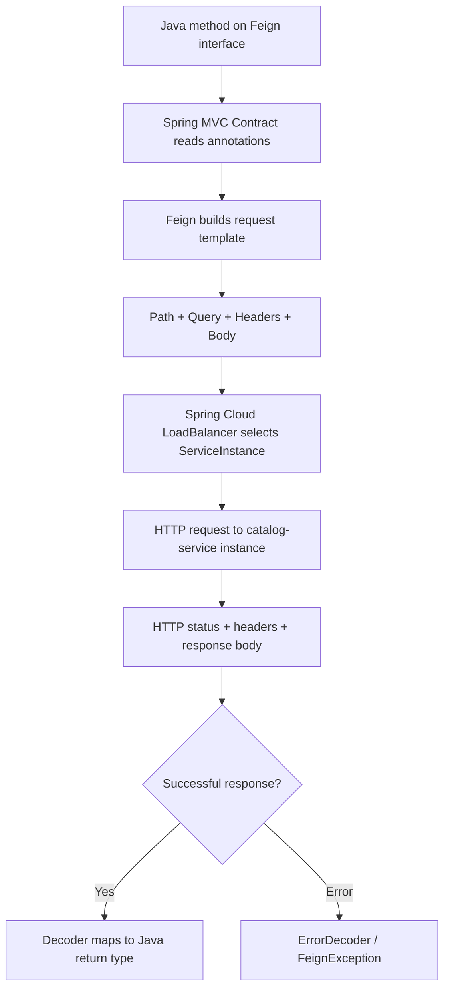
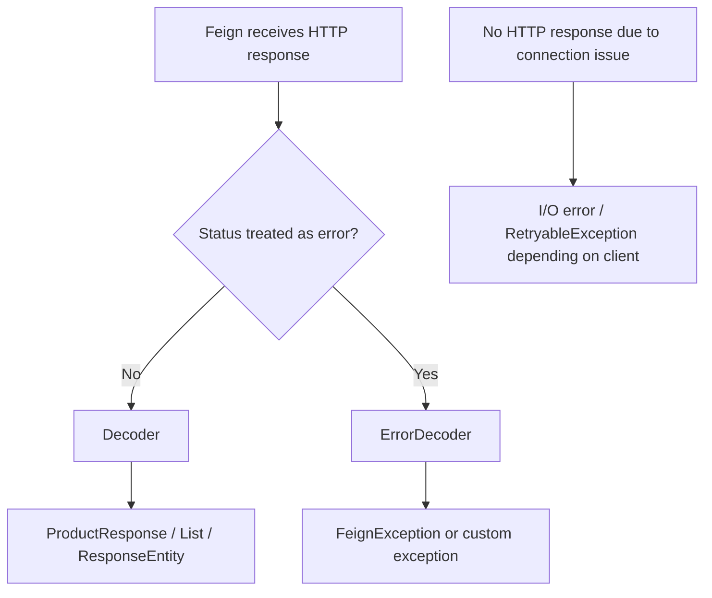

# Mapping Path, Query, Header, Body, and Response Types

Spring Cloud OpenFeign lets you describe a service's HTTP API as a **Java interface**. Instead of manually assembling URLs, adding headers, serializing JSON, and parsing responses at every call site, developers declare annotations such as `@GetMapping`, `@PathVariable`, `@RequestParam`, `@RequestHeader`, and `@RequestBody`. Feign generates the HTTP client from that contract.

In the Spring Cloud LoadBalancer module, a `@FeignClient(name = "catalog-service")` interface normally uses the **service ID** to locate replicas via discovery and LoadBalancer. However, routing to the right replica does not guarantee a valid request: a single mistake in a path variable name, query parameter, `Content-Type`, or response type can still make the service return `400`, `404`, `415`, or trigger JSON decoding errors.

This lesson walks through mapping **path, query, headers, body, and response types**, explains how data transforms between Java and HTTP, and shows how to diagnose errors at the OpenFeign – LoadBalancer – target service boundary.

## 1. From Java Method to HTTP Request

Suppose `order-service` needs to access `catalog-service` with this API contract:

| Operation | HTTP API | Meaning |
|---|---|---|
| View product | `GET /api/products/{id}` | ID sits in the **path** |
| Search products | `GET /api/products?category=...&page=...` | Criteria sit in the **query** |
| Create product | `POST /api/products` with JSON | Data sits in the **body** |
| Update product | `PUT /api/products/{id}` with JSON | Path identifies the resource; body carries payload |
| Delete product | `DELETE /api/products/{id}` | May return `204 No Content` |

A Java invocation may correspond to the request:

```http
POST /api/products HTTP/1.1
Host: catalog-service
Accept: application/json
Content-Type: application/json
X-Correlation-Id: req-0081

{"name":"Mechanical Keyboard","price":1500000}
```

`catalog-service` in this example is the **logical** hostname of the service ID when the request flows through Spring Cloud LoadBalancer, not a fixed IP address. The underlying HTTP connector sends the request to the host/port of the chosen `ServiceInstance`; the path, query, headers, and body must still match the target API's contract.



In Spring Cloud OpenFeign, **Spring MVC Contract** is the mechanism typically used to interpret Spring Web annotations. Do not mix native Feign `@RequestLine` syntax with Spring MVC `@GetMapping` in the same interface unless you have changed the contract accordingly.

## 2. Initializing a Feign Client with a Service ID

In a compatible Spring Boot project, you need the Spring Cloud OpenFeign and Spring Cloud LoadBalancer dependencies, plus a `ServiceInstance` provider such as Eureka, Consul, or static discovery configuration.

Maven starter example (versions managed by a Spring Cloud BOM compatible with Spring Boot):

```xml
<dependency>
    <groupId>org.springframework.cloud</groupId>
    <artifactId>spring-cloud-starter-openfeign</artifactId>
</dependency>
<dependency>
    <groupId>org.springframework.cloud</groupId>
    <artifactId>spring-cloud-starter-loadbalancer</artifactId>
</dependency>
```

Enable scanning for Feign interfaces:

```java
package com.example.orders;

import org.springframework.boot.SpringApplication;
import org.springframework.boot.autoconfigure.SpringBootApplication;
import org.springframework.cloud.openfeign.EnableFeignClients;

@SpringBootApplication
@EnableFeignClients(basePackages = "com.example.orders.client")
public class OrderApplication {
    public static void main(String[] args) {
        SpringApplication.run(OrderApplication.class, args);
    }
}
```

DTOs used in the examples:

```java
package com.example.orders.client;

import java.math.BigDecimal;

public record ProductResponse(
        String id,
        String name,
        BigDecimal price) { }

public record CreateProductRequest(
        String name,
        BigDecimal price) { }

public record UpdateProductRequest(
        String name,
        BigDecimal price) { }
```

On the Feign interface, `name` must match the **service ID** published by discovery:

```java
package com.example.orders.client;

import org.springframework.cloud.openfeign.FeignClient;
import org.springframework.web.bind.annotation.GetMapping;
import org.springframework.web.bind.annotation.PathVariable;

@FeignClient(name = "catalog-service")
public interface CatalogFeignClient {

    @GetMapping("/api/products/{id}")
    ProductResponse getProduct(@PathVariable("id") String id);
}
```

Feign maps `getProduct("42")` to `GET /api/products/42`. If `catalog-service` has multiple instances, Spring Cloud LoadBalancer can select one according to configuration. If the interface sets a fixed `url` in `@FeignClient`, the call typically targets that address directly instead of resolving the service ID via LoadBalancer.

**Configuration note:** place `@GetMapping`/`@PostMapping` on individual methods of the Feign interface. Do not rely on a class-level `@RequestMapping` on `@FeignClient`, as that style is not supported the same way as on regular Spring MVC controllers in current Spring Cloud OpenFeign versions.

## 3. Mapping Paths with `@PathVariable`

A path variable sits inside the **path segment** of the URL and typically identifies a specific resource:

```java
@GetMapping("/api/products/{id}")
ProductResponse getProduct(@PathVariable("id") String id);

@GetMapping("/api/categories/{categoryId}/products/{productId}")
ProductResponse getProductInCategory(
        @PathVariable("categoryId") String categoryId,
        @PathVariable("productId") String productId);
```

Call site:

```java
ProductResponse product =
        client.getProductInCategory("keyboard", "42");
```

Corresponds to:

```http
GET /api/categories/keyboard/products/42 HTTP/1.1
```

Important rules:

1. The name in `@PathVariable("productId")` must match the `{productId}` placeholder in the path. `@PathVariable("id")` cannot arbitrarily stand in for `{productId}`.
2. Declare names **explicitly** so the contract remains stable regardless of whether the compiler retains parameter-name metadata.
3. Feign handles path value encoding according to the active contract/encoder; do not concatenate URL strings manually or double-encode values yourself.
4. For IDs containing `/`, `?`, percent signs, or special characters, test the actual encoded output for your version and API design. Some HTTP servers/proxies handle encoded slashes differently. **Do not use path variables to pass arbitrary data containing path separators** without an explicit contract agreement.

**Common mistake:**

```java
// WRONG: placeholder is {productId}, but annotation specifies "id".
@GetMapping("/api/products/{productId}")
ProductResponse wrong(@PathVariable("id") String id);
```

This mapping mistake can surface when building the request or produce an unexpected request. The fix is to align the names:

```java
@GetMapping("/api/products/{productId}")
ProductResponse correct(@PathVariable("productId") String id);
```

## 4. Mapping Queries with `@RequestParam`

Query parameters follow `?` and represent filters, search terms, pagination, or display options. Queries do **not** replace resource-identifying paths.

```java
@GetMapping("/api/products")
List<ProductResponse> findProducts(
        @RequestParam("category") String category,
        @RequestParam("page") int page,
        @RequestParam("size") int size);
```

Example call:

```java
List<ProductResponse> products =
        client.findProducts("keyboard", 0, 20);
```

Semantically corresponding request:

```http
GET /api/products?category=keyboard&page=0&size=20 HTTP/1.1
```

The order of query parameters in the URL **does not have to match** the Java parameter declaration order. The server should process parameters by key name rather than position.

### 4.1. Optional Queries and Empty Values

```java
@GetMapping("/api/products/search")
List<ProductResponse> searchProducts(
        @RequestParam("q") String keyword,
        @RequestParam(value = "category", required = false)
        String category);
```

When `category` is `null`, query construction may omit the parameter depending on the encoder/contract; verify with HTTP tests if the contract distinguishes **omitted**, **empty string**, and **literal string `"null"`**. Do not assume `null` means `category=` across all versions.

Spring MVC's `@RequestParam(defaultValue = "0")` is helpful on a **receiving controller**, but should not be relied on as the sole mechanism for Feign **sending** default values upstream. The client should normalize required options explicitly before calling.

### 4.2. Query Objects with `@SpringQueryMap`

When there are many filter fields, you can group them into a Java bean and annotate it with `@SpringQueryMap`:

```java
package com.example.orders.client;

public class ProductSearchQuery {
    private String category;
    private Integer page;
    private Integer size;

    public String getCategory() { return category; }
    public void setCategory(String category) { this.category = category; }

    public Integer getPage() { return page; }
    public void setPage(Integer page) { this.page = page; }

    public Integer getSize() { return size; }
    public void setSize(Integer size) { this.size = size; }
}
```

```java
@GetMapping("/api/products")
List<ProductResponse> findProducts(@SpringQueryMap ProductSearchQuery query);
```

```java
ProductSearchQuery query = new ProductSearchQuery();
query.setCategory("keyboard");
query.setPage(1);
query.setSize(10);
List<ProductResponse> page = client.findProducts(query);
```

In a real interface, import `org.springframework.cloud.openfeign.SpringQueryMap`. `QueryMapEncoder` translates bean properties into query names/values. When a Java field name differs from the API parameter name or has a complex type, customize the encoder or map explicitly. Do not assume nested objects or arbitrary collection structures serialize in the exact format the server expects.

### 4.3. Multi-Valued Queries

Suppose the API accepts multiple tags:

```http
GET /api/products?tag=gaming&tag=wireless HTTP/1.1
```

You can use a collection query parameter and specify the format explicitly when needed:

```java
@CollectionFormat(feign.CollectionFormat.EXPLODED)
@GetMapping("/api/products")
List<ProductResponse> findByTags(@RequestParam("tag") List<String> tags);
```

The `@CollectionFormat` annotation belongs to package `org.springframework.cloud.openfeign`. Depending on the API, the server may expect `tag=gaming,wireless` (CSV) instead of repeated keys; client and server must agree on the format rather than inferring it from `List<String>` alone. Characters such as spaces, `&`, and `+` must be encoded properly.

## 5. Mapping Request Headers with `@RequestHeader`

Headers carry HTTP request metadata: accepted content types, bearer tokens, correlation IDs, locales, or contract-defined business identifiers.

```java
@GetMapping("/api/products/{id}")
ProductResponse getProductWithHeaders(
        @PathVariable("id") String id,
        @RequestHeader("X-Correlation-Id") String correlationId,
        @RequestHeader("Authorization") String authorization);
```

Example:

```java
ProductResponse product = client.getProductWithHeaders(
        "42",
        "req-0081",
        "Bearer " + accessToken);
```

HTTP wire format semantically:

```http
GET /api/products/42 HTTP/1.1
Authorization: Bearer <token>
X-Correlation-Id: req-0081
```

Principles:

- Use `@RequestHeader("X-Correlation-Id")` for values that change **per call**; use a `RequestInterceptor` for headers added according to **client policy**.
- `Accept` describes the response format the client wants to receive; `Content-Type` describes the format of the body the client sends. They **do not replace each other**.
- Do not log bearer tokens, cookies, or secret headers. Do not blindly forward every header from external requests to internal services.
- Only forward user tokens when your system's authorization model permits it; many systems use dedicated service credentials instead of reusing the caller's token directly.

### 5.1. Common Headers via `RequestInterceptor`

Example of an interceptor dedicated **exclusively** to `catalog-service`:

```java
import feign.RequestInterceptor;
import org.springframework.context.annotation.Bean;

public class CatalogFeignConfiguration {

    @Bean
    RequestInterceptor catalogClientHeader() {
        return request -> request.header(
                "X-Client-App", "order-service");
    }
}
```

Attach to the Feign client:

```java
@FeignClient(
        name = "catalog-service",
        configuration = CatalogFeignConfiguration.class)
public interface CatalogFeignClient {
    // @GetMapping / @PostMapping methods...
}
```

When you only want to apply an interceptor to one Feign client, **do not place `CatalogFeignConfiguration` within the main application's component scan** if it defines configuration beans that could be shared globally. Place it in a package outside the scan scope and reference it via `configuration = ...`. This is the same bean-scoping principle as per-service LoadBalancer configuration, even though **the Feign context and LoadBalancer context are separate mechanisms**.

Do not rely on `ThreadLocal` to retrieve tokens across all kinds of asynchronous processing: when using thread pools, circuit breakers, or other propagation boundaries, propagate security context through an appropriate mechanism.

## 6. Mapping JSON Bodies with `@RequestBody`

For requests that create or update resources, the JSON payload sits in the **HTTP body**, unlike query or path parameters. Spring Cloud OpenFeign typically uses `SpringEncoder` and the `HttpMessageConverter`s configured by Spring Boot to serialize Java objects into JSON when the media type and dependencies are present.

```java
@PostMapping(
        value = "/api/products",
        consumes = MediaType.APPLICATION_JSON_VALUE)
ProductResponse createProduct(
        @RequestBody CreateProductRequest request);
```

```java
CreateProductRequest request =
        new CreateProductRequest(
                "Mechanical Keyboard", new BigDecimal("1500000"));

ProductResponse created = client.createProduct(request);
```

Corresponding request:

```http
POST /api/products HTTP/1.1
Content-Type: application/json

{"name":"Mechanical Keyboard","price":1500000}
```

`MediaType` in the snippet belongs to `org.springframework.http.MediaType`; `@PostMapping` and `@RequestBody` belong to `org.springframework.web.bind.annotation`. The request/response records in the earlier section share the same fields as the JSON illustration. Actual configuration must ensure an appropriate JSON converter is present and the server accepts this schema.

### 6.1. Combining Path with Body

```java
@PutMapping(
        value = "/api/products/{id}",
        consumes = MediaType.APPLICATION_JSON_VALUE)
ResponseEntity<Void> updateProduct(
        @PathVariable("id") String id,
        @RequestBody UpdateProductRequest request);
```

Calling `updateProduct("42", body)` places `42` in the **path**, while `name` and `price` go into the **body**. These values have distinct meanings. If the server also requires the ID in the body, agree on consistency rules; Feign does not synchronize both places automatically.

### 6.2. Common Body Errors

| Error | Symptom | How to Handle |
|---|---|---|
| Missing `@RequestBody` or wrong contract declaration | Body is not serialized as expected | Check method annotations and actual HTTP request |
| `Content-Type` does not match server's `consumes` | `415 Unsupported Media Type` | Use matching media type and encoder |
| JSON missing required field or wrong type | `400` / `422` depending on server | Inspect DTO, validation, and error payload |
| Sending `null` for a required request body | API may reject invalid input | Clarify `null` semantics, validation, and contract |
| DTO field names do not match JSON | Invalid payload or dropped fields | Match DTO to contract or use appropriate JSON annotations |

A Feign method having multiple parameters does not mean every parameter goes into the body. Parameters must carry annotations indicating **their position in the HTTP request**. For a normal JSON document, wrap the data in **a single request DTO** annotated with `@RequestBody` rather than trying to create multiple independent bodies.

## 7. Form and Multipart Mapping Differ from JSON Body

`application/json`, `application/x-www-form-urlencoded`, and `multipart/form-data` are distinct formats. Do not take a method using a JSON `@RequestBody`, swap `consumes` to multipart, and expect the encoder to handle it automatically.

Example of a multipart contract accepting a file:

```java
@PostMapping(
        value = "/api/products/{id}/images",
        consumes = MediaType.MULTIPART_FORM_DATA_VALUE)
void uploadImage(
        @PathVariable("id") String productId,
        @RequestPart("file") MultipartFile file);
```

`@RequestPart` belongs to Spring Web and `MultipartFile` belongs to `org.springframework.web.multipart`. For this call to work, you need a multipart encoder supported by your Spring Cloud OpenFeign version and application configuration. If the server expects JSON metadata and files across multiple parts, explicitly declare `@RequestPart` for each part. Test **part names**, filenames, per-part content types, and upload size limits.

Do not confuse `@RequestParam` queries with form fields: server-side decoding depends on `Content-Type` and the endpoint contract. When an API accepts forms, design a dedicated DTO/encoder and verify the wire format rather than relying on accidental serialization behavior.

## 8. Choosing Return Types: DTO, `List<T>`, `ResponseEntity<T>`, `void`

The return type on the Feign interface dictates how the decoder interprets the **HTTP response**. The right type lets the business layer work with Java data instead of raw JSON, provided it matches the body the server actually returns.

| Return Type | Used For | Notes |
|---|---|---|
| `ProductResponse` | JSON object of a single product | Empty body may yield `null` |
| `List<ProductResponse>` | JSON array `[{},{}]` | Different from a JSON object wrapping `items` |
| `ResponseEntity<ProductResponse>` | Need status, headers, and DTO | 4xx/5xx still throw exceptions by default |
| `ResponseEntity<Void>` | Need status/headers without body | Suitable for `204 No Content` |
| `void` | No need to handle success body | Does not expose status directly to caller |
| Envelope DTO, e.g., `CatalogPageResponse` | Server returns JSON `{"items":[...],"total":...}` | DTO must mirror the exact structure |

### 8.1. Reading Status and Headers with `ResponseEntity`

```java
@GetMapping("/api/products/{id}")
ResponseEntity<ProductResponse> getProductWithResponse(
        @PathVariable("id") String id);

@DeleteMapping("/api/products/{id}")
ResponseEntity<Void> deleteProduct(
        @PathVariable("id") String id);
```

In a service:

```java
ResponseEntity<ProductResponse> response =
        client.getProductWithResponse("42");

int status = response.getStatusCode().value();
String requestId = response.getHeaders().getFirst("X-Request-Id");
ProductResponse body = response.getBody();

if (body == null) {
    throw new IllegalStateException(
            "Catalog response missing product body");
}
```

Unlike `ResponseEntity` in a Spring MVC controller, here it is **the HTTP client's result type**. Under default error handling, Feign does not return a `ResponseEntity` with status `404` for business code to inspect; HTTP error statuses are normally converted into exceptions in the ErrorDecoder step.

### 8.2. Generic Collections and Response Envelopes

When the JSON response is an array, the method can declare:

```java
@GetMapping("/api/products")
List<ProductResponse> getAllProducts();
```

If the JSON is a paginated object:

```json
{
  "items": [
    {"id": "42", "name": "Keyboard", "price": 1500000}
  ],
  "total": 1
}
```

The DTO must map the **object**, not a list:

```java
public record CatalogPageResponse(
        List<ProductResponse> items,
        long total) { }
```

```java
@GetMapping("/api/products")
CatalogPageResponse getPage(@RequestParam("page") int page);
```

Some serializers/decoders support generic wrappers like `ApiResponse<List<ProductResponse>>` if type metadata is preserved properly in the method signature. Still, test the actual schema rather than assuming Spring Data's `Page<ProductResponse>` is always compatible with paginated JSON produced by another service.

### 8.3. Empty Responses and `204` Status

`204 No Content` typically has no response body. Use `ResponseEntity<Void>` or `void` when the contract allows it. If an API is declared to return `ProductResponse` yet actually returns `204`, the result may be `null`; do not assume `ProductResponse` is always non-null merely because the Java method declares a return type.

## 9. Distinguishing Decoder and ErrorDecoder

Spring Cloud OpenFeign typically provides a decoder backed by **Spring `HttpMessageConverter`s** to read successful bodies, such as `SpringDecoder` and `ResponseEntity` support. When an HTTP status indicates an error, Feign invokes **ErrorDecoder** instead of decoding the response as a success DTO.



Typical error-handling example:

```java
try {
    ProductResponse product = client.getProduct("42");
} catch (FeignException.NotFound ex) {
    // catalog-service returned 404, if no custom ErrorDecoder is configured.
    throw new ProductNotFoundException("42", ex);
} catch (FeignException ex) {
    // Other HTTP status or error represented as a Feign exception.
    log.warn("Catalog call failed: status={}", ex.status());
    throw new CatalogDependencyException(ex);
}
```

The example assumes `feign.FeignException` is imported and `ProductNotFoundException`/`CatalogDependencyException` are defined in the application. In certain transport scenarios, Feign may throw `RetryableException` or another exception depending on the HTTP client/version; do not assume every exception necessarily carries an actual HTTP response.

Do not convert every HTTP error into a `404` on the caller's API. Resource `404`, conflict `409`, rate-limit `429`, dependency `5xx`, and connection errors must be handled according to the **business contract**. Pay special attention to idempotency when enabling retries for state-mutating requests.

**Special option:** some versions support `dismiss404`/non-default 404 handling configuration. When enabled, `404` may be routed through the decoder instead of throwing an error in the usual way. Always check Feign client configuration and test actual behavior; do not rely solely on the method signature.

## 10. Separating Request-Mapping Errors from Instance-Selection Errors

In an application using Spring Cloud LoadBalancer, a Feign call goes through two independent sets of decisions:

1. **HTTP mapping:** Feign converts annotations into method/path/query/headers/body and determines how to decode the response.
2. **Service discovery/load balancing:** Spring Cloud locates instances for `catalog-service` and chooses a destination address.

Examples:

| Symptom | Possible Cause | What to Check |
|---|---|---|
| `404` despite discovery finding multiple instances | Path or route mismatch, or ID does not exist | `@GetMapping`, `@PathVariable`, server logs, and HTTP status |
| `400` or `422` | Wrong query/body field name, missing field, or validation failure | Wire query, JSON schema, `@RequestParam`, `@RequestBody` |
| `401` or `403` | Missing/invalid auth header, authorization policy | `@RequestHeader`, interceptor, token security |
| `415` | Body encoder and `Content-Type` mismatch | `consumes`, media type, encoder, and target controller |
| `406` | `Accept` cannot be satisfied by server | `Accept` header, `produces`, and response type |
| HTTP 200 yet decoding fails | JSON does not match DTO or content type | Response body, decoder, generic types |
| No instance for service ID | Registry/discovery or supplier returns empty list | `@FeignClient(name)`, discovery, health/zone filters |
| Connection refused or timeout | Selected instance unreachable/failing | Host:port, network, timeouts, readiness, retries |

Do not tweak `@RequestBody` just because you received a timeout: a timeout can happen before the server sends any response. Conversely, do not increase retries if the error is consistently a `400` caused by a contract-violating body.

If the Feign client is declared as `@FeignClient(name = "catalog-service", url = "...")`, determine whether **fixed URL** or **service discovery** is in use before reasoning about LoadBalancer. A wrong `url` can send diagnostics completely off track.

## 11. Testing the Request Contract and Response Types

When writing or editing a Feign interface, verify the **actual outgoing requests**, not just the annotation code. Use an HTTP mock server (such as WireMock/MockWebServer) or a test replica of the target service to record method, path, query, headers, body, and response.

A practical workflow:

1. **Path:** call `getProduct("42")` and confirm the mock server sees `GET /api/products/42`. Test IDs with special characters and verify encoding.
2. **Query:** call search with `category`, `page`, `size`; compare key names and representations. With `@SpringQueryMap`, test missing properties, `null`, and collection queries.
3. **Header:** pass `X-Correlation-Id` and a dummy auth value in the test environment, verify the header is present; never put real tokens into snapshots/logs.
4. **Body:** send `CreateProductRequest`, check `Content-Type`, JSON keys, and numeric values. Test missing fields, wrong types, and validation responses.
5. **Object response:** mock returns product JSON; confirm the decoder builds the expected `ProductResponse`.
6. **List/envelope response:** mock returns both a JSON array and a JSON object with `items`; confirm the matching method decodes properly and a mismatched return type fails as expected.
7. **Empty response:** return `204 No Content` for a `ResponseEntity<Void>` method; confirm it does not attempt to parse a body.
8. **HTTP errors:** mock returns `404`, `409`, `429`, `503` with error payloads; test `FeignException` or custom `ErrorDecoder`, then verify business-layer error mapping.
9. **Discovery/LoadBalancer:** run at least two `catalog-service` instances without a fixed `url`, and verify both can be selected according to the active policy.
10. **Connection failure:** make an instance unreachable; observe timeouts, retry count, selected instance, and whether an HTTP response occurred.

Example verification table:

| Java Call | Expected HTTP | Expected Return Type |
|---|---|---|
| `getProduct("42")` | `GET /api/products/42` | `ProductResponse` |
| `findProducts("keyboard", 0, 20)` | `GET /api/products?category=keyboard&page=0&size=20` | `List<ProductResponse>` |
| `createProduct(request)` | `POST /api/products`, JSON body | `ProductResponse` |
| `updateProduct("42", body)` | `PUT /api/products/42`, JSON body | `ResponseEntity<Void>` |
| `deleteProduct("42")` | `DELETE /api/products/42` | `ResponseEntity<Void>` |

In practice, query key order may differ, JSON body field order may vary, and header names are case-insensitive. Tests should compare **HTTP semantics** and avoid brittle byte-for-byte dependence on insignificant ordering.

## 12. Logging, Timeouts, and Retry Policy

To observe requests when integrating OpenFeign:

- Enable controlled Feign logging in test environments, prioritizing method, sanitized URL, status, and duration. `FULL` level can print headers/bodies and **is not suitable for broad use in production** because it may expose tokens or personal data.
- Attach trace/correlation IDs via your observability infrastructure and track service ID, selected instance, HTTP status, attempt count, and duration.
- Configure **connect timeout** and **read timeout** aligned with the service's timing contract. They do not necessarily form a single overall deadline when discovery, retries, and request processing are involved.
- If retries are enabled, explicitly define retryable errors, attempt counts, backoff, and time budgets. By default in Spring Cloud OpenFeign, Feign's retry mechanism is typically configured differently from core OpenFeign's default retryer; do not assume retries happen merely because OpenFeign is used.
- For `POST`/state-changing requests, retries can repeat an operation if the server processed it but the response was lost. An idempotency key or equivalent business safeguard is required.

In addition, `@FeignClient(configuration = ...)` configures the **Feign client** (encoder, decoder, interceptor, logger, retryer, etc.). Configuring instance selection such as health filters, zones, and LoadBalancer policies is **a separate layer** belonging to Spring Cloud LoadBalancer. Do not confuse adjusting an encoder/decoder with changing the `ServiceInstance` selection algorithm.

## 13. Key Rules to Remember

- `@PathVariable` populates URL path placeholders; the annotation name must match the placeholder.
- `@RequestParam` and `@SpringQueryMap` describe query strings; clarify how `null` values, collections, and complex types are represented.
- `@RequestHeader` passes per-request metadata; `RequestInterceptor` adds headers per Feign client policy, without leaking credentials.
- `@RequestBody` and `consumes` govern body serialization; JSON, form, and multipart each have their own contracts.
- Return types `ProductResponse`, `List<ProductResponse>`, `ResponseEntity<T>`, or `Void` must match the real HTTP status and body structure.
- Feign decoders handle successful responses; HTTP 4xx/5xx responses are normally routed through `ErrorDecoder` and exceptions rather than decoded directly into success DTOs.
- When calling by service ID, **correct HTTP mapping** and **LoadBalancer picking a healthy instance** are two independent requirements. Inspect actual requests/responses, traces, timeouts, and retries to isolate failures.

Once you understand each data slot on an HTTP request and response type, OpenFeign makes inter-service communication cleaner while keeping API contracts explicit, testable, and observable in systems powered by Spring Cloud LoadBalancer.
