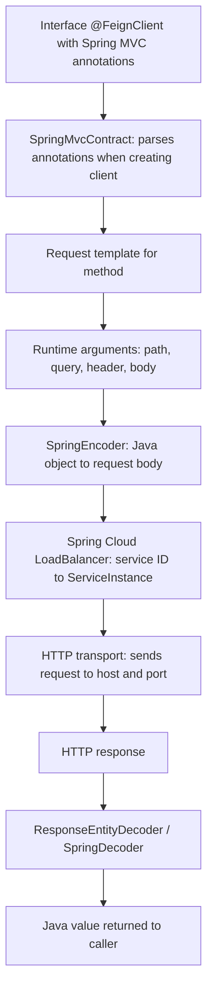
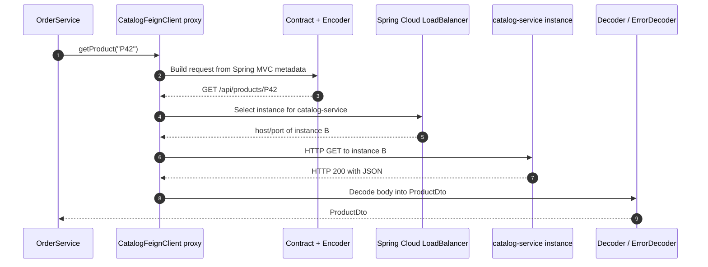

# Spring MVC Contract, Encoder, and Decoder

Spring Cloud OpenFeign lets you describe an HTTP call to another service using a **Java interface** instead of manually building requests with `RestClient`, `RestTemplate`, or `WebClient`. However, an interface only expresses developer intent. To turn a method like `getProduct("P42")` into an HTTP request and turn a JSON response into a Java object, OpenFeign coordinates three distinct components: **Contract**, **Encoder**, and **Decoder**.

In the `SPRING_CLOUD_SERVICE_COMMUNICATION_LOAD_BALANCING` module, OpenFeign also integrates with Spring Cloud LoadBalancer to resolve a logical name like `catalog-service` into a `ServiceInstance` with an actual host and port. Distinguish carefully: **Contract defines what the request looks like; Encoder builds the body; LoadBalancer selects the destination; Decoder reads the result into a Java type**. Understanding those boundaries helps diagnose mapping, JSON, content-type, HTTP status, and load-balancing issues accurately.

## 1. Roles of the Three Components

| Component | Main Input | Output | Common Errors |
|---|---|---|---|
| `Contract` | Annotations and method signatures on the Feign interface | Metadata/request template: HTTP method, path, headers, parameters | Missing annotation, wrong `@PathVariable`, wrong contract for the interface |
| `Encoder` | Java object used as request body, plus request metadata | Body data sent over HTTP, typically JSON or form | No suitable converter, wrong `Content-Type`, body fails to serialize |
| `Decoder` | Successful HTTP response plus declared return type | DTO, `List<T>`, `ResponseEntity<T>`, or matching Java type | JSON does not match DTO, wrong `Content-Type`, missing converter |

`SpringMvcContract` is the contract commonly used by Spring Cloud OpenFeign to understand Spring MVC annotations such as `@GetMapping`, `@PostMapping`, `@RequestParam`, `@PathVariable`, `@RequestHeader`, and `@RequestBody`. `SpringEncoder` and `SpringDecoder` leverage Spring's `HttpMessageConverters` to encode/decode HTTP bodies. In the default configuration, the decoder is typically a `ResponseEntityDecoder` wrapping a `SpringDecoder`, enabling return types like `ResponseEntity<ProductDto>`.



The diagram illustrates logical responsibilities. The contract is normally processed when the Feign client is created; annotations are not re-scanned on every request call. The encoder only runs when there is a body to serialize, and HTTP error responses can pass through `ErrorDecoder` instead of the normal decoder.

## 2. Foundational Setup for OpenFeign and LoadBalancer

In a Maven-based Spring Boot project, the core dependencies are:

```xml
<dependencies>
    <dependency>
        <groupId>org.springframework.cloud</groupId>
        <artifactId>spring-cloud-starter-openfeign</artifactId>
    </dependency>

    <dependency>
        <groupId>org.springframework.cloud</groupId>
        <artifactId>spring-cloud-starter-loadbalancer</artifactId>
    </dependency>
</dependencies>
```

If the application also exposes Spring MVC controllers, add `spring-boot-starter-web` as needed. Compatible Jackson starters and dependencies supply `HttpMessageConverters` for JSON. Use a **Spring Cloud BOM** compatible with your project's Spring Boot version; do not pick OpenFeign and LoadBalancer versions arbitrarily.

Enable Feign client scanning in the calling application:

```java
package com.example.orders;

import com.example.orders.client.CatalogFeignClient;
import org.springframework.boot.SpringApplication;
import org.springframework.boot.autoconfigure.SpringBootApplication;
import org.springframework.cloud.openfeign.EnableFeignClients;

@SpringBootApplication
@EnableFeignClients(clients = CatalogFeignClient.class)
public class OrderApplication {

    public static void main(String[] args) {
        SpringApplication.run(OrderApplication.class, args);
    }
}
```

`@EnableFeignClients` tells Spring to create proxies for interfaces annotated with `@FeignClient`. Depending on the project, you can use `basePackages` or an explicit `clients` list. Without this step, the Feign interface may not be registered as a bean, causing injection to fail before any request is sent.

## 3. Complete Example of Spring MVC Contract

Suppose `order-service` calls `catalog-service` to retrieve a product, search by category, or create a product. The interface can be written as follows:

```java
package com.example.orders.client;

import java.util.List;
import org.springframework.cloud.openfeign.FeignClient;
import org.springframework.http.MediaType;
import org.springframework.http.ResponseEntity;
import org.springframework.web.bind.annotation.GetMapping;
import org.springframework.web.bind.annotation.PathVariable;
import org.springframework.web.bind.annotation.PostMapping;
import org.springframework.web.bind.annotation.RequestBody;
import org.springframework.web.bind.annotation.RequestHeader;
import org.springframework.web.bind.annotation.RequestParam;

@FeignClient(name = "catalog-service", path = "/api/products")
public interface CatalogFeignClient {

    @GetMapping(value = "/{id}", produces = MediaType.APPLICATION_JSON_VALUE)
    ProductDto getProduct(@PathVariable("id") String id);

    @GetMapping(produces = MediaType.APPLICATION_JSON_VALUE)
    List<ProductDto> findProducts(
            @RequestParam("category") String category,
            @RequestParam(value = "limit", required = false) Integer limit);

    @PostMapping(
            consumes = MediaType.APPLICATION_JSON_VALUE,
            produces = MediaType.APPLICATION_JSON_VALUE)
    ResponseEntity<ProductDto> createProduct(
            @RequestHeader("X-Correlation-Id") String correlationId,
            @RequestBody CreateProductRequest request);
}
```

DTOs used in the interface, e.g., with Java `record`:

```java
package com.example.orders.client;

public record ProductDto(String id, String name, int available) {
}

public record CreateProductRequest(String name, int available) {
}
```

In a real Java project, those two `public record` declarations must reside in **two separate Java files**, `ProductDto.java` and `CreateProductRequest.java`. They are grouped together in one code block here solely to present the lesson's DTOs concisely.

Annotations interpreted by `SpringMvcContract` by purpose:

| Annotation | Contract Metadata Produced | Example When Called |
|---|---|---|
| `@FeignClient(name = "catalog-service")` | Client name / service ID | Look up instances of `catalog-service` |
| `@FeignClient(path = "/api/products")` | Path prefix for the client's methods | `/api/products` |
| `@GetMapping("/{id}")` | HTTP `GET` with path template | `/api/products/P42` |
| `@PathVariable("id")` | Substitutes parameter value into `{id}` placeholder | `P42` |
| `@RequestParam("category")` | Appends query parameter | `?category=books` |
| `@RequestHeader("X-Correlation-Id")` | Places value in request header | `X-Correlation-Id: trace-123` |
| `@RequestBody` | Marks parameter as HTTP request body | JSON of `CreateProductRequest` |
| `consumes` / `produces` | Describes expected request/response formats | Corresponding `Content-Type`, `Accept` |

In Feign, Spring MVC annotations are **client-side metadata**. They do not automatically create endpoints on `catalog-service`. The target service still needs a matching controller/HTTP handler. Both sides must agree on method, path, query, body, and data formats.

**Note:** Spring Cloud OpenFeign does not support every Spring MVC controller annotation pattern. For instance, use `path` on `@FeignClient` for a prefix rather than copying a class-level `@RequestMapping` directly from a controller onto a Feign interface without checking support in your version.

## 4. How Does the Contract Turn a Java Call into an HTTP Request?

Suppose a service calls:

```java
ProductDto product = catalogFeignClient.getProduct("P42");
```

The contract already knows this method uses GET, path `/api/products/{id}`, and parameter `id` is a path variable. When invoked, Feign substitutes the placeholder with an appropriately encoded value:

```http
GET /api/products/P42 HTTP/1.1
Host: catalog-service
Accept: application/json
```

`Host` in the HTTP snippet is a logical example. When Spring Cloud LoadBalancer selects an actual instance and the transport sends the request, the connection host/port and related headers may be adjusted accordingly. Do not treat the illustrative `Host` line as proof that Feign sends that exact string on the wire across every HTTP transport.

For `findProducts("books", 10)`, the request takes the form:

```http
GET /api/products?category=books&limit=10 HTTP/1.1
Accept: application/json
```

The contract determines parameter placement, while template expansion and parameter encoders handle inserting values into path/query/headers. Values containing spaces, `/`, Unicode characters, or special characters must be encoded appropriately for their URL context; never concatenate URL strings manually.

If `@PathVariable("id")` is missing or `{id}` in `@GetMapping` does not match, Feign may catch the invalid contract at client creation time or build a malformed request. Some annotation errors therefore surface **at startup**, before the HTTP transport ever has a chance to send a request. When no request reaches the target service at all, inspect the contract before blaming LoadBalancer.

### Spring MVC Contract vs. `feign.Contract.Default`

Core Feign has its own contract using annotations such as `@RequestLine` and `@Param`. Spring Cloud OpenFeign typically uses `SpringMvcContract` to read `@GetMapping`, `@PostMapping`, and familiar Spring MVC annotations.

If you replace the `Contract` bean with `feign.Contract.Default` while keeping an interface annotated with `@GetMapping`, the proxy will not interpret the mappings as intended. Do not swap the contract just to fix a body serialization or response decoding problem; Contract, Encoder, and Decoder solve **three different classes of problems**.

## 5. SpringEncoder: Turning a DTO into a Request Body

When calling:

```java
CreateProductRequest request = new CreateProductRequest("Notebook", 25);

ResponseEntity<ProductDto> response =
        catalogFeignClient.createProduct("trace-123", request);
```

`SpringMvcContract` determines the HTTP method, path, headers, and `@RequestBody` position. Next, **`SpringEncoder`** converts the DTO into the HTTP body using Spring's `HttpMessageConverters`. With a Jackson JSON converter and `Content-Type: application/json`, the body looks like:

```http
POST /api/products HTTP/1.1
Content-Type: application/json
Accept: application/json
X-Correlation-Id: trace-123

{"name":"Notebook","available":25}
```

Key factors in encoding:

1. **Java data type:** DTOs, `String`, byte arrays, or forms require matching converters.
2. **`Content-Type`:** Feign/Spring picks serialization based on the request's media type and registered converters.
3. **Jackson rules:** field names, date/time formats, enums, nulls, and annotations such as `@JsonProperty` affect the JSON output.
4. **Charset and format:** JSON, plain text, binary, or multipart encode differently; not every request is JSON.
5. **Source of converters:** Spring Boot normally auto-configures `HttpMessageConverters`, but replacing the encoder or converter beans can break support for previously working types.

Example DTO with field names differing from the target API:

```java
import com.fasterxml.jackson.annotation.JsonProperty;

public record CreateProductRequest(
        @JsonProperty("product_name") String name,
        @JsonProperty("stock_count") int available) {
}
```

With this DTO, the JSON uses keys `product_name` and `stock_count` instead of `name` and `available`. `SpringEncoder` does not guess the target service's domain schema: both applications must agree on the data contract or use explicit mappings.

### Do Not Confuse `@RequestParam` with `@RequestBody`

`@RequestParam` creates query parameters, whereas `@RequestBody` describes the request body. If the API expects JSON but the Feign interface only uses query parameters, the outgoing request will lack the body the server expects. If the API expects form URL-encoded or multipart data, configure the media type and encoder for that format; do not substitute JSON simply because a DTO can serialize as JSON.

## 6. SpringDecoder and ResponseEntityDecoder: Reading Responses into Java

Suppose `catalog-service` returns:

```http
HTTP/1.1 200 OK
Content-Type: application/json

{"id":"P42","name":"Notebook","available":25}
```

For an interface declaring `ProductDto getProduct(...)`, the decoder must read the response body and instantiate a matching `ProductDto`. `SpringDecoder` leverages `HttpMessageConverters`, where a Jackson converter normally translates JSON into the DTO.

Spring Cloud OpenFeign typically provides by default:

```text
Decoder for Feign client
  └─ ResponseEntityDecoder
       └─ SpringDecoder
            └─ HttpMessageConverters
                 └─ Jackson JSON converter, text converters, ...
```

`ResponseEntityDecoder` adds support for return types such as:

```java
ResponseEntity<ProductDto> createProduct(...);
```

Here the caller can inspect both status and headers alongside the body. If the method returns `ProductDto`, the caller receives only the decoded value of the declared type. Example:

```java
ResponseEntity<ProductDto> result =
        catalogFeignClient.createProduct("trace-123", request);

int status = result.getStatusCode().value();
String location = result.getHeaders().getFirst("Location");
ProductDto product = result.getBody();
```

`List<ProductDto>` or compatible generic types can also be decoded when return-type metadata and converters support them. If the DTO has types incompatible with the JSON, field names change, or the response sends an unexpected content type, decoding errors can occur **after the HTTP request has already succeeded at the network layer**.

### Handle Empty Responses and HTTP Statuses Explicitly

A `DELETE` endpoint may return `204 No Content`; in that case the interface should use an appropriate return type such as `void` or `ResponseEntity<Void>`, rather than forcing the decoder to build a DTO from a nonexistent body. For JSON `null`, optional fields, or missing data, design DTOs and null handling according to the API's rules. The decoder does not magically turn every empty response into a valid domain object.

## 7. Regular Decoder vs. ErrorDecoder

A common mistake is assuming every HTTP response passes through `SpringDecoder`. In Feign, responses with error statuses are normally routed to **`ErrorDecoder`**. By default, Feign throws `FeignException` or a subclass when receiving an HTTP error.

| HTTP Outcome | Component Typically Handling It | Example |
|---|---|---|
| `200 OK` with JSON | `Decoder` (`ResponseEntityDecoder` / `SpringDecoder`) | Produces `ProductDto` |
| `201 Created` with JSON | `Decoder` | Produces `ResponseEntity<ProductDto>` |
| `204 No Content` | Empty-body response handling | `void`, `ResponseEntity<Void>` |
| `400 Bad Request` | `ErrorDecoder` | Produces exception describing invalid request |
| `404 Not Found` | Typically `ErrorDecoder`, depending on 404 options | `FeignException.NotFound` or custom policy |
| `500 Internal Server Error` | `ErrorDecoder` | Server-side error exception |
| Unreachable, timeout | Transport/Feign exception | No HTTP body for `SpringDecoder` to read |

Spring Cloud OpenFeign has options that alter how 404 is handled in some versions. Do not assume 404 always turns into `null`, `Optional.empty()`, or an empty DTO. Inspect the specific client config and express the policy clearly at the business layer.

If you need to map error responses to domain exceptions, you can configure a dedicated `ErrorDecoder` for a Feign client. Example:

```java
package com.example.feignconfig;

import feign.Response;
import feign.codec.ErrorDecoder;
import org.springframework.context.annotation.Bean;

public class CatalogFeignErrorConfiguration {

    @Bean
    ErrorDecoder catalogErrorDecoder() {
        ErrorDecoder delegate = new ErrorDecoder.Default();

        return (methodKey, response) -> {
            if (response.status() == 404) {
                return new CatalogResourceNotFoundException(
                        "Catalog resource not found");
            }
            return delegate.decode(methodKey, response);
        };
    }
}
```

`CatalogResourceNotFoundException` is an application exception and must be declared separately. This is an **illustrative pattern**: if a client has multiple methods with different 404 meanings, distinguish them according to the business contract instead of treating every 404 as "product not found". Avoid reading and logging entire error bodies if they contain sensitive information.

If you want retries on certain statuses, explicitly design the `Retryer` and how retryable exceptions are produced for your API; merely adding an `ErrorDecoder` does not make Feign retry automatically. For create/update requests, uncontrolled retries can cause duplicate execution.

## 8. Customizing Encoder and Decoder per Feign Client

Spring Cloud OpenFeign's default configuration is usually sufficient for standard JSON APIs. Only define custom `Encoder` or `Decoder` beans when you explicitly need to change media types, converters, or payload structures.

Illustrative configuration showing how to rebuild encoder/decoder around Spring's `HttpMessageConverters`:

```java
package com.example.feignconfig;

import feign.codec.Decoder;
import feign.codec.Encoder;
import org.springframework.beans.factory.ObjectFactory;
import org.springframework.boot.autoconfigure.http.HttpMessageConverters;
import org.springframework.cloud.openfeign.support.ResponseEntityDecoder;
import org.springframework.cloud.openfeign.support.SpringDecoder;
import org.springframework.cloud.openfeign.support.SpringEncoder;
import org.springframework.context.annotation.Bean;

public class CatalogFeignCodecConfiguration {

    @Bean
    Encoder catalogEncoder(
            ObjectFactory<HttpMessageConverters> messageConverters) {
        return new SpringEncoder(messageConverters);
    }

    @Bean
    Decoder catalogDecoder(
            ObjectFactory<HttpMessageConverters> messageConverters) {
        return new ResponseEntityDecoder(
                new SpringDecoder(messageConverters));
    }
}
```

In practice, this configuration **mainly illustrates the default wiring** and usually provides no benefit unless you need custom converters. Across Spring Cloud releases, constructors and APIs of support classes can change; check your dependency version before copying verbatim. If a special format is required, pair any `Encoder` or `Decoder` replacement with tests against real requests/responses.

Attach the dedicated configuration to the client:

```java
@FeignClient(
        name = "catalog-service",
        path = "/api/products",
        configuration = CatalogFeignCodecConfiguration.class)
public interface CatalogFeignClient {
    // Declare methods as shown above
}
```

Place `CatalogFeignCodecConfiguration` **outside the component scan scope** of the main application if you only want the configuration to apply to `catalog-service`. If a configuration class containing `Encoder` or `Decoder` beans is scanned into the parent `ApplicationContext`, those beans can affect other Feign clients rather than only the intended one.

When a client needs both codecs and an `ErrorDecoder`, you can group the beans into one per-client configuration class or reference the relevant configuration classes in `configuration`. Be careful not to accidentally declare multiple beans of the same type without clarity on which should be used.

### Tuning via Properties

Spring Cloud OpenFeign also supports per-client configuration via properties, for example:

```yaml
spring:
  cloud:
    openfeign:
      client:
        config:
          catalog-service:
            connectTimeout: 2000
            readTimeout: 5000
            loggerLevel: basic
```

Timeouts in this example are in milliseconds according to the corresponding OpenFeign configuration. These are **HTTP client** settings; they do not replace `Encoder` or `Decoder` and do not govern the instance-selection algorithm. When configuring codecs by class name in properties, check supported class types, how Spring instantiates them, and the scope of the target client.

If multiple interfaces point to the same service ID yet need different codecs, `@FeignClient`'s `contextId` helps differentiate named client contexts and avoid bean-name collisions. When using `contextId`, double-check **which property configuration key maps to the actual client context**, instead of assuming only the service ID key applies.

## 9. Contract/Codec vs. Spring Cloud LoadBalancer

When `@FeignClient(name = "catalog-service")` does not specify a `url`, Spring Cloud OpenFeign can use LoadBalancer to select an instance if the corresponding module is present and properly configured. In modern releases, the integration typically involves a Feign HTTP client such as `FeignBlockingLoadBalancerClient` or a retry-capable variant.



Responsibilities are separated as follows:

- **SpringMvcContract:** turns methods and annotations into metadata used to construct HTTP requests.
- **SpringEncoder:** converts `@RequestBody` values into outgoing payload data.
- **LoadBalancer:** picks an instance from the list supplied by discovery/suppliers.
- **HTTP transport:** opens connections, enforces timeouts, sends requests, and reads responses.
- **SpringDecoder/ResponseEntityDecoder:** converts responses into return values when the status succeeds.
- **ErrorDecoder:** handles HTTP error responses according to the Feign client's policy.

If an explicit URL is declared such as `@FeignClient(name = "catalog-service", url = "http://localhost:8081")`, Feign uses that address rather than resolving the service ID through LoadBalancer in the normal way. Fixed-URL configuration can be useful for protocol tests, yet is unsuitable when the goal is distributing requests across multiple instances from discovery.

## 10. Common Errors and Finding the True Cause

| Symptom | Causes Worth Checking | How to Verify |
|---|---|---|
| Application fails creating Feign bean | Annotation unsupported by current contract, missing `@EnableFeignClients`, or bad mapping | Check startup stack trace and configured `Contract` bean type |
| `@GetMapping` is not recognized | `SpringMvcContract` replaced with Feign `Contract.Default` | Inspect the `Contract` bean in the named client context |
| Server returns `404` for every request | Wrong `@FeignClient(path)`, wrong method/path, or wrong target URL | Log actual request method/path, compare with server API |
| `400 Bad Request` on POST | DTO schema mismatch, missing `@RequestBody`, `Content-Type` mismatch | Inspect wire headers and body, check server validation |
| Fails to serialize body | `Encoder`/converter does not support the type or media type | Inspect exception before HTTP send, check HttpMessageConverters |
| HTTP `200` yet JSON read fails | DTO does not match payload, missing converter, or wrong Content-Type | Safely capture sample response, compare with `ProductDto` and decoder |
| Cannot read status/headers | Method returns DTO instead of `ResponseEntity<T>` | Change signature when caller truly needs HTTP metadata |
| HTTP `404` throws an exception | Response went to `ErrorDecoder` per default policy | Define desired 404 handling at client/business layer |
| Feign calls one fixed host | Hard-coded `url` or URL property overrides discovery | Inspect Feign client config and actually chosen instance |
| No instance found | Empty discovery, wrong service ID, or supplier filtered everything out | Inspect `ServiceInstance` list for the service ID |
| JSON is valid yet slow/times out | Transport or server issue, not Contract/Decoder | Check connect/read timeouts, latency, retries, and connectivity |

**Stage-by-stage diagnostic workflow:**

1. **Initialization:** is the interface registered as a Feign bean, and can `Contract` parse its annotations?
2. **Request creation:** are method/path/query/headers accurate, and does `Encoder` serialize the body for the media type?
3. **Target selection:** is a fixed URL or service ID used, does discovery return instances, and does LoadBalancer select properly?
4. **Transport:** did the request reach host:port, or were there connect/read timeouts or TLS/network errors?
5. **Result handling:** is the HTTP status successful, does the response body decode to the Java type, or did it go through `ErrorDecoder`?

Log at an appropriate level to observe method, path, service ID, selected instance ID, status, and latency. Avoid logging sensitive data such as cookies, tokens, credentials, or entire request/response bodies in production.

## 11. Practice Lab: Testing Contract, Encoding, Decoding, and Load Balancing

### Preparing Two Replicas of `catalog-service`

Run the server application on ports `8081` and `8082`. Each replica exposes endpoints matching `CatalogFeignClient` and returns a header or body identifying its `instanceId`. Spring MVC server example:

```java
@RestController
@RequestMapping("/api/products")
class CatalogController {

    @Value("${server.port}")
    private int port;

    @GetMapping("/{id}")
    ProductDto get(@PathVariable String id) {
        return new ProductDto(id, "Notebook-" + port, 25);
    }

    @PostMapping
    ResponseEntity<ProductDto> create(@RequestBody CreateProductRequest input) {
        ProductDto output = new ProductDto("P-new", input.name(), input.available());
        return ResponseEntity.status(201)
                .header("X-Instance-Port", Integer.toString(port))
                .body(output);
    }
}
```

This snippet is a minimal example for practicing GET/POST. Spring MVC imports, DTOs, and validation logic can be organized in separate Java files in a real project. To test `findProducts`, add a matching GET endpoint with `@RequestParam`.

### Discovery Configuration on the Consumer

```yaml
spring:
  cloud:
    discovery:
      client:
        simple:
          instances:
            catalog-service:
              - uri: http://localhost:8081
              - uri: http://localhost:8082
```

`localhost` only works when the consumer and both server processes run within the local machine's network context. When the consumer runs inside a container, replace it with addresses reachable from that container.

### Four Test Scenarios

| Scenario | Action | Expectation |
|---|---|---|
| **Contract** | Call `getProduct("P42")` | Server sees `GET /api/products/P42` and exact path variable |
| **Encoder** | Call `createProduct(...)` with `CreateProductRequest` | Server receives JSON body and `X-Correlation-Id` header with expected values |
| **Decoder** | Server returns `201` with JSON body and `X-Instance-Port` header | Caller reads `ResponseEntity<ProductDto>` containing status, header, and DTO |
| **LoadBalancer** | Send multiple GET requests to `catalog-service` | With a stable list and round robin, both instances can receive requests |

Perform additional failure experiments:

1. Change the interface path to a nonexistent endpoint to receive `404`. Verify the response passes through `ErrorDecoder` rather than treating it as a Jackson error.
2. Change the returned JSON to a payload incompatible with the DTO to observe a decoder failure while the HTTP status remains successful.
3. Stop one instance while keeping its address in `SimpleDiscoveryClient`. Observe the difference between connection errors, retries/health checks, and fallback to the remaining instance.
4. Set a fixed `url` in a single test to verify the HTTP contract without LoadBalancer, then remove `url` to verify discovery is used.
5. Change `Content-Type` on the server side to an incompatible format and inspect decoding behavior; do not alter mappings without checking media types first.

Do not use **response ordering** as sole proof of round robin: concurrency, retries, health checks, or caching can alter result order. A more reliable approach is having each instance return an identifier and correlating actual requests/responses.

## 12. Production Checklist

1. Is the Feign interface registered by `@EnableFeignClients`?
2. Are Spring MVC annotations in the interface supported by `SpringMvcContract` and aligned with the target HTTP API?
3. Does `@FeignClient(name)` match discovery's service ID and avoid fixed `url` when LoadBalancer is needed?
4. Are `@PathVariable`, `@RequestParam`, `@RequestHeader`, and `@RequestBody` placed properly?
5. Do `consumes`/`produces` and `Content-Type`/`Accept` headers match the actual payloads?
6. Do `SpringEncoder`, `SpringDecoder`, and `ResponseEntityDecoder` support the required DTOs, generic types, and converters?
7. Are successful responses going through `Decoder` clearly distinguished from HTTP errors going through `ErrorDecoder`?
8. If customizing codecs or contracts, are configuration classes kept outside global component scanning to avoid affecting other clients?
9. Have timeouts, retries, health checks, and discovery been tested together, especially for write requests with side effects?
10. Can you observe request mappings, statuses, selected instances, and encode/decode failures without logging secret data?

In summary, **`SpringMvcContract` interprets Spring MVC annotations, `SpringEncoder` builds request bodies, and `SpringDecoder` (usually wrapped in `ResponseEntityDecoder`) converts responses into Java objects**. Spring Cloud LoadBalancer is a separate layer responsible for selecting instances by service ID. By understanding these boundaries and verifying actual requests/responses at each layer, an OpenFeign application can communicate reliably across multiple service replicas without confusing HTTP contract errors with discovery or routing issues.
