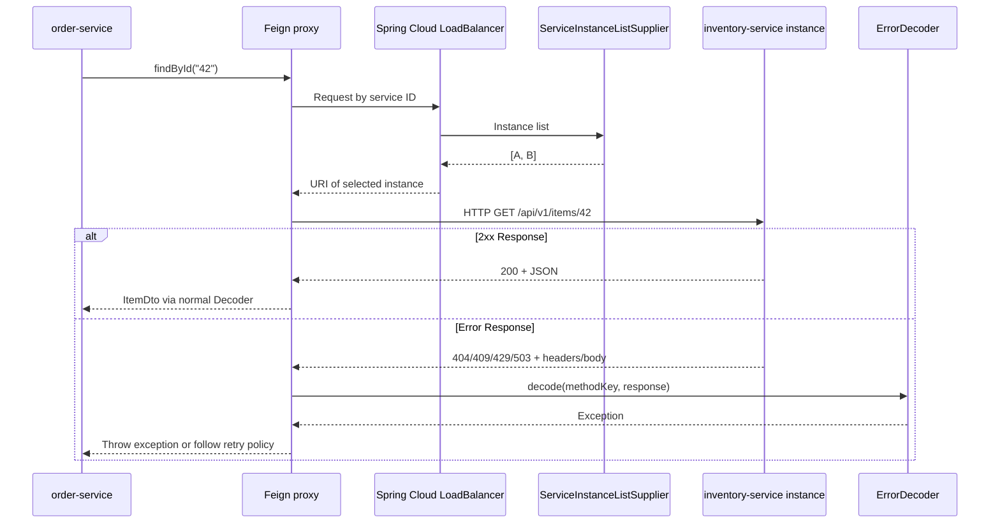

# ErrorDecoder and Classifying Errors from Target Services

In a microservices architecture using Spring Cloud LoadBalancer, a `@FeignClient` can call another service via **service ID** instead of manually managing the IP and port of each `ServiceInstance`. Feign expresses HTTP calls as Java interfaces, while Spring Cloud LoadBalancer selects an instance based on discovery. However, **selecting an instance does not guarantee the call succeeds**: the provider can still return HTTP `404`, `409`, `429`, `500`, or `503`, or the connection can drop before a response arrives.

OpenFeign's **`ErrorDecoder`** is the extension point for converting **unsuccessful HTTP responses** into meaningful exceptions. When designed properly, the calling layer can distinguish business errors (missing data, state conflicts), rate-limit errors, and transient errors at the target service, deciding whether to return an appropriate response, retry within bounds, or fail immediately.

This lesson analyzes the processing order of Feign and Spring Cloud LoadBalancer, default error behavior, implementing an `ErrorDecoder` specifically for `inventory-service`, protecting sensitive bodies/headers, and testing error classification without confusing HTTP errors with discovery or connection errors.

## 1. Where Does ErrorDecoder Sit in the OpenFeign Call Chain?

Suppose `order-service` calls `inventory-service`:

```java
@FeignClient(name = "inventory-service")
interface InventoryClient {
    @GetMapping("/api/v1/items/{id}")
    ItemDto findById(@PathVariable("id") String id);
}
```

With Spring Cloud OpenFeign and Spring Cloud LoadBalancer properly configured, `inventory-service` in the annotation is a **logical service ID**. The LoadBalancer integration selects an instance and the HTTP client executes the request. After receiving the HTTP response, Feign either decodes a success payload or handles an error.



The diagram depicts the case where **an HTTP response arrives from the provider**. If the connection fails, no response is created, so `ErrorDecoder` is not necessarily invoked. Meanwhile, if LoadBalancer finds no instances, some integrations may synthesize an **HTTP 503** instead of calling a backend; `ErrorDecoder` may still observe status 503, yet that 503 did not come from the provider.

Therefore, separate two questions:

1. **Was a target selected and an HTTP request sent to an instance?**
2. **Was there a real HTTP response from the target service, and what status did it carry?**

A `503` status alone is not enough to prove the backend returned `503`, and a connection exception does not by itself prove the instance-selection algorithm is broken.

## 2. How Does Feign Classify Errors by Default?

In OpenFeign, the core interface looks like:

```java
package feign.codec;

public interface ErrorDecoder {
    Exception decode(String methodKey, feign.Response response);
}
```

`methodKey` identifies the Feign method being called; `response` holds the status, headers, request, and body of the HTTP response. When receiving a status outside the success-decoding flow, Feign calls the configured `ErrorDecoder`, barring special configured cases such as routing 404 through the regular decoder.

**By default**, `ErrorDecoder.Default` typically constructs an exception in the `FeignException` hierarchy carrying details about the HTTP response. For responses with a `Retry-After` header, a Feign version may represent the error as `RetryableException` so the retryer has a chance to decide; this is **not** a guarantee that every 429 or 503 will automatically be retried.

| Call Outcome | Typical Processing Path | What the Application Layer Sees |
|---|---|---|
| `200 OK` + valid JSON | Data decoder | `ItemDto` |
| `204 No Content` | Success flow, no body | Result depends on return type and decoder |
| `400/404/409` | ErrorDecoder unless exempted by config | `FeignException` or custom exception |
| `429` | ErrorDecoder | `FeignException` / `RetryableException` / custom exception depending on config |
| `500/502/503/504` | ErrorDecoder | Corresponding HTTP exception or custom exception |
| Failed to open connection | No HTTP response to decode | Feign `RetryableException` or wrapped IOException depending on transport |
| No available instance | Depends on LoadBalancer integration | Possibly synthetic HTTP 503, or LoadBalancer-layer exception |
| 200 body violates JSON schema | Data decoder fails | `DecodeException` or another codec error, **not** via HTTP ErrorDecoder |

Exact exception classes depend on the Feign version, HTTP transport, and configuration. In Spring Cloud OpenFeign, **default retries are usually disabled with `Retryer.NEVER_RETRY`**, unlike some default retry behaviors in core Feign. You must configure retries explicitly if you want automatic retries.

### 2.1. Do Not Lump All FeignExceptions Together

`FeignException` exposes fields like status, request, and part of the response body. Yet these fields do not replace determining the **origin** of the error:

- An HTTP 404 returned by a backend may carry a payload such as `{"code":"ITEM_NOT_FOUND"}`.
- HTTP 503 may originate from the backend, a proxy, or the LoadBalancer layer.
- DNS/TCP/TLS errors usually have no actual HTTP status to classify.
- HTTP 200 with a mismatched JSON body is a data decoding failure, not a status error.

Group errors by **status and API contract**, while recording instance-selection traces, request IDs, and root causes for troubleshooting.

## 3. Preparing the Client and Service ID

In the calling application, typical Maven dependencies include:

```xml
<dependencies>
    <dependency>
        <groupId>org.springframework.cloud</groupId>
        <artifactId>spring-cloud-starter-openfeign</artifactId>
    </dependency>
    <dependency>
        <groupId>org.springframework.cloud</groupId>
        <artifactId>spring-cloud-starter-loadbalancer</artifactId>
    </dependency>
    <dependency>
        <groupId>org.springframework.boot</groupId>
        <artifactId>spring-boot-starter-web</artifactId>
    </dependency>
</dependencies>
```

This is only the dependencies block, not a complete `pom.xml`. The project must use an appropriate Spring Boot parent or dependency management and import a **Spring Cloud BOM compatible with the Spring Boot version**. Adding the OpenFeign starter alone does not provide discovery/instances for load balancing.

Enable Feign clients:

```java
import org.springframework.boot.SpringApplication;
import org.springframework.boot.autoconfigure.SpringBootApplication;
import org.springframework.cloud.openfeign.EnableFeignClients;

@SpringBootApplication
@EnableFeignClients
public class OrderApplication {
    public static void main(String[] args) {
        SpringApplication.run(OrderApplication.class, args);
    }
}
```

Declare a static instance list for the lab environment:

```yaml
server:
  port: 8080

spring:
  application:
    name: order-service
  cloud:
    discovery:
      client:
        simple:
          instances:
            inventory-service:
              - uri: http://localhost:8091
              - uri: http://localhost:8092
```

`SimpleDiscoveryClient` works well for testing two providers on the same machine; in real deployments, registries and health updates are separate components. If the client runs inside a Docker container, `localhost` points to **the client container**, so use a hostname reachable by the provider over the container network.

### 3.1. Defining a Feign Client with Dedicated Configuration

```java
import org.springframework.cloud.openfeign.FeignClient;
import org.springframework.web.bind.annotation.GetMapping;
import org.springframework.web.bind.annotation.PathVariable;

@FeignClient(
        name = "inventory-service",
        configuration = InventoryFeignConfiguration.class)
public interface InventoryClient {

    @GetMapping("/api/v1/items/{id}")
    ItemDto findById(@PathVariable("id") String id);
}
```

Example DTO in the client project:

```java
public record ItemDto(String id, String name, String servedBy) {
}
```

`@FeignClient(name = "inventory-service")` works with LoadBalancer to call the logical service name. You do not write code selecting `8091` or `8092` inside `InventoryClient`. `InventoryFeignConfiguration` will specify the `ErrorDecoder` used for this client.

> **Configuration scope:** a configuration class dedicated to `@FeignClient(configuration=...)` should be placed **outside the application's normal component scan path**, unless broader application is intentional. If that class accidentally enters the parent ApplicationContext, beans such as `ErrorDecoder` can affect other Feign clients and distort per-service error policies.

## 4. Building an ErrorDecoder Aligned with the API Contract

Suppose the inventory API has this contract:

| Status | Meaning in Inventory API | Desired Application Exception |
|---|---|---|
| `404` | Item does not exist when calling `findById` | `ItemNotFoundException` |
| `409` | Conflicting inventory state | `InventoryConflictException` |
| `429` | Backend requests throttling | `InventoryRateLimitedException` |
| `502/503/504` | Inventory or gateway temporarily unavailable | `InventoryUnavailableException` |
| `400/401/403/422/500` and other statuses | No custom rule | Delegate to `ErrorDecoder.Default` |

**There is no universal rule that "404 always means item not found".** A 404 can mean a wrong path, wrong API version, or policy block. Only map to a domain error when the endpoint and service contract define it clearly. If multiple Feign methods share the same `ErrorDecoder`, inspect standardized error codes in the body or the method key to avoid misapplying rules across endpoints.

### 4.1. Java Code for the Custom Decoder

Example implementing `InventoryErrorDecoder`. The code preserves the default decoder for non-customized statuses; because it **does not pre-read the body** in the default branch, `ErrorDecoder.Default` can still read the error body when creating `FeignException`.

```java
import feign.Response;
import feign.codec.ErrorDecoder;

import java.util.Collection;
import java.util.Map;

public final class InventoryErrorDecoder implements ErrorDecoder {

    private final ErrorDecoder delegate = new ErrorDecoder.Default();

    @Override
    public Exception decode(String methodKey, Response response) {
        int status = response.status();

        return switch (status) {
            case 404 -> new ItemNotFoundException(methodKey);
            case 409 -> new InventoryConflictException(methodKey);
            case 429 -> new InventoryRateLimitedException(
                    methodKey, firstHeader(response, "Retry-After"));
            case 502, 503, 504 ->
                    new InventoryUnavailableException(status, methodKey);
            default -> delegate.decode(methodKey, response);
        };
    }

    private static String firstHeader(Response response, String name) {
        for (Map.Entry<String, Collection<String>> entry
                : response.headers().entrySet()) {
            if (entry.getKey().equalsIgnoreCase(name)) {
                return entry.getValue().stream()
                        .findFirst()
                        .orElse(null);
            }
        }
        return null;
    }

    public static class InventoryHttpException extends RuntimeException {
        private final int upstreamStatus;

        InventoryHttpException(int status, String methodKey) {
            super("Inventory call failed: " + methodKey
                    + ", upstreamStatus=" + status);
            this.upstreamStatus = status;
        }

        public int upstreamStatus() {
            return upstreamStatus;
        }
    }

    public static final class ItemNotFoundException
            extends InventoryHttpException {
        ItemNotFoundException(String methodKey) {
            super(404, methodKey);
        }
    }

    public static final class InventoryConflictException
            extends InventoryHttpException {
        InventoryConflictException(String methodKey) {
            super(409, methodKey);
        }
    }

    public static final class InventoryRateLimitedException
            extends InventoryHttpException {
        private final String retryAfter;

        InventoryRateLimitedException(
                String methodKey, String retryAfter) {
            super(429, methodKey);
            this.retryAfter = retryAfter;
        }

        public String retryAfter() {
            return retryAfter;
        }
    }

    public static final class InventoryUnavailableException
            extends InventoryHttpException {
        InventoryUnavailableException(int status, String methodKey) {
            super(status, methodKey);
        }
    }
}
```

This illustrative code classifies by status for a **client that only has the `findById` endpoint**. If `InventoryClient` adds other operations, converting every 404 into `ItemNotFoundException` can be wrong: combine error codes in the payload, identify the operation, or split policies into appropriate decoders for different API groups.

The custom exceptions here are `RuntimeException`s. They **do not gain automatic retry behavior** simply by being named "Unavailable" or "RateLimited". If the system needs retries, define retry conditions separately; never let `ErrorDecoder` sleep or issue extra HTTP requests.

### 4.2. Registering ErrorDecoder for the Right Feign Client

```java
import feign.codec.ErrorDecoder;
import org.springframework.context.annotation.Bean;
import org.springframework.context.annotation.Configuration;

@Configuration(proxyBeanMethods = false)
public class InventoryFeignConfiguration {

    @Bean
    ErrorDecoder inventoryErrorDecoder() {
        return new InventoryErrorDecoder();
    }
}
```

Place `InventoryFeignConfiguration` outside `OrderApplication`'s default component scan while referencing it via `@FeignClient`'s `configuration` attribute. That way, `inventory-service`'s error policy does not accidentally override the decoder for `pricing-service` or other clients.

If per-client timeouts are also needed, you can combine them in Spring Cloud OpenFeign's configuration namespace for that service ID, but **timeouts** and **`ErrorDecoder`** are separate responsibilities: the decoder only handles responses already delivered to Feign, and does not govern socket wait times.

## 5. Error Body, Headers, and Reading Size Limits

Many APIs return not just an HTTP code, but also a structured error payload, for example:

```json
{
  "code": "ITEM_NOT_FOUND",
  "message": "Item does not exist",
  "requestId": "req-123"
}
```

In this case, combining `status` and `code` is more reliable than checking status alone. For instance, two 404s can differ: `ITEM_NOT_FOUND` carries business meaning, whereas a 404 caused by a wrong URI or gateway routing must be diagnosed separately.

**Note:** `Response.Body` may be a **read-once** stream. If a custom decoder consumes the entire body and then invokes `ErrorDecoder.Default`, the default decoder may have no remaining data to build a `FeignException` with an intact body. Choose one of two patterns:

- If **defining a custom exception**, read the body in a bounded way and construct your own exception for that branch.
- If **delegating to the default decoder**, do not consume the body before calling `delegate.decode(...)`; or reconstruct a `Response` with a fresh body before delegating.

In a custom branch, also bound how many bytes are read to guard against oversized or untrusted error bodies:

```java
import com.fasterxml.jackson.databind.JsonNode;
import com.fasterxml.jackson.databind.ObjectMapper;
import feign.Response;

import java.io.IOException;
import java.io.InputStream;

final class ErrorPayloadReader {

    private static final int MAX_ERROR_BYTES = 4096;
    private static final ObjectMapper MAPPER = new ObjectMapper();

    static String readErrorCode(Response response) {
        if (response.body() == null) {
            return null;
        }

        // Only call in a branch that returns its own exception;
        // do not read and then delegate the original response.
        try (InputStream input = response.body().asInputStream()) {
            byte[] bytes = input.readNBytes(MAX_ERROR_BYTES + 1);
            if (bytes.length > MAX_ERROR_BYTES) {
                return null;
            }

            JsonNode root = MAPPER.readTree(bytes);
            return root == null
                    ? null
                    : root.path("code").asText(null);
        } catch (IOException exception) {
            return null;
        }
    }
}
```

This is an **optional** helper for APIs with structured JSON errors per contract. For example, `InventoryErrorDecoder` can check `status == 404` and `"ITEM_NOT_FOUND".equals(ErrorPayloadReader.readErrorCode(response))` to distinguish a business 404 from an infrastructure 404; since the body was consumed in that branch, return your own exception instead of delegating the original `response` to the default decoder.

Avoid forwarding raw upstream `message` strings to end-user responses: they may contain stack traces, internal paths, personal data, or sensitive details. Record correlation IDs, method keys, statuses, and **normalized error codes**, limit the cardinality of codes used as metric labels, and protect all tokens/auth headers.

### Retry-After Does Not Automatically Mean Retry

For `429` or `503`, a `Retry-After` header may contain seconds or an HTTP-date. The `firstHeader` helper in Section 4 extracts the raw value to pass up to the layer that decides retries. It **does not parse, sleep, or retry**.

Example response:

```http
HTTP/1.1 429 Too Many Requests
Content-Type: application/json
Retry-After: 2

{"code":"RATE_LIMITED","message":"Try later"}
```

Retry only when you have a **retry budget**, overall deadline cap, backoff/jitter, idempotency guarantees, and clear visibility into the rate-limit source. If hundreds of clients immediately retry together, pressure on the backend worsens instead of easing.

## 6. 404, dismiss404, and the Difference Between Decoder and ErrorDecoder

Feign distinguishes:

- Regular `Decoder`: turns successful responses into the method's return type, e.g., JSON into `ItemDto`.
- `ErrorDecoder`: turns HTTP error responses into exceptions.

Spring Cloud OpenFeign supports routing 404 through the regular decoder, typically called `dismiss404`. Example property:

```yaml
spring:
  cloud:
    openfeign:
      client:
        config:
          inventory-service:
            dismiss404: true
```

When `dismiss404` is enabled, 404 responses may **bypass `ErrorDecoder`** and be passed to `Decoder`. Depending on the return type, body, and decoder, this can produce null/empty results, though it does not guarantee every 404 automatically becomes a valid `Optional.empty()` across all configurations.

If your policy is "404 must produce `ItemNotFoundException` in a custom ErrorDecoder", keep `dismiss404: false` (usually the default) and verify no other config overrides it. If you intentionally want 404 to yield an absent result, design the return-type contract and explicitly test the regular decoder path rather than mixing both mechanisms without clear precedence.

| Desired Design | Option to Consider |
|---|---|
| 404 is a business error with an explicit code | Custom `ErrorDecoder`; keep `dismiss404=false` |
| 404 means "not found" handled by caller as an empty value | Consider `dismiss404` with matching decoder/return type, or catch `FeignException.NotFound` in service layer |
| 404 might indicate wrong routing/path | Do not convert every 404 blindly into `ItemNotFoundException` |
| Need to read JSON error `{"code":...}` | Define error contract and read body once with size bounds |

## 7. Distinguishing Exceptions at the Service Layer

Once the decoder maps statuses, the service layer can apply distinct reactions:

```java
import feign.FeignException;
import feign.RetryableException;
import org.springframework.stereotype.Service;

@Service
public class OrderInventoryService {

    private final InventoryClient inventoryClient;

    public OrderInventoryService(InventoryClient inventoryClient) {
        this.inventoryClient = inventoryClient;
    }

    public ItemDto requireItem(String id) {
        try {
            return inventoryClient.findById(id);
        } catch (InventoryErrorDecoder.ItemNotFoundException exception) {
            // Item does not exist per API contract.
            throw exception;
        } catch (InventoryErrorDecoder.InventoryRateLimitedException exception) {
            // Throttle / degrade gracefully; do not retry blindly inside catch.
            throw exception;
        } catch (InventoryErrorDecoder.InventoryUnavailableException exception) {
            // Upstream HTTP 502/503/504 or synthetic 503 response
            // possibly coming from load balancer.
            throw exception;
        } catch (RetryableException exception) {
            // Connection failure or Feign-emitted retryable error.
            // Do not assume this is an HTTP 503 from the provider.
            throw exception;
        } catch (FeignException exception) {
            // Other HTTP status or unmapped Feign error.
            throw exception;
        }
    }
}
```

The example intentionally branches without adding fallbacks so it is clear **which exception enters which handling path**. In a real application, after classification you can map 404 to a 404 response, apply a circuit breaker to transient errors, or return a degraded response if the business contract allows it.

**Note on synthetic 503:** `InventoryUnavailableException` names **an HTTP code and degradation signal**, without asserting the request reached a provider. Some `FeignBlockingLoadBalancerClient` setups synthesize a 503 response when no instance is found; that response can still flow through `ErrorDecoder`. To conclude "upstream returned 503", combine observations from the instance-selection layer and HTTP client rather than catching by status alone.

### 7.1. Mapping Exceptions to API Responses

If `order-service` exposes a REST API to callers, custom exceptions should not turn every failure into a default HTTP 500. For example, you can declare:

```java
import org.springframework.http.HttpStatus;
import org.springframework.http.ResponseEntity;
import org.springframework.web.bind.annotation.ExceptionHandler;
import org.springframework.web.bind.annotation.RestControllerAdvice;

import java.util.Map;

@RestControllerAdvice
class InventoryExceptionAdvice {

    @ExceptionHandler(InventoryErrorDecoder.ItemNotFoundException.class)
    ResponseEntity<Map<String, String>> notFound(
            InventoryErrorDecoder.ItemNotFoundException ex) {
        return ResponseEntity.status(HttpStatus.NOT_FOUND)
                .body(Map.of("code", "ITEM_NOT_FOUND"));
    }

    @ExceptionHandler(InventoryErrorDecoder.InventoryConflictException.class)
    ResponseEntity<Map<String, String>> conflict(
            InventoryErrorDecoder.InventoryConflictException ex) {
        return ResponseEntity.status(HttpStatus.CONFLICT)
                .body(Map.of("code", "INVENTORY_CONFLICT"));
    }

    @ExceptionHandler(InventoryErrorDecoder.InventoryRateLimitedException.class)
    ResponseEntity<Map<String, String>> rateLimited(
            InventoryErrorDecoder.InventoryRateLimitedException ex) {
        return ResponseEntity.status(HttpStatus.SERVICE_UNAVAILABLE)
                .body(Map.of("code", "UPSTREAM_RATE_LIMITED"));
    }

    @ExceptionHandler(InventoryErrorDecoder.InventoryUnavailableException.class)
    ResponseEntity<Map<String, String>> unavailable(
            InventoryErrorDecoder.InventoryUnavailableException ex) {
        return ResponseEntity.status(HttpStatus.SERVICE_UNAVAILABLE)
                .body(Map.of("code", "UPSTREAM_UNAVAILABLE"));
    }
}
```

Here an upstream 429 is mapped to 503 on `order-service`'s API as an **illustrative decision**; another application might choose 429 if rate limits apply directly to its caller. Do not echo raw upstream bodies/error messages or forward unchecked `Retry-After` headers publicly. For write endpoints, preserve semantics carefully and prevent downstream exceptions from leaking internal state unnecessarily.

## 8. Timeout, Retry, and LoadBalancer Configuration: Do Not Mix Responsibilities

`ErrorDecoder` does not set timeouts and does not govern the instance-selection algorithm. In Spring Cloud OpenFeign, timeouts can be configured per client:

```yaml
spring:
  cloud:
    openfeign:
      client:
        config:
          inventory-service:
            connectTimeout: 1000
            readTimeout: 2000
```

Values here illustrate **milliseconds** and should be tuned to system characteristics. `connectTimeout` limits connection setup time; `readTimeout` governs waiting for response data, with exact behavior depending on the HTTP client in use. A request with multiple retries also needs an **overall deadline** at the business layer to stay within its time budget.

### 8.1. Retryer and ErrorDecoder

Spring Cloud OpenFeign normally registers `Retryer.NEVER_RETRY` by default, meaning there are no automatic Feign-level retries merely because a `RetryableException` or 503 response occurs. If retries are desired, design them explicitly by method, error type, attempt count, and operation cost.

| Layer / Mechanism | What Does It Decide? |
|---|---|
| `ErrorDecoder` | Which exception an HTTP status maps to |
| Feign `Retryer` | Whether to retry a retryable exception |
| Spring Cloud LoadBalancer Retry | Whether to retry a call or re-select an instance, depending on config/integration |
| `ServiceInstanceListSupplier` / load balancer | Candidate list and selected instance |
| HTTP transport | Connect/read timeouts, connections, TLS, and body |
| Circuit breaker / resilience policy | Short-circuiting calls, fallbacks, and load shedding |

**Do not** enable multiple retry layers independently: two retries in Feign multiplied by two retries in another layer can generate far more HTTP attempts than intended. Count **total attempts end-to-end**, not just each library's individual setting.

### 8.2. When Are Retries Reasonable?

Some idempotent GETs can retry after transient connection errors or 502/503/504 if budget remains. Conversely, for write or payment APIs, a timeout **does not prove** the server failed to process the operation: retrying without an idempotency key can cause duplicates.

Never unconditionally retry errors like 400, 401, 403, 404, or 409. For 429, respect rate limiting and `Retry-After` per validated policy. During an outage affecting all instances, mass retries can trigger a **retry storm** and worsen degradation.

## 9. Hands-On: Building a Provider Returning Multiple Error Types

To verify `ErrorDecoder`, run two `inventory-service` replicas on ports 8091 and 8092, each exposing the same endpoint. The provider can use Spring Boot Web and a simple controller:

```java
import org.springframework.beans.factory.annotation.Value;
import org.springframework.http.HttpHeaders;
import org.springframework.http.HttpStatus;
import org.springframework.http.ResponseEntity;
import org.springframework.web.bind.annotation.GetMapping;
import org.springframework.web.bind.annotation.PathVariable;
import org.springframework.web.bind.annotation.RestController;

record ApiError(String code, String message) {
}

@RestController
class InventoryDemoController {

    private final int port;

    InventoryDemoController(@Value("${server.port}") int port) {
        this.port = port;
    }

    @GetMapping("/api/v1/items/{id}")
    ResponseEntity<?> getItem(@PathVariable String id) {
        return switch (id) {
            case "missing" -> ResponseEntity.status(HttpStatus.NOT_FOUND)
                    .body(new ApiError("ITEM_NOT_FOUND", "No such item"));
            case "conflict" -> ResponseEntity.status(HttpStatus.CONFLICT)
                    .body(new ApiError("STOCK_CONFLICT", "Inventory conflict"));
            case "limited" -> ResponseEntity.status(429)
                    .header(HttpHeaders.RETRY_AFTER, "2")
                    .body(new ApiError("RATE_LIMITED", "Please retry later"));
            case "down" -> ResponseEntity.status(HttpStatus.SERVICE_UNAVAILABLE)
                    .body(new ApiError("INVENTORY_UNAVAILABLE", "Temporary issue"));
            default -> ResponseEntity.ok(
                    new ItemDto(id, "Item " + id, "inventory-" + port));
        };
    }
}
```

`ItemDto` in the provider can be defined as a record with the same structure as on the client. Run two processes:

```bash
# Terminal A
java -jar inventory-service.jar --server.port=8091

# Terminal B
java -jar inventory-service.jar --server.port=8092
```

Test the providers **directly** first:

```bash
curl -i http://localhost:8091/api/v1/items/42
curl -i http://localhost:8091/api/v1/items/missing
curl -i http://localhost:8092/api/v1/items/conflict
curl -i http://localhost:8092/api/v1/items/limited
curl -i http://localhost:8091/api/v1/items/down
```

Expect statuses `200`, `404`, `409`, `429` (with `Retry-After: 2` header), and `503` respectively. Both replicas must share the same HTTP contract; `servedBy` helps observe which replica handled the request. Do not proceed to decoder tests until direct responses are verified.

### 9.1. A Client Endpoint to Observe Mapping Results

`order-service` can expose:

```java
import org.springframework.web.bind.annotation.GetMapping;
import org.springframework.web.bind.annotation.PathVariable;
import org.springframework.web.bind.annotation.RestController;

@RestController
class InventoryProxyController {

    private final InventoryClient client;

    InventoryProxyController(InventoryClient client) {
        this.client = client;
    }

    @GetMapping("/test/items/{id}")
    ItemDto get(@PathVariable String id) {
        return client.findById(id);
    }
}
```

Once `InventoryFeignConfiguration` and `InventoryExceptionAdvice` above are registered, invoke:

```bash
curl -i http://localhost:8080/test/items/42
curl -i http://localhost:8080/test/items/missing
curl -i http://localhost:8080/test/items/conflict
curl -i http://localhost:8080/test/items/limited
curl -i http://localhost:8080/test/items/down
```

Note: the HTTP response from the proxy **need not** match the upstream status, because `@RestControllerAdvice` can translate according to API policy. In the example, upstream 429 intentionally becomes 503 at the proxy. Without an exception handler, Feign or custom exceptions may turn into a generic HTTP 500 from the client application.

## 10. Test Matrix and Non-HTTP Failure Cases

To avoid superficial testing, verify both the **exception type** and the **failure layer**.

| Input | Provider / LoadBalancer Outcome | Expected in `InventoryErrorDecoder` |
|---|---|---|
| `findById("42")` | HTTP 200 + ItemDto | ErrorDecoder not called; returns DTO |
| `findById("missing")` | HTTP 404 | `ItemNotFoundException` |
| `findById("conflict")` | HTTP 409 | `InventoryConflictException` |
| `findById("limited")` | HTTP 429, `Retry-After: 2` | `InventoryRateLimitedException` with `retryAfter() == "2"` |
| `findById("down")` | HTTP 503 from provider | `InventoryUnavailableException` |
| Client has no instances | LoadBalancer may synthesize HTTP 503 | May enter the same 503 branch; **do not conclude provider failed** |
| Selected instance's port is closed | Connection refused | ErrorDecoder **receives no HTTP response** to handle |
| HTTP 200 response holds malformed JSON | Decode error | Does not enter HTTP ErrorDecoder branch |
| Uncustomized HTTP 500 | Feign default | Exception produced by `ErrorDecoder.Default` |

### 10.1. Unit Testing the Decoder Without Running a Provider

Because `ErrorDecoder` only takes `methodKey` and `Response`, you can unit-test mapping with synthetic response objects:

```java
import static org.junit.jupiter.api.Assertions.assertEquals;
import static org.junit.jupiter.api.Assertions.assertInstanceOf;

import feign.Request;
import feign.Response;
import org.junit.jupiter.api.Test;

import java.nio.charset.StandardCharsets;
import java.util.Map;

class InventoryErrorDecoderTest {

    private final InventoryErrorDecoder decoder =
            new InventoryErrorDecoder();

    private Response response(int status, Map<String, java.util.Collection<String>> headers) {
        Request request = Request.create(
                Request.HttpMethod.GET,
                "http://inventory-service/api/v1/items/42",
                Map.of(),
                null,
                StandardCharsets.UTF_8,
                null);

        return Response.builder()
                .request(request)
                .status(status)
                .reason("Test")
                .headers(headers)
                .build();
    }

    @Test
    void converts404ToBusinessException() {
        Exception error = decoder.decode(
                "InventoryClient#findById(String)",
                response(404, Map.of()));

        assertInstanceOf(
                InventoryErrorDecoder.ItemNotFoundException.class, error);
    }

    @Test
    void keepsRetryAfterFrom429() {
        Exception error = decoder.decode(
                "InventoryClient#findById(String)",
                response(429, Map.of("Retry-After", java.util.List.of("2"))));

        InventoryErrorDecoder.InventoryRateLimitedException rateLimited =
                assertInstanceOf(
                        InventoryErrorDecoder.InventoryRateLimitedException.class,
                        error);
        assertEquals("2", rateLimited.retryAfter());
    }
}
```

This test template uses OpenFeign's `Request.create` API; if your project's library version differs in signature, adjust how `Request` is constructed rather than changing application logic. Unit tests **do not prove** the Feign proxy or LoadBalancer is wired properly; integration tests must still build real clients or providers/stubs and send HTTP requests by service ID.

### 10.2. Recommended Integration Scenarios

1. **Healthy instance:** provider returns 200; verify `servedBy` in DTO and confirm ErrorDecoder is not called.
2. **404/409/429:** mock/stub returns specified statuses and payloads; verify custom exceptions from the Feign client.
3. **503 from backend:** verify status mapping and trace of the selected instance.
4. **Empty instance list:** test the no-target case without assuming 503 came from the backend.
5. **Provider dies after selection:** test connection and timeout failures without expecting ErrorDecoder to receive an HTTP response.
6. **`dismiss404=true` configuration:** verify the 404 path changes compared to the expected ErrorDecoder flow, if the project uses this option.
7. **Bounded retries:** verify actual HTTP attempt counts rather than asserting only the final exception.

## 11. Observing and Troubleshooting Errors in Real Environments

| Symptom | Possible Cause | How to Investigate |
|---|---|---|
| ErrorDecoder does not receive 404 | `dismiss404=true`, Feign client uses another config, or request never got a response | Check per-client config and root exception |
| Every client gets inventory's decoder | `InventoryFeignConfiguration` scanned in parent context | Move config outside scan scope, verify bean scope |
| 503 still occurs when provider is healthy | LoadBalancer has no instances, gateway returned 503, or stale discovery/cache | Record 503 source, service ID, selected instance, and discovery |
| `RetryableException` when port is closed | Network/HTTP transport failure, not a 5xx response | Check host:port, DNS, TCP/TLS, timeouts |
| Continuous retries after HTTP 429 | Unbounded Retryer or resilience policy | Inspect `Retry-After`, deadline, backoff, and total attempts |
| Missing body in default FeignException | Custom decoder consumed body stream before delegating | Avoid reading body in fallback branch or rebuild response |
| 404 treated as missing item despite wrong endpoint | Mapping relies solely on status without checking API contract | Check error code, method key, and routing |
| HTTP 200 yet Feign fails | Data decoder cannot parse JSON or wrong Content-Type | Check payload, DTO, schema, and regular decoder |

### Fields to Log/Trace

- `serviceId`, Feign client name, `methodKey`, and operation.
- LoadBalancer-selected instance, target address, and correlation/request ID (where permitted).
- HTTP status, normalized business error code, exception type, and root cause.
- Timeouts, total HTTP attempts, retry count, and deadline.
- Response latency, discovery/cache state, and candidate instance count.

Avoid logging tokens, cookies, Authorization headers, or entire sensitive error payloads. `Feign Logger.Level.FULL` is helpful in labs yet can record sensitive headers/bodies and generate massive logs; control log levels per environment and security policy.

## 12. Checklist and Key Takeaways

- [ ] Distinguish **HTTP errors with a response** from connection errors, timeouts, empty discovery, and body decode errors.
- [ ] Understand `ErrorDecoder.decode(methodKey, response)` handles error responses; 2xx normally passes through the data decoder.
- [ ] Never assume HTTP 503 definitely came from the provider; LoadBalancer can also synthesize a 503 response.
- [ ] Write `ErrorDecoder` per API contract and register it cleanly via `@FeignClient(configuration=...)`.
- [ ] For statuses without custom rules, delegate to `ErrorDecoder.Default` **before consuming the body**.
- [ ] When reading error payloads, bound byte size, parse safely, and avoid exposing sensitive data.
- [ ] Distinguish `dismiss404` from converting 404 to an exception via ErrorDecoder.
- [ ] Remember custom exceptions do not enable retries automatically; verify `Retryer.NEVER_RETRY` in Spring Cloud OpenFeign.
- [ ] Apply timeouts, retry budgets, idempotency, and observability tailored to the call type.
- [ ] Include unit tests for status mapping and integration tests verifying calls through LoadBalancer to providers.

**Conclusion:** `ErrorDecoder` is the boundary where OpenFeign translates **a call's HTTP status** into **an application-meaningful exception**. Good design goes beyond mapping 404/409/429/503: it separates real HTTP errors from LoadBalancer-synthesized 503s and response-less transport errors, keeps bodies/headers safe, and ties retries and timeouts to bounded recovery policies. That makes inter-service communication clearer, easier to test, and easier to troubleshoot.
