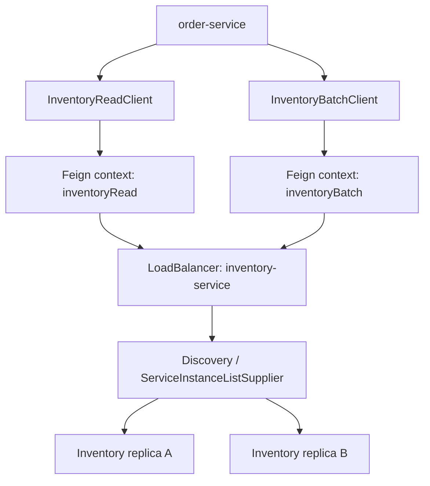
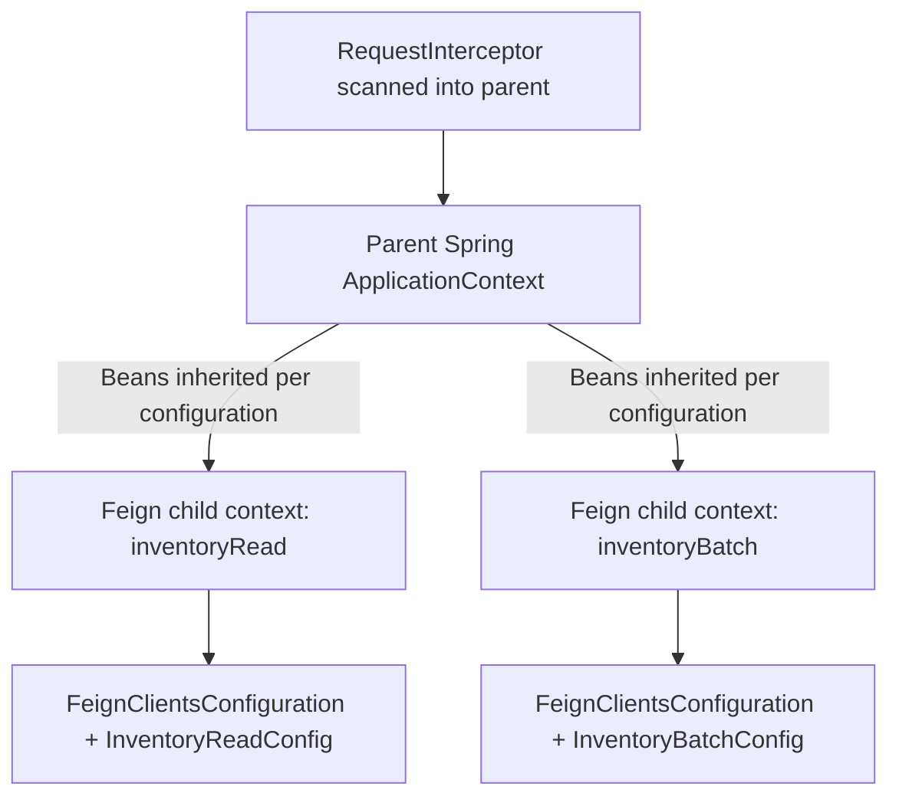

# Per-Client Feign Configuration and Preventing Beans from Leaking Across Clients

When an application uses multiple `@FeignClient` interfaces, not every client needs the same timeouts, error decoder, log level, interceptors, or authentication credentials. For example, `order-service` might call `inventory-service` for fast stock lookups while another client calls the same service for longer reconciliation batches. If the batch client's configuration is accidentally registered in the **parent ApplicationContext**, unrelated clients can inherit the same `RequestInterceptor`, `Retryer`, or `ErrorDecoder`. The consequences can include wrong timeouts, leaked headers, inflated retry counts, and puzzling failures.

This lesson belongs to the **OpenFeign** chapter of the Spring Cloud LoadBalancer module. Its goal is to show how to:

- Distinguish service ID (`name`), client configuration identifier (`contextId`), and a configuration class dedicated to a single Feign client.
- Understand how Spring Cloud OpenFeign creates **named client contexts** and inherits beans from the parent context.
- Avoid letting `@Configuration`, `@ComponentScan`, or `@EnableFeignClients(defaultConfiguration=...)` turn a dedicated config into a global default.
- Combine Java configuration and `application.yml` without disrupting timeouts, retries, discovery, health checks, zone routing, and observability of other clients.
- Verify isolation via behavioral tests rather than relying merely on successful application startup.

## 1. Scenario: Two Feign Clients, One Target Service

Suppose `order-service` has two distinct ways of calling `inventory-service`:

| Client | Responsibility | Desired Configuration |
|---|---|---|
| `InventoryReadClient` | Fetch stock to answer user requests. | Short read timeout, basic logging, header `X-Operation: read`. |
| `InventoryBatchClient` | Fetch stock data for internal reconciliation. | Longer read timeout, separate retry limit, header `X-Operation: batch`. |

Both call service ID `inventory-service` so Spring Cloud LoadBalancer selects a `ServiceInstance` from discovery, yet **their calling contracts and HTTP policies differ**.

Desired design:



Key point: two separate Feign contexts **do not automatically correspond to two separate replica pools**. If both use `name = "inventory-service"` without specifying a fixed URL, they can still select from the **same service ID**. `contextId` separates client configuration; instance selection policy belongs to the LoadBalancer layer and the suppliers/filters applied to that service ID.

## 2. How Is a Named Client Context Created?

Spring Cloud OpenFeign uses a **named clients** model. For each client identifier, the framework builds a child context on demand containing default beans from `FeignClientsConfiguration` plus custom beans declared for that client. Components that can be involved include:

| Component | Purpose |
|---|---|
| `feign.Decoder` | Converts response bodies into Java types. |
| `feign.Encoder` | Encodes request bodies into outgoing content. |
| `feign.Contract` | Interprets annotations on the Feign interface. |
| `RequestInterceptor` | Adds/modifies headers, queries, or metadata on Feign requests. |
| `ErrorDecoder` | Converts HTTP error responses into appropriate exceptions. |
| `Retryer` | Feign-layer retry policy, depending on version/configuration. |
| `Logger.Level` | Feign logging verbosity. |
| `Request.Options` | Request options, including connect/read timeouts per Feign API. |

Not all of these beans share the exact same default initialization source. OpenFeign defines some beans via `FeignClientsConfiguration`, while others are optionally looked up from the context. During bean lookup, a child context **can see beans from the parent context**. This exact mechanism allows a bean unintentionally defined in the main context to spill over to multiple Feign clients.



**Configuration isolation** does not mean severing every bean from the main application. Child contexts still maintain a parent/child relationship and intentionally share certain components. Placing `@FeignClient(configuration = ...)` properly reduces accidental overrides, yet **does not automatically remove shared beans that already exist in the parent**.

## 3. Three Attributes to Distinguish: name, contextId, configuration

Example:

```java
@FeignClient(
    name = "inventory-service",
    contextId = "inventoryRead",
    configuration = InventoryReadFeignConfig.class
)
public interface InventoryReadClient {

    @GetMapping("/api/items/{id}")
    ItemDto findItem(@PathVariable("id") String id);
}
```

| Attribute | Meaning | Common Mistake |
|---|---|---|
| `name` | Logical service name; when calling via LoadBalancer, usually the service ID used for instance lookup. | Assuming each `name` is forced to have a single HTTP configuration. |
| `contextId` | Distinguishes the named-client context and configuration bean identity of the Feign client. | Omitting it when creating multiple clients with the same `name` needing different configs. |
| `configuration` | Additional configuration class/group inside the specified client's context. | Letting this class be scanned as global bean configuration. |
| `url` (if used) | Fixed/configured target address for the client. | Assuming every client with `url` still uses discovery and service-ID load balancing. |

When **selecting instances via Spring Cloud LoadBalancer**, the primary pattern keeps `name = "inventory-service"` and **omits `url`**. If a direct target URL is declared, Feign can call that URL directly instead of asking LoadBalancer to pick a `ServiceInstance` for the service ID; keep this distinction in mind when testing discovery, health checks, and zone routing.

## 4. Two Interfaces with the Same name but Different contextIds

To avoid configuration bean collisions, specify two distinct `contextId`s:

```java
import org.springframework.cloud.openfeign.FeignClient;
import org.springframework.web.bind.annotation.GetMapping;
import org.springframework.web.bind.annotation.PathVariable;

@FeignClient(
    name = "inventory-service",
    contextId = "inventoryRead",
    configuration = InventoryReadFeignConfig.class
)
public interface InventoryReadClient {

    @GetMapping("/api/items/{id}")
    ItemDto findItem(@PathVariable("id") String id);
}
```

```java
@FeignClient(
    name = "inventory-service",
    contextId = "inventoryBatch",
    configuration = InventoryBatchFeignConfig.class
)
public interface InventoryBatchClient {

    @GetMapping("/api/items/export")
    String exportItems();
}
```

`ItemDto` is an application-defined DTO; familiar imports are omitted from the second snippet. Because the two interfaces are distinct types, they can be injected directly by type:

```java
@Service
class InventoryApplicationService {

    private final InventoryReadClient readClient;
    private final InventoryBatchClient batchClient;

    InventoryApplicationService(
            InventoryReadClient readClient,
            InventoryBatchClient batchClient) {
        this.readClient = readClient;
        this.batchClient = batchClient;
    }
}
```

If two beans share the same type or an interface has multiple implementations in the application, use an appropriate qualifier/bean name; `contextId` does not replace Spring's general autowiring rules.

### When Is contextId Especially Necessary?

In supported Spring Cloud OpenFeign versions, when two Feign clients share **the same `name` but have different configurations**, separate `contextId`s are needed to prevent context/configuration bean identifier conflicts. Without them, configuration errors may occur or one client may receive the wrong set of beans. Never rely on the luck of initialization order.

## 5. Where to Place Dedicated Configuration Classes to Avoid Global Scanning?

Example of safe configuration using **a class without `@Configuration`**, referenced only via `@FeignClient(configuration = ...)`:

```java
import feign.RequestInterceptor;
import feign.Logger;
import org.springframework.context.annotation.Bean;

// Do not add @Configuration/@Component to this class.
// Registered inside the inventoryRead context.
public class InventoryReadFeignConfig {

    @Bean
    RequestInterceptor readOperationHeader() {
        return template ->
            template.header("X-Operation", "read");
    }

    @Bean
    Logger.Level readFeignLogLevel() {
        return Logger.Level.BASIC;
    }
}
```

Independent configuration for the batch reconciliation client:

```java
import feign.RequestInterceptor;
import feign.Logger;
import org.springframework.context.annotation.Bean;

// Registered inside the inventoryBatch context.
public class InventoryBatchFeignConfig {

    @Bean
    RequestInterceptor batchOperationHeader() {
        return template ->
            template.header("X-Operation", "batch");
    }

    @Bean
    Logger.Level batchFeignLogLevel() {
        return Logger.Level.NONE;
    }
}
```

The example intentionally picks a non-sensitive header for observation. In real systems, never treat a client-supplied `X-Operation` header as authorization proof; upstream must enforce authentication/authorization independently.

**Package rule:** place `InventoryReadFeignConfig` and `InventoryBatchFeignConfig` where the main application's `@ComponentScan` will not pull them into the parent. Omitting `@Configuration` normally prevents standard component scanning from auto-discovering the class, yet adding stereotype annotations, importing it directly, or using overly broad scanning can still register it mistakenly. The cleanest approach is placing Feign configs in a separate package **outside `@SpringBootApplication`'s scan scope**, referencing them only via `configuration`.

An illustrative layout:

```text
com.example.order
  OrderApplication.java                 (@SpringBootApplication)
  clients/
    InventoryReadClient.java
    InventoryBatchClient.java
  service/
    InventoryApplicationService.java

com.example.feignclientconfig            (outside order's component scan)
  InventoryReadFeignConfig.java
  InventoryBatchFeignConfig.java
```

If the application needs to scan client interfaces in another package, use `@EnableFeignClients(clients = {...})` or configure targeted `basePackages`. Do not widen component scanning across the entire workspace just so Feign interfaces are found, as that can pull dedicated config classes into the parent.

## 6. Counter-Example: One Client's Bean Leaking to All Clients

Suppose a developer writes:

```java
package com.example.order.config;

import feign.RequestInterceptor;
import org.springframework.context.annotation.Bean;
import org.springframework.context.annotation.Configuration;

@Configuration // Scanned into parent by @SpringBootApplication.
public class InventoryBatchFeignConfig {

    @Bean
    RequestInterceptor batchOperationHeader() {
        return request ->
            request.header("X-Operation", "batch");
    }
}
```

And references this class on `InventoryBatchClient`:

```java
@FeignClient(
    name = "inventory-service",
    contextId = "inventoryBatch",
    configuration = InventoryBatchFeignConfig.class
)
interface InventoryBatchClient {
    // ...
}
```

Because `InventoryBatchFeignConfig` lies inside component scan scope, the `batchOperationHeader` bean can become a **parent bean**. When creating `InventoryReadClient` and other Feign clients, OpenFeign can discover that `RequestInterceptor` from the parent and apply it to unintended requests. If the interceptor adds `Authorization` or `X-Tenant-ID`, the bug escalates from a wrong header into **credential leakage or wrong-tenant routing**.

Listing a class in `configuration = InventoryBatchFeignConfig.class` **does not guarantee the class exists only in the child context** if Spring already registered it in the parent beforehand.

### Fixing the Root Problem

1. **Exclude client configuration classes from the main application's component scan**: place them outside base packages, omit `@Configuration` when unnecessary, or explicitly exclude them from scanning.
2. Register the class solely via `@FeignClient(configuration = ...)` on the target client.
3. Do not create client-specific `RequestInterceptor`, `Decoder`, `Encoder`, `Retryer`, or `ErrorDecoder` beans in shared configuration unless **you truly want every client to use them**.
4. Test whether headers/timeouts/error behavior are accidentally applied to other Feign clients.

Note: merely removing `@Configuration` while keeping `@Component` or `@Import` in the parent **does not solve global bean registration**. Check every path by which the class enters the ApplicationContext.

## 7. @EnableFeignClients: Shared Defaults vs. Per-Client Configuration

`@EnableFeignClients` enables Spring Cloud to discover `@FeignClient` interfaces. Example explicitly scoping two interfaces:

```java
@SpringBootApplication
@EnableFeignClients(clients = {
    InventoryReadClient.class,
    InventoryBatchClient.class
})
public class OrderApplication {

    public static void main(String[] args) {
        SpringApplication.run(OrderApplication.class, args);
    }
}
```

There are two distinct configuration channels:

| Mechanism | Scope |
|---|---|
| `@FeignClient(configuration = ReadConfig.class)` | Additional configuration solely for the declared client (provided it is not scanned as a parent bean). |
| `@EnableFeignClients(defaultConfiguration = CommonFeignConfig.class)` | Shared default configuration across managed Feign clients. |

If only `InventoryReadClient` should use the `X-Operation: read` interceptor, **do not** put it in `defaultConfiguration`. Conversely, a common logging/tracing policy designed for all Feign clients can belong in default configuration, provided it neither leaks sensitive headers nor conflicts with other telemetry.

## 8. application.yml: Global Defaults and Per-Client Configuration

In addition to Java configuration, Spring Cloud OpenFeign supports properties under `spring.cloud.openfeign.client.config`. Example for modern Spring Cloud OpenFeign versions:

```yaml
spring:
  cloud:
    openfeign:
      client:
        config:
          default:
            connectTimeout: 1500
            readTimeout: 3000
            loggerLevel: basic
          inventoryRead:
            connectTimeout: 500
            readTimeout: 1200
            loggerLevel: basic
          inventoryBatch:
            connectTimeout: 1500
            readTimeout: 10000
            loggerLevel: none
```

Timeout numbers in the example above are in **milliseconds** per the corresponding properties. These are illustrative values, not recommended default SLAs; measure in practice, establish overall deadlines, and budget retries. With distinct `contextId`s, keying configuration by Feign client identifier—such as `inventoryRead` and `inventoryBatch`—prevents a shared `inventory-service` key from accidentally applying the same policy to both.

| Key | Meaning |
|---|---|
| `default` | Global default values applied when no matching override exists. |
| `inventoryRead` | Targeted configuration for the client with the matching context ID. |
| `inventoryBatch` | Targeted configuration for the batch reconciliation client. |
| `connectTimeout` | Connection establishment budget for the corresponding Feign HTTP client. |
| `readTimeout` | Response-reading wait budget per the HTTP transport. |
| `loggerLevel` | Feign log verbosity; must align with framework logger levels. |

In version-specific docs, `feignName` may correspond to `name` or `contextId`; with **multiple clients sharing a name**, assign distinct context IDs and verify which property key the framework actually reads under your project's BOM. Client-specific properties and `default` properties follow merge/override rules; **do not assume every property merges identically**, especially for interceptor lists and inherited beans.

### Precedence Between Properties and Java Configuration

When the same option is configured in both Java and `application.yml`, Spring Cloud OpenFeign normally gives **higher priority to configuration properties**:

```yaml
spring:
  cloud:
    openfeign:
      client:
        default-to-properties: true
```

If Java config needs higher precedence, supported versions provide:

```yaml
spring:
  cloud:
    openfeign:
      client:
        default-to-properties: false
```

Do not use this flag as a quick fix for bean leakage. It resolves **configuration-value precedence**, not removing a `RequestInterceptor` bean already sitting in the parent. If one client's configuration leaks to another client, fix the bean registration scope first.

## 9. Beans in the Parent: Intentional Sharing or Accidental Inheritance?

A Feign client can inherit certain beans from the parent context. For example, the parent has a bean:

```java
@Bean
RequestInterceptor sharedTraceHeader() {
    return template ->
        template.header("X-Caller-Application", "order-service");
}
```

If intentionally shared, ensure the interceptor does not read untrusted headers from external requests or conflict with automatic tracing. However, if the parent holds an interceptor injecting `Authorization` specific to one downstream, other Feign clients can send the wrong credentials.

### When You Truly Need Not to Inherit Parent Configuration

OpenFeign supports `FeignClientConfigurer`. You can configure `inheritParentConfiguration()` to return `false` for a client:

```java
import org.springframework.cloud.openfeign.clientconfig.FeignClientConfigurer;
import org.springframework.context.annotation.Bean;

// Register only in the child context of the client requiring isolation.
public class IsolatedFeignConfig {

    @Bean
    FeignClientConfigurer feignClientConfigurer() {
        return new FeignClientConfigurer() {
            @Override
            public boolean inheritParentConfiguration() {
                return false;
            }
        };
    }
}
```

**Important:** the example must be attached **only** to the client requiring isolation via `@FeignClient(configuration = IsolatedFeignConfig.class)` or an equivalent configuration group, placed outside component scanning. Never put an isolating `FeignClientConfigurer` into the parent and assume only one client will be affected.

Disabling parent inheritance can drop genuinely needed shared customizations such as common interceptors, specialized decoders/encoders, or architecture-wide instrumentation. Use it only after understanding which beans the client requires, not wholesale to mask package structure mistakes.

### A Common Misconception

Two different contexts **do not mean every kind of HTTP resource is isolated**. They may share LoadBalancer by service ID, registries, HTTP transports/connection pools, or intentionally shared beans. If physical resource isolation is required, inspect transport configuration, connection pools, bulkheads, and concurrency limits as well; `contextId` is only part of the picture.

## 10. RequestInterceptor: Controlling Headers and Credentials

`RequestInterceptor` is commonly used to attach headers before Feign sends requests:

```java
public class InventoryReadFeignConfig {

    @Bean
    RequestInterceptor operationHeader() {
        return template ->
            template.header("X-Operation", "read");
    }
}
```

This is one of the easiest places to introduce a security bug if a shared interceptor pulls tokens from the current request. A user token valid for `order-service` is **not automatically valid for `inventory-service`**, and certainly must not be sent automatically to a Feign client calling an external partner. Tokens require matching audience, scope, subject, and relay/delegation policy. When using service-to-service tokens, select credentials for the **right downstream** and manage token lifecycles rather than holding per-user tokens in singleton beans.

**Distinguish:**

- A shared interceptor such as `X-Caller-Application` can make sense if all receiving clients agree, data is non-sensitive, and it does not alter access control.
- Downstream-specific interceptors (such as a token dedicated to inventory) must be scoped strictly to that client, never placed in parent/default configuration.
- `X-Tenant-ID`, `X-Region`, or routing hints from user input must be verified before driving policy; Spring Cloud LoadBalancer does not authorize requests merely by picking an instance.
- Do not use Feign `Logger.Level.FULL` in production if it risks logging `Authorization`, cookies, queries/tokens, or responses containing sensitive data.

## 11. Retry, ErrorDecoder, and Timeouts: Settings That Leak Easily

Suppose the user-facing lookup client needs fast responses, while the reconciliation client can wait longer. If the batch client's `Request.Options` or `Retryer` is placed in the parent, the interactive client may wait longer than intended or retry and amplify load.

| Setting | If It Leaks to Another Client |
|---|---|
| Connect/read timeout | Client stalls past SLA or times out prematurely. |
| `Retryer` | One request can trigger multiple unwanted HTTP attempts. |
| `ErrorDecoder` | HTTP `404`/`409`/`503` gets misinterpreted against the wrong business contract. |
| `Logger.Level` | Excessive logging, potentially exposing sensitive headers/bodies. |
| `RequestInterceptor` | Headers, tenant IDs, or tokens sent to the wrong downstream. |
| `Encoder`/`Decoder` | Wrong JSON format, parse errors, or hard-to-trace serialization bugs. |

In many Spring Cloud OpenFeign versions, the integration's default retry behavior differs from core Feign (such as using `Retryer.NEVER_RETRY`). Beyond Feign retries, Spring Cloud LoadBalancer or another resilience library may also participate if enabled. Never rely on assumptions like "Feign always retries automatically" or "a 1-second timeout guarantees the entire logical request finishes within 1 second".

If the same request is retried in Feign and in an outer calling layer, attempt counts **multiply** rather than add. For example, two layers each attempting up to three times can produce up to nine HTTP attempts for one operation, depending on wrapping and attempt definitions. Be extra careful with `POST` requests creating orders or writing data: the request may already have been processed upstream before the caller lost the response; retries require idempotency keys or duplicate prevention.

## 12. LoadBalancer, Discovery, and Per-Client Configuration Are Separate Layers

When `url` is omitted, Feign can call via LoadBalancer using logical `name`:

```text
InventoryReadClient   (contextId=inventoryRead)
        │
        ├── timeouts + interceptors of inventoryRead
        ▼
  name = inventory-service
        │
        ▼
Spring Cloud LoadBalancer selects ServiceInstance
        │
        ▼
HTTP client connects and receives response
```

For `InventoryBatchClient`, the path is similar while the client uses its own timeouts/interceptors. **LoadBalancer does not split instance lists by contextId automatically.** If you need to pick different replica subsets by zone, metadata, or health, design an instance-selection policy aligned with the service ID and request context rather than relying solely on `contextId`.

Conversely, a Feign client setting `url = "https://inventory.example.test"` may **skip discovery/LoadBalancer** for the service ID even though the interface still declares `name`. When debugging "I configured `@FeignClient`, why isn't round robin running?", check whether a fixed URL exists in the annotation or application properties.

### Which Global Defaults Actually Make Sense?

- Conservative connect timeouts, safe log levels, and common metrics can sit in `default` if every client shares similar needs.
- Read timeouts, error decoders, retries, and credentials should be evaluated individually per **API and business risk level**, not inferred just from sharing OpenFeign.
- Load-balancing components such as health checks, zone/hint filters, and LB retries must also be reviewed per service ID and version; they do not replace `contextId`-scoped HTTP client configuration.

## 13. How to Verify Configuration Is Truly Isolated

Do not rely solely on the application starting up or the interface being injectable. A bean leaked from the parent can let every client start normally and only surface bugs when requests are sent.

Create two mock/stub endpoints in the test environment, let `InventoryReadClient` and `InventoryBatchClient` call the same test upstream, and then verify:

| Test | Expectation |
|---|---|
| Call read client | Only carries `X-Operation: read` from read's dedicated configuration. |
| Call batch client | Only carries `X-Operation: batch` from batch's dedicated configuration. |
| Set batch timeout longer than read | Read client times out at its short budget; batch is not forced into read's timeout. |
| Upstream returns `404`/`503` | Each client applies its own `ErrorDecoder` or status handling. |
| Change batch log level | Does not alter read client's log level unexpectedly. |
| Add an interceptor to parent in a controlled experiment | Detect which clients inherit it; confirm whether it is intentional or a leak. |
| Remove an instance from discovery | Both clients still use LoadBalancer for `inventory-service` and see the updated list. |
| Set a fixed URL on one client in a test | Confirm that client no longer uses replica selection like the normal service-ID path. |

### Investigation Steps When Headers Mix Across Clients

1. Identify which Feign interface emitted the request, its `name`, and its `contextId`.
2. Inspect `@FeignClient(configuration=...)` and relevant `spring.cloud.openfeign.client.config.*` properties.
3. Check whether that configuration class was pulled into the parent by `@SpringBootApplication`/`@ComponentScan`.
4. Check which `RequestInterceptor`, `ErrorDecoder`, `Retryer`, `Logger.Level`, and `Request.Options` beans exist in the parent.
5. Distinguish beans **inherited from the parent** from beans **created in the child context**.
6. If needed, determine Java-vs-properties precedence and how `FeignClientConfigurer` isolates without accidentally dropping vital shared beans.
7. Send requests to a mock server; verify **actual headers and behavior** of each client. Never log real tokens in logs or test outputs.

If an application has multiple clients targeting different partners, verifying that `Authorization` or cookies never leak between them must be part of security testing, not merely config unit tests.

## 14. Common Mistakes

| Mistake | Why It Is Dangerous | How to Fix |
|---|---|---|
| Placing dedicated `@Configuration` inside component-scanned package | Custom bean becomes a parent bean visible to many Feign clients. | Move outside scan scope or exclude; reference only via `@FeignClient(configuration=...)`. |
| Two clients with same `name` lacking distinct `contextId`s | Easy identifier and configuration collisions. | Assign distinct `contextId`s for each client policy. |
| Putting an inventory-token interceptor in `defaultConfiguration` | Other downstreams may receive tokens not meant for them. | Scope the interceptor strictly to the matching Feign context. |
| Setting `default-to-properties=false` to "patch" bean leakage | Flag only changes value precedence; does not delete parent beans. | Fix bean registration scope and test inheritance. |
| Disabling parent inheritance blindly for every client | Can drop required shared customizations. | Only isolate clients that genuinely require it after checking dependencies. |
| Treating `contextId` as a new service ID | Changing context ID does not create a separate replica pool. | Use `name` to resolve service ID; design custom LB policies if needed. |
| Setting `url` yet expecting LB across multiple instances | Feign may call the URL target directly. | Omit fixed URLs when client-side load balancing via discovery is needed. |
| Enabling retries at multiple layers without counting total attempts | Causes retry storms, downstream overload, and duplicate writes. | Establish one retry owner, backoff, deadline, and idempotency. |

## 15. Checklist Before Taking Multiple Feign Clients to Production

- Clear `name` and `ServiceInstance` source for clients requiring LoadBalancer.
- Distinct `contextId`s when multiple clients share the same `name` with different configs.
- Dedicated configs referenced in `@FeignClient(configuration=...)` and kept outside the main application's component scan.
- Clear distinction between **intentionally** global beans and single-client beans.
- Never put downstream-specific interceptors/decoders into `@EnableFeignClients(defaultConfiguration=...)`.
- Never rely on `default-to-properties` to fix leaked parent beans.
- If using `FeignClientConfigurer.inheritParentConfiguration()`, verify required shared beans are also tested.
- Verify `spring.cloud.openfeign.client.config.<clientId>` keys match `contextId` and your active version.
- Distinguish Feign transport timeouts from overall deadlines and retry durations.
- Govern `Authorization`, tenant, and routing headers across trust boundaries; never copy blindly from external requests.
- Check whether fixed `url` settings bypass LoadBalancer and discovery.
- Test each client against a mock server to confirm headers/timeouts/error decoders are genuinely isolated.
- Observe service ID, context ID, selected instance, HTTP status, selection errors, timeouts, and retry attempts; avoid logging credentials.

**Conclusion:** `@FeignClient(configuration = ...)` defines per-client policies and `contextId` differentiates clients sharing a service ID, yet **true isolation depends on where beans are registered and how parent context inheritance behaves**. A Feign configuration class scanned into the parent can accidentally turn a private interceptor, retryer, or decoder into global configuration. Restrict bean scope, manage Java/properties precedence, and verify actual requests per client. Spring Cloud LoadBalancer remains responsible for selecting a `ServiceInstance`; Feign's per-client configuration governs how the caller builds and executes HTTP requests to that instance.
