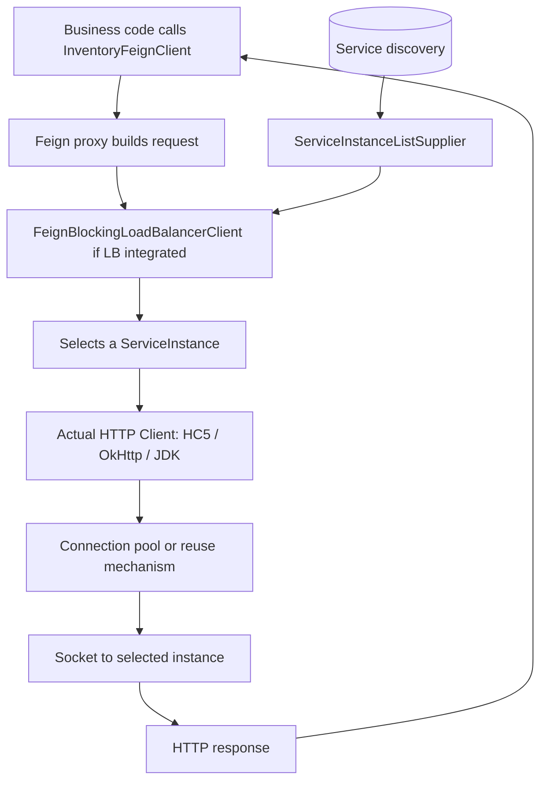
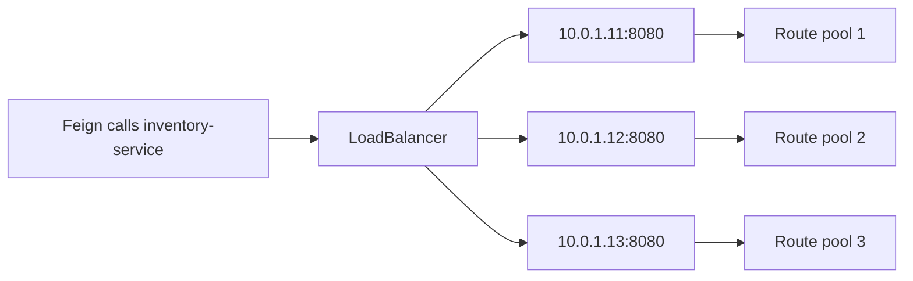
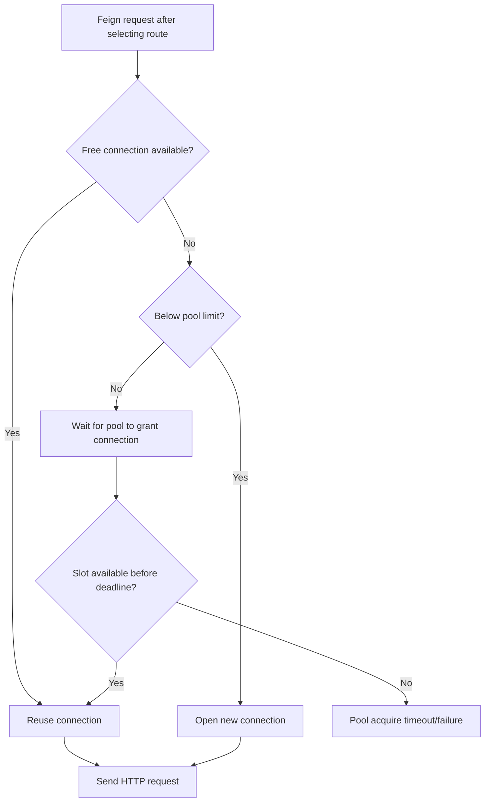
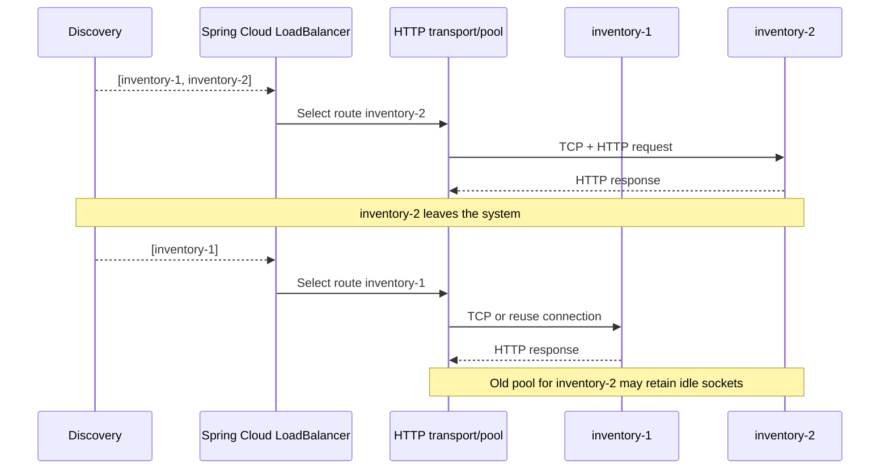

# Choosing HTTP Transport and Connection Pools

In a microservice application, Spring Cloud OpenFeign lets you call another service via a Java interface instead of constructing requests manually. For example, `order-service` declares `@FeignClient(name = "inventory-service")` and calls `inventoryClient.getProduct("P-1001")`. When Spring Cloud LoadBalancer is integrated, the name `inventory-service` is resolved to an available `ServiceInstance`.

However, **LoadBalancer only decides which instance to call; the HTTP transport performs the actual network connection**. Two applications using the same `@FeignClient` and the same round-robin algorithm can exhibit very different performance, socket usage, and timeout behavior if one uses the JDK HTTP transport and the other uses Apache HttpClient 5 or OkHttp.

This lesson belongs to the **OpenFeign** chapter in the Spring Cloud LoadBalancer module and focuses on choosing an HTTP transport, configuring and sizing connection pools, understanding the effects of service discovery, health checks, timeouts, and retries, and observing bottlenecks accurately in practice.

## 1. Two Distinct Decisions: Selecting an Instance and Opening a Connection

When calling `GET http://inventory-service/api/products/P-1001` via OpenFeign, there are typically two major steps:

1. **Client-side load balancing:** Spring Cloud fetches the `ServiceInstance` list from discovery or a supplier and chooses an address, such as `10.0.0.12:8080`.
2. **HTTP execution:** an underlying Feign `Client` uses a specific transport to acquire or open a TCP/TLS connection to that address, send the request, and receive the response.



`FeignBlockingLoadBalancerClient` is a wrapper used by Spring Cloud OpenFeign when integrating LoadBalancer for synchronous calls. It does not turn a connection to `inventory-1` into a connection to `inventory-2`: after selecting an instance, the connection must still target the actual remote endpoint.

In configurations with retries, the wrapper may differ, such as a variant supporting LoadBalancer retries. Bean names and wiring mechanisms vary across versions; the architectural point stays the same: **instance selection and HTTP execution are two separate responsibilities**.

## 2. What Role Does the HTTP Transport Play?

The HTTP transport determines how the client connects and consumes network resources:

- Creating and reusing TCP connections, TLS handshakes, and HTTP keep-alive.
- Managing connection pools, concurrent connections, and wait times to acquire a connection.
- Enforcing connect timeouts, response/read timeouts, proxies, TLS truststores, and client certificates.
- Resolving DNS at connection destinations and managing idle sockets and stale connections.
- Supporting different HTTP features per implementation, such as HTTP/2 when transport and configuration actually allow it.

**Do not confuse transport with Feign encoders/decoders:** encoders/decoders handle converting objects and HTTP bodies; the transport governs moving bytes over the wire. Likewise, a `RequestInterceptor` adding headers does not replace connection pool configuration.

## 3. Comparing Common Transport Options

| Option | How It Works in Feign | Strengths / Best Fit | Notes |
|---|---|---|---|
| **Feign `Client.Default`** | Uses a mechanism built on JDK `HttpURLConnection`. | Easy to start, minimal extra dependencies; suitable for labs and low traffic. | Lacks per-route pool sizing APIs like Apache HC5; keep-alive behavior depends on JDK settings. |
| **Apache HttpClient 5 (HC5)** | Uses Feign's `feign-hc5` module when auto-configured or wired by Spring Cloud OpenFeign. | Per-route pooling, explicit max total/per-route limits, timeouts, and lifecycle management; often fits sync HTTP/1.1 traffic. | Requires compatible dependencies and understanding of route/connection managers; do not use Apache HttpClient 4 configuration styles. |
| **OkHttp** | Uses Feign's `feign-okhttp` module with appropriate enable property and classpath. | Dedicated connection pool, supports keep-alive, TLS, proxies, and HTTP/2 depending on server/config. | Pool, dispatcher, and timeout models differ from HC5; do not use Apache pool properties to configure OkHttp. |
| **Custom Feign Client** | Registers a custom `feign.Client` implementation or system-controlled integration. | Needed for specialized TLS/proxy/transport policies. | Easy to accidentally replace or bypass LoadBalancer wrappers; must verify service-ID routing. |

If your goal is bounded pools and clear metrics, HC5 is often a convenient starting point. If your stack already standardizes on OkHttp and needs its capabilities, OkHttp may fit better. **There is no universally best transport:** decide based on workload, existing dependencies, TLS policy, compatibility, and benchmark results.

Version note: in modern Spring Cloud OpenFeign lines, **Apache HttpClient 4 is no longer supported as before**. Do not copy legacy guides using `feign-httpclient` or old property names without checking your active release train. Use the `feign-hc5` module for Apache HttpClient 5 if your stack supports it.

## 4. Conditions for Feign to Both Load Balance and Use the Right Transport

In a Spring Boot application using Spring Cloud OpenFeign, dependencies typically include:

```xml
<dependencies>
    <dependency>
        <groupId>org.springframework.cloud</groupId>
        <artifactId>spring-cloud-starter-openfeign</artifactId>
    </dependency>
    <dependency>
        <groupId>org.springframework.cloud</groupId>
        <artifactId>spring-cloud-starter-loadbalancer</artifactId>
    </dependency>
</dependencies>
```

Manage Spring Boot and Spring Cloud with compatible BOMs/parents. Spring Cloud LoadBalancer may not land on the classpath just because OpenFeign is present; declaring both starters explicitly avoids false assumptions. When using Eureka/Consul/Kubernetes or another provider, configure a discovery source; in a lab, you can use `SimpleDiscoveryClient`.

A simple Feign interface:

```java
import org.springframework.cloud.openfeign.FeignClient;
import org.springframework.web.bind.annotation.GetMapping;
import org.springframework.web.bind.annotation.PathVariable;

@FeignClient(name = "inventory-service")
public interface InventoryFeignClient {

    @GetMapping("/api/products/{id}")
    ProductView getProduct(@PathVariable("id") String productId);
}
```

Registering the Feign client with Spring Boot:

```java
import org.springframework.boot.SpringApplication;
import org.springframework.boot.autoconfigure.SpringBootApplication;
import org.springframework.cloud.openfeign.EnableFeignClients;

@SpringBootApplication
@EnableFeignClients(clients = InventoryFeignClient.class)
public class OrderApplication {
    public static void main(String[] args) {
        SpringApplication.run(OrderApplication.class, args);
    }
}
```

`ProductView` is an application-defined DTO. When `@FeignClient(name = "inventory-service")` omits a fixed URL and LoadBalancer integration is active, Feign uses the service ID to look up instances.

**Important:** if you declare `@FeignClient(name = "inventory-service", url = "http://localhost:8081")` or supply an equivalent static URL in client configuration, calls normally go straight to that URL, **no longer choosing among instances via service discovery**. That can be useful for calling a fixed host, yet does not prove LoadBalancer is active.

### Static Instance Configuration for the Practice Lab

```yaml
spring:
  cloud:
    discovery:
      client:
        simple:
          instances:
            inventory-service:
              - uri: http://localhost:8081
              - uri: http://localhost:8082
```

Both backends at 8081 and 8082 must actually be running and expose `GET /api/products/{id}`. If one backend is down, LoadBalancer can still pick that instance, while the HTTP transport will encounter `Connection refused` or a timeout. That is a different failure from not finding any `ServiceInstance`.

## 5. Choosing Apache HttpClient 5 in Spring Cloud OpenFeign

In Spring Cloud OpenFeign versions supporting HC5, you can add the Feign transport module:

```xml
<dependency>
    <groupId>io.github.openfeign</groupId>
    <artifactId>feign-hc5</artifactId>
</dependency>
```

The module version should be managed by a compatible BOM/dependency management setup. If your project uses a Spring Cloud OpenFeign version that auto-configures HC5 when the library is present, allow auto-configuration conditions to run and avoid defining unnecessary `Client` beans.

Example in `application.yml`:

```yaml
spring:
  cloud:
    openfeign:
      httpclient:
        hc5:
          enabled: true
        max-connections: 200
        max-connections-per-route: 50
        time-to-live: 60
        time-to-live-unit: seconds
      client:
        config:
          inventory-service:
            connectTimeout: 2000
            readTimeout: 5000
```

This is an **illustrative configuration**, not a universal baseline. Properties like `httpclient.max-connections`, `max-connections-per-route`, `time-to-live`, and the `hc5` branch are tuning knobs present across Spring Cloud OpenFeign generations supporting this transport, yet you **must check configuration metadata for your exact release train** to confirm property names, time units, activation conditions, and actual effects. Do not apply these properties to an application using OkHttp and expect OkHttp's pool to change.

`connectTimeout` and `readTimeout` in the example are high-level Feign client settings, measured in milliseconds in common Spring Cloud OpenFeign lines. They are **not necessarily the entire time budget** of a logical operation, nor are they synonymous with pool connection-acquisition timeouts.

### Summary of the Two Connection Limits

| Parameter | Practical Meaning |
|---|---|
| `max-connections: 200` | Maximum total connections within the connection manager per HC5 config, not 200 requests/second. |
| `max-connections-per-route: 50` | Maximum connections to a single HTTP route (typically host, port, scheme, and route/proxy info). |
| `time-to-live: 60` | Transport-level connection lifespan limit per policy; not a business-request processing timeout. |

If LoadBalancer selects two backends on two distinct remote routes, each route can have its own pool limit. When multiple service IDs or callers share one connection manager, the **total** limit matters just as much as per-route.

## 6. Choosing OkHttp When Needed

In lines supporting OkHttp integration, add the Feign dependency:

```xml
<dependency>
    <groupId>io.github.openfeign</groupId>
    <artifactId>feign-okhttp</artifactId>
</dependency>
```

and enable the transport via the Spring Cloud OpenFeign property:

```yaml
spring:
  cloud:
    openfeign:
      okhttp:
        enabled: true
```

Actual activation also depends on the classpath, whether HC5 is available, custom `Client` beans, and auto-configuration ordering in your release train. **Merely having `feign-okhttp` on the classpath does not prove OkHttp was selected**; observe the actual implementation running.

OkHttp provides a `ConnectionPool` object to control idle connection counts and keep-alive durations, along with `OkHttpClient`'s connect/read/write/call timeouts. Do not copy HC5's `max-connections-per-route` parameters to tune OkHttp: their models and APIs differ.

Pure OkHttp pool example, illustrating the library API only:

```java
import java.util.concurrent.TimeUnit;
import okhttp3.ConnectionPool;
import okhttp3.OkHttpClient;

ConnectionPool pool = new ConnectionPool(10, 2, TimeUnit.MINUTES);
OkHttpClient httpClient = new OkHttpClient.Builder()
        .connectionPool(pool)
        .connectTimeout(2, TimeUnit.SECONDS)
        .readTimeout(5, TimeUnit.SECONDS)
        .build();
```

This snippet **does not wire `httpClient` into Spring Cloud OpenFeign on its own**. To use it in a real application, configure beans/auto-configuration supported by your release train and verify the LoadBalancer wrapper is not bypassed. Avoid casually declaring a custom `feign.Client` bean that strips Feign of service-ID resolution.

### Note on Dispatcher and Synchronous Feign

OkHttp has a `Dispatcher` with limits such as `maxRequests` and `maxRequestsPerHost`, but you should not treat them as a **global concurrency limiter for synchronous OpenFeign calls**: Dispatcher's scheduling/limiting mechanism is designed primarily for asynchronous calls. To protect backends from excessive synchronous Feign calls, use application-level concurrency policies, bulkheads, or semaphores rather than tuning Dispatcher alone.

## 7. When to Use the Default Transport?

In small environments, Feign `Client.Default` based on JDK `HttpURLConnection` can suffice for labs or low traffic. However, do not interpret "default" as **zero connection reuse**: the JDK has its own HTTP keep-alive/caching behavior depending on version and system properties, just with different pool controls and metrics compared to HC5 or OkHttp.

When you need explicit max total connections, per-route limits, bounded pool waits, eviction, and clear pool metrics, a dedicated HTTP client usually provides more verifiable controls. Only switch transports after measuring bottlenecks, as changing transport also affects TLS, proxies, timeouts, redirects, and compatibility.

## 8. What Does a Connection Pool Actually "Pool By"?

Suppose discovery returns:

| ServiceInstance | URI |
|---|---|
| `inventory-1` | `http://10.0.1.11:8080` |
| `inventory-2` | `http://10.0.1.12:8080` |
| `inventory-3` | `http://10.0.1.13:8080` |

When LoadBalancer chooses `inventory-2`, the transport connects to `10.0.1.12:8080`. An open connection to `10.0.1.11:8080` cannot automatically be reused for another remote endpoint. HC5 typically pools by **actual route** (target host/port/scheme, including proxy when applicable), while OkHttp applies its own connection reuse/pooling rules.



**Do not confuse service ID with route pool.** One service ID can map to multiple hosts/ports; multiple service IDs can also map to a shared proxy. Pools manage connections by network address and the HTTP engine's rules, not by a rule that "every Feign client name owns exactly one pool".

With an HTTP proxy or service mesh, the actual connected address may differ from the instance addresses published by discovery. Measure the transport's real route before calculating backend connection counts.

## 9. Sizing Pools: Total, Per-Route, and Caller Replica Count

Three limits must be kept distinct:

1. **Max total:** maximum connections across the entire shared connection manager, if supported by the transport.
2. **Max per-route:** maximum connections to a single route/remote endpoint.
3. **Caller replica count:** each caller pod/VM normally runs its own HTTP client and pool; total sockets hitting a backend equal the combined effect across callers.

For example, one caller has `max total = 200` and `per-route = 50`. If discovery exposes three remote routes with no other limits, the caller can open connections across all three routes; **50 is not the system-wide socket limit**, and 200 is the manager's total limit.

If there are **10 caller replicas**, each capable of opening up to 50 connections to the same route, that backend could face **up to roughly 500 connections** from this caller group alone, excluding other traffic sources. This is a theoretical upper bound under simple assumptions, not a forecast of constantly open sockets.

### Using Little's Law as a Starting Point

In steady state, average concurrent requests can be estimated as:

```text
Average concurrency ≈ requests/sec × average latency (seconds)
```

For example, a caller sending `150 requests/sec` with an average latency of `200 ms`:

```text
150 × 0.2 = ~30 concurrent requests for the group
```

With three evenly balanced backends, each route averages about 10 concurrent requests. However, averages alone are **insufficient for picking max pool size**: examine bursts, p95/p99 latency, retries, slow instances, and actual caller counts. With HTTP/2, the relationship between concurrent requests and connections also depends on multiplexing.

## 10. Why Larger Pools Do Not Equal Higher Throughput

Suppose `inventory-service` can only handle 30 concurrent requests due to a small database pool. Raising max connections from 50 to 500 on every caller can:

- Create more sockets and TLS handshakes, increasing CPU, memory, and file descriptors.
- Push even more requests into an already saturated backend, worsening latency and timeouts.
- Trigger database contention, queuing, and cascading retries.
- Mask the real problem: **backpressure / concurrency limits**.

Pair pool sizing with rate limits/bulkheads or concurrent-call caps, deadlines, retry budgets, and each backend's actual capacity. Spring Cloud LoadBalancer by default does not know how many busy connections a caller holds against an instance to pick the "least loaded instance".

## 11. Three Timers Often Lumped Together as "Timeout"

When using a connection pool, distinguish:

| Timeout | What It Limits | Consequence When Exceeded |
|---|---|---|
| **Connection request / pool acquisition timeout** | Time spent waiting to borrow a connection from a full pool. | Fails before actually opening or sending the request to the backend. |
| **Connect timeout** | Time spent establishing a new TCP connection to the remote endpoint. | Connection error; does not mean the backend processed HTTP. |
| **Read/response/socket timeout** | Time spent waiting for response data per the HTTP transport mechanism. | May leave uncertain whether the backend committed the operation. |

Additionally, a business operation's **overall deadline** must account for multiple attempts, pool waits, connection setup, and response processing. For example, `connectTimeout: 2000` and `readTimeout: 5000` **do not automatically** guarantee an entire logical request finishes in 7 seconds once acquisition, DNS, TLS, retries, or redirects are included.

With HC5, dedicated tuning knobs typically exist for connection request timeout and connection/socket timeouts depending on the supported API/property branch. Do not rely solely on Feign's `connectTimeout`/`readTimeout` and assume pool queuing is bounded.

### Identifying Pool Starvation

If a backend processes requests slowly, connections stay leased. When concurrent requests exceed max per-route, new requests must wait to acquire; failures occurring before or during connection acquisition do not mean discovery failed to find an instance.



Do not rush to raise max per-route if requests hold connections too long because of streaming, slow backends, or retry storms. Find the root cause first, monitor leased/available/pending metrics per route, and inspect tail latencies.

## 12. Keep-Alive, Idle Eviction, and Connection Lifecycles

Connection pools save TCP/TLS setup overhead by keeping connections alive for reuse. However, **a socket can be closed by the server or proxy before the client realizes it**. For example, a reverse proxy closes idle connections after 30 seconds while the HTTP client expects to keep them idle longer: after an idle period, the next request may hit `Connection reset`, `NoHttpResponseException`, or an equivalent error depending on the transport.

Distinguish:

- **Keep-alive:** ability to keep a connection open for reuse by subsequent requests.
- **Idle timeout:** maximum time an unused connection is kept before being closed/evicted.
- **Connection Time-to-Live (TTL):** maximum age of a connection since creation, even if reused repeatedly; distinct from `ServiceInstance` list TTL.
- **Eviction:** mechanism for purging idle, expired, closed, or invalid connections per the HTTP engine's policy.
- **Graceful shutdown/draining:** server stops accepting new requests while allowing in-flight requests to finish within a window.

| Layer | Type of Timer | Impact |
|---|---|---|
| `ServiceInstance` cache / discovery | Instance-list TTL or polling interval. | Determines whether the caller still sees a backend in the candidate set. |
| HTTP connection pool | Idle timeout, connection TTL, eviction. | Determines whether sockets to an old backend stay pooled/reused. |
| HTTP request | Connect/read/overall timeout. | Determines how long an in-flight request is allowed to wait. |
| Backend / reverse proxy | Keep-alive, idle timeout, drain timeout. | Determines when the server/proxy closes connections and finishes processing. |

**There is no 1:1 mapping** between these timers. For instance, the discovery cache may have dropped `inventory-2`, yet the transport can still hold an idle connection to it until the pool evicts it. That does not mean LoadBalancer still picks `inventory-2`; the pool merely holds uncleaned resources. Conversely, if the instance list still contains a freshly dead backend, pooling cannot make requests to that backend succeed.

For application-managed pools, tie shutdown to the Spring application context lifecycle and close clients/connection managers cleanly. For pools owned by Spring Boot or starters, do not manually shut down shared resources when a single gateway goes down.

## 13. How Do Instance Changes Affect the Pool?

An autoscaling system may add and remove instances continuously. This creates an interaction between two systems:



During **scale-up**, a new instance is published by discovery before LoadBalancer can choose it. On the first call, the HTTP transport normally must establish a connection; cold TCP/TLS handshake cost can produce different latency compared to instances with warm pools.

During **scale-down**, if the caller uses stale discovery/cache lists or servers are killed abruptly, requests can fail. Coordinate readiness, deregistration, graceful drain, connection eviction, and safe retries; you cannot "fix" everything just by increasing max connections or shortening read timeouts.

Note that `SimpleDiscoveryClient` with a static URI list does not reflect dynamic scale-up/scale-down on registry changes. To simulate dynamic discovery, use a test provider that updates instances or update config following lab steps and observe the resulting behavior.

## 14. Retries Can Amplify Pressure on the Pool

Core Feign and Spring Cloud OpenFeign have different retry policies. In many Spring Cloud OpenFeign versions, the framework creates `Retryer.NEVER_RETRY` by default, differing from core Feign's default retry behavior. Spring Cloud LoadBalancer may also have its own retry layer depending on dependencies and configuration.

**Do not assume** every I/O error is retried automatically, or that changing Feign's `Retryer` makes every LoadBalancer attempt follow that policy. Verify the actual retry beans and layers active in your release train.

If up to two retries are allowed after the initial attempt:

```text
One logical request:
  attempt 1 -> pick inventory-1 -> connect timeout
  attempt 2 -> pick instance per retry policy -> read timeout
  attempt 3 -> pick instance per retry policy -> response / error

Maximum: 3 attempts for 1 logical request
```

Each attempt may need to acquire a new connection or wait on a route pool. When backends are already saturated, retries increase requests and pending pool queues, triggering a **retry storm**. Therefore:

- Only retry errors genuinely classified as transient; cap total attempts.
- Configure backoff and jitter where appropriate; avoid all callers retrying at the exact same moment.
- Enforce an overall deadline rather than granting a fresh unlimited timeout budget per attempt.
- Track actual attempt counts and distinguish same-instance retries from cross-instance retries.
- Avoid retrying state-mutating write requests without idempotency/deduplication safeguards.

For example, `POST /orders` might commit successfully on the server while the response times out. Resending without an idempotency key can create two orders. Pools and load balancing cannot guarantee business correctness on their own.

## 15. HTTP/2, Proxies, TLS, and Transport Choice

Choosing an HTTP transport also depends on the actual network conditions your application uses:

**HTTP/1.1:** one connection typically handles one active request at a time; once the response/body is consumed, the socket can return to the pool for the next request. Pool size and request concurrency are tightly coupled.

**HTTP/2:** can multiplex multiple streams over a single connection when client, server, and network path negotiate it successfully. OkHttp supports HTTP/2 in suitable configurations. Do not assume synchronous Feign with classic HC5 or every transport automatically uses HTTP/2; verify the actual engine/protocol chosen.

**HTTP proxies and service meshes:** the connection pool may connect to the proxy rather than the final instance IP. In that setup, "pool per route" must be understood in terms of the transport's route, not simply by service ID. If the proxy load-balances itself, clarify the boundary of responsibility between Spring Cloud LoadBalancer and the proxy to avoid misdiagnosis.

**TLS:** certificates, truststores, SNI, hostname verification, and mTLS client certificates must all be valid on the **HTTP transport beneath Feign**. Spring Cloud LoadBalancer picking the right instance is only the first step:

```text
Feign name=inventory-service
   |
   +-- LoadBalancer selects https://inventory.internal:8443
          |
          +-- HTTP transport: TLS handshake, certificate, hostname, mTLS
                 |
                 +-- Business HTTP request
```

If a registry returns raw IPs while certificates only carry DNS SANs, hostname verification can fail. Never disable hostname verification or enable trust-all SSL in production to hide mismatched instance metadata; fix registered names, certificate SANs, and TLS configuration consistently.

## 16. Choose Transport by Workload, Not Gut Feeling

| Need | What to Prioritize |
|---|---|
| Simple lab with low traffic | Default client may suffice for learning Feign and LoadBalancer; focus on beans and service IDs. |
| High-traffic HTTP/1.1 needing clear route limits | HC5 with max total/per-route, acquisition timeouts, and leased/available/pending metrics. |
| Stack already standardized on OkHttp | Consider OkHttp with its own pool/timeouts; verify real Feign integration. |
| HTTP/2 or special protocol requirements | Verify real transport/server/proxy support and benchmark against target setup. |
| Complex TLS/mTLS | Prefer a client with cleanly manageable SSL context and certificate rotation. |
| Centralized proxy management | Check routing, DNS, keep-alive, and pooling on both transport and proxy. |
| Many service IDs and autoscaling instances | Monitor route pool count, total sockets, create/evict rates, and backend pressure. |

Before switching transports, define measurable goals: reducing connection setup, trimming tail latency, cutting pending acquisitions, improving TLS policy, or aligning infrastructure. After changing, re-measure with the same workload and topology to avoid unfair comparisons.

## 17. Observability: Pinpointing Bottlenecks Across Feign, LoadBalancer, or Pool

Group metrics by layer:

| Layer | Useful Metrics / Signals |
|---|---|
| **Feign HTTP** | Request count, HTTP status/errors, p50/p95/p99 latency, timeouts, retry attempts. |
| **LoadBalancer** | `serviceId`, selected `instanceId`, valid instance count, no-instance errors. |
| **HTTP connection manager** | Leased/active connections, available/idle connections, pending per route, max total/per-route, acquire timeouts. |
| **Transport/TLS** | Connect errors, TLS handshake failures, connection resets, DNS latency, connection creation rate. |
| **Backend** | Request concurrency, thread pool/CPU, database pool, p95/p99, readiness, and rejected requests. |

Spring Cloud OpenFeign can integrate with Micrometer/Observation when the right dependencies and config conditions exist. **Feign request metrics do not automatically include pool metrics**: with HC5, add/read metrics from its connection manager; with OkHttp, instrumentation differs as well. Metric names, tags, and bean names vary across versions.

Useful log fields:

```text
traceId=9a3f
serviceId=inventory-service
selectedInstance=inventory-2
attempt=1
transport=hc5
httpStatus=200
durationMs=87
```

This example only illustrates log/tracing content, not Feign's default logs. To know `transport=hc5`, observe or instrument the running transport itself rather than printing "HC5" simply because a dependency is present.

When enabling Feign debug logging, avoid full request/response body logging in production if payloads contain tokens, cookies, PII, or sensitive bodies. Never put user IDs, URLs containing dynamic data, or tokens into metric labels due to data-leak risks and high cardinality.

## 18. Verifying Which Transport Implementation Is Actually Selected

A common mistake is setting `spring.cloud.openfeign.httpclient.hc5.enabled: true` or `spring.cloud.openfeign.okhttp.enabled: true` and assuming the intended transport is definitely running. To verify:

1. Check the **resolved dependency tree** and BOM of `spring-cloud-starter-openfeign`, `feign-hc5`, or `feign-okhttp`.
2. Inspect the Condition Evaluation Report or Actuator `/actuator/conditions` in a secured environment.
3. Inspect the Feign client context and active `feign.Client` bean; when LoadBalancer is integrated, it may be a **wrapper** delegating to an HTTP client.
4. Verify the actual delegate is HC5/OkHttp/JDK rather than looking only at the wrapper class.
5. Send multiple requests in a lab and observe connection creation/reuse, leased/pending counts, and per-route sockets.
6. If a custom `feign.Client` bean exists, confirm it is still wrapped by Spring Cloud LoadBalancer rather than bypassing service-ID routing.

Example Maven commands:

```bash
./mvnw dependency:tree -Dincludes=io.github.openfeign:feign-hc5
./mvnw dependency:tree -Dincludes=io.github.openfeign:feign-okhttp
./mvnw dependency:tree -Dincludes=org.springframework.cloud:spring-cloud-openfeign-core
./mvnw dependency:tree -Dincludes=org.springframework.cloud:spring-cloud-loadbalancer
```

In Gradle projects, `./gradlew dependencyInsight --dependency feign-hc5 --configuration runtimeClasspath` and similar commands identify resolved dependencies. These are instructions for learners to run in their own projects, not mandatory steps during authoring.

When using Spring Boot Actuator, you can inspect `/actuator/beans` or `/actuator/conditions` once configured and secured. Never expose internal diagnostic endpoints publicly to the Internet.

## 19. Practice Lab: Two Instances, HC5, and Bounded Pool

Set up a lab environment with two `inventory-service` servers:

- `localhost:8081` returns `instanceId=inventory-1` on `GET /api/debug/instance`.
- `localhost:8082` returns `instanceId=inventory-2` on the same path.
- Both expose `GET /api/lab/slow` simulating 300–500 ms latency via controlled I/O, never in production.

Caller `order-service` uses `@FeignClient(name = "inventory-service")` and `SimpleDiscoveryClient` from Section 4. Enable HC5 per your supported version and configure small max total/per-route limits to observe queuing.

### Scenario A — Verifying Instance Selection

Call `GET /api/debug/instance` repeatedly. With round robin and a stable instance list, requests should reach both backends. If you only see DNS resolution for `inventory-service`, check the LoadBalancer wrapper and whether a fixed URL was accidentally set in `@FeignClient`.

### Scenario B — Verifying Connection Reuse

Send sequential requests and then a batch of concurrent requests. Observe newly opened connections, reused connections, and active sockets per route. With HTTP/1.1, sequential requests to the same route usually have an opportunity to reuse keep-alive connections, though the server/proxy may close them under its own policy.

### Scenario C — Per-Route Limit

Set small limits such as max total 8 and per-route 2 in the lab, then send 20 concurrent calls to the slow endpoint. Observe processed requests, requests waiting for a connection, acquire timeouts, and latency. The goal is to demonstrate that **max connections is not max throughput**; having 2 connections does not mean the system can only handle 2 requests/second.

### Scenario D — One Failing Instance

Stop `inventory-2` after a round of successful requests. Inspect the list returned by the supplier, selected instance, connection resets/timeouts, and how long health/discovery takes to drop the instance. Keep retries bounded to distinguish pool errors from stale-list errors.

### Scenario E — Comparing Transports

Run the same workload, instance count, timeouts, TLS, and concurrency with HC5 and OkHttp in two separate configurations. Compare p95/p99, socket counts, connection churn, memory, CPU, and error rates. Do not enable multiple transport configs simultaneously and guess which one ran.

### Result Recording Table Template

| Scenario | Transport | Max Total / Route | Concurrency | p95 Latency | Acquire Errors | Notes |
|---|---|---|---|---|---|---|
| Baseline | HC5 | Record config | Record actual | Measure actual | Measure actual | Reused? |
| Small pool | HC5 | Record config | Record actual | Measure actual | Measure actual | Any pending? |
| Comparison | OkHttp | Use matching pool params | Record actual | Measure actual | Measure actual | Any differences? |

Do not fill in numbers that were not measured. Document versions, protocol, caller replica count, and machine conditions when comparing.

## 20. Troubleshooting Table

| Symptom | Possibilities to Check | Action |
|---|---|---|
| `UnknownHostException: inventory-service` | Feign resolves directly via DNS, missing LoadBalancer wrapper or misconfigured fixed client/url. | Check `@FeignClient`, `spring-cloud-starter-loadbalancer`, `feign.Client`, and bean config. |
| No instance for service ID | Empty registry/supplier, wrong service ID, or health filter removed all candidates. | Inspect `ServiceInstanceListSupplier`; tuning the pool will not fix this. |
| `Connection refused` to selected IP | Backend not listening, wrong port, or dead instance. | Test connecting to exact host/port, check discovery and draining. |
| Pool acquire timeout | Max total/per-route saturated or connections held too long. | Track leased/pending, concurrency, and backend latency. |
| `ConnectTimeoutException` | DNS/network/backend unable to finish TCP handshake in time. | Compare connect timeout, port, firewall, and connection creation rate. |
| Read timeout while backend may have written data | Response delayed or lost while transaction committed. | Check server logs, idempotency; do not retry blindly. |
| More sockets than expected | Multiple caller replicas, separate managers, or multiple routes; per-route is not global. | Count sockets per process, route, and connection manager. |
| Connection reset after idle period | Server/proxy closes keep-alive sooner than client expects. | Tune idle eviction/keep-alive and graceful drain. |
| Enabled HC5 with no visible effect | Dependency/auto-config overridden, another client chosen. | Inspect Feign delegate and resolved dependencies. |
| Added OkHttp yet still running HC5 | Transport selection via conditions/classpath differs from expectation. | Inspect auto-config/beans and choose one transport explicitly. |
| HTTPS handshake fails | Truststore, hostname/SAN, certificate, or mTLS. | Verify chain and hostname; never disable certificate verification. |
| Retries climb alongside p99 latency | Failures amplified while pool/backend is congested. | Bound retries, apply deadlines and concurrency budgets. |
| One instance receives many slow requests | LoadBalancer ignores real capacity; that backend/route pool overloads. | Compare per instance: latency, CPU, pool pending, and error rate. |

## 21. Pre-Operations Checklist

- [ ] Select compatible Spring Boot/Spring Cloud OpenFeign release trains and manage dependencies with a BOM.
- [ ] Include `spring-cloud-starter-openfeign` and an appropriate LoadBalancer/discovery source.
- [ ] `@FeignClient(name = "...")` uses a logical service ID; do not accidentally set a fixed URL when instance selection is needed.
- [ ] Verify the **actually active** HTTP transport rather than inferring it solely from classpath dependencies.
- [ ] If using HC5, understand max total and max per-route limits; also check pool acquisition timeouts.
- [ ] If using OkHttp, configure via OkHttp APIs/properties and understand how it differs from HC5.
- [ ] Set connect, pool-wait, response-read timeouts and an overall deadline fitting the workload.
- [ ] Account for caller replica counts to keep total backend sockets within budget.
- [ ] Tune idle/lifetime/eviction to match server keep-alive, proxies, and TLS policies.
- [ ] Enforce concurrency/bulkhead limits; never expect larger pools alone to solve overload.
- [ ] Verify health checks, discovery, and instance caches during scale-up/scale-down or backend failure.
- [ ] Distinguish Feign retries, LoadBalancer retries, and duplicate-write risks on non-idempotent operations.
- [ ] Track request metrics, selected instances, leased/idle/pending connections, and per-route errors.
- [ ] Never log credentials or sensitive request bodies; control metric label cardinality.
- [ ] Test connection reuse, pool saturation, timeouts, TLS, and graceful shutdown before production.

**Conclusion:** In Spring Cloud OpenFeign, Spring Cloud LoadBalancer selects the `ServiceInstance`, while a transport such as **Apache HttpClient 5**, **OkHttp**, or the JDK executes connections. Connection pools are managed according to the HTTP engine's model and remote route, not simply by Feign client name. For reliable inter-service communication, choose a compatible transport, configure bounded max total/per-route limits and timeouts, regulate concurrency, measure leased/pending connections, and keep the lifecycles of discovery, health checks, retries, and TCP/TLS sockets clearly separated.
