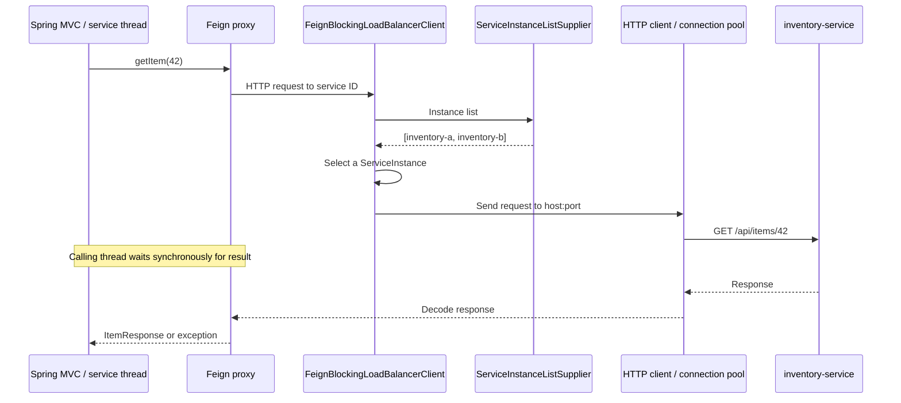
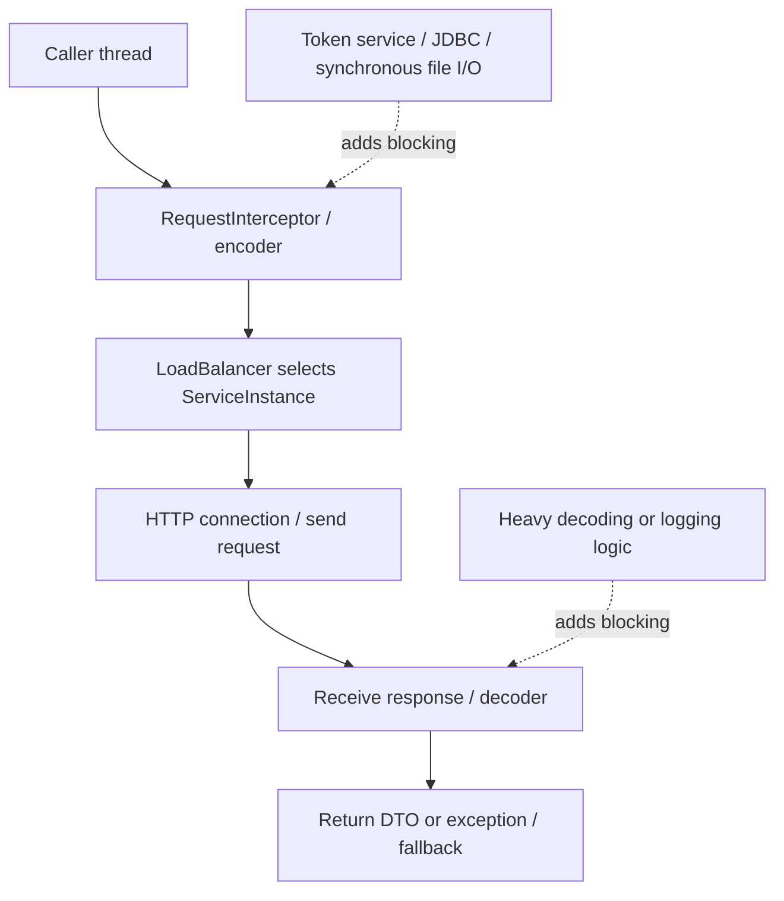
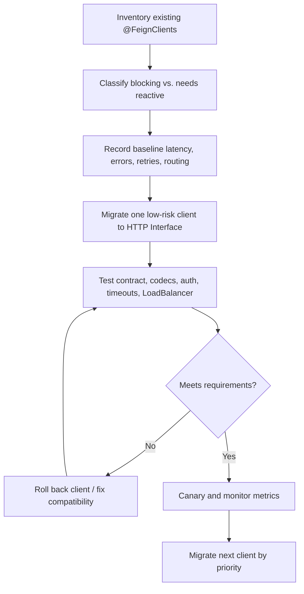

# Thread-Blocking Limitations and Library Lifecycle Guidance

Spring Cloud OpenFeign lets you describe HTTP calls using a Java interface and annotations instead of writing individual request-sending statements. When paired with Spring Cloud LoadBalancer, a `@FeignClient(name = "inventory-service")` can call a service by **service ID**: the framework retrieves the `ServiceInstance` list from discovery/suppliers, selects a destination, and sends the HTTP request to that instance. This is a concise, familiar pattern in Spring MVC applications.

However, **Spring Cloud OpenFeign currently supports a blocking client model**, not a reactive HTTP client like `WebClient`. A typical Feign method holds the calling thread while waiting for connection setup, response, and body decoding. Meanwhile, official documentation confirms that Spring Cloud OpenFeign is in **feature-complete** status: it continues receiving patches and minor improvements, but reactive support is not planned; the project recommends **Spring HTTP Service Clients** for new development and gradual migration.

This lesson in the **OpenFeign** chapter explains thread-blocking limits, impacts on throughput and event loops, safe ways to use Feign in existing systems, and decision criteria for keeping Feign versus migrating to `RestClient`, `WebClient`, or HTTP Service Clients according to the library lifecycle.

## 1. Do Not Confuse Declarative Syntax with Execution Model

Feign looks like an ordinary Java method call:

```java
@FeignClient(name = "inventory-service")
public interface InventoryFeignClient {

    @GetMapping("/api/items/{id}")
    ItemResponse getItem(@PathVariable("id") long id);
}
```

Used inside a service:

```java
@Service
public class OrderInventoryService {

    private final InventoryFeignClient inventory;

    public OrderInventoryService(InventoryFeignClient inventory) {
        this.inventory = inventory;
    }

    public ItemResponse loadItem(long id) {
        return inventory.getItem(id); // Waits for result before returning.
    }
}
```

`ItemResponse` is an illustrative DTO. For Spring to register the interface, the application must enable Feign client scanning:

```java
@SpringBootApplication
@EnableFeignClients(clients = InventoryFeignClient.class)
public class OrderApplication {
}
```

And the corresponding dependency:

```xml
<dependency>
    <groupId>org.springframework.cloud</groupId>
    <artifactId>spring-cloud-starter-openfeign</artifactId>
</dependency>
```

To use Spring Cloud LoadBalancer instead of just a plain Feign HTTP client, include `spring-cloud-starter-loadbalancer` in the dependency graph alongside a suitable instance source. Manage versions through a Spring Cloud BOM compatible with Spring Boot; do not arbitrarily pick starter versions from mismatched release trains.

### 1.1. What Happens During a Call?



In Spring Cloud OpenFeign's default integration, when Spring Cloud LoadBalancer is present, the client used is typically `FeignBlockingLoadBalancerClient`. The word **blocking** in its name describes how the call executes, not that discovery or target selection must query the registry over the network on every request: instance lists may already be cached.

If a fixed `url` is set in `@FeignClient` or the corresponding configuration property, the call may **bypass LoadBalancer instance selection** and hit that URL directly. Therefore, distinguish `name`/service-ID calls from `url` calls.

## 2. What Specifically Are the Blocking Limits?

A synchronous call can span these time intervals:

\[
T_{call}=T_{select}+T_{connect}+T_{request}+T_{server}+T_{response}+T_{decode}
\]

This is a conceptual model, not a Feign timeout formula. While waiting on sockets or the server, **the caller's Java thread can be held blocked** and unable to perform other work. The underlying HTTP client can reuse connections to cut TCP/TLS overhead, yet connection reuse **does not turn a Feign call into non-blocking I/O**.

| Property | Standard OpenFeign | Reactive WebClient |
|---|---|---|
| Calling API | `Item getItem(id)` | `Mono<Item>` or `Flux<Item>` |
| Waiting for HTTP response | Caller normally blocks synchronously | Registers I/O and emits signal when result arrives |
| Resource model | Caller thread + connection pool | Event loop, non-blocking I/O, Reactor pipeline |
| Composing multiple calls | Sequential calls or manual executor usage | `flatMap`, `zip`, `concatMap`, and Reactor operators |
| Use on WebFlux event loop | Unsuitable if called directly | Suitable when the entire pipeline has no blocking work |
| LoadBalancer compatibility | Supports blocking LoadBalancer | Supports reactive LoadBalancer when properly configured |

Do not conclude that every blocking application has poor performance. For a Spring MVC system with moderate traffic, well-sized connection pools, and clear timeouts, OpenFeign can work smoothly and remain easy to maintain. Problems arise when concurrent waiting calls exceed available threads, HTTP connections, or downstream capacity.

### 2.1. Estimating Thread Pressure with Little's Law

With a steady request arrival rate \(\lambda\) and average downstream wait time \(W\) per call, the average number of waiting calls is approximately:

\[
L \approx \lambda W
\]

For example, `order-service` handles 200 requests/second; each request makes one Feign call averaging 200 ms:

\[
L \approx 200 \times 0.2 = 40
\]

Roughly 40 calls may be waiting concurrently in this simplified model. If downstream slows from 200 ms to 1 second, that figure jumps to about 200. This is not the **exact** thread count to configure because controller work, queues, CPU, retries, parallel calls, and latency variance also matter. It illustrates why a downstream slowdown can rapidly trigger **thread pool exhaustion** on the caller.

If each request calls three Feign clients **sequentially**, total request wait time can approximate the sum of all three calls. Using another thread pool to call them in parallel can lower single-request latency, yet increases concurrent calls hitting the backend; bound concurrency rather than optimizing single-request latency alone.

### 2.2. Thread Pools and Connection Pools Are Two Different Bottlenecks

| Bottleneck | Symptoms | What to Observe |
|---|---|---|
| Servlet/container threads | Requests queue up, queues grow, many threads in WAITING/TIMED_WAITING | Thread dumps, active threads, executor queues |
| HTTP connection pool | Waiting to acquire connections even while threads are free | Leased/available/pending connections, pool timeouts |
| Registry or supplier | Slow even before the HTTP request starts | Instance-list fetch duration / cache misses |
| Downstream server | Rising p99, read timeouts, high downstream queues or CPU | Per-instance/backend latency and errors |
| Circuit breaker/bulkhead | Requests rejected early or fallbacks spike | Rejections, open state, concurrency limits |

Adding caller threads cannot fix errors when the connection pool is too small; enlarging the connection pool will not help either if the backend is saturated. Measure both sides.

## 3. OpenFeign in Spring MVC vs. Spring WebFlux

### 3.1. In Spring MVC: Blocking Can Be a Reasonable Choice

In the Servlet/Spring MVC model, a request is typically handled by a worker thread. Blocking Feign fits a sequential programming style: controller calls service, service calls Feign, then returns the response.

```java
@RestController
@RequestMapping("/orders")
class OrderController {

    private final OrderInventoryService service;

    OrderController(OrderInventoryService service) {
        this.service = service;
    }

    @GetMapping("/items/{id}")
    ItemResponse item(@PathVariable long id) {
        return service.loadItem(id);
    }
}
```

In this model, the right choice is not necessarily rewriting everything to reactive. Configure connect/read timeouts, pools, concurrent-request caps, and circuit breakers, and monitor p95/p99 before deciding to change architectures.

### 3.2. In WebFlux: Never Call Feign Directly on the Event Loop

The snippet below is an **anti-pattern** if run on a Reactor Netty event-loop thread:

```java
// WRONG: Synchronous Feign call can block the event loop.
@GetMapping("/reactive/items/{id}")
Mono<ItemResponse> bad(@PathVariable long id) {
    return Mono.just(inventoryFeignClient.getItem(id));
}
```

`inventoryFeignClient.getItem(id)` executes **before** `Mono.just(...)` even creates the publisher. It can block the thread running the handler, and if that is an event-loop thread, many other connections suffer. Replacing `Mono.just` with `Mono.defer` without changing the scheduler only delays the call; it **does not offload** it automatically.

A transitional approach when Feign cannot yet be removed is:

```java
@GetMapping("/reactive/items/{id}")
Mono<ItemResponse> temporary(@PathVariable long id) {
    return Mono.fromCallable(() -> inventoryFeignClient.getItem(id))
            .subscribeOn(Schedulers.boundedElastic());
}
```

`Mono.fromCallable` defers execution until subscription time; `subscribeOn(Schedulers.boundedElastic())` runs the synchronous call on a bounded scheduler reserved for blocking I/O, avoiding blocking the event loop. This **does not make Feign a reactive HTTP client**: each Feign call still consumes a worker/virtual thread depending on executor config, a connection, and downstream resources while waiting.

If offloading in a high-traffic application, bound concurrent tasks and monitor the scheduler's queue. `Schedulers.parallel()` is generally not the right place for blocking Feign calls. Never call `.block()` on a `Mono` inside an event loop to get a synchronous value back—that merely reverses the problem and can throw `IllegalStateException`.

### 3.3. Reactor Timeouts Do Not Guarantee Canceling Blocking HTTP

```java
Mono<ItemResponse> result = Mono.fromCallable(
                () -> inventoryFeignClient.getItem(42))
        .subscribeOn(Schedulers.boundedElastic())
        .timeout(Duration.ofSeconds(3));
```

`Mono.timeout` limits how long the pipeline waits for a signal, yet does not necessarily stop the Feign call if the HTTP client/SDK does not support cancellation or interruption cleanly. Therefore, configure **Feign's connect/read timeouts** as well as the overall business time limit. Never treat the `timeout` operator as a replacement for socket timeouts.

## 4. Feign Extensions Can Also Block Threads

It is not only the main HTTP call that can block. Feign's execution path also contains encoders, decoders, interceptors, error decoders, and fallbacks.



| Extension | Risk If Running Slow Work | How to Handle |
|---|---|---|
| `RequestInterceptor` | Fetching an OAuth token via sync API on **every** request | Cache tokens, use an appropriate token provider, bound timeouts/concurrency |
| `Encoder` / `Decoder` | Serializing large payloads, decoding streams, or heavy parsing | Cap body sizes, pick efficient formats, measure CPU/memory |
| `ErrorDecoder` | Reading huge error bodies or making extra blocking API calls | Keep error handling lightweight; avoid unnecessary secondary I/O |
| Feign `Capability` | Attaching wrappers that add overhead or log sensitive data | Inspect configuration and real metrics |
| Circuit-breaker fallback | Fallback calling another slow system | Design lightweight fallbacks with separate deadlines |

### 4.1. RequestInterceptor Example: Do Not Query Tokens Unboundedly

```java
public class CachedAuthInterceptor implements RequestInterceptor {

    private final TokenProvider tokenProvider;

    public CachedAuthInterceptor(TokenProvider tokenProvider) {
        this.tokenProvider = tokenProvider;
    }

    @Override
    public void apply(RequestTemplate template) {
        String token = tokenProvider.currentValidToken();
        template.header("Authorization", "Bearer " + token);
    }
}
```

`TokenProvider` is a hypothetical abstraction; `currentValidToken()` needs a clear cache/refresh policy rather than making blocking auth-server calls indefinitely on every request. Never log tokens. When refreshing, use proactive refresh or limit how many threads can refresh concurrently so 100 requests do not simultaneously refresh one expired token.

In WebFlux, **never** call a blocking Feign interceptor directly on the event loop assuming header manipulation is always safe: it may invoke SDKs, DNS, locks, or other I/O. No annotation automatically turns Feign's `RequestInterceptor` into a reactive `ExchangeFilterFunction`.

## 5. Timeouts, Retries, and LoadBalancer in a Blocking Client

For Feign to stay stable under a blocking model, bound wait times and call counts. Spring Cloud OpenFeign allows per-client configuration via properties:

```yaml
spring:
  cloud:
    openfeign:
      client:
        config:
          inventory-service:
            connectTimeout: 1000
            readTimeout: 2500
            loggerLevel: basic
```

According to OpenFeign configuration docs, `connectTimeout` and `readTimeout` use **milliseconds**. `1000` and `2500` are illustrative values to tune against real downstream latency and SLAs. `connectTimeout` limits connection setup time; `readTimeout` limits waiting to read responses per the active HTTP client mechanism. Errors like `Connection refused` may fail sooner than the timeout.

| Component | What Does It Limit? | What Does It Not Guarantee? |
|---|---|---|
| Feign connect timeout | Connection setup time | Does not bound total request processing time |
| Feign read timeout | Waiting to read response data per HTTP client | Does not replace the caller's overall deadline |
| Spring Cloud LoadBalancer | Picks an instance by service ID and supplier | Does not guarantee the instance is still healthy at send time |
| Registry/cache/health | Candidate set based on available info | Cannot eliminate every race when an instance dies suddenly |
| Retry | Retries certain errors if configured | Does not guarantee idempotency or overall time bounds |
| Bulkhead/circuit breaker | Sheds load / stops cascading failures | Does not fix an overloaded downstream or bad data |

**Common point of confusion:** Spring Cloud OpenFeign creates `Retryer.NEVER_RETRY` by default, disabling retries at **the Feign layer**, unlike core Feign's default. This does **not** mean the whole system has zero retries: HTTP libraries, Spring Cloud LoadBalancer, gateways, or business layers may still be configured to retry. Verify actual HTTP attempt counts.

### 5.1. Do Not Blindly Enable Retries on State-Mutating POSTs

For example, `POST /payments` might complete payment processing while the response times out. If the caller retries automatically without an idempotency key, it can create a duplicate transaction. When enabling retries in Feign, LoadBalancer, or a circuit breaker, define:

1. Which HTTP methods/errors are safe to retry.
2. Maximum attempts, backoff, and overall deadline.
3. Whether each retry switches instances; use an appropriate request-context/retry-aware supplier if needed.
4. Idempotency keys or deduplication for non-idempotent operations.
5. How metrics are recorded: one user request can generate multiple outbound attempts.

Do not enable retries across multiple layers without multiplying total attempts: e.g., three attempts in layer A and three attempts in layer B can produce up to nine calls in some execution flows.

### 5.2. Protecting Thread Pools with Bulkheads and Circuit Breakers

With blocking Feign, if downstream stalls for seconds, many caller threads get pinned. Circuit breakers stop calling early after an error threshold, while **bulkheads** cap concurrent calls to downstream. You can use Spring Cloud CircuitBreaker/Resilience4j with the proper dependencies and configuration; integration does not appear automatically from `@FeignClient` alone.

Do not treat a circuit breaker as a cure-all for every failure. Thresholds, sliding windows, timeouts, fallbacks, and concurrency caps must be load-tested. Fallbacks **must not** call another downstream unboundedly or execute heavy work on the already overloaded thread.

## 6. Thread-per-Request, Virtual Threads, and Backpressure

### 6.1. Do Virtual Threads Replace the Need to Rethink OpenFeign?

Java 21 provides **virtual threads**; Spring Boot can support using them for many synchronous workloads under proper configuration. Virtual threads reduce the cost of holding **platform threads** during I/O waits, yet they do not turn Feign protocols or methods into non-blocking reactive calls and do not eliminate all limits:

- TCP connection counts and connection pool limits remain finite.
- Databases, downstreams, registries, and token servers still have concurrency limits.
- Certain synchronized blocks, native code, or locks can cause pinning or reduce benefits depending on JDK and libraries.
- Retries, timeouts, circuit breakers, and business safety constraints must still be designed.

Example Boot option in a Java 21-compatible environment:

```yaml
spring:
  threads:
    virtual:
      enabled: true
```

The exact effect of this property depends on the Boot version, servlet container, and executor configuration; **do not claim every Feign call automatically switches to a virtual thread** simply because the property is enabled. Inspect thread dumps and library compatibility before deploying to production.

### 6.2. Backpressure Does Not Appear Automatically in Blocking Clients

A Feign interface returning `ItemResponse` does not provide Reactive Streams `request(n)` signaling to throttle multi-item emissions. Even when wrapped in `Mono.fromCallable` on `boundedElastic`, the underlying network I/O stays blocking. Backpressure in an outer pipeline does not turn Feign into a reactive streaming client.

For high-load services, manage concurrency with semaphores/bulkheads, request queue caps, timeouts, and rate limiting. If you need thousands of long-lived connections, streaming, or heavy asynchronous I/O composition, `WebClient` or `WebClient`-backed HTTP Service Clients are usually more suitable.

## 7. Spring Cloud OpenFeign Lifecycle: What Does Feature-Complete Mean?

Official **Spring Cloud OpenFeign** documentation states clearly: since the announcement accompanying Spring Cloud 2022.0.0, the library is considered **feature-complete**. The project primarily accepts **bug fixes** and may accept minor feature contributions; the team recommends migrating gradually toward **Spring HTTP Service Clients**.

Points to understand accurately:

- **Feature-complete does not mean deleted immediately or unusable.** Many systems running stably on OpenFeign can continue using it while their release train remains compatible and supported.
- **It is not a promise that reactive Feign will arrive.** Current documentation states clearly that Spring Cloud OpenFeign does not support reactive clients like Spring `WebClient` and has no plans to add that capability here.
- **It is not a mandate to migrate at all costs in a single release.** Base decisions on version support, technical requirements, security risk, and change cost.
- **Do not generalize Spring Cloud OpenFeign's status to the entire Feign ecosystem.** Spring Cloud OpenFeign is Spring's integration; other library projects maintain their own lifecycles.

For systems already using Feign successfully, a practical plan is usually **controlled maintenance** and **not expanding Feign usage for new reactive clients**, rather than rewriting hundreds of interfaces all at once merely because of the term feature-complete.

### 7.1. Decision Matrix by System Characteristics

| Context | Recommended Direction | Rationale |
|---|---|---|
| Spring MVC app, stable Feign, solid timeouts/metrics | Continue using OpenFeign with lifecycle governance | Avoids risky migration without measurable benefit |
| New service, mostly blocking, wants declarative API | Spring HTTP Service Clients + `RestClient` | Spring's recommended API direction for new usage |
| New service running WebFlux end-to-end | Spring HTTP Service Clients + `WebClient`, or direct `WebClient` | Preserves reactive pipeline without blocking event loop |
| Existing Feign calls slow and pinning many threads | Measure load, pools, timeouts, concurrency first; consider per-client migration | Root cause may lie in backend or config, not only the library |
| Many custom Feign interceptors, fallbacks, codecs | Migrate strategically with equivalence tests | Swapping annotations alone does not guarantee identical behavior |
| Service requiring streaming / high async concurrency | Prefer an appropriate reactive client | Feign's blocking model does not meet large-scale non-blocking I/O needs |

Do not use virtual threads as the sole criterion for keeping or dropping Feign. Choosing a client model also depends on API contracts, tracing, retries, service architecture, and team operational readiness.

## 8. Migration Path Using Spring HTTP Service Clients

Spring Framework provides **HTTP Interface Clients**: you still define a Java interface annotated with `@HttpExchange`, `@GetExchange`, or other HTTP exchange annotations. `HttpServiceProxyFactory` builds proxies atop adapters for `RestClient` (blocking) or `WebClient` (reactive). This is not `@FeignClient` and does not automatically inherit Feign interceptors/configurations.

### 8.1. An Interface for Blocking Calls Using RestClient

```java
import org.springframework.web.bind.annotation.PathVariable;
import org.springframework.web.service.annotation.GetExchange;
import org.springframework.web.service.annotation.HttpExchange;

@HttpExchange
public interface InventoryHttpService {

    @GetExchange("/api/items/{id}")
    ItemResponse getItem(@PathVariable("id") long id);
}
```

Creating the proxy from `RestClient`:

```java
@Bean
InventoryHttpService inventoryHttpService(
        @LoadBalanced RestClient.Builder builder) {

    RestClient restClient = builder
            .baseUrl("http://inventory-service")
            .build();

    RestClientAdapter adapter = RestClientAdapter.create(restClient);
    HttpServiceProxyFactory factory =
            HttpServiceProxyFactory.builderFor(adapter).build();

    return factory.createClient(InventoryHttpService.class);
}
```

This illustrates manual configuration: the application needs a `@LoadBalanced` `RestClient.Builder`, an instance source, and Spring Cloud LoadBalancer so `http://inventory-service` resolves as a service ID. Using a non-load-balanced `RestClient.Builder` treats the hostname as a regular URL instead of performing discovery lookup.

The example uses `RestClientAdapter` and `HttpServiceProxyFactory` from modern Spring Framework; check packages/imports and compatibility with your project's Framework/Boot version. The `ItemResponse` DTO must still match the real JSON contract.

### 8.2. Reactive Interface Using WebClient

For a WebFlux call path, design the interface returning `Mono<ItemResponse>`:

```java
@HttpExchange
public interface ReactiveInventoryHttpService {

    @GetExchange("/api/items/{id}")
    Mono<ItemResponse> getItem(@PathVariable("id") long id);
}
```

Creating the proxy with `WebClientAdapter`:

```java
@Bean
ReactiveInventoryHttpService reactiveInventoryHttpService(
        @LoadBalanced WebClient.Builder builder) {

    WebClient webClient = builder
            .baseUrl("http://inventory-service")
            .build();

    WebClientAdapter adapter = WebClientAdapter.create(webClient);
    HttpServiceProxyFactory factory =
            HttpServiceProxyFactory.builderFor(adapter).build();

    return factory.createClient(ReactiveInventoryHttpService.class);
}
```

This is an **alternative** to the blocking client in Section 8.1, not a recommendation for one business flow to invoke both proxies. When using `WebClient`, ensure auth filters, custom suppliers, and response handling also perform no blocking I/O on the event loop. The key difference is that `WebClientAdapter` natively supports reactive return types; changing a Feign interface from `ItemResponse` to `Mono<ItemResponse>` while keeping Feign does not grant that capability.

### 8.3. HTTP Service Clients Do Not Automatically Have Every Feign Feature

| Current Feign Feature | What to Consider When Migrating |
|---|---|
| `@FeignClient(name=...)` | Service-ID base URL and LoadBalancer integration for `RestClient`/`WebClient` |
| `@GetMapping`, `@PostMapping` | Map to `@GetExchange`, `@PostExchange`, and `@HttpExchange` |
| Feign `RequestInterceptor` | `RestClient` request interceptor or `WebClient` `ExchangeFilterFunction` |
| Feign `ErrorDecoder` | HTTP client status handlers and exception mapping |
| Custom Feign codecs/contracts | Message converters/codecs and HTTP interface argument resolvers |
| Feign retryer / LoadBalancer retry | Retries at HTTP client/Resilience4j/LoadBalancer with bounded attempts |
| Feign circuit-breaker fallback | Design equivalent circuit breaker/fallback explicitly |
| `@FeignClient(url=...)` | Direct base URL without adding LoadBalancer unnecessarily |
| Feign logging/observability | Preserve tracing/metrics and logging policies on the new client |

In newer Spring Boot/Spring Cloud releases supporting HTTP Service Client groups, you can configure client groups and integrate Spring Cloud LoadBalancer via documented auto-configuration. For instance, Spring Cloud LoadBalancer **from 5.0.0 onward** supports group-based integration for Spring HTTP Service Clients; Boot 4.x configuration uses groups under `spring.http.serviceclient.<group-name>`. For older Boot/Spring Cloud projects, start with the manual adapter pattern shown above and consult your release train's docs rather than copying config from another version.

## 9. Non-Disruptive Migration Strategy

An effective migration plan moves **one HTTP client at a time**, never mixing protocol changes, routing strategy changes, and business logic changes in one release.



### 9.1. What to Inventory Before Changing Annotations

For each `@FeignClient`, document:

1. `name`, `contextId`, and whether it uses a fixed `url` or service discovery.
2. HTTP methods and DTOs, `404` conventions, null bodies, pagination, and error responses.
3. `connectTimeout`, `readTimeout`, interceptors, encoders, decoders, and retryer configs.
4. Fallbacks/circuit breakers, OAuth2, mTLS, proxies, request compression, or logging.
5. Requests/second, p95/p99, error rates, connection pools, and queue depths.
6. Discovery/health/cache instance sources, selection policies, and zone/tenant routing rules.

You do not have to copy **every** legacy mechanism verbatim. Migration is an opportunity to drop redundant retry configs, interceptors doing unnecessary sync I/O, or excessive body logging. However, any behavioral change must be explicit and tested.

### 9.2. Equivalence Testing Across Both Call Paths

| Test | What to Confirm |
|---|---|
| URL and HTTP method | Path/query/headers/body match old contract |
| Serialization | JSON, date/time, enums, and null/empty bodies are compatible |
| Service discovery | `inventory-service` selects proper `ServiceInstance` when no fixed URL exists |
| Direct URL | Partner client does not accidentally route through LoadBalancer |
| Timeouts | Connect/read failures stay bounded within SLO without holding threads forever |
| Retries and idempotency | Does not increase attempt counts or duplicate side effects unexpectedly |
| Circuit breaker/fallback | Identical trip conditions, handling order, and error responses |
| Authentication | Tokens/credentials go only to intended targets and never leak to logs |
| Metrics/tracing | Accurately traces service ID, errors, and latency without cardinality explosion |
| Load test | Throughput and p95/p99 under load stay within acceptable bounds |

While two implementations coexist temporarily, you can use a service-layer abstraction to toggle between Feign and HTTP Interface via feature flag or config. Never fire **the same side-effecting POST** concurrently to both clients just to compare responses; any shadow traffic must never mutate real data.

## 10. When Migration Is Not Yet Feasible: Operating OpenFeign Safely

Continuing to use OpenFeign can make sense when existing services run reliably. Maintain these principles:

- **Stay on a supported release train:** track Spring Boot, Spring Cloud, JDK, and Feign/HTTP client dependencies with security patch cycles.
- **Use only on appropriate blocking paths:** avoid calling directly from WebFlux event loops.
- **Set timeouts and time budgets:** bound total request duration when downstream slows down.
- **Cap concurrency:** protect Servlet thread pools, Feign HTTP connection pools, and downstreams with bulkheads/rate limiting.
- **Verify real retries:** Spring Cloud Feign defaults to `Retryer.NEVER_RETRY`, yet other layers may still retry.
- **Design honest fallbacks:** never return fabricated success data if business logic cannot tolerate stale/unknown state.
- **Preserve observability:** measure service ID, selected instance, wait durations, errors, and attempt counts.
- **Never build dynamic URLs from untrusted input:** prevent SSRF; restrict logging of sensitive headers/tokens and bodies.
- **Prefer HTTP Service Clients for new code:** avoid expanding dependencies on a feature-complete integration when no technical barrier prevents adopting the newer option.

### 10.1. Operational Failures Often Misattributed to Blocking

| Symptom | Possible Cause | Investigation Direction |
|---|---|---|
| p99 rises with request rate | Servlet threads, connection pool, or downstream saturated | Thread dumps, pool pending counts, per-instance latency |
| OpenFeign reports no instances for service | Wrong service ID, empty discovery/cache, health filters | Inspect supplier list, service name, and registry |
| Requests hit only one instance | Incomplete source list, metadata filter, or selection policy | Compare candidate count and LoadBalancer lifecycle/metrics |
| Requests bypass LoadBalancer | Fixed URL on Feign client or missing starter | Check `@FeignClient(url=...)`, properties, and HTTP client beans |
| WebFlux stalls despite few Feign requests | Feign called directly on event loop | Thread dump `reactor-http-nio-*`, switch to WebClient or offload |
| `Mono.timeout` fires yet connections stay busy | Blocking Feign/SDK call cannot cancel | Configure Feign timeouts and measure active connections |
| One request turns into multiple POSTs | Multi-layer retries without idempotency | Count outbound attempts and inspect each layer's policy |
| Fallback keeps timing out | Fallback calls another blocking service | Design lightweight fallbacks and bound deadlines |
| Missing traces after migration | Interceptors/capabilities not mapped to new HTTP client | Compare traces and meters on both sides |

## 11. Practice Lab: Observing Blocking Behavior and Migrating Step by Step

Prepare `inventory-service` with two instances and an endpoint `/api/items/{id}` with tunable latency. `order-service` calls via `@FeignClient(name = "inventory-service")`. You can use an existing registry or `SimpleDiscoveryClient` with two stub endpoints in a test environment.

**Experiment A — Keep OpenFeign on Spring MVC:**

1. Send increasing requests/second through an MVC controller; measure p95/p99 and throughput.
2. Intentionally raise downstream latency from 50 ms to 1 second; observe waiting Servlet workers and connection pool metrics.
3. Configure appropriate `connectTimeout/readTimeout` and concurrency caps; compare early-failed requests vs. pinned threads.
4. Stop one instance; observe discovery/cache/health lag and failed requests before LoadBalancer avoids the dead target.

**Experiment B — Test Inside WebFlux to See the Limit:**

1. In a test environment, call Feign directly inside a WebFlux handler; observe thread dumps and latency as concurrency grows.
2. Replace with `Mono.fromCallable(...).subscribeOn(Schedulers.boundedElastic())` and compare; inspect the scheduler queue to see offloading is not free.
3. Replace the HTTP client completely with `WebClient` or a `WebClient`-backed HTTP Interface while keeping the same service ID, contract, and equivalent timeouts.
4. Re-measure p95/p99, throughput, thread counts, connection pools, errors/retries, and resource consumption.

**Experiment C — Per-Client Migration:**

1. Write `InventoryHttpService` with `@GetExchange` and build a proxy with `RestClientAdapter`.
2. Use contract tests against a backend stub to compare statuses, headers, JSON bodies, and exception mapping between Feign and the new client.
3. Run a small canary, track errors and timeouts by implementation, and expand once stable.

Do not declare a reactive client superior based on a single low-load test. If the backend endpoint is CPU-saturated, Feign, RestClient, and WebClient can all appear equally slow. Separate **thread wait time**, **instance-selection time**, **connection time**, and **server processing time**.

## 12. Decision Checklist

- Do I know clearly whether the call is **blocking** or **reactive**, and which Servlet worker, event loop, or executor it runs on?
- Does `@FeignClient` use `name` for load balancing, or is it pinned via `url`?
- Are connect/read timeouts, retries, connection pools, and bulkheads bounded?
- Do any `RequestInterceptor`, `ErrorDecoder`, or fallback implementations perform extra synchronous I/O?
- If using WebFlux, are `.block()` and direct Feign calls avoided on the event loop?
- When temporarily offloading Feign, have concurrency, queues, and cancellation been measured?
- Is it clear that **feature-complete does not mean immediate end-of-support**, with a plan to track release trains?
- For new clients, have HTTP Service Clients on `RestClient` or `WebClient` been considered instead of adding more OpenFeign?
- During migration, have contracts, auth, error mapping, timeouts, retries, discovery, and observability all been tested?
- Are baseline p95/p99, error rates, and rollback paths ready to prove any change is beneficial?

**Conclusion:** Spring Cloud OpenFeign remains a pragmatic choice in many well-running Spring MVC services, yet its calls **block threads** and are unsuitable directly on WebFlux event loops. Offloading a Feign call onto `boundedElastic` is only a transitional bridge; it does not deliver end-to-end reactive HTTP. Meanwhile, Spring Cloud OpenFeign's **feature-complete** status signals a clear direction: maintain existing clients cleanly under control, prefer **Spring HTTP Service Clients** for new declarative flows, and migrate gradually to `RestClient` or `WebClient` based on your architecture, operational data, and equivalence tests.

## References

- [Spring Cloud OpenFeign — Project overview](https://docs.spring.io/spring-cloud-openfeign/reference/index.html): feature-complete announcement and recommendation for Spring HTTP Service Clients.
- [Spring Cloud OpenFeign — Features](https://docs.spring.io/spring-cloud-openfeign/reference/spring-cloud-openfeign.html): blocking LoadBalancer, reactive support, `Retryer.NEVER_RETRY`, properties, and timeouts.
- [Spring Framework — REST Clients / HTTP Service Clients](https://docs.spring.io/spring-framework/reference/integration/rest-clients.html): `@HttpExchange`, `RestClientAdapter`, `WebClientAdapter`, and `HttpServiceProxyFactory`.
- [Spring Cloud Commons — LoadBalancer](https://docs.spring.io/spring-cloud-commons/reference/spring-cloud-commons/loadbalancer.html): `ServiceInstance` selection and versioned HTTP Service Clients integration.
- [Spring Boot — Calling REST Services](https://docs.spring.io/spring-boot/reference/io/rest-client.html): configuring RestClient, WebClient, and HTTP Service Clients groups.
