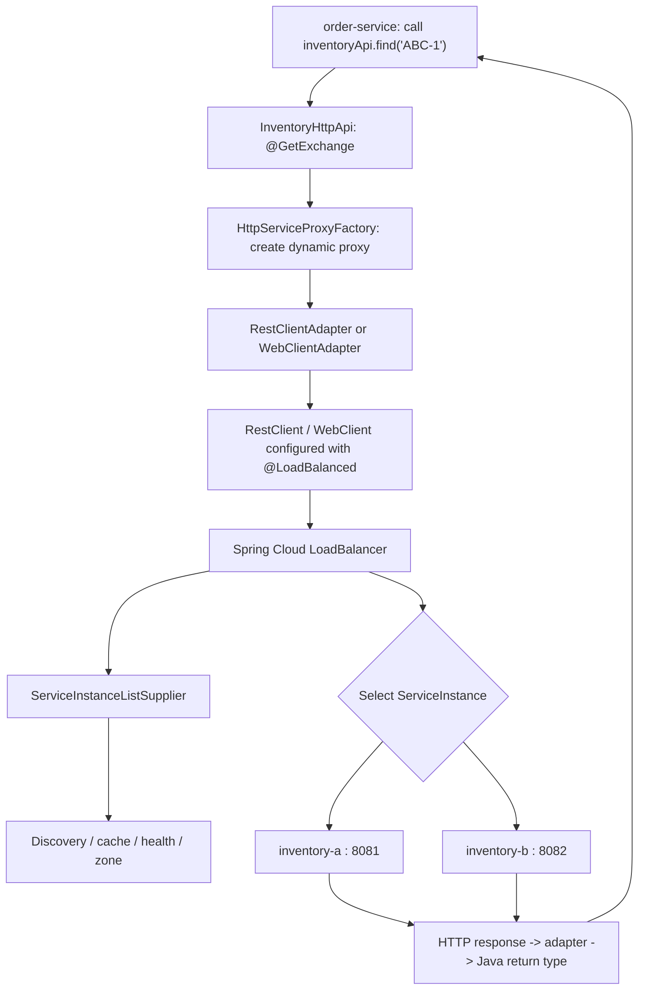

# HttpServiceProxyFactory and the HTTP Execution Adapter Layer

## 1. From HTTP Interface to a Real Call

In the **HTTP Interface** chapter of the `SPRING_CLOUD_SERVICE_COMMUNICATION_LOAD_BALANCING` module, we want `order-service` to call `inventory-service` by **service ID** instead of rewriting `RestClient`/`WebClient` boilerplate everywhere. Spring Framework provides a Java interface that declares the HTTP contract using `@HttpExchange`, `@GetExchange`, `@PostExchange`, and parameter annotations. `HttpServiceProxyFactory` creates the proxy object that implements that interface; an **HTTP adapter** bridges the proxy to a real client such as `RestClient`, `WebClient`, or `RestTemplate`.

Three responsibilities must be distinguished:

1. **The HTTP interface** describes *which endpoint to call, where parameters go, and what data type to receive*.
2. **HttpServiceProxyFactory + adapter** turns a Java method invocation into an HTTP exchange on the underlying client.
3. **Spring Cloud LoadBalancer + discovery** decides *which `ServiceInstance` replica* receives that exchange, provided the underlying client is configured for load balancing.

Therefore, `HttpServiceProxyFactory` is **not** a load-balancing algorithm, an HTTP client, or a service registry; `RestClientAdapter` itself also does **not** resolve service IDs on its own. In an application using Spring Cloud LoadBalancer, it is the properly configured `RestClient`/`WebClient`/`RestTemplate` that translates `http://inventory-service/...` into a concrete instance host/port.

### Learning Objectives

After this lesson, you will be able to:

- Create an HTTP Interface for `inventory-service` using `@HttpExchange` and path, query, header, and body parameters.
- Build a proxy using `HttpServiceProxyFactory.builderFor(adapter).build().createClient(...)`.
- Distinguish `HttpExchangeAdapter` (blocking) and `ReactorHttpExchangeAdapter` (reactive) along with the return types they support.
- Combine `RestClientAdapter` or `WebClientAdapter` with a `@LoadBalanced` builder to call by service ID.
- Explain why swapping adapters can change blocking/reactive semantics, timeouts, error handling, and tracing without changing API paths.
- Recognize the difference between **manual proxy bean creation** and **automatic HTTP Service Client groups** in Spring Boot 4/Spring Cloud Commons 5.0+.
- Verify instance selection, discovery/health-check errors, HTTP 404/503, timeouts, and retries.

## 2. Architecture Diagram: A Proxy Does Not Replace the Underlying Client



The diagram shows a **logical** chain of responsibility. `HttpServiceProxyFactory` builds the proxy during bean initialization, while a blocking method executes HTTP when invoked; a reactive method typically returns a publisher that executes the exchange upon subscription. Creating the factory and proxy bean **does not mean** any network request has been sent yet.

| Layer | Input | Job | Not Directly Responsible For |
|---|---|---|---|
| `@HttpExchange` interface | Methods and annotations | Declares HTTP contract | Does not choose an instance or open sockets |
| `HttpServiceProxyFactory` | Interface + `HttpExchangeAdapter` | Creates proxy and handles parameters/return types | Does not perform discovery or retries |
| `RestClientAdapter` | `RestClient` | Bridges proxy exchanges to synchronous client | Does not turn hostnames into service IDs |
| `WebClientAdapter` | `WebClient` | Bridges proxy exchanges to reactive client | Does not keep calls non-blocking if API returns sync types |
| `RestTemplateAdapter` | `RestTemplate` | Supports blocking clients based on `RestTemplate` | Does not load-balance if `RestTemplate` lacks interceptor |
| `LoadBalancer` | service ID + list of `ServiceInstance` | Selects an instance by policy | Does not define DTO/API contracts |
| HTTP connector / request factory | Concrete URI, body, headers | Sends requests, manages connections and transport timeouts | Does not understand HTTP Interface annotations |

**Common mistake:** configuring a proxy from `RestClient.create("http://inventory-service")` and expecting `inventory-service` to always be handled by Spring Cloud. If the client lacks the LoadBalancer interceptor, that name can be sent straight to DNS, causing an `UnknownHostException`. Successfully creating the proxy does not prove discovery works.

## 3. Defining an HTTP Interface with a Clear Contract

Suppose the inventory service exposes this API:

| Method | Endpoint | Purpose |
|---|---|---|
| `GET` | `/api/inventory/{sku}` | Fetch stock for one SKU |
| `GET` | `/api/inventory?onlyAvailable=true` | Filter inventory list |
| `POST` | `/api/inventory/reservations` | Reserve a quantity of stock (must ensure idempotency) |

Using Java `record` types as illustrative DTOs:

```java
public record InventorySnapshot(
        String sku, int available, String instanceId) {}

public record ReserveRequest(
        String sku, int quantity, String idempotencyKey) {}

public record ReservationResult(
        String reservationId, String status, String instanceId) {}
```

Define a synchronous interface suitable for `RestClientAdapter`:

```java
import java.util.List;
import org.springframework.web.bind.annotation.PathVariable;
import org.springframework.web.bind.annotation.RequestBody;
import org.springframework.web.bind.annotation.RequestHeader;
import org.springframework.web.bind.annotation.RequestParam;
import org.springframework.web.service.annotation.GetExchange;
import org.springframework.web.service.annotation.HttpExchange;
import org.springframework.web.service.annotation.PostExchange;

@HttpExchange(url = "/api/inventory", accept = "application/json")
public interface InventorySyncApi {

    @GetExchange("/{sku}")
    InventorySnapshot find(@PathVariable("sku") String sku);

    @GetExchange
    List<InventorySnapshot> list(
            @RequestParam("onlyAvailable") boolean onlyAvailable);

    @PostExchange("/reservations")
    ReservationResult reserve(
            @RequestHeader("Idempotency-Key") String key,
            @RequestBody ReserveRequest request);
}
```

How to read it:

- `@HttpExchange(url = "/api/inventory")` defines the shared path prefix; it is combined with the underlying HTTP client's `baseUrl`.
- `@GetExchange("/{sku}")` defines a `GET`, where `@PathVariable` substitutes the SKU into the URI.
- `@RequestParam` produces a query parameter, not a JSON body.
- `@RequestHeader` adds a header to that specific request.
- `@RequestBody` provides the object to serialize into the body; JSON converter/codec configuration comes from the underlying client.
- `ReserveRequest.idempotencyKey` and the header are only an illustrative contract. **They do not create idempotency by themselves**: `inventory-service` must persist/check the key when processing write operations.

Do not hardcode a physical URL like `http://localhost:8081` in the annotation if you want LoadBalancer to select instances; the logical name should live in the client's `baseUrl` or group configuration. One interface can be reused across multiple base URLs, provided the API schema and version remain consistent.

### 3.1. Common Annotations and Parameter Types

| Syntax | Effect | Notes |
|---|---|---|
| `@HttpExchange` | Shared HTTP interface configuration | Can be placed on type or method |
| `@GetExchange`, `@PostExchange`, `@PutExchange`, `@PatchExchange`, `@DeleteExchange` | Declares HTTP method | Does not add retries/transactions |
| `@PathVariable` | Replaces variables in URI template | Variable name must match template |
| `@RequestParam` | Sends query/form parameter per content type | Distinguish query vs. form-urlencoded |
| `@RequestHeader` | Sends a header | Never dump secrets into logs |
| `@RequestBody` | Sends object/publisher as body | Client codec/converter controls serialization |
| `@RequestPart` | Multipart body | Requires matching content type/codec |
| `URI` as method parameter | Specifies a dynamic URI | Can override annotation/base URL; control scheme/host |
| `@CookieValue` | Sends cookie per contract | Does not automatically enable sticky sessions |

Parameter and return representations may differ between Spring Framework 6.x and 7.x. Check the documentation for your resolved version and do not assume every MVC controller annotation works identically on an HTTP service client.

## 4. How Does HttpServiceProxyFactory Create a Proxy?

A factory is typically constructed once in Spring configuration. You supply **an adapter created from a configured HTTP client** and call `createClient`:

```java
RestClient restClient = RestClient.builder()
        .baseUrl("https://api.example.test")
        .build();

RestClientAdapter adapter = RestClientAdapter.create(restClient);

HttpServiceProxyFactory factory =
        HttpServiceProxyFactory.builderFor(adapter).build();

InventorySyncApi api = factory.createClient(InventorySyncApi.class);
```

The snippet above only demonstrates the factory API; it **does not perform load balancing** because the URL is a single HTTPS endpoint and the client has no LoadBalancer integration. To call by service ID, use a builder configured with Spring Cloud LoadBalancer as shown in the next section.

When `api.find("ABC-1")` is called, the proxy:

1. Looks up `@HttpExchange` and `@GetExchange` metadata on the method.
2. Converts `@PathVariable` and other annotations into request details.
3. Asks the adapter to execute the exchange for the expected response type.
4. Uses the underlying HTTP client's converter/codec to turn the response body into `InventorySnapshot`.
5. Returns the value or throws an exception from the adapter/client layer if an error occurs.

`HttpServiceProxyFactory` is a *proxy factory*, not a connection pool or a new gateway. The same interface backed by two adapters can use two completely different HTTP stacks.

### 4.1. Main Adapter Classes

| Adapter | Underlying Client Class | Abstraction | Recommended Return Types | When to Use |
|---|---|---|---|---|
| `RestClientAdapter` | `RestClient` | `HttpExchangeAdapter` | DTO, `List<T>`, `ResponseEntity<T>`, `void` | Blocking/Servlet apps; fluent API |
| `RestTemplateAdapter` | `RestTemplate` | `HttpExchangeAdapter` | DTO, `ResponseEntity<T>`, `void` | Codebases already using `RestTemplate` |
| `WebClientAdapter` | `WebClient` | `ReactorHttpExchangeAdapter` | `Mono<T>`, `Flux<T>`, and reactive variants | Spring WebFlux/reactive pipelines |

`ReactorHttpExchangeAdapter` supports reactive types in addition to synchronous ones; however, if you declare blocking return types on `WebClientAdapter`, the proxy may have to block waiting for the result, losing end-to-end non-blocking benefits. Avoid calling synchronous DTO-returning methods inside a WebFlux event-loop thread.

**Do not use `RestClientAdapter` and declare `Mono<InventorySnapshot>` just because the interface syntax allows `Mono`**: a blocking adapter does not provide the same reactive contract as `WebClientAdapter`. Design the interface to match the execution model.

## 5. Creating a Proxy with RestClientAdapter and Spring Cloud LoadBalancer

This is the primary pattern for blocking applications. Configure a `@LoadBalanced` `RestClient.Builder` bean first, then create the adapter and proxy:

```java
import org.springframework.cloud.client.loadbalancer.LoadBalanced;
import org.springframework.context.annotation.Bean;
import org.springframework.context.annotation.Configuration;
import org.springframework.web.client.RestClient;
import org.springframework.web.client.support.RestClientAdapter;
import org.springframework.web.service.invoker.HttpServiceProxyFactory;

@Configuration(proxyBeanMethods = false)
class InventoryHttpClientConfiguration {

    @Bean
    @LoadBalanced
    RestClient.Builder loadBalancedRestClientBuilder() {
        return RestClient.builder();
    }

    @Bean
    InventorySyncApi inventorySyncApi(
            @LoadBalanced RestClient.Builder builder) {

        RestClient client = builder.clone()
                .baseUrl("http://inventory-service")
                .build();

        RestClientAdapter adapter = RestClientAdapter.create(client);

        return HttpServiceProxyFactory.builderFor(adapter)
                .build()
                .createClient(InventorySyncApi.class);
    }
}
```

**Why does this order matter?**

- `@LoadBalanced` on the `RestClient.Builder` bean lets Spring Cloud attach load-balancing mechanics to clients built from that bean.
- `baseUrl("http://inventory-service")` holds the **service ID**; the logical host is resolved at request time via discovery and instance selection policies.
- `RestClientAdapter.create(client)` simply bridges the proxy to the created `RestClient`, without calling the registry itself.
- `HttpServiceProxyFactory.builderFor(adapter)` builds the factory, and `createClient(InventorySyncApi.class)` returns a proxy bean ready for injection elsewhere.
- `builder.clone()` creates an isolated builder for the inventory client, avoiding mutating `baseUrl` for other clients.

The application needs Spring Web, `spring-cloud-starter-loadbalancer`, and a `DiscoveryClient` or equivalent instance source. The code above is based on API usage in Spring Framework 6.2+/Spring Cloud Commons 4.3+; **verify the exact Release Train and imports in your project** if using a different version.

For observability/tracing, Spring Boot typically supplies dedicated builder customizers. If you construct `RestClient.builder()` manually as in this minimal example, ensure the required customizers are applied for your Boot version; a self-managed builder can bypass expected auto-configured settings.

### 5.1. Using the Proxy Bean in `order-service`

```java
import org.springframework.stereotype.Service;

@Service
class InventoryReader {
    private final InventorySyncApi inventory;

    InventoryReader(InventorySyncApi inventory) {
        this.inventory = inventory;
    }

    InventorySnapshot getStock(String sku) {
        return inventory.find(sku);
    }
}
```

The business layer does not need to know about `RestClient` or `HttpServiceProxyFactory`. If `inventory-service` has three replicas, calls to `find` can be routed by LoadBalancer to different instances without changing the interface.

**Checkpoint:** in a blocking call, the HTTP request executes when `inventory.find(...)` is invoked. Do not assume the proxy executes asynchronously just because Spring Cloud LoadBalancer uses reactive abstractions internally for instance selection.

## 6. Creating a Proxy with WebClientAdapter to Return Mono or Flux

When the application uses WebFlux or needs a non-blocking pipeline, declare a **separate reactive interface** for the same HTTP contract:

```java
import reactor.core.publisher.Flux;
import reactor.core.publisher.Mono;
import org.springframework.web.bind.annotation.PathVariable;
import org.springframework.web.service.annotation.GetExchange;
import org.springframework.web.service.annotation.HttpExchange;

@HttpExchange(url = "/api/inventory", accept = "application/json")
public interface InventoryReactiveApi {

    @GetExchange("/{sku}")
    Mono<InventorySnapshot> find(@PathVariable("sku") String sku);

    @GetExchange
    Flux<InventorySnapshot> list();
}
```

Spring Cloud bean for `WebClient`:

```java
import org.springframework.cloud.client.loadbalancer.LoadBalanced;
import org.springframework.context.annotation.Bean;
import org.springframework.context.annotation.Configuration;
import org.springframework.web.reactive.function.client.WebClient;
import org.springframework.web.reactive.function.client.support.WebClientAdapter;
import org.springframework.web.service.invoker.HttpServiceProxyFactory;

@Configuration(proxyBeanMethods = false)
class InventoryReactiveHttpClientConfiguration {

    @Bean
    @LoadBalanced
    WebClient.Builder loadBalancedWebClientBuilder() {
        return WebClient.builder();
    }

    @Bean
    InventoryReactiveApi inventoryReactiveApi(
            @LoadBalanced WebClient.Builder builder) {

        WebClient client = builder.clone()
                .baseUrl("http://inventory-service")
                .build();

        WebClientAdapter adapter = WebClientAdapter.create(client);

        return HttpServiceProxyFactory.builderFor(adapter)
                .build()
                .createClient(InventoryReactiveApi.class);
    }
}
```

This is an **alternative** to the blocking configuration if the application only needs one client model; if both are used, configure and inject the proxy types explicitly. With `WebClientAdapter`, a method returning `Mono` or `Flux` does not normally send the request when creating the publisher; the exchange executes when the publisher is subscribed to.

In a WebFlux controller:

```java
@RestController
@RequestMapping("/demo/inventory")
class InventoryReactiveController {

    private final InventoryReactiveApi inventory;

    InventoryReactiveController(InventoryReactiveApi inventory) {
        this.inventory = inventory;
    }

    @GetMapping("/{sku}")
    Mono<InventorySnapshot> one(@PathVariable String sku) {
        return inventory.find(sku);
    }

    @GetMapping
    Flux<InventorySnapshot> all() {
        return inventory.list();
    }
}
```

A `Flux<InventorySnapshot>` emitting multiple elements from **one JSON array response** still belongs to a single HTTP request routed to one instance. If you call `inventory.find(sku)` for each SKU inside `flatMap`, each call/subscription can trigger a separate HTTP request and select a different instance.

### 6.1. Avoid Confusing a Reactive Proxy with "Per-Element Distribution"

```java
Flux<InventorySnapshot> oneHttpResponse = inventory.list();

Flux<InventorySnapshot> severalHttpRequests =
        Flux.fromIterable(List.of("ABC-1", "XYZ-2", "LMN-3"))
                .flatMap(inventory::find, 3);
```

The first example sends **one GET** returning multiple items; the second issues **three GETs**, each of which can pick a different instance. `WebClientAdapter` does not split a returned list into separate requests.

## 7. RestTemplateAdapter: Bridging Existing RestTemplate Applications

Spring Framework also supports `RestTemplateAdapter`. It is useful when an application already has a `RestTemplate` configured with request factories, interceptors, authentication, and error handlers.

**Alternative** example — do not register alongside the `InventorySyncApi` bean of the same type/name in section 5:

```java
@Bean
InventorySyncApi inventorySyncApiFromRestTemplate(
        @LoadBalanced RestTemplate restTemplate) {

    // Logical service name and path are configured in the URI handler;
    // RestTemplate must actually have the LoadBalancer interceptor.
    restTemplate.setUriTemplateHandler(
            new DefaultUriBuilderFactory("http://inventory-service"));

    RestTemplateAdapter adapter =
            RestTemplateAdapter.create(restTemplate);

    return HttpServiceProxyFactory.builderFor(adapter)
            .build()
            .createClient(InventorySyncApi.class);
}
```

For this snippet to work properly, a `@LoadBalanced RestTemplate` bean configured by Spring Cloud must exist. Calling `new RestTemplate()` and `RestTemplateAdapter.create(...)` **does not** integrate service discovery. Because mutating the URI handler affects every consumer sharing that `RestTemplate` bean, real projects should create a dedicated client bean for the proxy or configure the handler when constructing `RestTemplate`.

`RestTemplateAdapter` pairs with blocking return types. For new applications without legacy API constraints, `RestClientAdapter` usually yields cleaner configuration. `HttpServiceProxyFactory` preserves the HTTP Interface declaration, but switching adapters does not automatically make timeouts, interceptors, and converters behave identically.

## 8. API/Release Train Compatibility: Manual Factory vs. Auto-Registration

**Not every Spring Boot/Spring Cloud Release Train shares the same auto-registration mechanism.** Two cases must be clearly separated:

| Ecosystem | HTTP Interface Bean Creation | LoadBalancer Integration |
|---|---|---|
| Spring Framework 6.1/6.2 + Spring Boot 3.x + Spring Cloud Commons 4.x | Created manually from `HttpServiceProxyFactory` as in sections 5/6, or custom registration if built by the app | Wired manually via `@LoadBalanced RestClient.Builder`/`WebClient.Builder` |
| Spring Framework 7.x + Spring Boot 4.x + Spring Cloud Commons 5.0+ | Adds `@ImportHttpServices` and Spring Boot **HTTP Service Client groups** | Spring Cloud Commons 5.0+ includes group configurers to attach LoadBalancer conditionally |

Specifically, Spring Cloud Commons **5.0.0+** supports LoadBalancer integration for HTTP Service Client groups via `LoadBalancerRestClientHttpServiceGroupConfigurer` and `LoadBalancerWebClientHttpServiceGroupConfigurer`. This mechanism relies on Spring Boot 4 auto-configuration beans; **do not copy the automatic group setup into a Boot 3/Commons 4.x project expecting it to work**.

### 8.1. Auto-Registration Example in Spring Boot 4/Spring Cloud 5

On supported versions, an HTTP Interface can be registered as follows:

```java
import org.springframework.boot.autoconfigure.SpringBootApplication;
import org.springframework.web.service.registry.ImportHttpServices;

@SpringBootApplication
@ImportHttpServices(
        group = "inventory-service",
        types = InventorySyncApi.class)
public class OrderApplication {
}
```

When the `inventory-service` group has no `base-url` configured, Spring Cloud Commons 5.0+ can derive the URL from the **group name** as `http://inventory-service` and attach the corresponding LoadBalancer interceptor/filter to the group's client.

You can make load balancing explicit using an `lb`-schemed URL:

```yaml
spring:
  http:
    serviceclient:
      inventory-service:
        base-url: "lb://inventory-service"
        connect-timeout: 1s
        read-timeout: 2s
```

With Spring Cloud Commons 5.0+ integration, the `lb` scheme triggers LoadBalancer for the group; HTTP is chosen initially for the request and can switch to HTTPS if the selected instance is marked secure. The group must be configured with matching Spring Boot/Spring Cloud modules, discovery must supply `ServiceInstance` entries, and the group's HTTP client must build successfully.

**Critical trap:** simply writing

```yaml
spring:
  http:
    serviceclient:
      inventory-service:
        base-url: "http://inventory-service"
```

in an **automatic HTTP Service Client group** is not equivalent to `lb://inventory-service`. According to Spring Cloud Commons 5.0 documentation, if `base-url` is explicitly set with a scheme **other than `lb`**, the group configurer **does not automatically attach** LoadBalancer. This differs from the **manual** setup in section 5, where you explicitly create a `@LoadBalanced` client and set `http://inventory-service` as `baseUrl`. Do not mix the two mechanisms and assume every URL with a service-ID hostname will always be load-balanced.

The blocking/reactive adapter choice of a **group** must match the HTTP Service API and the auto-configuration supported by your Spring Boot version. If using `Mono`/`Flux` return types, ensure the group is built with `WebClient`/reactive adapter; do not assume `@ImportHttpServices` automatically converts blocking return types to reactive ones.

### 8.2. Avoid Registering Duplicate Proxies

In one application, if `@ImportHttpServices` is used so Spring Boot creates the `InventorySyncApi` bean, do not simultaneously define a manual bean of the same type/name without an explicit qualifier. Typical symptoms are `NoUniqueBeanDefinitionException` or accidentally injecting a non-load-balanced proxy. Pick either **manual factory** or **group registration** as the primary path per interface.

## 9. Return Types Are Determined by the Adapter

| Desired Result | RestClientAdapter / RestTemplateAdapter | WebClientAdapter |
|---|---|---|
| No body needed | `void` | `Mono<Void>` or `void` |
| Single JSON object | `InventorySnapshot` | `Mono<InventorySnapshot>` or synchronous type |
| JSON list | `List<InventorySnapshot>` | `Flux<InventorySnapshot>` or `Mono<List<InventorySnapshot>>` when contract matches |
| Status + headers + body | `ResponseEntity<InventorySnapshot>` | `Mono<ResponseEntity<InventorySnapshot>>` |
| Headers only | `HttpHeaders` | `Mono<HttpHeaders>` |
| Data stream | Blocking API matching response/transport type | `Flux<T>`, depending on codec and streaming format |

With `RestClientAdapter` and `RestTemplateAdapter`, `HttpExchangeAdapter` serves synchronous calls rather than a Reactor pipeline. With `WebClientAdapter`, `ReactorHttpExchangeAdapter` supports both reactive and certain synchronous return types, but **you should not block on the WebFlux event loop**.

**Return types do not decide the instance selection algorithm:** Spring Cloud LoadBalancer chooses a target per HTTP request. A `List<T> list()` method sends only one request if the endpoint returns an array; it does not send one request per element. A `Mono<T> find()` method can execute the request again if the publisher is subscribed to multiple times without caching/sharing the signal.

## 10. Where Do Errors, Timeouts, and Retries Live?

### 10.1. Classifying Errors by Layer

| Symptom | Likely Source | How to Verify |
|---|---|---|
| Proxy not created / bean not found | Missing `createClient` or misconfigured `@ImportHttpServices` for version | Check bean configuration, interface scanning, and startup exceptions |
| `UnknownHostException: inventory-service` | Underlying HTTP client not handled by LoadBalancer; sent hostname straight to DNS | Check `@LoadBalanced`/LB filter or `lb` scheme on group |
| No instance available to select | Empty discovery, wrong service ID, supplier filtered everything out | Inspect registry, supplier, health/zone/hints, and selection events |
| Instance selected, then connection refused/timeout | Dead instance, wrong host/port, or slow network | Compare instance ID, transport exception, DNS/network |
| Downstream returns HTTP 404 | Wrong endpoint or missing SKU per API | Distinguish status from discovery errors |
| Downstream returns HTTP 503 | Server actually reported unavailable | Check server logs, traces, and selection metrics |
| Reactive LB generates HTTP 503 when no instance exists | No HTTP sent to server | Use LoadBalancer lifecycle/discard metrics to confirm |
| Body fails to deserialize | JSON/schema/codec/converter mismatch | Inspect `Content-Type`, DTO, and decode stack trace |
| Single logical request sent multiple times | Layered retries, multiple subscriptions | Count HTTP attempts separately from logical requests |

With `RestClientAdapter`, `RestClient` by default throws a `RestClientException` subtype when `retrieve` encounters 4xx/5xx; the exact class depends on status and handler configuration. With `WebClientAdapter`, 4xx/5xx by default surface as `WebClientResponseException` in the publisher. HTTP Interface **does not normalize** these two exception hierarchies into a single unified type.

"No instance available" errors usually occur before connecting downstream. In blocking implementations, `BlockingLoadBalancerClient` may throw `IllegalStateException`; with a reactive LoadBalancer filter, it can appear as a synthesized 503 error response. Check your Release Train and do not assume every 503 came from the actual server.

### 10.2. Customizing Error Handling on the Underlying HTTP Client

Example `RestClient` with a status handler:

```java
RestClient client = loadBalancedBuilder.clone()
        .baseUrl("http://inventory-service")
        .defaultStatusHandler(
                status -> status.value() == 503,
                (request, response) -> {
                    throw new IllegalStateException(
                            "inventory-service returned HTTP 503");
                })
        .build();

InventorySyncApi api = HttpServiceProxyFactory
        .builderFor(RestClientAdapter.create(client))
        .build()
        .createClient(InventorySyncApi.class);
```

`loadBalancedBuilder` above is an existing `@LoadBalanced RestClient.Builder`. The handler processes **received HTTP responses**; it does not directly intercept connection failures, timeouts, or proxy initialization errors. In production applications, use domain-specific exceptions carrying the root cause and correlation ID rather than a generic `IllegalStateException` across unrelated failures as in this short snippet.

In `WebClient`, handle responses via `WebClient.Builder`'s `defaultStatusHandler` or pipeline operators like `onErrorResume`/`onErrorMap` based on error type. Avoid writing a blanket fallback returning `available=0` for every failure: "out of stock" is different from "stock unknown because dependency failed".

### 10.3. Timeouts Are Configured at Transport, Not Factory

- **Connect/read/response timeouts:** configured on the `RestClient` request factory or `WebClient` connector; they govern real HTTP exchanges with the selected instance.
- **Reactive timeout:** `.timeout(Duration)` can be added on `Mono`/`Flux` with appropriate semantics; avoid confusing inter-signal timeouts with a total stream deadline.
- **Discovery timeout/cache:** belongs to LoadBalancer/discovery; do not conflate with HTTP timeouts.
- **Factory:** `HttpServiceProxyFactory` does not provide an overall HTTP timeout policy equivalent to the transport configurations above.

When using `WebClientAdapter` with synchronous return types, some versions support configuring `blockTimeout` on the adapter. Even so, Spring Framework recommends relying on HTTP client/transport timeouts for full control and avoiding blocking calls on event-loop threads.

### 10.4. Retries Must Account for Total Attempts

`HttpServiceProxyFactory` does not perform retries itself. Retries can live in:

1. Spring Cloud LoadBalancer (`spring.cloud.loadbalancer.retry.*`, depending on blocking/reactive and dependencies).
2. Spring Retry or Reactor `retryWhen` at the caller layer.
3. A circuit breaker/resilience library or gateway.
4. The underlying HTTP client if retry capability is configured.

In labs, disable retries first to measure a single request hitting a single instance. Then enable **one** bounded retry policy for idempotent GETs and log each attempt/selected instance. Do not blindly retry reservation/payment `POST` calls without an idempotency key and downstream duplicate handling.

## 11. End-to-End Practice: Proxy by Service ID

### 11.1. Topology

| Component | Configuration | Purpose |
|---|---|---|
| `order-service` | Spring Boot, Spring Cloud LoadBalancer, HTTP interface proxy | Caller |
| `inventory-a` | `inventory-service`, port 8081 | Replica A |
| `inventory-b` | `inventory-service`, port 8082 | Replica B |
| Discovery | `SimpleDiscoveryClient` with two static URIs in lab, or a real registry | Supplies instance list |

Example `application.yml` of `order-service` for the **manual factory approach**:

```yaml
spring:
  application:
    name: order-service
  cloud:
    discovery:
      client:
        simple:
          instances:
            inventory-service:
              - uri: http://localhost:8081
                instance-id: inventory-a
              - uri: http://localhost:8082
                instance-id: inventory-b
    loadbalancer:
      retry:
        enabled: false

server:
  port: 8080
```

Do not simultaneously apply the `spring.http.serviceclient...` group configuration from section 8 while testing the manual factory; keep only one registration mechanism active per experiment to avoid ambiguity about configuration sources. `localhost` ports only make sense when processes share a network namespace.

### 11.2. Server Returning `instanceId`

Each `inventory-service` implements a controller matching the API contract and returns its own `instanceId`:

```java
@RestController
@RequestMapping("/api/inventory")
class InventoryController {

    private final String instanceId;

    InventoryController(Environment env) {
        this.instanceId = env.getRequiredProperty("app.instance-id");
    }

    @GetMapping("/{sku}")
    InventorySnapshot find(@PathVariable String sku) {
        return new InventorySnapshot(sku, 12, instanceId);
    }

    @GetMapping
    List<InventorySnapshot> list(
            @RequestParam(defaultValue = "false")
            boolean onlyAvailable) {
        return List.of(
                new InventorySnapshot("ABC-1", 12, instanceId),
                new InventorySnapshot("XYZ-2", 5, instanceId));
    }
}
```

Set `app.instance-id=inventory-a`, `server.port=8081` on instance A, and `app.instance-id=inventory-b`, `server.port=8082` on instance B. The lab uses only `GET` requests to avoid side effects across retries. With `@GetExchange` `list(...)` on the interface, pass the `onlyAvailable` query parameter and inspect the JSON array returned by the server.

### 11.3. Controller Calling the Proxy Bean

Example for the **manual `RestClientAdapter`** in section 5:

```java
@RestController
@RequestMapping("/demo/inventory")
class InventoryDemoController {

    private final InventorySyncApi inventory;

    InventoryDemoController(InventorySyncApi inventory) {
        this.inventory = inventory;
    }

    @GetMapping("/{sku}")
    InventorySnapshot one(@PathVariable String sku) {
        return inventory.find(sku);
    }

    @GetMapping
    List<InventorySnapshot> all() {
        return inventory.list(false);
    }
}
```

Start both inventory instances and `order-service`, then send requests:

```bash
curl -i http://localhost:8080/demo/inventory/ABC-1
curl -i http://localhost:8080/demo/inventory/ABC-1
curl -i http://localhost:8080/demo/inventory/ABC-1
curl -i http://localhost:8080/demo/inventory
```

If Round Robin runs over two instances with a stable list and no concurrent traffic, `instanceId` across requests will alternate. Within **one** list response, all objects share the same `instanceId` because one HTTP GET was served by one instance. This holds regardless of whether the proxy returns `List` or `Flux`.

### 11.4. Failure Scenario Test Suite

| Test | Adjustment | Expected Result to Verify |
|---|---|---|
| Wrong service ID | Change base URL to `http://inventroy-service`, unregistered | No instance found, no HTTP request reaches inventory |
| Missing interceptor/filter | Build `RestClient`/`WebClient` without `@LoadBalanced` builder | Logical hostname may hit DNS resolution and fail |
| One instance dead | Keep old URI in `SimpleDiscoveryClient` but stop port 8081 | Connection errors when A is picked; not auto-removed without a health supplier |
| Registry returns empty list | Remove both A and B from discovery and restart caller if static | Enters no-instance branch, distinct from real server HTTP 503 |
| Server returns HTTP 404 | Query a non-existent SKU per contract | Client exception/status matching HTTP 404; not misclassified as discovery error |
| Server returns HTTP 503 | Explicitly return status 503 from endpoint | Server logs show incoming request; distinct from reactive LB synthesized 503 |
| JSON body mismatches contract | Change field/type on server | Decode/binding error; must not be reported as no-instance |
| Switch to `WebClientAdapter` | Use `InventoryReactiveApi` and publisher-returning controller | Each GET selects an instance on subscribe; does not block event loop |
| Switch runbook to Boot4/Cloud5 group | Use `@ImportHttpServices`, remove manual bean | Confirm single bean, valid group name/base URL/scheme, and LB interception |

### 11.5. Distinguishing "Proxy Created" from "Request Reached Server"

Log at three points:

- **Factory/bean creation:** was the `InventorySyncApi` or `InventoryReactiveApi` proxy bean created?
- **LoadBalancer on caller:** service ID, instance list, selected instance, missing-instance errors, discovery duration.
- **inventory-service:** actual `instanceId` receiving the request, HTTP status/latency.

Successful proxy creation at startup **does not** prove the registry has instances, the endpoint exists, or TLS/cookies/auth are valid. Interface invocations must be verified against real HTTP responses and server logs/traces.

## 12. Common Architectural Mistakes

| Mistake | Why It Is Wrong | Fix |
|---|---|---|
| Assuming `HttpServiceProxyFactory` performs discovery itself | Factory only builds a proxy over an adapter | Configure LoadBalancer on the underlying client or Boot4/Cloud5 group |
| Creating `RestClientAdapter` from a plain client and calling a service ID | Logical host may go straight to DNS | Use a `@LoadBalanced RestClient.Builder` and build the client from it |
| Mixing `@ImportHttpServices` and a manual factory bean for the same interface | Can create two conflicting proxy beans | Choose one mechanism or use explicit qualifiers |
| In Boot4/Cloud5 group setting `base-url: http://inventory-service` and expecting auto LB | Group integration only auto-wires when URL is null or uses `lb` scheme | Omit base URL or use `lb://inventory-service` |
| Declaring `Mono<T>` for `RestClientAdapter` | Blocking adapter does not provide Reactor contract | Use `WebClientAdapter` and a reactive interface |
| Using `WebClientAdapter` while returning sync DTOs on the event loop | Can introduce blocking behavior in a reactive pipeline | Return `Mono`/`Flux`; let WebFlux subscribe |
| Setting timeouts on the factory and thinking network I/O is bounded | Factory does not own sockets/pools | Configure transport timeouts and deadlines |
| Treating every HTTP 503 as coming from inventory server | Reactive LoadBalancer can synthesize 503 when no instance exists | Inspect server logs, supplier, and lifecycle/discard metrics |
| Retrying `POST` without idempotency | Can create duplicate stock reservations | Design idempotency first and bound retries |
| Swapping client builders and losing observability | Manually built builders may miss Boot customizers | Use version-appropriate builders/configurers |
| Using absolute URLs in interface annotations | Can bypass logical base URL | Keep relative paths in annotations and manage base URL via client/group |

## 13. Completion Checklist and Extended Exercises

### Checklist

- [ ] Recorded resolved Spring Boot, Spring Framework, and Spring Cloud Commons/LoadBalancer versions.
- [ ] Created `@HttpExchange` interface with proper methods/paths, `@PathVariable`, `@RequestParam`, headers/body, and return types.
- [ ] Understand that `HttpServiceProxyFactory` creates proxies, not network clients or discovery.
- [ ] Know that `RestClientAdapter`/`RestTemplateAdapter` are blocking, while `WebClientAdapter` supports reactive calls.
- [ ] Configured underlying client with `@LoadBalanced` or the appropriate group configurer for your version.
- [ ] Logical URI uses service ID; `ServiceInstance` list actually contains instances.
- [ ] Verified `createClient` or `@ImportHttpServices` produces the single expected proxy bean.
- [ ] Tested HTTP 200, 404, 503, no-instance, dead instance, timeout, and decode errors.
- [ ] Timeouts/retries and authentication/tracing are configured at the right layer, bounded, and verified.
- [ ] Did not block the WebFlux event loop; did not retry write operations without idempotency.
- [ ] Tracked HTTP attempt counts, selected instance IDs, and server-side logs.

### Exercise 1 — Same Interface, Two Underlying Clients

Build `InventorySyncApi` with `RestClientAdapter` and another version using `RestTemplateAdapter`. Keep URLs/paths unchanged and test against two instances. Compare exceptions, request factory timeouts, and interceptor/metric propagation. **Do not** register two beans of the same type at one injection point without a qualifier.

### Exercise 2 — From Blocking to Reactive

Create `InventoryReactiveApi` with `WebClientAdapter` and a controller returning `Mono<InventorySnapshot>`. Send 20 GETs and tally `instanceId`. Then call `Flux<InventorySnapshot>` for the list and explain why all items from a single GET share the same instance ID.

### Exercise 3 — Controlled LoadBalancer Disablement

In a lab environment, build a `RestClient` without `@LoadBalanced` and pass it to `RestClientAdapter`. Call `http://inventory-service` when DNS does not define that hostname. Record the stack trace and compare it with the no-instance error when LoadBalancer is present but discovery is empty.

### Exercise 4 — Group Auto-Configuration on Boot4/Cloud5 Only

Create an app with `@ImportHttpServices(group="inventory-service", types=InventorySyncApi.class)`. Try two configs: omitting `base-url`, and setting `base-url: lb://inventory-service`. Verify both are handled by LoadBalancer. Then try `base-url: http://inventory-service` and observe the difference per 5.0+ documentation, avoiding confusion with manual `@LoadBalanced` config.

### Exercise 5 — Failures and Resilience

Simulate one stopped replica that still remains in the registry; test first with retries disabled and then with one GET retry. Count requests/attempts, confirm the factory creates no new instances itself, and verify timeouts are enforced by the HTTP transport. If testing `POST`, do so only when the server supports idempotency keys.

## 14. References

- [Spring Framework 6.2 — HTTP Interface and REST Clients](https://docs.spring.io/spring-framework/reference/6.2/integration/rest-clients.html): `@HttpExchange`, `HttpServiceProxyFactory.builderFor(...)`, `RestClientAdapter`, `WebClientAdapter`, `RestTemplateAdapter`, parameters, and return values.
- [Spring Framework — Current REST Clients](https://docs.spring.io/spring-framework/reference/integration/rest-clients.html): API/registration updates and changes across Framework versions.
- [Spring Cloud Commons 4.3 — Common Abstractions](https://docs.spring.io/spring-cloud-commons/reference/4.3/spring-cloud-commons/common-abstractions.html): `@LoadBalanced RestClient.Builder` and `@LoadBalanced WebClient.Builder`.
- [Spring Cloud Commons 4.3 — LoadBalancer](https://docs.spring.io/spring-cloud-commons/reference/4.3/spring-cloud-commons/loadbalancer.html): service ID, instance lists, suppliers, health, retries, and target selection policies.
- [Spring Cloud Commons 5.0 — LoadBalancer](https://docs.spring.io/spring-cloud-commons/reference/spring-cloud-commons/loadbalancer.html): section **LoadBalancer Integration for Spring HTTP Service Clients AutoConfiguration** (verify page shows Commons 5.0 before using).
- [Spring Boot 4.0 — Calling REST Services](https://docs.spring.io/spring-boot/4.0/reference/io/rest-client.html): `@ImportHttpServices`, HTTP Service Client groups, group base URL and timeout configuration.
- [Spring Cloud — Release Train](https://spring.io/projects/spring-cloud/): check Spring Boot/Spring Cloud compatibility before borrowing code from another branch.

**Conclusion:** `HttpServiceProxyFactory` produces a **callable Java API** from an HTTP interface; `RestClientAdapter`, `WebClientAdapter`, or `RestTemplateAdapter` determines **how HTTP is executed**. To communicate by service ID across multiple replicas, the underlying HTTP client must be properly integrated with **Spring Cloud LoadBalancer**. Keeping the three layers — **contract – adapter – load balancing** — separate lets you swap HTTP stacks, apply retries/timeouts, and trace failures without conflating them.
