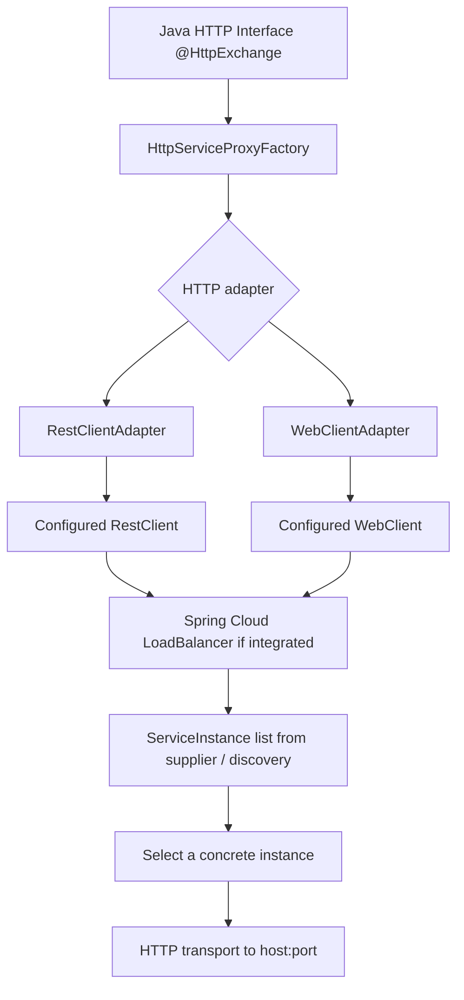

# Connecting an Interface to a Configured RestClient or WebClient

Spring Framework's **HTTP Interface** lets you describe an HTTP API as a Java interface and then generate a proxy that sends requests through a configured HTTP client. In a system using Spring Cloud LoadBalancer, this technique cleanly separates the **API contract** from **replica selection, connection settings, timeouts, headers, and error handling**.

For example, `order-service` calls `inventory-service` to check stock. Rather than scattering `RestClient.get().uri(...)` or `WebClient.get().uri(...)` calls throughout business logic, you declare an interface annotated with `@HttpExchange` and `@GetExchange`. You then use `HttpServiceProxyFactory` with `RestClientAdapter` or `WebClientAdapter`, depending on whether synchronous or reactive execution is needed.

**Learning objective:** learn how to create and configure an HTTP Interface proxy, wire it to a LoadBalancer-enabled `RestClient`/`WebClient`, understand when a `ServiceInstance` is chosen by service ID, and distinguish contract, discovery, network, and business errors. This is foundational knowledge for the `SPRING_CLOUD_SERVICE_COMMUNICATION_LOAD_BALANCING` module, aiming at reliable inter-service communication with proper timeouts, retries, and observability.

## 1. Separating the HTTP Contract from the Execution Infrastructure

An HTTP Interface describes **what to call**, not **which transport to use**. Consider the same stock-lookup API:

```http
GET /api/stocks/BOOK-001 HTTP/1.1
Host: inventory-service
Accept: application/json
```

Hypothetical response:

```http
HTTP/1.1 200 OK
Content-Type: application/json

{
  "sku": "BOOK-001",
  "availableQuantity": 12
}
```

With HTTP Interface, method and path mappings live on the interface. However, for the proxy to execute requests, it requires an **adapter** connected to a concrete HTTP client.

| Component | Role | What It Does Not Do Automatically |
| --- | --- | --- |
| `@HttpExchange` / `@GetExchange` | Describes HTTP method, URL, headers, and parameter bindings | Does not send requests itself |
| `HttpServiceProxyFactory` | Creates a Java proxy for the interface | Does not create a service registry |
| `RestClientAdapter` | Bridges the proxy to synchronous `RestClient` | Does not enable LoadBalancer automatically |
| `WebClientAdapter` | Bridges the proxy to reactive `WebClient` | Does not enable LoadBalancer automatically |
| `@LoadBalanced` builder | Allows Spring Cloud to customize the HTTP client to resolve service IDs | Does not synthesize target instances |
| `ServiceInstanceListSupplier` and LoadBalancer | Supplies candidates and chooses a `ServiceInstance` | Does not deserialize the API's JSON |

The key point is that **the interface does not decide which replica gets called**. That decision belongs to the HTTP client **integrated with** Spring Cloud LoadBalancer, working with the instance supplier and the module's selection policy.

## 2. Architecture: Same Contract, Two Different Adapters



In the diagram, `RestClient` and `WebClient` are **mutually exclusive connection options**, not two layers that a single request traverses together. The same kind of API contract can be expressed as two interfaces, but their **return types** will differ: synchronous calls typically return a DTO or `ResponseEntity`, whereas reactive calls can return `Mono<DTO>` or `Flux<DTO>`.

An important note: creating a proxy via `RestClientAdapter.create(restClient)` uses **only the exact `RestClient` instance passed in**. If that instance was not built from a LoadBalancer-enabled builder, `HttpServiceProxyFactory` will not add LoadBalancer on its own simply because the base host is named `inventory-service`.

## 3. Declaring an HTTP Contract with Spring Framework Annotations

Let us start with a synchronous interface:

```java
package com.example.order.clients;

import org.springframework.web.bind.annotation.PathVariable;
import org.springframework.web.service.annotation.GetExchange;
import org.springframework.web.service.annotation.HttpExchange;

@HttpExchange(url = "/api/stocks", accept = "application/json")
public interface InventorySyncApi {

    @GetExchange("/{sku}")
    StockResponse getStock(@PathVariable("sku") String sku);
}
```

Caller-side DTO:

```java
package com.example.order.clients;

public record StockResponse(String sku, int availableQuantity) {}
```

What the annotations express:

- `@HttpExchange(url = "/api/stocks")`: shared path at the interface level.
- `@GetExchange("/{sku}")`: HTTP GET for the appended path segment.
- `@PathVariable("sku")`: binds the Java parameter into the path template.
- `accept = "application/json"`: declares the expected response media type.

Combined with the HTTP client's base URL `http://inventory-service`, the logical URI is:

```text
http://inventory-service/api/stocks/BOOK-001
```

Spring Framework also provides `@PostExchange`, `@PutExchange`, `@PatchExchange`, `@DeleteExchange`, and binding annotations such as `@RequestParam`, `@RequestHeader`, and `@RequestBody`. They describe the contract; authentication, authorization, versioning, and business rules still must be designed separately.

### 3.1. Why Not Put Instance Addresses on the Interface?

Avoid writing:

```java
@HttpExchange(url = "http://10.0.1.11:8080/api/stocks")
interface HardCodedInventoryApi {
    @GetExchange("/{sku}")
    StockResponse getStock(@PathVariable("sku") String sku);
}
```

That example couples the contract to **a specific IP address**. It undermines instance replacement, adding replicas, and load balancing by service ID. Prefer keeping only paths on the interface and letting the configured HTTP client hold the **logical base URL**.

A reasonable exception is dedicated clients calling a fixed administrative or test endpoint, though those should never be confused with clients expected to use discovery and Spring Cloud LoadBalancer.

## 4. Dependencies and Prerequisites

To use `RestClient` or `WebClient` with HTTP Interface, you need a Spring Framework version with those APIs; in Spring Boot projects, typical dependencies are:

```xml
<!-- RestClient and synchronous HTTP client APIs -->
<dependency>
    <groupId>org.springframework.boot</groupId>
    <artifactId>spring-boot-starter-web</artifactId>
</dependency>

<!-- WebClient for the reactive option -->
<dependency>
    <groupId>org.springframework.boot</groupId>
    <artifactId>spring-boot-starter-webflux</artifactId>
</dependency>

<!-- Client-side load balancing -->
<dependency>
    <groupId>org.springframework.cloud</groupId>
    <artifactId>spring-cloud-starter-loadbalancer</artifactId>
</dependency>
```

Include only the starter matching your application model; you do not need both `spring-boot-starter-web` and `spring-boot-starter-webflux` just to use HTTP Interface. Spring Boot/Spring Cloud versions should be managed via a compatible BOM. Examples in this lesson use HTTP Interface APIs available since Spring Framework 6.x and proxy creation via `HttpServiceProxyFactory.builderFor(...)` in versions that support it.

Besides libraries, you need an **instance source** for `inventory-service` when calling by service ID. That can be a discovery client (Eureka, Consul, ...) or a static instance list for test environments. LoadBalancer cannot pick a replica if the supplier yields no candidates.

## 5. Connecting HTTP Interface to Synchronous RestClient

The wiring takes four steps:

1. Register a `@LoadBalanced` `RestClient.Builder`.
2. Use that builder to create a `RestClient` with the logical base URL.
3. Use `RestClientAdapter` to create the HTTP adapter.
4. Use `HttpServiceProxyFactory` to generate the interface implementation.

Complete configuration example in `order-service`:

```java
package com.example.order.config;

import com.example.order.clients.InventorySyncApi;
import org.springframework.cloud.client.loadbalancer.LoadBalanced;
import org.springframework.context.annotation.Bean;
import org.springframework.context.annotation.Configuration;
import org.springframework.web.client.RestClient;
import org.springframework.web.client.support.RestClientAdapter;
import org.springframework.web.service.invoker.HttpServiceProxyFactory;

@Configuration
class InventorySyncClientConfig {

    @Bean
    @LoadBalanced
    RestClient.Builder loadBalancedRestClientBuilder() {
        return RestClient.builder();
    }

    @Bean
    InventorySyncApi inventorySyncApi(
            @LoadBalanced RestClient.Builder builder) {

        RestClient restClient = builder
                .baseUrl("http://inventory-service")
                .build();

        HttpServiceProxyFactory proxyFactory =
                HttpServiceProxyFactory
                        .builderFor(RestClientAdapter.create(restClient))
                        .build();

        return proxyFactory.createClient(InventorySyncApi.class);
    }
}
```

When `InventorySyncApi.getStock("BOOK-001")` is called, the proxy uses the interface contract to assemble the HTTP call. The `RestClient` instance executes the call; instance selection relies on the LoadBalancer configuration attached to the builder.

**Wiring note:** `@LoadBalanced` here applies to the **builder bean** and injection point, not to `InventorySyncApi`. If your application has multiple `RestClient.Builder` beans, distinguish plain builders from load-balanced builders using consistent qualifiers/bean names. Do not call `RestClient.create()` elsewhere, pass it to the adapter, and expect it to inherit the bean configuration above.

### 5.1. Using the Proxy in a Business Service

```java
import com.example.order.clients.InventorySyncApi;
import com.example.order.clients.StockResponse;
import org.springframework.stereotype.Service;

@Service
class OrderStockService {

    private final InventorySyncApi inventory;

    OrderStockService(InventorySyncApi inventory) {
        this.inventory = inventory;
    }

    boolean hasAvailableStock(String sku, int required) {
        StockResponse stock = inventory.getStock(sku);
        return stock.availableQuantity() >= required;
    }
}
```

The synchronous method returns `StockResponse` or throws an exception if the HTTP call fails. Even though it reads like an in-process call, it is a **network call** that can be slow, time out, or fail. Never invoke it assuming downstream always responds instantaneously.

### 5.2. Configuring Request Factory and Timeouts on RestClient

You can configure the transport before building the proxy. Example using the JDK HTTP Client:

```java
import java.net.http.HttpClient;
import java.time.Duration;
import org.springframework.http.client.JdkClientHttpRequestFactory;
import org.springframework.web.client.RestClient;

HttpClient jdkClient = HttpClient.newBuilder()
        .connectTimeout(Duration.ofSeconds(2))
        .build();

JdkClientHttpRequestFactory transport =
        new JdkClientHttpRequestFactory(jdkClient);
transport.setReadTimeout(Duration.ofSeconds(5));

RestClient restClient = loadBalancedBuilder
        .baseUrl("http://inventory-service")
        .requestFactory(transport)
        .build();
```

In this snippet, `loadBalancedBuilder` is the `@LoadBalanced` bean injected by Spring, not a fresh `RestClient.builder()` created outside the Spring context. Timeouts bound the transport's connection and read stages per the implementation's contract; they **do not** automatically bound the total deadline if the application retries or performs additional steps.

In Spring Boot, an auto-configured builder may already carry observability, customizers, or a specific request factory. If you declare `RestClient.builder()` yourself, check whether important customizers are applied and verify against your actual Boot version before shipping to production.

## 6. Connecting HTTP Interface to Reactive WebClient

If the application needs a reactive pipeline, another interface can use the **same HTTP contract** while returning `Mono<StockResponse>`:

```java
package com.example.order.clients;

import org.springframework.web.bind.annotation.PathVariable;
import org.springframework.web.service.annotation.GetExchange;
import org.springframework.web.service.annotation.HttpExchange;
import reactor.core.publisher.Mono;

@HttpExchange(url = "/api/stocks", accept = "application/json")
public interface InventoryReactiveApi {

    @GetExchange("/{sku}")
    Mono<StockResponse> getStock(@PathVariable("sku") String sku);
}
```

The corresponding proxy creation uses `WebClientAdapter`:

```java
package com.example.order.config;

import com.example.order.clients.InventoryReactiveApi;
import org.springframework.cloud.client.loadbalancer.LoadBalanced;
import org.springframework.context.annotation.Bean;
import org.springframework.context.annotation.Configuration;
import org.springframework.web.reactive.function.client.WebClient;
import org.springframework.web.reactive.function.client.support.WebClientAdapter;
import org.springframework.web.service.invoker.HttpServiceProxyFactory;

@Configuration
class InventoryReactiveClientConfig {

    @Bean
    @LoadBalanced
    WebClient.Builder loadBalancedWebClientBuilder() {
        return WebClient.builder();
    }

    @Bean
    InventoryReactiveApi inventoryReactiveApi(
            @LoadBalanced WebClient.Builder builder) {

        WebClient webClient = builder
                .baseUrl("http://inventory-service")
                .build();

        HttpServiceProxyFactory proxyFactory =
                HttpServiceProxyFactory
                        .builderFor(WebClientAdapter.create(webClient))
                        .build();

        return proxyFactory.createClient(InventoryReactiveApi.class);
    }
}
```

Here, `@LoadBalanced WebClient.Builder` is integrated by Spring Cloud with the appropriate LoadBalancer mechanism when required dependencies and auto-configuration are present. `WebClientAdapter` delegates HTTP Interface execution to the constructed `WebClient`. Annotations on the interface **do not replace** the LoadBalancer filter or instance-source configuration.

### 6.1. When Does the Request Actually Run?

`Mono<StockResponse>` represents an asynchronous pipeline. When calling:

```java
Mono<StockResponse> response = inventoryReactiveApi.getStock("BOOK-001");
```

typically no actual HTTP request is sent downstream until there is a **subscription**. For example:

```java
import reactor.core.publisher.Mono;

Mono<Boolean> hasStock(String sku, int required) {
    return inventoryReactiveApi.getStock(sku)
            .map(stock -> stock.availableQuantity() >= required);
}
```

In a WebFlux application, the request-handling layer subscribes to the returned pipeline. **Do not call `block()` on an event-loop thread just to convert reactive into synchronous**, as blocking event-loop threads degrades throughput and causes operational issues. If your application is primarily synchronous, using `RestClient` with a synchronous interface is usually clearer.

### 6.2. Configuring Network Timeouts for WebClient

With the Reactor Netty transport, configure timeouts on the HTTP connector before creating the proxy:

```java
import io.netty.channel.ChannelOption;
import java.time.Duration;
import org.springframework.http.client.reactive.ReactorClientHttpConnector;
import org.springframework.web.reactive.function.client.WebClient;
import reactor.netty.http.client.HttpClient;

HttpClient nettyHttpClient = HttpClient.create()
        .option(ChannelOption.CONNECT_TIMEOUT_MILLIS, 2000)
        .responseTimeout(Duration.ofSeconds(5));

WebClient webClient = loadBalancedWebClientBuilder
        .baseUrl("http://inventory-service")
        .clientConnector(new ReactorClientHttpConnector(nettyHttpClient))
        .build();
```

This snippet assumes `loadBalancedWebClientBuilder` is a Spring-managed `@LoadBalanced` builder. Netty timeout settings apply to the **transport**, not as a replacement for an end-to-end deadline or retry policy. If using connection pooling or custom TLS, configure those resources consistently and manage their lifecycle cleanly.

## 7. How Do RestClientAdapter and WebClientAdapter Differ?

| Aspect | RestClientAdapter | WebClientAdapter |
| --- | --- | --- |
| Underlying client | `RestClient` | `WebClient` |
| Primary execution model | Synchronous, direct result | Reactive, `Mono`/`Flux` pipeline |
| Typical API return types | `StockResponse`, `ResponseEntity<StockResponse>` | `Mono<StockResponse>`, `Flux<StockResponse>` |
| Latency/threading | Calling thread blocks while waiting on HTTP | Pipeline can be non-blocking with a matching transport |
| Network configuration | `ClientHttpRequestFactory` and underlying HTTP client | `ClientHttpConnector` / Reactor Netty or other transport |
| Error handling | `try/catch` around synchronous call | `onErrorResume`, `onErrorMap`, or error signal handlers |
| Load balancing | Must use LB-configured `RestClient` | Must use LB-configured `WebClient` |

Choosing an adapter does not depend on how many replicas the target service has. Both can use the same logical name `inventory-service` and the same `ServiceInstanceListSupplier`. The difference lies in how HTTP is sent and received, synchronous vs. asynchronous execution, transport selection, and application architecture.

Avoid taking an interface returning `Mono<StockResponse>` and pairing it arbitrarily with a synchronous adapter without verifying return-type support. For clarity in this guide, the two examples use **two separate interfaces**, reflecting the two execution models.

## 8. When Is the Service ID Resolved and the Instance Selected?

A common misconception is thinking `HttpServiceProxyFactory.createClient(...)` queries the service registry at Spring startup. In reality, **proxy creation** is separate from **request execution**:

1. During Spring bean initialization, `HttpServiceProxyFactory` builds the interface proxy.
2. When business code invokes a method (or subscribes to a reactive publisher), the adapter prepares the HTTP request.
3. The HTTP client uses base URL `http://inventory-service`.
4. If the client is integrated with Spring Cloud LoadBalancer, service ID `inventory-service` is used to retrieve candidates and choose a `ServiceInstance`.
5. The request goes to the chosen replica's physical URI; the HTTP response is decoded per the interface contract.

Example with two replicas:

```text
HTTP Interface:       GET /api/stocks/BOOK-001
RestClient/WebClient:  baseUrl = http://inventory-service
Service ID:            inventory-service
Supplier:              [10.0.1.11:8080, 10.0.1.12:8080]
LoadBalancer picks:    10.0.1.12:8080
HTTP request to:       http://10.0.1.12:8080/api/stocks/BOOK-001
```

**Merely having the hostname in the URL does not guarantee Spring Cloud LoadBalancer is active.** If the builder is a plain client, the hostname may hit DNS resolution or fail with an unknown host error. Even if cluster DNS resolves the service ID, that is not proof that client-side LoadBalancer picked an instance using your desired policy.

## 9. Base URL and Path: Avoiding Malformed URIs

Typically, place the **logical authority** on the HTTP client and the **resource path** on the interface:

```java
// HTTP client:
builder.baseUrl("http://inventory-service");

// HTTP Interface:
@HttpExchange(url = "/api/stocks")
interface InventorySyncApi {
    @GetExchange("/{sku}")
    StockResponse getStock(@PathVariable("sku") String sku);
}
```

When configuring a `baseUrl` that includes a path prefix, account for how the client and annotations combine URIs. Accidentally adding `/api` in both places can duplicate the path segment or produce an unexpected URL.

Common mistakes:

| Error | Example | Consequence |
| --- | --- | --- |
| Doubled prefix | Base URL has `/api` and interface also has `/api` | Request hits wrong path, likely returning `404` |
| Hardcoded IP on interface | `http://10.0.1.11:8080` | Bypasses service ID/discovery |
| Builder lacks `@LoadBalanced` | Using `RestClient.create()` or `WebClient.create()` | No Spring Cloud instance selection |
| Wrong service ID | `inventory` vs. `inventory-service` | No instances found from supplier |
| Header added after selection | Routing-hint header attached too late | Has no effect on instance selection |
| Incompatible return type | JSON differs from DTO or adapter return type | Decode or response handling error |

Test the final outgoing URL rather than comparing fragmented configuration strings by eye.

## 10. Multiple Proxies Can Be Created from Differently Configured HTTP Clients

One system can have mixed needs: internal `inventory-service` uses service discovery, whereas external `pricing-service` uses a fixed URL, special TLS settings, or different authentication.

Example of two configurations:

```text
InventorySyncApi
  -> RestClientAdapter
  -> @LoadBalanced RestClient
  -> http://inventory-service
  -> selects a ServiceInstance

ExternalPricingApi
  -> RestClientAdapter
  -> plain RestClient
  -> https://pricing.example.com
  -> standard DNS/transport
```

Do not register a single shared load-balanced builder bean and accidentally use it for all external URLs. When an application has multiple builders of the same type, use clear bean names and qualifiers, and keep track of which calls use service IDs versus physical URLs. Configuring proxies per interface also helps isolate timeouts, headers, error handling, and retry policies per downstream service.

## 11. Where Should Headers, Authentication, and Correlation IDs Live?

Typically there are three configuration levels:

| Location | Appropriate Information |
| --- | --- |
| Interface method | Headers that are part of the HTTP contract, e.g., `@RequestHeader("X-Correlation-ID")` |
| Client builder | Default headers, authentication, tracing/filters/interceptors reused across a downstream |
| Request context / LoadBalancer | Hints, cookies, or instance-selection metadata when the supplier is configured to read them |

Example declaring correlation ID on the HTTP Interface:

```java
import org.springframework.web.bind.annotation.PathVariable;
import org.springframework.web.bind.annotation.RequestHeader;
import org.springframework.web.service.annotation.GetExchange;
import org.springframework.web.service.annotation.HttpExchange;

@HttpExchange(url = "/api/stocks")
interface InventoryWithTraceApi {

    @GetExchange("/{sku}")
    StockResponse getStock(
            @PathVariable("sku") String sku,
            @RequestHeader("X-Correlation-ID") String traceId);
}
```

A business or observability header does not automatically become a routing hint. To influence instance selection, there must be a mechanism forwarding request metadata into the context supported by the supplier/LoadBalancer and its matching policy. If Spring Cloud LoadBalancer reads a specific hint header, verify how the integration extracts the header and when the filter/interceptor runs rather than just adding the header and expecting replica routing to change.

Never hardcode tokens in source code; never log `Authorization` headers, cookies, payloads, or personal data. When propagating per-user tokens, maintain explicit authentication and authorization boundaries; zones and hints are not security controls.

## 12. Classifying Errors Across HTTP Interface, LoadBalancer, and Transport

When a proxy throws an error, the root cause can originate in any of several layers:

| Symptom | Primary Layer | What to Inspect |
| --- | --- | --- |
| Cannot create proxy bean | Spring configuration / contract | Interface, annotations, bean factory, dependencies |
| No replica found | Discovery / supplier / LoadBalancer | Service ID, registry state, cache, health checks |
| Unknown host | DNS/transport or missing LB wiring | Base URL and injected builder |
| Connection refused | TCP/transport | Selected instance host/port, server process |
| Connect/read timeout | HTTP transport/server | Timeouts, connectivity, process load, or proxy |
| HTTP `401`, `404`, `429`, `503` | HTTP response | Path, permissions, rate limit, downstream/gateway |
| `200` response with `availableQuantity=0` | Business logic | Stock rules, not LoadBalancer algorithm |
| JSON fails to decode | Contract/codec | DTO, field names, schema, content type |

With the synchronous `RestClient` adapter using default retrieval, HTTP status errors typically produce `RestClientResponseException` subtypes; connection/I/O failures may be wrapped in `ResourceAccessException`. With `WebClient`, common classes are `WebClientResponseException` (HTTP error responses) and `WebClientRequestException` (request/network errors). Exact exception classes can vary with how responses are retrieved, custom status handlers, and framework versions.

Synchronous example:

```java
import org.springframework.web.client.ResourceAccessException;
import org.springframework.web.client.RestClientResponseException;

try {
    StockResponse stock = inventorySyncApi.getStock("BOOK-001");
    // Continue evaluating availableQuantity per business rules.
} catch (RestClientResponseException ex) {
    int status = ex.getStatusCode().value();
    // Read and map error body per API contract.
} catch (ResourceAccessException ex) {
    // Inspect root cause, timeout, connection, and target instance.
}
```

In reactive code, handle errors in the pipeline:

```java
import org.springframework.web.reactive.function.client.WebClientRequestException;
import org.springframework.web.reactive.function.client.WebClientResponseException;
import reactor.core.publisher.Mono;

Mono<StockResponse> result = inventoryReactiveApi.getStock("BOOK-001")
        .doOnError(WebClientRequestException.class,
                ex -> logNetworkProblem(ex))
        .doOnError(WebClientResponseException.class,
                ex -> logHttpStatus(ex.getStatusCode().value()));
```

`logNetworkProblem(...)` and `logHttpStatus(...)` are application-defined helper functions shown here to illustrate where events are recorded. `doOnError` observes the error without **handling or swallowing it**; if a fallback is required, use `onErrorResume` or appropriate error mapping and ensure fallbacks do not mask critical infrastructure failures.

## 13. Retries, Idempotency, and Overall Deadlines

HTTP Interface does not make retries safe by itself; the proxy simply delegates the call to the HTTP client and whatever policies are configured.

Suppose `POST /api/reservations` is sent to `inventory-service`. The server might persist the reservation successfully, yet the response is lost to a read timeout. If the caller immediately retries against another instance, the action could execute twice.

When designing retries:

1. Separate safe read requests from requests with side effects.
2. Define which errors are retryable: connection refusals, timeouts, or certain `5xx` statuses; do not retry all `4xx` errors.
3. Bound the total attempt count and apply backoff/jitter where appropriate.
4. Enforce an overall business deadline rather than only per-attempt timeouts.
5. For write operations, consider idempotency keys or status-lookup APIs to prevent duplicates.
6. Decide which layer owns retries (HTTP client, Spring Cloud LoadBalancer, or application adapter) and avoid multiplying attempts across layers.

For example, `GET /api/stocks/{sku}` may be retried after a transient connection failure if business rules permit. By contrast, a `POST` mutating inventory needs an explicit idempotency contract even when requests are load-balanced across replicas sharing the same datastore.

In reactive code, `retryWhen(...)` resubscribes to the publisher, triggering a new HTTP attempt. Do not treat it as a default fix without verifying correctness and time bounds.

## 14. Observability: Separating Proxy, Instance Selection, and HTTP Requests

To debug an `order-service` → `inventory-service` request, capture at least four layers of information:

- **HTTP Interface:** operation name (e.g., `getStock`), path template, and sanitized business parameters.
- **LoadBalancer:** service ID, selected instance, completion status; `LoadBalancerLifecycle` can be used depending on integration.
- **HTTP transport:** connection duration, timeouts, HTTP status, TLS or I/O errors.
- **Server:** which instance actually received the request, processing time, business outcome.

Example log flow:

```text
traceId=7d2a... operation=InventorySyncApi.getStock skuCategory=book
traceId=7d2a... serviceId=inventory-service lb.selected=10.0.1.12:8080
traceId=7d2a... http.method=GET http.status=200 durationMs=56
traceId=7d2a... business.stockAvailable=true
```

When you only see an exception thrown from the proxy, you cannot tell immediately whether the failure happened before or after instance selection. Correlate the trace ID, candidate list, and transport logs to avoid misattributing failures to discovery.

If your project already uses Spring Observability/Micrometer, leverage instrumentation compatible with your running version. Avoid creating duplicate metrics across multiple interceptors or generating high-cardinality tags from SKUs, dynamic URLs, or unbounded instance IDs.

## 15. Integration Testing Both Adapters with an Instance Source

To test HTTP Interface calls by service ID, you can use a static instance source instead of a registry in a lab. For example, assuming two mock HTTP servers listening on ports `18081` and `18082`:

```yaml
spring:
  cloud:
    discovery:
      client:
        simple:
          instances:
            inventory-service:
              - uri: http://localhost:18081
              - uri: http://localhost:18082
```

Configuration only provides the instance list; you must **actually start test servers** at those addresses. Ensure both servers expose `GET /api/stocks/{sku}` returning JSON compatible with `StockResponse`.

Suggested test matrix:

| Scenario | What to Verify |
| --- | --- |
| `RestClient` proxy calls `getStock` | HTTP GET sent to one of the declared instances; DTO deserializes cleanly |
| `WebClient` proxy returns `Mono<StockResponse>` | Request runs on subscription and result decodes properly |
| Builder lacks `@LoadBalanced` | Do not mistake DNS resolution for Spring Cloud load balancing |
| One instance stops | Distinguish connection errors, stale discovery/cache, and retry policy |
| Supplier returns empty list | Caller fails with missing-target error per integration; no request reaches server |
| Wrong path prefix declared | Observe incorrect request URI and HTTP `404` |
| Server returns `503` | Observe status/error body according to active adapter |
| Server returns `200` with insufficient stock | Proxy returns DTO; business layer evaluates insufficient stock |
| Fixed timeout | Confirm the configured request factory/connector is actually in effect |
| Retry enabled at one layer | Never exceeds attempt/deadline cap and never duplicates write operations |

Unit tests can mock `InventorySyncApi` or `InventoryReactiveApi` to verify caller business logic, but they **do not prove** the adapter builds the right HTTP request or LoadBalancer selects the right instance. Those behaviors require integration tests with a real HTTP client, Spring context, and a controlled instance source.

## 16. Diagnosing When the Interface Calls the Wrong Replica or Fails

Suppose the HTTP Interface proxy initializes cleanly, yet requests fail. Check sequentially:

1. **Proxy:** was the bean created via `HttpServiceProxyFactory` with the right interface?
2. **Adapter:** does the proxy use `RestClientAdapter` or `WebClientAdapter`? Do return types match the client model?
3. **Configured client:** which builder created `RestClient`/`WebClient`? Does it carry `@LoadBalanced`?
4. **Logical URI:** does the base URL use the right service ID and combine cleanly with `@HttpExchange` paths?
5. **Discovery/supplier:** are any instances returned for the service ID? Are zone filters, health checks, or stale caches excluding them?
6. **Selection:** which replica did LoadBalancer pick? Is it retrying onto another replica?
7. **Transport:** are connect/read timeouts, DNS, TLS, connection pools, and server listening ports healthy?
8. **HTTP contract:** do method, headers, body, content type, and DTO match the target API?
9. **Business semantics:** does the HTTP status/body indicate an infrastructure error or a domain failure?
10. **Observability:** do traces, logs, and metrics point to the same call/attempt?

For example, if calling `http://10.0.1.12:8080/api/stocks/BOOK-001` directly succeeds while the proxy targeting `http://inventory-service` reports unknown host, inspect the LoadBalancer builder and service ID wiring first. If LoadBalancer selects the right instance yet the proxy throws a JSON decode error, the issue likely lies in DTOs/codecs rather than the selection algorithm.

## 17. Design Pitfalls to Avoid

1. **Do not put `@LoadBalanced` on the interface expecting auto-proxy creation.** HTTP Interface requires `HttpServiceProxyFactory` and an adapter.
2. **Do not put IPs/ports inside contract annotations** when the goal is service-ID invocation and replica selection.
3. **Do not mix plain builders with load-balanced builders** if they serve different target systems.
4. **Do not treat proxy creation as a downstream health check.** Network errors may only surface when a call runs.
5. **Do not log authentication headers or arbitrary bodies** when debugging requests.
6. **Do not turn `Mono` synchronous with `block()` on an event-loop thread**, especially on reactive paths.
7. **Do not retry every error or every HTTP method**; consider idempotency, deadlines, and attempt caps.
8. **Do not judge LoadBalancer solely by the final HTTP status**; observe the service ID, candidate list, and selected instance too.
9. **Do not use unchecked fallbacks** that disguise dependency failures as successful synthetic data.
10. **Do not treat HTTP Interface as OpenFeign.** Both use Java interfaces, but their runtimes, adapters, configurations, and extension points differ.

## 18. Self-Check Questions

1. How does the role of `HttpServiceProxyFactory` differ from `RestClientAdapter` and `WebClientAdapter`?
2. Why does `@HttpExchange` not automatically make an HTTP client understand service IDs?
3. In the `RestClient` example, which component must carry the `@LoadBalanced` annotation?
4. Why is it usually better to keep the logical base URL on the client and only declare paths on the interface?
5. What is the key difference between `StockResponse getStock(...)` and `Mono<StockResponse> getStock(...)`?
6. When is an HTTP request actually sent if a `WebClientAdapter` method returns `Mono`?
7. Why does having an instance in discovery not guarantee a request will succeed?
8. When encountering a read timeout on `POST`, why can retrying against another instance still be dangerous?
9. If a `RestClient` proxy returns HTTP `404`, how do you distinguish a wrong path from "no available instance"?
10. Which layers must you inspect if the same interface works with a physical URL but fails with `http://inventory-service`?

**Conclusion:** HTTP Interface defines the HTTP contract; `HttpServiceProxyFactory` creates the proxy; `RestClientAdapter` or `WebClientAdapter` connects the proxy to a concrete HTTP client. Spring Cloud LoadBalancer participates in `ServiceInstance` selection only when the **underlying HTTP client** is configured for service IDs. Decoupling contract, adapter, LoadBalancer, and transport lets you reuse interfaces, swap synchronous/reactive clients, and accurately diagnose discovery, timeout, retry, and business issues.
