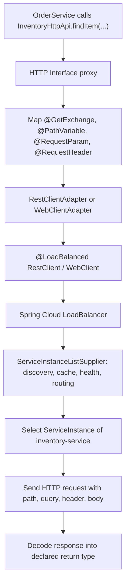

# Mapping Parameters, Headers, Bodies, and Return Types

Spring Framework's **HTTP Interface** lets you describe an HTTP API using a Java interface and annotations such as `@HttpExchange`, `@GetExchange`, and `@PostExchange`. Instead of calling `restClient.get()` or `webClient.post()` manually in every caller, the application declares methods, parameters, and return types; `HttpServiceProxyFactory` creates a client proxy that executes the corresponding HTTP requests.

This lesson belongs to the **HTTP Interface** chapter of the `SPRING_CLOUD_SERVICE_COMMUNICATION_LOAD_BALANCING` module. The context is microservice communication with Spring Cloud LoadBalancer: the HTTP Interface must be backed by a **LoadBalancer-integrated** `RestClient` or `WebClient` so the logical name `inventory-service` resolves to a `ServiceInstance`. HTTP Interface annotations do not discover services, nor do they enable health checks, caching, retries, or timeouts on their own.

The goal is to understand accurately how **path variables**, **query parameters**, **headers**, and **bodies** map to requests, and how to pick **return types** suited for synchronous APIs, reactive APIs, and responses requiring status codes or headers.

## 1. Overall Model: Interface, Adapter, Transport, LoadBalancer

An HTTP Interface spans three layers of responsibility:

1. **Java contract:** methods, HTTP verbs, paths, parameters, and return types in the interface.
2. **Proxy and adapter:** `HttpServiceProxyFactory` reads annotations and delegates calls through `RestClientAdapter` or `WebClientAdapter`.
3. **HTTP transport and LoadBalancer:** `RestClient` or `WebClient` executes the request; when created from a `@LoadBalanced` builder with a service ID hostname, Spring Cloud LoadBalancer chooses a concrete instance.



Example method:

```java
@GetExchange("/items/{sku}")
ItemView findItem(
        @PathVariable("sku") String sku,
        @RequestParam("warehouse") String warehouse,
        @RequestHeader("X-Correlation-ID") String correlationId);
```

Java invocation:

```java
ItemView item = inventoryApi.findItem(
        "SKU-001", "hcm-01", "req-2054");
```

Corresponding logical request:

```http
GET /api/v1/items/SKU-001?warehouse=hcm-01 HTTP/1.1
Host: inventory-service
X-Correlation-ID: req-2054
Accept: application/json
```

LoadBalancer may then select `inventory-a:8081` or `inventory-b:8082`. The `SKU-001` value, `warehouse` query parameter, and correlation header remain part of the request; the instance-selection algorithm does not alter that payload.

## 2. `@HttpExchange` and HTTP Method Annotations

`@HttpExchange` describes shared settings or a specific HTTP exchange, such as base path, HTTP method, `contentType`, and `accept`. Shorthand annotations `@GetExchange`, `@PostExchange`, `@PutExchange`, `@PatchExchange`, and `@DeleteExchange` make methods easier to read.

```java
import org.springframework.http.MediaType;
import org.springframework.web.service.annotation.GetExchange;
import org.springframework.web.service.annotation.HttpExchange;
import org.springframework.web.service.annotation.PostExchange;
import org.springframework.web.bind.annotation.PathVariable;
import org.springframework.web.bind.annotation.RequestBody;

@HttpExchange(
        url = "/api/v1",
        accept = MediaType.APPLICATION_JSON_VALUE)
public interface InventoryHttpApi {

    @GetExchange("/items/{sku}")
    ItemView findItem(@PathVariable("sku") String sku);

    @PostExchange(
            url = "/reservations",
            contentType = MediaType.APPLICATION_JSON_VALUE)
    ReservationView createReservation(
            @RequestBody ReserveStockRequest request);
}
```

This snippet uses application-defined DTOs `ItemView`, `ReservationView`, and `ReserveStockRequest`. Methods with `{sku}` placeholders or JSON bodies must annotate parameters accordingly so the proxy builds requests matching the contract.

Rules:

| Placement | Example | Role |
|---|---|---|
| Type-level | `@HttpExchange(url="/api/v1")` | Path prefix and shared attributes for all methods |
| Method-level | `@GetExchange("/items/{sku}")` | Defines GET and operation path |
| Method-level | `@PostExchange(contentType="application/json")` | Defines POST and outbound body media type |
| Method-level | `@DeleteExchange("/items/{sku}")` | Defines DELETE |
| Method-level | `@HttpExchange(method="HEAD", url="/health")` | HTTP methods without a dedicated shorthand annotation |

`contentType` describes the body format the client sends; `accept` specifies the response format the client expects. They do not eliminate the need to configure matching message converters/codecs and server-side API contracts.

## 3. Parameter Mapping Table

HTTP Interface reuses many familiar annotations from Spring MVC, but here their meaning is **constructing an outbound request**, not binding an inbound controller request.

| Parameter Type | Annotation / Type | Maps Into Request | Example |
|---|---|---|---|
| Path variable | `@PathVariable("sku")` | Fills placeholder in URL path | `/items/{sku}` |
| Query parameter | `@RequestParam("warehouse")` | Query parameter by default, depending on content type | `?warehouse=hcm-01` |
| Header | `@RequestHeader("X-Correlation-ID")` | HTTP request header | `X-Correlation-ID: req-2054` |
| JSON body | `@RequestBody` | Payload serialized by codec/message converter | `{"sku":"SKU-001"}` |
| Multipart part | `@RequestPart("file")` | One part of a multipart body | File or form field |
| Cookie | `@CookieValue("locale")` | Request cookie | `Cookie: locale=vi` |
| Request attribute | `@RequestAttribute("...")` | Internal request attribute (adapter-dependent) | Not equivalent to HTTP header |
| Dynamic URL | `URI` as method parameter | Can override URL defined by annotations | Must validate/control host |
| Dynamic HTTP method | `HttpMethod` as parameter | Overrides method declared in annotation | Use intentionally |

`@RequestHeader` supports single values, `Collection`, `Map`, and `MultiValueMap`; `@RequestParam` can also accept multiple values. Spring converts simple types to strings when needed.

**Important distinction:** With `content-type: application/x-www-form-urlencoded`, `@RequestParam` arguments are encoded into a **form request body** instead of the URL query string. Therefore, never claim `@RequestParam` *always* produces a query parameter.

Method parameters should not be `null` when the annotation marks them as required. When a parameter is optional, use the API's optional/`required=false` mechanism and test behavior when the value is absent.

## 4. Self-Contained Example: Synchronous `InventoryHttpApi`

Build a contract for calling `inventory-service`: reading stock by SKU/warehouse, searching by tag list, creating a stock reservation, and canceling a reservation.

### 4.1. DTOs

```java
package com.example.order.inventory;

public record ItemView(
        String sku,
        String warehouse,
        int available,
        String servedBy) {
}

public record ReserveStockRequest(
        String sku,
        int quantity,
        String warehouse) {
}

public record ReservationView(
        String reservationId,
        String status) {
}
```

### 4.2. Fully Declared HTTP Interface

```java
package com.example.order.inventory;

import java.util.List;

import org.springframework.http.HttpHeaders;
import org.springframework.http.MediaType;
import org.springframework.http.ResponseEntity;
import org.springframework.web.bind.annotation.PathVariable;
import org.springframework.web.bind.annotation.RequestBody;
import org.springframework.web.bind.annotation.RequestHeader;
import org.springframework.web.bind.annotation.RequestParam;
import org.springframework.web.service.annotation.DeleteExchange;
import org.springframework.web.service.annotation.GetExchange;
import org.springframework.web.service.annotation.HttpExchange;
import org.springframework.web.service.annotation.PostExchange;

@HttpExchange(
        url = "/api/v1",
        accept = MediaType.APPLICATION_JSON_VALUE)
public interface InventoryHttpApi {

    @GetExchange("/items/{sku}")
    ItemView findItem(
            @PathVariable("sku") String sku,
            @RequestParam("warehouse") String warehouse,
            @RequestHeader("X-Correlation-ID") String correlationId);

    @GetExchange("/items")
    List<ItemView> searchItems(
            @RequestParam("tag") List<String> tags,
            @RequestParam(name = "warehouse", required = false)
            String warehouse);

    @PostExchange(
            url = "/reservations",
            contentType = MediaType.APPLICATION_JSON_VALUE)
    ResponseEntity<ReservationView> reserveStock(
            @RequestHeader("Idempotency-Key") String idempotencyKey,
            @RequestBody ReserveStockRequest request);

    @DeleteExchange("/reservations/{reservationId}")
    ResponseEntity<Void> cancelReservation(
            @PathVariable("reservationId") String reservationId);

    @GetExchange("/health-detail")
    HttpHeaders readResponseHeaders();
}
```

This example illustrates **different return-type options**, not mandatory operations required of every inventory API. The target service must implement the matching endpoints. `readResponseHeaders()` fits cases where the caller only cares about response headers; it still executes an HTTP request.

Observations:

- `@PathVariable("sku")` injects the Java argument into `{sku}`, not into the body.
- `@RequestParam("warehouse")` produces a query parameter on GET.
- `@RequestParam("tag") List<String>` supports multi-valued query parameters, such as `?tag=hot&tag=sale`.
- `@RequestHeader("Idempotency-Key")` puts the deduplication key in a header rather than mixing it into the JSON body.
- `@RequestBody ReserveStockRequest` is serialized by the client's message converter.
- `ResponseEntity<ReservationView>` retains status, response headers, and the response DTO.
- `ResponseEntity<Void>` retains status/headers when an endpoint returns no meaningful body.

### 4.3. Predicting the Request from a Method Call

```java
ItemView item = inventoryApi.findItem(
        "SKU-001",
        "hcm-01",
        "req-2054");
```

Logical request:

```http
GET /api/v1/items/SKU-001?warehouse=hcm-01 HTTP/1.1
Host: inventory-service
Accept: application/json
X-Correlation-ID: req-2054
```

For `reserveStock`:

```java
ResponseEntity<ReservationView> response =
        inventoryApi.reserveStock(
                "checkout-2042",
                new ReserveStockRequest(
                        "SKU-001", 2, "hcm-01"));
```

Logical request:

```http
POST /api/v1/reservations HTTP/1.1
Host: inventory-service
Accept: application/json
Content-Type: application/json
Idempotency-Key: checkout-2042

{
  "sku": "SKU-001",
  "quantity": 2,
  "warehouse": "hcm-01"
}
```

The HTTP snippets illustrate mapping; header ordering, `Content-Length`, and encoding details depend on the HTTP transport. Spring Cloud LoadBalancer resolves the physical target from the logical hostname and does not turn `Idempotency-Key` into a retry policy by itself.

## 5. Creating a Proxy from a `@LoadBalanced` `RestClient`

Declaring an HTTP Interface **does not create a client bean**. In setups using Spring Framework's `HttpServiceProxyFactory`, the application must create an adapter and generate the proxy from it.

Spring Java configuration example:

```java
package com.example.order.config;

import com.example.order.inventory.InventoryHttpApi;
import org.springframework.beans.factory.annotation.Qualifier;
import org.springframework.cloud.client.loadbalancer.LoadBalanced;
import org.springframework.context.annotation.Bean;
import org.springframework.context.annotation.Configuration;
import org.springframework.web.client.RestClient;
import org.springframework.web.client.support.RestClientAdapter;
import org.springframework.web.service.invoker.HttpServiceProxyFactory;

@Configuration(proxyBeanMethods = false)
public class InventoryHttpInterfaceConfiguration {

    @Bean("inventoryLoadBalancedBuilder")
    @LoadBalanced
    RestClient.Builder inventoryLoadBalancedBuilder() {
        return RestClient.builder();
    }

    @Bean
    InventoryHttpApi inventoryHttpApi(
            @Qualifier("inventoryLoadBalancedBuilder")
            RestClient.Builder builder) {

        RestClient restClient = builder
                .baseUrl("http://inventory-service")
                .build();

        RestClientAdapter adapter =
                RestClientAdapter.create(restClient);

        HttpServiceProxyFactory factory =
                HttpServiceProxyFactory.builderFor(adapter)
                        .build();

        return factory.createClient(InventoryHttpApi.class);
    }
}
```

Execution flow:

1. `@LoadBalanced` marks the builder so Spring Cloud attaches load-balancing integration when the matching starter is present.
2. `baseUrl("http://inventory-service")` uses the **service ID as the logical hostname**.
3. `RestClientAdapter.create(restClient)` adapts the HTTP client API to the abstraction used by the proxy factory.
4. `factory.createClient(InventoryHttpApi.class)` generates a proxy implementing the Java interface.
5. Calling a method on `InventoryHttpApi` applies the request mapping, and `RestClient` sends the request through LoadBalancer.

Do not do this when load balancing is required:

```java
// Does not go through a configured @LoadBalanced builder.
RestClient client = RestClient.create(
        "http://inventory-service");

InventoryHttpApi api = HttpServiceProxyFactory
        .builderFor(RestClientAdapter.create(client))
        .build()
        .createClient(InventoryHttpApi.class);
```

In this non-load-balanced example, `inventory-service` may be treated as an ordinary DNS hostname; it either fails to connect or goes through an external DNS mechanism rather than Spring Cloud `ServiceInstanceListSupplier`.

### 5.1. Dependencies and Required Spring Versions

HTTP Interface is a Spring Framework feature; `RestClient` is available in Spring Framework 6.1+. For Spring Boot and Spring Cloud, pick compatible release trains via the Spring Cloud BOM.

Example client dependencies:

```xml
<dependency>
    <groupId>org.springframework.boot</groupId>
    <artifactId>spring-boot-starter-web</artifactId>
</dependency>
<dependency>
    <groupId>org.springframework.cloud</groupId>
    <artifactId>spring-cloud-starter-loadbalancer</artifactId>
</dependency>
```

You also need a `ServiceInstance` source: Eureka, Consul, Kubernetes discovery, or a static list from `SimpleDiscoveryClient`. `@HttpExchange` annotations themselves **do not register instances** in discovery.

Depending on your Spring Boot version, using a builder configured by Boot customizers preserves observability, SSL, and HTTP transport defaults. Do not assume calling `RestClient.builder()` directly anywhere is equivalent to a fully auto-configured application builder.

## 6. Path Variables and URL Encoding

`@PathVariable` tells Spring to expand placeholders:

```java
@GetExchange("/items/{sku}")
ItemView findBySku(@PathVariable("sku") String sku);
```

When calling `findBySku("SKU-001")`, the URI is built with path `/items/SKU-001`.

For values containing special characters such as `SKU/2026`, spaces, `?`, `#`, or `%`, check how the **HTTP client's URI builder** encodes each value. A slash inside a SKU is **data belonging to one variable**, not automatically a path segment separator.

Tests should verify the raw URI generated by the HTTP client, e.g., expecting `%2F` for an encoded slash when the API contract treats a slash-containing SKU as a single path segment. However, servers or gateways may enforce their own policies on encoded slashes; proper client-side encoding does not guarantee server acceptance.

Guidelines:

- Never build paths by concatenating raw strings with unencoded data.
- Declare placeholders explicitly: `@GetExchange("/items/{sku}")` with `@PathVariable("sku")`.
- Never use user-supplied input as the scheme or hostname of a base URL.
- When non-default encoding behavior is required, configure the transport's URI builder factory and verify with tests.
- If IDs frequently contain special characters, consider passing them via query parameters instead of path segments per service contract.

## 7. Query Parameters: Single, Repeated, Optional, and Form-Urlencoded

`@RequestParam` maps query parameters in standard requests:

```java
@GetExchange("/items")
List<ItemView> searchItems(
        @RequestParam("warehouse") String warehouse,
        @RequestParam("tag") List<String> tags);
```

Calling:

```java
inventoryApi.searchItems(
        "hcm-01",
        List.of("sale", "fragile"));
```

Produces a request query such as:

```text
/api/v1/items?warehouse=hcm-01&tag=sale&tag=fragile
```

Exact ordering of query parameters is not a critical contract unless the server requires it; in tests, assert on parameter names and values or the client-built URI.

### 7.1. Optional Parameters

```java
@GetExchange("/items")
List<ItemView> search(
        @RequestParam(name = "warehouse", required = false)
        String warehouse);
```

When `warehouse == null`, the parameter can be omitted according to the resolver's optional-value rules. Do not assume `null` turns into the literal string `"null"` in the URL; if the backend distinguishes an absent parameter from an empty one, write separate tests for both.

### 7.2. Maps and Multi-Value Parameters

`@RequestParam` accepts `Map<String, ?>` or `MultiValueMap<String, ?>` for multiple parameters. When forwarding dynamic user-provided keys, apply an allowlist so sensitive internal query keys are not passed through unintentionally.

### 7.3. `@RequestParam` Is Not Always a Query Parameter

A common pitfall when learning HTTP Interface: if a method specifies `contentType = MediaType.APPLICATION_FORM_URLENCODED_VALUE`, Spring may encode `@RequestParam` values into the form body.

```java
@PostExchange(
        url = "/session",
        contentType =
                MediaType.APPLICATION_FORM_URLENCODED_VALUE)
SessionView createSession(
        @RequestParam("client_id") String clientId,
        @RequestParam("scope") String scope);
```

Here the payload is `client_id=...&scope=...` in the body, **not a JSON body**. Verify that both the server API and the configured adapter support form encoding.

## 8. Headers: Separating HTTP Metadata from Business Data

`@RequestHeader` maps a Java parameter to a request header:

```java
@GetExchange("/items/{sku}")
ItemView find(
        @PathVariable("sku") String sku,
        @RequestHeader("X-Correlation-ID") String correlationId,
        @RequestHeader("Authorization") String authorization);
```

Example:

```java
api.find(
        "SKU-001",
        "req-2054",
        "Bearer " + accessToken);
```

When designing APIs yourself, you can avoid passing raw `Authorization` parameters on every method by using a trusted **`RestClient`/`WebClient` request interceptor or filter**. Either way, ensure only tokens intended for the target service are sent outbound.

### 8.1. Multiple Dynamic Headers

`@RequestHeader` supports `Map` and `MultiValueMap` for passing multiple headers:

```java
@GetExchange("/items/{sku}")
ItemView find(
        @PathVariable("sku") String sku,
        @RequestHeader HttpHeaders headers);
```

The caller can construct:

```java
HttpHeaders headers = new HttpHeaders();
headers.set("X-Correlation-ID", "req-2054");
headers.setAccept(
        List.of(MediaType.APPLICATION_JSON));
```

However, never copy **all inbound user headers** blindly onto an outbound client. Headers such as `Host`, `Cookie`, `Authorization`, forwarding headers, or routing-control headers can be unsafe or inappropriate when sent to another service.

### 8.2. Headers Are Not Request Attributes

`@RequestAttribute` attaches an internal attribute for the client request-execution mechanism, supported by `RestClient` and `WebClient`. It **does not create an HTTP header** and should not replace `@RequestHeader` when the target API expects the value on the wire.

### 8.3. Headers Can Participate in Routing

Spring Cloud LoadBalancer includes suppliers that route by hints or request context. For example, a header like `X-SC-LB-Hint` can be read at the client/load-balancer layer if a matching supplier is configured. Adding `@RequestHeader("X-SC-LB-Hint")` alone is not enough for hint-based selection: the corresponding integration and supplier must also be wired.

## 9. JSON Bodies with `@RequestBody`

A `POST` request typically carries a business payload:

```java
@PostExchange(
        url = "/reservations",
        contentType = MediaType.APPLICATION_JSON_VALUE)
ResponseEntity<ReservationView> reserve(
        @RequestHeader("Idempotency-Key") String key,
        @RequestBody ReserveStockRequest request);
```

When the caller passes:

```java
new ReserveStockRequest("SKU-001", 2, "hcm-01")
```

the client serializes the request DTO to JSON if a suitable codec/message converter is configured. There is no need to call `objectMapper.writeValueAsString(...)` manually or append it to the URI.

**Common mistakes:**

- Omitting `@RequestBody`: HTTP Interface does not infer that an arbitrary object belongs in the JSON body.
- Setting `Content-Type` to form or multipart when the payload is JSON: the server may respond with 415.
- DTO mismatches contract: missing fields, mismatched names, or invalid data lead to 400.
- Passing a body on GET when the target API does not support it: avoid designs relying on GET bodies.
- Retrying `POST` after a timeout when the server already processed it: risks creating duplicate reservations.

For state-mutating operations, put idempotency or deduplication mechanisms in place before enabling automatic retries; `@RequestBody` alone does not make a request idempotent.

## 10. Multipart Bodies and `@RequestPart`

When an API needs to upload a file along with metadata, use multipart instead of trying to squeeze files into `@RequestParam` query parameters.

```java
import org.springframework.core.io.Resource;
import org.springframework.http.MediaType;
import org.springframework.http.ResponseEntity;
import org.springframework.web.bind.annotation.RequestPart;
import org.springframework.web.service.annotation.PostExchange;

@PostExchange(
        url = "/attachments",
        contentType = MediaType.MULTIPART_FORM_DATA_VALUE)
ResponseEntity<UploadReceipt> upload(
        @RequestPart("file") Resource file,
        @RequestPart("description") String description);
```

Parts can be `String`, `Resource`, encoded objects, `HttpEntity` carrying per-part content and headers, or compatible publishers in reactive environments.

When sending files, consider:

- Does the `Resource` provide a filename, content length, and readable stream?
- Is the `Content-Type` of each part accurate?
- Does the HTTP transport support multipart for the active adapter?
- Are size limits and timeouts tuned for large payloads?
- Can the request body be re-read if retries occur?

`@RequestPart` is **one part of a multipart body**, not a path or query parameter.

## 11. Synchronous Return Types: `T`, `ResponseEntity`, `HttpHeaders`, `void`

For HTTP Interfaces using `RestClientAdapter` or `RestTemplateAdapter`, common synchronous return types are:

| Return Type | Meaning | When to Use |
|---|---|---|
| `ItemView` or type `T` | Deserializes response body into DTO | Only business data is needed |
| `List<ItemView>` | Deserializes a typed collection | Endpoint returns a JSON array |
| `ResponseEntity<ItemView>` | Body, status, and response headers | Need to inspect ETag, 201, 202, etc. |
| `ResponseEntity<Void>` | Status/headers without a body | `DELETE` or `POST` returning no payload |
| `HttpHeaders` | Response headers only | Need metadata, version, or rate-limit headers |
| `void` | Executes request and discards response body | Actions needing no content back |

Example:

```java
@GetExchange("/items/{sku}")
ItemView fetch(@PathVariable("sku") String sku);

@GetExchange("/items/{sku}")
ResponseEntity<ItemView> fetchWithMetadata(
        @PathVariable("sku") String sku);

@DeleteExchange("/reservations/{id}")
ResponseEntity<Void> cancel(
        @PathVariable("id") String reservationId);

@PostExchange("/maintenance/recalculate")
void requestRecalculation();
```

In `cancel`, placeholder `{id}` matches the explicit name in `@PathVariable("id")` even though the Java variable is named `reservationId`. Without an explicit name, parameter resolution can depend on parameter-name metadata retained at compile time.

A response body is not always required. For example, with `204 No Content`, declaring `ResponseEntity<Void>` makes far more sense than a DTO that cannot be deserialized from an empty body.

### 11.1. `ResponseEntity` Does Not Alter Default 4xx/5xx Handling

`ResponseEntity<T>` lets you inspect status codes when the client treats the response as successful or per custom configuration. Never assume this return type automatically converts HTTP 4xx/5xx errors into normal return values.

With `RestClient`, default `retrieve()` handling normally turns HTTP 4xx/5xx into exceptions; the HTTP Interface adapter relies on how the underlying client handles statuses. If the application wants to map an error status to a business DTO, configure a status handler/error decoder on the HTTP client layer and test it.

## 12. `WebClientAdapter`: Reactive Types and Subscription Semantics

When using `WebClientAdapter`, an HTTP Interface can return `Mono` and `Flux`. Dedicated interface example:

```java
package com.example.order.inventory;

import org.springframework.http.MediaType;
import org.springframework.http.ResponseEntity;
import org.springframework.web.bind.annotation.PathVariable;
import org.springframework.web.bind.annotation.RequestBody;
import org.springframework.web.service.annotation.GetExchange;
import org.springframework.web.service.annotation.HttpExchange;
import org.springframework.web.service.annotation.PostExchange;
import reactor.core.publisher.Flux;
import reactor.core.publisher.Mono;

@HttpExchange(
        url = "/api/v1",
        accept = MediaType.APPLICATION_JSON_VALUE)
public interface ReactiveInventoryHttpApi {

    @GetExchange("/items/{sku}")
    Mono<ItemView> findItem(
            @PathVariable("sku") String sku);

    @PostExchange(
            url = "/reservations",
            contentType = MediaType.APPLICATION_JSON_VALUE)
    Mono<ResponseEntity<ReservationView>> reserve(
            @RequestBody ReserveStockRequest request);

    @GetExchange(
            url = "/stock-events",
            accept = MediaType.TEXT_EVENT_STREAM_VALUE)
    Flux<StockEvent> streamChanges();
}
```

With Spring WebFlux on the classpath, configuration:

```java
import org.springframework.beans.factory.annotation.Qualifier;
import org.springframework.cloud.client.loadbalancer.LoadBalanced;
import org.springframework.context.annotation.Bean;
import org.springframework.context.annotation.Configuration;
import org.springframework.web.reactive.function.client.WebClient;
import org.springframework.web.reactive.function.client.support.WebClientAdapter;
import org.springframework.web.service.invoker.HttpServiceProxyFactory;

@Configuration(proxyBeanMethods = false)
class ReactiveInventoryConfiguration {

    @Bean("inventoryLoadBalancedWebClientBuilder")
    @LoadBalanced
    WebClient.Builder inventoryLoadBalancedWebClientBuilder() {
        return WebClient.builder();
    }

    @Bean
    ReactiveInventoryHttpApi reactiveInventoryHttpApi(
            @Qualifier("inventoryLoadBalancedWebClientBuilder")
            WebClient.Builder builder) {

        WebClient webClient = builder
                .baseUrl("http://inventory-service")
                .build();

        WebClientAdapter adapter =
                WebClientAdapter.create(webClient);

        return HttpServiceProxyFactory
                .builderFor(adapter)
                .build()
                .createClient(ReactiveInventoryHttpApi.class);
    }
}
```

`StockEvent` above is an illustrative application-defined DTO; the `/stock-events` endpoint must support a matching stream such as server-sent events. `Flux<T>` does not magically turn an ordinary JSON array into an infinite stream; the actual payload type and codecs govern decoding.

### 12.1. Return-Type Comparison

| Synchronous with `RestClientAdapter` | Reactive with `WebClientAdapter` | Notes |
|---|---|---|
| `ItemView` | `Mono<ItemView>` | Single body DTO |
| `void` | `Mono<Void>` | Completes with no body needed |
| `ResponseEntity<ItemView>` | `Mono<ResponseEntity<ItemView>>` | Status/headers needed |
| `HttpHeaders` | `Mono<HttpHeaders>` | Response headers only |
| No direct reactive streaming equivalent | `Flux<StockEvent>` | Multiple items in a stream |
| — | `Mono<ResponseEntity<Flux<StockEvent>>>` | Status/headers with streaming body |

With `WebClient`, publishers are normally **lazy**: without a subscription, no request may be sent. In reactive applications, return `Mono`/`Flux` to the controller or composition chain instead of calling `block()` on an event-loop thread. Misplaced `block()` calls exhaust threads and break the non-blocking model.

`WebClient` also supports some synchronous return types through the adapter in compatible versions, though `Mono`/`Flux` should be preferred in reactive pipelines. Timeouts for synchronous returns via the reactive adapter have specific considerations; prefer configuring timeouts on the underlying HTTP client.

## 13. Dynamic `URI` Parameters and the Risk of Bypassing Service IDs

HTTP Interface lets a method accept a `URI` parameter to override the declared URL for that invocation:

```java
@GetExchange("/items")
List<ItemView> fetchFrom(URI uri);
```

This is useful when a client **intentionally** calls a dynamic URL, but dangerous if a method lets callers pass arbitrary unvalidated URIs.

For example, a URI like `http://127.0.0.1:8081/items` does not use the logical hostname `inventory-service`, so **you cannot assume** it will be load-balanced across `inventory-service`'s `ServiceInstance` list. Conversely, a URI whose host is a service ID can go through LoadBalancer if the HTTP client and adapters are configured properly.

Never take a user-supplied URL and pass it straight into a `URI` parameter:

- Risks SSRF against metadata services, loopback addresses, or internal systems.
- Can bypass service policies, health checks, zones, or routing hints.
- When using a physical URL, discovery no longer decides the target instance for that request.

If dynamic URLs are genuinely required, validate scheme, host, and path against a trusted allowlist, and explicitly decide when requests go through LoadBalancer versus direct targets.

## 14. Common Mistakes with Parameters and Return Types

| Symptom | Common Cause | Fix |
|---|---|---|
| `IllegalArgumentException` expanding URL | `{sku}` mismatches `@PathVariable` | Declare explicit matching names in annotations |
| URL missing query parameter | Forgot `@RequestParam` or passed `null` | Check method signature and optional semantics |
| Backend misses header | Forgot `@RequestHeader` or header only existed on inbound request | Attach outbound header on method or interceptor |
| Server returns 415 | Wrong `Content-Type` or missing converter | Declare `contentType` matching the body |
| Empty JSON body | Forgot `@RequestBody` | Add body annotation and contract-matching DTO |
| Multipart fails to receive file | Confused query `@RequestParam` with `@RequestPart` | Use multipart content type and suitable `Resource` |
| Response deserialization fails | Return type mismatches JSON schema | Use matching DTO/collection structure |
| Need HTTP status but only get DTO | Declared `T` instead of `ResponseEntity<T>` | Choose a return type carrying status/headers |
| Expecting `204` to return a DTO | Empty body is valid for `204` | Use `ResponseEntity<Void>` or `void` |
| `Mono` sends no request | Not subscribed / publisher not returned to pipeline | Compose and subscribe properly |
| `UnknownHostException: inventory-service` | Proxy uses `RestClient`/`WebClient` without `@LoadBalanced` | Build adapter from a load-balanced builder |
| Only one instance ever picked despite replicas | Physical URI used or supplier filter left one candidate | Check `baseUrl`, instance list, and policy |
| `POST` creates duplicate records | Retried without idempotency | Use `Idempotency-Key` / constrain retries |
| Hard-to-classify timeouts | No bounded connect/read/response timeouts | Configure timeouts on the HTTP client per version |

## 15. Test Mapping Separately from Testing LoadBalancer

Two failure categories can look similar while requiring different test tools:

1. **HTTP mapping bugs:** wrong path, query, header, body, or response decoding failure.
2. **Instance-selection bugs:** missing service ID, empty discovery source, stale cache, bad health/zone filter, or builder lacking LoadBalancer.

### 15.1. Unit Testing Mapping with `MockRestServiceServer`

You can bind a mock HTTP server to `RestClient.Builder` and verify the exact request generated by the HTTP Interface.

```java
import org.junit.jupiter.api.Test;
import org.springframework.http.HttpMethod;
import org.springframework.http.MediaType;
import org.springframework.test.web.client.MockRestServiceServer;
import org.springframework.web.client.RestClient;
import org.springframework.web.client.support.RestClientAdapter;
import org.springframework.web.service.invoker.HttpServiceProxyFactory;

import static org.junit.jupiter.api.Assertions.assertEquals;
import static org.springframework.test.web.client.match
        .MockRestRequestMatchers.header;
import static org.springframework.test.web.client.match
        .MockRestRequestMatchers.method;
import static org.springframework.test.web.client.match
        .MockRestRequestMatchers.requestTo;
import static org.springframework.test.web.client.response
        .MockRestResponseCreators.withSuccess;

class InventoryHttpInterfaceMappingTest {

    @Test
    void mapsPathQueryAndHeader() {
        RestClient.Builder builder = RestClient.builder()
                .baseUrl("http://inventory-service");

        MockRestServiceServer server =
                MockRestServiceServer.bindTo(builder).build();

        server.expect(requestTo(
                        "http://inventory-service/api/v1/items/SKU-001"
                                + "?warehouse=hcm-01"))
                .andExpect(method(HttpMethod.GET))
                .andExpect(header(
                        "X-Correlation-ID", "req-2054"))
                .andRespond(withSuccess(
                        "{\"sku\":\"SKU-001\","
                                + "\"warehouse\":\"hcm-01\","
                                + "\"available\":7,"
                                + "\"servedBy\":\"inventory-a\"}",
                        MediaType.APPLICATION_JSON));

        InventoryHttpApi api = HttpServiceProxyFactory
                .builderFor(RestClientAdapter.create(builder.build()))
                .build()
                .createClient(InventoryHttpApi.class);

        ItemView item = api.findItem(
                "SKU-001", "hcm-01", "req-2054");

        assertEquals("SKU-001", item.sku());
        assertEquals(7, item.available());
        server.verify();
    }
}
```

This unit test proves **HTTP request mapping and response body decoding**. It **does not prove** LoadBalancer selected an instance: the mock HTTP server responds without querying `ServiceInstanceListSupplier`. Never use mock test results as evidence of round-robin balancing.

For request bodies, add a `reserveStock` test using `MockRestRequestMatchers.content().json(...)`, `contentType(MediaType.APPLICATION_JSON)`, and `Idempotency-Key`. For methods returning `ResponseEntity<ReservationView>`, assert status, headers, and response DTO together.

### 15.2. Integration Testing with Real `ServiceInstance` Targets

To verify that the HTTP Interface passes through Spring Cloud LoadBalancer:

1. Start two HTTP stub servers on different ports, both implementing `/api/v1/items/{sku}`.
2. Have server A return `servedBy=inventory-a` and server B return `servedBy=inventory-b`.
3. Register both URIs under the same service ID `inventory-service` using `SimpleDiscoveryClient`.
4. Build `InventoryHttpApi` from a `@LoadBalanced RestClient.Builder` as in section 5.
5. Invoke `findItem(...)` sequentially multiple times and collect `servedBy`.
6. Assert every response comes from `{inventory-a, inventory-b}`; with default round robin and two healthy instances, confirm both appear.
7. Call an unregistered service ID and verify no HTTP request reaches either stub; exact error type depends on integration/version.
8. Keep retry, cache, and health-check tests isolated, since they affect selection counts and observed order.

Example static instance source in a test profile:

```properties
spring.cloud.discovery.client.simple.instances.inventory-service[0].uri=http://localhost:18081
spring.cloud.discovery.client.simple.instances.inventory-service[1].uri=http://localhost:18082
spring.cloud.loadbalancer.cache.enabled=false
spring.cloud.loadbalancer.retry.enabled=false
```

Both HTTP servers must actually listen on `18081` and `18082`, or use `@DynamicPropertySource` to supply dynamic ports. `SimpleDiscoveryClient` does not detect dead instances automatically like a discovery server with health/registration lifecycles. If server B stops while the supplier still returns A and B, the algorithm can still pick B and hit connection refused.

## 16. Timeouts, Retries, and Observability Live Outside Annotation Mapping

HTTP Interface handles contract declaration. The following responsibilities belong to other layers:

| Responsibility | Layer to Configure |
|---|---|
| Instance source per service ID | Discovery client / `ServiceInstanceListSupplier` |
| Instance selection policy | `ReactorServiceInstanceLoadBalancer` and per-service config |
| Connect/read/response timeouts | Request factory or HTTP transport of `RestClient`/`WebClient` |
| Retries, backoff, and deadlines | LoadBalancer integration or matching resilience layer |
| Automatic Bearer tokens | HTTP client interceptor/filter |
| Trace context | Micrometer Tracing / client instrumentation |
| JSON serialization | Message converters/codecs and DTOs |
| HTTP status mapping | Status handler/error handling on HTTP client |
| Fallbacks / circuit breakers | Application or framework resilience policy |

Do not expect changing a return type from `ItemView` to `ResponseEntity<ItemView>` to enable retries or alter instance selection.

For a `POST` creating a reservation, if a response times out after the server already processed it, retrying risks creating two reservations. Use an idempotency key, cap retry attempts, classify errors carefully, and enforce an overall deadline. With reactive `WebClient`, avoid attaching an unconditional `retryWhen` for all exceptions.

In production observability, record `serviceId`, path template, HTTP method, candidate count, selected instance (in internal logs), response status, latency, and retry attempts. Avoid turning SKUs or full URIs containing sensitive data into high-cardinality metric labels.

## 17. Practical Checklist

- [ ] Java interface has `@HttpExchange` and method annotations matching HTTP verbs.
- [ ] Path placeholders match `@PathVariable` names.
- [ ] Query parameters are declared with `@RequestParam` and tested for repeated/optional values.
- [ ] Outbound headers are declared with `@RequestHeader` or injected via interceptor/filter.
- [ ] JSON bodies use `@RequestBody` and matching `contentType`.
- [ ] Multipart uploads use `@RequestPart`/resources and compatible message writers.
- [ ] Return types fit the contract: `T`, `ResponseEntity<T>`, `HttpHeaders`, `void`, or reactive types.
- [ ] `HttpServiceProxyFactory` is built from the right `RestClient`/`WebClient` adapter.
- [ ] Adapter wraps an HTTP client created from a `@LoadBalanced` builder when service discovery is required.
- [ ] Base URL uses the service ID rather than a hardcoded physical `host:port`.
- [ ] Mock tests prove request mapping; separate integration tests prove instance selection.
- [ ] Tests cover missing instances, empty response bodies, 4xx/5xx statuses, and timeouts.
- [ ] Retries on write operations are guarded by idempotency or explicit contracts.
- [ ] `Authorization`, `Cookie`, or untrusted routing headers are never forwarded blindly.

## 18. Summary

Spring HTTP Interface maps **Java parameters → HTTP request path/query/header/body** and **HTTP responses → method return types**. `@PathVariable` handles placeholders, `@RequestParam` handles query parameters or form bodies depending on content type, `@RequestHeader` adds headers, `@RequestBody` serializes payloads, and `@RequestPart` handles multipart parts. Choosing `T`, `ResponseEntity<T>`, `HttpHeaders`, `void`, or `Mono`/`Flux` controls what response data the caller receives and whether execution is synchronous or reactive.

In the Spring Cloud LoadBalancer module, the decisive connection point is **an adapter built from a load-balanced `RestClient` or `WebClient`**. HTTP Interface only declares the contract; LoadBalancer selects the instance based on service ID, discovery, and routing policies. Verify the two layers separately: unit tests confirm request mapping, while integration tests confirm the logical URL resolves to the right `ServiceInstance`.

### References

- [Spring Framework — REST Clients: HTTP Service Clients](https://docs.spring.io/spring-framework/reference/integration/rest-clients.html) — `@HttpExchange`, supported method arguments, return types, `HttpServiceProxyFactory`, and adapters.
- [Spring Cloud Commons — Common Abstractions](https://docs.spring.io/spring-cloud-commons/reference/spring-cloud-commons/common-abstractions.html) — configuring `@LoadBalanced RestClient.Builder` and `@LoadBalanced WebClient.Builder` for service-ID calls.
- [Spring Cloud Commons — Spring Cloud LoadBalancer](https://docs.spring.io/spring-cloud-commons/reference/spring-cloud-commons/loadbalancer.html) — `ServiceInstanceListSupplier`, caching/health checks, and instance selection policies.
