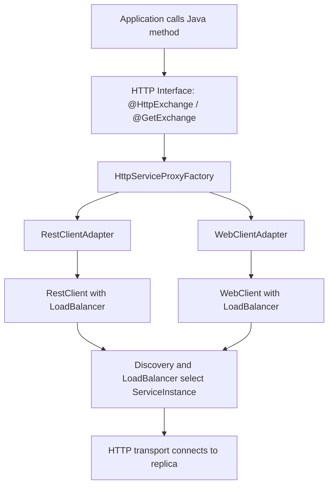

# Choosing Between Synchronous and Reactive Invocation

Spring Framework lets you declare an HTTP client as a **Java interface** with `@HttpExchange`, `@GetExchange`, `@PostExchange`, and related annotations. Instead of writing HTTP calls manually in each business method, the application creates a proxy using `HttpServiceProxyFactory`; the proxy delegates to an HTTP adapter to send requests and convert responses into the declared return type.

When paired with Spring Cloud LoadBalancer, an HTTP Interface can call `http://catalog-service/...` by **service ID** instead of hardcoding a host/port. However, HTTP Interface does not dictate whether the application runs **synchronously (blocking)** or **reactively (non-blocking)**. That choice lives in the underlying client/adapter, the return types, and the caller's execution model. This lesson compares `RestClientAdapter` and `WebClientAdapter`, shows how to configure them with `@LoadBalanced`, and provides selection criteria based on load, execution flow, latency, composition of multiple calls, and operations.

## 1. HTTP Interface Is the Contract; the Adapter Determines Execution

An HTTP Interface describes **paths, HTTP methods, parameters, headers, bodies, and return types**. For example, a method fetching a product by ID can be written with `@GetExchange("/{id}")` and `@PathVariable("id")`.

`HttpServiceProxyFactory` reads the interface metadata and generates a proxy. When a method is invoked, the proxy delegates the call to the configured adapter. Two commonly used adapters are:

- `RestClientAdapter`: uses Spring Framework's `RestClient` to execute HTTP calls in a **blocking** style.
- `WebClientAdapter`: uses Spring WebFlux's `WebClient`, able to return `Mono<T>`/`Flux<T>` and participate in **reactive** pipelines.



The diagram illustrates two **configuration options**, not a single call passing through both adapters. Both `RestClientAdapter` and `WebClientAdapter` share `@HttpExchange` metadata, yet their HTTP pipeline, how results are awaited, and supported return types differ.

Spring Cloud LoadBalancer sits at the **service-ID-to-`ServiceInstance` resolution layer**, separate from blocking vs. reactive concerns. Either client type can select replicas by service ID as long as `RestClient.Builder` or `WebClient.Builder` is properly configured with LoadBalancer.

## 2. How Do Synchronous and Reactive Differ?

Suppose `order-service` needs to call `catalog-service` and wait for product data before responding to the user.

**Synchronous (blocking):** the calling thread waits until the HTTP request finishes or fails. Results are normally returned directly as `ProductDto` or `ResponseEntity<ProductDto>`.

```java
ProductDto product = catalogBlockingApi.findProduct("P42");
// Next line runs after the method returns a result or throws an exception.
process(product);
```

**Reactive (non-blocking):** the method returns a publisher such as `Mono<ProductDto>`; while waiting on I/O, no application thread needs to stay blocked. The application can compose additional steps that only execute when the publisher is subscribed to.

```java
Mono<ProductDto> product = catalogReactiveApi.findProduct("P42");

Mono<OrderView> view = product.map(this::buildOrderView);
// Pipeline executes upon subscription; do not call block() on the event-loop.
```

| Criterion | Synchronous HTTP Interface | Reactive HTTP Interface |
|---|---|---|
| Illustrative adapter | `RestClientAdapter` | `WebClientAdapter` |
| Return types | `ProductDto`, `ResponseEntity<ProductDto>` | `Mono<ProductDto>`, `Flux<ProductDto>` |
| Thread while waiting on HTTP | Calling thread may block | No need to block a calling thread on I/O wait |
| Coordinating multiple requests | Sequential calls or explicit executors/virtual threads | Easily composed with `zip`, `flatMap`, `when`, etc. |
| Error handling | Exceptions on blocking calls | `onError` signals in publisher |
| Best suited for | Imperative/MVC flows, sequential business logic, existing blocking stacks | Reactive/WebFlux flows, high concurrent I/O, composition needs |
| Common pitfall | Thread pool exhaustion when downstream slows down | Calling `block()` on event-loop, mixing blocking ops into pipeline |

**Reactive is not automatically faster for a single isolated request.** Primarily, it changes resource utilization when many I/O operations are concurrently in flight. Actual latency still depends on network, discovery, replica count, transport, connection pools, target server, and overall application design.

## 3. Dependencies and Version Constraints

With compatible Spring Boot and Spring Cloud versions, the core dependencies are:

```xml
<dependencies>
    <!-- For RestClient and Spring Web components. -->
    <dependency>
        <groupId>org.springframework.boot</groupId>
        <artifactId>spring-boot-starter-web</artifactId>
    </dependency>

    <!-- For WebClient and reactive HTTP transport. -->
    <dependency>
        <groupId>org.springframework.boot</groupId>
        <artifactId>spring-boot-starter-webflux</artifactId>
    </dependency>

    <!-- Resolve service ID and select ServiceInstance. -->
    <dependency>
        <groupId>org.springframework.cloud</groupId>
        <artifactId>spring-cloud-starter-loadbalancer</artifactId>
    </dependency>
</dependencies>
```

The snippet shows dependencies needed if a single app tries **both** approaches. An application using only synchronous HTTP Interfaces does not need all of WebFlux; an application using only reactive `WebClient` does not necessarily need the MVC starter. Choose dependencies matching your real deployment model rather than copying examples verbatim.

`RestClient` appeared in Spring Framework **6.1**, so `RestClientAdapter` requires a Spring Framework generation that includes it (e.g., compatible Spring Boot **3.2+**). HTTP Interface and `WebClientAdapter` existed in earlier Spring Framework 6 releases. Verify a Spring Cloud BOM compatible with your project's Spring Boot version, especially for `@LoadBalanced RestClient.Builder` and `@LoadBalanced WebClient.Builder` integration.

In a lab without a registry, you can supply instances with `SimpleDiscoveryClient`. When using Eureka, Consul, or Kubernetes, add the corresponding discovery starter; an HTTP Interface does not create a registry or replica list on its own.

## 4. Defining Two Interfaces for the Same API

Suppose `catalog-service` exposes:

```http
GET /api/products/P42 HTTP/1.1
Accept: application/json
```

Sample response:

```http
HTTP/1.1 200 OK
Content-Type: application/json

{"id":"P42","name":"Notebook","available":25}
```

Shared DTO declared in `ProductDto.java`:

```java
package com.example.orders.catalog;

public record ProductDto(String id, String name, int available) {
}
```

### Interface for Blocking Calls

```java
package com.example.orders.catalog;

import org.springframework.web.bind.annotation.PathVariable;
import org.springframework.web.service.annotation.GetExchange;
import org.springframework.web.service.annotation.HttpExchange;

@HttpExchange("/api/products")
public interface CatalogBlockingApi {

    @GetExchange("/{id}")
    ProductDto findProduct(@PathVariable("id") String id);
}
```

When calling `findProduct("P42")`, the caller waits for the HTTP operation to complete and receives `ProductDto` or an exception.

### Interface for Reactive Calls

```java
package com.example.orders.catalog;

import org.springframework.web.bind.annotation.PathVariable;
import org.springframework.web.service.annotation.GetExchange;
import org.springframework.web.service.annotation.HttpExchange;
import reactor.core.publisher.Mono;

@HttpExchange("/api/products")
public interface CatalogReactiveApi {

    @GetExchange("/{id}")
    Mono<ProductDto> findProduct(@PathVariable("id") String id);
}
```

Both interfaces describe **the same HTTP endpoint**. The main difference is the return type: one receives the DTO directly, while the other receives `Mono<ProductDto>`. If an API streams multiple items, the reactive interface can declare `Flux<T>` when the client/adapter and response format support streaming; not every endpoint returning a JSON array requires `Flux<T>`.

Separating the interfaces here clarifies the blocking vs. reactive contracts. In real systems, you do not need to create both interfaces for every service. Pick **one primary model** per client aligned with your application architecture.

## 5. Building a Synchronous HTTP Interface with `RestClientAdapter`

First, define a `@LoadBalanced` `RestClient.Builder`, then build the proxy via `RestClientAdapter`:

```java
package com.example.orders.config;

import com.example.orders.catalog.CatalogBlockingApi;
import org.springframework.cloud.client.loadbalancer.LoadBalanced;
import org.springframework.context.annotation.Bean;
import org.springframework.context.annotation.Configuration;
import org.springframework.web.client.RestClient;
import org.springframework.web.client.support.RestClientAdapter;
import org.springframework.web.service.invoker.HttpServiceProxyFactory;

@Configuration(proxyBeanMethods = false)
public class BlockingCatalogClientConfiguration {

    @Bean
    @LoadBalanced
    RestClient.Builder loadBalancedRestClientBuilder() {
        return RestClient.builder();
    }

    @Bean
    CatalogBlockingApi catalogBlockingApi(
            @LoadBalanced RestClient.Builder builder) {

        RestClient restClient = builder.clone()
                .baseUrl("http://catalog-service")
                .build();

        HttpServiceProxyFactory factory = HttpServiceProxyFactory
                .builderFor(RestClientAdapter.create(restClient))
                .build();

        return factory.createClient(CatalogBlockingApi.class);
    }
}
```

Key points to understand:

1. `@LoadBalanced` marks the **builder** so Spring Cloud attaches the interceptor capable of resolving service IDs.
2. `baseUrl("http://catalog-service")` uses the service ID as the logical host rather than pinning one instance address.
3. `RestClientAdapter.create(restClient)` connects the HTTP Interface proxy to the configured `RestClient`.
4. `HttpServiceProxyFactory` creates an implementation of `CatalogBlockingApi` ready for injection into business components.
5. When the proxy invokes a method, `RestClient` executes the request synchronously; the LoadBalancer interceptor selects an instance before the HTTP transport connects to host/port.

Example business service using the proxy:

```java
package com.example.orders.service;

import com.example.orders.catalog.CatalogBlockingApi;
import com.example.orders.catalog.ProductDto;
import org.springframework.stereotype.Service;

@Service
public class OrderPreviewService {
    private final CatalogBlockingApi catalog;

    public OrderPreviewService(CatalogBlockingApi catalog) {
        this.catalog = catalog;
    }

    public String describeProduct(String id) {
        ProductDto product = catalog.findProduct(id);
        return product.name() + " (available=" + product.available() + ")";
    }
}
```

The application can keep `CatalogBlockingApi` as a singleton proxy and reuse it. Do not rebuild `RestClient` or `HttpServiceProxyFactory` per request; HTTP clients and connection pools should have clear application-level lifecycles.

## 6. Building a Reactive HTTP Interface with `WebClientAdapter`

For applications using WebFlux and Reactor, the equivalent configuration uses `WebClient.Builder`:

```java
package com.example.orders.config;

import com.example.orders.catalog.CatalogReactiveApi;
import org.springframework.cloud.client.loadbalancer.LoadBalanced;
import org.springframework.context.annotation.Bean;
import org.springframework.context.annotation.Configuration;
import org.springframework.web.reactive.function.client.WebClient;
import org.springframework.web.reactive.function.client.support.WebClientAdapter;
import org.springframework.web.service.invoker.HttpServiceProxyFactory;

@Configuration(proxyBeanMethods = false)
public class ReactiveCatalogClientConfiguration {

    @Bean
    @LoadBalanced
    WebClient.Builder loadBalancedWebClientBuilder() {
        return WebClient.builder();
    }

    @Bean
    CatalogReactiveApi catalogReactiveApi(
            @LoadBalanced WebClient.Builder builder) {

        WebClient webClient = builder.clone()
                .baseUrl("http://catalog-service")
                .build();

        HttpServiceProxyFactory factory = HttpServiceProxyFactory
                .builderFor(WebClientAdapter.create(webClient))
                .build();

        return factory.createClient(CatalogReactiveApi.class);
    }
}
```

When a service calls `catalogReactiveApi.findProduct("P42")`, the method returns `Mono<ProductDto>`. The request runs when a subscriber subscribes to the publisher, for instance when Spring WebFlux subscribes while handling a controller response:

```java
package com.example.orders.web;

import com.example.orders.catalog.CatalogReactiveApi;
import com.example.orders.catalog.ProductDto;
import org.springframework.web.bind.annotation.GetMapping;
import org.springframework.web.bind.annotation.PathVariable;
import org.springframework.web.bind.annotation.RestController;
import reactor.core.publisher.Mono;

@RestController
public class ProductQueryController {

    private final CatalogReactiveApi catalog;

    public ProductQueryController(CatalogReactiveApi catalog) {
        this.catalog = catalog;
    }

    @GetMapping("/order-view/products/{id}")
    public Mono<ProductDto> getProduct(@PathVariable String id) {
        return catalog.findProduct(id);
    }
}
```

Crucial point: **never call `.block()` on an event-loop thread**. `.block()` forces the processing thread to wait for the result; on certain non-blocking Reactor threads, that operation is even rejected with an exception. Use `map`, `flatMap`, `zip`, and Reactor operators to transform results without forcing a synchronous model.

If an application configures both `RestClient.Builder` and `WebClient.Builder`, they are distinct bean types, though you may still need explicit `@Qualifier` annotations when multiple builders **of the same type** exist. Call `clone()` before setting per-client `baseUrl`, headers, or filters so you do not mutate a shared builder unexpectedly.

## 7. Spring Cloud LoadBalancer Does Not Appear Automatically Inside HTTP Interface

`@HttpExchange` and `@GetExchange` describe the **HTTP contract**, not that a client must route through discovery. Suppose an adapter is built from:

```java
RestClient restClient = RestClient.builder()
        .baseUrl("http://catalog-service")
        .build();
```

If this builder has no LoadBalancer integration, `catalog-service` is normally treated as a real DNS hostname. Locally, this leads to DNS resolution errors instead of selecting a `ServiceInstance`.

Similarly:

```java
WebClient webClient = WebClient.builder()
        .baseUrl("http://catalog-service")
        .build();
```

Calling `WebClientAdapter.create(webClient)` **does not automatically** insert `ReactorLoadBalancerExchangeFilterFunction`. That filter must already exist on a `WebClient` built from a `@LoadBalanced` builder or configured equivalently.

```text
HTTP Interface proxy
    ↓
RestClientAdapter / WebClientAdapter
    ↓
HTTP client integrated with LoadBalancer
    ↓
Service ID → ServiceInstanceListSupplier → select instance
    ↓
HTTP transport connects to instance
```

If `baseUrl` points to a fixed address like `http://localhost:8081`, requests already target a specific instance; that does not test service-ID distribution. A system using DNS-based load balancing can still resolve a service name successfully without Spring Cloud LoadBalancer; inspect client wiring and selected-instance logs to tell them apart.

## 8. When Should You Prefer Synchronous Calls?

Synchronous calls via `RestClientAdapter` generally make sense when:

- The existing application is Spring MVC or imperative from controller down to repository and service layers using blocking APIs.
- A business operation needs one or a few sequential calls with acceptable latency and sized thread pools.
- Business libraries, security context, or transactions are structured around the active execution thread.
- The team values code flows that are straightforward to step through in debuggers and standard stack traces.
- The application uses Java virtual threads or managed executors tuned for blocking operations, while still bounding HTTP connections and downstream load.

Example: an administrative API writes to a database via JDBC and calls one confirmation service. When the entire stack is already blocking, introducing `WebClient` for a single call rarely justifies the cost of changing error-handling and context-propagation models.

**Do not pick blocking purely for simplicity if the system holds many concurrent waiting I/O calls with a bounded thread pool.** Under heavy overlapping call volume, threads blocked waiting on downstream responses become a bottleneck. Evaluate thread pools, queues, connection pools, and timeouts against real traffic.

## 9. When Should You Prefer Reactive Calls?

Reactive HTTP Interfaces via `WebClientAdapter` generally make sense when:

- The application already runs on Spring WebFlux with handlers/controllers returning `Mono` or `Flux`.
- A single request aggregates results from multiple downstream services that can run concurrently.
- The system handles high concurrent I/O and needs bounded thread counts plus concurrency/backpressure control.
- Pipelines compose timeouts, fallbacks, cancellation, or asynchronous steps.
- Remaining dependencies also expose reactive APIs or blocking parts are safely isolated.

Example of an endpoint fetching product info and stock in parallel:

```java
Mono<ProductDto> product = catalogReactiveApi.findProduct("P42");
Mono<StockDto> stock = inventoryReactiveApi.findStock("P42");

Mono<ProductView> combined = Mono.zip(product, stock)
        .map(tuple -> new ProductView(tuple.getT1(), tuple.getT2()));
```

Here `InventoryReactiveApi`, `StockDto`, and `ProductView` are illustrative application types defined separately. `Mono.zip` allows both I/O requests to progress concurrently once subscribed. If one source errors or completes empty, zipping rules may prevent emitting `ProductView`; define error and missing-data handling per business requirements.

**Reactive does not make JDBC, filesystem calls, or blocking libraries non-blocking.** Calling blocking code inside `map` or `flatMap` on the event-loop still stalls threads. Use reactive drivers or offload blocking work to a dedicated bounded scheduler (`Schedulers.boundedElastic()`); offloading isolates blocking work rather than making it genuinely asynchronous I/O.

## 10. When Is Mixing Blocking and Reactive a Poor Choice?

These two patterns easily defeat design goals:

```java
// Anti-pattern: blocking on a reactive processing thread.
Mono<ProductDto> result = catalogReactiveApi.findProduct("P42");
ProductDto product = result.block();
```

```java
// Anti-pattern: direct blocking HTTP call inside a reactive pipeline.
Mono<ProductDto> result = Mono.fromCallable(
        () -> catalogBlockingApi.findProduct("P42"));
// Simply wrapping in Mono does not make the inner call non-blocking.
```

The second snippet can run on a dedicated scheduler when integrating legacy code is unavoidable, yet invoking it on an event-loop thread without switching schedulers still blocks the thread. Conversely, in an MVC application, calling `WebClient` and `.block()` at a synchronous boundary can occasionally be technically acceptable, though it behaves as a **synchronous call using a reactive transport**, without the non-blocking benefits of an end-to-end reactive pipeline.

When the architecture is predominantly synchronous, `RestClientAdapter` is usually clearer. When the pipeline is already reactive, `WebClientAdapter` with `Mono`/`Flux` fits better. **Do not pick reactive return types just for syntax** only to block on the very next line.

## 11. Timeouts, Retries, and Health Checks in Both Models

HTTP Interface hides client invocation boilerplate, yet **does not supply** timeouts, retries, or health filtering. Those policies belong in their respective layers:

| Concern | With `RestClientAdapter` | With `WebClientAdapter` |
|---|---|---|
| Connect timeout | `ClientHttpRequestFactory` / HTTP transport | `ClientHttpConnector`, e.g., Reactor Netty `HttpClient` |
| Response wait | Transport and response/read timeout | Transport response timeout, plus operator timeout if a deadline is needed |
| Retries | Spring Cloud LoadBalancer retry or configured retry layer | LoadBalancer retry, Reactor `retryWhen`, or matching layer |
| Health filtering | `ServiceInstanceListSupplier` by service ID | Same supplier system by service ID |
| HTTP 4xx/5xx errors | Exception thrown on blocking call per status handler | Publisher may emit `onError` per status handler |
| Overall business deadline | Account for discovery, pool, connect, retries, processing in budget | Account for total budget, plus publisher cancellation/timeout if appropriate |

Transport configuration examples are illustrative; timeout APIs depend on the active HTTP transport. With `RestClient`, `HttpComponentsClientHttpRequestFactory` can configure Apache HttpClient and connection pools. With `WebClient`, `ReactorClientHttpConnector` can configure Reactor Netty `HttpClient` timeouts. No single `@HttpExchange` attribute enforces an overall request timeout.

Especially when enabling retries, avoid stacking retries across layers: HTTP transport, LoadBalancer, and Reactor may each have retry policies. If multiple layers retry independently, one business call can generate far more HTTP requests than intended. Evaluate `POST`/`PATCH` idempotency and total time budgets before enabling retries.

A `ServiceInstance` marked healthy by a health check can still be slow or fail mid-request. Health filtering lowers the chance of picking a bad instance, but does not replace timeouts, retries, or business-level error handling in the HTTP Interface caller.

## 12. Where Errors Occur and What the Caller Receives

Suppose both interfaces call `catalog-service` while the registry returns zero replicas. Failure can occur during the LoadBalancer step before any request reaches HTTP transport.

With a **blocking** interface, the caller normally catches an exception directly at the call site:

```java
try {
    ProductDto product = catalogBlockingApi.findProduct("P42");
    process(product);
} catch (Exception ex) {
    // Classify by actual root cause; avoid catching generic Exception in production.
    recordFailure(ex);
}
```

With a **reactive** interface, errors normally travel through the publisher's `onError` signal:

```java
Mono<ProductDto> result = catalogReactiveApi.findProduct("P42")
        .doOnError(error -> recordFailure(error))
        .onErrorResume(error -> fallbackIfAllowed(error));
```

`recordFailure`, `fallbackIfAllowed`, and `process` are illustrative business functions. Never apply a blanket fallback for all errors without checking the failure class: `404` may mean missing product, `401` relates to authorization, while connect timeouts or missing instances are infrastructure errors. Each demands a different policy.

| Symptom | Where to Check First | What Not to Assume Too Quickly |
|---|---|---|
| Proxy fails to instantiate | HTTP Interface annotations, `HttpServiceProxyFactory`, adapter, return type | LoadBalancer is broken |
| Logical host fails to resolve | Builder lacks `@LoadBalanced`, wrong service ID, empty discovery | HTTP Interface does not work |
| Instance selected, then `Connection refused` | Host/port, process state, network | Annotations are wrong |
| JSON body fails to parse | DTO, converter, response `Content-Type` | Round-robin algorithm is broken |
| Slow responses or timeouts | Downstream latency, transport, pool, retries | Reactive automatically fixes latency |
| Fails only inside containers | Instance addresses unreachable from container | Must switch to reactive |

To diagnose issues, separate **proxy creation → request building → instance selection → HTTP connection → response decoding**. Synchronous or reactive invocation styles do not fix broken discovery, URIs, endpoints, or JSON contracts.

## 13. Lab: Using Both Adapters Against Two Replicas

**Goal:** point both proxies at the same service ID and observe that Spring Cloud LoadBalancer still selects instances while return types and request control differ.

### Preparing Servers and Discovery

Run two `catalog-service` replicas on ports `8081` and `8082`, each exposing `/api/products/{id}` returning JSON. Include an instance ID/port field or response header for easy observation.

Declare static discovery in the **consumer**:

```yaml
spring:
  cloud:
    discovery:
      client:
        simple:
          instances:
            catalog-service:
              - uri: http://localhost:8081
              - uri: http://localhost:8082
```

`localhost` addresses are valid only when the consumer and both replicas run on the same host/network namespace. If the consumer runs inside Docker, `localhost` refers to the consumer container itself and must be replaced with container-reachable addresses.

### Testing the Blocking Interface

```java
ProductDto product = catalogBlockingApi.findProduct("P42");
System.out.println("blocking: " + product);
```

Send repeated requests and record the selected instance. While waiting for a response, the calling thread blocks. Introduce artificial delay or stop one instance, then observe exceptions and wait durations.

### Testing the Reactive Interface

```java
Mono<ProductDto> result = catalogReactiveApi.findProduct("P42");

return result
        .doOnNext(product -> logProduct(product))
        .doOnError(error -> logFailure(error));
```

This snippet represents the body of a reactive service/controller method returning `Mono<ProductDto>`; `logProduct` and `logFailure` are application-defined methods. Do not call `subscribe()` manually inside a controller just to fire off a request and abandon its lifecycle; return the publisher so the framework manages subscription.

### Verification Matrix

| Test | Outcome to Verify |
|---|---|
| Call `RestClientAdapter` proxy by service ID | Direct DTO response or exception, routed through LoadBalancer |
| Call `WebClientAdapter` proxy by service ID | Returns `Mono<ProductDto>`; request executes upon subscription |
| Remove `@LoadBalanced` from active builder | Logical name may hit DNS resolution without desired instance selection |
| Change `catalog-service` to an unregistered service ID | Missing-instance error or matching LoadBalancer integration failure |
| Stop one instance while keeping static discovery | Connect errors/timeouts may occur; failing over depends on retry/health policy |
| Add timeouts and slow down a server | Distinguish transport timeout errors from LoadBalancer finding no instances |
| Call two downstreams in parallel with reactive `zip` | Observe total elapsed time and behavior when one source errors/completes empty |

Never use **response ordering** alone as proof of round robin: concurrency, retries, health checks, and changing instance lists can reorder responses relative to selection order. Safely log the service ID, selected instance ID/host:port, duration, and request outcome.

## 14. Decision Table for Designing HTTP Interfaces

| Practical Situation | Reasonable Starting Choice | Rationale |
|---|---|---|
| MVC app with mostly JDBC and blocking libraries | `RestClientAdapter` + synchronous DTOs | Keeps the imperative model consistent |
| End-to-end reactive WebFlux with heavy downstream I/O | `WebClientAdapter` + `Mono`/`Flux` | Preserves non-blocking execution and composition |
| Single simple GET with low traffic | Whichever matches existing architecture | Reactive does not reduce network latency by itself |
| Aggregating multiple independent HTTP endpoints | Often consider `WebClientAdapter` | Concurrent composition is straightforward, though error policy is needed |
| Using Java virtual threads with blocking APIs | `RestClientAdapter` is viable | Thread model handles more concurrent blocking calls; limits still apply |
| Heavy blocking code inside a reactive pipeline | Isolate at a boundary or stay imperative | Arbitrary mixing stalls event-loop threads |
| Needs load balancing, health, zones, or retries | **Either** works | Those belong to Spring Cloud LoadBalancer and client integration |

A practical rule of thumb: **choose based on the caller's execution model and system operability, not because one interface looks shorter or a framework is trendy**. Afterward, configure discovery, LoadBalancer, timeouts, and retries for the chosen adapter.

## 15. Production Readiness Checklist

1. Does the interface accurately describe the target API's method, path, query, body, headers, and response types?
2. Have you clearly chosen either **blocking `RestClientAdapter`** or **reactive `WebClientAdapter`** for this client?
3. Are the interface return types compatible with the adapter and caller execution model?
4. Does `HttpServiceProxyFactory` build the proxy from an HTTP client **integrated with LoadBalancer**?
5. Does `baseUrl` use the service ID, and does discovery return host/port values reachable by the consumer?
6. Have you avoided `.block()` on event loops and direct blocking I/O inside reactive pipelines?
7. Are connect/response timeouts, connection pools, and overall deadlines configured on the active HTTP transport?
8. Are retries bounded, unstacked across layers, and checked against write-operation idempotency?
9. Have timeouts, failed instances, empty discovery, HTTP errors, and invalid JSON been tested for the active model?
10. Is observability sufficient to separate proxy creation, instance selection, connection, and decoding failures without leaking sensitive data?

**Conclusion:** HTTP Interface is how you declare HTTP contracts in Java; **`RestClientAdapter` and `WebClientAdapter` determine the execution model**. For imperative/MVC applications, synchronous calls are usually the most consistent fit. For I/O-heavy WebFlux pipelines needing composition, reactive calls often provide advantages. Whichever path you choose, service IDs only resolve reliably to `ServiceInstance` targets for inter-service calls when the underlying HTTP client is properly wired with Spring Cloud LoadBalancer.
