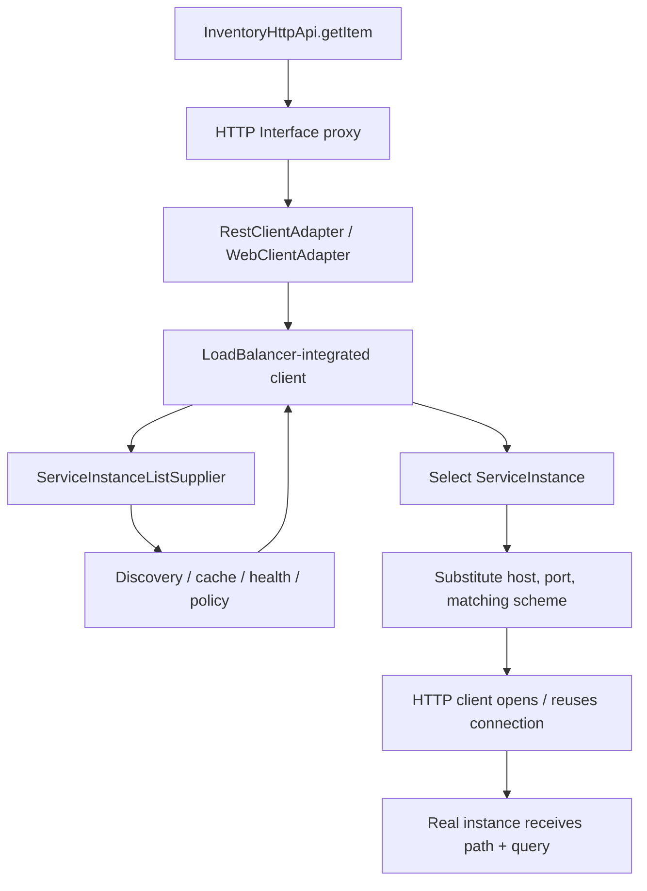
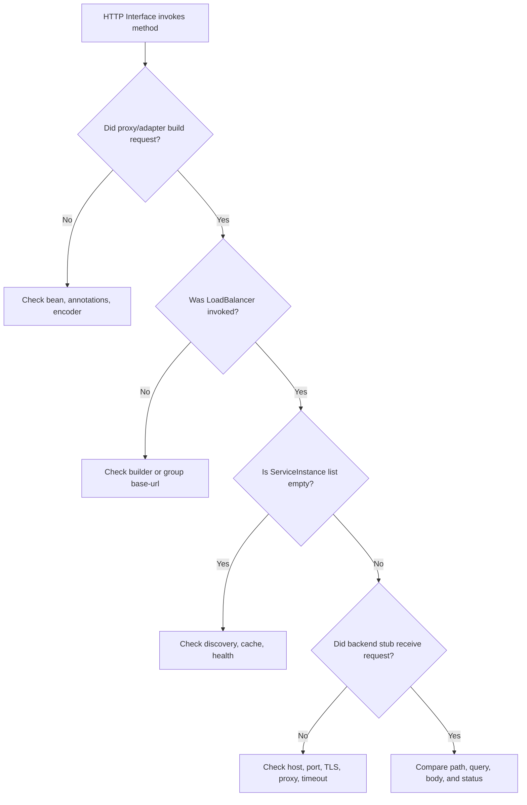

# Routing Calls Through LoadBalancer and Verifying the Actual URI

Spring HTTP Interface lets you describe an HTTP API using a Java interface and annotations such as `@HttpExchange`, `@GetExchange`, and `@PostExchange`. `HttpServiceProxyFactory` creates a proxy that executes calls from that interface through `RestClient` or `WebClient`. However, **having an HTTP Interface does not automatically guarantee calls go through Spring Cloud LoadBalancer**. Replica selection depends on the underlying HTTP client and how `baseUrl` is configured.

This lesson in the **HTTP Interface** chapter of the **Spring Cloud Service Communication Load Balancing** module explores two questions: *how do you call a service by `serviceId` through LoadBalancer?* and *how do you prove which host/port actually received the request after LoadBalancer picks a `ServiceInstance`?* The lab combines discovery, caching/health when applicable, `RestClient`, `WebClient`, timeouts/retries, and error observation so you never confuse a logical URI with the real network URI.

## 1. How Do the Logical URI and Actual URI Differ?

Suppose `order-service` needs to read data from `inventory-service`. On the client side, the call can carry a logical URI:

```text
http://inventory-service/api/items/42?includeStock=true
```

`inventory-service` is a **service ID**, not necessarily a hostname with a DNS record. The discovery source or supplier might return two instances:

| service ID | instance ID | host | port | scheme |
|---|---|---|---:|---|
| `inventory-service` | `inventory-a` | `10.0.1.10` | `8080` | HTTP |
| `inventory-service` | `inventory-b` | `10.0.1.11` | `8080` | HTTP |

Once `Spring Cloud LoadBalancer` picks `inventory-b`, the HTTP client sends the request to a real target equivalent to:

```text
http://10.0.1.11:8080/api/items/42?includeStock=true
```

To make responsibilities explicit:



**Distinguish three concepts before debugging:**

1. **Declared URI:** `@GetExchange` and `baseUrl` supply the logical URI before LoadBalancer runs.
2. **Selected instance:** the `ServiceInstance` object containing `instanceId`, `host`, `port`, `isSecure`, and metadata.
3. **Network destination that received the request:** the endpoint actually receiving the HTTP request, inspectable via a stub server or server access logs. In proxy/service-mesh environments, the final TCP socket and application instance may be at different hops.

Seeing `http://inventory-service/...` in HTTP Interface logs **does not prove** the request was load-balanced. Conversely, seeing a successful response does not prove Spring Cloud LoadBalancer participated: the name `inventory-service` might have been resolved directly by internal DNS.

## 2. HTTP Interface Only Declares the HTTP Contract

Define the interface for the inventory API:

```java
import org.springframework.web.bind.annotation.PathVariable;
import org.springframework.web.bind.annotation.RequestParam;
import org.springframework.web.service.annotation.GetExchange;
import org.springframework.web.service.annotation.HttpExchange;

@HttpExchange("/api/items")
public interface InventoryHttpApi {

    @GetExchange("/{id}")
    ItemReply getItem(
            @PathVariable("id") long id,
            @RequestParam("includeStock") boolean includeStock);
}

public record ItemReply(
        long id,
        String instance,
        int serverPort,
        String path,
        String query) {
}
```

`InventoryHttpApi` and `ItemReply` are **two `public` types and must live in two separate Java files** (`InventoryHttpApi.java` and `ItemReply.java`); they are shown together here to display the contract clearly. `ItemReply` is a lab DTO: the backend returns the ID, its instance identifier, and the request details it **actually received**. In real business APIs, DTOs only need domain fields; there is no need to expose debug fields in production.

`@HttpExchange` and `@GetExchange` specify the method, path, parameters, and data mapping. They **do not** configure discovery, instance selection, retries, or timeouts. All of those depend on the adapter and HTTP client wired into `HttpServiceProxyFactory`.

| Component | Role | Selects Instances Automatically? |
|---|---|---|
| `InventoryHttpApi` | Java HTTP call contract | No |
| `HttpServiceProxyFactory` | Generates proxy implementation for interface | No |
| `RestClientAdapter` | Bridges proxy calls to `RestClient` | No |
| `WebClientAdapter` | Bridges proxy calls to `WebClient` | No |
| `RestClient` or `WebClient` **integrated with LoadBalancer** | Resolves service-ID URIs and selects instances | Yes, via Spring Cloud LoadBalancer |
| **Direct** HTTP client | Connects to URL via DNS/proxy/transport | Does not use Spring Cloud LoadBalancer |

To keep URIs testable, use **relative** paths in annotations and place the service ID in `baseUrl`. Never hardcode `http://10.0.1.10:8080` or a partner URL into an interface meant for load balancing, as that couples the API contract to a concrete destination.

## 3. Prerequisites for Calling Through LoadBalancer

The application requires three groups of components:

- **HTTP Interface and adapter:** Spring Framework with `HttpServiceProxyFactory`, `RestClientAdapter`, or `WebClientAdapter` matching your version.
- **Spring Cloud LoadBalancer:** `org.springframework.cloud:spring-cloud-starter-loadbalancer` dependency plus a LoadBalancer-integrated HTTP client.
- **Instance list source:** `DiscoveryClient`/`ReactiveDiscoveryClient` (Eureka, Consul, Kubernetes depending on infrastructure), `SimpleDiscoveryClient`, or a custom supplier.

Example Maven dependency for LoadBalancer:

```xml
<dependency>
    <groupId>org.springframework.cloud</groupId>
    <artifactId>spring-cloud-starter-loadbalancer</artifactId>
</dependency>
```

If using `WebClient`, Spring WebFlux client and Reactor must be on the classpath (e.g., via `spring-boot-starter-webflux`). For `RestClient`, the matching Spring Web starter is needed. The Spring Cloud release train must be compatible with Spring Boot; do not copy Boot 4/Spring Cloud 5 config into a Boot 3/Spring Cloud 4 app without checking versions.

### 3.1. Static Instance Source for Practice

`SimpleDiscoveryClient` lets you run tests without Eureka/Consul. Example in the **caller's** `application.yml`:

```yaml
spring:
  cloud:
    discovery:
      client:
        simple:
          instances:
            inventory-service:
              - uri: http://127.0.0.1:18081
              - uri: http://127.0.0.1:18082
```

Both test instances must **actually be running** and listening on ports `18081` and `18082`. If the caller runs in a container, `127.0.0.1` is that container's loopback; replace it with a hostname or IP reachable by the caller. When another discovery adapter is on the classpath, verify which instance source LoadBalancer actually reads: static config only matters if those instances appear in the active supplier.

To observe distribution cleanly, this lab assumes default round-robin selection, no health/zone filters excluding instances, and no retries turning one application request into multiple HTTP attempts.

## 4. Approach 1: HTTP Interface with `@LoadBalanced` `RestClient`

This fits a **blocking** application such as Spring MVC. Define a `@LoadBalanced` `RestClient.Builder` and use it to construct the HTTP client backing the proxy.

```java
import org.springframework.cloud.client.loadbalancer.LoadBalanced;
import org.springframework.context.annotation.Bean;
import org.springframework.context.annotation.Configuration;
import org.springframework.web.client.RestClient;
import org.springframework.web.client.support.RestClientAdapter;
import org.springframework.web.service.invoker.HttpServiceProxyFactory;

@Configuration(proxyBeanMethods = false)
public class InventoryHttpClientConfiguration {

    @Bean
    @LoadBalanced
    RestClient.Builder inventoryLoadBalancedBuilder() {
        return RestClient.builder();
    }

    @Bean
    InventoryHttpApi inventoryHttpApi(
            @LoadBalanced RestClient.Builder builder) {

        RestClient restClient = builder
                .baseUrl("http://inventory-service")
                .build();

        HttpServiceProxyFactory factory = HttpServiceProxyFactory
                .builderFor(RestClientAdapter.create(restClient))
                .build();

        return factory.createClient(InventoryHttpApi.class);
    }
}
```

This is abbreviated configuration code: `InventoryHttpApi` and `ItemReply` are declared in separate Java files along with any matching DTOs. In an application with **multiple** `RestClient.Builder` beans, place `@LoadBalanced` at the injection point as above and distinguish direct builders with `@Primary` or appropriate qualifiers. Do not use a direct builder when discovery-based selection is intended.

### 4.1. Calling the Proxy Without Knowing Host/Port

```java
@Service
public class InventoryGateway {

    private final InventoryHttpApi inventory;

    public InventoryGateway(InventoryHttpApi inventory) {
        this.inventory = inventory;
    }

    public ItemReply find(long id) {
        return inventory.getItem(id, true);
    }
}
```

Calling `getItem(42, true)` produces an HTTP request equivalent to:

```text
Logical URI: http://inventory-service/api/items/42?includeStock=true
Instance:    inventory-a (127.0.0.1:18081) or inventory-b (127.0.0.1:18082)
Target URI:  http://127.0.0.1:18081/api/items/42?includeStock=true
             or http://127.0.0.1:18082/api/items/42?includeStock=true
```

The proxy builds the request from annotations, `RestClient` delegates through integration to `BlockingLoadBalancerClient`, and the HTTP request factory executes the connection. `@HttpExchange` does not need a separate `@LoadBalanced` annotation; that annotation applies to the **builder/client**.

### 4.2. Preserving Spring Boot Auto-Configuration

Raw `RestClient.builder()` suffices to demonstrate instance selection, but it may miss customizations Spring Boot normally attaches to `RestClient.Builder`, such as message converters, request factories, customizers, and observability. When those are needed, inject `RestClientBuilderConfigurer` when creating the bean:

```java
@Bean
@LoadBalanced
RestClient.Builder inventoryLoadBalancedBuilder(
        RestClientBuilderConfigurer configurer) {

    return configurer.configure(RestClient.builder());
}
```

`RestClientBuilderConfigurer` resides in **different packages** across Spring Boot generations: `org.springframework.boot.autoconfigure.web.client` in Boot 3.x, and `org.springframework.boot.restclient.autoconfigure` in Boot 4.x. Pick the import matching your BOM, and do not declare both example beans with the same name in one configuration.

`RestClient.Builder` is mutable. If creating multiple distinct clients from the same builder, use prototype bean scope or call `.clone()` before setting different `baseUrl`, header, or timeout values. A `@LoadBalanced` builder is **not** meant for calling external partner URLs directly; keep a separate direct builder when needed.

## 5. Approach 2: Reactive HTTP Interface on `WebClient`

When a WebFlux application requires non-blocking handling, an HTTP Interface can return `Mono<T>` or `Flux<T>` if the adapter supports reactive types. Define a dedicated interface:

```java
@HttpExchange("/api/items")
public interface ReactiveInventoryHttpApi {

    @GetExchange("/{id}")
    Mono<ItemReply> getItem(
            @PathVariable("id") long id,
            @RequestParam("includeStock") boolean includeStock);
}
```

Create the proxy from a `@LoadBalanced WebClient.Builder`:

```java
@Configuration(proxyBeanMethods = false)
public class ReactiveInventoryHttpClientConfiguration {

    @Bean
    @LoadBalanced
    WebClient.Builder inventoryLoadBalancedWebClientBuilder() {
        return WebClient.builder();
    }

    @Bean
    ReactiveInventoryHttpApi reactiveInventoryHttpApi(
            @LoadBalanced WebClient.Builder builder) {

        WebClient client = builder
                .baseUrl("http://inventory-service")
                .build();

        HttpServiceProxyFactory factory = HttpServiceProxyFactory
                .builderFor(WebClientAdapter.create(client))
                .build();

        return factory.createClient(ReactiveInventoryHttpApi.class);
    }
}
```

Matching imports include `org.springframework.web.reactive.function.client.WebClient`, `org.springframework.web.reactive.function.client.support.WebClientAdapter`, and `reactor.core.publisher.Mono`. The reactive and blocking configuration classes are **two illustrative options**; you do not have to create both for one service if your architecture only uses one execution model.

Usage inside a pipeline:

```java
Mono<ItemReply> reply = inventoryApi.getItem(42, true)
        .timeout(Duration.ofSeconds(3))
        .doOnNext(item -> log.debug("servedBy={}", item.instance()));
```

Never call `.block()` inside an `ExchangeFilterFunction` or WebFlux event-loop thread. If using a custom supplier, avoid blocking I/O inside `ServiceInstanceListSupplier.get(Request)`. `WebClient` does not replace connect timeouts, response timeouts, retries, or connection pool limits.

### 5.1. Where Are the Two Approaches Alike and Different?

| Criterion | Proxy on `RestClient` | Proxy on `WebClient` |
|---|---|---|
| HTTP Interface | Methods typically return DTOs | Methods can return `Mono<DTO>`/`Flux<DTO>` |
| Proxy creation | `RestClientAdapter.create(restClient)` | `WebClientAdapter.create(webClient)` |
| LoadBalancer integration | Blocking client/interceptor | Reactive exchange filter |
| Logical URL format | `http://inventory-service/...` | `http://inventory-service/...` |
| Target selection result | `ServiceInstance` from supplier by service ID | `ServiceInstance` from supplier by service ID |
| Thread handling | Caller waits synchronously for result | Reactive pipeline, non-blocking when all stages are async |
| Verifying physical URI | Server stub/access log, LB transformer | Server stub/access log, LB transformer |

**Key equivalence:** HTTP Interface is the declarative layer, while `RestClient`/`WebClient` itself determines the actual transport path. Swapping adapters while forgetting to build from a load-balanced builder is a very common reason clients bypass load balancing.

## 6. Approach 3: HTTP Service Client Groups in Spring Boot 4 and Spring Cloud 5

Newer releases can register HTTP Service Clients automatically via `@ImportHttpServices`. **Spring Cloud LoadBalancer 5.0.0+** provides integration for HTTP Service Client groups through group configurers for `RestClient` and `WebClient`. This is **a different configuration mechanism** from manual proxy creation in sections 4–5; pay close attention to `base-url` rules.

Example of an HTTP Service interface without a concrete host:

```java
@SpringBootApplication
@ImportHttpServices(
        group = "inventory-service",
        types = InventoryHttpApi.class)
public class OrderApplication {
}
```

`@ImportHttpServices` in this example comes from `org.springframework.web.service.registry.ImportHttpServices` in Boot/Spring Framework versions supporting HTTP Service Client groups. `InventoryHttpApi` still uses relative-path annotations as shown earlier.

### 6.1. Rules for Automatic LoadBalancer Enablement

Per Spring Cloud LoadBalancer 5.x documentation, for a group named `inventory-service`:

| Group `base-url` Setting | Auto-Attaches LB Integration? | Behavior |
|---|---|---|
| **Not declared** | **Yes**, when auto-config and dependencies are present | Uses group name as `serviceId`, builds logical URL `http://inventory-service` |
| `lb://inventory-service` | **Yes** | `lb` scheme signals instance selection; uses HTTP initially, may switch to HTTPS for secure instances |
| `http://inventory-service` | **No**, per auto-group rules | HTTP client treats host as an ordinary URL; group configurer does not auto-add LB filter |
| `https://api.partner.example` | **No** | Calls partner directly by URL |

Where confusion arises between the two integration paths:

- With a **manual proxy on a `@LoadBalanced` builder**, `baseUrl("http://inventory-service")` is right because the builder **already has** the LoadBalancer interceptor/filter.
- With an **auto-configured HTTP Service Client group**, explicitly setting `base-url: http://inventory-service` **does not trigger** group LoadBalancer integration. Leave `base-url` **unset** so the group name becomes the service ID, or specify the `lb://` scheme.

Example **explicit** config for an auto-configured group:

```yaml
spring:
  http:
    serviceclient:
      inventory-service:
        base-url: "lb://inventory-service"
        connect-timeout: 1s
        read-timeout: 3s
```

If you want to derive the service ID from the **group name** `inventory-service`, you can **omit** `base-url` completely. For functionally named groups such as `inventoryReadClient`, use `lb://inventory-service` so the real service ID is used instead of accidentally looking up a service named `inventoryReadClient`.

**Version scope:** this section relies on Spring Boot 4 HTTP Service Client groups and Spring Cloud LoadBalancer 5.0+; do not assume `@ImportHttpServices`, group properties, or these automatic rules exist or behave identically in Spring Boot 3.x and Spring Cloud 4.x. Check the BOM and docs for your active release train before implementing.

### 6.2. Why Test Both Explicit and Implicit URLs?

If an application migrates from manual proxy creation to `@ImportHttpServices`, copying `http://inventory-service` verbatim from `RestClient.Builder.baseUrl(...)` into the group property can **lose LoadBalancer integration** even though the interface code and request paths remain unchanged. Symptoms vary by environment: DNS `UnknownHostException`, hitting Kubernetes DNS service directly (succeeding without Spring Cloud policies), or routing through another proxy.

Write integration tests proving **`ServiceInstance` selection actually ran**, not just asserting an HTTP 200 response.

## 7. Most Reliable Verification Method: Two Mock Backends

To know for certain which host/port received the URI, run **two servers** exposing the same API while returning distinct IDs and ports. Observing the **server side** is more reliable than merely printing the logical URL from the interface or builder.

### 7.1. Stub Backend Returning Receiver Identity

Example controller for the stub `inventory-service` app:

```java
@RestController
public class InventoryStubController {

    @Value("${stub.instance-name}")
    private String instanceName;

    @GetMapping("/api/items/{id}")
    ItemReply find(
            @PathVariable("id") long id,
            @RequestParam("includeStock") boolean includeStock,
            HttpServletRequest request) {

        return new ItemReply(
                id,
                instanceName,
                request.getLocalPort(),
                request.getRequestURI(),
                request.getQueryString());
    }
}
```

`ItemReply` is the DTO from earlier; `HttpServletRequest` belongs to Jakarta Servlet in Spring Boot 3+/4+ on the Servlet stack. For a pure WebFlux backend, use WebFlux's request API instead of `HttpServletRequest`.

Start **two stub processes** with the same code and different configurations:

```text
Instance A: --server.port=18081 --stub.instance-name=inventory-a
Instance B: --server.port=18082 --stub.instance-name=inventory-b
```

When calling stubs A and B directly to sanity-check the environment, illustrative responses are:

```json
{"id":42,"instance":"inventory-a","serverPort":18081,
 "path":"/api/items/42","query":"includeStock=true"}
```

```json
{"id":42,"instance":"inventory-b","serverPort":18082,
 "path":"/api/items/42","query":"includeStock=true"}
```

These are **example** responses. For real verification, run both servers and inspect actual responses; never treat illustrative JSON as proof a test ran.

### 7.2. Calling Through the HTTP Interface Proxy

From a caller configured with `SimpleDiscoveryClient` and a `@LoadBalanced` builder, invoke sequentially:

```java
ItemReply first = inventoryApi.getItem(42, true);
ItemReply second = inventoryApi.getItem(43, false);

System.out.printf("first=%s:%d path=%s query=%s%n",
        first.instance(), first.serverPort(), first.path(), first.query());
System.out.printf("second=%s:%d path=%s query=%s%n",
        second.instance(), second.serverPort(), second.path(), second.query());
```

With two healthy instances, round-robin, no concurrent traffic, and no retries, two consecutive picks **normally** hit two different instances. Still, do not hardcode *A then B* as a strict assertion: the round-robin counter may start at a different offset, and discovery/health/retries or concurrent tests can affect ordering.

What to confirm:

1. `instance` is `inventory-a` or `inventory-b`, **not** `inventory-service`.
2. `serverPort` is in `{18081, 18082}`, matching registered endpoints.
3. `path` remains `/api/items/42` or `/api/items/43`.
4. `query` still carries `includeStock=true`/`false` per call.
5. Each stub's access log shows the corresponding requests; if stub B receives nothing, inspect supplier/algorithm/filters.

**Fields returned by the backend and server access logs are the proof of which HTTP endpoint received the request.** They complement LoadBalancer metrics, though they do not replace network-hop inspection if proxies or sidecars sit in between.

## 8. Writing an Integration Test Checking Both Logical URI and Physical Target

Assuming the test launches two stub instances on `18081` and `18082` and the caller uses the static configuration from section 3.1, a direct test against the HTTP Interface proxy looks like:

```java
@SpringBootTest
class InventoryHttpInterfaceRoutingIT {

    @Autowired
    InventoryHttpApi inventoryApi;

    @Test
    void requestsReachDiscoveredInstances() {
        ItemReply one = inventoryApi.getItem(42, true);
        ItemReply two = inventoryApi.getItem(43, false);

        assertEquals(42L, one.id());
        assertEquals("/api/items/42", one.path());
        assertEquals("includeStock=true", one.query());

        assertEquals(43L, two.id());
        assertEquals("/api/items/43", two.path());
        assertEquals("includeStock=false", two.query());

        Set<Integer> allowedPorts = Set.of(18081, 18082);
        assertTrue(allowedPorts.contains(one.serverPort()));
        assertTrue(allowedPorts.contains(two.serverPort()));
        assertTrue(Set.of("inventory-a", "inventory-b")
                .contains(one.instance()));
        assertTrue(Set.of("inventory-a", "inventory-b")
                .contains(two.instance()));
    }
}
```

The example uses JUnit 5, omitting imports for `Set`, `@SpringBootTest`, `@Autowired`, `@Test`, and assertions. **Precondition:** both servers must actually be running; if stubs are not started, the test must fail. Asserting `serverPort` on the backend proves the endpoint received the request, not whether an intermediary sidecar/proxy was present.

### 8.1. Checking Distribution Without Brittle Tests

If you want to verify round-robin, send multiple **sequential** requests in an isolated environment with no other callers, a fixed candidate list, retries disabled, and health filtering outside test interference. You can count requests per backend and check distribution against observed picks, but avoid requiring one specific call to hit A before B when another test might have advanced shared state.

In tests using random or weighted routing, assert **set membership** and statistical distribution over enough requests rather than demanding the first two requests hit distinct targets. For zone/metadata policies, verify excluded candidates never appear in server access logs.

### 8.2. Using Dynamic Ports Instead of Fixed Ports

In CI, ports `18081`/`18082` may already be occupied. In practice, run stubs on dynamic ports (`server.port=0`, MockWebServer, WireMock, or embedded test servers), and supply each stub's URI to `SimpleDiscoveryClient` **before the caller context initializes** via `@DynamicPropertySource` or equivalent test configuration. That keeps tests independent of developer ports and safe for parallel runs.

Do not mutate discovery properties after the HTTP client and LoadBalancer child context have already initialized expecting them to reload automatically. To test dynamic topology changes at runtime, use a dynamic discovery source or a supplier capable of refreshing lists rather than mutating a static property value.

## 9. Observing the Selected Instance Directly Inside LoadBalancer

Stub responses verify **who received the request**; Spring Cloud LoadBalancer also lets you observe **which instance it chose**. In tests, you can add a `LoadBalancerRequestTransformer` for `RestClient` to attach a diagnostic header:

```java
@Bean
LoadBalancerRequestTransformer selectedInstanceHeader() {
    return (request, instance) -> new HttpRequestWrapper(request) {
        @Override
        public HttpHeaders getHeaders() {
            HttpHeaders copy = new HttpHeaders();
            copy.putAll(super.getHeaders());
            copy.set("X-LB-Test-Instance", instance.getInstanceId());
            return copy;
        }
    };
}
```

On the stub backend, log the `X-LB-Test-Instance` header and compare it against `instance` and `serverPort` observed by the backend. For example, `X-LB-Test-Instance=inventory-b` paired with response `instance=inventory-b, serverPort=18082` confirms consistency between LoadBalancer's decision and the receiving endpoint.

`LoadBalancerRequestTransformer` belongs to Spring Cloud, while `HttpRequestWrapper` and `HttpHeaders` belong to Spring Framework; imports are omitted. Enable this transformer only in test environments or under a clear diagnostic policy: headers can be spoofed by external clients and must never be trusted for authorization or tenant isolation.

### 9.1. Equivalent Transformer for `WebClient`

```java
@Bean
LoadBalancerClientRequestTransformer reactiveInstanceHeader() {
    return (request, instance) -> ClientRequest.from(request)
            .header("X-LB-Test-Instance", instance.getInstanceId())
            .build();
}
```

With `WebClient`, `ClientRequest` belongs to `org.springframework.web.reactive.function.client`. The header helps test and trace instance selection; it is **not** a physical hostname or connection address. Use server logs to confirm path/port and cross-check against the transformer value.

### 9.2. Why Filter Logs Can Mislead

A `WebClient` `ExchangeFilterFunction` or `RestClient` `ClientHttpRequestInterceptor` can observe the URI **before or after** LoadBalancer rewrites it, depending on chain ordering. If a filter prints `request.url()` showing `inventory-service`, you cannot conclude the HTTP client tried to look up `inventory-service` in DNS.

Likewise, printing `ServiceInstance.getUri()` proves an instance was **selected**, not that the backend **received** the request. Connection refused, TLS errors, proxy routing, DNS, or timeouts can still happen after selection. To draw accurate conclusions, line up evidence on one timeline: instance selection → connection start → backend access log → response/error.

## 10. Relationship Between Scheme, Host, Port, and Path

In a load-balanced request, the logical host acts as the service ID. Once an instance is picked, the transport must use that instance's address and matching scheme. Key items to verify:

| URI Component | Example | What to Watch During Instance Selection |
|---|---|---|
| Scheme | `http` or `https` | `ServiceInstance.isSecure()` and LB config can influence target scheme |
| Logical host | `inventory-service` | This is the service ID, not necessarily the socket host |
| Actual host | `10.0.1.11` | Taken from selected instance; must be reachable from caller |
| Port | `8080` | Depends on instance; wrong port causes connection error or wrong service |
| Path | `/api/items/42` | Must survive proxy/client intact; avoid bad `baseUrl` concatenation |
| Query | `includeStock=true` | Must be properly encoded by URI builder and preserved in final request |

If an instance is marked `secure=true`, URI reconstruction can upgrade the request to HTTPS even when the logical URI started with `http://`, depending on integration; therefore check certificates/truststores as well as the actual scheme. Do not hardcode `https://` everywhere assuming the registry/LoadBalancer will ignore `isSecure`.

### 10.1. Do Not Confuse the `Host` Header with the TCP Destination

The HTTP `Host` header or HTTP/2 `:authority` can differ from the socket address the HTTP client connects to, especially with reverse proxies, TLS SNI, service meshes, or host-preservation settings. Thus, **reading the `Host` header alone is not enough to prove which instance was chosen**. With local direct stub servers, combining `serverPort` and access logs with `ServiceInstance` is much clearer.

### 10.2. Avoid Untrusted Absolute URLs in HTTP Interfaces

Spring HTTP Interface can accept a `URI` parameter and some annotations accept absolute URLs, yet an absolute URI can **override the client's base URL**. On a load-balanced client, the new host may be interpreted as a different service ID; on a direct client, it can become an outbound request to another server.

If the goal is always calling `inventory-service`, keep the service ID controlled by configuration and use relative paths/queries. Never pass user-supplied URLs straight into the proxy, as that risks SSRF, misrouting, or leaking `Authorization` headers. Keep HTTP Interfaces for external partner URLs separate from HTTP Interfaces for service discovery.

## 11. Real-World Errors When Configuring or Verifying URIs

| Symptom | Common Cause | Investigation Path |
|---|---|---|
| `No instances available for inventory-service` | Right service ID chosen, but discovery/supplier returned empty list | Check `getServiceId()`, registry, health filters, and instance source |
| `UnknownHostException: inventory-service` | Direct client tried DNS instead of Spring Cloud LoadBalancer | Verify `@LoadBalanced` builder; for auto groups, check `base-url` rules |
| HTTP Interface returns 200 with zero LB metrics | Handled directly by DNS/proxy, or integration disabled | Check transformer, lifecycle callbacks, and stub access logs |
| Server only receives requests on port `18081` | Supplier returns one instance, filter drops B, or pinned policy | Print candidate set and selected instance; check `/whoami` on both servers |
| 404 response despite picking right instance | `@HttpExchange`, `@GetExchange`, or `baseUrl` path concatenated wrong | Inspect path actually received by backend and server mappings |
| Query missing or encoded wrong | Wrong `@RequestParam`, URI template, or passed value | Compare `query` in response/access log against proxy invocation |
| TLS handshake error after picking instance | Incompatible scheme, `isSecure`, certificate, SNI, or truststore | Check scheme/host/port and actual transport exception |
| Retries cause server to record multiple requests per call | Retry in LB or HTTP client; timeout after backend accepted request | Count outbound attempts, review policy and idempotency |
| Discovery config changed, yet requests hit old host | Cache/registry not converged, or static config not refreshed | Inspect state at each supplier layer and refresh interval |
| Same interface hits direct client after Boot 4 migration | Auto group has explicit `base-url: http://inventory-service` | Leave `base-url` null or use `lb://` for LB-integrated groups |

### 11.1. Troubleshooting Stage by Stage



Each branch represents an independent layer that can fail on its own. Do not blame every `503`, `404`, or timeout on the round-robin algorithm; inspect service ID, candidate list, selected target, and the request received by the backend.

## 12. How Timeouts, Retries, and Health Affect Observation

A simple integration test often assumes one HTTP Interface call equals one backend request. In real systems, **retries can generate multiple attempts**, sometimes across multiple instances. Caches and health checks also alter the observed candidate set over time.

- **Connect timeout:** LoadBalancer picked a target, yet the socket failed to connect; absence of backend access logs does not prove LB did not run.
- **Read timeout:** the backend may have received and processed the request while the caller still observes a timeout.
- **Retries:** one method call can emit multiple HTTP requests, so use correlation IDs/attempt IDs when debugging.
- **List caching:** an instance removed from the registry may temporarily remain in the supplier.
- **Health checks:** unhealthy instances may be filtered out before selection; verify both probe outcomes and all-unhealthy fallback policies.
- **Connection pooling:** connections are reused by real endpoint; the logical URL does not determine the final pool key.

For `POST` operations with side effects, retrying after a timeout is only safe when the API enforces an idempotency key or duplicate-handling mechanism. Never infer retry safety from round-robin results over two requests.

### 12.1. Observing via Micrometer and Lifecycle Callbacks

When compatible dependencies and configuration are present, Spring Cloud LoadBalancer supports lifecycle callbacks and Micrometer metrics for load-balanced requests. They can record service IDs, selection outcomes, and errors. However, **LB meters do not replace backend access logs**, and not every call path exposes full physical URIs.

When adding metric tags, avoid unbounded cardinality from full paths like `/api/items/123456`, tokens, user IDs, or sensitive query parameters. Use URI templates such as `/api/items/{id}` whenever possible; for server logs, enforce proper data protection and retention policies.

## 13. Comprehensive Practice Lab

Implement this in three rounds, each with clear verification criteria.

### Round A — Manual Proxy, Blocking `RestClient`

1. Start stubs A (`18081`) and B (`18082`) returning `ItemReply` with distinct instances and ports.
2. Configure `SimpleDiscoveryClient` with service ID `inventory-service` as in section 3.1.
3. Build the proxy from `RestClientAdapter` and a `@LoadBalanced RestClient.Builder`.
4. Call `getItem(42, true)` multiple times; confirm the backend receives the right path/query and ports belong to the registered list.
5. Temporarily attach a test transformer; cross-check the selected instance ID against `ItemReply.instance`.
6. Try removing `@LoadBalanced` from the builder to observe the difference: if DNS lacks `inventory-service`, host resolution fails; if DNS resolves it, responses may succeed without proving Spring Cloud is load-balancing.

### Round B — Reactive Proxy, `WebClient`

1. Use `ReactiveInventoryHttpApi` returning `Mono<ItemReply>` with `WebClientAdapter`.
2. Issue two requests via `Mono.zip` or a concurrency-bounded pipeline.
3. Inspect both responses and access logs, without calling `.block()` on an application event-loop thread.
4. Stop instance B and observe failures and convergence timing of discovery and health checks.
5. Configure bounded timeouts/retries and verify actual outbound attempt counts.

### Round C — Auto-Configured Group (Boot 4 + Cloud 5)

1. Register `@ImportHttpServices(group = "inventory-service", types = InventoryHttpApi.class)`.
2. Leave the group's `base-url` **undeclared**; verify requests go through LB.
3. Set `base-url: "lb://inventory-service"`; verify requests still go through LB.
4. Try `base-url: "http://inventory-service"` inside the **auto group**, observe the difference, and explain why.
5. Lock in the verified configuration, enable sensible metrics, and keep tests to guard against regressions during BOM upgrades.

### 13.1. Lab Pass Criteria

| Check | Passing Condition |
|---|---|
| Interface proxy | Java method produces the exact HTTP method, path, and query |
| LoadBalancer integration | `ServiceInstance` selection decision occurs when calling service ID |
| Actual target | Backends A/B confirm matching ports and instance names |
| No direct vs. LB confusion | Non-discovery calls use direct client; internal calls use LB builder |
| Resilience | When one instance stops, errors/failover match timeout/health/cache config |
| No unintended side effects | Retries never duplicate business writes unexpectedly |
| Observability | Data correlates logical URI, selected instance, and access logs |

## 14. Checklist for Putting Load-Balanced HTTP Interfaces into Production

- Keep `@HttpExchange`/`@GetExchange` declaring **relative paths** and API contracts; never hardcode instance IPs on interfaces.
- Match the adapter to the execution model: `RestClientAdapter` for blocking, `WebClientAdapter` for reactive.
- For manual proxies, use `@LoadBalanced RestClient.Builder` or `@LoadBalanced WebClient.Builder`; never assume the adapter enables LB itself.
- For Boot 4/Cloud 5 auto groups, remember the difference between **omitting `base-url`**, **`lb://`**, and **explicit `http://`**.
- Verify the `ServiceInstance` source per service ID and confirm the caller can actually reach advertised hosts/ports.
- Use server stubs/access logs to prove which endpoint received requests; never rely solely on URLs appearing in code or filter logs.
- Use `LoadBalancerRequestTransformer`/`LoadBalancerClientRequestTransformer` in tests to cross-check selected instances.
- Thoroughly test paths, query encoding, HTTP/HTTPS schemes, TLS, timeouts, and proxies.
- Count outbound attempts when retries are enabled; use idempotency keys for side-effecting requests.
- Understand how caching, discovery, and health checks affect candidate lists and failover behavior.
- Preserve Spring Boot auto-configuration when defining builders; avoid uncontrolled sharing of mutable builders.
- Track metrics/tracing with bounded cardinality; never log credentials or sensitive data.

**Conclusion:** HTTP Interface turns an HTTP API into a clean Java interface, yet **LoadBalancer does not live inside the interface annotations**. With manual proxies, integration lives on the `RestClient`/`WebClient` built from a `@LoadBalanced` builder. With modern HTTP Service Client groups, integration follows dedicated `base-url` rules. To be sure calls travel the intended path, verify the full chain **logical URI → selected `ServiceInstance` → host/port actually hit on the backend**, along with path/query fidelity and post-selection failure modes.

## References

- [Spring Framework — REST Clients / HTTP Service Clients](https://docs.spring.io/spring-framework/reference/integration/rest-clients.html): `@HttpExchange`, `HttpServiceProxyFactory`, `RestClientAdapter`, `WebClientAdapter`, and return types.
- [Spring Cloud Commons — Common Abstractions](https://docs.spring.io/spring-cloud-commons/reference/spring-cloud-commons/common-abstractions.html): creating `@LoadBalanced RestClient.Builder` and `WebClient.Builder`, routing via service IDs.
- [Spring Cloud Commons — Spring Cloud LoadBalancer](https://docs.spring.io/spring-cloud-commons/reference/spring-cloud-commons/loadbalancer.html): transformers, lifecycle, metrics, and automatic HTTP Service Client group integration since 5.0.0.
- [Spring Boot — Calling REST Services](https://docs.spring.io/spring-boot/reference/io/rest-client.html): `@ImportHttpServices`, named groups, `spring.http.serviceclient.<group>.base-url`, and HTTP client configuration.
