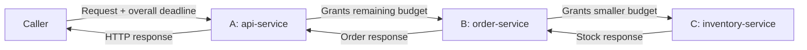

# Time Budget from Incoming Request to Final Service

A request in a microservices system rarely ends at the first service that receives it. For example, `api-service` receives `GET /orders/42`, calls `order-service`, and `order-service` then calls `inventory-service`. Spring Cloud LoadBalancer helps each client select a `ServiceInstance` by service ID, but **does not automatically determine the total time that the call chain is allowed to consume**. If each hop only configures its own timeout independently, a request can wait far longer than what users find acceptable, especially when retries are involved.

An **end-to-end time budget** is the limit allocated for the entire journey: from the moment a request enters the system until a response is returned or it terminates with an error. From this budget, services must decide how much time remains for local processing, discovery, waiting on the connection pool, network connection, HTTP response, retries, and returning the result to the caller.

This topic belongs to the **Timeouts** group in Spring Cloud LoadBalancer: besides configuring `RestClient`, `RestTemplate`, `WebClient`, and OpenFeign to call the right service ID, we must ensure that **every attempt and every hop shares a controlled deadline**.

## 1. Distinguishing Timeout, Deadline, and Time Budget

Three concepts are often used interchangeably:

| Concept | Meaning | Example |
|---|---|---|
| **Timeout** | Maximum time for a single operation or phase | TCP connection up to 200 ms |
| **Deadline** | The final point in time by which the work must complete | The request must finish before the end timestamp calculated upon receipt |
| **Time budget** | Remaining duration allowed to be used before the deadline | 480 ms left to make downstream calls and assemble the response |

If a request has a 1,000 ms budget and has already consumed 350 ms, the remaining portion is **not a fresh 1,000 ms**:

\[
T_{\mathrm{remaining}}=\max(0,\ T_{\mathrm{budget}}-T_{\mathrm{elapsed}})
\]

Within a Java process, `elapsed` should be computed using a **monotonic** clock such as `System.nanoTime()` to avoid skew when the system clock is adjusted. Wall-clock time (epoch milliseconds) is useful when exchanging a deadline across different machines, but is only safe when **clock skew**, header trustworthiness, and network transit time have been accounted for.

Example:

```text
T=0 ms     api-service starts processing; budget = 1,000 ms
T=120 ms   authentication completes; remaining = 880 ms
T=350 ms   about to call order-service; remaining = 650 ms
T=780 ms   order-service returns response; remaining = 220 ms
T=930 ms   response sent to caller; 70 ms reserve left
```

At `T=350 ms`, granting a new **1,000 ms** timeout to downstream can cause the total duration to exceed the initial deadline. A downstream call must be granted an amount of time **no greater than the remaining portion**, while leaving a reserve buffer for subsequent steps.

## 2. Budget Across the Chain A → B → C

Suppose:

- **A = api-service:** receives requests from external clients and performs authentication.
- **B = order-service:** aggregates the order and needs inventory data.
- **C = inventory-service:** retrieves stock from cache/database.



For **sequential** steps, the time along the critical path is typically additive:

\[
T_{\mathrm{end\text{-}to\text{-}end}}
\approx T_A+T_{A\to B}+T_B+T_{B\to C}+T_C
+T_{\mathrm{return}}
\]

Each component here must be defined so that there is **no double counting**: for instance, `T_{A→B}` is only the network/transport cost, while `T_B` includes processing time at B without adding B→C time again if that is already counted separately.

In real layers, configuring “A waits for B at most 650 ms” **already includes** the time B spends calling C. Therefore, you must not add a 400 ms budget for C on top of B's 650 ms budget as if they were independent.

### Example Allocation of a 1,000 ms Deadline

| Component in the journey | Planned budget | Explanation |
|---|---:|---|
| Request intake, authentication, routing at A | 80 ms | Includes initial overhead |
| Local processing at A | 70 ms | Input validation, data preparation |
| **Entire A → B call** | **650 ms** | Includes B → C and response from B |
| Aggregation, serialization, and returning response at A | 100 ms | Do not let downstream consume the entire deadline |
| Reserve for jitter/queue/scheduling | 100 ms | Absorbs minor fluctuations |
| **Total** | **1,000 ms** | Do not re-grant 1,000 ms to each hop |

**Inside** B's 650 ms budget, we can plan:

| B's workload | Budget |
|---|---:|
| Processing/queue at B | 70 ms |
| **B → C (including C's processing)** | **400 ms** |
| Data aggregation and returning to A | 80 ms |
| Reserve at B | 100 ms |
| **Total within B's 650 ms** | **650 ms** |

These numbers are **illustrative examples**, not optimal configurations for every application. They must be tuned based on actual latency metrics and SLA/SLO requirements.

### When B Calls C and D in Parallel

If B sends two concurrent calls to `inventory-service` and `pricing-service`, the waiting time on the critical path is approximately the **larger** of the two calls, plus overhead, rather than the sum of both:

\[
T_{\mathrm{parallel}}\approx\max(T_{B\to C},T_{B\to D})
\]

However, each branch still needs **the same request deadline boundary**, connection pool/concurrency limits, and an appropriate error policy. Parallelism does not create extra time; nor does it mean both branches have the right to independently consume the entire budget and drag out the request together.

## 3. Often-Overlooked Waiting Periods

A configuration with only `connectTimeout` and `readTimeout` does not cover all the time that can be consumed:

| Phase | Example | Why it matters |
|---|---|---|
| Pre-processing queue | Request waiting for thread/event loop or concurrency limit | Budget may already be consumed before calling downstream |
| Instance selection | Discovery, `ServiceInstanceListSupplier`, cache, or health/zone filtering | Target selection time is also on the request path |
| Connection pool wait | Waiting for an idle connection | Can take significant time even when connect timeout is small |
| DNS and TCP connect | Hostname resolution, TCP handshake | Can fail before sending the HTTP request |
| TLS handshake | Certificate exchange and secure session setup | Not necessarily covered identically across all HTTP clients |
| Sending request | Uploading a large payload or backpressure | Consumes time even before the backend starts processing |
| Waiting for response / reading body | Backend processing followed by response transmission | Read/response timeout is not always an overall deadline |
| Retry and backoff | Waiting and then executing one or more HTTP attempts | Can multiply total elapsed time severalfold |
| Final processing and returning response | Merging data, serialization, socket write | Needs a reserve after downstream returns |

For example, if `connectTimeout=200 ms` and `readTimeout=500 ms`, **you cannot conclude** that the entire request is guaranteed to finish within 700 ms: there is still pool waiting, multiple reads, retries, data processing, and other timeout layers. The exact semantics of `readTimeout` also depend on the HTTP transport and library version.

### Operation-Level Timeouts vs. End-to-End Deadline

| Configuration / concept | Primary scope | Guarantees a full-request bound? |
|---|---|---|
| TCP connect timeout | A single connection attempt | No |
| Pool acquisition timeout | Waiting to acquire a connection from the pool | No |
| Read/response timeout | Waiting for a response or idle gap while reading data | Not always an overall deadline |
| Per-attempt timeout | A single HTTP attempt | No if there are multiple attempts |
| **Overall deadline** | All work from ingress to response | The limit that must be **actively enforced** |

To achieve end-to-end control, **multiple layers** are needed: transport-level timeouts to protect sockets, per-attempt timeouts, and an overall limit for the processing/retry chain based on the remaining budget.

## 4. Principle for Granting Budget to the Next Hop

At the moment of preparing to call downstream, let:

- `R`: remaining time of the request in the current process.
- `M`: time to reserve for validation, aggregation, and sending the response.
- `C`: configured timeout limit for downstream according to policy.

Maximum budget for the next hop:

\[
T_{\mathrm{hop}}=\min(C,\ R-M),\qquad
\text{call only if }R>M
\]

This is the total limit for **one hop**, not `connectTimeout` or `readTimeout`. If `R-M>0` does not hold, **fail fast** instead of still calling downstream and almost certainly timing out.

Example:

```text
Remaining of the request at A : 520 ms
Reserve to return response at A : 80 ms
Configured max for A -> B       : 700 ms
=> Hop budget A -> B            : min(700, 520-80) = 440 ms
```

At B, if 140 ms has already been spent and about 300 ms remains under the received budget, B must not grant a fresh 600 ms to C. B must take the remaining amount minus B's own reserve.

### The Earliest Deadline Is the True Limit

An operation may be subject to multiple deadlines:

1. Incoming deadline from the caller (if authenticated/accepted).
2. Maximum deadline according to the service's own policy.
3. Per-endpoint/downstream limit.

**The effective limit is the earliest deadline**, not the longest one. If the caller only allows 300 ms, an internal 2-second policy does not permit B to keep working for another 2 seconds after the caller's budget has expired.

## 5. Monotonic Clock and How to Store Budget in Java

Within **a single JVM**, you can store the end timestamp using `System.nanoTime()` and compute the remaining time right when actually sending the request. The snippet below is an **in-process** helper, not an epoch deadline whose raw value can be sent directly to another machine:

```java
import java.time.Duration;

public final class DeadlineBudget {

    private final long deadlineNanos;

    private DeadlineBudget(long deadlineNanos) {
        this.deadlineNanos = deadlineNanos;
    }

    public static DeadlineBudget after(Duration total) {
        if (total.isZero() || total.isNegative()
                || total.compareTo(Duration.ofMinutes(10)) > 0) {
            throw new IllegalArgumentException(
                    "Budget must be positive and <= 10 minutes");
        }
        return new DeadlineBudget(
                System.nanoTime() + total.toNanos());
    }

    public Duration remaining() {
        long nanos = deadlineNanos - System.nanoTime();
        return Duration.ofNanos(Math.max(0L, nanos));
    }

    public Duration forHop(Duration configuredMax, Duration reserve) {
        if (configuredMax.isZero() || configuredMax.isNegative()
                || reserve.isNegative()) {
            throw new IllegalArgumentException(
                    "Invalid hop timeout or reserve");
        }

        Duration available = remaining().minus(reserve);
        if (available.isZero() || available.isNegative()) {
            throw new DeadlineExceededException(
                    "No budget left for downstream");
        }
        return available.compareTo(configuredMax) < 0
                ? available : configuredMax;
    }

    public static final class DeadlineExceededException
            extends RuntimeException {
        DeadlineExceededException(String message) {
            super(message);
        }
    }
}
```

This example class caps the incoming budget at 10 minutes to prevent absurd numbers; **the exact cap must match the product**, so do not take 10 minutes as a default for synchronous APIs. The difference of `System.nanoTime()` values measures elapsed time within the same process even if the system wall clock is adjusted.

**Do not send `deadlineNanos` to another service**: `System.nanoTime()` has no shared epoch across machines, and a value from JVM A cannot be used as a deadline in JVM B. Only pass a quantity with clear semantics, such as **remaining budget** or a validated epoch deadline with clock skew handling.

## 6. Propagating Budget Between Services: Principles and Risks

HTTP does not provide a single unified end-to-end deadline rule across all Spring Cloud libraries. You can design an internal header, for example:

```http
GET /api/v1/items/42 HTTP/1.1
Host: inventory-service
X-Request-Budget-Ms: 350
traceparent: 00-<trace-id>-<span-id>-01
```

The header here is an **application-defined illustrative protocol**, not a header that Spring Cloud LoadBalancer automatically adds or enforces. `traceparent` follows tracing conventions (the value in the example is a placeholder, not a valid trace ID to copy).

When using remaining budget in milliseconds:

1. The caller must measure elapsed time, subtract its reserve, and send a value **no greater than the genuinely remaining budget**.
2. The receiver verifies that the header comes from a trusted layer, parses it safely, caps it by the **local max budget**, and starts a new monotonic clock.
3. The receiver continues subtracting its own processing time before calling the next hop.
4. The caller still needs to enforce **its own deadline**: network transit time from A to B is not automatically deducted from a numeric TTL that B only starts counting upon receipt.
5. If cross-machine deadline accuracy matters, a unified deadline protocol is needed (e.g., an absolute deadline with synchronized clocks and clock skew compensation), plus enforcement at ingress and at each hop.

**Security:** do not trust a budget header arbitrarily sent by an Internet client. If accepted unvalidated, a caller can request an excessively long duration and hold resources, or send an abnormal budget causing widespread fail-fast errors. At ingress, determine the budget from the SLO, route, and authenticated caller; when forwarding between services, overwrite or validate the header at the trust boundary.

### Example Receiver Capping Oversized Header Values

```java
import java.time.Duration;

final class IncomingBudget {

    private static final long MAX_MILLIS = 800;

    static DeadlineBudget create(String trustedHeader) {
        if (trustedHeader == null) {
            return DeadlineBudget.after(
                    Duration.ofMillis(MAX_MILLIS));
        }

        try {
            long value = Long.parseLong(trustedHeader);
            if (value <= 0) {
                throw new DeadlineBudget.DeadlineExceededException(
                        "Caller budget expired");
            }
            return DeadlineBudget.after(
                    Duration.ofMillis(Math.min(MAX_MILLIS, value)));
        } catch (NumberFormatException malformed) {
            throw new IllegalArgumentException(
                    "Invalid internal budget header", malformed);
        }
    }
}
```

This snippet assumes the header has **already** passed through an authentication/normalization layer. For Internet input, determine the budget according to ingress policy instead of using `trustedHeader` directly. It is an example of a **relative TTL** protocol, which does not automatically compensate for the time the header spends on the network; the true overall deadline is still monitored by the caller/ingress.

## 7. Enforcing Budget with WebClient and Spring Cloud LoadBalancer

`WebClient` is well suited for demonstrating dynamic deadlines because each `Mono` is an asynchronous pipeline. For example, service B uses a `@LoadBalanced WebClient.Builder` to call C by service ID:

```java
import org.springframework.cloud.client.loadbalancer.LoadBalanced;
import org.springframework.context.annotation.Bean;
import org.springframework.context.annotation.Configuration;
import org.springframework.web.reactive.function.client.WebClient;

@Configuration
class WebClientConfiguration {

    @Bean
    @LoadBalanced
    WebClient.Builder loadBalancedWebClientBuilder() {
        return WebClient.builder();
    }
}
```

The client calling `inventory-service` can apply the budget to the **entire hop**, not just the body-read timeout:

```java
import java.time.Duration;

import org.springframework.beans.factory.annotation.Qualifier;
import org.springframework.stereotype.Service;
import org.springframework.web.reactive.function.client.WebClient;
import reactor.core.publisher.Mono;

record StockDto(String itemId, int available) {
}

@Service
class InventoryGateway {

    private final WebClient client;

    InventoryGateway(
            @Qualifier("loadBalancedWebClientBuilder")
            WebClient.Builder builder) {
        this.client = builder
                .baseUrl("http://inventory-service")
                .build();
    }

    Mono<StockDto> getStock(
            String itemId, long artificialDelayMs, DeadlineBudget budget) {
        return Mono.defer(() -> {
            // Reserve 80 ms for B to aggregate data and return the response.
            Duration allowed;
            try {
                allowed = budget.forHop(
                        Duration.ofMillis(400), Duration.ofMillis(80));
            } catch (DeadlineBudget.DeadlineExceededException expired) {
                return Mono.error(expired);
            }

            if (allowed.compareTo(Duration.ofMillis(1)) < 0) {
                return Mono.error(
                        new DeadlineBudget.DeadlineExceededException(
                                "Insufficient time for HTTP request"));
            }

            return client.get()
                    .uri(uri -> uri.path("/api/v1/stock/{id}")
                            .queryParam("delayMs", artificialDelayMs)
                            .build(itemId))
                    .header("X-Request-Budget-Ms",
                            Long.toString(allowed.toMillis()))
                    .retrieve()
                    .bodyToMono(StockDto.class)
                    .timeout(allowed);
        });
    }
}
```

Key points of this code:

- `Mono.defer` computes `remaining` **at subscription time**, rather than computing it early when constructing a `Mono` that might sit in a queue.
- `forHop` picks the **smaller** of the configured timeout and `remaining` minus `reserve`.
- The HTTP URI still uses the **service ID** and goes through the LoadBalancer filter to choose a `ServiceInstance`.
- The budget header is sent to C as a **controlled internal hint**; C must handle it itself to take advantage of it.
- `timeout(allowed)` bounds how long B's subscriber waits for the hop result. It covers instance selection and the HTTP operation inside that publisher, but **does not guarantee that C immediately stops computing when B stops waiting**.

To protect connection pools and sockets, alongside `Mono.timeout` you also need to configure the HTTP connector: connect timeout, response timeout, pending-acquire timeout, and connection limits. With Reactor Netty or other HTTP clients, exact timeout names and semantics must be checked against the version in use.

### Creating the Budget at B's Entry Point

A WebFlux controller demonstrates receiving the verified header from A, creating a local deadline in JVM B, and calling C:

```java
import org.springframework.web.bind.annotation.GetMapping;
import org.springframework.web.bind.annotation.PathVariable;
import org.springframework.web.bind.annotation.RequestHeader;
import org.springframework.web.bind.annotation.RequestParam;
import org.springframework.web.bind.annotation.RestController;
import reactor.core.publisher.Mono;

@RestController
class StockProxyController {

    private final InventoryGateway gateway;

    StockProxyController(InventoryGateway gateway) {
        this.gateway = gateway;
    }

    @GetMapping("/api/v1/stock-proxy/{id}")
    Mono<StockDto> proxy(
            @PathVariable String id,
            @RequestParam(defaultValue = "50") long delayMs,
            @RequestHeader(
                    name = "X-Request-Budget-Ms",
                    required = false) String incomingBudget) {

        // Only use headers that have passed through a trusted layer.
        DeadlineBudget budget = IncomingBudget.create(incomingBudget);
        return Mono.defer(() -> {
            Duration remaining = budget.remaining();
            if (remaining.isZero()) {
                return Mono.error(
                        new DeadlineBudget.DeadlineExceededException(
                                "Request budget already expired"));
            }
            return gateway.getStock(id, delayMs, budget)
                    .timeout(remaining);
        });
    }
}
```

In this example controller, the trusted ingress layer must strip or overwrite `X-Request-Budget-Ms` before external clients are allowed to reach B. Without an ingress, treat the header in the lab strictly as test data; do not use that pattern unmodified as a production security boundary.

The `Mono.timeout` calls at the controller layer and the gateway layer have **two different scopes**: the controller enforces the remaining time for the entire request at B, while the gateway enforces the budget granted specifically for hop B→C. Whichever deadline is smaller will stop waiting first.

## 8. Timeouts in RestTemplate, RestClient, and OpenFeign Do Not Replace an Overall Deadline

Spring Cloud LoadBalancer can integrate with both blocking and reactive HTTP clients. The end-to-end budget remains the responsibility of **the caller and the orchestration layer**.

### 8.1. RestTemplate with Connect/Read Timeout

A simple example for blocking applications:

```java
import org.springframework.cloud.client.loadbalancer.LoadBalanced;
import org.springframework.context.annotation.Bean;
import org.springframework.context.annotation.Configuration;
import org.springframework.http.client.SimpleClientHttpRequestFactory;
import org.springframework.web.client.RestTemplate;

@Configuration
class BlockingClientConfiguration {

    @Bean
    @LoadBalanced
    RestTemplate loadBalancedRestTemplate() {
        SimpleClientHttpRequestFactory factory =
                new SimpleClientHttpRequestFactory();
        factory.setConnectTimeout(200); // ms
        factory.setReadTimeout(450);    // ms
        return new RestTemplate(factory);
    }
}
```

This bean goes through LoadBalancer integration when calling a logical URL such as `http://inventory-service/...`. However, `setReadTimeout(450)` does not guarantee that the entire request A→B→C will complete within 450 ms: it is a limit on the HTTP request factory, not the dynamic remaining time of the business request.

`SimpleClientHttpRequestFactory` is used for learning examples; production environments may need an HTTP client with connection pooling, pool-wait timeouts, TLS, and appropriate timeouts.

With `RestClient`, you can similarly choose an appropriate `ClientHttpRequestFactory` and use `@LoadBalanced RestClient.Builder`. Dynamic remaining time is difficult to apply solely through fixed bean timeouts; if a hard deadline is required in a blocking stack, you must design an **outer wrapper mechanism** aware of the total request budget, bounded cancellation/interruption, and the HTTP transport's behavior. Do not assume `Future.orTimeout` or cancelling a future immediately stops a socket mid-read.

### 8.2. OpenFeign by Service ID

Spring Cloud OpenFeign provides per-client configurations, for example:

```yaml
spring:
  cloud:
    openfeign:
      client:
        config:
          inventory-service:
            connectTimeout: 200
            readTimeout: 450
```

In Spring Cloud OpenFeign, these two values are expressed in **milliseconds**. They bound stages at the Feign/HTTP client layer, but are **not an ingress deadline** and do not automatically subtract time already spent at A.

`@FeignClient(name = "inventory-service")` can select an instance through Spring Cloud LoadBalancer; if no instance is available, an error may occur **before connecting to a provider**. You must distinguish target selection errors, connect timeouts, read timeouts, and actual HTTP 503 responses from the provider.

In many Spring Cloud OpenFeign configurations, `Retryer.NEVER_RETRY` is the default. Do not infer solely from `connectTimeout/readTimeout` configuration that Feign will automatically retry or always switch instances on failure; those mechanisms must be explicitly configured and tested separately.

### 8.3. Comparison Matrix

| HTTP client / technology | Easily configured timeouts | Additional work needed for end-to-end budget management |
|---|---|---|
| `RestTemplate` | Connect and read on the request factory | Caller-layer deadline, blocking control, retry budget |
| `RestClient` | Request factory / transport timeouts | Caller-layer deadline, care when cancelling blocking operations |
| `WebClient` | Connector timeouts and `Mono.timeout` | Compute remaining at subscribe time, apply budget across pipeline and per hop |
| OpenFeign | Per-client `connectTimeout`, `readTimeout` | Overall deadline in orchestration, control over retries and caller timeout |
| Spring Cloud LoadBalancer | Instance selection, discovery, supplier, retry if configured | Does not replace an overall deadline across multiple services |

## 9. Retries Must Fit Inside the Budget

Retries increase the probability of success during transient errors, but they also consume budget. If A has 700 ms to call B, a configuration of “400 ms per attempt, retry twice” can far exceed 700 ms even though each attempt obeys its own timeout.

A conservative inequality:

\[
\sum_{i=1}^{N} T_{\mathrm{attempt},i}
+\sum_{j=1}^{N-1} T_{\mathrm{backoff},j}
+T_{\mathrm{overhead}}
\le T_{\mathrm{hop}}
\]

With `T_hop = 650 ms`, two attempts of up to 250 ms and one 80 ms backoff require roughly **580 ms**, leaving 70 ms for overhead. Conversely, three attempts × 300 ms plus 100 + 200 ms backoff require up to 1,200 ms, clearly exceeding the 650 ms limit.

**Important:** actual total duration is not fixed. Network, scheduler, and connections have overhead; therefore the overall deadline must be **enforced**, not merely relied upon via static addition. If remaining time is insufficient for a useful attempt, stop retrying instead of making a call guaranteed to time out.

### WebClient Example Bounding Both Each Attempt and the Entire Retry Chain

```java
import java.time.Duration;
import java.util.concurrent.TimeoutException;

import org.springframework.web.reactive.function.client.WebClientRequestException;
import org.springframework.web.reactive.function.client.WebClientResponseException;
import reactor.core.publisher.Mono;
import reactor.util.retry.Retry;

Mono<StockDto> fetchStockWithRetry(
        String itemId, DeadlineBudget budget, WebClient client) {
    return Mono.defer(() -> {
        Duration hopLimit;
        try {
            hopLimit = budget.forHop(
                    Duration.ofMillis(400), Duration.ofMillis(80));
        } catch (DeadlineBudget.DeadlineExceededException ex) {
            return Mono.error(ex);
        }

        return client.get()
                .uri("/api/v1/stock/{id}", itemId)
                .retrieve()
                .bodyToMono(StockDto.class)
                // Each attempt waits at most 150 ms.
                .timeout(Duration.ofMillis(150))
                .retryWhen(Retry.backoff(1, Duration.ofMillis(50))
                        .filter(error -> error instanceof TimeoutException
                                || error instanceof WebClientRequestException
                                || (error instanceof WebClientResponseException http
                                    && (http.getStatusCode().value() == 502
                                    || http.getStatusCode().value() == 503
                                    || http.getStatusCode().value() == 504))))
                // Two attempts + backoff still share the hop deadline.
                .timeout(hopLimit);
    });
}
```

`Retry.backoff(1, ...)` here allows **at most one retry** after the initial call. The 150 ms timeout sits **before** `retryWhen`, so it applies to each individual attempt; `timeout(hopLimit)` sits after `retryWhen` to cap the entire chain, including backoff. In this example, `client` must be a LoadBalancer-integrated WebClient if the URI uses a service ID, or a client passed in with an appropriate base URL.

**There is no guarantee that a retry picks a different instance**. Whether a retry re-executes instance selection depends on Spring Cloud LoadBalancer integration, the HTTP client type, and active policies. If retries are enabled both in Feign/WebClient and at the LoadBalancer or circuit breaker layer, verify the **actual number of HTTP attempts** to avoid unintended retry multiplication.

For write or payment operations, a timeout does not prove the server did not process the request. Do not retry non-idempotent operations without an idempotency key or appropriate deduplication mechanism.

## 10. Hands-On: Measuring the Deadline at B When C Is Slow

This lab uses two processes:

| Service | Address | Role |
|---|---|---|
| `order-service` (B) | `http://localhost:8081` | Receives requests with a budget, checks remaining time, and calls C |
| `inventory-service` (C) | `http://localhost:8091` | Intentionally injects delay before returning stock data |

In `order-service`, declare `inventory-service` using `SimpleDiscoveryClient` in `application-lab.yml`:

```yaml
server:
  port: 8081

spring:
  application:
    name: order-service
  cloud:
    discovery:
      client:
        simple:
          instances:
            inventory-service:
              - uri: http://localhost:8091
```

Application B requires `spring-boot-starter-webflux`, `spring-cloud-starter-loadbalancer`, and a Spring Cloud BOM compatible with Spring Boot. C can use Spring Boot WebFlux. `StockDto` is the shared data contract between the two projects; in the lab you can declare `record StockDto(String itemId, int available) {}` on each side.

### 10.1. Provider C Injects a Controlled Delay

In `inventory-service`:

```java
import java.time.Duration;

import org.springframework.web.bind.annotation.GetMapping;
import org.springframework.web.bind.annotation.PathVariable;
import org.springframework.web.bind.annotation.RequestParam;
import org.springframework.web.bind.annotation.RestController;
import reactor.core.publisher.Mono;

record StockDto(String itemId, int available) {
}

@RestController
class InventoryDemoController {

    @GetMapping("/api/v1/stock/{id}")
    Mono<StockDto> stock(
            @PathVariable String id,
            @RequestParam(defaultValue = "50") long delayMs) {
        long boundedDelay = Math.max(0L, Math.min(delayMs, 3000L));
        return Mono.delay(Duration.ofMillis(boundedDelay))
                .map(tick -> new StockDto(id, 12));
    }
}
```

`Mono.delay` creates an asynchronous delay suitable for the lab. It does not fully simulate CPU-bound work, database waits, or queue saturation; the sole goal is to measure whether B **respects the deadline**.

Run C and verify directly:

```bash
java -jar inventory-service.jar --server.port=8091
```

```bash
curl -i 'http://localhost:8091/api/v1/stock/42?delayMs=100'
```

### 10.2. Mapping Expired Deadlines to a Clear Response

When `Mono.timeout` emits a `TimeoutException`, without dedicated handling the framework may return a generic HTTP 500. Service B should map downstream timeout errors according to its API contract, for example `504 Gateway Timeout`:

```java
import java.util.Map;
import java.util.concurrent.TimeoutException;

import org.springframework.http.HttpStatus;
import org.springframework.http.ResponseEntity;
import org.springframework.web.bind.annotation.ExceptionHandler;
import org.springframework.web.bind.annotation.RestControllerAdvice;

@RestControllerAdvice
class DeadlineExceptionHandler {

    @ExceptionHandler({
        TimeoutException.class,
        DeadlineBudget.DeadlineExceededException.class
    })
    ResponseEntity<Map<String, String>> downstreamTimeout(Exception error) {
        return ResponseEntity.status(HttpStatus.GATEWAY_TIMEOUT)
                .body(Map.of("code", "DOWNSTREAM_DEADLINE_EXCEEDED"));
    }
}
```

In this example, **504 is a decision made by the API gateway/service B**, not a status code that WebClient automatically generates when calling `.timeout()`. When the deadline expires before B selects an instance, the application may still choose a different status code per its contract; downstream timeout errors should be distinguished from invalid input requests.

Run B with `StockProxyController` and `InventoryGateway` from Section 7:

```bash
java -jar order-service.jar --spring.profiles.active=lab
```

### 10.3. Three Experiments on Remaining Budget

**Case A — C responds fast enough:**

```bash
curl -i -H 'X-Request-Budget-Ms: 600' \
  'http://localhost:8081/api/v1/stock-proxy/42?delayMs=80'
```

B receives around 600 ms. `forHop` picks up to `min(400, 600 - 80) = 400 ms`. With C waiting only 80 ms under normal network conditions, expect `200` and body `{"itemId":"42","available":12}`.

**Case B — C takes longer than the hop budget:**

```bash
curl -i -H 'X-Request-Budget-Ms: 250' \
  'http://localhost:8081/api/v1/stock-proxy/42?delayMs=500'
```

B's hop budget is approximately `min(400, 250 - 80) = 170 ms`. After exceeding the timeout, `InventoryGateway` emits an error; in the example `DeadlineExceptionHandler` maps it to `504`. Total latency will not necessarily be exactly 170 ms due to scheduling, HTTP, and serialization.

**Case C — insufficient time to even start:**

```bash
curl -i -H 'X-Request-Budget-Ms: 50' \
  'http://localhost:8081/api/v1/stock-proxy/42?delayMs=10'
```

B keeps an `80 ms` reserve, so a remaining budget of only 50 ms causes `forHop` to reject calling C **right at the client**. Expect the error handler to return `504` without issuing a downstream HTTP request. This is **intentional fail-fast**, avoiding wasted load.

If you want to compare caller-side timing on Linux/macOS:

```bash
curl --silent --show-error --output /dev/null \
  --write-out 'status=%{http_code} total=%{time_total}s\n' \
  -H 'X-Request-Budget-Ms: 250' \
  'http://localhost:8081/api/v1/stock-proxy/42?delayMs=500'
```

Note: `curl` metrics measure the **entire journey as seen by the caller**, including latency from the machine running curl to B. It does not separately measure the time B spent selecting a `ServiceInstance`, waiting on C, or merging the response.

### 10.4. Verifying That Cancellation Is Not Rollback

When B times out waiting, the subscription to the HTTP client can be cancelled and the connector may close or discard the request; **there is no guarantee** that C has stopped all work. A request that reached C may already have been processed before B timed out, especially if C writes to a database or publishes events. At each hop, clearly define cancellation, idempotency, and discarding late results.

Even though the budget header is forwarded to C, this lab only **proves that B enforces the deadline**; controller C does not yet read or enforce the header. To verify end-to-end propagation, add budget parsing and separate cancellation/timeout enforcement at C, then extend with A receiving user requests and applying an outer deadline.

## 11. Testing Other Real-World Scenarios

| Test case | Expected behavior | What to record |
|---|---|---|
| C takes 50 ms, hop has 400 ms | Success | Service ID, instance, response duration |
| C takes 700 ms, hop has 300 ms | B hits deadline before C finishes | Timeout type, cancellation timestamp, HTTP status returned by B |
| B already spent 300 ms before calling C | Budget for C is smaller than when B first received request | Remaining value at call time |
| C returns 503 immediately | HTTP error, not a timeout if response arrived in time | HTTP status, exception, retry policy |
| No `inventory-service` instance available | Target selection error may occur before HTTP | Discovery/supplier, LB event |
| An instance cannot open TCP | Connect error or timeout | Host:port, connect timeout, transport exception |
| Client retries once | Total time must still stay under the hop deadline | Actual HTTP attempts and backoff |
| A calls B, then B calls C | Deadlines of B and C must not exceed A's deadline | Remaining propagated across hops |
| B calls two services in parallel | Deadline follows critical path and cancels when needed | Speed of slower branch, concurrency, merged result |

Do not run experiments that shut down providers or intentionally slow down applications in production. A replica serving real traffic can receive extra retried requests from the experiment and impact other users.

## 12. Observing and Classifying Timeout Sources

Merely logging `"timeout"` is not enough: you need to know **which deadline**, **at which hop**, and **before or after instance selection**.

| Observability signal | Helps answer |
|---|---|
| `traceId` / `spanId` | Which services did the request traverse? |
| `serviceId` and `selectedInstance` | Which instance did LoadBalancer choose? |
| `budgetInitialMs` | How much budget was granted at ingress? |
| `remainingBeforeCallMs` | How much time remained when starting downstream? |
| `hopLimitMs` and `reserveMs` | Why did the caller only grant that much time? |
| `connectDuration`, `responseDuration` | Was the slowdown in connecting or waiting for processing? |
| `attemptCount` / `retryBackoffMs` | How much budget did retries consume? |
| `timeoutOrigin` | Overall deadline, per-hop, connect, read, or pool-acquire? |
| `httpStatus` and `exceptionClass` | Was it a real 503/504 response or an HTTP client timeout? |
| `cancellationObserved` | Was request cancellation observed downstream? |

These field names are **suggestions for application instrumentation**, not all of which are metrics provided out of the box by Spring Cloud. Combine them with OpenTelemetry/Micrometer Observation or suitable tracing infrastructure to inspect the A→B→C spans and per-hop request duration.

Do not use per-request `traceId`, `itemId`, or `remainingBeforeCallMs` as unbounded **metric tags**: they cause cardinality explosion. You can record details in protected traces/logs, while metrics should only group by service, timeout type, status, latency buckets, and retry state. Never log tokens, cookies, or customer data.

### Distinguishing Types of “Timeouts”

- **Caller deadline exceeded:** the ingress layer ran out of budget; the returned result may depend on whether the caller is still waiting or has already disconnected.
- **Connect timeout:** failed to establish TCP within the allowed time; check the network and the selected instance.
- **Read/response timeout:** connected, but did not receive a response on time; may be due to a slow backend or network issue.
- **Pool acquisition timeout:** waited too long for an idle connection; increasing wait time does not fix the underlying resource shortage.
- **HTTP 504 from gateway:** an **HTTP response returned by a layer**, which does not by itself prove which hop threw a Java `TimeoutException`.
- **HTTP 503 from provider/LoadBalancer:** indicates unavailability/no target in some cases; not synonymous with a timeout.

Proper classification prevents “firefighting” by blindly increasing every timeout. If the bottleneck is pool saturation or a retry storm, raising timeouts keeps requests alive longer and makes system overload worse.

## 13. Common Time-Budget Design Mistakes

| Mistake | Consequence | Fix |
|---|---|---|
| Setting a 2-second timeout on **each** of A→B, B→C, C→D for a request with a 2-second SLO | Total duration exceeds the SLO multiple times over | Use a **shared deadline** and decreasing remaining time across hops |
| Not keeping a reserve to return the response | Deadline expires right as downstream finishes returning | Subtract reserve before granting hop budget |
| Setting only a connect timeout | Pool/response/read can wait very long | Add response/read, pool, and overall timeouts |
| Configuring multi-layer retries without counting total attempts | Retry storm, slowdown, and increased load | Check total retry budget and deadline |
| Sending raw `System.nanoTime()` over an HTTP header | Clocks share no common epoch across JVMs | Send a clearly defined budget or an epoch deadline with skew handling |
| Trusting `X-Request-Budget-Ms` from Internet users | Callers manipulate resource limits | Assign budget at ingress and validate inside the trust boundary |
| Computing timeout when building a `Mono` and subscribing seconds later | Stale budget does not reflect elapsed time | Compute remaining at subscription time using `Mono.defer` |
| Assuming `Mono.timeout` guarantees stopping a write task at C | Side effects may still complete after caller stops waiting | Idempotency, cancellation-aware logic, downstream deadline |
| Turning timeouts into unbounded retries | Exceeds deadline, multiplies upstream load | Cap attempts, backoff, total deadline, and circuit breaker |
| Treating HTTP 504 as the automatic result of every timeout | Wrong API mapping and misdiagnosis | Identify which layer throws the timeout and add exception handlers |

## 14. Process for Designing a Budget for a New API

1. **Define the end-to-end SLO.** For example, 95% of requests complete under 1 second; distinguish a statistical SLO from a per-request **hard deadline**. Do not set hard timeouts equal to p95 without considering error rates.
2. **Draw the dependency graph.** Identify sequential hops, parallel hops, maximum path length, fan-out points, and required read/write steps.
3. **Measure in practice.** Collect distributions of connect, pool, response, processing, queue, and retries; do not rely solely on averages. p95/p99 latencies can differ sharply from p50.
4. **Allocate and reserve.** Set aside portions for ingress, security, critical downstream calls, serialization/response, and jitter. A child branch's deadline must fit inside its parent's deadline.
5. **Choose timeouts at each layer.** Transport connect/read/response, per-attempt timeout, total hop timeout, and overall deadline.
6. **Design propagation.** Prefer deadlines/budgets with clear semantics, validate headers at the trust boundary, and avoid re-creating a fresh budget at every hop.
7. **Define retry/fallback.** Only retry recoverable errors and safe operations; use attempt limits, backoff/jitter, circuit breakers, and a shared deadline.
8. **Add observability.** Record remaining time, hop budget, selected instance, status, timeout type, retry count, and trace ID without unbounded metric cardinality.
9. **Test failures intentionally.** Simulate slow backends, empty discovery, connection failures, retries, and near-expired deadlines; verify the system fails fast when required.
10. **Re-evaluate after deployment.** Compare timeout rates, p95/p99 latency, resources, and retry counts against targets; adjust with data rather than raising timeouts across the board.

## 15. Key Takeaways

- **One request has one end-to-end budget.** Do not re-grant a fresh maximum budget when a request passes through service B or C.
- **Remaining budget decreases in real time**, including queue wait, instance selection, connection, processing, retries, and response transmission.
- **Downstream hop timeout ≤ remaining − reserve**; if time is insufficient, fail fast instead of attempting the call.
- Connect/read/response timeouts on `RestTemplate`, `RestClient`, `WebClient`, or OpenFeign **do not automatically replace** a cross-hop deadline.
- Within a JVM, use `System.nanoTime()` to measure intervals; across JVMs, use a clear budget/deadline propagation protocol and account for clock skew, network transit, and trust boundaries.
- **Retries always consume budget.** Account for attempts, backoff, and overhead; do not assume every retry picks a different instance.
- `Mono.timeout` can stop waiting at the caller, but **does not guarantee cleanly cancelling every side effect** already started downstream.
- Track each hop with service ID, `ServiceInstance`, remaining budget, status, and timeout origin to distinguish LoadBalancer, transport, and backend errors.

**Conclusion:** Designing timeouts in a multi-service system is not about putting a huge number on every HTTP client. A more sustainable approach is to start from the **incoming request's deadline**, continuously subtract elapsed time, grant only the remainder to each hop, keep a reserve, and keep retries under control. When combined with discovery, health checks, `ServiceInstance` selection algorithms, and observability in Spring Cloud LoadBalancer, the system avoids cascading hung requests and handles incidents more predictably.
