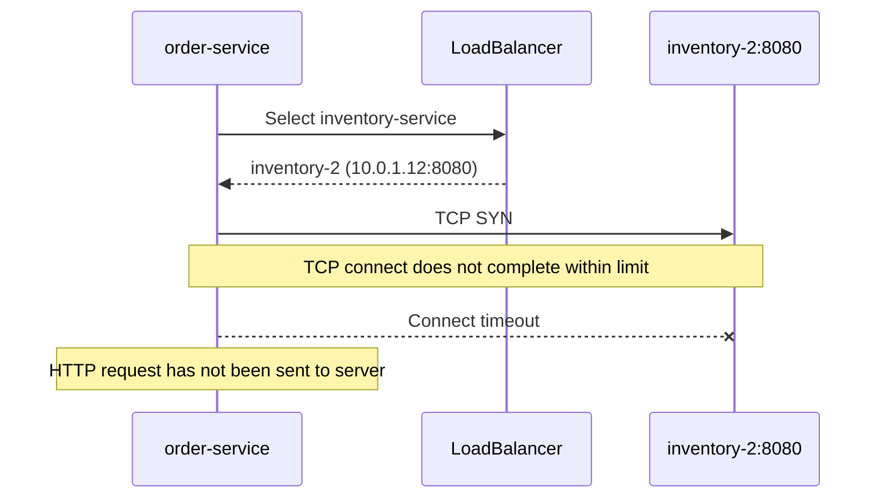
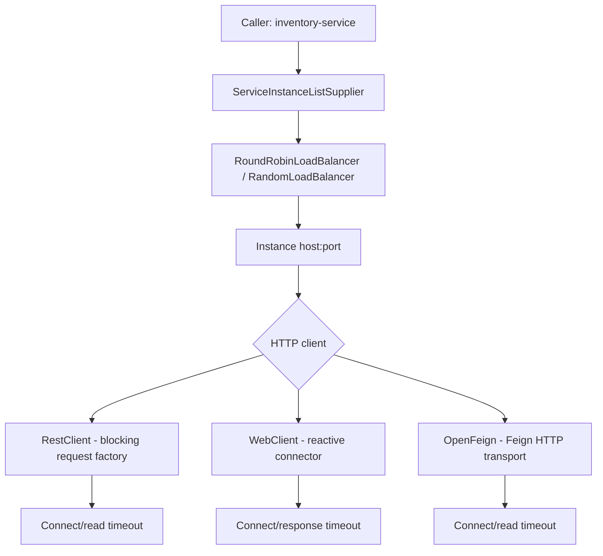
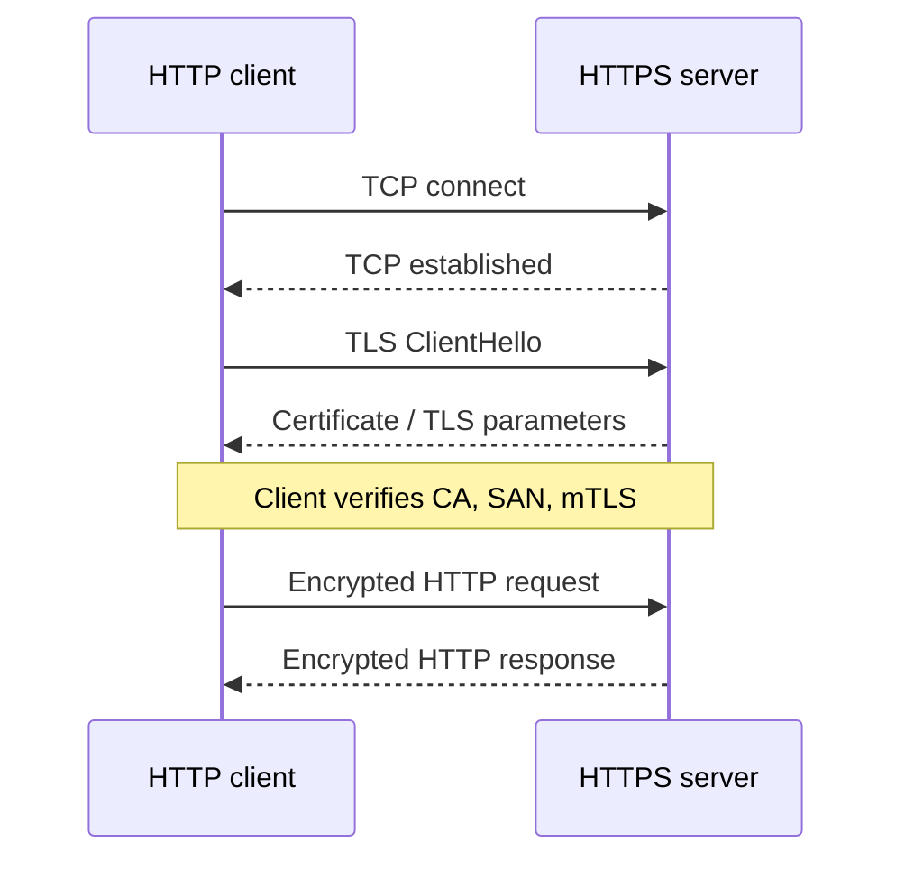
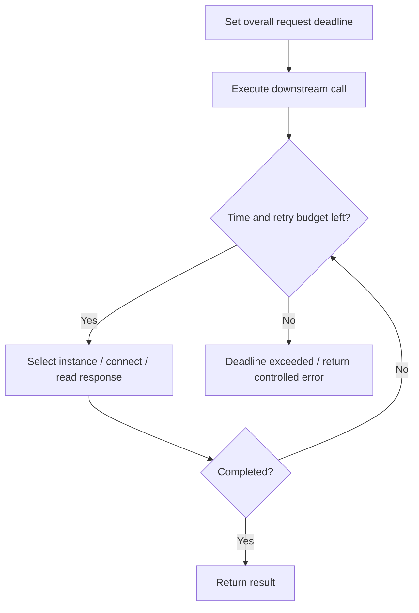

# Connect Timeout, Read Timeout, and Response Timeout

An HTTP call between microservices can fail even when `Spring Cloud LoadBalancer` has selected the right `ServiceInstance`. For example, `order-service` calls `inventory-service` to check stock: the TCP connection to the instance is blocked and cannot be established; or TCP connects successfully, but the backend takes too long to process the query; or the server begins returning data and then stops sending partway through. These three situations are often grouped together under “timeout,” yet they require different **time limits and diagnostic approaches**.

In the **Timeouts** chapter of the Spring Cloud LoadBalancer module, this lesson explains **connect timeout**, **read timeout**, and **response timeout** in detail, common points of confusion when integrating `RestClient`, `WebClient`, and `OpenFeign`, and principles for setting timeouts alongside discovery, health checks, connection pools, and retries. The goal is to deliberately bound service call durations without masking root causes or overloading the system with retries.

## 1. At Which Stage Do Timeouts Occur?

An HTTP call through LoadBalancer typically goes through the following steps:


Not every request executes every step. When an HTTP keep-alive connection is still valid, the HTTP client can **reuse the socket** and skip TCP connect and TLS handshake for that request. If the instance URI is an IP address, the DNS step for the instance host may not happen. If the request uses HTTP/2, multiple streams can share a single connection; in that case, pools and socket timeouts have additional specific characteristics.

| Stage | Related timeout / limit | Primary responsibility |
|---|---|---|
| Fetching instance list from discovery | Discovery provider wait time, supplier, or caller-side deadline. | Service discovery / Spring Cloud LoadBalancer. |
| Waiting for an available connection from the pool | Pool acquisition / connection request timeout. | HTTP transport and connection manager. |
| DNS resolution | DNS resolver timeout or system timeout; depends on HTTP client. | Resolver / HTTP transport / OS. |
| Establishing the TCP socket | **Connect timeout**. | HTTP transport. |
| TLS handshake | SSL/TLS handshake timeout or overall deadline; depends on transport. | TLS/HTTP transport. |
| Waiting for server to start returning HTTP response | Some forms of **response timeout**, read timeout, or response-header wait limit. | HTTP client/transport. |
| Waiting for next byte/chunk of response | **Read timeout**, response-inactivity timeout, or similar mechanism. | HTTP client/transport. |
| Entire logical operation | **Overall timeout / deadline**. | Business/orchestration layer or client if supported. |

**Key point:** connect, read, and response timeouts are not three interchangeable configuration variables. Each name also has **HTTP-library-dependent semantics**. You must read the documentation of the HTTP engine actually running, not just memorize property names.

## 2. Connect Timeout: Bounding TCP Connection Establishment

**Connect timeout** is the maximum time an HTTP client waits to **establish a new TCP connection** to the selected remote endpoint, according to the transport's mechanism. If the connection does not complete within the limit, the client reports an error; there is no HTTP response from the backend.

For example, LoadBalancer selects `10.0.1.12:8080`. A network policy or firewall drops TCP connection packets. The caller attempts to open a socket and hits the connect timeout before it can send `GET /api/products/P-1001`.



### Limitations of Connect Timeout

- **Typically does not cover DNS lookup**: DNS can take time before TCP connect even begins, depending on the HTTP client/resolver.
- **Does not necessarily cover TLS handshake**: TCP connect can succeed while certificate verification, mTLS, or TLS negotiation subsequently hangs or fails.
- **Does not apply when reusing a connection**: if a socket already exists in the pool, the request can proceed straight to sending HTTP.
- **Does not mean connection refused**: `Connection refused` usually occurs when the target actively rejects the connection and can fail immediately without waiting for the timeout to elapse.
- **May repeat across multiple IP addresses or attempts**, depending on DNS and HTTP client policy. Do not assume one logical request has at most a single connect-timeout interval.

When configuring, distinguish TCP connect failures caused by the network from “no instance found” errors from LoadBalancer. If `ServiceInstanceListSupplier` returns an empty list, there is **no remote endpoint to TCP-connect to yet**; changing connect timeout will not create additional instances.

## 3. Read Timeout: Waiting for Data on an Established Connection

In many synchronous HTTP clients using socket timeouts, **read timeout** (often equivalent to socket read timeout) limits how long a read operation **waits for data** from an established connection. If no new bytes satisfy the read operation within this interval, the client raises an error, such as `SocketTimeoutException: Read timed out`.

For example, TCP connect has completed and the request has been sent:

```text
t=0 ms      TCP connection ready
t=20 ms     Client sends GET /api/products/P-1001
t=20..5020  Backend sends no data for the read operation
t≈5020 ms   5-second read timeout; client stops waiting
```

A read timeout can occur in **two different situations**: no response header/first byte has arrived yet, or part of the response has arrived and the client is waiting for the next chunk. Exactly which interval is measured depends on the request factory/HTTP engine.

### Read Timeout Is Not Necessarily a Limit on the Entire Response

Suppose an HTTP server returns a body in chunks, one chunk every 4 seconds, while the read timeout is 5 seconds. If the transport resets the timer per read operation or per data-inactivity gap, the response can continue for minutes and **never violate the read timeout**. This is why you cannot claim “with `readTimeout=5000`, the entire HTTP request must finish within 5 seconds.”

For streaming, SSE, or large file transfers, add an **overall deadline** when business logic must finish within a fixed bound; conversely, for intentionally long-lived streams, an overall timeout may be inappropriate. Define the SLA for each request type before choosing.

## 4. Response Timeout: Similar Name, Not Always the Same Semantics

**Response timeout** may mean the wait for a response to appear or a limit on inactivity while receiving response data, depending on the library. It is not a universal HTTP parameter defined identically across all Java clients.

For example, in **Reactor Netty**, `HttpClient.responseTimeout(Duration)` sets the maximum time allowed **between network-level read operations while receiving a response**, per that version's API semantics. Therefore, think of it as closer to a **response read inactivity timeout** than an absolute deadline for the entire logical operation.

In some other HTTP engines or gateways, “response timeout” may mean waiting for **response headers**, **time to first byte (TTFB)**, or waiting for the entire request to finish. Never apply a single definition across all vendors.

| Concept | Start / end points to clarify | Common misconception |
|---|---|---|
| Connect timeout | Time trying to establish a new TCP connection. | “TCP connect timeout also protects TLS handshake and all response reads.” |
| Read timeout | Data wait time for a read/socket operation, implementation-dependent. | “Read timeout is the total time the API is allowed to process.” |
| Response timeout | May be response wait or response read interval depending on specific API. | “In RestClient, WebClient, and Feign, response timeout is always the same property.” |
| Overall deadline | From start of logical operation until completion/cancellation, potentially including retries. | “Setting only response timeout gives you an end-to-end deadline.” |

### Two Milestones to Distinguish

**Time to first byte (TTFB)**: from a request-send milestone until receiving the first byte of the response, depending on how the metric is defined; reflects mostly server processing time to begin responding plus network cost.

**Total response reception time**: from the request or start of reading until the entire body is consumed and processing completes. For large bodies or streaming, this duration can be very long even when TTFB is small.

To measure the SLA of a business call, you generally need to observe TTFB, total duration, and connection phases—not just a single timeout setting.

## 5. Timing Examples for Three Failure Types

Suppose a client has a 2-second connect timeout, a 5-second read/response inactivity timeout, and an 8-second overall business deadline.

| Scenario | What happens | Limit that may trigger |
|---|---|---|
| Backend TCP packets dropped by firewall | Cannot establish TCP within 2 seconds. | **Connect timeout**. |
| TCP succeeds; backend returns no response bytes for 5 seconds. | Client waits to read response. | **Read / response timeout**, depending on transport. |
| Backend returns a chunk every 4 seconds for 30 seconds. | No data gap exceeds 5 seconds. | Read/response inactivity may not trigger, but the **8-second overall deadline** can trigger. |
| Pool saturated; waits 3 seconds to acquire before connecting. | 2-second connect and 5-second read do not separately cover pool wait. | **Pool acquire timeout** or **overall deadline** if configured. |
| TCP finishes; TLS handshake hangs too long. | Network socket is open, but HTTP has not been sent. | TLS handshake timeout or overall deadline, depending on client. |

These numbers are illustrative only; durations do not always add linearly across every runtime. With DNS, connection reuse, proxies, or retries, the actual path can differ and some timeouts may not even be exercised.

## 6. Connecting with Spring Cloud LoadBalancer

Spring Cloud LoadBalancer is responsible for **finding and selecting a ServiceInstance**, such as from `SimpleDiscoveryClient`, Eureka, or Consul; it does not replace socket timeout configuration on the underlying HTTP engine.



Frequently misunderstood situations:

- **No instances available**: LoadBalancer cannot pick a target; do not diagnose this by increasing read timeout.
- **Instance cached but already dead**: LoadBalancer may still pick the stale instance, causing connect timeout/refused; check discovery freshness, health checks, and draining.
- **Instance selected but backend is slow**: connect already succeeded, so response/read timeout may occur. Inspect the backend, database, and how long requests hold connections.
- **LoadBalancer waits too long on discovery**: HTTP transport connect/read timeouts do not necessarily bound the instance discovery stage.

If the client retries, a single logical request may select multiple instances or pick the same instance again depending on policy. Never treat one attempt's connect timeout as the deadline for the **entire** call.

## 7. RestClient: Configuring Connect and Read Timeouts on the Request Factory

`RestClient` is the synchronous HTTP client introduced in Spring Framework 6.1 (typically alongside Spring Boot 3.2+). It uses a `ClientHttpRequestFactory`; how timeouts are configured depends on the actual factory, such as `SimpleClientHttpRequestFactory`, the JDK HTTP client, or Apache HttpComponents.

An illustrative example using `SimpleClientHttpRequestFactory`, suitable for a synchronous lab on Spring Framework versions supporting these setters:

```java
import org.springframework.cloud.client.loadbalancer.LoadBalanced;
import org.springframework.context.annotation.Bean;
import org.springframework.context.annotation.Configuration;
import org.springframework.http.client.SimpleClientHttpRequestFactory;
import org.springframework.web.client.RestClient;

@Configuration(proxyBeanMethods = false)
class InventoryRestClientConfig {

    @Bean
    @LoadBalanced
    RestClient.Builder loadBalancedRestClientBuilder() {
        SimpleClientHttpRequestFactory factory =
                new SimpleClientHttpRequestFactory();
        factory.setConnectTimeout(2_000); // millis
        factory.setReadTimeout(5_000);    // millis

        return RestClient.builder().requestFactory(factory);
    }
}
```

Then inject the right bean:

```java
import org.springframework.cloud.client.loadbalancer.LoadBalanced;
import org.springframework.stereotype.Service;
import org.springframework.web.client.RestClient;

@Service
class InventoryRestGateway {

    private final RestClient client;

    InventoryRestGateway(@LoadBalanced RestClient.Builder builder) {
        this.client = builder.baseUrl("http://inventory-service").build();
    }

    ProductView getProduct(String id) {
        return client.get()
                .uri("/api/products/{id}", id)
                .retrieve()
                .body(ProductView.class);
    }
}
```

`ProductView` is an application-defined DTO. The two timeouts above are limits **applied by this request factory**, not universal properties of every `RestClient`. With Apache HttpClient or the JDK request factory, use the corresponding API/timeouts of that factory.

**Note on Spring Boot customization:** Calling `RestClient.builder()` yourself may miss HTTP client customizers, observation, SSL, or codecs that Spring Boot attaches to a Boot-managed builder. In real projects, use the Boot-version-appropriate configurer/customizer to preserve both HTTP transport settings and `@LoadBalanced`; verify the bean actually injected, not just the configuration written.

### What If RestClient Uses a Connection Pool?

`SimpleClientHttpRequestFactory` is backed by JDK `HttpURLConnection`, which lacks a per-route pool API equivalent to Apache HC5. If a project switches to `HttpComponentsClientHttpRequestFactory` or another pooled transport, there is also a timeout for **waiting to lease a connection from the pool**. In many HTTP engines, a connect timeout **does not** limit pool-wait time; configure the connection request timeout separately.

## 8. WebClient + Reactor Netty: Connect and Response Timeouts

`WebClient` uses a `ClientHttpConnector`. With Reactor Netty, you can configure `HttpClient` before attaching it to a builder marked `@LoadBalanced` by Spring Cloud:

```java
import java.time.Duration;
import io.netty.channel.ChannelOption;
import org.springframework.cloud.client.loadbalancer.LoadBalanced;
import org.springframework.context.annotation.Bean;
import org.springframework.context.annotation.Configuration;
import org.springframework.http.client.reactive.ReactorClientHttpConnector;
import org.springframework.web.reactive.function.client.WebClient;
import reactor.netty.http.client.HttpClient;

@Configuration(proxyBeanMethods = false)
class InventoryWebClientConfig {

    @Bean
    @LoadBalanced
    WebClient.Builder inventoryLoadBalancedBuilder() {
        HttpClient http = HttpClient.create()
                .option(ChannelOption.CONNECT_TIMEOUT_MILLIS, 2_000)
                .responseTimeout(Duration.ofSeconds(5));

        return WebClient.builder()
                .clientConnector(new ReactorClientHttpConnector(http));
    }
}
```

Using the builder from the Spring context:

```java
import org.springframework.cloud.client.loadbalancer.LoadBalanced;
import org.springframework.stereotype.Service;
import org.springframework.web.reactive.function.client.WebClient;
import reactor.core.publisher.Mono;

@Service
class InventoryWebGateway {

    private final WebClient client;

    InventoryWebGateway(@LoadBalanced WebClient.Builder builder) {
        this.client = builder.baseUrl("http://inventory-service").build();
    }

    Mono<ProductView> getProduct(String id) {
        return client.get()
                .uri("/api/products/{id}", id)
                .retrieve()
                .bodyToMono(ProductView.class);
    }
}
```

Here:

- `CONNECT_TIMEOUT_MILLIS` bounds establishing a new TCP connection per Reactor Netty/Netty.
- `responseTimeout(Duration.ofSeconds(5))` is Reactor Netty's response timeout mechanism, **not inherently the total logical duration** from calling `getProduct()` until all data is decoded.
- `Mono<ProductView>` is an asynchronous publisher; the actual request happens on subscription.
- If the application uses `JdkClientHttpConnector`, `JettyClientHttpConnector`, or `HttpComponentsClientHttpConnector`, the Reactor Netty settings above **do not apply**.

Do not equate `WebClient responseTimeout` with `OpenFeign readTimeout` without specifying the engine, as the interval measured can differ. Likewise, adding the Reactor Netty dependency does not guarantee a builder uses this connector if another custom client connector is already configured.

### Setting an Overall Deadline on a Mono

When a business API must complete within a fixed bound, you can apply Reactor's `timeout` on the outside of the pipeline:

```java
Mono<ProductView> result = client.get()
        .uri("/api/products/{id}", id)
        .retrieve()
        .bodyToMono(ProductView.class)
        .timeout(Duration.ofSeconds(8));
```

This limit applies once the publisher is subscribed; it can cancel the subscription upon timeout. However, cancelling the client-side subscription **does not guarantee the backend has stopped or rolled back its work**. When retries are present, place the overall deadline **outside** the retry operator when you want to bound all attempts, rather than letting each attempt get a fresh full budget.

## 9. OpenFeign: Per-Feign-Client connectTimeout and readTimeout

With synchronous Spring Cloud OpenFeign, two commonly used properties are configured per service ID/client name:

```yaml
spring:
  cloud:
    openfeign:
      client:
        config:
          inventory-service:
            connectTimeout: 2000
            readTimeout: 5000
```

In Spring Cloud OpenFeign release trains using this configuration format, these example values are in **milliseconds**. `connectTimeout` relates to TCP connection; `readTimeout` bounds waiting to receive response data according to the actual HTTP client's behavior. When using `Apache HttpClient 5` or `OkHttp` as the Feign transport, verify that the timeouts are applied to the delegate client as expected.

A Feign interface:

```java
import org.springframework.cloud.openfeign.FeignClient;
import org.springframework.web.bind.annotation.GetMapping;
import org.springframework.web.bind.annotation.PathVariable;

@FeignClient(name = "inventory-service")
public interface InventoryFeignClient {
    @GetMapping("/api/products/{id}")
    ProductView getProduct(@PathVariable("id") String productId);
}
```

If you set a fixed `url` on `@FeignClient` or configure a static client URL, service-ID resolution may no longer participate as it does when using only `name`. Timeout settings can still take effect, but they are **no longer evidence** that Spring Cloud LoadBalancer is selecting instances.

### Why Is Feign Read Timeout Not a Total SLA?

Suppose the backend accepts a request and waits 4 seconds on the database before returning data. `readTimeout: 5000` can let this request succeed if no other limit intervenes. Yet if the client waited 3 seconds on the pool beforehand or retried multiple times, total duration can still far exceed 5 seconds. Moreover, chunked responses can cause read timeout to behave as an inter-read gap depending on the HTTP transport.

OpenFeign does not define a generic “response timeout” with the same semantics as Reactor Netty's `responseTimeout`. If you need an overall SLA, implement an **orchestration-layer deadline or a transport-supported overall-call timeout**, then verify cancellation and retry behavior.

## 10. Waiting for a Connection from the Pool Is Not Connect Timeout

When an HTTP engine has a connection pool, a client may have to wait for an idle connection before opening a new TCP connection or reusing a socket. In Reactor Netty, this step is controlled by `ConnectionProvider` parameters, not `ChannelOption.CONNECT_TIMEOUT_MILLIS`:

```java
import java.time.Duration;
import reactor.netty.resources.ConnectionProvider;

ConnectionProvider provider = ConnectionProvider
        .builder("inventory-pool")
        .maxConnections(40)
        .pendingAcquireMaxCount(80)
        .pendingAcquireTimeout(Duration.ofMillis(600))
        .build();
```

Attach this provider to `HttpClient.create(provider)`, then configure WebClient's connector. When 40 connections are busy for a remote pool and no more can be allocated, new requests must wait to acquire. If waiting exceeds 600 ms or the pending queue fills up, the request fails **before actually sending HTTP**, even though `connectTimeout=2000 ms` was never breached.

The numbers above are illustrative: Reactor Netty's `maxConnections` typically applies per remote pool and `pendingAcquireMaxCount` caps waiting requests. Do not assume 40 is an application-wide maximum when there are multiple instances or connection providers.

With **Apache HttpClient 5** used by OpenFeign or RestClient, the connection manager can provide max-total, max-per-route, and connection-request timeout limits. A single route's behavior can be constrained independently even when the manager's global total has not reached max.

| Symptom | Timeout to check first |
|---|---|
| `PoolAcquireTimeoutException` / pending acquisition error in WebClient | `pendingAcquireTimeout` and `ConnectionProvider` capacity. |
| Apache HC5 reports failing to lease a connection from manager in time | HC5 connection request / pool lease timeout. |
| Pool grants a connection, but remote cannot complete TCP handshake | Connect timeout. |
| Pool returns an old socket, but server already closed idle connection | Keep-alive/idle eviction, stale connection, and I/O error—not just connect timeout. |
| TCP connects, response starts very late | Read/response timeout and backend bottleneck. |

**Increasing connect timeout does not fix pool starvation.** If a slow backend keeps all connections busy, raising pool size indefinitely can overload the server further. Measure active/idle/pending pool counts, bound concurrency, and identify why connections are held so long.

## 11. DNS and TLS Have Their Own Timeouts

### DNS Lookup

When an HTTP client must resolve a hostname, DNS can occur before TCP connect. Many clients have their own DNS resolver or rely on the OS, and connect timeout is not guaranteed to bound this stage completely. Even when `inventory-service` is a logical service ID and LoadBalancer returns a hostname such as `inventory-2.internal`, an additional DNS lookup may still be required to find the actual IP.

If logs show significant time elapsed even before TCP connect starts, check DNS resolution, search domains, DNS cache/TTL, records, DNS network reachability, and the HTTP engine's resolver mechanism. Do not just raise `connectTimeout` and assume it is fixed.

### TLS Handshake

After TCP connect to an HTTPS endpoint, the HTTP transport must also negotiate TLS, verify the certificate chain, check hostname/SAN, check certificate validity, and possibly send a client certificate for mTLS.



When TLS fails to complete, the error is typically `SSLHandshakeException`, a certificate verification error, or a handshake timeout, **with no HTTP response to read**. A 2-second connect timeout does not mean the TLS handshake necessarily gets 0 extra seconds or fits inside those 2 seconds.

Configure a handshake timeout via the transport's API if supported, alongside an overall deadline for the logical operation when needed. Never disable hostname/certificate verification to work around timeouts or misconfigured TLS.

## 12. Response Headers, Body, and Streaming Cases

A server can send a response in several ways:

1. Receive the request and compute for 6 seconds before sending headers.
2. Send headers after 50 ms, then spend 6 seconds generating the JSON body.
3. Send part of the body, pause for 10 seconds, then resume sending.
4. Keep an SSE/stream open for hours, emitting an event every few seconds.

Although callers perceive all of these as “waiting for a response,” they are not the same.

| Response pattern | Metric to observe | Timeout to choose |
|---|---|---|
| First header/byte arrives very slowly | Time to first byte or response-header latency. | Response-header/read timeout or transport overall deadline. |
| Large body, received steadily but takes long | Total duration, body size, throughput. | Overall deadline if business operation must finish; read inactivity when data stops. |
| Body stalls mid-transmission | Time between reads, socket inactivity. | Read timeout or Reactor Netty response timeout. |
| Intentionally long-lived SSE/stream | Event gap, stream uptime, cancel/error rate. | Per-event idle timeout and heartbeat mechanism; avoid arbitrary short full-stream deadlines. |

With `WebClient`, `bodyToMono(...)` typically consumes a finite body and emits a result; `bodyToFlux(...)` can represent multiple parts or a long-lived stream. If the response uses `Transfer-Encoding: chunked` or HTTP/2 streaming, do not assume read timeout caps total seconds since the request started.

### An Example Event Timeline

```text
0s       TCP/HTTP request ready
1s       Response headers received
4s       Chunk 1 received
8s       Chunk 2 received
12s      Chunk 3 received
16s      Response complete
```

If the read inactivity timeout is 5 seconds and every gap without data is under 5 seconds, **no read timeout may fire even though the whole request takes 16 seconds**. Conversely, if the server pauses for 7 seconds between chunk 1 and chunk 2, a timeout can occur during body reading. Exact milestones depend on how the HTTP transport receives bytes and applies timeouts.

## 13. Overall Deadline: Protecting Total Business Duration

A service often needs to answer its caller before a deadline. For instance, a quote-generation API has a 1.5-second budget and internally calls two downstream services. If each downstream call is allowed 2 seconds connect + 5 seconds read plus multiple retries, the API's overall budget becomes meaningless.

An **overall deadline** is the final cutoff for the entire logical operation, including instance selection, pool queuing, connect, reading the response, and retry attempts. Remaining budget must be partitioned/coordinated across downstream calls.



Distinguish:

- **Per-attempt timeout:** bounds a single connection or response wait.
- **Per-hop budget:** bounds a single downstream call, including retries on that hop.
- **End-to-end deadline:** bounds the entire business call across multiple services.

With Reactor, a `Mono.timeout(...)` **outside the retry operator** can bound the wait time of the entire pipeline. If placed **before** `retryWhen(...)`, each subscription can receive a fresh timeout interval. Verify operator ordering and ensure effective request cancellation.

Example **without retry**:

```java
Mono<ProductView> product = webClient.get()
        .uri("/api/products/{id}", id)
        .retrieve()
        .bodyToMono(ProductView.class)
        .timeout(Duration.ofMillis(1500));
```

A publisher timeout cannot guarantee the backend rolls back work already running. For write workflows, design idempotency, transaction boundaries, and handling for uncertain outcomes.

## 14. Retries Can Prolong Timeouts and Amplify Load

Suppose a Feign client has `connectTimeout=2000` and `readTimeout=5000`. If the system allows up to three attempts (initial plus two retries), theoretical total duration can far exceed 7 seconds because:

- Each attempt can incur pool wait, DNS, TCP connect, TLS, and response reading again.
- There is backoff between retry attempts.
- LoadBalancer may select a different instance or the same instance depending on policy.
- If the response is read in chunks, read timeout does not necessarily cap the entire body.

Therefore, **never multiply retry count by a single timeout and treat that as a guaranteed SLA**. Define an overall deadline, attempt budget, backoff, and inspect actual timing per phase.

### Two Types of Retries to Identify

1. **HTTP client/Feign/Reactor pipeline retry:** may retry the request against the same or a different URL/instance depending on configuration.
2. **Spring Cloud LoadBalancer retry:** if enabled with supporting dependencies/policies, can combine instance selection for the next attempt.

Spring Cloud OpenFeign in many versions defaults to `Retryer.NEVER_RETRY`, differing from some Feign core defaults; WebClient does not retry all errors by default; RestClient does not automatically know which business calls are safe to retry. Never assume retries are active just because a project uses LoadBalancer.

**Write operations require the utmost caution.** The backend may have already persisted data while the caller hit a read timeout right before receiving the response. Retrying a `POST` without an idempotency key or deduplication can duplicate side effects. A read timeout error does not prove the request was never executed.

### Retry Storms and Pool Saturation

When many requests simultaneously suffer read timeouts due to backend saturation, immediate retries can:

- Increase request volume to the backend at its weakest moment.
- Occupy more connections and grow the pending acquisition queue.
- Trigger even more connect/response timeouts.
- Worsen p95/p99 latency and cascading failures.

Restrict retries to transient errors, apply backoff/jitter where needed, enforce concurrency/bulkhead limits, and tie every attempt to the overall deadline.

## 15. Timeouts Can Be Misinterpreted as HTTP Status Codes

A timeout in an HTTP client **does not necessarily produce an HTTP response**. When unable to connect or read a response, the client typically throws a corresponding exception. Conversely, a proxy or gateway may actively return an HTTP status when it times out waiting on upstream.

| Symptom | Possible origin | Is there an HTTP response? |
|---|---|---|
| `ConnectTimeoutException` or `SocketTimeoutException: connect timed out` | HTTP transport waited too long for TCP connect. | Usually **no** response from upstream. |
| `SocketTimeoutException: Read timed out` | HTTP transport waited for readable data. | May have no response or a partial response; unlikely to have a complete body. |
| Reactor Netty `ReadTimeoutException` / response timeout | Response-reading layer timed out per configuration. | Usually terminates publisher with error, without a complete response. |
| Pool acquisition timeout | Waited too long for a connection from manager. | Request usually was never sent to backend. |
| HTTP `408 Request Timeout` | Server/proxy returned a timeout status on the receiving side. | **Yes**, HTTP status 408. |
| HTTP `504 Gateway Timeout` | Gateway/proxy timed out waiting on upstream. | **Yes**, HTTP response generated by gateway/proxy. |
| HTTP `503 Service Unavailable` | Could be from gateway/backend or LoadBalancer finding no instance, depending on integration. | May have an HTTP response; not synonymous with connect/read timeout. |

Do not blindly map every caller timeout to `504`: in many cases the caller receives an exception and the application must decide how to map the error in its own API. Likewise, do not assume every `504` came from a Java client read timeout; it may originate from an ingress or API gateway with its own limits.

## 16. Setting Timeouts by Call Type

| Call type | Characteristics | Timeout guideline |
|---|---|---|
| `GET` reading fast cache/metadata | Small response, tight SLA. | Reasonably short connect, read/response tuned to p99, clear overall deadline. |
| `GET` complex database query | Longer server-side processing. | Read timeout matching valid budget; track query p95/p99. |
| `POST` creating orders/payments | Has side effects; late response may accompany successful commit. | Tie timeout to idempotency and status reconciliation; never retry blindly. |
| Large file upload/download | Long body transfer, variable throughput. | Read inactivity plus overall budget sized for file; consider streaming. |
| Long-lived SSE/stream | Response intentionally does not finish early. | Appropriate idle heartbeat/stream lifecycle; avoid arbitrary short full-stream deadlines. |
| Health check | Short, simple response. | Verifiably short timeout that avoids false negatives during brief network slowdowns. |

Setting timeouts too low creates false errors during peak hours; setting them too high holds connections/threads/pools longer and reduces capacity. Start from **SLOs**, p95/p99 metrics, network topology, backoff/retry settings, and caller/backend resources.

A useful mental model:

```text
Single-call budget <= remaining deadline of parent request
Retry + backoff + attempts budget <= call deadline
Timeout thresholds must consider tail latency, not just average latency
```

Do not infer that connect timeout + read timeout always equals total request time; multiple phases and attempts may repeat or be skipped.

## 17. Observing Timeouts at the Right Layer

For diagnostics, record **which stage the request reached**:

| Signal / metric | Used to distinguish |
|---|---|
| Service ID, selected instance, attempt | Which target LoadBalancer chose; which attempt failed. |
| Discovery lookup duration, supplier result count | Was time lost before obtaining a target? |
| Connection pool active/idle/pending and acquire latency | Did the request wait on the pool before connecting? |
| DNS lookup/connect/TLS handshake duration if transport exposes it | Is there network congestion or TLS misconfiguration? |
| TTFB / response headers time | Was the backend slow to start responding? |
| Total response body duration and bytes | Was it slow due to large body, streaming, or backend stalling? |
| Connect timeout, read timeout, response timeout counts | Which error type is rising and how is it distributed across instances? |
| Overall deadline exceeded / cancellation | How many requests exceeded the overall budget? |
| Retry attempts, backoff, success after retry | Are retries rescuing transient errors or amplifying load? |
| HTTP status from backend/proxy | Was it a valid HTTP status rather than a client-side exception? |

Spring Boot Actuator, Micrometer, Reactor Netty metrics, Feign Micrometer, and tracing can provide much of this information depending on starters and versions. **Do not assume** all listed metrics appear just by adding Actuator: verify the HTTP engine and instrumentation setup.

Example of a useful log/tracing record:

```text
serviceId=inventory-service
instanceId=inventory-2
attempt=1
phase=READ_RESPONSE
durationMs=5012
outcome=READ_TIMEOUT
traceId=73b2
```

This is an illustrative format, not LoadBalancer's default log output. Do not log tokens, cookies, private keys, or sensitive request bodies; avoid attaching dynamic product IDs/URLs as unbounded-cardinality metric labels.

### Measuring on Both Caller and Server

If the caller logs a read timeout while the server never sees the request ID, the failure may have happened before the backend received the request, or server logging may be incomplete. If the server shows the request already completed before the caller timed out, inspect the network, proxies, body transfer, and client processing. If the server finishes **after** the caller cancels, decide how to handle abandoned work or committed business results.

Looking only at caller-side timeout logs is rarely enough to conclude the backend “didn't run.”

## 18. Hands-On Lab: Reproducing Each Timeout Type

Prepare `order-service` as the caller and two `inventory-service` instances at `localhost:8081` and `localhost:8082`. You can use `SimpleDiscoveryClient`:

```yaml
spring:
  cloud:
    discovery:
      client:
        simple:
          instances:
            inventory-service:
              - uri: http://localhost:8081
              - uri: http://localhost:8082
```

For a WebFlux test backend, you can create a slow-responding endpoint **without blocking the event loop**:

```java
import java.time.Duration;
import org.springframework.web.bind.annotation.GetMapping;
import org.springframework.web.bind.annotation.RestController;
import reactor.core.publisher.Mono;

@RestController
class TimeoutLabController {

    @GetMapping("/lab/slow-response")
    Mono<String> slowResponse() {
        return Mono.just("ready")
                .delayElement(Duration.ofSeconds(7));
    }
}
```

With a caller configured with a 5-second response/read timeout, an endpoint returning after about 7 seconds is a useful way to test **waiting too long for a response**. Exact results depend on the HTTP client, timeout configuration, and when the read operation begins.

### Scenario A — Baseline

1. Create a fast endpoint `/lab/fast` and call it successfully via service ID.
2. Record the selected instance, HTTP status, latency, and retry count (if any).
3. Verify the request went through LoadBalancer, not accidental DNS resolution to a host with the same name.

### Scenario B — Read/Response Timeout

1. Set connect timeout to 2 seconds and read/response timeout to 5 seconds.
2. Call `/lab/slow-response` where the server intentionally waits 7 seconds before sending the body.
3. Observe exception/timing; verify TCP connected and the request reached the server.
4. Increase the read/response limit to 9 seconds **only in the lab**, call again, and see whether the response succeeds.

### Scenario C — Connect Timeout

1. In the lab environment, use a network-fault simulation tool such as a test proxy or an authorized firewall rule to create a situation where **TCP connect does not complete**.
2. Set a finite connect timeout and observe the error occurring **before any HTTP request is sent**.
3. Compare against a port with no listening process: that case may return `Connection refused` immediately rather than a connect timeout.
4. Restore network/proxy rules after the test and verify the backend works normally.

**Never use a random Internet IP or modify production firewalls to trigger a connect timeout.** Real networks may immediately return unreachable/refused errors with unexpected timing.

### Scenario D — Pool Acquisition Timeout

1. Use Reactor Netty or HC5 with a small pool/route limit and a short pending acquire timeout in the lab.
2. Generate multiple concurrent requests to the slow endpoint.
3. Observe active/pending connection counts and pool-acquisition wait errors.
4. Verify the failure occurs **before a new TCP connect**, distinguishing it from `CONNECT_TIMEOUT_MILLIS`.

### Scenario E — Streaming with Pauses

Create a stream emitting multiple chunks at varying intervals, such as 4 seconds and 7 seconds. With a 5-second read inactivity timeout, test which case fails and which continues. Do not use a small single-shot response body to infer how read timeout behaves for streaming.

### Scenario F — Retry and Overall Deadline

1. Configure up to one or two retries for an **idempotent GET** request under appropriate conditions.
2. Record attempt count, per-attempt timeout, and total latency.
3. Set an overall deadline shorter than the combined timeout across multiple attempts.
4. Verify the logical operation stops at the deadline rather than waiting through unbounded retries.

Record results in a table:

| Scenario | Transport | Relevant timeout | Actual error / result | Reached server? | Total time |
|---|---|---|---|---|---|
| Baseline | Specify | Record config | Measure actual | Verify | Measure actual |
| Connect | Specify | Connect | Measure actual | Verify | Measure actual |
| Read/response | Specify | Read/response | Measure actual | Verify | Measure actual |
| Pool | Specify | Acquire | Measure actual | Verify | Measure actual |
| Retry/deadline | Specify | Attempt + overall | Measure actual | Verify | Measure actual |

Do not fill in fabricated measurements; record Framework/Boot/Cloud versions, HTTP engine, instance count, caller count, and test load for valid comparison.

## 19. Quick Diagnostic Table

| Symptom | Priority hypothesis | Check action |
|---|---|---|
| `UnknownHostException: inventory-service` | Client is not using a load-balanced builder/wrapper or DNS does not resolve service ID. | Inspect `@LoadBalanced`, `@FeignClient` URL, and discovery. |
| `503` due to no instances | Empty supplier or health checks filtered all instances out. | Inspect `ServiceInstance` list; TCP timeouts will not help. |
| Connection refused immediately | Backend not listening on host/port or actively rejecting connections. | Check remote URI/port and server status. |
| `ConnectTimeoutException` | New TCP connect did not complete in time; network or backend unreachable. | Check DNS, network policy, firewall, target IP, and connect time. |
| SSL handshake error or hang | TLS trust/certificate/mTLS/handshake issue distinct from TCP connect. | Check CA/SAN, client cert, and TLS handshake timeout. |
| Pool acquire timeout | Per-route/total pool saturated; requests waiting for connections. | Monitor active/idle/pending, backend latency, and concurrency. |
| Read timeout before headers arrive | Backend/proxy failed to start responding promptly or network lost bytes. | Compare TTFB, server request logs, transport timeouts. |
| Read timeout partway through | Stream stopped sending data or proxy/server cut transfer. | Inspect body chunks, keep-alive, network resets, and read inactivity. |
| HTTP `504` | Gateway/proxy timed out waiting on upstream. | Check gateway and upstream timeouts, not just the Java client. |
| Retries make response much slower | Each attempt gets a fresh timeout plus backoff. | Enforce overall deadline and limit attempts. |
| Write request timed out but data was saved | Server committed before response returned. | Verify transaction/idempotency; never retry blindly. |
| Timeouts seen despite low backend CPU | Bottleneck may be pool, DNS, TLS, database, proxy, or event loop. | Measure per-phase timing before adding CPU or raising timeouts. |

## 20. Common Misconceptions

- **“Connect timeout is the maximum time for the entire request to complete.”** False: it bounds establishing a new TCP connection according to the transport.
- **“Read timeout = time to download the entire body.”** False in many implementations: it can be a limit on **not receiving data** between reads.
- **“WebClient responseTimeout is identical to Feign readTimeout.”** You cannot assume this; consider the HTTP engine and corresponding API.
- **“With a 5-second timeout, three retries still take at most 5 seconds.”** False if the timeout is per attempt without an overall deadline.
- **“Increasing timeouts always makes the system more stable.”** Not necessarily: holding connections/threads longer can prolong overload.
- **“A TCP connect timeout means the backend received the request and didn't respond.”** False: connection failures typically occur **before the HTTP request is sent**.
- **“HTTP 504 is always returned by Spring Cloud LoadBalancer.”** False: 504 usually comes from a gateway/proxy; trace the source of the status.
- **“A POST read timeout proves the write didn't happen.”** False: the backend may have committed before the caller timed out.
- **“Enabling health checks or retries automatically fixes timeouts.”** No: health checks can filter failed targets and retries can recover transient faults, but neither replaces proper timeouts and deadlines.

## 21. Safe Timeout Configuration Checklist

- [ ] Distinguish discovery, pool acquire, DNS, TCP connect, TLS handshake, response headers, body read, and overall deadline.
- [ ] Identify the **actual** HTTP engine in use for RestClient, WebClient, or OpenFeign.
- [ ] Understand that `connectTimeout` does not necessarily bound DNS/TLS/pool acquisition.
- [ ] Understand that `readTimeout` usually relates to waiting for data, not inherently total body duration.
- [ ] Verify the exact semantics of `responseTimeout` for your chosen HTTP engine.
- [ ] Do not assume identical seconds behave the same when migrating from RestClient to WebClient/Feign.
- [ ] Configure a pool acquisition timeout if the HTTP engine uses a connection pool.
- [ ] Establish an overall deadline from business SLAs; allocate budget across downstream calls and retries.
- [ ] Distinguish client-side exceptions from HTTP status codes returned by backends/proxies.
- [ ] Observe selected instance, attempt, connect/read/response failures, and per-phase latency.
- [ ] Check health/discovery/caching if many requests select dead or draining instances.
- [ ] Avoid blindly raising timeouts or pool sizes when the backend is saturated.
- [ ] Retry only in a controlled manner; protect idempotency for writes with side effects.
- [ ] Test connect, read/response, pool acquire, streaming, and overall deadline failures in the lab.
- [ ] Preserve TLS security requirements; never use trust-all or disable hostname verification to “fix” timeouts.

**Conclusion:** **Connect timeout** controls establishing a TCP connection, **read timeout** usually controls waiting to receive data on a connection, and **response timeout** must be interpreted per specific HTTP transport—in Reactor Netty, it relates to the response-data reading interval. None of these limits alone guarantees completion time for the entire business operation. When Spring Cloud LoadBalancer selects a `ServiceInstance`, coordinate HTTP client timeouts, connection pools, discovery, retries, and an **overall deadline** so inter-service calls have both clear bounds and accurate failure diagnostics.
