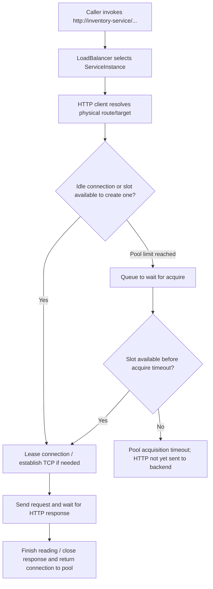
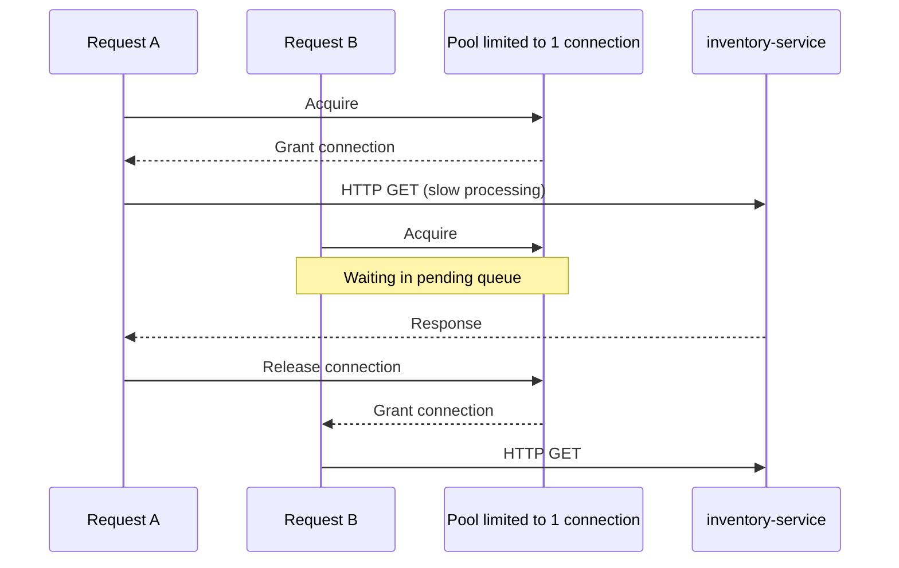

# Connection Pool Acquisition Timeout

## Objectives

A request from `order-service` to `inventory-service` can slow down or fail **before even starting to establish a TCP connection**. The cause is not necessarily a slow server, a network failure, or Spring Cloud LoadBalancer picking the wrong `ServiceInstance`. If the HTTP client uses a **connection pool** and the pool has no connections left to allocate, the request must queue and wait to *lease/acquire* a connection. Once the allowed wait expires, the request fails right on the caller side.

That wait limit is commonly called **connection request timeout**, **connection acquisition timeout**, **pool acquisition timeout**, or **pending acquire timeout**, depending on the HTTP client.

After this lesson, you will be able to:

- Distinguish **waiting for a connection from the pool** from **connect timeout**, **read/response timeout**, and **overall deadline**.
- Understand `max connections`, `max connections per route`, pending queues, and connection reuse mechanisms.
- Configure pool-acquire timeouts with Apache HttpClient 5 for `RestClient` and `RestTemplate`.
- Configure Reactor Netty's `pendingAcquireTimeout` for `WebClient`.
- Use the exact Spring Cloud OpenFeign properties when Feign runs on Apache HttpClient 5.
- Diagnose pool saturation using metrics, timeout errors, active/idle/pending connection counts, and concurrent load tests.
- Set timeouts, pool sizes, and retries aligned with SLAs without overloading the system further.

## 1. Where Does the Connection Pool Sit in the LoadBalancer Call Path?

In client-side load balancing, `RestClient`, `RestTemplate`, `WebClient`, or OpenFeign can call a logical URL:

```text
http://inventory-service/api/items/SKU-42
```

Spring Cloud LoadBalancer uses `inventory-service` as the service ID, fetches the instance list from discovery, and selects a `ServiceInstance`, such as `10.20.1.12:8080`. **After the selection step**, the HTTP client handles acquiring or creating a connection for the chosen physical address.



**An HTTP connection pool is not LoadBalancer's `ServiceInstance` list.** They are two distinct structures:

| Component | Managed data | Problem solved |
|---|---|---|
| `ServiceInstanceListSupplier` | Instances: host, port, metadata, list state | Selecting **which backend** |
| LoadBalancer cache | Snapshot of instance list per service ID | Reducing discovery query overhead |
| HTTP connection pool | TCP/TLS connections or connection resources to route/remote address | Reusing connections and bounding concurrent connections |
| Pool acquisition timeout | Duration a request may wait for a connection resource | Bounding queuing time on the HTTP client side |

If you change `spring.cloud.loadbalancer.cache.ttl`, you are changing how the **instance list** is cached, not how long requests wait for an **HTTP connection**. If you change `spring.cloud.loadbalancer.retry.*`, you affect the retry policy rather than directly increasing the number of connections in the pool.

## 2. Four Timeouts That Must Not Be Conflated

| Timeout type | Where does it start? | What does expiration mean? | Example config names |
|---|---|---|---|
| **Pool acquire / connection request** | When HTTP client requests a connection resource from the pool | Failed to obtain a connection resource within wait limit | HC5 `connectionRequestTimeout`; Reactor Netty `pendingAcquireTimeout` |
| **Connect timeout** | When opening a new network connection to host/port | Failed to establish connection within limit | `connectTimeout`; `CONNECT_TIMEOUT_MILLIS` |
| **Read/response timeout** | During waiting/reading response per HTTP stack semantics | Backend failed to respond or continue sending data in time | `readTimeout`, `responseTimeout` |
| **Deadline / total call duration** | From start of an operation until completion or cancellation | Entire operation exceeded time budget | Application-layer deadline; Reactor `Mono.timeout(...)` |

Illustrative example:

```text
t=0 ms      Caller begins an HTTP operation
t=0–450     Waiting for a connection from the pool (pending acquire)
t=450–520   Establishing new TCP/TLS if no reusable connection exists
t=520–850   Backend processes and returns response
t=850       Finished reading; resource released back to pool
```

In this scenario, **the first 450 ms is not a connect timeout**: a `connect()` call to the backend may not have happened yet. Configuring `connectTimeout=1s` does not stop a request from waiting in the pool after 1 second. Configuring `readTimeout=3s` also does not necessarily bound pending acquire duration.

Note: each stack starts/initializes timers at different points, especially with HTTP/2, TLS handshakes, retries, or proxies. Therefore, do not assume summing phase timeouts always equals an overall deadline. If an SLA requires an operation to finish within 1,500 ms, design an **overall deadline** in addition to per-phase timeouts.

## 3. Why Do Requests Have to Wait for a Connection from the Pool?

A connection pool can enforce two key limits:

- **Total number of connections** the pool is allowed to maintain.
- **Number of connections for a single route/target**; with Apache HC5, a route comprises the HTTP target and potentially proxy/network path details.

Suppose an Apache pool enforces:

```text
maxTotal = 40 connections
defaultMaxPerRoute = 10 connections
```

When a caller issues 20 concurrent requests to **one route** and 10 connections are already busy serving requests, the remaining requests may have to wait for connections to return to the pool. The global limit of 40 is not full, yet the **per-route limit of 10** still builds a queue.

Situations that easily exhaust a pool:

1. Sudden concurrency spikes while total and per-route pool limits are too low.
2. Slow backend processing, causing each request to hold a connection longer.
3. Response bodies are not properly read, consumed, or closed; resources are not returned to the pool.
4. Excessive retries increasing the number of requests competing for connections.
5. Multiple callers sharing a single pool while one hot endpoint consumes most capacity.
6. The pool hits its global limit from connections to a proxy/other target, even though the failing request targets a separate service.
7. When instances are drained or a backend has issues, remaining active connections occupy slots longer than normal.

With non-multiplexed HTTP/1.1, one connection typically serves one request at a time. **HTTP/2 can multiplex multiple streams over a single connection**, so connection count and concurrent requests no longer have a one-to-one relationship. Do not mechanically apply HTTP/1.1 pool-size examples to HTTP/2.

### 3.1. Queue Time and Head-of-Line Waiting



If Request A holds the connection longer than B's `pool-acquire-timeout`, B fails even though:

- `inventory-service` is still healthy;
- DNS and discovery are both correct;
- LoadBalancer already selected an instance;
- B's connect timeout and read timeout may not even have been reached.

A pool acquisition timeout **has no HTTP status from the backend**, because the request never even started traveling to the backend. The caller may map the failure to an error response for upstream, but must not record it as an HTTP 500 sent by `inventory-service`.

## 4. Apache HttpClient 5: connectionRequestTimeout

With Apache HttpClient 5 (HC5), the wait time for a connection from the connection manager is configured via `RequestConfig.Builder.setConnectionRequestTimeout(...)`. Spring Framework provides `HttpComponentsClientHttpRequestFactory` so `RestClient` and `RestTemplate` can use Apache HC5.

### 4.1. Configuring a Shared HC5 Pool

Java example compatible with current HC5 and Spring Framework APIs:

```java
import org.apache.hc.client5.http.config.RequestConfig;
import org.apache.hc.client5.http.impl.classic.CloseableHttpClient;
import org.apache.hc.client5.http.impl.classic.HttpClients;
import org.apache.hc.client5.http.impl.io.PoolingHttpClientConnectionManager;
import org.apache.hc.client5.http.impl.io.PoolingHttpClientConnectionManagerBuilder;
import org.apache.hc.core5.util.Timeout;
import org.springframework.context.annotation.Bean;
import org.springframework.context.annotation.Configuration;

@Configuration(proxyBeanMethods = false)
class ApacheHttpPoolConfiguration {

    @Bean(destroyMethod = "close")
    CloseableHttpClient pooledHttpClient() {
        PoolingHttpClientConnectionManager manager =
                PoolingHttpClientConnectionManagerBuilder.create()
                        .build();
        manager.setMaxTotal(40);
        manager.setDefaultMaxPerRoute(10);

        RequestConfig requestConfig = RequestConfig.custom()
                .setConnectionRequestTimeout(Timeout.ofMilliseconds(500))
                .setResponseTimeout(Timeout.ofSeconds(3))
                .build();

        return HttpClients.custom()
                .setConnectionManager(manager)
                .setDefaultRequestConfig(requestConfig)
                .build();
    }
}
```

Meaning:

| Setting | Example value | Effect |
|---|---:|---|
| `setMaxTotal(40)` | 40 | Maximum total connections in the manager. |
| `setDefaultMaxPerRoute(10)` | 10 | Maximum connections per route unless overridden. |
| `setConnectionRequestTimeout(500 ms)` | 500 ms | Wait at most 500 ms to lease a connection from the pool. |
| `setResponseTimeout(3 s)` | 3 s | Response wait limit per HC5 semantics. |

These are **hands-on values**, not defaults recommended for every system. You still need to configure connect timeout/TLS handshake per infrastructure requirements; in HC5 you can use `ConnectionConfig` and `SocketConfig` accordingly. `connectionRequestTimeout` does not replace them.

### 4.2. Applying the Pool to RestClient

In Spring Cloud LoadBalancer, `RestClient` is built from `@LoadBalanced RestClient.Builder`:

```java
import org.apache.hc.client5.http.impl.classic.CloseableHttpClient;
import org.springframework.cloud.client.loadbalancer.LoadBalanced;
import org.springframework.context.annotation.Bean;
import org.springframework.http.client.HttpComponentsClientHttpRequestFactory;
import org.springframework.web.client.RestClient;

@Bean
@LoadBalanced
RestClient.Builder inventoryRestClientBuilder(
        CloseableHttpClient pooledHttpClient) {
    var factory =
            new HttpComponentsClientHttpRequestFactory(pooledHttpClient);
    return RestClient.builder().requestFactory(factory);
}
```

Business gateway:

```java
import org.springframework.cloud.client.loadbalancer.LoadBalanced;
import org.springframework.stereotype.Component;
import org.springframework.web.client.RestClient;

@Component
class InventoryGateway {

    private final RestClient client;

    InventoryGateway(@LoadBalanced RestClient.Builder builder) {
        this.client = builder.baseUrl("http://inventory-service").build();
    }

    String whoAmI() {
        return client.get()
                .uri("/whoami")
                .retrieve()
                .body(String.class);
    }
}
```

The request still goes through Spring Cloud LoadBalancer to find an `inventory-service` instance, **and then** the HC5 pool leases a connection to the selected physical address. If no connection is available, the wait is governed by `connectionRequestTimeout`.

If your application uses Spring Boot's auto-configured `RestClient.Builder` and customizers such as tracing or observability, integrate the request factory into the Spring Boot-configured builder rather than constructing a standalone builder that loses those customizers.

### 4.3. Applying the Pool to RestTemplate

With the same `CloseableHttpClient` bean:

```java
import org.apache.hc.client5.http.impl.classic.CloseableHttpClient;
import org.springframework.cloud.client.loadbalancer.LoadBalanced;
import org.springframework.context.annotation.Bean;
import org.springframework.http.client.HttpComponentsClientHttpRequestFactory;
import org.springframework.web.client.RestTemplate;

@Bean
@LoadBalanced
RestTemplate inventoryRestTemplate(
        CloseableHttpClient pooledHttpClient) {
    var factory =
            new HttpComponentsClientHttpRequestFactory(pooledHttpClient);
    return new RestTemplate(factory);
}
```

Both `RestClient` and `RestTemplate` in this example use **the same `CloseableHttpClient` singleton**: thus they share the same HC5 connection manager and total/per-route limits. If each client needs an independent pool, deliberately create and manage separate connection managers.

### 4.4. Configuring Directly on HttpComponentsClientHttpRequestFactory

Spring Framework also provides:

```java
var factory =
        new HttpComponentsClientHttpRequestFactory(pooledHttpClient);
factory.setConnectionRequestTimeout(
        java.time.Duration.ofMillis(500));
```

`setConnectionRequestTimeout(Duration)` sets the timeout for requesting a connection from the manager, **not** the connect timeout. When set on the factory, Spring merges the factory's `RequestConfig` with the Apache HTTP client's existing configuration; avoid declaring conflicting values in both places. Choose one easy-to-audit source of configuration.

`SimpleClientHttpRequestFactory` based on `HttpURLConnection` does not give you a `PoolingHttpClientConnectionManager` like HC5 to tune with the properties above. Do not apply HC5's `setConnectionRequestTimeout` concepts to every HTTP client factory and claim they share identical pool behavior.

## 5. WebClient + Reactor Netty: pendingAcquireTimeout

With `WebClient` running on Reactor Netty, the connection pool layer is managed by `reactor.netty.resources.ConnectionProvider`. The setting equivalent to connection request timeout is **`pendingAcquireTimeout(Duration)`**.

Key properties:

| ConnectionProvider API | Role |
|---|---|
| `maxConnections(n)` | Maximum connections per managed pool. |
| `pendingAcquireMaxCount(n)` | Number of acquire requests that can queue; requests beyond this are rejected early. |
| `pendingAcquireTimeout(duration)` | Maximum time a pending acquire may wait. |
| `maxIdleTime(duration)` | Limit on how long a connection is kept idle. |
| `maxLifeTime(duration)` | Limit on connection lifetime. |
| `metrics(true)` | Enables pool statistics with Micrometer when the right dependencies are present. |

In current Reactor Netty documentation, **`pendingAcquireTimeout` defaults to 45 seconds** and the default pending queue max is **2 times `maxConnections`**. These are Reactor Netty `ConnectionProvider` defaults under standard configuration, **not** universal defaults across all Spring HTTP clients.

### 5.1. Creating ConnectionProvider and WebClient.Builder

```java
import java.time.Duration;
import io.netty.channel.ChannelOption;
import org.springframework.cloud.client.loadbalancer.LoadBalanced;
import org.springframework.context.annotation.Bean;
import org.springframework.context.annotation.Configuration;
import org.springframework.http.client.reactive.ReactorClientHttpConnector;
import org.springframework.web.reactive.function.client.WebClient;
import reactor.netty.http.client.HttpClient;
import reactor.netty.resources.ConnectionProvider;

@Configuration(proxyBeanMethods = false)
class InventoryWebClientConfiguration {

    @Bean(destroyMethod = "dispose")
    ConnectionProvider inventoryConnectionProvider() {
        return ConnectionProvider.builder("inventory-http-pool")
                .maxConnections(20)
                .pendingAcquireMaxCount(40)
                .pendingAcquireTimeout(Duration.ofMillis(500))
                .metrics(true)
                .build();
    }

    @Bean
    @LoadBalanced
    WebClient.Builder inventoryWebClientBuilder(
            ConnectionProvider inventoryConnectionProvider) {
        HttpClient httpClient =
                HttpClient.create(inventoryConnectionProvider)
                        .option(ChannelOption.CONNECT_TIMEOUT_MILLIS, 1000)
                        .responseTimeout(Duration.ofSeconds(3));
        return WebClient.builder()
                .clientConnector(new ReactorClientHttpConnector(httpClient));
    }
}
```

With this builder:

- `maxConnections(20)` caps pool connections.
- `pendingAcquireMaxCount(40)` caps waiting acquires.
- `pendingAcquireTimeout(500 ms)` only limits the waiting phase in the pending queue.
- `CONNECT_TIMEOUT_MILLIS=1000` only applies when establishing a new TCP connection.
- `responseTimeout(3 s)` controls the response phase per Reactor Netty.

A request can be rejected **immediately when the queue is full**, without waiting the full 500 ms. That is backpressure behavior, not a bug in `pendingAcquireTimeout`.

### 5.2. Calling a Service with WebClient

```java
import java.time.Duration;
import org.springframework.cloud.client.loadbalancer.LoadBalanced;
import org.springframework.stereotype.Component;
import org.springframework.web.reactive.function.client.WebClient;
import reactor.core.publisher.Mono;

@Component
class InventoryReactiveGateway {

    private final WebClient client;

    InventoryReactiveGateway(@LoadBalanced WebClient.Builder builder) {
        this.client = builder.baseUrl("http://inventory-service").build();
    }

    Mono<String> whoAmI() {
        return client.get()
                .uri("/whoami")
                .retrieve()
                .bodyToMono(String.class)
                .timeout(Duration.ofSeconds(2));
    }
}
```

`Mono.timeout(2s)` is an example of an **overall limit for the subscribed publisher**, including pending acquire time if the request actually reaches that step. It does not replace pool configuration and must be chosen consistently with connect/response timeouts, retries, and upstream deadlines.

In a Spring WebFlux application, do not call `block()` on the event loop just to use this gateway as a synchronous HTTP client.

### 5.3. What Scope Does Reactor Netty's Connection Pool Have?

`ConnectionProvider` manages connections per **target/remote address or pool key** depending on the HTTP stack. When LoadBalancer picks different instances of `inventory-service`, they may be managed under separate pool buckets. The `maxConnections(20)` value in the example does not mean “the entire `inventory-service` is limited to exactly 20 concurrent requests” across every HTTP model and version.

With HTTP/2, a single connection can serve multiple concurrent streams, so check pending-stream metrics as well when using HTTP/2. When using a proxy or service mesh, the pool may be tied to the proxy or intermediate network endpoint; verify the actual route.

## 6. OpenFeign Running on Apache HttpClient 5

OpenFeign does not have a single acquire timeout applied uniformly across all HTTP transports. If Feign uses **Apache HttpClient 5**, Spring Cloud OpenFeign supports dedicated properties:

```yaml
spring:
  cloud:
    openfeign:
      httpclient:
        max-connections: 100
        max-connections-per-route: 20
        hc5:
          enabled: true
          connection-request-timeout: 500
          connection-request-timeout-unit: milliseconds
      client:
        config:
          inventory-service:
            connectTimeout: 1000
            readTimeout: 3000
```

Here:

| Property | Meaning |
|---|---|
| `httpclient.max-connections` | Total connection limit of the Apache HC5 pool. |
| `httpclient.max-connections-per-route` | Connection limit for a single route. |
| `httpclient.hc5.connection-request-timeout` | **Wait time to acquire a connection from the HC5 pool**. |
| `httpclient.hc5.connection-request-timeout-unit` | Unit for the timeout above: `milliseconds` in this example. |
| `client.config.inventory-service.connectTimeout` | Connect timeout in Feign client configuration. |
| `client.config.inventory-service.readTimeout` | Read/response timeout in Feign client configuration. |

According to Spring Cloud OpenFeign **5.0.4** documentation, the HC5 default is `connection-request-timeout=3` with unit `minutes`; default pool limits are `max-connections=200` and `max-connections-per-route=50`. These are defaults you must **verify for your exact version** and adjust to real SLAs: letting a request wait up to three minutes for the pool is far too long for many real-time HTTP APIs.

Notes:

1. Apache HC5 must be on the classpath and Feign must actually be using the HC5 transport; HC5 properties do not control OkHttp or the JDK HTTP client.
2. `spring-cloud-starter-loadbalancer` is an optional dependency of OpenFeign; add it when you want client-side LoadBalancer resolution by service ID.
3. With `@FeignClient(name="inventory-service", url="http://...")`, Feign can still use the HC5 pool for direct HTTP, but does not pick instances via LoadBalancer.
4. HC5's `connection-request-timeout` property is configured in the **HTTP transport group**, not under `spring.cloud.loadbalancer.clients.inventory-service`.
5. If you supply a custom `CloseableHttpClient` bean for OpenFeign, that bean's custom settings may determine pool/timeouts; do not assume YAML is always the final effective configuration.

**There is no universal `spring.cloud.loadbalancer.connection-request-timeout` property applying to RestClient, WebClient, and Feign.** This timeout configuration belongs to the HTTP client/pool executing the connection.

## 7. Designing a Timeout Budget to Prevent Cascading Failures

Suppose the API contract allows a caller to wait at most **1,500 ms** to call `inventory-service`. An illustrative plan:

| Stage | Example budget |
|---|---:|
| Waiting to acquire from pool | 200 ms |
| Establishing a new connection, if needed | 300 ms |
| Waiting for / processing response | 800 ms |
| Reserve buffer | 200 ms |

The illustrative numbers sum to 1,500 ms, **but this is not a system guarantee**. Those timeouts can start at different phases; service lookup, TLS, request writing, retries, and response deserialization also consume time.

Therefore, you should:

1. Define the overall deadline of an outbound operation from the caller's SLA.
2. Set pool acquire timeout short enough to avoid pointless queuing when downstream is already overloaded.
3. Set separate connect/response timeouts sufficient for real network and backend latency.
4. Cap retry count and backoff so that **total duration across multiple attempts** still fits the deadline.
5. With Reactor, place `Mono.timeout(...)` at the operation layer; with blocking clients, apply deadlines/circuit breakers or suitable cancellation if supported by the HTTP stack.
6. Never set timeouts to `0` or `-1` arbitrarily: whether that means “infinite” or “no timeout” depends on the API and can hold requests far longer than acceptable.

### 7.1. Retries Can Exhaust a Pool Faster

If a caller is waiting to acquire because the pool is full, retrying immediately does not create new connections beyond the limit; it only adds more attempts competing for the same resource. A bad scenario:

```text
Backend processes slowly
  -> connections are held long
  -> pending request count rises
  -> pool acquire timeout
  -> caller retries immediately
  -> even more pending requests
  -> backend and pool become further overloaded
```

Combine timeouts with **concurrency limits**, bounded queues, exponential backoff with jitter, and retry policies restricted to safe or idempotent requests. Retries in Feign, LoadBalancer, and gateways must be controlled **holistically**, never stacked blindly.

### 7.2. Pool Size Should Be Based on Load and Connection Hold Time

Under near-steady-state conditions, you can apply intuition from Little's Law:

```text
Average concurrent operations ≈ throughput (requests/sec)
                              × resource hold time (sec)
```

For example, with **HTTP/1.1**, 150 requests/sec, and an average hold time of 0.20 seconds per operation, you need roughly **30 active connections** if one connection serves only one request at a time.

This is an **initial estimate**, not an exact formula for choosing pool size. Account for p95/p99 distributions, burst traffic, route count, HTTP/2 multiplexing, retries, infrastructure limits, and headroom. Increasing the pool indefinitely does not cure a slow backend; it can push even higher load downstream and cause more connect timeouts.

## 8. Distinguishing Pool-Acquire Timeouts from Similar Errors

| Symptom | Where does it usually occur? | Questions to check |
|---|---|---|
| **Pool acquisition timeout** | Caller, waiting for a connection from the pool | Have active connections hit the limit? Is the pending queue growing? |
| **Pending queue full** | Caller, before or upon queuing | Is `pendingAcquireMaxCount` full? |
| **Connect timeout** | Caller, when opening a new TCP connection | Is the target blocking connections? Network/route/firewall/TCP backlog issue? |
| **Read/response timeout** | Caller, waiting for backend response | Is the backend slow or is data transfer stalling on the connection? |
| **No instances available** | Spring Cloud LoadBalancer | Are discovery/suppliers returning instances? |
| **HTTP 429/503 from backend/gateway** | Remote server or proxy actually returning an HTTP status | Is there a response/status code from the backend? |
| **Connection refused** | TCP connect | Is a process listening on the selected address? |

With Apache HC5, look for messages like **timeout waiting for connection from pool** or connection lease details in the exception/cause chain. With Reactor Netty, you may see errors related to **`PoolAcquireTimeoutException`** or exceeding pending acquire limits, depending on version.

Do not rely solely on outer exception class names: Spring WebClient/RestClient/Feign can wrap errors in `WebClientRequestException`, `ResourceAccessException`, or `RetryableException`. Inspect the **root cause**, request phase, metrics, and corresponding stack trace.

When the backend records no request while the caller times out, inspect **pool acquire** and **connect** before concluding the backend is slow. If the backend logs the request and takes long to process it, focus on response time and connection hold duration.

## 9. Observing the Pool with Metrics

With Reactor Netty, enable metrics when building `ConnectionProvider` via `metrics(true)`. If Micrometer/Actuator and a metrics registry are configured, key metrics include:

| Reactor Netty metric | Meaning |
|---|---|
| `reactor.netty.connection.provider.active.connections` | Connections currently leased and active. |
| `reactor.netty.connection.provider.idle.connections` | Idle connections available for reuse. |
| `reactor.netty.connection.provider.total.connections` | Sum of active and idle connections. |
| `reactor.netty.connection.provider.max.connections` | Pool connection limit. |
| `reactor.netty.connection.provider.pending.connections` | Number of waiting acquires. |
| `reactor.netty.connection.provider.max.pending.connections` | Limit on queued acquires. |
| `reactor.netty.connection.provider.pending.connections.time` | Pool wait time; inspect distribution/p95/p99. |

If `active.connections` approaches `max.connections`, `pending.connections` climbs, and `pending.connections.time` rises simultaneously, there is strong evidence of pool saturation.

With Apache HC5, you can read `leased`, `available`, `pending`, and `max` statistics from `PoolingHttpClientConnectionManager` via the connection manager's stats API. When designing production beans, if direct observation is needed, manage the connection manager as its own bean so a metrics collector can access it; not every RestClient/Feign setup automatically exports Apache pool metrics the way Reactor Netty does.

Do not confuse **connection pool metrics** with Spring Cloud LoadBalancer metrics. `LoadBalancerLifecycle` and instance-selection metrics tell you which backend a request was routed to; they do not describe wait times for leasing a connection from the underlying pool.

Bound tag cardinality: `remote.address` and pool name should be controlled; avoid putting dynamic request IDs or URLs into metric labels.

## 10. Hands-On: Triggering Controlled Pool Saturation

Goal: prove that **a healthy instance exists** yet requests still fail due to waiting too long for the pool. Practice in a local/test environment; never inject intentional load in production.

### Step 1. Create a Slow-Processing Backend

Suppose backend `inventory-service` runs on `localhost:8081` and exposes:

```java
import org.springframework.web.bind.annotation.GetMapping;
import org.springframework.web.bind.annotation.RestController;

@RestController
class SlowInventoryController {

    @GetMapping("/slow")
    String slow() throws InterruptedException {
        Thread.sleep(2_000);
        return "inventory-a";
    }
}
```

`Thread.sleep()` here is **only for a Spring MVC test demo**, not a pattern for a WebFlux event loop. Never use blocking sleep in a production reactive endpoint.

### Step 2. Prepare the Caller

Register a static service ID:

```yaml
spring:
  cloud:
    discovery:
      client:
        simple:
          instances:
            inventory-service:
              - uri: http://localhost:8081
```

Create an HTTP client using HC5 as in Section 4, but for this test **reduce the per-route pool to 1** and set:

```text
maxTotal: 1
defaultMaxPerRoute: 1
connectionRequestTimeout: 500 ms
responseTimeout: 3 s
backend processing time: ~2 s
```

Have the caller invoke `http://inventory-service/slow` via `@LoadBalanced RestClient.Builder` or `RestTemplate`. Make sure requests actually use the configured HC5 pool rather than a different default request factory.

### Step 3. Send Two Concurrent Requests

From the caller application or a load-testing tool, start **two nearly simultaneous requests** to the same service/route:

```text
Request A:
  t=0     leases the single connection
  t≈2000  receives response and releases connection

Request B:
  t≈0     waits in pending acquire
  t≈500   connectionRequestTimeout expires -> exception
```

Request B can fail **before the backend ever processes it**. Exact outcomes depend on scheduling, connection reuse, and the environment, but the expected pattern is one request holding the connection long enough for the other to hit the acquire timeout.

### Step 4. Compare Hypotheses

| Single variable changed | Expectation to verify |
|---|---|
| Increase per-route pool from 1 to 2 | Both requests can be granted connections in parallel. |
| Increase acquire timeout from 500 ms to 3 s | Request B can wait for A to finish and then acquire the connection. |
| Reduce backend latency from 2 s to 100 ms | Connection returns quickly, reducing pending time. |
| Keep pool at 1 but increase connect timeout | **Does not** resolve waiting caused by a full pool. |
| Keep pool at 1 but increase response timeout | May let requests hold connections longer; does not fix acquire errors. |
| Enable multiple immediate retries | Can overload queue/pool further; measure before enabling. |

### Step 5. Similar Practice with WebClient

Keep the `/slow` backend and configure `ConnectionProvider`:

```java
ConnectionProvider provider =
        ConnectionProvider.builder("demo-pool")
                .maxConnections(1)
                .pendingAcquireMaxCount(2)
                .pendingAcquireTimeout(Duration.ofMillis(500))
                .build();
```

Send two concurrent `WebClient` requests through the same provider and check pending acquire metrics/logs. You may observe `PoolAcquireTimeoutException` when the second request fails to obtain a connection within 500 ms. Remember to **subscribe** to both publishers concurrently to generate real load; merely creating two `Mono` instances without subscribing executes no HTTP calls.

### Step 6. Scaling to Multiple Instances

Register an additional `inventory-service` at `localhost:8082` with a healthy backend, then compare LoadBalancer choosing the other route. With Apache HC5, per-route limits can allow each target its own connections; with Reactor Netty, examine the pool key per remote address. This is why **instance count** and **required connection count** are related but not identical.

Do not conclude “LoadBalancer cures pool exhaustion” if LoadBalancer can still choose an already saturated route or if clients share a proxy. Rely on actual per-route/connection metrics.

## 11. Production Incident: Diagnostic Workflow

When encountering pool connection-acquisition errors, proceed in order:

1. **Identify the actual HTTP transport**: HC5, Reactor Netty, OkHttp, or JDK HttpClient? Do not guess based only on whether the app uses RestClient, WebClient, or Feign.
2. **Find the root cause**: distinguish pool acquire timeout from TCP connect, response timeout, and `No instances available`.
3. **Inspect pool metrics**: active, idle, pending, max, queue wait p95/p99, and route counts.
4. **Inspect downstream**: high latency, unclosed streaming responses, timeouts, or incidents right after a rollout?
5. **Inspect concurrency**: requests/sec, active request count, retries per operation, and burstiness.
6. **Check per-route and total limits**: raising max total while keeping per-route too low may bring no relief.
7. **Check timing and budget**: does pool wait exceed caller deadlines? Are default timeouts far longer than the SLA?
8. **Change one variable in testing**: lower latency, reduce concurrency, adjust pool size or acquire timeout; observe the effect.
9. **Establish overload protections**: concurrency limits, bounded queues, rate limiting/circuit breakers, retries with backoff.
10. **Verify after deployment**: re-measure acquire errors, p95/p99 latency, downstream CPU, and pool saturation; do not watch only HTTP 5xx counts.

### 11.1. Common Configuration Mistakes

| Mistake | Consequence | Fix |
|---|---|---|
| Raising `connectTimeout` to handle pool wait | Pool can still run out of slots and requests still queue | Configure **connection request / pending acquire timeout**. |
| Setting a very long acquire timeout | Requests queue for long, tying up caller resources | Align with deadline and queue capacity. |
| Raising only `maxTotal` while leaving `maxPerRoute` low | Hot route still exhausts connections | Check both limits. |
| Raising pool size without bound | Can push extra load to backend or open too many connections | Measure downstream capacity and bound appropriately. |
| Failing to consume/close response bodies | Connections are not cleanly released to the pool | Ensure reading or closing resources on all branches. |
| Stacking Feign and LoadBalancer retries | Unexpectedly increases pending requests | Account for total attempts and idempotency. |
| Setting HC5 properties while running OkHttp | Properties have no effect | Verify the actual transport. |
| Tuning `spring.cloud.loadbalancer.cache.ttl` to fix pool exhaustion | Only changes instance-list caching, not the HTTP pool | Fix the HTTP client connection manager itself. |
| Ignoring HTTP/1.1 vs. HTTP/2 differences | Misestimating needed connection counts | Account for stream concurrency/multiplexing. |

## 12. Implementation Checklist

- [ ] Know the exact HTTP transport: Apache HC5, Reactor Netty, or another.
- [ ] Distinguish pool-acquire timeout, connect timeout, response/read timeout, and total deadline.
- [ ] Identify total connection limits, per-route limits, and pending queue limits.
- [ ] If using HC5, configure `connectionRequestTimeout` properly in `RequestConfig` or the request factory.
- [ ] If using WebClient/Reactor Netty, configure `pendingAcquireTimeout`, `pendingAcquireMaxCount`, and `maxConnections`.
- [ ] If using OpenFeign/HC5, configure `spring.cloud.openfeign.httpclient.hc5.connection-request-timeout` with its unit.
- [ ] Do not use LoadBalancer cache or retry properties as substitutes for HTTP pool timeouts.
- [ ] Verify whether the pool is shared across multiple clients/routes.
- [ ] Ensure response bodies are consumed/closed; streaming responses have clear lifecycles.
- [ ] Ensure acquire timeout is shorter than/consistent with the outbound operation's budget.
- [ ] Ensure retry/concurrency limits do not create request cascades when the pool is full.
- [ ] Track active/idle/pending metrics, p95/p99 wait time, and error rate.
- [ ] Test two concurrent requests with a small pool to distinguish acquire timeout from connect timeout.
- [ ] Verify behavior during scale-out/scale-in and changes in `ServiceInstance` counts.

## Conclusion

**Pool acquisition timeout** is the time an HTTP request on the caller side is permitted to wait for a connection resource after LoadBalancer has chosen a route. It is **distinct** from opening a TCP connection, waiting for a response, and the total duration of an operation.

With **Apache HttpClient 5**, use `connectionRequestTimeout`; with **Reactor Netty/WebClient**, use `pendingAcquireTimeout`; with **OpenFeign on HC5**, use the `spring.cloud.openfeign.httpclient.hc5.connection-request-timeout` property group along with its time unit. Connection limits, pending acquire counts, timeouts, and retries must together reflect downstream capacity.

Do not cure pool saturation solely by increasing timeouts or connection counts. Measure queue wait, active/pending connections, backend latency, and total attempts, then select settings aligned with your SLA to keep inter-service communication stable.

## References

- [Spring Framework — HttpComponentsClientHttpRequestFactory (connection request timeout)](https://docs.spring.io/spring-framework/docs/current/javadoc-api/org/springframework/http/client/HttpComponentsClientHttpRequestFactory.html)
- [Apache HttpClient 5 — RequestConfig and connection request timeout](https://hc.apache.org/httpcomponents-client-5.5.x/current/httpclient5/apidocs/org/apache/hc/client5/http/config/RequestConfig.Builder.html)
- [Apache HttpClient 5 — PoolingHttpClientConnectionManager](https://hc.apache.org/httpcomponents-client-5.5.x/current/httpclient5/apidocs/org/apache/hc/client5/http/impl/io/PoolingHttpClientConnectionManager.html)
- [Reactor Netty — HTTP Client Connection Pool and pendingAcquireTimeout](https://projectreactor.io/docs/netty/release/reference/http-client.html)
- [Reactor Netty — ConnectionProvider API](https://projectreactor.io/docs/netty/release/api/reactor/netty/resources/ConnectionProvider.ConnectionPoolSpec.html)
- [Spring Cloud OpenFeign 5.0.4 — HC5 connection pool settings](https://docs.spring.io/spring-cloud-openfeign/reference/spring-cloud-openfeign.html)
- [Spring Cloud OpenFeign — Configuration Properties](https://docs.spring.io/spring-cloud-openfeign/reference/configprops.html)
- [Spring Cloud Commons — Spring Cloud LoadBalancer](https://docs.spring.io/spring-cloud-commons/reference/spring-cloud-commons/loadbalancer.html)
