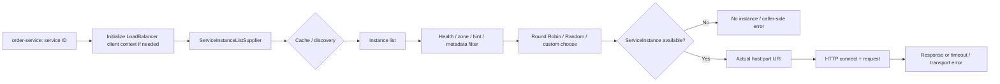

# Instance List Lookup Time and Instance Selection Time

## 1. Context: Why Is a Request Slow Before Even Sending HTTP?

In the **Timeouts** chapter of the `SPRING_CLOUD_SERVICE_COMMUNICATION_LOAD_BALANCING` module, we analyze the often-overlooked portion of latency when `order-service` calls `inventory-service` through Spring Cloud LoadBalancer: **retrieving the `ServiceInstance` list** and **selecting an instance** before the HTTP client ever connects to the server.

Suppose `order-service` uses `RestClient`, `WebClient`, or OpenFeign to call:

```text
http://inventory-service/api/inventory/ABC-1
```

The host `inventory-service` is a **service ID**. The application cannot connect to a concrete instance until a candidate list is supplied and `RoundRobinLoadBalancer`, `RandomLoadBalancer`, or another policy chooses a target. Latency can come from the registry, cache, `ServiceInstanceListSupplier` chain, first-time context initialization, health/zone filtering, or building the request itself.

**Lesson question:** when a request takes 800 ms, how much time was spent *looking up the list*, how much *picking an instance*, and how much *connecting/reading the response*? Which timeout property governs which phase? How can you prove whether slowness occurred before or after instance selection?

### Learning Objectives

After this lesson, you will be able to:

1. Clearly distinguish `T_discovery`, `T_supplier`, `T_selection`, `T_connect`, `T_response`, and `T_end_to_end`.
2. Explain how `spring.cloud.loadbalancer.service-discovery.timeout` affects discovery queries, and **not** HTTP timeouts or the full request deadline.
3. Identify the impact of caching, health checks, zone/hint filtering, lazy child contexts, and retries on target selection time.
4. Configure a baseline with `@LoadBalanced RestClient.Builder` or `WebClient.Builder` and place HTTP timeouts on the right client.
5. Separately measure the first call, cache hits/misses, a slow registry, empty instance lists, and selected instances whose connection fails.
6. Design a bounded time budget, measure p50/p95/p99, and troubleshoot incidents without masking root causes.

## 2. Request Flow Through LoadBalancer



Only certain links in this chain are active in a given configuration. For example, `SimpleDiscoveryClient` uses a static list; `EurekaDiscoveryClient` may already hold instance data in an internal cache; `CachingServiceInstanceListSupplier` can serve lists from LoadBalancer's cache; `HealthCheckServiceInstanceListSupplier` runs its own schedule.

Four critical boundaries:

| Boundary | Start | End | Notes |
|---|---|---|---|
| **Context init** | LoadBalancer service ID is used for the first time | Child context and corresponding beans are ready | Typically a cold-start effect, differing between first call and steady-state |
| **List retrieval** | Supplier starts requesting the list for the service ID | Receives candidate snapshot/list | May be a cache hit or a remote registry call |
| **Selection** | Eligible candidate set is available | Algorithm returns a `ServiceInstance` or no-instance | Round Robin/Random are usually cheap on an already-fetched list; filters/suppliers can be costlier |
| **HTTP exchange** | Instance URI is known | Connect, send request, receive body/status | Uses HTTP transport connect/read/response timeouts |

In Spring Cloud code, `choose()` often depends on the publisher emitted by `ServiceInstanceListSupplier`. If you measure the **entire duration of calling `choose()`**, the measurement can **include time spent waiting on the supplier/discovery**, not just computing the Round Robin index. That is why metrics must be named after the exact boundary measured, rather than calling everything “algorithm latency.”

### 2.1. Notation Used Throughout

Consider a single call without retries, and let:

- `T_ctx`: time to create the LoadBalancer child context (if it is the first call).
- `T_list`: time to obtain the `ServiceInstance` list from the supplier, including cache/discovery depending on the chain.
- `T_filter`: time to apply health/zone/hint/metadata filters if those steps run on the request path.
- `T_pick`: time to pick an instance from the final list.
- `T_http`: time to connect, have the server process, and receive the response; can be further split into connect, TTFB, and body read.
- `T_total`: time observed by the `order-service` client until receiving a result or error.

A **conceptual** breakdown:

\[
T_{\mathrm{total}}\approx T_{\mathrm{ctx}}+T_{\mathrm{list}}+T_{\mathrm{filter}}+T_{\mathrm{pick}}+T_{\mathrm{http}}+T_{\mathrm{overhead}}.
\]

Never simply add **percentiles** (p95 of list + p95 of HTTP does not equal p95 of total); nor should you add overlapping/asynchronous phases or retries as if they were always sequential. To measure budgets accurately, record timestamps/correlation IDs for **the same request or attempt**.

## 3. Timeout When Querying Service Discovery

Spring Cloud Commons 4.3 lists:

```text
spring.cloud.loadbalancer.service-discovery.timeout
```

This is a `Duration` value for **how long to wait for the discovery call that fetches the instance list**, used in `DiscoveryClientServiceInstanceListSupplier`. For example:

```yaml
spring:
  cloud:
    loadbalancer:
      service-discovery:
        timeout: 500ms
```

**Interpretation:** the supplier has roughly a 500 ms budget to fetch the list from the discovery delegate in the corresponding implementation. If the registry or discovery client fails to provide the list in time, the supplier may handle the timeout and return an **empty list**. With no instance to select, the caller receives a no-instance error or a synthesized error response, depending on blocking/reactive integration and version.

### 3.1. What Does This Timeout Not Cover?

| Phase | Does `service-discovery.timeout` directly replace this phase's timeout? |
|---|---|
| Querying `DiscoveryClient#getInstances(serviceId)` or reactive delegate used by supplier | **Yes**, in `DiscoveryClientServiceInstanceListSupplier` implementations supporting the property |
| Waiting for cache TTL expiration | **No** — TTL governs data freshness, not request deadlines |
| Health check scheduler and refetch intervals | **No** — those schedules have separate properties |
| Execution time of custom zone/weighted/hint suppliers | **Not guaranteed**; only applies to the discovery step wrapped with the timeout by the implementation |
| Entire `ReactorLoadBalancer#choose` including all suppliers/custom logic | **Not guaranteed**; measure and bound total duration at the caller layer |
| Establishing socket/TLS to an inventory instance | **No** — configure HTTP client connect timeout |
| Waiting for first byte / reading response from inventory | **No** — response/read timeout or another deadline |
| Total request across multiple retries and backoff | **No** — requires a budget/deadline for the entire logical request |

The *Configuration Properties* 4.3 documentation describes the property but **does not publish a default in the default column**. The source code of some `DiscoveryClientServiceInstanceListSupplier` versions initializes it to `Duration.ofSeconds(30)`, yet **you should not treat that number as a default SLA across all Release Trains/implementations**. Check the source tag of the exact resolved artifact or set the timeout explicitly.

### 3.2. When a Discovery Timeout Occurs

Illustrative flow in an implementation that falls back to an empty list:

```text
Request GET http://inventory-service/...
  -> DiscoveryClientServiceInstanceListSupplier
     -> delegate.getInstances("inventory-service") is slow
     -> 500ms elapsed: timeout / fallback to empty list []
  -> LoadBalancer receives empty list
  -> cannot select a ServiceInstance
  -> caller receives "no instances" error or synthesized HTTP 503
```

This **does not mean** `inventory-service` actually has zero instances. The registry may hold `[a,b]`, yet the caller's query did not finish in time. Therefore, separate `discovery_timeout` metrics from `registry_zero_instances` and check discovery client logs.

In some versions, timeouts and exceptions inside the supplier are converted into an empty list so LoadBalancer can proceed. Such handling is convenient for callers, but makes registry errors easily mistaken for missing services. Inspect supplier logs/traces, especially when evaluating no-instance situations.

**Special note on blocking discovery:** a Reactor-level timeout around a blocking `DiscoveryClient` does not necessarily cancel underlying I/O immediately or instantly free every thread calling the registry. When timeouts happen frequently, check thread pools, native network timeouts of the registry client library, and concurrency limits; do not rely on this property as the sole control over load hitting the registry.

## 4. Selection Time Differs from List Retrieval Time

Given a fixed list `[inventory-a, inventory-b, inventory-c]`:

- `RoundRobinLoadBalancer` rotates positions through the list.
- `RandomLoadBalancer` picks an index randomly.
- A custom LoadBalancer may use weights, zones, metadata, or access history.

Computing an index over a small list is usually fast compared to registry/network calls. However, how a LoadBalancer implementation picks a target **is not decoupled from the supplier**: it must await the list, may apply per-request filters, and may return empty if no candidate qualifies. Therefore:

| Situation | `T_list` | `T_pick` | Practical conclusion |
|---|---|---|---|
| Cache hit, three instances available | Usually small | Usually tiny | HTTP/backend likely dominates total latency |
| Cache miss, slow registry | Can be large | Unchanged noticeably | Slow registry/supplier, not “slow” Round Robin |
| Multiple supplier filters | Can increase | Implementation-dependent | Measure the whole selection chain; split stages if needed |
| First call after startup | Higher due to lazy child context + cold cache | Similar after warm-up | Do not use cold requests as baseline latency |
| Empty list | Still incurs lookup cost | No instance to pick | Handle no-instance; HTTP connect timeout cannot fix this |
| Stale cache containing dead instance | Can return very fast | Picks very fast | Failure occurs at HTTP connect/response, not list lookup |

### 4.1. Lazy Child Context and How to Warm Up

Spring Cloud LoadBalancer creates a child context per service ID and **lazily initializes** it on first use. The first call can spend extra time creating beans/starting suppliers, easily skewing benchmarks.

You can configure eager loading:

```yaml
spring:
  cloud:
    loadbalancer:
      eager-load:
        clients:
          - inventory-service
          - payment-service
```

This configuration requests creating contexts for the specified clients earlier; it is **not** a configuration guaranteeing that the registry or inventory instances are already healthy. Another approach in the lab is sending warm-up requests and excluding warm-up data from reports. When verifying cold-start optimizations, measure the “first call” and “subsequent calls” groups separately.

### 4.2. Caching Makes Things Faster, with Trade-Offs

`CachingServiceInstanceListSupplier` reuses instance lists, reducing queries to discovery. Spring Cloud Commons 4.3 documents `spring.cloud.loadbalancer.cache.ttl` defaulting to `35s` and `spring.cloud.loadbalancer.cache.enabled` as the global cache switch.

Example to **experiment** with both modes:

```yaml
# Baseline without LoadBalancer cache:
spring:
  cloud:
    loadbalancer:
      cache:
        enabled: false
```

```yaml
# A separate experiment run with cache enabled:
spring:
  cloud:
    loadbalancer:
      cache:
        enabled: true
        ttl: 20s
```

The two snippets above are **two separate run configurations**; do not paste two `spring:` blocks into the same YAML file. With caching, the first call after a cache miss can be slower while subsequent hits are usually faster. **A 20s TTL does not mean every request waits 20s**; it is the lifetime of cached data. The cache may hold dead instances or miss new instances until refreshed/expired; actual delay and list freshness depend on the discovery cache, LoadBalancer cache, and health supplier.

Per the documentation, when a discovery implementation (such as Eureka client) already caches internally, you can **disable the LoadBalancer cache** to avoid double caching. With `HealthCheckServiceInstanceListSupplier`, which has its own replay/cache mechanism, keep suppliers in the right order; do not wrap extra caches arbitrarily and expect data to remain fresh.

## 5. Health Check and Refetch Schedules Are Not Request Timeouts

When `HealthCheckServiceInstanceListSupplier` is active:

- `spring.cloud.loadbalancer.health-check.interval`: health probe interval (defaults to `25s` in Commons 4.3).
- `spring.cloud.loadbalancer.health-check.refetch-instances`: whether to proactively refetch the list from the delegate when the delegate does not emit continuous updates (defaults to `false`).
- `spring.cloud.loadbalancer.health-check.refetch-instances-interval`: refetch interval when enabled (defaults to `25s`).
- `spring.cloud.loadbalancer.health-check.repeat-health-check`: toggles independent probe rounds; each refetch can still trigger health checks.

**These intervals describe background refresh schedules**, not deadlines for a specific HTTP request. A new instance needs time to appear in the registry, be seen by the supplier, pass health checks, and become selectable; that is distinct from `service-discovery.timeout` bounding a single lookup.

Lab example for observing membership refresh:

```yaml
spring:
  cloud:
    loadbalancer:
      health-check:
        refetch-instances: true
        refetch-instances-interval: 10s
        repeat-health-check: false
        path:
          default: /actuator/health
          inventory-service: /actuator/health/readiness
```

**Condition:** a health-check supplier must already be in the chain. Setting `health-check.*` properties **does not** automatically create a `HealthCheckServiceInstanceListSupplier` in every setup. With a registry that already provides only healthy instances, an extra probe layer may not be needed.

Zone/hint/metadata filtering rules can make the post-discovery list differ from the selectable list. Do not equate `T_registry` with `T_eligible_list` if requests must wait on filters or a custom reactive supplier.

## 6. Comparison with RestClient, WebClient, and OpenFeign Timeouts

The table below helps identify where to place configurations:

| Timeout / limit type | Responsible layer | What it does **not** guarantee |
|---|---|---|
| `spring.cloud.loadbalancer.service-discovery.timeout` | Discovery-calling supplier | Does not cover all filters, instance selection, or HTTP connect/read |
| `RestClient` connect timeout | HTTP request factory | Does not govern discovery speed |
| `RestClient` read timeout | HTTP request factory | Not a shared deadline across multiple retries |
| `WebClient` connect timeout | Reactor Netty / HTTP connector | Does not help before an instance is selected |
| `WebClient` response timeout | HTTP connector | Does not necessarily cap total discovery time or infinite streams |
| Reactor `Mono.timeout(...)` | Publisher Reactor operator | Covers only the chain **inside** the operator, depending on placement |
| OpenFeign `connectTimeout`/`readTimeout` | Feign client transport/configuration | Does not inherently bound service discovery or total retries |
| Business deadline / request budget | API caller / request orchestration | Must account for retries, backoff, queuing, and downstream |

### 6.1. RestClient Example with LoadBalancer and HTTP Timeouts

```java
@Configuration(proxyBeanMethods = false)
class InventoryRestClientConfig {

    @Bean
    @LoadBalanced
    RestClient.Builder loadBalancedRestClientBuilder() {
        return RestClient.builder();
    }

    @Bean
    RestClient inventoryRestClient(
            @LoadBalanced RestClient.Builder builder) {

        SimpleClientHttpRequestFactory factory =
                new SimpleClientHttpRequestFactory();
        factory.setConnectTimeout(500); // millisecond
        factory.setReadTimeout(1_500);   // millisecond

        return builder.clone()
                .requestFactory(factory)
                .baseUrl("http://inventory-service")
                .build();
    }
}
```

This example assumes Spring Framework 6.x/Boot 3.x and properly configured `spring-cloud-starter-loadbalancer`. `factory.setConnectTimeout` and `setReadTimeout` apply to HTTP against the **selected instance**; if discovery fails to return a list, these two settings do not terminate the lookup phase any sooner.

`RestClient` uses blocking HTTP. If you need an **overall deadline** covering discovery, retries, and business logic, design a caller-layer timeout/cancellation mechanism compatible with your runtime, thread pool, and actual transport cancellation capabilities; do not assume `connectTimeout + readTimeout` equals a hard limit on the entire request.

### 6.2. WebClient Example and End-to-End Publisher Timeout

```java
@Configuration(proxyBeanMethods = false)
class InventoryWebClientConfig {

    @Bean
    @LoadBalanced
    WebClient.Builder loadBalancedWebClientBuilder() {
        return WebClient.builder();
    }
}
```

Configuring WebClient with the Reactor Netty connector:

```java
HttpClient httpClient = HttpClient.create()
        .option(ChannelOption.CONNECT_TIMEOUT_MILLIS, 500)
        .responseTimeout(Duration.ofMillis(1500));

WebClient client = loadBalancedBuilder.clone()
        .baseUrl("http://inventory-service")
        .clientConnector(new ReactorClientHttpConnector(httpClient))
        .build();
```

In the snippet above, `loadBalancedBuilder` is the `@LoadBalanced`-injected bean. When you want to bound the **entire publisher including instance lookup and HTTP**, place `timeout` outside the pipeline:

```java
Mono<InventoryStock> stock(String sku) {
    return client.get()
            .uri("/api/inventory/{sku}", sku)
            .retrieve()
            .bodyToMono(InventoryStock.class)
            .timeout(Duration.ofSeconds(2));
}
```

A `Mono.timeout(2s)` placed like this can emit a `TimeoutException` after two seconds without a response. That is a **Reactor-layer** limit—not a substitute for registry client or HTTP connector timeouts—and does not mean all underlying blocking I/O in the registry stops at that exact instant. For long-lived `Flux` streams, `timeout(Duration)` typically observes the interval between signals; do not treat it as a fixed lifetime deadline for the stream.

### 6.3. OpenFeign Example

For Spring Cloud OpenFeign, configuration looks like:

```yaml
spring:
  cloud:
    openfeign:
      client:
        config:
          inventory-service:
            connectTimeout: 500
            readTimeout: 1500
```

Values in this example are in **milliseconds** per the corresponding Feign configuration. They control connection/read durations for the Feign client, and do not replace `spring.cloud.loadbalancer.service-discovery.timeout`. The client name under `spring.cloud.openfeign.client.config` must match the Feign client ID/context ID in use; verify against `@FeignClient` and your Spring Cloud OpenFeign version.

When Feign calls by service ID through Spring Cloud LoadBalancer, selecting the `ServiceInstance` happens before Feign has an actual server address. Feign retries, LoadBalancer retries, and resilience libraries can differ; do not assume they all share one retry counter or timeout.

## 7. Designing a Time Budget Instead of Setting Just One Timeout

Suppose the `order-service` API must respond within **2 seconds**, including calling `inventory-service` and subsequent business steps. An **illustrative** budget, not a universal recommendation:

| Item | Planned budget | Notes |
|---|---:|---|
| Discovery / supplier lookup | 200 ms | Usually tiny on cache hit; max must consider registry |
| Instance filtering and selection | 50 ms | Includes policy/custom code overhead |
| Connecting to instance | 250 ms | May include DNS/TCP/TLS depending on connector |
| Send/receive response and backend processing | 900 ms | Based on actual inventory SLO |
| Remaining processing at order-service | 200 ms | JSON, business logic, and returning response |
| Reserve buffer | 400 ms | Variance, scheduling, GC, and overhead |
| **Target total** | **2,000 ms** | API deadline must be enforced in the right place |

Budgets are only useful when backed by measurement. In particular, `service-discovery.timeout=500ms` should not automatically be added twice if cache hits avoid registry calls; nor should you assume every request waits 500 ms.

### 7.1. With Retries, Total Time Can Multiply

Example of a single logical request with two HTTP attempts:

```text
Attempt 1:
  lookup/pick 100ms + connect 200ms + response wait 700ms = 1000ms
Backoff: 200ms
Attempt 2:
  lookup/pick 100ms + connect 200ms + response wait 700ms = 1000ms
Observed minimum total is already ~2200ms, excluding overhead.
```

These numbers only illustrate sequential phases. Setting per-attempt timeouts **does not automatically cap the whole logical request**. In a reactive pipeline, place `retryWhen(...)` inside and `timeout(...)` outside to bound the entire chain:

```java
Mono<InventoryStock> withRetryAndOverallDeadline(String sku) {
    return client.get()
            .uri("/api/inventory/{sku}", sku)
            .retrieve()
            .bodyToMono(InventoryStock.class)
            .retryWhen(Retry.backoff(
                    1, Duration.ofMillis(100))
                    .filter(this::isTransientNetworkError))
            .timeout(Duration.ofSeconds(2));
}
```

Here `isTransientNetworkError` is an **application-defined** predicate; for example, only retrying transient connection errors that are safe for HTTP GET. Never retry all errors unconditionally. `Retry.backoff(1, ...)` allows at most one retry after the initial attempt; there is no guarantee the retry picks a different instance unless selection policy supports it. If retries are also enabled in Spring Cloud LoadBalancer, total attempts may exceed expectations.

For POST operations with side effects (placing orders, payments), a timeout does not reveal whether the server committed. You must have an idempotency key and server-side deduplication before retrying.

### 7.2. When to Fail Fast

The goal of failing fast is to return a meaningful error when a dependency is unavailable rather than tying up resources for too long. For example:

- When the registry times out, callers need to distinguish “slow discovery” from “genuinely zero instances” for alerting.
- When no `ServiceInstance` is found, HTTP connect timeout **is never used**, so handle no-instance at the LoadBalancer/caller layer.
- When an instance is selected but the socket fails to open, connect timeouts and network exceptions form a separate error group.
- When the server received the request but responds slowly, response/read timeouts and deadlines are more appropriate.
- For cache-only read fallbacks, mark data as stale and bound TTL; do not turn instance-lookup failures into fabricated stock data.

## 8. Practice 1 — Separating Lookup and Selection Time from HTTP

### 8.1. Minimal Topology

Use three processes:

| Component | Port | Role |
|---|---|---|
| `order-service` | 8080 | Caller via LoadBalancer |
| `inventory-a` | 8081 | Healthy instance |
| `inventory-b` | 8082 | Healthy instance |

In a lab without a real registry, configure `SimpleDiscoveryClient`:

```yaml
spring:
  application:
    name: order-service
  cloud:
    discovery:
      client:
        simple:
          instances:
            inventory-service:
              - uri: http://localhost:8081
                instance-id: inventory-a
              - uri: http://localhost:8082
                instance-id: inventory-b
    loadbalancer:
      retry:
        enabled: false
      cache:
        enabled: false
      service-discovery:
        timeout: 500ms
server:
  port: 8080
```

Run on the same host or network namespace; inside containers, the caller's `localhost` is not the address of the other two inventory containers. `SimpleDiscoveryClient` uses a **static** list and does not simulate remote registry latency; it serves as a baseline to verify the pipeline and HTTP.

### 8.2. Server Endpoint Capable of Injecting Delay

In both `inventory-service` instances, return the ID so the chosen target is visible:

```java
@RestController
@RequestMapping("/api/inventory")
class InventoryController {
    private final String instanceId;

    InventoryController(Environment env) {
        this.instanceId = env.getRequiredProperty("app.instance-id");
    }

    @GetMapping("/{sku}")
    InventoryStock find(@PathVariable String sku,
                        @RequestParam(defaultValue = "0") long delayMs)
            throws InterruptedException {
        Thread.sleep(delayMs); // Only for simulating errors/slowness in the lab.
        return new InventoryStock(sku, 12, instanceId);
    }
}

record InventoryStock(String sku, int available, String instanceId) {}
```

This snippet uses blocking Spring MVC. Never use `Thread.sleep` on a WebFlux event loop or in production; with WebFlux, simulate using `Mono.delay` and proper non-blocking handling. Run instance A with `app.instance-id=inventory-a` and B with `inventory-b`.

### 8.3. Measuring Cold Start and Steady-State

Steps:

1. Start `order-service` and both inventory instances.
2. Send the **first** request to `http://localhost:8080/demo/inventory/ABC-1`; record end-to-end latency on the `order-service` client and caller logs.
3. Send 50–100 more requests to the same endpoint with zero delay, excluding the first request from steady-state statistics.
4. Restart `order-service`, try `spring.cloud.loadbalancer.eager-load.clients` as in Section 4.1, and repeat the measurement.
5. Compare median/p95; if the first call is noticeably slower, separate child context init, JIT, DNS/connection pool, and downstream startup rather than blaming everything on the selection algorithm.

`SimpleDiscoveryClient` returns lists rapidly, so this **is not a discovery timeout test**. Only when you create a discovery source that can be slowed down in a controlled way can you demonstrate the effect of `service-discovery.timeout`.

## 9. Practice 2 — Simulating Slow Discovery and Timeout Bounds

To truly experiment with **list lookup time**, use a `DiscoveryClient` delegate whose `getInstances("inventory-service")` call can be slowed controllably, or a real registry behind a latency-injecting network proxy. Do not just increase `Thread.sleep` in the inventory server: that slows down the **HTTP response**, not **discovery**.

### 9.1. Deliberately Slow Mock Delegate (Intentional Pseudocode)

```java
// Test pseudocode: wraps a real DiscoveryClient,
// never use in production as a way to inject delay.
class SlowDiscoveryClient implements DiscoveryClient {
    private final DiscoveryClient delegate;

    @Override
    public List<ServiceInstance> getInstances(String serviceId) {
        sleepForTest(Duration.ofMillis(900));  // Lab only.
        return delegate.getInstances(serviceId);
    }

    @Override
    public List<String> getServices() {
        return delegate.getServices();
    }

    @Override
    public String description() {
        return "delayed discovery for lab";
    }
}
```

The snippet above is a **conceptual sketch**, not a ready-to-run bean/configuration: you must implement `sleepForTest`, register the wrapper in the right lookup chain, avoid circular composite `DiscoveryClient` references, and control bean ordering. With a real registry, you can inject delay at the network/proxy layer in an isolated environment instead of wrapping the client.

### 9.2. Experiment Matrix

| Run | Discovery delay | `service-discovery.timeout` | Expected observation |
|---|---:|---:|---|
| A | 50 ms | 500 ms | List received; LoadBalancer picks an instance if other steps are normal |
| B | 900 ms | 500 ms | Discovery timeout; may fall back to empty list, leading to no-instance |
| C | 900 ms | 1500 ms | May receive list after ~900 ms; total request still waits for HTTP |
| D | 900 ms | 500 ms; cache enabled and warm | May skip calling discovery on this request if cache hits |
| E | Registry returns empty list immediately | 1500 ms | Fast no-instance; raising timeout does not create replicas |
| F | List has instances but inventory delays 900 ms | 500 ms | Instance picked fast, **HTTP response** is slow; tuning discovery timeout does not fix it |

In B and C, keep HTTP timeouts large enough so HTTP timeouts do not mask discovery outcomes. In D, prove a cache hit via `getInstances` call counts or tracing; do not rely on a single fast request as proof.

### 9.3. Three Questions After Each Run

1. Did the supplier receive a fresh list, an empty list, or a timeout error? At which stage?
2. Did LoadBalancer select a `ServiceInstance`? If not, did any HTTP request reach inventory?
3. How long did it take from logical request start until response or exception? Was there retry/cold start/caching?

If Run B results in HTTP 503, it **could** be a caller-generated 503 due to no instance found, not an inventory server returning 503. Check inventory logs and caller-side selection events.

## 10. Logging and Measuring Time at the Exact Boundaries

### 10.1. Timestamps to Capture

Suggested timestamps for a single HTTP attempt:

```text
t0 - caller receives request or subscribes to WebClient request
t1 - LoadBalancer/supplier starts looking up the list
t2 - supplier emits list for the service ID
t3 - LoadBalancer selects an instance or determines none is available
t4 - HTTP client begins connect/sending request to target host:port
t5 - HTTP headers / first byte received if instrumentation supports it
t6 - body finished reading or terminated with error/cancellation
```

From these, compute:

\[
\begin{aligned}
T_{\text{list}} &= t_2 - t_1,\\
T_{\text{choose-pipeline}} &= t_3 - t_1,\\
T_{\text{selection-after-list}} &\approx t_3 - t_2,\\
T_{\text{HTTP}} &= t_6 - t_4,\\
T_{\text{end-to-end}} &= t_6 - t_0.
\end{aligned}
\]

This is a **logical measurement framework**, not callbacks that Spring Cloud LoadBalancer guarantees to emit across all `t0..t6`. In reactive pipelines, a supplier may emit multiple snapshots and filters may run in the chain; `t2` should be defined as the **snapshot used for the selection round under inspection**, not an arbitrary initial emission.

### 10.2. Avoiding Measurement Errors

- Use `System.nanoTime()` to measure **durations within the same process**, avoiding direct subtraction of timestamps from two unsynchronized machines.
- Measure `T_list` by instrumenting around `ServiceInstanceListSupplier#get(...)` and when the Flux emits lists; note `get(Request)` may differ from `get()` when request-based filters run.
- Measure `T_choose-pipeline` from the start of `ReactorLoadBalancer#choose(...)` until receiving `Response<ServiceInstance>`; it **includes time waiting on the supplier**.
- If measuring via `LoadBalancerLifecycle`, verify exact timing of `onStart`, `onStartRequest`, and `onComplete` in your version; do not assume they correspond directly to `t1`, `t2`, `t3` without reading source code.
- If no event distinguishes filtering from picking, publish the metric as `lb_choose_total_duration` instead of claiming it is Round Robin CPU time.
- With blocking HTTP, log the timestamp when exceptions arrive along with their cause; with reactive HTTP, place timing operators at **subscription** time, not merely at publisher **assembly** time.
- Attach correlation ID/trace ID, service ID, instance ID (if selected), result, and retry attempt; avoid storing tokens, sensitive bodies, or high-cardinality user IDs in metric labels.

### 10.3. Example Measuring Discovery with Reactor in a Test Harness

The following conceptual snippet measures **time to first snapshot** from a supplier; it does not replace production instrumentation:

```java
Mono<List<ServiceInstance>> firstSnapshot(
        ServiceInstanceListSupplier supplier) {

    return Mono.defer(() -> {
        long startNs = System.nanoTime();

        return supplier.get()
                .next()
                .doOnNext(instances -> {
                    long elapsedNs = System.nanoTime() - startNs;
                    log.info("serviceId={} stage=supplier-first-snapshot"
                            + " durationMs={} count={}",
                            supplier.getServiceId(),
                            elapsedNs / 1_000_000.0,
                            instances.size());
                });
    });
}
```

Here `supplier.get().next()` means **stop after the first snapshot** so it can be timed. Do not use this harness snippet as a production supplier if you need continuous Flux health updates or request-based filtering. For real suppliers depending on `Request`, measure `get(request)` instead of `get()` so you stay on the actual routing chain.

### 10.4. Micrometer and Tracing

Spring Cloud LoadBalancer supports `MicrometerStatsLoadBalancerLifecycle` when instrumentation is enabled and a `MeterRegistry` is present:

```yaml
spring:
  cloud:
    loadbalancer:
      stats:
        micrometer:
          enabled: true
```

LoadBalancer metrics help track successes, failures, or discards per implementation semantics. **Do not assume** built-in metrics separately measure `T_list`, `T_filter`, and `T_pick`. For fine-grained hotspot analysis, add custom timers named clearly for each measured phase, or tracing spans around discovery and the HTTP client. The `stats.micrometer.enabled` setting is global; check your actual version.

Suggested **custom-designed metric names** (do not assume Spring Cloud exports them out of the box):

| Metric | Unit | Recommended labels |
|---|---|---|
| `discovery_lookup_duration` | ms/s per MeterRegistry | service ID, outcome, cache state |
| `lb_supplier_snapshot_duration` | ms/s | service ID, supplier type |
| `lb_choose_total_duration` | ms/s | service ID, algorithm, result |
| `lb_no_instance_total` | counter | service ID, reason if verifiable |
| `http_client_duration` | ms/s | service ID, status/error class |
| `retry_attempts_total` | counter | service ID, operation class |

Never put `requestId` or raw URIs containing SKUs/tokens into metric tags, because cardinality can explode uncontrollably. Per-request details belong in traces/logs governed by security policies.

## 11. How to Read Result Reports

**Hypothetical data solely for practicing interpretation** (not an executed benchmark):

| Scenario | Supplier first snapshot p95 | Choose pipeline p95 | HTTP client p95 | End-to-end p95 | Initial conclusion |
|---|---:|---:|---:|---:|---|
| Warm cache, healthy | 1 ms | 2 ms | 80 ms | 88 ms | HTTP/backend dominates latency |
| Cache miss, slow registry | 180 ms | 184 ms | 80 ms | 275 ms | Registry/supplier may be the hotspot |
| Cold first request | 160 ms | 165 ms | 80 ms | 300 ms | Includes context/JIT/pool; measure separately |
| Discovery timeout 500 ms | ~500 ms | ~500 ms | No HTTP | ~510 ms | No-instance due to timeout; not inventory returning error |
| Stale cache, dead instance | 1 ms | 2 ms | 500 ms then error | ~510 ms | Lookup is fast, but target cannot be reached |

Each column's p95 comes from a **different distribution**; **do not add p95 values across a row** to deduce the overall p95. The hypothetical table also omits some overhead. To draw conclusions from real measurements, run multiple iterations under identical configuration and load, with clear warm-up, comparing p50/p99 and error rates together.

**Distinguishing two types of 503 errors:**

- A discovery timeout yields an empty list; LoadBalancer cannot pick an instance, and the caller may generate a synthesized 503. The inventory server **never receives a request**.
- A real HTTP 503 returned by inventory after it was selected and connected. There is evidence of the request on the server, an HTTP status, and a downstream trace.

A generic error handler may turn both into `503 Service Unavailable` at the outer API. To diagnose properly, preserve caller-side classification, service ID, and the failing stage.

## 12. Mistakes to Avoid

| Misconception | Why it is wrong | How to fix |
|---|---|---|
| “Raising connect timeout gives the registry more time to return the list” | Connect timeout belongs to HTTP to an instance after target selection | Tune/measure discovery timeout and registry client |
| “`service-discovery.timeout` is the deadline for the whole request” | It only wraps part of the discovery supplier | Design caller-wide deadlines and per-layer timeouts |
| “`cache.ttl=35s` makes requests always wait 35 seconds” | TTL is data validity lifetime, not wait time | Measure cache hit/miss, lookup duration, and freshness |
| “Health interval 25s means each probe timeout is 25s” | Interval is scheduler cadence, not probe timeout | Check HTTP client used for health checks and per-probe timeout |
| “Round Robin took 500 ms” | `choose` may have waited 500 ms on discovery before computing index | Measure supplier and selection separately |
| “No instance means wrong service ID” | Could be registry timeout, genuinely empty list, or all filtered out | Measure each stage; inspect lists before/after filtering |
| “Slow first call means poor algorithm” | Lazy child context and cold JIT/cache cause overhead | Warm up or eager-load if appropriate |
| “Enabling cache is always better” | Cache may retain dead instances or miss new ones | Balance latency against staleness and discovery caching |
| “Retries fix every timeout” | Retries can multiply deadlines and load | Bound attempts/backoff; retry only safe errors |
| “If it timed out, downstream couldn't have processed the request” | Timeouts can occur after server processing or with unknown outcome | Use idempotency and tracing for write operations |
| “Adding stage p95s equals total p95” | Percentiles do not add linearly | Measure end-to-end directly; analyze traces per request |
| “Setting WebClient timeout guarantees registry blocking I/O is cancelled” | Reactive cancellation is not guaranteed to stop all blocking calls | Bound registry clients; inspect threads and network |

## 13. Comprehensive Hands-On Exercises

**Exercise 1 — Cold start and eager load.** Run `order-service` with two inventory instances. Measure the first request after startup and 100 requests after warm-up. Enable `eager-load.clients`, rerun, record p50/p95 and discovery call counts. Prove whether the change came from context initialization or another source.

**Exercise 2 — Cache hit/miss.** Test `cache.enabled=false` and `true` with a fixed TTL. Record supplier snapshot durations, registry call counts, and list freshness when adding a replica. State the latency–staleness trade-off.

**Exercise 3 — Slow registry.** Use a test delegate/proxy with a 900 ms delay, and set `service-discovery.timeout` to `500ms` and `1500ms` in turn. Show when no instance is selected and why HTTP connect timeout has no effect in this scenario.

**Exercise 4 — Selected instance is dead.** Register an instance URI with no server listening on that port. Set HTTP connect timeout to 500 ms and discovery timeout to 2 s. Measure and explain how this differs from the registry timeout exercise.

**Exercise 5 — Timeout + retry.** Create an inventory endpoint that delays responses by 900 ms. Configure one retry for GET with 100 ms backoff and a 2 s overall deadline. Record total attempts, final error timestamp, cancellation behavior, and why the same logic should not be applied to payments.

**Exercise 6 — Observing the right metrics.** Build a report containing `T_list`, `T_choose-pipeline`, `T_http`, `T_total`, and error rate under the same correlation ID. Explain why `T_choose-pipeline` can be large even though Round Robin picks an index very quickly.

### Self-Assessment Checklist

- [ ] Can distinguish list lookup time from instance selection time and HTTP time.
- [ ] Knows that `spring.cloud.loadbalancer.service-discovery.timeout` belongs to the discovery supplier.
- [ ] Does not confuse cache TTL, health interval, and refetch interval with request timeouts.
- [ ] Understands why `choose()` can include time awaiting the supplier.
- [ ] Understands LoadBalancer child context cold starts and warm-up/eager-loading options.
- [ ] Distinguishes cache hits/misses, registry timeouts, empty lists, and dead instances.
- [ ] Configures HTTP connect/read timeouts accurately for RestClient/WebClient/OpenFeign.
- [ ] Enforces an overall deadline alongside retries/backoff; protects write operations with idempotency.
- [ ] Measures and reports p50/p95/p99, errors, HTTP attempt counts, cache state, and instance IDs.
- [ ] Does not treat the sum of stage p95s as the overall p95.

## Official References

- [Spring Cloud Commons 4.3 — Configuration Properties](https://docs.spring.io/spring-cloud-commons/reference/4.3/configprops.html): `spring.cloud.loadbalancer.service-discovery.timeout`, cache TTL, retry, health checks, and instrumentation.
- [Spring Cloud Commons 4.3 — Spring Cloud LoadBalancer](https://docs.spring.io/spring-cloud-commons/reference/4.3/spring-cloud-commons/loadbalancer.html): `ServiceInstanceListSupplier`, caching, eager loading, health checks, instance selection, and metrics.
- [Spring Cloud Commons — DiscoveryClientServiceInstanceListSupplier source](https://github.com/spring-cloud/spring-cloud-commons/blob/main/spring-cloud-loadbalancer/src/main/java/org/springframework/cloud/loadbalancer/core/DiscoveryClientServiceInstanceListSupplier.java): timeout handling mechanism in the implementation on `main`. **Does not substitute for reading the source tag of your exact deployed version.**
- [Spring Framework — RestClient and HTTP Clients](https://docs.spring.io/spring-framework/reference/integration/rest-clients.html): request factories, timeouts, and HTTP client handling.
- [Spring Framework — WebClient](https://docs.spring.io/spring-framework/reference/web/webflux-webclient.html): reactive HTTP client and connector configuration.
- [Reactor — Error Handling / Timeout](https://projectreactor.io/docs/core/release/reference/coreFeatures/error-handling.html): error operators, retries, and timeouts in reactive pipelines.
- [Spring Cloud — Release Train](https://spring.io/projects/spring-cloud/): selecting Spring Cloud versions compatible with Spring Boot.

**Conclusion:** *List lookup time* depends on discovery, suppliers, caching, and refresh steps; *instance selection time* is the decision over the eligible instance set; *HTTP time* begins only after a target is chosen. Only by measuring and bounding each layer properly—combining caller deadlines with sensible retries and timeouts—can services communicating via `RestClient`, `WebClient`, and OpenFeign fail fast, accurately, and recover in a controlled manner.
