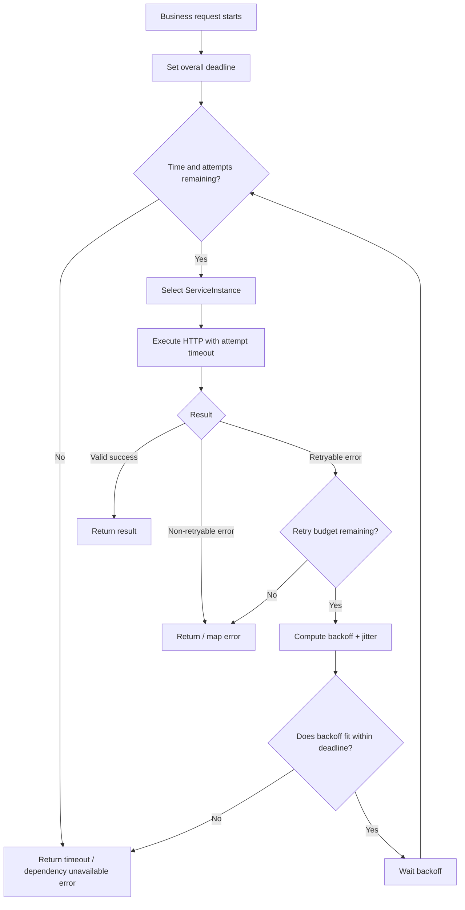

# Coordinating Timeouts with Retry Counts and Backoff

When `order-service` calls `inventory-service` through Spring Cloud LoadBalancer, a call may go through service discovery, `ServiceInstance` selection, connection setup, waiting for server processing, and receiving an HTTP response. If one step is slow or fails, the client can **retry** against another replica. However, retries do not automatically create reliability: if attempt counts and wait durations are uncoordinated, a single business request can run past its deadline, hold many connections, and amplify load onto struggling replicas.

This lesson belongs to the **Timeouts** chapter of the `SPRING_CLOUD_SERVICE_COMMUNICATION_LOAD_BALANCING` module. It focuses on designing an **overall time budget (end-to-end deadline)**, **per-attempt timeouts**, **retry caps**, and **backoff with jitter**. Examples cover `RestClient`, `WebClient`, OpenFeign, and Spring Cloud LoadBalancer, while distinguishing infrastructure faults from HTTP/business errors and showing how to measure them in practice.

> Guiding principle: a timeout or retry policy is only meaningful when you know which layer it applies to, how many attempts it covers, and whether it fits inside the business call's deadline. Millisecond values in this lesson are illustrative figures; adjust them to your real system's SLOs, latency histograms, and library versions.

## 1. Distinguishing Timeout, Retry, Backoff, and Deadline

Four concepts work together without replacing one another:

| Concept | Question to answer | Example |
| --- | --- | --- |
| **Connect timeout** | How long may we wait to establish a connection to an instance? | 300 ms |
| **Read/response timeout** | Once the request is sent, how long does the client wait for reply/data per the transport in use? | 900 ms |
| **Retry** | When an attempt fails, how many times and on which errors may we try again? | Up to 2 retries after the initial call |
| **Backoff** | How long do we wait between attempts to avoid traffic spikes? | 100 ms, 200 ms, with jitter |
| **End-to-end deadline** | By what point in time must the entire operation finish? | 2,500 ms from when the caller started |

An **attempt** is a single try at executing the call to the target service. One **business request** can spawn multiple attempts when retries are enabled.

Example:

```text
Business request: check stock for BOOK-001
    Attempt 1 -> instance A -> connection refused
    Backoff   -> short wait
    Attempt 2 -> instance C -> HTTP 200
Business result: stock received from attempt 2
```

Two attempts are **two HTTP tries**, yet only one business request from the caller. When computing metrics or load limits, distinguish them.

### 1.1. A Timeout Does Not Mean the Request Was Not Processed

If a client hits a **connect timeout** before establishing a connection, the request very likely did not reach the target application server over that connection. However, if a **read timeout** occurs after the request was sent, the server may have already processed the operation and merely been slow or lost the response.

This is especially critical for state-mutating requests such as `POST /api/reservations`. Retrying after a read timeout without idempotency can create two reservations. For `GET` reads, retrying is usually lower risk, yet still requires attempt limits and a deadline.

## 2. Timeouts Exist at Multiple Layers

No single `timeout` property governs every timing aspect of an HTTP call.

| Phase | Time to manage | Typical configuration location |
| --- | --- | --- |
| Fetching `ServiceInstance` list | Discovery/registry lookup and cache refresh | Discovery client or supplier |
| Selecting an instance | Filter/selection overhead | Spring Cloud LoadBalancer |
| Acquiring a connection from pool | Pool acquisition timeout or pending queue | HTTP transport/pool |
| TCP connection | Connect timeout | JDK, Apache HttpClient, Reactor Netty, Feign transport |
| TLS handshake | Handshake duration depending on transport | TLS/HTTP client |
| Waiting for response | Read/response timeout | HTTP transport, Feign, RestClient, WebClient |
| Pause between tries | Backoff delay | Retry policy |
| Entire call | Absolute deadline / total timeout | Orchestration layer or reactive pipeline |

Implementations may define “read timeout” differently: waiting for a response, gap between byte reads, or transport-specific intervals. Therefore, do not assume adding `connectTimeout + readTimeout` always yields a **hard upper bound** on a single attempt. Beyond those two numbers lie DNS, TLS, connection pooling, body streaming, and other overhead.

**Spring Cloud LoadBalancer selects an instance; it does not replace HTTP client timeout settings.** Even a supplier with health checks cannot guarantee the chosen instance will respond before the deadline.

## 3. A Three-Tier Timing Model

You can view a caller-to-downstream request in three tiers:

1. **Whole-call deadline:** how much time the caller is still permitted to spend on the dependent operation.
2. **Attempt timeout:** specific limit when trying to send a request over the transport to one instance.
3. **Backoff and retry budget:** remaining attempts and maximum wait between them.



Key takeaway: **the decision to retry must be re-evaluated after each failure**. Allowing up to three attempts initially does not mean executing all three when only a few milliseconds remain before the deadline.

## 4. Calculating a Time Budget Across Multiple Attempts

Suppose we estimate an upper bound `T_attempt` per attempt and allow `N` attempts. There are `N - 1` backoff pauses between them. One budgeting model is:

```text
T_planned_budget =
    N × T_attempt
    + sum(backoff between attempts)
    + discovery / instance-selection / scheduling / processing overhead
```

This is a **planning formula**, not a law of the transport: an attempt can take longer than expected if a timeout only bounds one stage of the request.

### 4.1. Three-Attempt Example

Assumptions:

- Connect timeout: **300 ms**.
- Read/response timeout: **900 ms**.
- For illustration, each attempt takes at most **1,200 ms** (300 + 900 ms), excluding overhead.
- Maximum attempts: **3** (initial + up to 2 retries).
- Nominal backoff before first retry: **100 ms**.
- Nominal backoff before second retry: **200 ms**.

If every attempt hits the assumed upper bound:

```text
Attempt 1:       1,200 ms
Backoff 1:         100 ms
Attempt 2:       1,200 ms
Backoff 2:         200 ms
Attempt 3:       1,200 ms
-------------------------
Planned total:   3,900 ms (excluding overhead)
```

If the caller only has a **2,500 ms deadline**, a policy of “always try all three attempts” is inconsistent. You must shorten per-attempt timeouts, reduce retry count, or **stop early when time runs out**.

```mermaid
gantt
    title Illustration of 2,500 ms budget vs. up to 3,900 ms retry chain
    dateFormat X
    axisFormat %L
    section Call sequence
    Attempt 1 :0, 1200
    Backoff 1 :1200, 1300
    Attempt 2 :1300, 2500
    section Limit
    Overall deadline :crit, 0, 2500
```



The Gantt chart illustrates one scenario where **two attempts hit timeout**; no budget remains for the third attempt. Do not treat bar lengths on the diagram as timing guarantees from any library.

### 4.2. Remaining Budget Matters More Than Initial Timeout Config

Let `D` be the absolute deadline (measured by a monotonic clock in the same process) and `now` be the current time:

```text
remaining = max(0, D - now)
attemptBudget = min(perAttemptLimit, remaining - reservedMargin)
```

If `remaining` is too small for a useful attempt or cannot even cover minimum backoff, stop. Each attempt should be bounded by the **remaining budget**, instead of reusing the original timeout value regardless of the deadline.

For example, after the first attempt 1,000 ms remain. A retry with a 2,000 ms read timeout will blow past the budget unless another deadline mechanism stops it. Proper design trims the retry timeout or skips the retry.

## 5. Choosing Retry Counts: Always Count the Initial Call

Two phrasings often cause confusion:

- **`maxAttempts = 3`:** up to three attempts total, meaning one initial call plus two retries.
- **`maxRetries = 3`:** up to three retries *after* the initial call, meaning up to four attempts total.

Different libraries' property names can adopt either meaning. Never copy the number `3` across APIs without checking the configuration contract.

| Policy | Max HTTP requests under this counting |
| --- | --- |
| No retry | 1 |
| 1 initial attempt + 1 retry | 2 |
| 1 initial attempt + 2 retries | 3 |
| 1 initial attempt + 3 retries | 4 |

In Spring Cloud LoadBalancer, you can also distinguish retry counts **on the same instance** versus **on the next instance**. These properties interact per version; do not deduce total attempts from a single property alone. Verify the actual number of requests sent via logs or integration tests.

**Unbounded retries are not recommended.** When downstream is overloaded, concurrent clients retrying together only worsen the outage.

## 6. Backoff: Why Not Retry Immediately?

Suppose 1,000 callers simultaneously hit a `503` error because the target service is overloaded. If all 1,000 clients retry **immediately**, the server gets hit with another 1,000 nearly simultaneous requests before it has time to recover.

**Backoff** inserts a pause between attempts to give downstream room to recover and reduce the chance of callers piling requests together.

Common strategies:

| Strategy | How it works | Risk / benefit |
| --- | --- | --- |
| No backoff | Retry immediately | Instant load spike; easily triggers retry storms |
| Fixed backoff | Always wait 100 ms | Simple, yet multiple callers can stay synchronized |
| Exponential backoff | Wait grows progressively: 100, 200, 400… ms | Slows retry rate during prolonged outages |
| Exponential + jitter | Exponential wait plus randomness | Prevents callers from retrying at the exact same instant |

### 6.1. Bounded Exponential Backoff Formula

One way to compute nominal delay for the `k`-th retry (starting at `k = 1`):

```text
delayBase(k) = min(maxBackoff, initialBackoff × 2^(k-1))
Example:
initialBackoff = 100 ms
maxBackoff     = 800 ms
k = 1 -> 100 ms
k = 2 -> 200 ms
k = 3 -> 400 ms
k = 4 -> 800 ms
k = 5 -> 800 ms (capped)
```

Growing delays do not mean you must always wait up to `maxBackoff`. Retries can be cancelled early due to exhausted attempts, deadline expiration, circuit breakers, or non-retryable errors.

### 6.2. Jitter to Prevent Synchronized Retries

**Jitter** adds randomness to the delay so clients spread their retry timestamps apart.

Example *full jitter* strategy:

```text
delayActual(k) = random(0, delayBase(k))
```

With `delayBase = 200 ms`, one caller might wait 40 ms, another 163 ms, and another 198 ms. Libraries implement different jitter formulas (full, equal, percentage factor); you cannot deduce the exact algorithm merely from a property named `jitter`.

**Mandatory rule:** delay after jitter must still fit inside the overall deadline. If the server returns `Retry-After`, evaluate a policy honoring that hint instead of applying a shorter delay and continuing to overload the server.

## 7. Sample Timeline with Retry, Backoff, and Deadline

Suppose `order-service` has a **2,500 ms** deadline and calls `inventory-service` with up to two retries for `GET`.

```text
t=   0 ms  Business request starts; deadline at t=2,500
t=  40 ms  Select instance A
t= 340 ms  Attempt 1 fails: connection refused
t= 440 ms  100 ms backoff finishes
t= 470 ms  Select instance C
t=1,120 ms Attempt 2 receives HTTP 200
t=1,140 ms Return final result
```

In this scenario there are only **two attempts**. There is no reason to run a third attempt after attempt 2 succeeds. Remaining budget is not a quota that must be spent.

Another situation: the second attempt drags until `t = 2,450 ms` and fails. Even if configuration technically leaves one retry unused, only about 50 ms remain before the deadline. If another backoff or attempt cannot finish within that budget, stop and return an appropriate error rather than insisting on using every configured try.

**Do not convert client timeouts directly into HTTP `504` if your application is not genuinely acting as a gateway and has not designed that HTTP error contract.** A client timeout typically surfaces first as an exception; the API gateway/service layer decides which HTTP response fits.

## 8. Timeout Configuration per HTTP Client

All examples below are **transport/attempt configurations**—they do not automatically create an overall deadline. How you wire them into an application depends on your dependencies and Spring Boot/Spring Cloud versions.

### 8.1. RestClient with JDK HTTP Client

```java
import java.net.http.HttpClient;
import java.time.Duration;

import org.springframework.cloud.client.loadbalancer.LoadBalanced;
import org.springframework.context.annotation.Bean;
import org.springframework.context.annotation.Configuration;
import org.springframework.http.client.JdkClientHttpRequestFactory;
import org.springframework.web.client.RestClient;

@Configuration
class InventoryRestClientConfig {

    @Bean
    @LoadBalanced
    RestClient.Builder inventoryRestClientBuilder() {
        HttpClient jdkClient = HttpClient.newBuilder()
                .connectTimeout(Duration.ofMillis(300))
                .build();

        JdkClientHttpRequestFactory factory =
                new JdkClientHttpRequestFactory(jdkClient);
        factory.setReadTimeout(Duration.ofMillis(900));

        return RestClient.builder().requestFactory(factory);
    }
}
```

A client created from a `@LoadBalanced` builder can call logical URLs like `http://inventory-service/api/stocks/BOOK-001` if Spring Cloud LoadBalancer and an instance source are configured. `JdkClientHttpRequestFactory` manages how HTTP is sent; timeouts do not affect the instance selection algorithm.

When a project relies on Spring Boot's auto-configured `RestClient.Builder` with observability/customizers, verify whether declaring your own builder skips required customizers.

### 8.2. WebClient with Reactor Netty

```java
import java.time.Duration;

import io.netty.channel.ChannelOption;
import org.springframework.http.client.reactive.ReactorClientHttpConnector;
import org.springframework.web.reactive.function.client.WebClient;
import reactor.netty.http.client.HttpClient;

HttpClient transport = HttpClient.create()
        .option(ChannelOption.CONNECT_TIMEOUT_MILLIS, 300)
        .responseTimeout(Duration.ofMillis(900));

WebClient inventory = loadBalancedWebClientBuilder
        .baseUrl("http://inventory-service")
        .clientConnector(new ReactorClientHttpConnector(transport))
        .build();
```

In this example, `loadBalancedWebClientBuilder` is a `WebClient.Builder` bean registered with `@LoadBalanced`. Reactor Netty's `responseTimeout(...)` and Reactor's `Mono.timeout(...)` have **different scopes**: transport settings bound response waiting per Netty; `Mono.timeout` can bound a broader reactive pipeline, including backoff when placed appropriately.

### 8.3. OpenFeign by Service Name

```yaml
spring:
  cloud:
    openfeign:
      client:
        config:
          inventory-service:
            connectTimeout: 300
            readTimeout: 900
```

In standard Spring Cloud OpenFeign configurations, the timeout values above are interpreted in **milliseconds**. Confirm they apply to the intended Feign client; a `Request.Options` bean, another per-client config, or a customized HTTP transport can alter effective values.

OpenFeign via `@FeignClient(name = "inventory-service")` can use Spring Cloud LoadBalancer when no physical URL overrides it and required dependencies/beans exist. Do not assume Feign is retrying simply because timeouts are configured: Spring Cloud OpenFeign typically supplies `Retryer.NEVER_RETRY` by default, differing from core Feign's default retry behavior in some setups.

## 9. Bounding Total Time with a Reactive Pipeline

With `WebClient`, Reactor gives a clear way to coordinate **up to two retries** and a **pipeline-wide deadline**. The following `GET` example assumes a configured `WebClient inventoryWebClient`:

```java
import java.time.Duration;

import org.springframework.web.reactive.function.client.WebClientRequestException;
import org.springframework.web.reactive.function.client.WebClientResponseException;
import reactor.core.publisher.Mono;
import reactor.util.retry.Retry;

Mono<StockResponse> result = inventoryWebClient.get()
        .uri("/api/stocks/{sku}", "BOOK-001")
        .retrieve()
        .bodyToMono(StockResponse.class)
        .retryWhen(
                Retry.backoff(2, Duration.ofMillis(100))
                        .maxBackoff(Duration.ofMillis(400))
                        .jitter(0.5)
                        .filter(error ->
                                error instanceof WebClientRequestException
                                || (error instanceof WebClientResponseException response
                                    && response.getStatusCode()
                                            .is5xxServerError()))
        )
        .timeout(Duration.ofMillis(2500));
```

Explanation:

- `Retry.backoff(2, ...)`: **at most two retries**, so up to three attempts including the first call.
- `.filter(...)`: example retrying only request/network errors and `5xx` responses; in practice classify more carefully (not every network error or `5xx` should be retried).
- `.jitter(0.5)`: adds randomness to the backoff schedule per Reactor's algorithm.
- `.timeout(2,500 ms)` placed **after `retryWhen(...)`** bounds the entire attempt and backoff chain as seen from the subscription.
- If the whole pipeline hits 2,500 ms, it emits a timeout signal and cancels the subscription; whether server-side work stops immediately still depends on the transport and downstream.

**Operator ordering matters greatly**:

```java
// Cap spanning all retries and backoff:
source.retryWhen(policy).timeout(totalBudget);

// Not equivalent: timeout can be re-applied per subscription:
source.timeout(perAttemptBudget).retryWhen(policy);
```

The second order can be useful when you want a **per-attempt** timeout, yet without an outer `timeout(totalBudget)`, total time can still exceed the whole-call budget.

**Note:** `StockResponse` is an application DTO. The example assumes the GET call is safe to retry and extra retries are not enabled at the gateway, HTTP transport, or LoadBalancer. If Spring Cloud LoadBalancer also retries, coordinate them so actual attempts do not exceed the Reactor count.

## 10. Spring Cloud LoadBalancer Retries: Same Instance or Next Instance?

Spring Cloud LoadBalancer operates at the **instance-selection** layer. When retry integration is enabled, it can retry on the same `ServiceInstance` or try a different instance, depending on policy and integration support.

Common properties in supported versions include:

```yaml
spring:
  cloud:
    loadbalancer:
      retry:
        enabled: true
        maxRetriesOnSameServiceInstance: 0
        maxRetriesOnNextServiceInstance: 1
        retryOnAllOperations: false
        backoff:
          enabled: true
          minBackoff: 100ms
          maxBackoff: 500ms
          jitter: 0.5
```

This example expresses the intent: **avoid repeating on the same instance**, allow **one retry on another instance**, do not automatically enable retries for all HTTP operations, and use jittered backoff where supported by the integration/version.

Important caveats:

1. **Check your Spring Cloud version and retry activation conditions.** Some behavior depends on retry dependencies and the HTTP client's integration path.
2. **Never deduce total attempts from a single property.** Same-instance and next-instance retry rules interact; verify actual behavior with tests.
3. **A retry-aware supplier can use prior-attempt context** to avoid the instance that just failed; if no alternative candidate exists, fallback behavior depends on configuration.
4. **Backoff does not replace transport timeouts.** Even with slower retry frequency, an individual attempt can still hang indefinitely if network timeouts are missing.
5. **Do not add another retry at the business layer without counting total tries.** Every layer can multiply the real requests sent downstream.

If a specific setting is unsupported or not applied by auto-configuration in your running version, the property may have no effect. Always confirm via logs, instrumentation, and integration tests rather than trusting YAML alone.

## 11. When Is Retrying Allowed: By Error Type and HTTP Method

Retries help most with **transient errors** and **operations that can be repeated safely**. Never rely simply on “on error, retry.”

| Situation | Retry? | Reason |
| --- | --- | --- |
| `GET` gets connection refused from one replica | Possibly, bounded | Trying another instance while time remains may succeed |
| `GET` gets transient `503` | Possibly, if policy permits | Server/gateway may be briefly overloaded; needs backoff |
| `GET` gets `429` with `Retry-After` | Per contract and deadline | Avoid violating rate-limit guidance |
| `GET` gets `404` because SKU does not exist | Usually no | Switching replicas will not make a nonexistent resource exist |
| `POST` updating inventory hits read timeout | Never retry blindly | Server may have already executed; requires idempotency |
| `POST` with server-enforced idempotency key | Possibly, bounded | Needs an explicit deduplication contract |
| HTTP `400` due to invalid payload | No | Retrying does not fix invalid input data |
| Invalid TLS/certificate error | Do not retry with same config | Usually requires fixing config/certs, not a transient glitch |

HTTP `500` is also not automatically safe to retry for state-changing operations. For example, the server might commit to the database and then fail while serializing the response; retrying a `POST` would duplicate the operation.

**`Retry-After` and `429`:** if the server asks you to wait longer than the caller's remaining time, decline to retry within the current deadline or return an appropriate error. Do not treat rate limits merely as a signal to switch instances, since all replicas often share the same quota.

## 12. Idempotency: Prerequisite for Retrying Write Operations

**Idempotent** means executing an operation multiple times with the same identifier/request produces no additional side effects beyond the intended result. An HTTP method like `PUT` is idempotent in protocol semantics, yet the application must still implement side effects and execution logic accordingly. `POST` can be made idempotent at the API level via an idempotency key.

Example caller creating a reservation request:

```http
POST /api/reservations HTTP/1.1
Host: inventory-service
Content-Type: application/json
Idempotency-Key: order-7841-reserve-BOOK-001

{
  "orderId": "order-7841",
  "sku": "BOOK-001",
  "quantity": 2
}
```

The server must define how results are stored and looked up by key, including race control across instances and handling the same key sent with a different payload. **Sending a header alone does not make an API idempotent.** When replicas share a database, deduplication must still be implemented atomically on the server.

When a client encounters a read timeout after the first attempt, it may retry with the same key if the contract permits. The server returns the already-processed result or a clear status rather than reserving inventory a second time.

## 13. Retry Storms and Multi-Tier Amplification

Consider the call chain:

```text
Client -> API Gateway -> order-service -> inventory-service
```

If the gateway retries up to **3 attempts** and `order-service` also retries up to **3 attempts** per downstream failure, one external request can trigger up to **9 calls to inventory-service** in the worst case. Adding one more tier with 3 attempts pushes it up to **27**, not counting secondary calls.

Not every incident hits the theoretical maximum, yet this amplification factor is large enough to cause an overload spiral: **slow downstream → timeouts → more retries → even slower downstream**.

Preventive measures:

- Assign **one tier to own the retry policy** for each service-to-service edge.
- Use an **overall deadline** to cut off the chain when useful time expires.
- Enforce a **retry budget** across total traffic, not just per individual call.
- Use **exponential backoff and jitter** for transient errors, without unbounded delays.
- Apply **rate limiting, concurrency limits, and circuit breakers** where suitable to stop uncontrolled load growth.
- Track **attempts/request**, retry success rate, and extra load generated by retries.

Sometimes a good design **does not retry at the caller**, returning an error early to protect a degraded system.

## 14. Deadlines Must Propagate Across Tiers

If a user request has a 2,000 ms deadline and `order-service` already spent 700 ms on authentication and local reads, the call to `inventory-service` no longer has 2,000 ms. Only about **1,300 ms** remain, minus time needed for the caller to assemble its response.

```text
Original deadline:           2,000 ms
Time already spent:            700 ms
Remaining budget:            1,300 ms
Reserve for response packing:  100 ms
Budget grantable downstream: 1,200 ms
```

Propagate the **deadline or remaining budget** via a reliable internal mechanism with clearly defined units, clock semantics, and start time. For example, an internal header can carry a normalized deadline, but never trust deadline values from external clients without validation and clamping.

Distinguish an **absolute deadline** from a **duration**:

- An absolute deadline lets all tiers agree on one cutoff timestamp if machine clocks are sufficiently synchronized.
- Remaining duration avoids full dependence on cross-machine clocks, but must subtract consumed time and transit overhead.

Within **one Java process**, using `System.nanoTime()` to measure elapsed time and compute remaining budget is more stable than wall-clock time, though `nanoTime()` values must never be exchanged between machines as a globally meaningful timestamp.

## 15. Designing Policies for Different Downstream Services

Do not copy a single timeout and retry policy across all APIs.

| Downstream / API | Characteristics | Policy guidance |
| --- | --- | --- |
| Stock check `GET` | Read-only, fast return, often multiple replicas | Short timeout aligned to SLO; very few retries allowed |
| Stock reservation `POST` | Mutates state, risk of duplication | Prioritize idempotency; avoid blind retries |
| Large report generation | Long processing, resource-heavy | Business-appropriate deadline; consider async jobs |
| Notification dispatch | Has side effects, involves queues or third parties | Use outbox/idempotency and controlled worker retries |
| Health check | Endpoint must respond quickly | Very short timeout; never flood with heavy retry traffic |

**SLOs** and latency distributions form the baseline for timeouts: measure `p50`, `p95`, `p99`, and timeout rates per service ID, instance, or zone. Too-low timeouts cause false errors and unnecessary retries; too-high timeouts tie up connections/threads and slow the entire chain.

Beyond averages, watch tail latency: a downstream with `p50 = 40 ms` but `p99 = 1,200 ms` calls for different decisions than one steady around 40–60 ms.

## 16. Observing Timeouts, Retries, and Instance Selection Together

To detect an overly aggressive or overly permissive policy, do not inspect only the final HTTP status. A request might finish with `200` after multiple errors and backoffs; logging only the final outcome hides retry-generated load.

Fields worth capturing:

| Layer | Useful data |
| --- | --- |
| Business request | Trace ID, operation, initial deadline, and final elapsed time |
| Each attempt | Attempt index, service ID, selected instance, execution duration |
| Retry policy | Retry reason, actual delay/backoff, retries consumed |
| Transport | Connect/read timeouts, connection resets, response status, root cause |
| Discovery/LoadBalancer | Candidate list, health/zone filters, selected instance |
| Downstream | Requests/sec, latency, processing state, and overload indicators |

Illustrative log example:

```text
traceId=b731... serviceId=inventory-service attempt=1
instance=10.0.1.11:8080 result=CONNECT_REFUSED durationMs=83
traceId=b731... retry=true backoffMs=117 remainingBudgetMs=2180
traceId=b731... serviceId=inventory-service attempt=2
instance=10.0.1.13:8080 httpStatus=200 durationMs=146
traceId=b731... outcome=SUCCESS totalDurationMs=376 attempts=2
```

If an error hits only one instance, logs from `LoadBalancerLifecycle` or equivalent instrumentation can reveal which replica was picked. Never equate `HTTP 503` with “no instances available”: downstream or a gateway may have returned `503`. Conversely, missing instances is a selection-stage error before any HTTP request leaves for the target service.

When exporting metrics, avoid putting SKUs, user IDs, dynamic query URLs, tokens, or unnormalized values into high-cardinality labels. Better labels are service ID, HTTP method, status group, and exception type.

## 17. Debugging Workflow When Calls Take Unusually Long

Suppose `order-service` has a sub-2-second SLO, yet some requests take 6–10 seconds. Investigate in order:

1. **Check the overall deadline:** is it enforced in code or only written in docs?
2. **Determine actual attempt count:** how many HTTP requests did one business call emit?
3. **Check stacked retries:** are gateway, Feign, Spring Cloud LoadBalancer, Reactor `retryWhen`, and app libraries all retrying together?
4. **Verify timeouts:** are connect, read/response, connection-pool acquisition, and overall timeouts set on the actual HTTP client instance in use?
5. **Read actual backoff:** how many pauses occurred and how much time did they consume?
6. **Check which errors trigger retries:** are `404`/`400` being retried wrongly? Is `Retry-After` respected?
7. **Check instance selection:** did retries switch replicas or keep hitting the broken instance?
8. **Check discovery/health/cache:** are dead instances staying in candidate lists too long?
9. **Measure downstream latency:** is the slowdown in the server itself, pool exhaustion, or TLS/network?
10. **Verify correctness:** a timed-out write may have executed; do idempotency and server logs detect duplicates?

For instance, if the first attempt takes 1,000 ms, two retries also take 1,000 ms each, and backoffs are 200 ms and 400 ms, total duration is already around **3,600 ms** before overhead. Do not blame the Round Robin algorithm alone when **accumulated attempts and backoffs** already exceed the SLO.

## 18. Implementation Mistakes to Avoid

1. **Setting only connect timeout:** an opened connection where downstream never replies can still tie up resources indefinitely.
2. **Setting only read timeout:** connection pool wait, DNS, discovery, TLS, and retries are not necessarily covered.
3. **Setting per-attempt timeout equal to the overall deadline:** multiple attempts + backoff easily breach the deadline without an outer cap.
4. **Confusing `maxRetries` with `maxAttempts`:** can emit one extra request beyond expectations.
5. **Retrying immediately without backoff:** causes load spikes and retry storms.
6. **Backoff without jitter:** callers failing together stay synchronized on retries.
7. **Retrying every status or HTTP method:** especially hazardous for write operations and unrecoverable client-input errors.
8. **Enabling independent retries at multiple tiers:** attempts and total duration can grow exponentially.
9. **Ignoring `Retry-After`:** works against downstream overload/rate-limit signals.
10. **Assuming from caller timeout logs that the server did not process:** clients lack certainty when responses are lost.
11. **Measuring only final outcomes:** hides a broken replica consistently failing first attempts.
12. **Using `Thread.sleep` in reactive flows:** blocks the event loop; use Reactor's asynchronous backoff instead.
13. **Relying solely on client-side cancellation:** cancelling a subscription does not reliably abort side effects running on the server.
14. **Copying sample configs to production without measuring:** right timeouts depend on latency, SLOs, throughput, and resource limits.

## 19. Practice Scenarios with Guided Solutions

**Scenario A.** Caller has a 2,000 ms deadline, each attempt is budgeted up to 800 ms, first backoff is 150 ms, and second backoff is 300 ms. If three attempts are allowed:

```text
3 × 800 + 150 + 300 = 2,850 ms (excluding overhead)
```

This policy exceeds the planned deadline. Fixes include reducing attempt count, lowering per-attempt timeout, or cutting off early based on remaining budget. **Do not** inflate the deadline just to fit three attempts if the caller's SLO forbids it.

**Scenario B.** A `POST /api/reservations` request hits a read timeout on instance A. Healthy instance B exists. Should we immediately retry against B? **Not by default.** You must check the idempotency contract and whether A may have committed; if the server enforces cross-instance deduplication keys, controlled retries are possible.

**Scenario C.** Gateway retries twice, `order-service` retries twice, and the HTTP client retries internally. Why did p99 jump? Each tier can multiply attempts and backoff, stretching the critical path and piling load onto `inventory-service`. Designate one tier to own retries and enforce an overall deadline.

**Scenario D.** One instance consistently returns connection refused while others are healthy. Should you lower timeouts or add more retries? First inspect **health checks, instance lists, cache refresh intervals, and next-instance retry policy**. Shorter timeouts help fail fast, but do not fix stale instance lists.

## 20. Knowledge Self-Check

1. Why do connect timeout and read timeout not form a true end-to-end deadline?
2. How can `maxRetries = 2` and `maxAttempts = 2` differ?
3. With three attempts and two backoff pauses, what is the total time-budget formula?
4. If 50 ms of budget remain for a retry that needs a 100 ms backoff, what should the policy do?
5. Which phenomenon in multi-caller systems do exponential backoff and jitter mitigate?
6. In Reactor, why does `source.retryWhen(policy).timeout(total)` differ from `source.timeout(perAttempt).retryWhen(policy)`?
7. At which layer does retrying on the same `ServiceInstance` differ from retrying on a different instance? Why do both still need transport timeouts?
8. Should `HTTP 404`, `503`, and connection refused be retried the same way?
9. Why does a read timeout on a `POST` request not prove the server has not persisted data?
10. If both gateway and service retry up to three attempts, how can actual request volume be amplified?
11. Which metrics help distinguish helpful retries from overload-inducing retries?
12. When a request exceeds its deadline, which configurations and per-layer logs would you inspect?

**Conclusion:** For reliable inter-service communication, **set the overall deadline first**, then allocate sensible budgets for per-attempt timeouts, retry limits, and jittered backoff within the remaining time. Spring Cloud LoadBalancer can help select a different `ServiceInstance` during retries, but does not replace HTTP transport time bounds or business idempotency. The right policy must be verified via actual attempt counts, latencies, traces, and downstream load—not merely timeout values in a YAML file.
