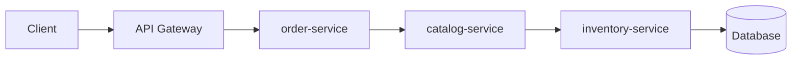

# Propagating Deadlines and Stopping Work When Requests Expire

In a microservices architecture, a request can traverse an API Gateway, `order-service`, `catalog-service`, and `inventory-service` before returning a result. If each service independently configures a 2-second timeout for its next outbound call, total processing time can far exceed how long the user is willing to wait. Moreover, after the caller gives up, downstream services may keep consuming threads, connections, CPU, or database capacity to compute a result nobody will ever receive.

A **deadline** solves this by defining the **final point in time** at which a request still matters. Deadlines propagate across hops, each hop recomputes remaining time, refuses to start new work once the budget is exhausted, and attempts to cancel operations that are no longer needed. In the `SPRING_CLOUD_SERVICE_COMMUNICATION_LOAD_BALANCING` module, this approach must coordinate with Spring Cloud LoadBalancer, `RestClient`, `WebClient`, OpenFeign, HTTP transport timeouts, and retries—yet **never** assume LoadBalancer automatically propagates deadlines or aborts all downstream work.

## 1. Distinguishing Timeout, Deadline, and Cancellation

Three related concepts that do not replace one another:

| Concept | Meaning | Example scope |
|---|---|---|
| **Timeout** | Maximum duration allowed for one operation or phase | Wait for pool connection 200 ms; TCP connect 300 ms; wait for response 700 ms |
| **Deadline** | Absolute point in time by which the entire request must finish | Request must finish before 12:00:01.500 UTC |
| **Cancellation** | Signal to stop a waiting/running task because its result is no longer needed | Cancel a WebClient subscription; interrupt a task; close a request/connection |

Timeouts answer “**how long** may we wait?”, whereas deadlines answer “**by when** does time run out?”. Cancellation answers “once time has run out, **how do we tell remaining work to stop?**”.

For example, `order-service` receives a 1,500 ms budget. It spends 450 ms on authentication and preparing data. When calling `catalog-service`, only about 1,050 ms of real budget remain—not a fresh 1,500 ms. If it must reserve 100 ms to merge data and write the response, `catalog-service` should receive at most around 950 ms for the remaining work.

A short **connect timeout** does not guarantee the entire call finishes within the deadline: waiting on pools, discovery, retries, backoff, reading bodies, and business logic all consume budget. Deadlines must therefore be enforced at the **request-orchestration layer**, in addition to per-phase HTTP timeouts.

## 2. Why Per-Hop Timeouts Easily Breach SLAs

Consider a sequential call chain:



If every hop has a “2-second read timeout” with no shared deadline, a single request can undergo multiple waits and retries. Each service behaves as if it has a full 2 seconds left even if the caller disconnected long ago. When many requests hit downstream trouble simultaneously, this wasted work builds queues, drains connection pools, and amplifies failures.

A deadline provides a shared boundary:

```text
Client wants completion before D = 12:00:01.500
    |
Gateway forwards deadline D
    | consumed 150 ms
order-service has ~1,350 ms left
    | consumed another 350 ms
catalog-service has ~1,000 ms left
    | before calling inventory-service, must subtract reserve budget
inventory-service may work only within the remaining time
```

Not every service needs identical connect or response timeouts. However, **no hop may unilaterally extend the deadline it received**. If a service needs less time to protect internal resources, it may set a child deadline **earlier** than the caller's deadline.

## 3. Computing Remaining Time Budget

Let `D` be the deadline and `t_now` be the current time:

\[
B_{remaining} = \max(0, D - t_{now})
\]

If a service must reserve `R` for post-downstream processing and wants to cap that downstream call by `C`:

\[
B_{downstream} = \max\bigl(0, \min(B_{remaining}-R,\;C)\bigr)
\]

Example:

- Initial budget for the entire request: **1,500 ms**.
- Consumed in gateway and `order-service`: **480 ms**.
- Remaining: **1,020 ms**.
- Reserve **120 ms** for combining results and sending the response.
- `catalog-service` has its own per-call cap of **800 ms**.

Budget for the next call is `min(1,020 - 120, 800) = 800 ms`. If only 90 ms remain while the app needs a 120 ms reserve, **do not start** the downstream call; return an expiration error or a cheap, safe fallback per business policy.

Reserve times are not fixed constants for every system. Measure real phases, queues, serialization, connection pools, and network overhead to pick proper thresholds. If a request crosses many hops, overly large per-hop reserves can exhaust the budget prematurely; balance them against the overall SLO.

## 4. Propagating Deadlines via HTTP Headers

A common approach uses an internal header to carry an **absolute timestamp**, for example:

```http
GET /api/products/P42 HTTP/1.1
Host: catalog-service
X-Request-Deadline-Epoch-Millis: 1794926401500
X-Correlation-Id: req-7f29
```

`X-Request-Deadline-Epoch-Millis` here is an **application-designed illustrative convention**, not a standard header automatically emitted or understood by Spring Cloud LoadBalancer. The value is milliseconds since the Unix epoch. `X-Correlation-Id` links logs/traces together, without carrying time-limit semantics.

At each hop, the application should:

1. **Receive** the deadline established by the gateway or trusted upstream.
2. **Validate and clamp** the deadline against the service's own maximum policy.
3. **Compute remaining time** before each potentially slow operation.
4. **Enforce execution limits** on the operation via suitable timeouts/cancellation.
5. **Propagate a deadline no later than the received deadline** when calling downstream.
6. **Stop launching new work** once budget runs out; curb in-flight tasks where cancellation is possible.

### Do Not Blindly Trust Headers from the Internet

External clients could send a deadline far in the future to hold resources long, or an already-expired deadline to trigger floods of errors. The gateway should strip/replace untrusted headers, set the deadline from SLOs and auth policy, and propagate it only inside the trusted network. Internal services should still enforce **their own maximum cap**, even behind a gateway.

For epoch-numeric headers, validate syntax, magnitude, negative/overflow values, and invalid-input handling policies. Never use raw deadline strings to construct hostnames or customize URLs. Avoid leaking internal topology or policy details in responses to public clients.

## 5. Clocks: Absolute Deadlines vs. Locally Measured Elapsed Time

Propagating an absolute timestamp avoids stacking timeouts across hops. However, it requires machine clocks to be **sufficiently synchronized**. If `order-service` and `catalog-service` drift by 500 ms, the same timestamp can appear expired too early or seem to have more time left than reality.

Therefore:

- Synchronize host/VM/container clocks using NTP or equivalent, and monitor clock skew.
- Use absolute timestamps for **inter-process propagation**, but upon receipt convert into a local budget tracked with a **monotonic clock** (such as `System.nanoTime()`) so wall-clock adjustments do not alter in-process wait durations.
- Define a policy for anomalous timestamps and deadlines that are already expired on arrival.
- In environments without reliable clock sync, you can propagate **remaining budget** over a well-defined internal protocol, reducing reliance on wall clocks while subtracting transit time and clamping on receipt.

Do not confuse `System.currentTimeMillis()` (wall clock, adjustable) with `System.nanoTime()` (local interval measurement). The two values must never be compared directly because they use different origins.

## 6. Defining a Shared Deadline Object

A `Deadline` type keeps applications from juggling raw `long` variables manually. The example below uses `Clock` for testability; it is an **illustrative** implementation for an internal service receiving headers from a trusted source:

```java
package com.example.orders.timeout;

import java.time.Clock;
import java.time.DateTimeException;
import java.time.Duration;
import java.time.Instant;

public record Deadline(Instant expiresAt) {

    public static Deadline fromTrustedHeader(
            String raw,
            Duration maximumBudget,
            Clock clock) {

        Instant now = clock.instant();
        Instant localLimit = now.plus(maximumBudget);

        if (raw == null || raw.isBlank()) {
            return new Deadline(localLimit);
        }

        try {
            Instant upstream = Instant.ofEpochMilli(Long.parseLong(raw));
            return new Deadline(upstream.isBefore(localLimit)
                    ? upstream : localLimit);
        } catch (NumberFormatException | DateTimeException ex) {
            throw new IllegalArgumentException("Invalid deadline header", ex);
        }
    }

    public Duration remaining(Clock clock) {
        Duration value = Duration.between(clock.instant(), expiresAt);
        return value.isNegative() ? Duration.ZERO : value;
    }

    public boolean expired(Clock clock) {
        return remaining(clock).isZero();
    }

    public String asHeaderValue() {
        return Long.toString(expiresAt.toEpochMilli());
    }
}
```

A simple exception representing an expired deadline:

```java
package com.example.orders.timeout;

public class DeadlineExceededException extends RuntimeException {
    public DeadlineExceededException() {
        super("Request deadline exceeded");
    }
}
```

Initial creation can enforce a 1,200 ms maximum budget:

```java
Deadline deadline = Deadline.fromTrustedHeader(
        incomingDeadlineHeader,
        Duration.ofMillis(1200),
        clock);

if (deadline.expired(clock)) {
    throw new DeadlineExceededException();
}
```

This snippet rejects malformed headers and prevents the deadline from exceeding the local cap. It is **not yet** a complete production implementation: you must enforce positive/valid `maximumBudget`, choose HTTP error codes for invalid headers, handle clock skew, and use monotonic timing for in-process execution budgets. Above all, never use a far-future client-supplied deadline to hold connections longer than your SLO.

## 7. Reactive: Propagating Deadlines via WebClient and Cancelling on Expiration

With Spring WebFlux, `Mono.timeout(Duration)` emits an error when the publisher fails to finish in time. On timeout, the operator sends a **cancel** signal to the upstream subscription. This is an effective mechanism to try stopping an awaiting reactive HTTP request, though it **does not guarantee** the target server stopped business work that already started.

Create a `WebClient.Builder` backed by Spring Cloud LoadBalancer:

```java
package com.example.orders.config;

import java.time.Clock;
import org.springframework.cloud.client.loadbalancer.LoadBalanced;
import org.springframework.context.annotation.Bean;
import org.springframework.context.annotation.Configuration;
import org.springframework.web.reactive.function.client.WebClient;

@Configuration(proxyBeanMethods = false)
public class OutboundClientConfiguration {

    @Bean
    Clock clock() {
        return Clock.systemUTC();
    }

    @Bean
    @LoadBalanced
    WebClient.Builder loadBalancedWebClientBuilder() {
        return WebClient.builder();
    }
}
```

Then build the client calling `catalog-service` and check remaining time **at subscription time**, rather than only when assembling the pipeline:

```java
package com.example.orders.catalog;

import com.example.orders.timeout.Deadline;
import com.example.orders.timeout.DeadlineExceededException;
import java.time.Clock;
import java.time.Duration;
import java.util.concurrent.TimeoutException;
import org.springframework.cloud.client.loadbalancer.LoadBalanced;
import org.springframework.stereotype.Component;
import org.springframework.web.reactive.function.client.WebClient;
import reactor.core.publisher.Mono;

@Component
public class CatalogClient {
    private final WebClient webClient;
    private final Clock clock;

    public CatalogClient(
            @LoadBalanced WebClient.Builder builder,
            Clock clock) {
        this.webClient = builder.clone().build();
        this.clock = clock;
    }

    public Mono<ProductDto> findProduct(String id, Deadline deadline) {
        return Mono.defer(() -> {
            Duration remaining = deadline.remaining(clock);
            if (remaining.isZero()) {
                return Mono.error(new DeadlineExceededException());
            }

            return webClient.get()
                    .uri("http://catalog-service/api/products/{id}", id)
                    .header("X-Request-Deadline-Epoch-Millis",
                            deadline.asHeaderValue())
                    .retrieve()
                    .bodyToMono(ProductDto.class)
                    .timeout(remaining)
                    .onErrorMap(TimeoutException.class,
                            error -> new DeadlineExceededException());
        });
    }
}
```

`ProductDto` is an application DTO matching `catalog-service`'s JSON. `Mono.defer` is vital because time can elapse in the pipeline between **creating** the `Mono` and **subscribing** to it. Computing `remaining` upfront and reusing it forever can grant a timeout larger than the actual remaining budget.

`timeout(remaining)` bounds publisher wait time at the Reactor layer. When it times out, Reactor tries to cancel the upstream subscription; with WebClient and compatible transports, cancelling typically stops waiting for the response or closes/aborts the underlying HTTP operation. Still, **bytes already sent cannot be recalled**, and a task on the server does not necessarily know the caller cancelled.

Never treat `Mono.timeout` as a replacement for all connect timeouts, response timeouts, or connection pool limits. You still need proper timeouts on Reactor Netty/HTTP connectors and resource bounds, especially under high concurrency or pool contention.

## 8. Checking Deadlines at Request Entry and Propagating Across Hops

At the HTTP boundary of `order-service`, the app can read the header from a trusted gateway, build a `Deadline`, and pass that same deadline into downstream clients:

```java
package com.example.orders.web;

import com.example.orders.catalog.CatalogClient;
import com.example.orders.catalog.ProductDto;
import com.example.orders.timeout.Deadline;
import java.time.Clock;
import java.time.Duration;
import org.springframework.web.bind.annotation.GetMapping;
import org.springframework.web.bind.annotation.PathVariable;
import org.springframework.web.bind.annotation.RequestHeader;
import org.springframework.web.bind.annotation.RestController;
import reactor.core.publisher.Mono;

@RestController
public class OrderPreviewController {
    private final CatalogClient catalog;
    private final Clock clock;

    public OrderPreviewController(CatalogClient catalog, Clock clock) {
        this.catalog = catalog;
        this.clock = clock;
    }

    @GetMapping("/orders/preview/{id}")
    public Mono<ProductDto> preview(
            @PathVariable String id,
            @RequestHeader(
                    value = "X-Request-Deadline-Epoch-Millis",
                    required = false) String header) {

        Deadline deadline = Deadline.fromTrustedHeader(
                header, Duration.ofMillis(1200), clock);

        if (deadline.expired(clock)) {
            return Mono.error(new DeadlineExceededException());
        }

        return catalog.findProduct(id, deadline);
    }
}
```

In this example, `DeadlineExceededException` must be imported and mapped to an appropriate HTTP response in a real application. `fromTrustedHeader` should only be used after a gateway validates/controls the header. If the controller is reachable directly from the Internet, add trust-boundary checks and policy limits before using any external value.

If `catalog-service` calls `inventory-service` next, it must read the received deadline, recompute remaining budget, **propagate the same deadline or an earlier sub-deadline**, and reject work when out of budget. Never mint a fresh 1,200 ms at every hop. Specifically, `@LoadBalanced WebClient.Builder` resolves service IDs; it **does not automatically carry deadline headers** unless your code or an HTTP client filter attaches them.

## 9. Overall Budget for Multiple Calls and Reactive Composition

When calling `catalog-service` and `inventory-service` in parallel, you can use `Mono.zip`. Ensure the **combined aggregate operation** is also bounded by the deadline:

```java
Mono<OrderView> buildView(String id, Deadline deadline) {
    return Mono.defer(() -> {
        Duration totalRemaining = deadline.remaining(clock);
        if (totalRemaining.isZero()) {
            return Mono.error(new DeadlineExceededException());
        }

        Mono<ProductDto> product = catalog.findProduct(id, deadline);
        Mono<StockDto> stock = inventory.findStock(id, deadline);

        return Mono.zip(product, stock)
                .map(tuple -> new OrderView(tuple.getT1(), tuple.getT2()))
                .timeout(totalRemaining)
                .onErrorMap(TimeoutException.class,
                        ex -> new DeadlineExceededException());
    });
}
```

Types `StockDto`, `OrderView`, and client `inventory` are assumed defined by the application. Execution of the two calls may overlap, yet they **share the same deadline**. One failing call can fail the zip and cancel the sibling subscription; server work already underway still requires downstream cancellation or its own deadline to stop early.

If partial results are acceptable when one downstream fails, define the fallback policy explicitly and avoid turning timeouts into default data that looks valid. For instance, showing product details without stock counts may be acceptable on a preview screen, but unacceptable when confirming an order or deducting inventory.

## 10. Synchronous RestClient/OpenFeign: No Guaranteed Cancellation

With blocking `RestClient`, `RestTemplate`, or OpenFeign, an HTTP call can hold a thread waiting on I/O. You can configure HTTP client limits:

- **Pool lease timeout:** waiting to acquire a connection from the pool.
- **Connect timeout:** opening a connection to the `ServiceInstance`'s host/port.
- **Response/read timeout:** waiting for data returned from downstream.
- **Request deadline:** overall orchestration-layer budget covering waiting, instance selection, retries, and follow-up processing.

Example per-client properties in Spring Cloud OpenFeign, setting **transport** limits rather than a whole-request deadline:

```yaml
spring:
  cloud:
    openfeign:
      client:
        config:
          catalog-service:
            connectTimeout: 300
            readTimeout: 700
```

These numbers are in milliseconds per standard OpenFeign configuration; they are **illustrative thresholds**, not optimal settings for every infrastructure. `readTimeout` does not automatically cover an entire retry chain and post-response work. If a request only has 150 ms left while the client still has `readTimeout: 700`, the app risks waiting past the shared deadline.

### Stopping Thread Work Too When Time Expires

For blocking work submitted to an `ExecutorService`, you can wait up to remaining time and request cancellation when overdue:

```java
Future<Result> future = executor.submit(() -> blockingWork());

Duration remaining = deadline.remaining(clock);
if (remaining.isZero()) {
    future.cancel(true);
    throw new DeadlineExceededException();
}

try {
    return future.get(remaining.toMillis(), TimeUnit.MILLISECONDS);
} catch (TimeoutException timeout) {
    future.cancel(true);  // Requests an interrupt, not a guaranteed kill.
    throw new DeadlineExceededException();
}
```

`Result`, `executor`, `blockingWork`, `clock`, and `deadline` in the snippet are hypothetical application components; in real code import `Future`, `TimeUnit`, `Duration`, `TimeoutException`, and handle `InterruptedException`/`ExecutionException` completely. In this pattern, **`Future.cancel(true)` only sends an interrupt signal**. If the HTTP/JDBC library ignores interrupts or the operation already ran on the server, work may continue.

Similarly, `CompletableFuture.orTimeout(...)` completes a future exceptionally upon expiration, **without proving background I/O was cancelled**. Do not merely attach a timeout to a future and assume threads, sockets, and database queries were freed.

For synchronous HTTP clients, prefer transport timeouts, implementation-provided request abort/cancel APIs, and cancellation checks at task boundaries. Any thread pool/executor wrapping blocking calls must also bound concurrency and queues to avoid solving one timeout by spawning unbounded threads.

## 11. Spring Cloud LoadBalancer, Retries, and Remaining Deadlines

Spring Cloud LoadBalancer selects a `ServiceInstance` via service ID, discovery, and `ServiceInstanceListSupplier`s. **It does not inherently manage a shared end-to-end deadline** across `RestClient`, `WebClient`, OpenFeign, and downstream services. When no instance is available, discovery returns empty, or a chosen instance fails, re-selection/retries must still obey the remaining budget.

Illustrative timeline when the caller has 900 ms at the start of a downstream call:

| Event | Time spent | Remaining budget |
|---|---:|---:|
| Start | 0 ms | 900 ms |
| Waiting for discovery / picking instance | 60 ms | 840 ms |
| Attempt 1 connection fails | 240 ms | 600 ms |
| Backoff before retry | 100 ms | 500 ms |
| Attempt 2 | Bounded by remaining budget minus reserve | Must not grant a fresh 900 ms |

If retries are enabled via Reactor `retryWhen`, Spring Cloud LoadBalancer retry, or another layer, clarify **who owns retries** and where total duration is bounded. One reactive pattern wraps the whole attempt/retry chain in an overall timeout computed **at subscribe time**:

```java
Mono<ProductDto> withBudget(Deadline deadline) {
    return Mono.defer(() -> {
        Duration remaining = deadline.remaining(clock);
        if (remaining.isZero()) {
            return Mono.error(new DeadlineExceededException());
        }

        return fetchOneAttempt(deadline)
                .retryWhen(retrySpecForTransientFailures())
                .timeout(remaining)
                .onErrorMap(TimeoutException.class,
                        ex -> new DeadlineExceededException());
    });
}
```

`fetchOneAttempt` should recompute deadline/budget before each subscription; `retrySpecForTransientFailures()` is an application policy that caps attempts/backoff and filters retryable errors. The goal here is emphasizing that **the deadline wraps both backoff and retries**, not encouraging retrying every HTTP error.

Never unconditionally retry `POST`/`PATCH` operations with side effects. When a caller times out after the server succeeded and the response was lost, a subsequent attempt can create an order or deduct inventory twice. Use idempotency keys, transactions, and proper deduplication if business rules allow retries.

## 12. Stopping Work: Cooperation Between Caller and Target Server

A client returning a timeout error does not automatically make the server stop processing. Distinguish the possibilities:

| Situation | What can the caller do? | What must downstream do? |
|---|---|---|
| Request not sent yet | Skip sending once deadline expired | Nothing to do |
| Awaiting reactive HTTP response | Cancel subscription; release cancellable resources | Detect disconnect/cancel or check its own deadline |
| Awaiting blocking HTTP | Apply transport timeout; abort request if supported; conditional interrupt | Honor deadlines and cancellation at work boundaries |
| Server querying DB | Caller cannot remotely force DB stop via header alone | Set query/statement timeouts; cancel query if driver supports it |
| Server already wrote data | Cannot “undo” a side effect just by cancelling | Require transactions, idempotency, or compensation policy if suitable |
| Task offloaded to queue/background | Caller no longer owns direct lifecycle | Message TTL, deadline check when worker picks up task, deduplication |

A server receiving a deadline should check it **before expensive steps** (large queries, additional HTTP calls, job creation) and **after long waits**. Once expired, stop spawning new work and return an error when a response can still be sent.

With reactive processing, subscriber cancellation can propagate through some publishers and HTTP clients, yet **does not guarantee** tasks detached via manual `subscribe()`, `@Async`, standalone threads, message queues, or external side effects stop too. Avoid unmanaged detached tasks; for intentional background work, use dedicated deadlines, cancellation tokens, or job state checks.

For database queries, set query/statement timeouts aligned with budgets and transactions. If a request cancels mid-transaction, understand framework and database rollback semantics; closing a connection does not mean every executed effect rolls back automatically.

## 13. When a Deadline Expires, Which HTTP Status Should Be Returned?

No single HTTP status fits every deadline-expiration case:

- **`504 Gateway Timeout`** usually fits when a gateway/proxy does not receive a timely reply from upstream. An application aggregating downstream calls may choose a similar representation per its API contract.
- **`503 Service Unavailable`** fits temporary unavailability, such as no available instances or overload; not every deadline expiration is a 503.
- **`408 Request Timeout`** usually relates to a server waiting for the client to finish sending its request, not a default code for every downstream timeout.
- When the **client already disconnected**, the server may be unable to send any response; some proxies log a non-standard code like `499` internally to indicate client-closed connections.

Critically, separate **deadline exceeded** from **no service instance available**, **connect timeout**, **read timeout**, **HTTP 500**, and **business errors** in logs and metrics. When an API returns a fallback, clearly signal whether data is partial or degraded if that affects user decisions.

## 14. Observing Deadlines and Cancellation Across Services

For operations, record at minimum:

| Observability field | Meaning |
|---|---|
| `traceId` / `spanId` | Links hops of the same request |
| `serviceId` and chosen `instanceId` | Separates discovery/routing issues from downstream issues |
| Remaining budget on receiving request | Shows how much time the service was granted |
| Remaining budget before each outbound call | Identifies whether downstream was given too much time |
| Attempt/retry count and backoff | Detects failure-time load amplification |
| Timeout type | Pool lease, connect, response, overall deadline |
| Cancellation outcome | Was cancel/interrupt sent? Did work actually stop? |
| Final outcome | Success, timeout, cancelled, fallback, error |

For example, two services both report timeouts for different reasons: `catalog-service` took 700 ms to respond, leaving `inventory-service` only 100 ms because earlier steps spent the budget. Looking only at `inventory-service` connect/read timeouts could lead operators to tune the wrong final service instead of optimizing the overall request chain.

Keeping separate metrics for **deadline exceeded before sending**, **deadline exceeded awaiting HTTP**, and **work cancelled after timeout** reveals whether policies actually shed load or merely change how errors are reported. Never log tokens, cookies, or user payloads in deadline logs; timestamps, durations, service IDs, and trace IDs are usually enough for analysis.

## 15. Hands-On Lab with Two Downstream Instances

**Goal:** prove that a shared deadline is not reset at each hop, reactive clients stop waiting when expired, and already-expired steps do not issue new requests.

### Setup

- `order-service`: receives `/orders/preview/{id}`, creates a 1,200 ms deadline if no trusted deadline exists, and calls `catalog-service` via `@LoadBalanced WebClient.Builder`.
- `catalog-service`: two instances on `localhost:8081` and `localhost:8082`, each exposing `/api/products/{id}`. Allow configurable response delay in the lab.
- `inventory-service` (optional): endpoint returning stock after a delay to test `Mono.zip` aggregation.

Static discovery configuration in the consumer:

```yaml
spring:
  cloud:
    discovery:
      client:
        simple:
          instances:
            catalog-service:
              - uri: http://localhost:8081
              - uri: http://localhost:8082
```

`localhost` is valid only when consumer and both instances run in the same network context. Under Docker/Kubernetes, use addresses actually reachable from the consumer; DNS or container port issues cannot be solved by raising deadlines.

### Cases to Observe

| Test case | How to trigger | Expected result |
|---|---|---|
| No deadline at ingress | Omit header, use 1,200 ms local budget | Gateway/service assigns valid deadline per policy |
| Very little remaining deadline | Send header created by trusted gateway with 50 ms left | Downstream step does not start if budget is insufficient; fails fast |
| Already expired deadline | Send expired header | No outbound HTTP call made; returns expiration error |
| Slow downstream | Make instance sleep 2 seconds | Caller stops waiting around granted deadline; does not wait full 2 seconds |
| Retry with backoff | Inject transient error on attempt 1 | Total retry/backoff duration does not exceed deadline |
| One `Mono.zip` branch fails | Make `inventory-service` slow or failing | Sibling branch receives cancel as appropriate; whole pipeline stops on time |
| Blocking call via Future | Run long blocking task | `future.cancel(true)` is requested, but separately verify whether I/O really stopped |
| Post-deadline side effect | Test DB write with idempotency key | Not automatically re-executed or double-written due to timeout |

In the lab, log request start time, propagated header values, remaining time at each hop, selected instance, HTTP calls sent, timeout timestamps, and tasks still running afterward. **Do not treat a caller receiving a timeout as sufficient proof that downstream stopped working.** A thorough test instruments the target server as well.

## 16. Design Pitfalls to Avoid

| Anti-pattern | Consequence | Replacement |
|---|---|---|
| Every hop resets a 2-second timeout | Call chain exceeds overall SLO | Propagate shared deadline and subtract elapsed time |
| Setting only connect timeout | Pool wait, response, retries, and business work are unbounded | Combine transport timeouts with overall deadline |
| Computing `remaining` when building `Mono`, subscribing much later | Grants an outdated budget | Use `Mono.defer` or compute at attempt start |
| Trusting raw deadlines from browsers | Clients can stretch or break budgets | Gateway controls headers; every service clamps bounds |
| Assuming `.timeout()` cancels all server tasks | Background jobs/DB keep running | Propagate deadlines, cancellation tokens, query timeouts, and idempotency |
| Calling `Future.cancel(true)` and assuming thread died | I/O may ignore interrupts | Transport timeout/abort and verify per-library cancellation |
| Unbudgeted retries at multiple tiers | Amplifies requests and drains connections | Clear retry owner, bounded attempts/backoff, and overall deadline |
| Using deadline headers for authorization | Caller-supplied data can be tampered with | Keep auth/authz separate; deadlines govern time only |
| Assuming timeout error means server didn't process | Write requests may have succeeded | Idempotency keys, reconciliation, and proper transactions |

## 17. Production Adoption Checklist

1. Have you defined the overall request SLO/time budget and a trusted point where deadlines originate?
2. Does the deadline header clearly specify units, format, authenticity, and maximum bounds?
3. Do all downstream services receive and **never extend** upstream deadlines?
4. Is remaining budget measured **right before each call**, failing fast when expired?
5. Do transports have tight connect/pool/response timeouts aligned with the overall deadline?
6. For WebClient, are `timeout`/cancellation applied on the right publisher and tested against a slow server?
7. For blocking RestClient/OpenFeign, have you verified real interrupt/abort behavior rather than just future timeouts?
8. Are retries bounded in attempts/backoff, enclosed within the overall deadline, and prevented from blindly repeating unsafe writes?
9. Do database queries, transactions, background jobs, and message queues check deadlines and stop where appropriate?
10. Have you tested client disconnects, slow discovery, failed instances, exhausted connection pools, clock skew, and failures after data writes?
11. Do metrics/traces record remaining budget, attempt counts, selected instances, timeout types, and cancellation outcomes?
12. Are error codes/fallbacks clearly defined without masking failed requests as valid business results?

**Conclusion:** Timeouts protect a single operation; **deadlines protect the entire journey of a request**. In Spring Cloud LoadBalancer, selecting a `ServiceInstance` and configuring `RestClient`, `WebClient`, or OpenFeign are only part of that journey. To keep the system from wasting resources after a caller times out, **propagate deadlines across hops, recompute budgets before every task, bound both retries and transport timeouts, and design cooperative cancellation**. Above all, a timeout signal on the caller must never be mistaken for a guarantee that downstream side effects were rolled back.
