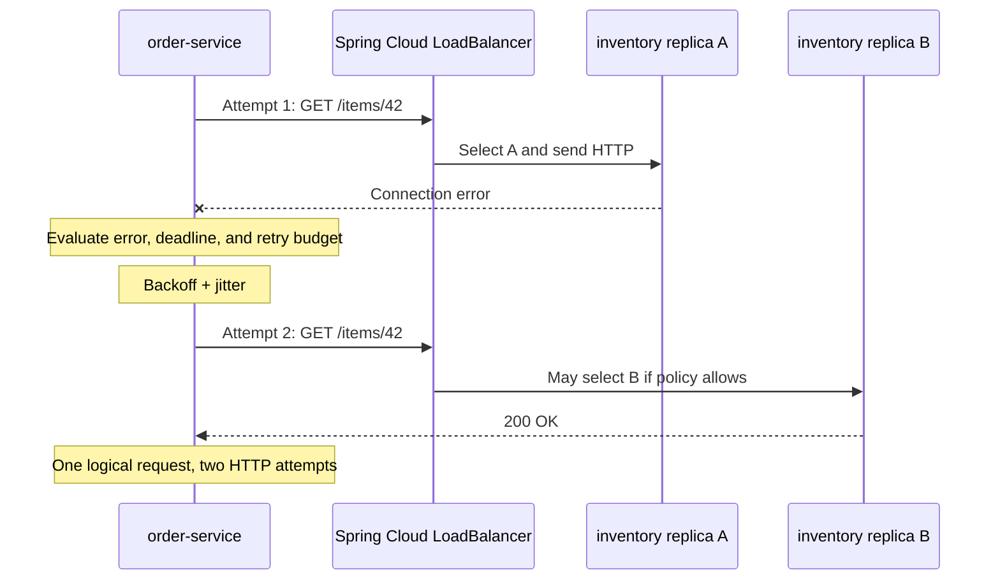
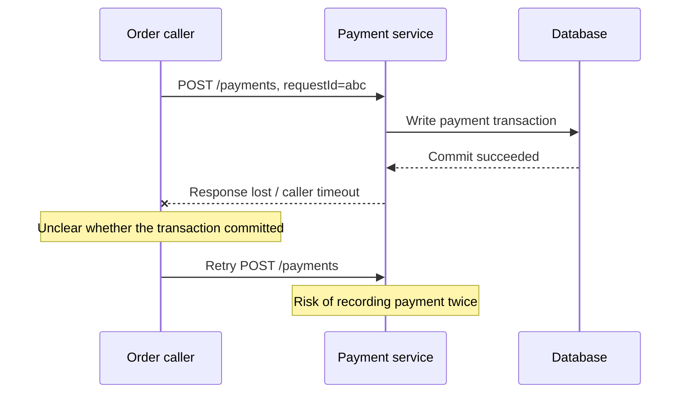
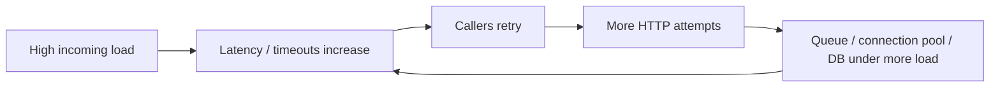
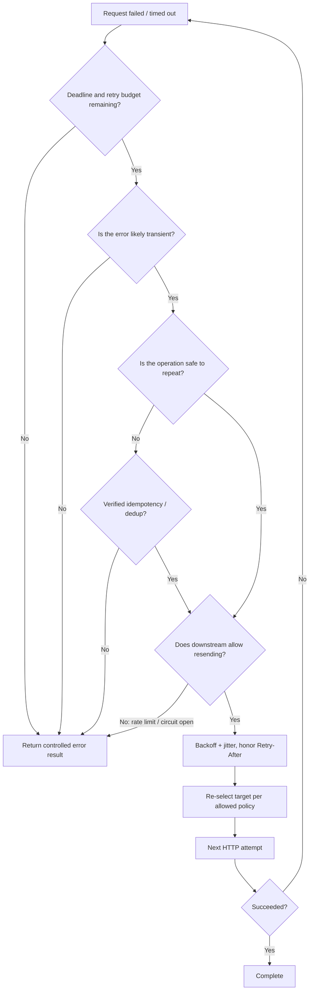

# When Retries Help and When They Make Things Worse

In a microservice system, a single failed HTTP call does not necessarily mean the target service has completely failed. A network connection can drop right as a replica is being replaced; one instance may be temporarily overloaded while another instance is still serving well. **Retries** help overcome such *transient* failures. However, if every caller retries immediately when the system is congested, retries can turn a minor incident into a **retry storm**, making it even harder for downstream services to recover.

This lesson belongs to the **Retries** chapter in the `SPRING_CLOUD_SERVICE_COMMUNICATION_LOAD_BALANCING` module on Spring Cloud LoadBalancer. The caller may use `RestClient`, `WebClient`, or OpenFeign to call a service ID such as `inventory-service`. Spring Cloud LoadBalancer is responsible for selecting a `ServiceInstance` based on discovery, health checks, and routing policies; meanwhile, whether to retry, which errors to retry, with what budget, and whether to re-select an instance must be designed separately.

**Central question:** When does adding another attempt create a real chance of success, and when does it only send additional load to a system that can no longer process requests?

## 1. A retry is not an independent new request

Suppose `order-service` makes a logical request:

```http
GET http://inventory-service/api/items/42
```

If the first attempt encounters a connection error and the system retries twice, one **logical request** can generate up to three **HTTP attempts**:



The diagram above illustrates **one possibility**: the second attempt selects B. Retrying does **not automatically** select a different instance. If the retry mechanism sits inside the HTTP transport after the URI has already been resolved to a specific host/port, the retry may continue hitting A. If the retry wraps the entire call through LoadBalancer, instance selection may run again, yet it can still pick A depending on the algorithm, candidate list, and configuration.

Three distinct metrics need to be tracked:

| Concept | Meaning |
|---|---|
| **Logical request** | A single business operation that the caller intends to perform. |
| **HTTP attempt** | An actual attempt to send a request over the transport; retries create additional attempts. |
| **LoadBalancer selection** | One `ServiceInstance` selection; not every retry necessarily re-runs selection. |

Do not count three attempts as three independent orders in business reporting; likewise, do not measure only logical requests while ignoring the actual load generated by extra attempts.

## 2. When are retries helpful?

Retries create value when the following core conditions are met simultaneously:

1. **The error is likely transient:** a reasonable chance that a subsequent attempt will succeed.
2. **The request can be executed again safely:** it does not cause unintended side effects, or duplicate-handling protection is in place.
3. **Sufficient time remains:** the total duration of attempts and backoff does not exceed the business deadline.
4. **Downstream still has capacity to serve:** retrying does not further congest an overloaded system or violate rate limits.
5. **The retry still honors routing policies:** it does not bypass tenant, region, zone, or access-control constraints.

Common suitable examples:

- **Connection refused from a replica that just left the system:** discovery/caching lists have not updated yet; if another replica is ready, retrying can succeed.
- **Short-lived gateway error:** an upstream proxy returns `502 Bad Gateway` due to a temporary connection drop while another backend can still serve.
- **Replica restarting:** a safe read request fails during the brief window between readiness and discovery updates.
- **Temporarily slow dependency:** in some cases, waiting for a backoff period and retrying allows the system to recover while staying within the deadline.

Not every error in the list above is automatically retryable. Decisions must rely on the API contract, actual error metrics, and the layer where the error originated—not just the exception name.

## 3. Before retrying, identify where the failure occurred

Failures occurring before instance selection, during connection establishment, after sending the request, or after upstream processing have very different implications.

| Failure stage | Examples | Can retry help? | Notes |
|---|---|---|---|
| **Discovery/LoadBalancer found no instance** | Wrong service ID, empty registry, health supplier filtered out all candidates. | Unlikely if misconfigured; only helpful if the list is recovering quickly. | Do not loop endlessly when no `ServiceInstance` exists. |
| **After selection, before connection succeeds** | Connection refused from A; B is still healthy. | Yes, with limits and re-selection from an appropriate candidate set. | Selecting B only happens if the retry mechanism actually runs through LB. |
| **Connection dropped or response timeout** | Read timeout, connection reset. | Possibly, but **there is no guarantee the server did not execute the request**. | Write operations must have idempotency. |
| **Upstream returns an explicit error** | `429`, `502`, `503`, `504`. | Depends on status, rate-limit policy, and `Retry-After`. | Do not retry immediately by reflex. |
| **Invalid request or missing permissions** | `400`, `401`, `403`, `404`. | Usually no. | Resending the same data rarely fixes the error. |
| **Business/data-condition error** | `409 Conflict`, validation failed. | Usually not automatically. | Must follow the business contract; may require a separate conflict-resolution flow. |

**No available instance** is not the same as **upstream returning HTTP `503`**. Depending on the integration, the final outcome at the caller may appear as a `503` error or an exception in both cases, but the point of origin differs. To choose the right retry policy, you must record whether a `ServiceInstance` was selected and whether an HTTP response was received from an actual instance.

### Interpret HTTP statuses by cause, not mechanically by group

- `408 Request Timeout`: may be a transient error, but you need to understand which server/proxy returned it and whether the request already caused side effects.
- `429 Too Many Requests`: downstream is asking callers to slow down; prioritize honoring `Retry-After`, concurrency/rate limits, and deadlines rather than resending immediately.
- `500 Internal Server Error`: may be a bug or a prolonged dependency outage. Do not blindly retry all `500` responses.
- `502`, `503`, `504`: often worth considering for *bounded* retries, but if all replicas share the same broken dependency, retrying may be futile.
- `401 Unauthorized`: should only trigger a controlled credential-refresh flow when appropriate; do not turn it into an infinite retry loop.
- `403 Forbidden` and other authentication/authorization errors: do not retry to "try another instance" in order to bypass permissions.

If the response includes `Retry-After` (in seconds or an HTTP date), apply it according to the contract, within reasonable bounds and the remaining deadline. If the required wait exceeds the deadline, **return a controlled error** instead of holding the request indefinitely.

## 4. Idempotency: the core prerequisite for retrying

**Idempotency** means that performing the same operation multiple times has an intended effect equivalent to performing it once, according to the system's contract. How safe a retry is depends on both the HTTP method and how the API is implemented, not just the method name.

| Method / operation | Retry considerations |
|---|---|
| `GET /items/42` | Per HTTP, safe/idempotent; usually a good candidate if the API is truly read-only. |
| `HEAD` / `OPTIONS` | Usually safe; still requires a deadline and load limits. |
| `PUT /items/42` | Has idempotent semantics in HTTP, but versioning, secondary events, and specific logic must be checked. |
| `DELETE /items/42` | Has idempotent semantics with respect to resource state; subsequent responses may differ and side effects must be reviewed. |
| `POST /orders` | Typically creates a new transaction; do not auto-retry without verified idempotency/deduplication guarantees. |
| `PATCH /stock` | Not idempotent by default; repeating increment/decrement operations can cause data corruption. |

### Why timeouts after sending are especially dangerous

A timeline that can occur:



**A timeout does not mean upstream failed to process the request.** If the caller automatically retries `POST`, data may be created twice. To retry in a controlled manner:

1. The caller generates a **stable idempotency key** for *one business operation*.
2. Every attempt of that operation uses the **same key**, without generating a new key on each retry.
3. Upstream stores/checks the key and processed result for an appropriate retention window, ensuring the check-and-commit step is concurrency-safe.
4. Upon receiving an existing key again, upstream returns a compatible result or executes a duplicate-detection flow according to the contract.
5. Track key expiration, tenant scope, and semantics when two requests share the same key but have different payloads.

Illustrative request example:

```http
POST /api/orders HTTP/1.1
Host: orders.example.test
Content-Type: application/json
Idempotency-Key: 8ec93dbe-20be-4fc1-b9b6-9fc647e310f5

{"itemId":"42","quantity":1}
```

`Idempotency-Key` is an API-implemented convention/contract, **not something Spring Cloud LoadBalancer guarantees automatically**. Simply attaching the header without server-side deduplication cannot prevent duplicate transactions.

## 5. Why can retries make things worse?

### 5.1. Adding load when the system is already overloaded

Suppose `inventory-service` is operating near its capacity limit. It returns errors or times out on a fraction of requests. If every caller retries immediately, each failed request spawns another request, driving up queues and CPU usage, causing even more requests to fail.



This is a **positive feedback loop**: the longer processing takes, the more requests pile up waiting; retries leave downstream with even less chance to recover.

If each logical request allows **up to three attempts**, suppose the failure probability of each attempt is `p` and independent (a simplified assumption for calculation):

```text
E[attempts] = 1 + p + p²

p = 0.10  -> E = 1.11 attempts / logical request
p = 0.90  -> E = 2.71 attempts / logical request
```

When failures rise from 10% to 90%, the expected number of attempts surges sharply. If 1,000 logical requests/second all fail and each performs three attempts, downstream can receive up to roughly **3,000 attempts/second** instead of 1,000, unless there is a prior limiting/blocking mechanism. In real incidents, failures are usually **correlated**, so the independent model above only illustrates amplification rather than serving as an exact forecast.

### 5.2. Multi-layer retries create a multiplier effect

Some systems retry at the gateway, inside the business service, inside Feign/RestClient/WebClient, and also at the LoadBalancer layer. If two layers each allow three total attempts, a single logical request can generate up to **3 × 3 = 9** calls to downstream, depending on how the retry handlers are nested.

```text
1 logical request
   └─ gateway: up to 3 calls to order-service
        └─ order-service: each up to 3 calls to inventory-service
             => up to 9 HTTP attempts to inventory-service
```

You should designate a **primary retry owner** per segment of the call graph and align deadlines and retry budgets across layers. Avoid letting every library automatically "help" by retrying without anyone knowing the total number of attempts.

### 5.3. Synchronized retries cause load spikes

If 10,000 callers fail at the same time and all wait exactly 100 ms before retrying, they can create a new synchronized wave of load. That is why you should use **exponential backoff with jitter** instead of an identical fixed delay for every request.

### 5.4. Retrying on configuration errors or shared system failures

Retries cannot fix a wrong service ID, an invalid TLS certificate, an invalid token, blocked access via network policy, or a prolonged outage on a shared database. When every instance depends on the same disconnected database, switching from replica A to B can still return the same error; retrying only increases the number of connections waiting on the database.

### 5.5. Extending user-facing tail latency

A request may eventually succeed after several attempts yet exhaust the upstream caller's patience. For example:

```text
Attempt 1 waits 1.0s and times out
Backoff 1: 0.2s
Attempt 2 waits 1.0s and times out
Backoff 2: 0.4s
Attempt 3 waits 1.0s
Total ~3.6s (excluding overhead)
```

If the endpoint SLA is only 2 seconds, retrying like this works against the service objective even if it ultimately succeeds. **Per-attempt timeouts** are not enough; you also need an **overall deadline** for the logical request.

## 6. Decision flow: should you retry?



This flowchart is a mental model. Depending on the application, non-retryable errors can be mapped to a clear API error, a degraded-functionality fallback, or a cached result. **Fallbacks also need their own contract**; do not turn every timeout into "out of stock" or "payment failed" when the true state has not been determined.

## 7. Backoff, jitter, attempts, and retry budget

**Exponential backoff** increases the wait interval after each failure; **jitter** adds randomness to reduce the chance of callers retrying at the exact same moment.

An illustrative policy:

| Attempt | Approximate time from start (if errors fail fast) | Notes |
|---|---|---|
| 1 | Immediately | Send the initial request. |
| 2 | After ~100–250 ms | Only if the error is retryable and budget remains. |
| 3 | After ~200–500 ms more | Backoff increases and includes jitter. |
| 4 | Not executed | Maximum limit of three attempts. |

These intervals are examples only; do not apply them as defaults for every API. Choose them based on actual latency, downstream capacity, business urgency, and server limits.

Three types of limits should work together:

- **Per-request attempt limit:** maximum number of executions for one logical request (for example, 3 total).
- **Deadline:** overall clock covering attempts, backoff, and error handling (for example, 2 seconds).
- **Global retry budget:** limits the ratio or volume of retried requests relative to normal traffic, preventing runaway retries when errors spike broadly.

For example, `maxRetries = 2` typically means "two **additional** tries after the initial attempt" in some APIs such as `Reactor Retry`, meaning up to three total attempts. Do not read a property named "max retries" in another library and assume the same semantics; verify whether it counts **retries** or **attempts**, and whether there are separate limits for same-instance versus next-instance retries.

When `Retry-After` asks to wait longer than the remaining deadline, do not ignore the backpressure signal to retry early. The caller can decline to retry and report an error/upstream-unavailable early per its contract.

## 8. Retry the same instance or pick another instance?

Spring Cloud LoadBalancer selects a `ServiceInstance` by service ID, based on the list supplied by discovery and the `ServiceInstanceListSupplier` chain. In a system with replicas A, B, and C:

| Strategy | When it can help | When it can backfire |
|---|---|---|
| **Retry same A** | Momentary connection, proxy, or processing glitches that vanish very quickly. | A is hung, overloaded, about to shut down, or has a local hardware fault. |
| **Retry on B** | A has an isolated fault; B is still healthy and able to serve. | A and B share a broken dependency; retrying still fails and adds load. |
| **Try another zone** | Policy is only a soft preference and cross-zone failover is permitted. | Violates data residency or tenant/region constraints. |
| **Do not retry** | Auth errors, invalid payload, open circuit breaker, exhausted budget. | May miss a chance to recover if the fault is truly brief, but reduces amplification risk. |

In Spring Cloud LoadBalancer, whether a retry hits the same `ServiceInstance` or moves to the next instance depends on the **version, client integration, and retry configuration**. You cannot assume that simply enabling retries guarantees round-robin will pick a different replica. You must track the actual instance ID on *each attempt* and check whether the retry layer sits before or after host/port selection.

### Health checks and discovery do not eliminate uncertainty

An instance can be marked healthy by a health check at time T and fail immediately afterward. Conversely, the registry/cache may still contain an instance that just stopped accepting traffic. Retries can bridge this synchronization lag, but they can also re-select stale entries if there is no refresh mechanism.

If the candidate list is empty due to a **hard filter** (e.g., processing allowed only in `region-eu`), retries must preserve that constraint. **Do not** fall back to logic like "when no instance remains, send to any zone" just to boost success rates.

## 9. Which layer owns retries: WebClient, RestClient, OpenFeign, or LoadBalancer?

| Layer | Common mechanism | Points to control |
|---|---|---|
| `WebClient` | Reactor `retryWhen(...)` or filter/resilience integration. | Re-subscription, error predicate, backoff, deadline, and operator ordering. |
| `RestClient` | Spring Retry/Resilience4j at the call site, or another configured integration. | Blocking threads, transport timeouts, attempt count, and ability to re-select an instance. |
| OpenFeign | Feign's `Retryer` or an enclosing resilience mechanism. | Per-Feign-client configuration; do not infer Spring Cloud OpenFeign behavior from core Feign's default retry. |
| Spring Cloud LoadBalancer | Conditional retry support in compatible integrations and same/next-instance selection depending on config. | Classpath, service ID, supplier, retried exceptions/statuses, and BOM-specific property semantics. |
| Gateway/mesh/proxy | Infrastructure-level retries. | Total cross-layer attempts, risk of retrying writes, and `Retry-After` handling. |

In many Spring Cloud OpenFeign versions, the framework provides `Retryer.NEVER_RETRY` by default, unlike core Feign's default behavior. That **does not mean** all other retry layers are disabled; you must inspect filters, client configs, LoadBalancer retries, and any gateway involved in your exact application version.

When configuring Spring Cloud LoadBalancer, relevant properties may include `spring.cloud.loadbalancer.retry.enabled`, retry counts on the same/next instance, and retry policies by HTTP status/exception. Property names, defaults, Spring Retry dependencies, and reactive support **can vary across releases**. Check the BOM and documentation for your running version; do not copy an entire retry configuration from another application without testing.

**Designating a single primary owner for retries on each call path** makes it clear how attempt counts, timeouts, instance selection, and telemetry behave. If multiple layers retry for their own reasons, you must align on a single overall deadline and amplification cap.

## 10. WebClient example: filtered retry with a deadline

The example below is for a **read `GET` request**, assuming a `@LoadBalanced WebClient.Builder` bean and a `ServiceInstance` source for `inventory-service`.

```java
import java.net.ConnectException;
import java.net.SocketTimeoutException;
import java.time.Duration;
import org.springframework.cloud.client.loadbalancer.LoadBalanced;
import org.springframework.web.reactive.function.client.WebClient;
import org.springframework.web.reactive.function.client.WebClientRequestException;
import org.springframework.web.reactive.function.client.WebClientResponseException;
import reactor.core.publisher.Mono;
import reactor.util.retry.Retry;

class InventoryGateway {
    private final WebClient inventoryClient;

    InventoryGateway(@LoadBalanced WebClient.Builder builder) {
        this.inventoryClient = builder.clone()
            .baseUrl("http://inventory-service")
            .build();
    }

    Mono<ItemDto> getItem(String id) {
        return inventoryClient.get()
            .uri("/api/items/{id}", id)
            .retrieve()
            .bodyToMono(ItemDto.class)
            .retryWhen(
                Retry.backoff(2, Duration.ofMillis(150))
                    .maxBackoff(Duration.ofMillis(600))
                    .jitter(0.5)
                    .filter(InventoryGateway::isTransient)
            )
            .timeout(Duration.ofSeconds(2));
    }

    private static boolean isTransient(Throwable error) {
        if (error instanceof WebClientResponseException response) {
            int status = response.getStatusCode().value();
            return status == 502 || status == 503 || status == 504;
        }
        if (error instanceof WebClientRequestException request) {
            Throwable cause = request.getCause();
            return cause instanceof ConnectException
                || cause instanceof SocketTimeoutException;
        }
        return false;
    }
}
```

`ItemDto` is an application-defined DTO. The example omits Spring annotations/beans that create the builder and is not a complete production configuration. Key points:

1. `Retry.backoff(2, ...)` allows **at most two retries after the initial call**, i.e., up to three attempts.
2. `filter(...)` accepts only specific errors considered transient. Do not blindly retry `4xx` or arbitrary exceptions.
3. `jitter(0.5)` spreads out retry schedules; `maxBackoff` caps the delay.
4. `timeout(Duration.ofSeconds(2))` is placed **after `retryWhen`** to bound the combined retries/backoff chain at this position. Placing the timeout inside the source before `retryWhen` turns it into a *per-attempt* timeout rather than an overall deadline.
5. Re-subscription can re-run the WebClient/LoadBalancer filter chain, but it **does not guarantee selecting a different instance** or make retries automatically safe for every backend.

The `isTransient` pattern still needs tuning based on the transport used, actual exception types, `429/Retry-After` policy, and load levels. For instance, a `503` caused by discovery having no instances at all is rarely worth retrying rapidly with short backoff; conversely, a `503` from upstream with a long `Retry-After` should follow the header or fail when the deadline expires. Some network errors surface under different exception causes; you should not treat every `WebClientRequestException` as retryable, especially TLS/certificate errors that cannot resolve themselves on retry.

### Retries do not create an overall deadline automatically

HTTP connector `connectTimeout` and `responseTimeout` bound their respective I/O phases and do not necessarily cover discovery, all retries, backoff, or connection-pool wait times. When using synchronous RestClient or Feign, you must design a similar budget around the call wrapper. Reactor's `timeout(...)` cancels the subscription, yet it cannot guarantee that a request already sent to upstream produced no side effects: the server may still be executing the work.

## 11. RestClient/OpenFeign example: what must stay the same?

With synchronous RestClient or OpenFeign, the logic remains:

```text
logical request
  -> acquire deadline + retry budget
  -> call service ID through LoadBalancer
  -> evaluate error / HTTP status / idempotency
  -> if eligible: backoff with jitter and retry
  -> otherwise: return error/fallback per contract
```

An OpenFeign interface example:

```java
@FeignClient(name = "inventory-service", contextId = "inventoryRead")
interface InventoryReadClient {

    @GetMapping("/api/items/{id}")
    ItemDto findItem(@PathVariable("id") String id);
}
```

To scope retries to this specific client, configure the `Retryer` or resilience layer **per client** and verify bean inheritance from the parent context. Placing a `Retryer` bean in a shared `@Configuration` can unintentionally affect all Feign clients. Do not arbitrarily raise attempt counts just to "look more resilient."

Similarly, with RestClient, timeouts on `ClientHttpRequestFactory`/HTTP transport are I/O limits; they do not decide whether HTTP `503` should be retried. A Spring Retry/Resilience4j wrapper or equivalent mechanism must explicitly define the error predicate, overall timeout, and operation safety. If the application uses servlet threads, each blocking retry and backoff also holds caller threads longer.

## 12. Retries must coordinate with circuit breakers, bulkheads, and rate limiting

Retry is a recovery tool, **not an infinite load-absorption mechanism**.

| Mechanism | Role | Relationship with retry |
|---|---|---|
| **Circuit breaker** | Stops sending more requests once errors cross a threshold and probes recovery via state transitions. | When the circuit is open, retries should generally stop to avoid piling on load. |
| **Bulkhead / concurrency limit** | Caps concurrent requests consuming resources. | Retries must obey concurrency limits and must not bypass unbounded queues. |
| **Rate limiter** | Throttles request rate over time. | `429` usually signals to slow down; immediate retries can backfire. |
| **Timeout/deadline** | Bounds waiting time for a single attempt or an entire logical request. | When the deadline expires, stop retrying even if max attempts have not been reached. |
| **LoadBalancer + health/discovery** | Selects an instance from eligible candidates. | Retries may re-invoke selection, but do not replace health checks or zone policies. |
| **Idempotency/deduplication** | Prevents duplicate business execution when requests repeat. | Essential prerequisite for retrying write operations. |

The wrapping order of these mechanisms matters. For example, placing retries **outside** the circuit breaker lets the circuit breaker observe each attempt; placing the circuit breaker **outside** retries means it only sees a failure after all retries are exhausted. This choice affects metrics, circuit-opening behavior, and total load. There is no single optimal order for every application; identify what unit needs protection and test both configurations.

Controlled fail-fast design is usually better than keeping every request waiting on upstream during an outage. For non-essential features, returning degraded or cached results may be acceptable if the contract allows; do not return stale data for operations requiring strong consistency without signaling it.

## 13. Retries and security/routing

A retried request must still preserve all verified conditions:

- **Correct tenant:** do not use client-supplied headers to route a request to another tenant's instance pool.
- **Correct region:** if policy requires processing only in `region-eu`, retries must not fall back to `region-us` when EU instances are exhausted.
- **Correct token/scope:** retrying is not a way to bypass `401`/`403` by trying different replicas.
- **Correct logical request ID:** preserve the correlation/trace ID and idempotency key per operation; you may add a separate attempt number for observability.
- **No credential leaks in logs:** log retry errors, instance IDs, or headers using an allowlist; do not log access tokens, cookies, or sensitive payloads.

If a WebClient filter or Feign `RequestInterceptor` attaches an `Authorization` header per request, verify how it re-runs on each attempt and whether tokens can expire. For service-to-service tokens, use proper delegation/refresh mechanisms rather than blindly forwarding an external request's `Authorization` header.

## 14. Observability: prove whether retries are helping or hurting

You must measure **logical requests** and **attempts** separately. A high final success rate can hide excessive retries and degraded latency.

| Metric / event | Operational question |
|---|---|
| `logical_requests_total` | How many business operations started? |
| `http_attempts_total` | How many HTTP requests were actually sent? |
| `retries_total` by error group | Are retries mainly driven by timeouts, connect errors, `502`, `503`, or `429`? |
| `retry_exhausted_total` | How many requests failed after exhausting their budget? |
| `attempts_per_request` | What is the current retry amplification factor? |
| `latency_p95/p99` of logical requests | Are retries pushing tail latency past SLO? |
| `chosen_instance` / same-vs-next attempt | Do retries switch instances when needed? |
| `no_eligible_instance` | Did retries fail due to discovery/health/zone filtering or transport? |
| `circuit_open`, `rate_limited`, `bulkhead_rejected` | Is the system shedding load in time? |

These metric names are implementation suggestions, **not mandatory default metrics** of Spring Cloud LoadBalancer. When using Micrometer/Tracing, check the instrumentation available in your Spring version.

Do not attach arbitrary `requestId` or idempotency keys as high-cardinality metric labels. Use traces/spans/logs to inspect individual requests, and keep metric labels bounded by service ID, operation template, and error category. If multiple retry layers exist, track `attemptNumber` and `retryOwner` at appropriate scopes to avoid mistaking one logical request for multiple transactions.

### A criterion for measuring retry value

Compare two modes in a controlled test environment:

- **No retry:** success rate, p95, attempts/second, CPU, and downstream errors.
- **Bounded retry:** the same metrics, plus recovered-request rate and extra attempt count.

If retries barely improve success rates while driving up CPU, p99, and overload errors, that retry policy is **doing more harm than good**. "Eventually succeeded" rate should never be the sole metric.

## 15. Lab exercise: distinguishing transient failure from a retry storm

Set up `order-service` using WebClient or RestClient/Feign to call `inventory-service` by service ID, with two replicas A and B. You can use a stub server or an internal test environment. Have each replica return its `instanceId` so you can see where requests actually land; run the tests below under bounded load only.

| Experiment | Simulation | Behavior to verify |
|---|---|---|
| **Connection error on A** | Stop A from accepting connections while B stays healthy. | Some GETs can recover via retry; verify whether B is actually selected. |
| **No instances left** | Discovery returns empty or health filter removes all. | Fast repeated retries do not conjure servers; distinguish from upstream HTTP errors. |
| **All replicas share broken DB** | Both A and B return `503`. | Retries may inflate attempts without improving success; circuit/budget must cap them. |
| **API returns `400`** | Invalid payload. | Do not retry. |
| **Rate limit `429`** | Server returns `Retry-After`. | Slow down, respect deadline, do not retry immediately. |
| **Lost POST response** | Server committed, but caller times out. | No duplicate records created when idempotency key and server dedup are present. |
| **Two retry layers** | Caller retries and gateway also retries. | Determine max total attempts and prevent unintended load multiplication. |
| **Short deadline** | Retry/backoff exceeds allowed time. | Stop when deadline expires; do not hold threads/connections. |
| **Zone hard constraint** | Only a replica in a disallowed zone is healthy. | Retries do not cross tenant/region boundaries. |
| **500 callers failing together** | Simulate bounded load and synchronized backoff. | Compare peak RPS with and without jitter. |

### How to record results

For each test, log the timestamp, logical request ID, attempt number, service ID, receiving instance, per-attempt duration, error/status, backoff, total deadline, successful response count, and attempts/second at upstream. Do not count only `HTTP 200` at the caller; inspect the HTTP attempts generated to see the true cost of each recovery.

You do not need to crank traffic up until the system crashes to demonstrate a retry storm. A controlled stub server and an attempts/second chart are enough to illustrate amplification.

## 16. Checklist before enabling retries in production

- Retry only **likely transient errors**; do not blindly retry every exception or HTTP `5xx`.
- Verify whether the request is safe to repeat; for writes, validate idempotency keys and server-side deduplication.
- Set explicit attempt limits, and clarify whether "max retries" counts extra attempts or total attempts.
- Configure exponential backoff + jitter and an overall deadline, honoring `Retry-After` when present.
- Designate **one primary retry owner** per call path; audit retries across gateway, client, Feign, LoadBalancer, and mesh.
- Understand same-instance/next-instance behavior; verify which instance is selected on each attempt.
- Never break zone/region/tenant or security constraints during retry/failover.
- Combine retries with circuit breakers, bulkheads, and rate limiting to prevent retry storms.
- Monitor logical requests, HTTP attempts, recovery rate, p95/p99, extra load, and retry exhaustion.
- Do not confuse connect/read timeouts with an overall deadline; account for the blocking cost of RestClient/OpenFeign.
- Specifically test empty discovery, instance deregistration, HTTP `429`, `503`, timeouts, and lost POST responses.
- Revisit the retry budget during rollouts or changes to health checks, zone routing, and replica counts.

**Key takeaway:** retries are worthwhile when **the failure is genuinely transient, the operation is safe to repeat, and sufficient time and capacity remain to try again**. Retries cause harm when facing shared system failures, overloaded downstreams, non-idempotent requests, or multiple retry layers amplifying traffic. Spring Cloud LoadBalancer can re-select a `ServiceInstance`, but it cannot automatically verify every business-safety condition. A sound policy must combine **error classification, attempt limits, jittered backoff, overall deadlines, idempotency, and load protection** — while measuring what retries actually improve.
