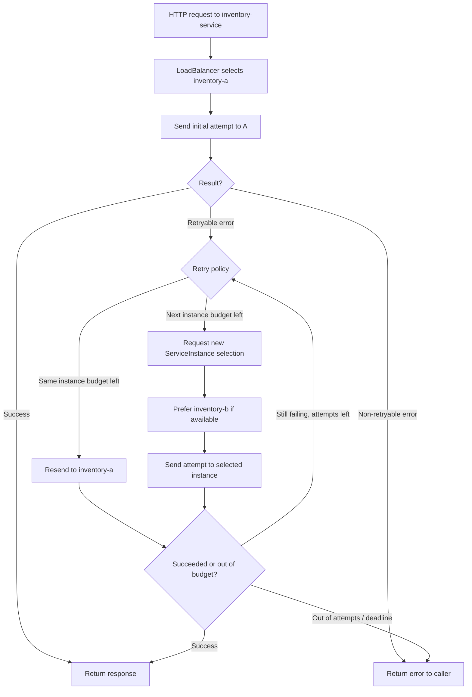
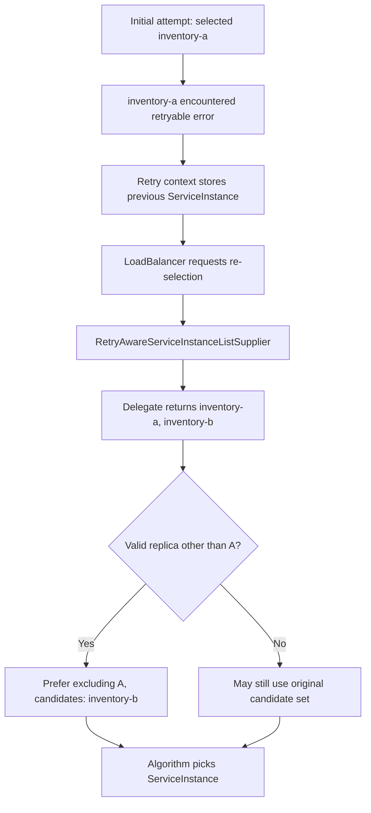

# Retrying the Same Instance vs. Switching to Another Instance

When a call between microservices fails, **resending the same request** does not necessarily mean **resending to the same server**. With Spring Cloud LoadBalancer, retries can go in two directions: keeping the `ServiceInstance` that was just selected, or asking LoadBalancer to pick a different `ServiceInstance` before the next attempt. These two behaviors have different impacts on resilience, system load, latency, and business-operation safety.

This lesson belongs to the **Retries** chapter in the `SPRING_CLOUD_SERVICE_COMMUNICATION_LOAD_BALANCING` module. Its goal is to understand both retry types accurately, configure retry counts, trigger conditions, mechanisms for avoiding failed instances, differences between blocking and reactive clients, and how to test which server received each request. The material also ties into using `RestClient`, `RestTemplate`, `WebClient`, and OpenFeign in a system with discovery, health checks, timeouts, and routing policies.

> **Principle:** Retries improve recovery chances when failures are transient, but they do not create new instances, automatically fix configuration bugs, guarantee a different server will be picked, or make a write operation idempotent.

## 1. Opening scenario: one service with two instances

Suppose `order-service` calls:

```http
GET /api/v1/stock/SKU-001 HTTP/1.1
Host: inventory-service
X-Correlation-ID: req-501
```

Discovery returns two instances:

| Service ID | Instance ID | Host:port | Illustrative status |
|---|---|---|---|
| `inventory-service` | `inventory-a` | `10.0.1.11:8081` | Temporarily slow due to a transient network glitch |
| `inventory-service` | `inventory-b` | `10.0.1.12:8082` | Operating normally |

LoadBalancer picks A for the initial call; the request may time out. There are two ways to retry:

- **Retry same instance:** resend the request to A. Sensible if A only experienced a brief hiccup and still has capacity to serve.
- **Retry next instance:** perform a new target selection, preferring an instance other than A if available; in this example, the request can be sent to B.

Both behaviors occur only when the client has **a retry mechanism enabled** and the error satisfies the **retryable policy**.

### 1.1. Processing flow diagram



This diagram is a mental model; it does not prescribe that every release must order attempts identically. Actual ordering and invocation counts must be verified using the client integration in your Spring Cloud release train.

## 2. Defining "same" and "next" accurately

A `ServiceInstance` is a replica identified by service ID together with host/port/instance ID and metadata. There are two independent counters:

| Mechanism | Meaning | Impact on target selection |
|---|---|---|
| `max-retries-on-same-service-instance` | Number of retries **on the current instance** after the initial attempt to that instance | Does not require a new instance for each same-instance retry |
| `max-retries-on-next-service-instance` | Number of retries **after re-selecting an instance** | LoadBalancer runs a new selection; may pick another replica |
| `avoid-previous-instance` | Policy to avoid the just-failed instance when re-selecting | Prefers excluding the previous instance if another eligible candidate exists |
| `retryable-status-codes` / `retryable-exceptions` | Defines which errors qualify for retry | Does not alter the instance set unless a retry runs |
| `retry-on-all-operations` | Allows retrying HTTP methods other than GET | Requires reviewing business safety |

**"Next instance" does not guarantee a different instance ID.** With only one instance, when zone/health filters leave a single candidate, or without previous-instance avoidance, re-selection can still return the already-tried replica. Therefore, observe the instance ID on each attempt rather than relying on the property name alone.

### 2.1. Comparing the two strategies

| Criterion | Retry same instance | Re-select another instance |
|---|---|---|
| Target of next attempt | Keeps current target | Re-runs instance selection |
| Sensible when | Glitch is fleeting and server is still healthy | Error is tied to a specific host/port or overloaded instance |
| Risk | Piles more load onto a failing instance | Increases load / replays the request on another instance |
| Discovery requirement | Requires an initial instance | Requires a candidate set for the next selection |
| Zone/metadata changes | Not re-evaluated on same-instance retries | Can be re-evaluated via supplier/policy |
| Success guarantee | No | No |
| Duplicate-write risk | Yes | Yes; two replicas may even process it concurrently |

Neither strategy is universally better. Decide based on the error type, instance count, discovery refresh behavior, and request semantics.

## 3. Counting attempts: "retry" does not mean "total requests"

Properties named **max retries** count **additional** tries after the initial attempt, not the total number of HTTP requests.

Suppose you configure:

```yaml
spring:
  cloud:
    loadbalancer:
      retry:
        max-retries-on-same-service-instance: 1
        max-retries-on-next-service-instance: 2
```

An illustrative scenario when every attempt encounters a retryable error:

```text
Attempt 1: select instance A, send to A
Attempt 2: retry same instance A
Attempt 3: re-select instance, say B is chosen
Attempt 4: retry same instance B
Attempt 5: re-select instance, say C is chosen
Attempt 6: retry same instance C
```

If an instance succeeds on attempt 2, the remaining attempts are **not executed**.

In a model where same-instance retries apply to each newly selected instance, given `S` same-instance retries and `N` next-instance retries, an illustrative upper bound can be expressed as:

```text
maximumAttempts = (S + 1) × (N + 1)
```

For example, `S=1`, `N=2` yields up to six HTTP attempts. This is a **theoretical budget** assuming both retry tiers are fully exercised; actual attempt counts also depend on retryable errors, implementation details, deadlines, available instances, and other retry layers.

### 3.1. Some configurations and expectations

| Same retries | Next retries | Max scenario under the model | Purpose |
|---:|---:|---|---|
| 0 | 0 | 1 attempt | No retries through LoadBalancer |
| 1 | 0 | A → A | Retry only on the same instance |
| 0 | 1 | A → new selection (e.g., B) | Retry after selecting another target |
| 1 | 1 | A → A → B → B | One retry per selected instance |
| 2 | 1 | A → A → A → B → B → B | Favor more same-instance retries |

The names A/B in the table are **illustrative instances**. Re-selection does not guarantee B will be chosen; nor is there a guarantee the first attempt always picks A.

## 4. Spring Cloud LoadBalancer retry configuration

Common properties in Spring Cloud Commons:

| Property | Role | Default in current reference docs |
|---|---|---|
| `spring.cloud.loadbalancer.retry.enabled` | Enables retry capability when integration/dependencies are present | `true` |
| `spring.cloud.loadbalancer.retry.max-retries-on-same-service-instance` | Retries on the same instance | `0` |
| `spring.cloud.loadbalancer.retry.max-retries-on-next-service-instance` | Retries with a new instance selection | `1` |
| `spring.cloud.loadbalancer.retry.avoid-previous-instance` | Attempts to avoid the previously tried instance on re-selection | `true` |
| `spring.cloud.loadbalancer.retry.retry-on-all-operations` | Allows retrying methods other than GET | `false` |
| `spring.cloud.loadbalancer.retry.retry-on-all-exceptions` | Retries errors outside the defined list as well | `false` |
| `spring.cloud.loadbalancer.retry.retryable-status-codes` | List of retryable HTTP status codes | Empty |
| `spring.cloud.loadbalancer.retry.retryable-exceptions` | List of retryable exceptions | Empty, uses implementation defaults |

**Warning:** `retry.enabled=true` is a configuration condition; it **does not mean every HTTP client automatically retries**. Blocking clients typically require `Spring Retry` on the classpath; `WebClient` requires reactive retry integration. Always verify auto-configuration and the exact client version in use.

Across Spring Cloud release trains, defaults for activation conditions and classpath integrations can change. Keep Spring Boot and Spring Cloud BOMs compatible, inspect effective configuration, and test rather than relying solely on YAML values.

### 4.1. Retry only on the same instance

```yaml
spring:
  cloud:
    loadbalancer:
      retry:
        enabled: true
        max-retries-on-same-service-instance: 1
        max-retries-on-next-service-instance: 0
        retryable-status-codes:
          - 503
```

Model:

```text
GET inventory-service
  select A
  A -> HTTP 503
  retry A
  A -> HTTP 200
  done
```

If A continues returning 503, the client stops when the budget runs out; it does not fail over to B because `max-retries-on-next-service-instance=0`.

### 4.2. Retry only after selecting a new instance

```yaml
spring:
  cloud:
    loadbalancer:
      retry:
        enabled: true
        max-retries-on-same-service-instance: 0
        max-retries-on-next-service-instance: 1
        avoid-previous-instance: true
        retryable-status-codes:
          - 503
```

Model:

```text
GET inventory-service
  select A
  A -> HTTP 503
  re-select from candidate list
  if B is available, prefer B
  B -> HTTP 200
  done
```

If the supplier only returns instance A, the next attempt may still call A. Setting `avoid-previous-instance=true` does not fabricate instance B.

### 4.3. Disabling retries to measure baseline behavior

```yaml
spring:
  cloud:
    loadbalancer:
      retry:
        enabled: false
```

In tests covering round-robin, caching, or health checks, disabling retries prevents **one business call from generating multiple HTTP attempts** and skewing counts. When re-enabling retries, record logical requests, instance selections, and HTTP attempts separately.

## 5. Enabling the right mechanism for RestTemplate/RestClient and WebClient

Spring Cloud LoadBalancer sits underneath multiple HTTP clients, yet not all clients use the same retry mechanism.

### 5.1. Blocking clients: RestTemplate and RestClient

For blocking paths supported by Spring Cloud LoadBalancer, the Spring Cloud Commons documentation describes integrating **Spring Retry** to perform load-balanced retries. A commonly required Maven dependency:

```xml
<dependency>
    <groupId>org.springframework.retry</groupId>
    <artifactId>spring-retry</artifactId>
</dependency>
```

Alongside `spring-cloud-starter-loadbalancer` and a compatible Spring Web version. Depending on how the client is constructed and the version, having Spring Retry on the classpath causes Spring Cloud to use retry-capable interceptors/clients.

Example load-balanced `RestClient.Builder` bean:

```java
import org.springframework.cloud.client.loadbalancer.LoadBalanced;
import org.springframework.context.annotation.Bean;
import org.springframework.context.annotation.Configuration;
import org.springframework.web.client.RestClient;

@Configuration(proxyBeanMethods = false)
public class ClientConfiguration {

    @Bean("inventoryRestClientBuilder")
    @LoadBalanced
    RestClient.Builder inventoryRestClientBuilder() {
        return RestClient.builder();
    }
}
```

Gateway using the Spring-managed builder:

```java
@Service
public class InventoryGateway {

    private final RestClient client;

    public InventoryGateway(
            @Qualifier("inventoryRestClientBuilder")
            RestClient.Builder builder) {

        this.client = builder.build();
    }

    public String whoAmI() {
        return client.get()
                .uri("http://inventory-service/whoami")
                .retrieve()
                .body(String.class);
    }
}
```

Set `spring.cloud.loadbalancer.retry.*` as in section 4, then verify actual behavior using counters on the target servers. **Do not create `RestClient.create("http://inventory-service")` outside the load-balanced builder** and expect service-ID selection or retries.

If the project uses `RestTemplate`, that bean must also be annotated with `@LoadBalanced`. Across release trains, blocking retry support may be wired through different LoadBalancer interceptor/client types. Do not draw conclusions from a single class name alone.

### 5.2. Reactive WebClient

For `WebClient`, use a `@LoadBalanced` builder or the corresponding reactive filter:

```java
@Configuration(proxyBeanMethods = false)
public class ReactiveClientConfiguration {

    @Bean("inventoryWebClientBuilder")
    @LoadBalanced
    WebClient.Builder inventoryWebClientBuilder() {
        return WebClient.builder();
    }
}
```

```java
@Service
public class InventoryReactiveGateway {

    private final WebClient client;

    public InventoryReactiveGateway(
            @Qualifier("inventoryWebClientBuilder")
            WebClient.Builder builder) {
        this.client = builder.build();
    }

    public Mono<String> whoAmI() {
        return client.get()
                .uri("http://inventory-service/whoami")
                .retrieve()
                .bodyToMono(String.class);
    }
}
```

Enable LoadBalancer retries with the appropriate properties:

```yaml
spring:
  cloud:
    loadbalancer:
      retry:
        enabled: true
        max-retries-on-same-service-instance: 0
        max-retries-on-next-service-instance: 1
```

In reactive flows, avoid unconditionally adding `retryWhen(Retry.max(...))` **outside a chain that already has LoadBalancer retries**. If both are active, HTTP attempt counts can multiply and "same/next" semantics become confused. For a `WebClient` built directly without a LoadBalancer filter, Reactor retries merely repeat the request to the already-resolved URL without re-selecting a `ServiceInstance`.

### 5.3. OpenFeign

OpenFeign has its own retry layer (`Retryer`) and integrates with LoadBalancer when `@FeignClient(name=...)` is used without a direct URL. Spring Cloud OpenFeign typically configures `Retryer.NEVER_RETRY` by default instead of plain Feign's automatic retry.

Therefore:

- Do not treat Feign `Retryer` retry counts as strictly equivalent to Spring Cloud LoadBalancer retry properties.
- Check whether the Feign client calls a service ID via LoadBalancer or uses a direct `url`.
- If `@FeignClient(url=...)` or a URL property pins a fixed target, Spring Cloud LoadBalancer does not select another instance for that call.
- Do not enable Feign Retryer, circuit-breaker retries, and LoadBalancer retries simultaneously without calculating total attempts.

## 6. Re-selection semantics with RetryAwareServiceInstanceListSupplier

When a retry moves to a new instance selection, `RetryAwareServiceInstanceListSupplier` is a key Spring Cloud LoadBalancer component. It can use information about the **previous instance** to avoid including that instance again in the candidate list when another suitable replica exists.

This is a decorator-style supplier; it does not send HTTP requests directly.



Spring Cloud documentation describes avoiding the previous instance on re-selection according to `spring.cloud.loadbalancer.retry.avoid-previous-instance`. Depending on the release train and classpath/auto-configuration conditions, verify that this wrapper is actually applied in the active supplier bean.

**Do not equate "avoid previous instance" with a permanent blacklist**:

- The old instance is not deregistered from the registry.
- Discovery caches are not purged just because one request timed out.
- The next business call can still select the old instance.
- If only A remains as a candidate, the wrapper cannot always exclude A while still providing a target.
- If A and B belong to different zones, hints, or metadata groups, only instances **surviving mandatory filters** are eligible for re-selection.

### 6.1. Why might "next" still be A?

Common cases:

1. The instance set contains only A.
2. Health checks or zone filters removed B.
3. Routing enforces a hard constraint allowing only A to serve the request.
4. A custom supplier does not accept/forward the `Request` carrying retry context.
5. `avoid-previous-instance` is disabled or the wrapper was not attached.
6. A custom selection algorithm ignores the filtered list.

Never drop hard security/tenant/zone constraints just so a retry can "find B." Failing closed when no valid target exists is far better than sending a request into the wrong data boundary.

## 7. Which HTTP statuses and exceptions can trigger a retry?

Retries are not triggered simply because a response body looks unexpected. They depend on status codes, exceptions, HTTP method, and policy.

### 7.1. HTTP status codes

In testing, `503 Service Unavailable` is often a sensible status to trigger retry scenarios. You can declare:

```yaml
spring:
  cloud:
    loadbalancer:
      retry:
        retryable-status-codes:
          - 503
          - 502
          - 504
```

These codes are policy examples only; do not automatically add every 5xx code or 429 without understanding the API contract, `Retry-After`, and system state.

| Status | Should retry? | Reason |
|---|---|---|
| `200`/`201` | No | Success |
| `400` | Usually no | Invalid request data |
| `401`/`403` | Usually no | Authentication/authorization cannot be fixed by retrying the same payload |
| `404` | Usually no | Resource does not exist; depends on API contract |
| `408` | Possibly | Server/proxy timeout; verify whether the request was already processed |
| `429` | Conditionally | Rate limited; must honor `Retry-After` and deadline |
| `500` | Only per policy | May indicate a persistent programming bug |
| `502`/`503`/`504` | Often candidates for bounded retry | Temporary gateway/availability errors |

**Retryable status codes must be handled at the right layer.** Some `retrieve()` clients automatically convert HTTP errors into exceptions; LoadBalancer retry integration must attach at a step that can inspect the relevant status/exception. Real tests should prove whether a 503 response produces a second attempt.

### 7.2. IOException and timeouts

According to Spring Cloud Commons documentation, when no custom exception list is specified, default exceptions can include `IOException`, `TimeoutException`, and `RetryableStatusCodeException`. Do not enable `retry-on-all-exceptions=true` by default, as programming bugs, JSON parsing failures, or invalid configurations would also be retried pointlessly.

Explicit configuration example:

```yaml
spring:
  cloud:
    loadbalancer:
      retry:
        retry-on-all-exceptions: false
        retryable-exceptions:
          - java.io.IOException
          - java.util.concurrent.TimeoutException
```

When configuring an explicit exception list, make sure you do not accidentally exclude status-code retry mechanisms that the application relies on. Current release trains have dedicated handling for `RetryableStatusCodeException`; inspect the effective list and test the allowed status codes.

### 7.3. GET vs. POST

`spring.cloud.loadbalancer.retry.retry-on-all-operations=false` is a documented default safety guard. It generally corresponds to retrying only GET operations by default under framework policy.

If you enable:

```yaml
spring:
  cloud:
    loadbalancer:
      retry:
        retry-on-all-operations: true
```

understand that this **permits retrying** HTTP methods other than GET—it does not make every POST safe.

GET, HEAD, or operations designed to be idempotent are far better suited for automatic retries. For a POST creating orders, reserving stock, or charging payments, the server may have already processed the request before the client timed out; retrying on A or B can create **duplicate transactions**.

## 8. Idempotency: the biggest risk when switching instances

Consider this request:

```http
POST /api/v1/reservations HTTP/1.1
Host: inventory-service
Content-Type: application/json

{"sku":"SKU-001","quantity":2}
```

Scenario:

1. Instance A successfully processes the reservation and writes to the DB.
2. The response from A is lost due to a network timeout.
3. The client treats it as a transient error and selects instance B.
4. Instance B receives the same POST again.
5. Without server-side duplicate checks, a second reservation may be created.

This is not a LoadBalancer bug; the retry mechanism **cannot know for sure whether the server already committed**.

### 8.1. Using an idempotency key properly

The client generates a stable key for **one logical operation**:

```http
POST /api/v1/reservations HTTP/1.1
Host: inventory-service
Idempotency-Key: order-501-reserve-stock
Content-Type: application/json

{"sku":"SKU-001","quantity":2}
```

All retries of the same logical operation keep the exact same key. On the server side:

- Record the key scoped by user/tenant and operation.
- Ensure processing for the same key is atomic or protected by proper locking.
- Return the previously recorded result instead of executing a second time.
- Define a TTL/lifecycle for idempotency records.
- Do not silently accept the same key with a different payload.

Attaching the header alone is not enough: **the server must enforce deduplication**. For payments or critical updates, idempotency controls must live in a business datastore shared across instances.

## 9. Capping total duration and the retry storm phenomenon

Retries can multiply latency because every attempt incurs connect timeout, read timeout, discovery, and backoff delays.

Example:

```text
logical GET inventory-service
   attempt A: times out after 700ms
   backoff:    100ms
   attempt B: times out after 700ms
   backoff:    200ms
   attempt C: succeeds after 300ms

Total nearly 2,000ms, excluding overhead.
```

If an upstream caller also retries that logical request, total attempts can grow exponentially. For instance, an API gateway retrying twice on the outer tier while `order-service` retries three attempts on the inner tier can produce many times the initial request volume.

**Minimum design:**

- Cap same/next retry counts.
- Configure connect timeouts, read/response timeouts, and an overall business deadline.
- Use jittered backoff for errors that can recover after a short wait.
- Do not retry once the caller has canceled the request or the deadline has expired.
- Avoid enabling multiple independent retry layers without a shared budget.
- Use circuit breakers, bulkheads, and rate limits when needed to avoid crushing a failing service.

Do not choose retries solely because success rates rise. Measure P95/P99 latency, total HTTP attempts, final errors, and load impact on the target service simultaneously.

## 10. Backoff differences between reactive and blocking

For Spring Cloud LoadBalancer reactive retries, backoff can be configured as:

```yaml
spring:
  cloud:
    loadbalancer:
      retry:
        enabled: true
        max-retries-on-same-service-instance: 0
        max-retries-on-next-service-instance: 1
        backoff:
          enabled: true
          min-backoff: 50ms
          max-backoff: 300ms
          jitter: 0.3
```

These `backoff.*` properties apply to the **reactive** mechanism per Spring Cloud documentation; do not assume a blocking `RestClient` automatically uses the same Reactor Retry/backoff operator just from this configuration.

For blocking + Spring Retry, the docs describe implementing `LoadBalancedRetryFactory` to supply a `BackOffPolicy`. Conceptual Java example:

```java
import org.springframework.cloud.client.loadbalancer.LoadBalancedRetryFactory;
import org.springframework.context.annotation.Bean;
import org.springframework.context.annotation.Configuration;
import org.springframework.retry.backoff.BackOffPolicy;
import org.springframework.retry.backoff.ExponentialBackOffPolicy;

@Configuration(proxyBeanMethods = false)
class LoadBalancerRetryBackoffConfiguration {

    @Bean
    LoadBalancedRetryFactory loadBalancedRetryFactory() {
        return new LoadBalancedRetryFactory() {
            @Override
            public BackOffPolicy createBackOffPolicy(String service) {
                ExponentialBackOffPolicy policy =
                        new ExponentialBackOffPolicy();
                policy.setInitialInterval(100);
                policy.setMultiplier(2.0);
                policy.setMaxInterval(400);
                return policy;
            }
        };
    }
}
```

This example applies to Spring Cloud versions that provide `LoadBalancedRetryFactory` with this signature. In a project that already defines a factory bean or another auto-configuration, verify bean precedence, especially when overriding the default blocking policy. Do not create multiple competing factories assuming all of them take effect together.

## 11. Per-service configuration

Not every dependency can tolerate the same policy. A catalog read service may permit instance re-selection, whereas a payment-creation service typically requires strict retry constraints.

Current Spring Cloud Commons supports per-LoadBalancer-client configuration under the prefix:

```text
spring.cloud.loadbalancer.clients.<clientId>.*
```

Design example:

```yaml
spring:
  cloud:
    loadbalancer:
      retry:
        enabled: true
        max-retries-on-same-service-instance: 0
        max-retries-on-next-service-instance: 1
      clients:
        inventory-service:
          retry:
            max-retries-on-same-service-instance: 1
            max-retries-on-next-service-instance: 1
            retryable-status-codes:
              - 503
        payment-service:
          retry:
            max-retries-on-same-service-instance: 0
            max-retries-on-next-service-instance: 0
```

Intent:

- `inventory-service` may retry A once and re-select B once for eligible errors.
- `payment-service` performs zero LoadBalancer retries per the configured counts.
- Other services follow the global configuration when no client override is defined.

**Version note:** some release trains/documentation show configuration under `spring.cloud.loadbalancer.[serviceId].retry.*`, whereas current versions use the `clients.<clientId>.*` prefix. Verify the exact configuration properties class in your BOM and test that the `inventory-service` client context actually receives the override; do not mix prefixes together by guesswork.

### 11.1. When should you disable retries?

Consider disabling retries for a target service if:

- The request is a non-idempotent write transaction.
- The server cannot absorb replayed load during overload conditions.
- The client has a very tight deadline where a second attempt has no value.
- A circuit breaker or upstream system already manages retries within a shared budget.
- Retries increase cascading failure probability rather than improving availability.

Disabling retries does not mean disabling LoadBalancer or discovery. LoadBalancer still selects an instance for the **first attempt**.

## 12. Testing properly: observe HTTP attempts on each instance

To prove same-instance vs. next-instance retries, do not just assert a final `200 OK` response. You need to know **which instance received each attempt**, in order.

You can set up two HTTP stubs:

- A returns 503 a number of times, then returns 200 or keeps failing depending on the scenario.
- B returns 200.
- Each stub records `X-Correlation-ID` and instance ID in a log/counter table.
- `order-service` calls `http://inventory-service/whoami` via a `@LoadBalanced` bean.
- Discovery supplies A and B; `SimpleDiscoveryClient` can be used to control the list.

Example identifying response:

```http
HTTP/1.1 200 OK
X-Instance-Id: inventory-b
Content-Type: text/plain

inventory-b
```

### 12.1. Same-instance scenario

Configuration:

```yaml
spring:
  cloud:
    loadbalancer:
      retry:
        enabled: true
        max-retries-on-same-service-instance: 1
        max-retries-on-next-service-instance: 0
        retryable-status-codes: [503]
```

To test **without depending on whether A or B is chosen first**, configure both servers with the same rule: for a given correlation ID, the first attempt returns 503 and the second attempt on that same server returns 200. After sending one logical GET, expect:

```text
Example:
  inventory-b receives req-501 attempt 1 -> 503
  inventory-b receives req-501 attempt 2 -> 200

  inventory-a does not receive req-501
```

Key assertions:

- There are **two attempts** with the same correlation ID.
- Both attempts hit the **same instance ID**.
- First attempt returns 503, second attempt returns 200.
- There is no third attempt.

This is a better test design than forcing "first attempt must hit A," because round-robin may start with either A or B depending on state.

### 12.2. Next-instance scenario

Configuration:

```yaml
spring:
  cloud:
    loadbalancer:
      retry:
        enabled: true
        max-retries-on-same-service-instance: 0
        max-retries-on-next-service-instance: 1
        avoid-previous-instance: true
        retryable-status-codes: [503]
```

Make A always return 503; B always return 200.

```text
If first attempt selects A:
  inventory-a receives req-502 -> 503
  load balancer re-selects
  inventory-b receives req-502 -> 200

If first attempt selects B:
  inventory-b receives req-503 -> 200
  no retry needed
```

With both instances eligible and the retry-aware supplier active, trigger **at least one logical request** whose first attempt hits A so you can observe the retry behavior. If you only send a single request and it hits B first, a 200 response does not prove next-instance retry worked.

Assertions on the request that hit A:

- A received exactly one attempt returning 503.
- B received a subsequent attempt with the same correlation ID and returned 200.
- No same-instance retry occurred on A.
- Total server requests are tracked separately from logical requests.

### 12.3. No eligible B

Configure the supplier to return only A while `max-retries-on-next-service-instance=1`. When the first attempt fails, re-selection may still pick A. The test should **allow this outcome under fallback policy**, or if the business forbids retrying A, implement a stricter policy.

Inspect selection counts and HTTP attempt counts separately. If the source returns an empty list, either the initial attempt or the next attempt may fail at the target-selection layer without any request reaching A or B.

## 13. Stub server template with per-request counters

The Java snippet below illustrates a lightweight HTTP server using JDK `HttpServer`. It accepts an `instanceId`, returns 503 on the first attempt for a given correlation ID, and returns 200 if the same server is called again.

```java
import java.io.IOException;
import java.io.OutputStream;
import java.net.InetSocketAddress;
import java.nio.charset.StandardCharsets;
import java.util.concurrent.ConcurrentHashMap;
import java.util.concurrent.atomic.AtomicInteger;

import com.sun.net.httpserver.HttpServer;

public final class RetryProbeServer implements AutoCloseable {

    private final String instanceId;
    private final HttpServer server;
    private final ConcurrentHashMap<String, AtomicInteger> calls =
            new ConcurrentHashMap<>();

    public RetryProbeServer(String instanceId) throws IOException {
        this.instanceId = instanceId;
        this.server = HttpServer.create(
                new InetSocketAddress("127.0.0.1", 0), 0);

        this.server.createContext("/whoami", exchange -> {
            String requestId = exchange.getRequestHeaders()
                    .getFirst("X-Correlation-ID");

            if (requestId == null || requestId.isBlank()) {
                requestId = "missing";
            }

            int attempt = calls
                    .computeIfAbsent(
                            requestId,
                            key -> new AtomicInteger())
                    .incrementAndGet();

            int status = attempt == 1 ? 503 : 200;
            String payload = instanceId
                    + ":attempt=" + attempt;

            byte[] bytes = payload.getBytes(
                    StandardCharsets.UTF_8);

            exchange.getResponseHeaders()
                    .set("X-Instance-Id", instanceId);
            exchange.getResponseHeaders()
                    .set("X-Attempt", Integer.toString(attempt));
            exchange.getResponseHeaders()
                    .set("Content-Type",
                            "text/plain; charset=UTF-8");

            exchange.sendResponseHeaders(status, bytes.length);

            try (OutputStream out =
                         exchange.getResponseBody()) {
                out.write(bytes);
            }
        });

        this.server.start();
    }

    public int port() {
        return server.getAddress().getPort();
    }

    public int attemptsFor(String correlationId) {
        AtomicInteger value = calls.get(correlationId);
        return value == null ? 0 : value.get();
    }

    @Override
    public void close() {
        server.stop(0);
    }
}
```

Each server maintains its own counter. With the same-instance policy and one logical GET sharing `X-Correlation-ID`:

```text
attemptsFor("req-501") on A + B = 2
one of the two servers has 2
the other server has 0
```

This is a **fault-simulating stub keyed by request ID**. It does not provide real discovery or health checks. To wire it into a load-balanced client, start two stubs, register their URIs through `SimpleDiscoveryClient`, and call via `@LoadBalanced RestClient.Builder` or a compatible client.

### 13.1. Dedicated setup for next-instance

For next-instance tests, server A should always return 503 and server B should always return 200; do not reuse the "503 on first attempt per server" logic above if the goal is to prove A → B recovery. Replace the handler to choose the status by `instanceId` or create a fixed-status stub.

Example handler logic:

```java
int status = instanceId.equals("inventory-a")
        ? 503
        : 200;
```

A log trace grouped by correlation ID such as:

```text
req-601, attempt=1, instance=inventory-a, status=503
req-601, attempt=2, instance=inventory-b, status=200
```

is stronger evidence than an assertion checking only the `inventory-b` result.

## 14. Wiring two servers into SimpleDiscoveryClient for end-to-end measurement

No Eureka/Consul is needed for a baseline test. With two local servers on dynamic ports, instance info can be supplied via Spring Boot Test:

```java
@SpringBootTest(
        classes = RetryExperimentTest.TestApp.class,
        webEnvironment = SpringBootTest.WebEnvironment.NONE,
        properties = {
                "spring.cloud.loadbalancer.cache.enabled=false",
                "spring.cloud.loadbalancer.retry.enabled=true",
                "spring.cloud.loadbalancer.retry.max-retries-on-same-service-instance=1",
                "spring.cloud.loadbalancer.retry.max-retries-on-next-service-instance=0",
                "spring.cloud.loadbalancer.retry.retryable-status-codes[0]=503"
        })
class RetryExperimentTest {

    static final RetryProbeServer A = newServer("inventory-a");
    static final RetryProbeServer B = newServer("inventory-b");

    @DynamicPropertySource
    static void instances(DynamicPropertyRegistry properties) {
        properties.add(
                "spring.cloud.discovery.client.simple.instances."
                        + "inventory-service[0].uri",
                () -> "http://127.0.0.1:" + A.port());

        properties.add(
                "spring.cloud.discovery.client.simple.instances."
                        + "inventory-service[1].uri",
                () -> "http://127.0.0.1:" + B.port());
    }

    @Autowired
    @Qualifier("loadBalancedBuilder")
    RestClient.Builder loadBalancedBuilder;

    @Test
    void retriedRequestStaysOnSameInstance() {
        String correlationId = "retry-case-501";

        String value = loadBalancedBuilder.build().get()
                .uri("http://inventory-service/whoami")
                .header("X-Correlation-ID", correlationId)
                .retrieve()
                .body(String.class);

        assertNotNull(value);

        int a = A.attemptsFor(correlationId);
        int b = B.attemptsFor(correlationId);

        assertEquals(2, a + b);
        assertTrue((a == 2 && b == 0)
                || (a == 0 && b == 2));
    }

    @AfterAll
    static void stop() {
        A.close();
        B.close();
    }

    static RetryProbeServer newServer(String name) {
        try {
            return new RetryProbeServer(name);
        } catch (IOException error) {
            throw new UncheckedIOException(error);
        }
    }

    @SpringBootConfiguration
    @EnableAutoConfiguration
    static class TestApp {
        @Bean("loadBalancedBuilder")
        @LoadBalanced
        RestClient.Builder builder() {
            return RestClient.builder();
        }
    }
}
```

To use the snippet in a Java test file, add these imports:

```java
import java.io.IOException;
import java.io.UncheckedIOException;

import org.junit.jupiter.api.AfterAll;
import org.junit.jupiter.api.Test;
import org.springframework.beans.factory.annotation.Autowired;
import org.springframework.beans.factory.annotation.Qualifier;
import org.springframework.boot.SpringBootConfiguration;
import org.springframework.boot.autoconfigure.EnableAutoConfiguration;
import org.springframework.boot.test.context.SpringBootTest;
import org.springframework.cloud.client.loadbalancer.LoadBalanced;
import org.springframework.context.annotation.Bean;
import org.springframework.test.context.DynamicPropertyRegistry;
import org.springframework.test.context.DynamicPropertySource;
import org.springframework.web.client.RestClient;

import static org.junit.jupiter.api.Assertions.*;
```

In your test `pom.xml`, beyond Spring Boot Test and Spring Cloud LoadBalancer dependencies, **Spring Retry is required on the classpath** for the Spring Cloud–supported blocking path. This example illustrates an integration testing approach; verify the exact API/binder and retry interceptor in your active Spring Cloud BOM before applying it.

For the **next-instance test**, use a separate test class or profile with `max-retries-on-same-service-instance=0`, `max-retries-on-next-service-instance=1`, A always returning 503, and B always returning 200. Do not mutate these properties mid-run inside the same `ApplicationContext` and assume the active retry bean has reconfigured itself.

## 15. Common pitfalls that skew real-world test results

| Symptom | Possible cause | Resolution |
|---|---|---|
| Retry configured, yet only one attempt runs | Missing Spring Retry for blocking or reactive retry not enabled | Check dependencies, interceptor beans, and auto-configuration |
| Attempt hits another host despite same=1 | Another retry layer exists or test mixes multiple logical requests | Attach a correlation ID per operation |
| Next retry still hits A | Only one candidate or retry-aware filtering inactive | Check supplier/avoid-previous/zone/health |
| Only one HTTP 200 response observed | Retries happened before the final response | Count attempts on each server |
| GET returns 503 without retrying | Status not marked retryable or client lacks retry integration | Check `retryable-status-codes` and HTTP client setup |
| HTTP 400 is also retried | `retry-on-all-exceptions` is too broad or outer retry layer active | Narrow the retryable error scope |
| POST sent twice | Retry enabled on non-GET without idempotency | Use idempotency keys or disable retries |
| Total attempts higher than expected | Overlapping retries in Feign, LB, Reactor, and gateway | Define a shared budget and count per layer |
| Errors persist even though B is healthy | Client uses direct URL to A or B was filtered out | Inspect actual routing path and supplier |
| All requests become slow after timeouts | Timeout × attempts + backoff | Enforce an overall deadline |
| Newly added instance unseen by retries | Cache or discovery SDK holds stale data | Measure time-to-converge and TTL |
| Test expects A then B, gets opposite order | Stateful round-robin or random policy | Assert set/sequence by correlation ID without guessing first target |
| Retry logs lack instance ID | Instrumentation only at HTTP client | Add logging/metrics at selection point and server stub |

## 16. Observability: measure both logical requests and attempts

In production, measure these signals separately:

| Metric | Meaning |
|---|---|
| `logicalRequestCount` | Number of business operations requesting a dependency call |
| `httpAttemptCount` | Number of HTTP requests actually sent to instances |
| `sameInstanceRetryCount` | Retries keeping the same instance |
| `nextInstanceRetryCount` | Retries re-selecting an instance |
| `previousInstanceId` | Previously failed replica (controlled logging/tracing) |
| `selectedInstanceId` | Replica for the current attempt |
| `retryReason` | Timeout, I/O error, HTTP 503, ... |
| `retryBudgetExhaustedCount` | Operations failing after exhausting retry attempts |
| `finalOutcome` | Success/failure and final HTTP code |
| `endToEndLatency` | Latency of one logical operation including retries |
| `loadBalancerCandidateCount` | Candidate count after discovery/filters |

Example log sharing a correlation ID:

```text
traceId=req-501 serviceId=inventory-service
attempt=1 instance=inventory-a mode=INITIAL status=503

traceId=req-501 serviceId=inventory-service
attempt=2 instance=inventory-a mode=SAME_INSTANCE status=503

traceId=req-501 serviceId=inventory-service
attempt=3 instance=inventory-b mode=NEXT_INSTANCE status=200

traceId=req-501 serviceId=inventory-service
logicalOutcome=SUCCESS totalAttempts=3 elapsedMs=340
```

These field names are **instrumentation examples**, not a default Spring Cloud metric set. Avoid using raw request IDs, dynamic URLs, high-cardinality instance IDs, or personal data as metric labels. Keep fine-grained details in sampled traces/logs under appropriate access controls.

### 16.1. Alerting rules

Alerts should track **retry rates and final error rates**, not just successful request counts:

- Retries surge while requests still succeed: the dependency may be degrading and masked by retries.
- `nextInstanceRetryCount` climbs sharply: a subset of instances may be unhealthy.
- P95/P99 latency rises: multiple attempts are burning through the deadline.
- `retryBudgetExhaustedCount` increases: fix the root cause instead of simply raising retry counts.
- Write requests appear with the same idempotency key multiple times: verify the server is genuinely deduplicating.

## 17. Safe rollout workflow

A practical step-by-step sequence:

1. Pick an idempotent API, such as `GET /whoami` or `GET /stock/{sku}`, to test retries first.
2. Verify the client has load-balancing integration and uses a service ID URI rather than a hardcoded instance address.
3. Verify the Spring Retry dependency (blocking) or reactive retry integration.
4. Start with `same=0, next=0` to observe a request with zero retries.
5. Inject 503 on the server and enable `same=1, next=0`; verify two attempts on the same instance.
6. Switch to `same=0, next=1`; make A fail and B healthy, and observe the A → B transition.
7. Test single-instance, zero-instance, stale-cache, and zone/hint-filter scenarios.
8. Configure retryable statuses and exceptions explicitly; do not retry every exception.
9. Add timeouts, backoff, jitter, and an overall deadline.
10. For POST, enable retries only after establishing an idempotency contract and testing duplicate prevention.
11. Measure success rate, total attempts, latency, retry budget exhausted, and final errors.
12. Verify effective configuration in your actual Spring Cloud BOM release train.

## 18. Self-check questions

**1. If `max-retries-on-same-service-instance=1` and `max-retries-on-next-service-instance=0`, will the request necessarily be sent to B?** No. If the first attempt hits A, the allowed retry continues targeting A.

**2. If `max-retries-on-next-service-instance=1`, is the instance ID guaranteed to change?** No. Another valid replica must exist and retry-aware selection must be active.

**3. Why is a final HTTP 200 insufficient proof of a retry?** Because the request may have succeeded on the first attempt; you must count attempts by correlation ID on the servers.

**4. For a GET returning 503, why might no retry occur?** Missing dependency/integration, status not listed as retryable, retries disabled, or configuration not taking effect.

**5. If a POST is retried to B after timing out on A, what is the biggest danger?** A may already have committed the transaction; B processing it again creates duplicate data. An idempotency key and server-side checks are required.

**6. Should you increase max retries to fix a "no available instance" error?** That is not a root fix. Investigate discovery, health checks, zone/metadata filters, or an incorrect service ID.

**7. Why can one logical HTTP request generate three HTTP attempts?** Because LoadBalancer/client retries execute after retryable errors, including same-instance retries and instance re-selections.

**8. Is `retry.enabled=true` alone enough for every client to retry?** No. Behavior also depends on Spring Retry, WebClient reactive integration, Feign, and custom layers.

## 19. Conclusion

**Same-instance retry** and **retry after selecting a new instance** are two distinct Spring Cloud LoadBalancer policies. `max-retries-on-same-service-instance` keeps the current attempt's target; `max-retries-on-next-service-instance` triggers a subsequent `ServiceInstance` selection. `RetryAwareServiceInstanceListSupplier` can avoid the just-failed replica when alternatives exist in the candidate pool, but it does not guarantee always switching to a different server.

Reliable retries require combining **eligible retry errors**, **attempt limits**, **timeouts/deadlines**, **backoff**, **health/discovery freshness**, and especially **idempotency for write operations**. Do not look only at the final response: use a correlation ID to observe each attempt, receiving instance, and HTTP outcome. A well-designed retry policy improves resilience without turning localized faults into a retry storm or duplicate writes.

### References

- [Spring Cloud Commons — Common Abstractions: Retrying Failed Requests](https://docs.spring.io/spring-cloud-commons/reference/spring-cloud-commons/common-abstractions.html) — same/next instance retries, retryable error lists, blocking/reactive configuration, retry-aware supplier.
- [Spring Cloud Commons — Configuration Properties](https://docs.spring.io/spring-cloud-commons/reference/configprops.html) — defaults for `spring.cloud.loadbalancer.retry.*` and backoff.
- [Spring Cloud Commons — Spring Cloud LoadBalancer](https://docs.spring.io/spring-cloud-commons/reference/spring-cloud-commons/loadbalancer.html) — instance selection, supplier chain, caching, health checks, and routing policies.
- [Spring Cloud OpenFeign — Reference](https://docs.spring.io/spring-cloud-openfeign/reference/spring-cloud-openfeign.html) — Feign retryer and load-balanced path when calling by service ID.
