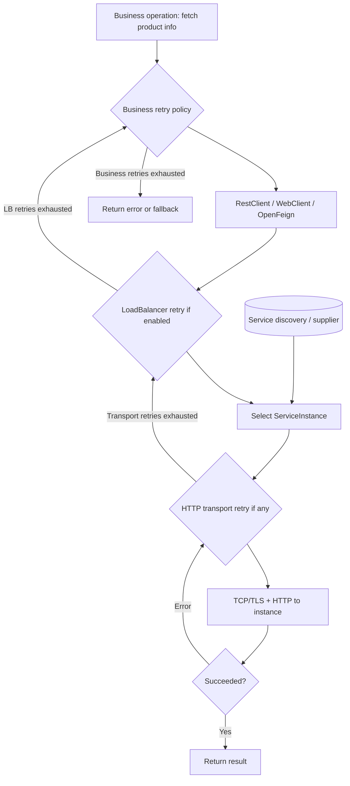
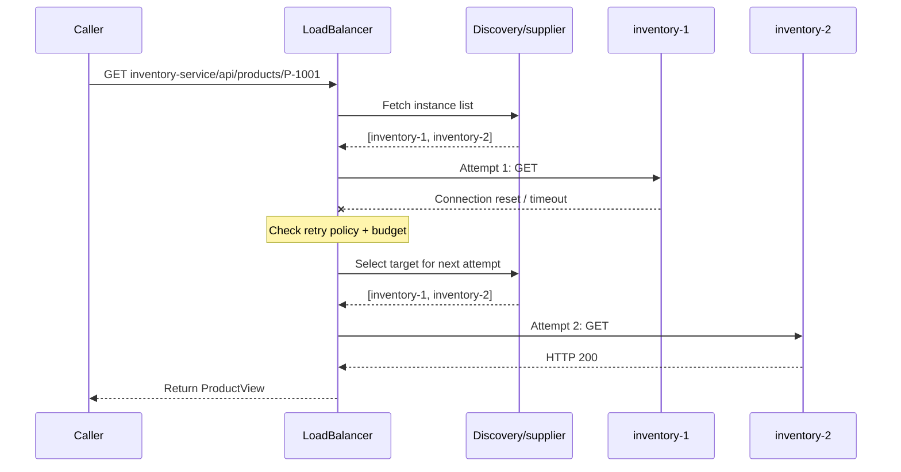
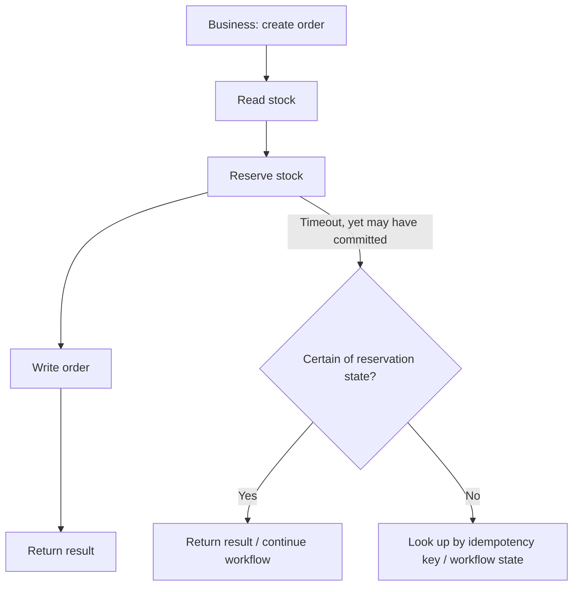
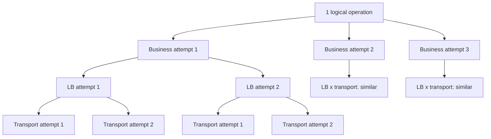
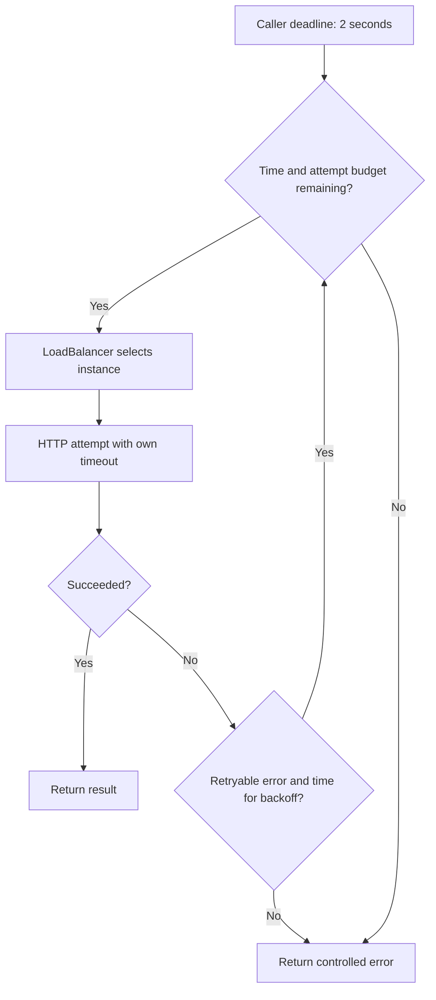

# Retries at the HTTP Client, LoadBalancer, and Business Layers

In a microservice system, an `order-service → inventory-service` call can fail transiently: a TCP connection closes, an instance was just scaled down, the backend returns `503 Service Unavailable`, or the network suffers a brief interruption. **Retry** is the act of resending an operation after a failure in the hope that the next attempt succeeds. However, retries are not always safe and do not live in just one place.

With Spring Cloud LoadBalancer, a call can pass through **three distinct retry layers**: retries inside the HTTP client/transport, retries tied to LoadBalancer `ServiceInstance` selection, and retries decided by the business layer. If all three are enabled unintentionally, a single user request can turn into many HTTP attempts, exhaust connection pools, amplify load on the backend, and even create duplicate data.

This lesson belongs to the **Retries** chapter of the Spring Cloud LoadBalancer module. It helps distinguish the three retry layers accurately, choose between same-instance and next-instance retries, configure and verify behavior with `RestClient`, `WebClient`, and `OpenFeign`, and control timeouts, backoff, idempotency, and error observability.

## 1. Why must we distinguish the three retry layers?

Consider a caller invoking:

```text
GET http://inventory-service/api/products/P-1001
```

`inventory-service` is a **logical service ID**. Spring Cloud LoadBalancer queries `ServiceInstanceListSupplier` and selects an instance, such as `10.0.1.12:8080`. The HTTP transport opens or reuses a socket to send the request to that remote endpoint.

If a failure occurs, multiple places can decide to "resend":



This diagram only illustrates loops that **can exist**; it does not claim every application enables all three. Some integrations place retries in filters, interceptors, or wrappers rather than nesting them exactly as drawn. To know what happens in practice, inspect the active beans, HTTP engine, and operator/wrapper ordering.

| Layer | Who makes the decision? | Can it switch instances? | Primary concerns |
|---|---|---|---|
| **HTTP client / transport** | JDK/Apache HC5/OkHttp, Feign `Retryer`, or an HTTP client operator attached to the request. | Usually keeps the attempt's URL/remote or uses its own mechanism; does **not by default** re-query Spring Cloud LoadBalancer. | Connection failures, socket reuse, data transmission, ability to replay the request body. |
| **Spring Cloud LoadBalancer** | Retry-aware LoadBalancer interceptor/filter/wrapper. | Can retry the same `ServiceInstance` or request selecting the next instance per policy. | Target selection from the instance list and retries in the service ID context. |
| **Business layer** | Service/application workflow, `RetryTemplate`, Resilience4j, or Reactor pipeline. | Can re-invoke the entire gateway and thus trigger a new instance selection, depending on how the client is built. | Deciding which operations are safe to resend, time budgets, and final outcome. |

### What is an attempt?

In this lesson, a **logical operation** is an operation the business needs to complete; an **HTTP attempt** is an actual try to send a request downstream. One logical operation can have multiple attempts. Because some failures happen **before any HTTP request is sent** (such as failing to acquire a connection or finding no instances), not every retry iteration equals a request reaching the backend.

## 2. Retries at the HTTP client and transport layer

The lowest layer may retry on connection errors, closed sockets, DNS changes, or conditions the HTTP engine deems recoverable. However, this behavior **depends on the implementation and version**:

- **JDK/HttpURLConnection or JDK HttpClient:** connection recovery/redirect/retry behavior depends on the API, JDK version, and configuration. Do not infer a uniform retry policy merely from the word "JDK."
- **Apache HttpClient 5:** has its own retry execution/strategy mechanism that can be customized on the client builder. Do not assume Apache HC5 automatically retries all request types or HTTP statuses.
- **OkHttp:** can transparently recover from certain connection failures per its HTTP client policy; body replayability and attempt counts depend on request type and conditions.
- **Core Feign:** has the `Retryer` concept. **Spring Cloud OpenFeign** in many release trains provides `Retryer.NEVER_RETRY` as the default instead of some core Feign defaults. Always check the actual version and beans.
- **WebClient and RestClient:** creating an API client does not automatically guarantee retries for all failures. You can add Reactor `retryWhen`, Spring Retry, Resilience4j, or other wrappers when needed.

**One dangerous pitfall:** the transport may know "no response was received," but it does not always know for sure **whether the server already processed the request**. For instance, the server may commit an order and then close the connection before the response arrives; retrying `POST` can create a second order.

### Connection retry is not the same as HTTP status retry

A transport may retry after a `Connection reset` error without automatically retrying HTTP `503`. Conversely, an application layer may deliberately retry `503` even though the connection succeeded. When investigating multiple attempts, explicitly record whether the retry came from a socket exception or an HTTP status.

### What if the HTTP transport retries on its own?

Even without configuring a Retryer or LoadBalancer retry, an HTTP engine can transparently replay certain connection failures under its internal policy. Therefore, observe **actual requests arriving at the backend** or instrument the transport rather than concluding "there is only one attempt" simply because no retry is declared at the service layer.

## 3. Retries in Spring Cloud LoadBalancer

The Spring Cloud LoadBalancer layer handles **instance selection by service ID**. When integrated with retries, it can retry the same `ServiceInstance` or select another instance according to policy.

Suppose discovery provides:

```text
inventory-service
  - inventory-1 : 10.0.1.11:8080
  - inventory-2 : 10.0.1.12:8080
  - inventory-3 : 10.0.1.13:8080
```

If a request to `inventory-2` fails, there are two options:

| Behavior | Example | When worth considering? |
|---|---|---|
| **Retry on same instance** | `inventory-2 → inventory-2` | Truly transient connection/socket glitch while the instance remains healthy; avoids unnecessary affinity shifts. |
| **Retry on next instance** | `inventory-2 → inventory-3` | First instance shows signs of unreadiness or target failure; topology has multiple eligible instances. |

**"Next instance" does not guarantee a different instance in every environment.** The supplier list may have only one instance left; caching or health checks may filter out the rest; the algorithm may re-pick; and the retry-aware supplier's ability to avoid the previous instance depends on version. To be sure of behavior, verify both configuration and lab results.

### Configuring retry limits

In Spring Cloud LoadBalancer versions that support the corresponding retry properties, intent can be expressed as:

```yaml
spring:
  cloud:
    loadbalancer:
      retry:
        enabled: true
        max-retries-on-same-service-instance: 0
        max-retries-on-next-service-instance: 1
        retry-on-all-exceptions: false
        retryable-status-codes:
          - 503
```

This is a **conditional configuration example**, not a guarantee that property names or defaults are identical across all release trains. Check the metadata and documentation for your **exact** Spring Cloud version, especially blocking vs. reactive client mechanisms and supporting dependencies like Spring Retry when required.

Intended meaning of the example: configure zero extra retries on the same instance; allow up to one switch to another instance as supported by the integration; actively retry only `503` among declared status codes; do not retry all exceptions indiscriminately. **Actual effect depends on the HTTP client in use, the classpath, and whether calls flow through a retry-aware LoadBalancer.**

### Retry-on-status differs from retry-on-exception

Connection failures such as `ConnectException` usually have no HTTP status. `503` is a valid HTTP response from a backend or gateway. The two inputs can follow different retry conditions, and some clients wrap exceptions so the same underlying failure surfaces under different types.

Do not enable `retry-on-all-exceptions: true` just to "heal every error." Business errors, invalid TLS certificates, `401 Unauthorized`, invalid request payloads, and Java serialization errors almost never disappear after an identical retry.

### Retries are affected by discovery and health checks

If `ServiceInstanceListSupplier` returns a stale list containing an instance that just scaled down, retrying on a healthy instance can rescue the request. However, if the registry keeps returning invalid entries or health checks filter everything out, continuing to retry will not conjure a new backend.



The diagram shows a scenario that **can happen**, not proof that LoadBalancer always forces switching to another instance or that every connection failure is retried.

## 4. Retries at the business layer

The business layer understands **the goal and semantics of the operation**, which neither the HTTP transport nor LoadBalancer can fully know. It must answer:

- Is this operation idempotent? Could data have already committed before the caller timed out?
- Is this failure transient or permanent?
- How much time remains before the parent request's deadline?
- Should we retry the whole workflow or only one sub-step? Would repeating succeed-already steps cause duplication?
- Do we need to query business state, compensate, or return an "in progress" result?

For example, `OrderService` calls inventory to **read** stock, then sends a command to **reserve stock**. If the reservation command times out, retrying the **entire** `createOrder()` could create a new order and reserve stock twice, even though the earlier read step was safe to repeat.



Business-layer retries can be built with Spring Retry (`RetryTemplate` or `@Retryable`), Resilience4j Retry, or Reactor operators. Choose **one clear owner of the retry budget**. If the business-layer policy already retries the whole gateway call, consider disabling or capping retries in the HTTP transport and LoadBalancer to prevent multiplying attempts.

### "Retry at the right step" instead of "retry from the start"

In multi-step workflows, retrying the failed sub-step (if that step is idempotent) is usually safer than re-executing every step. If the sub-step's outcome is uncertain, use a state-verification mechanism or request key to avoid duplicate side effects.

## 5. Attempt multiplication when multiple layers retry together

Suppose independent configurations allow each layer to execute:

- Transport: up to **2 attempts** per transport call.
- LoadBalancer: up to **2 attempts** per execution it manages.
- Business layer: up to **3 attempts** per logical operation.

When retry layers are nested and every try reaches the backend, the theoretical upper bound is:

```text
2 × 2 × 3 = 12 HTTP attempts / logical operation
```

If 100 concurrent business requests all fail, total pressure can spike to roughly 1,200 attempts in the worst case before even counting other caller replicas. In practice it may be lower because failures happen before HTTP transmission, retries are filtered by exception/status, deadlines expire early, or retry layers do not nest as assumed. Still, **retry amplification is a real risk**.



Design principle: **set a retry budget for the entire logical operation and designate the primary policy owner**. Lower-layer retries should handle only failures that layer has enough context to classify safely; business-layer retries decide business risk and the final deadline.

## 6. Which errors are worth retrying?

Not every response code or exception should be resent. A starting reference table:

| Scenario | Retryable? | Conditions and warnings |
|---|---|---|
| TCP connect timeout or connection error before sending HTTP | **Possibly**, with explicit limits. | Must verify the operation/HTTP engine can replay; avoid infinite loops on bad DNS, firewall, or TLS. |
| Connection reset while sending or reading response | **With caution**. | Unclear whether the backend received or committed the request; prefer safe GETs or idempotency. |
| `502 Bad Gateway`, `503 Service Unavailable`, `504 Gateway Timeout` | **Possibly** for suitable requests. | Inspect proxy/backend cause; honor `Retry-After` if present; avoid piling on load. |
| `429 Too Many Requests` | **Possibly**, but must obey rate limits. | Check `Retry-After`, throttle or queue sensibly; immediate retries usually backfire. |
| `408 Request Timeout` | **Case-by-case**. | Check which server/gateway issued it and whether the request can be replayed safely. |
| `500 Internal Server Error` | **Not by default**. | May reflect a code/workflow bug or already-applied side effects; retry only with an explicit policy. |
| `400 Bad Request`, `401 Unauthorized`, `403 Forbidden` | **Usually no** with the same request. | Fix payload, permissions, or credentials; resending the identical request won't help. |
| `404 Not Found` | **Usually no**; some eventual-consistency systems define deliberate exceptions. | Requires an explicit data contract; never enable global 404 retries. |
| TLS certificate/hostname validation failure | **No** without config changes. | Fix CA, SAN, hostname, client certificate, or service discovery metadata. |
| No `ServiceInstance` available | **Not by default**. | Check discovery/health, and if genuinely waiting for scale-up, enforce a strict deadline and bounded backoff. |

Error classification should consider **HTTP method**, **endpoint idempotency**, **exception type**, **business state**, **Retry-After**, and **remaining time budget**. A simplistic "retry all 5xx" rule can be unsafe for order creation or payment commands.

### When HTTP statuses are not retried at the right layer

A `503` may be returned by the backend, by a gateway, or by LoadBalancer integration when no instance is found. Not every `503` shares the same root cause or likelihood of succeeding on retry. When a policy inspects status codes, ensure the HTTP client/wrapper passes the status to the proper retry layer rather than converting it into a different exception that the rule skips.

## 7. Idempotency is the safety boundary for retries

**Idempotent** means executing the same valid request multiple times produces a final state effect equivalent to executing it once, under the system's contract. Distinguish **HTTP-method idempotency** from **actual business idempotency**.

| Method / operation type | Remarks |
|---|---|
| `GET`, `HEAD` | Safe and idempotent per HTTP semantics; better suited to retries provided the endpoint has no improper side effects. |
| `PUT` | Idempotent per HTTP semantics, though implementation must preserve the contract and guard concurrent updates. |
| `DELETE` | Idempotent with respect to target state per HTTP semantics, though subsequent status codes may differ from the first call. |
| `POST` | Not idempotent by default; requires an idempotency key or operation ID for safe retries. |
| `PATCH` | Not idempotent by default; depends on patch semantics and preconditions. |

A `POST /payments` request may have already recorded the payment before the response was lost to a read timeout. The client must never assume "no 200 means not paid." Use a **stable idempotency key across all attempts** and persist processing state server-side:

```http
POST /api/payments HTTP/1.1
Host: payment-service
Idempotency-Key: order-2026-1120-payment-1
Content-Type: application/json

{"orderId":"order-2026-1120","amount":250000}
```

This key is illustrative; in production, keys should uniquely identify a business operation without exposing sensitive data. The server must implement **atomic** deduplication, store the result/operation state, and handle concurrent arrivals sharing the same key. Adding the header client-side when the server ignores it **does not provide idempotency**.

When a request times out, a safer strategy may be querying `GET /payments/by-operation/{id}` or polling operation status instead of immediately re-sending the write command. This design connects to outbox patterns, workflow state, and compensation in distributed multi-step flows.

## 8. Backoff, jitter, and Retry-After

If many callers retry immediately after a backend fails, the resulting traffic spike can slow backend recovery further. **Backoff** inserts a pause between attempts; **jitter** adds random variation to reduce synchronized retries across clients.

A common design formula:

```text
delay before nth retry ≈ min(maxDelay, baseDelay × 2^(n - 1))
jitter = bounded random variation around or below the delay
```

Example with `baseDelay = 100 ms`, `maxDelay = 800 ms`:

| Retry # | Backoff before jitter |
|---|---:|
| 1 | 100 ms |
| 2 | 200 ms |
| 3 | 400 ms |
| 4 | 800 ms |
| 5 | 800 ms |

This is not a mandate to retry five times; retry counts must stay small enough to fit inside the overall deadline. Backoff must be tuned alongside error rates, peak traffic, rate limits, and backend capacity.

For `429` and some `503` responses, a server/proxy may send `Retry-After`. This header can specify **a number of seconds** or **an HTTP date/time**; callers should parse both formats properly and honor it within SLA bounds. If `Retry-After` exceeds the operation's remaining time, it is usually best to **stop retrying and return a controlled error** rather than waiting past the deadline.

**Never call `Thread.sleep()` on a Reactor event loop.** In reactive pipelines, use `Retry.backoff(...)` or an appropriate scheduler without blocking I/O threads.

## 9. WebClient: reactive pipeline retry policies

`WebClient` exposes a reactive HTTP API. With Spring Cloud LoadBalancer, it can be configured via `@LoadBalanced WebClient.Builder`; instance selection typically happens in the filter chain during execution. At the business layer, Reactor `retryWhen(...)` lets you retry a publisher with a classifier, backoff, and bounded attempt count.

Example retrying only a **read-only GET call** on transport errors or backend `503`:

```java
import java.time.Duration;
import org.springframework.cloud.client.loadbalancer.LoadBalanced;
import org.springframework.stereotype.Service;
import org.springframework.web.reactive.function.client.WebClient;
import org.springframework.web.reactive.function.client.WebClientRequestException;
import org.springframework.web.reactive.function.client.WebClientResponseException;
import reactor.core.publisher.Mono;
import reactor.util.retry.Retry;

@Service
public class InventoryReactiveGateway {

    private final WebClient webClient;

    public InventoryReactiveGateway(@LoadBalanced WebClient.Builder builder) {
        this.webClient = builder
                .baseUrl("http://inventory-service")
                .build();
    }

    public Mono<ProductView> findProduct(String productId) {
        return Mono.defer(() -> webClient.get()
                        .uri("/api/products/{id}", productId)
                        .retrieve()
                        .bodyToMono(ProductView.class))
                .retryWhen(Retry.backoff(2, Duration.ofMillis(100))
                        .maxBackoff(Duration.ofMillis(800))
                        .jitter(0.5)
                        .filter(this::isRetryableReadError))
                .timeout(Duration.ofSeconds(3));
    }

    private boolean isRetryableReadError(Throwable error) {
        if (error instanceof WebClientRequestException) {
            return true;
        }
        if (error instanceof WebClientResponseException response) {
            return response.getStatusCode().value() == 503;
        }
        return false;
    }
}
```

`ProductView` is an example application DTO. In Reactor, `Retry.backoff(2, ...)` allows **at most two retries**, meaning up to **three pipeline-level subscriptions/attempts** if both retries are used. The `timeout(Duration.ofSeconds(3))` operator **after** `retryWhen` caps the entire publisher including retries and backoff.

**Conditions and limitations of this example:**

- Use only for GETs verified to be safe; do not copy onto write `POST` operations without idempotency.
- `WebClientRequestException` is a broad category. The example deliberately caps counts and deadline, but production code should distinguish connection reset, timeout, DNS, and unrecoverable SSL failures.
- This minimal snippet only retries `503`; it does **not** handle `Retry-After` or retry `429`. Add header- and deadline-aware policy logic if needed.
- This is **pipeline/caller retry**, not proof that Spring Cloud LoadBalancer's built-in retry is enabled.
- Re-subscribing can cause LoadBalancer to pick a new instance if the filter runs again; **it does not guarantee a different instance from the previous one**.
- If LoadBalancer retry or automatic HTTP transport retry is also enabled, total underlying attempts may exceed three. Inspect policies across all layers.

### Watch operator ordering

```java
// Overall deadline covering inner retries:
Mono<ProductView> bounded = source
        .retryWhen(retryPolicy)
        .timeout(Duration.ofSeconds(3));

// Per-subscription timeout; retry may try again after a timeout:
Mono<ProductView> possiblyLonger = source
        .timeout(Duration.ofSeconds(3))
        .retryWhen(retryPolicy);
```

These two pipelines are **not equivalent**. In the second form, each re-subscription gets a fresh `timeout` window, allowing the logical operation to run longer than 3 seconds. In multi-hop systems, derive the deadline from the parent request's remaining budget and verify HTTP transport cancellation.

## 10. RestClient: deliberate retries at the business layer

`RestClient` is a synchronous HTTP client. Calling `RestClient.create()` or building a plain client does not imply retries exist for errors. You can use **Spring Retry** in the service/gateway while continuing to use `@LoadBalanced RestClient.Builder` to resolve service IDs.

Illustrative example of a bounded Spring Retry policy for I/O errors on **GET**:

```java
import java.util.Map;
import org.springframework.context.annotation.Bean;
import org.springframework.context.annotation.Configuration;
import org.springframework.retry.backoff.ExponentialBackOffPolicy;
import org.springframework.retry.policy.SimpleRetryPolicy;
import org.springframework.retry.support.RetryTemplate;
import org.springframework.web.client.ResourceAccessException;

@Configuration(proxyBeanMethods = false)
class InventoryRetryConfiguration {

    @Bean
    RetryTemplate inventoryReadRetryTemplate() {
        SimpleRetryPolicy retryPolicy = new SimpleRetryPolicy(
                3,
                Map.of(ResourceAccessException.class, true)
        );

        ExponentialBackOffPolicy backoff = new ExponentialBackOffPolicy();
        backoff.setInitialInterval(100L);
        backoff.setMultiplier(2.0);
        backoff.setMaxInterval(800L);

        RetryTemplate template = new RetryTemplate();
        template.setRetryPolicy(retryPolicy);
        template.setBackOffPolicy(backoff);
        return template;
    }
}
```

Usage in a gateway:

```java
import org.springframework.cloud.client.loadbalancer.LoadBalanced;
import org.springframework.retry.support.RetryTemplate;
import org.springframework.stereotype.Service;
import org.springframework.web.client.RestClient;

@Service
class InventoryBlockingGateway {

    private final RestClient client;
    private final RetryTemplate retryTemplate;

    InventoryBlockingGateway(
            @LoadBalanced RestClient.Builder builder,
            RetryTemplate inventoryReadRetryTemplate) {
        this.client = builder.baseUrl("http://inventory-service").build();
        this.retryTemplate = inventoryReadRetryTemplate;
    }

    ProductView findProduct(String id) {
        return retryTemplate.execute(context ->
                client.get()
                        .uri("/api/products/{id}", id)
                        .retrieve()
                        .body(ProductView.class)
        );
    }
}
```

This example assumes the project includes the appropriate Spring Retry dependency and a separate `@LoadBalanced RestClient.Builder` configuration. `SimpleRetryPolicy` takes **three total attempts**, not three retries on top of the initial call. `ResourceAccessException` covers many resource-access/transport failures; in production, narrow the classifier by exception cause and endpoint semantics. `ExponentialBackOffPolicy` here adds no jitter; under heavy load, use a jittered backoff policy supported by your Spring Retry version.

The code above illustrates the **business/gateway layer** owning retries; it does not demonstrate LoadBalancer retrying via `max-retries-on-next-service-instance`. To bound total duration on a synchronous call, add an overall deadline in the orchestration layer or appropriate HTTP transport timeouts; `RetryTemplate` alone does not enforce an end-to-end deadline.

**Regarding injection:** When multiple `RetryTemplate` or `RestClient.Builder` beans exist, specify explicit qualifiers rather than relying on parameter names. This minimal snippet focuses only on retries; a production project must configure the HTTP request factory, TLS, metrics, and bean lifecycle according to the active Spring Boot/Cloud combination.

## 11. OpenFeign: distinguishing Feign Retryer and LoadBalancer retry

Spring Cloud OpenFeign generates proxies from interfaces, for example:

```java
import org.springframework.cloud.openfeign.FeignClient;
import org.springframework.web.bind.annotation.GetMapping;
import org.springframework.web.bind.annotation.PathVariable;

@FeignClient(name = "inventory-service")
public interface InventoryFeignClient {
    @GetMapping("/api/products/{id}")
    ProductView getProduct(@PathVariable("id") String productId);
}
```

With Spring Cloud LoadBalancer on the classpath and no fixed URL configured on the client, Feign can use a wrapper such as `FeignBlockingLoadBalancerClient` to resolve service IDs. In common Spring Cloud OpenFeign release trains, a `feign.Retryer.NEVER_RETRY` bean is used by default, differing from core Feign's default retry policy.

If you need to **explicitly disable core Feign retries** for a specific client and let another layer own the policy, declare a client-scoped configuration:

```java
import feign.Retryer;
import org.springframework.context.annotation.Bean;

class InventoryFeignConfiguration {
    @Bean
    Retryer feignRetryer() {
        return Retryer.NEVER_RETRY;
    }
}
```

and attach it to `@FeignClient`:

```java
@FeignClient(
        name = "inventory-service",
        configuration = InventoryFeignConfiguration.class)
public interface InventoryFeignClient {
    @GetMapping("/api/products/{id}")
    ProductView getProduct(@PathVariable("id") String productId);
}
```

These are **replacements for the earlier interface declaration**, not three identically named interfaces in the same project. Keep Feign-specific configuration classes outside global component scanning; otherwise they can affect multiple Feign clients.

**Important note:** `Retryer.NEVER_RETRY` only controls retries via Feign's `Retryer` mechanism; it **does not guarantee** that the underlying HTTP transport lacks internal recovery or that Spring Cloud LoadBalancer retries are disabled. In addition, Spring Cloud OpenFeign may integrate CircuitBreaker, metrics, custom `Client` beans, and configuration properties; inspect the effective final beans.

Do not casually re-enable core Feign `Retryer.Default` for all HTTP methods, especially when the same request already has LoadBalancer retries and business retries. When retries are needed, design the classifier, deadline, backoff, and idempotency in the primary owning layer.

## 12. Retries and timeouts: the budget must cover the whole operation

Suppose each HTTP attempt has:

```text
Connect timeout: 2 seconds
Read/response timeout: 5 seconds
Backoff between attempts: 100 - 400 ms
Max 3 attempts
```

You cannot conclude that the logical request finishes within 5 seconds; even **2 + 5** is not an upper bound for a single attempt once discovery, pool acquisition, DNS, TLS, and response-body reads are included. When retries are allowed, these delays can repeat.

Separate:

1. **Per-attempt timeout:** bounds individual TCP connects, response waits, or data reads.
2. **Per-operation retry budget:** maximum attempts and total backoff.
3. **End-to-end deadline:** by when the parent request must return a result or fail.



In a call chain `gateway → order-service → inventory-service`, individual hops must not consume the parent request's remaining deadline arbitrarily. If `order-service` only has 300 ms left before the gateway times out, starting a retry with a 500 ms backoff is usually pointless and wastes resources.

### Canceling a request does not guarantee canceling side effects

Reactive cancellation, HTTP client timeouts, or closing a client connection can stop waiting on the caller side. Yet the backend **may keep executing** and commit data. That is why write requests require an operation ID/idempotency even when the caller enforces tight deadlines.

## 13. Retries, connection pools, and backpressure

Retries increase the number of requests sent downstream. If `WebClient`'s or Apache HC5's connection pool already has many active connections, retries can further swell the pending acquire queue and increase `PoolAcquireTimeoutException` / connection-request timeouts.

```text
Backend slows down
    ↓
HTTP requests hold connections longer
    ↓
Pool pending queue grows, callers time out
    ↓
Callers retry immediately
    ↓
Backend receives extra load and slows down further
```

Mitigate this by combining:

- **Attempt limits** and an overall deadline.
- **Jittered backoff** to prevent synchronized retries.
- **Concurrency limits/bulkheads** to cap active operations per downstream.
- **Circuit breakers** configured conditionally to stop sending requests to a persistently failing dependency.
- **Rate limiting** and honoring `Retry-After` when the backend signals overload.
- **Load shedding** or fallbacks when capacity is exhausted instead of unbounded queuing.

Circuit breakers and retries serve different goals. Retries recover from transient glitches, whereas circuit breakers stop piling load onto a dependency deemed unavailable. If wrapped in the wrong order, the request count seen by the circuit breaker and actual backend attempts will diverge; verify your Resilience4j/Spring Cloud CircuitBreaker setup.

## 14. Consistency and affinity when switching instances

Retrying on another instance is not always equivalent to retrying on the same instance:

- **Sticky sessions:** an instance may hold in-memory session state; retrying elsewhere loses context unless session state is shared.
- **Eventual consistency:** a second instance may not yet observe data just written on the first instance; an immediate GET retry may return `404` or stale data.
- **Stateful processing:** partial work started on the first instance may not be resumable on another instance.
- **Sharding or tenant routing:** not every instance is permitted to handle every key or tenant.
- **Version rollouts:** instances running different API versions may behave differently for the same request.

Therefore, before enabling retry-on-next-instance, confirm **all instances in the candidate pool can handle that specific request equivalently**. If routing uses zones, versions, metadata, or affinity, suppliers/filters and retry policies must honor those constraints.

Retries do not replace consistency design or shared state storage.

## 15. Observability: measure retries across all three layers

Do not count logical requests alone. To know whether retries are genuinely helping or amplifying failures, measure **actual HTTP attempts** as well:

| Signal | Meaning |
|---|---|
| Logical operation count | How many incoming business operations arrived? |
| HTTP attempt count | How many HTTP tries did the backend actually receive? |
| Retry count by layer | Did transport, LoadBalancer, or business layer trigger the resend? |
| Retry reason | Which exception/status qualified for retry? |
| Selected `serviceId` and `instanceId` | Did the next attempt switch instances? |
| First-attempt success vs. success-after-retry | How many requests did retries rescue? |
| Retry-exhausted count | How many operations still failed after exhausting the budget? |
| Timeout/deadline exceeded | Are retries pushing operations past SLA? |
| Backoff duration and `Retry-After` | Is the wait policy sensible and aligned with server signals? |
| Pool active/idle/pending, backend p95/p99 | Are retries congesting connections or downstream? |

Structured log example:

```text
traceId=6c33
operationId=read-product
serviceId=inventory-service
attempt=2
retryLayer=business
previousError=HTTP_503
selectedInstance=inventory-3
backoffMs=200
deadlineRemainingMs=1450
```

This is an **illustrative log**, not default logging/metrics from Spring Cloud LoadBalancer. Each transport has its own logging; pinpointing the exact retry layer may require interceptors, observation handlers, or extra instrumentation. Never put order IDs, dynamic URLs, user tokens, credentials, or full request bodies into high-cardinality metric labels.

### Tracing one logical request with multiple attempts

Tracing should link all attempts to the same logical operation while keeping spans/attempts distinguishable. If every attempt is collapsed into a single HTTP call record, request amplification is hard to spot. If every attempt has an isolated trace with no correlation ID, measuring retry impact on business latency becomes difficult.

A useful dashboard places **retry rate**, **success-after-retry**, **backend errors**, **pool pending**, and **p99 logical latency** side by side. Rising retry rates paired with rising backend p99 and falling success-after-retry usually signal a need to reduce retries—not increase them.

## 16. Lab exercise: same-instance and next-instance retries

Prepare three test applications locally:

1. `order-service` as caller, with a `@LoadBalanced` `WebClient` or `RestClient` gateway.
2. `inventory-1` running at `localhost:8081`.
3. `inventory-2` running at `localhost:8082`.

Both backends expose `GET /api/products/{id}`. For observability, have responses include the instance ID and a caller-supplied request ID. You can configure a static instance list via `SimpleDiscoveryClient`:

```yaml
spring:
  cloud:
    discovery:
      client:
        simple:
          instances:
            inventory-service:
              - uri: http://localhost:8081
              - uri: http://localhost:8082
```

Before testing retries, verify that normal requests flow through LoadBalancer and that both backends can be selected by the active algorithm. With a static list, stopping a server **does not automatically remove its URI** from discovery—making it convenient to reproduce stale instances.

### Scenario A — No retries, establish baseline

- Intentionally disable retries at LoadBalancer and business layers, and check whether the underlying transport performs any connection recovery on its own.
- Have an endpoint return `503` and send one GET.
- Record actual requests hitting the backends, HTTP statuses/exceptions, and logical latency.
- Confirm no unintended retry layer is active before comparing later scenarios.

### Scenario B — Retry same instance

- Configure same-instance retry policy (if supported by your version and integration).
- Make `inventory-1` return `503` on the first attempt and `200` on the next attempt for an **idempotent GET**.
- Record `requestId`, `instanceId`, `attempt`, and outcome.
- Verify it truly retried the same instance rather than round-robin happening to pick it again.

### Scenario C — Retry on another instance

- Enable next-instance retry policy and cap total attempts.
- Make one backend always return `503` while the other returns `200`.
- Observe whether the caller succeeds after retry and **which instance was actually selected**.
- Repeat with only one instance in the supplier to see that retry-on-next does not guarantee another target.

### Scenario D — Timeouts before and after the server receives the request

- Trigger a connect error (in the lab, via a controlled proxy/network fault) and a read timeout after the backend receives the request.
- Compare server logs and attempt counts: connect timeouts usually send no HTTP request, whereas read timeouts **can** happen after the server has already executed side effects.
- For a test `POST`, use an operation ID/idempotency key with backend deduplication, without creating real production data.

### Scenario E — Multiple retry layers enabled together

- Configure business retries up to 2 attempts and LoadBalancer retries up to 2 attempts, for GET only.
- If transport retries exist, also record actual connection/request counts.
- Compare observed max HTTP attempts against predictions from nested loops.
- Set an overall deadline and see whether it truncates attempts under slow load.

### Scenario F — Backoff and overload

- Have the backend return `429` or `503`, and test short jittered backoff with a small number of callers in the lab.
- If the backend sends `Retry-After`, verify whether your custom policy honors the header; do not assume `Retry.backoff` does this automatically.
- Observe actual backend RPS, pool pending queue, retry rate, p95/p99, and success-after-retry.
- Compare immediate retry against backoff policy; never stress-test production.

### Result recording template

| Scenario | Business attempts | LB attempts | Actual HTTP attempts | Selected instance | Logical latency | Outcome |
|---|---|---|---|---|---|---|
| Baseline | Measure | Measure | Measure | Observe | Measure | Log error/success |
| Same-instance retry | Measure | Measure | Measure | Observe | Measure | Log error/success |
| Next-instance retry | Measure | Measure | Measure | Observe | Measure | Log error/success |
| Multi-layer retry | Measure | Measure | Measure | Observe | Measure | Log error/success |
| Overall deadline | Measure | Measure | Measure | Observe | Measure | Stopped on time? |

Do not invent benchmark numbers. Record exact Spring Boot, Spring Cloud, HTTP engine versions, instance lists, and active policies so results are reproducible.

## 17. Diagnostic table when retries do not behave as expected

| Symptom | Hypothesis to check | Action |
|---|---|---|
| Retry configured, yet only one HTTP attempt | Retry layer not activated; exception/status rejected by classifier; missing dependency/integration. | Inspect effective properties, beans, traces, and release-train classification rules. |
| Retries do not switch instances | Policy still tries same instance, list has one target, or supplier lacks previous-instance avoidance. | Check selected instance per attempt, supplier, and retry-aware policy. |
| Multiple backend requests despite business retries off | Transport or LoadBalancer performed retries. | Instrument the underlying HTTP engine and wrappers; don't inspect only `RetryTemplate`/`retryWhen`. |
| Retries succeed yet p99 spikes | Too many attempts/backoff, slow backend, or overly wide deadline. | Reduce attempt budget, optimize backend, measure logical rather than attempt latency. |
| `POST` creates duplicate transactions after timeout | Server committed before response was lost; request replayed without deduplication. | Add idempotency key, operation state, and "uncertain outcome" handling. |
| `429` keeps getting retried repeatedly | Policy ignores `Retry-After` or backoff is too short. | Parse header, throttle rate, stop when deadline expires. |
| TLS certificate errors retried repeatedly | Classifier is too broad, e.g., retrying every exception. | Exclude unrecoverable validation/configuration errors. |
| `503` repeats across all instances | Infrastructure or shared dependency is down; switching instances won't help. | Inspect backend/shared dependency; use circuit breaker/load shedding. |
| Pool acquire timeouts spike with retries on | Retries amplify concurrency and hold connections longer. | Reduce retries, cap concurrency, inspect pool pending and backend latency. |
| Caller timed out yet server still wrote data | Client cancellation does not abort server transactions. | Design idempotency and query outcome via operation ID. |
| Retries fail before any instance is picked | Empty discovery / all filtered by health checks. | Inspect `ServiceInstance` list and readiness; don't just raise max attempts. |
| Attempt metrics mismatch backend logs | Pre-send failures, hidden transport retries, proxy retries, or metric instrumented at wrong layer. | Cross-check client traces, proxy logs, and server correlation IDs. |

## 18. Safe retry policy design checklist

- [ ] Define the **logical operation** and what constitutes an HTTP attempt in your running system.
- [ ] Inventory all retry layers: HTTP transport, Spring Cloud LoadBalancer, service/business layer, and any gateway/proxy.
- [ ] Designate **one layer as primary owner of the retry budget**, avoiding unintended attempt multiplication.
- [ ] Check Spring Boot/Cloud versions, classpath, and beans to verify whether LoadBalancer retries are actually enabled.
- [ ] Distinguish same-`ServiceInstance` retry from next-instance retry; never assume the next selection is always different.
- [ ] Verify alternative instances can process the request identically, especially with session affinity, sharding, and eventual consistency.
- [ ] Retry only statuses/exceptions classified as transient and appropriate for the HTTP method.
- [ ] Do not retry all `4xx`, `5xx`, or exceptions merely because the prior attempt failed.
- [ ] For write requests, require an idempotency key/operation ID and server-side deduplication before allowing retries.
- [ ] Cap attempt counts, and use exponential backoff with jitter where appropriate.
- [ ] Honor backend/proxy `Retry-After` headers on `429`/`503` when present.
- [ ] Enforce an **overall deadline** spanning attempts, backoff, pool acquisition, connect, and response.
- [ ] Pair with concurrency limits/bulkheads, circuit breakers, or rate limiters when saturation is possible.
- [ ] Observe retry counts per layer, selected instances, error classifiers, success-after-retry, and retry-exhausted counts.
- [ ] Monitor connection pools and backend p95/p99 to catch retry amplification.
- [ ] Lab-test transient GET errors, lost POST responses, TLS failures, stale instances, pool saturation, and deadlines.
- [ ] Never expose Authorization headers, cookies, private keys, user data, or sensitive request bodies in logs or metrics.

**Conclusion:** Retries improve resilience against transient failures **only when applied at the right layer, for the right error types, and within a clear time budget**. HTTP client retries handle certain transport issues; Spring Cloud LoadBalancer retries can influence `ServiceInstance` selection; business-layer retries govern operation safety and final outcomes. For reliable communication with `RestClient`, `WebClient`, or `OpenFeign`, measure real HTTP attempts, avoid uncontrolled multi-layer retries, enforce backoff/deadlines, and make idempotency a prerequisite before replaying write operations.
