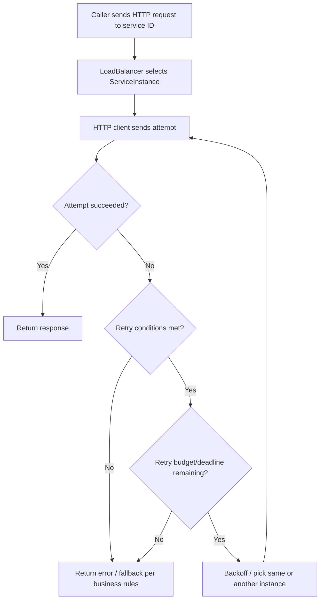
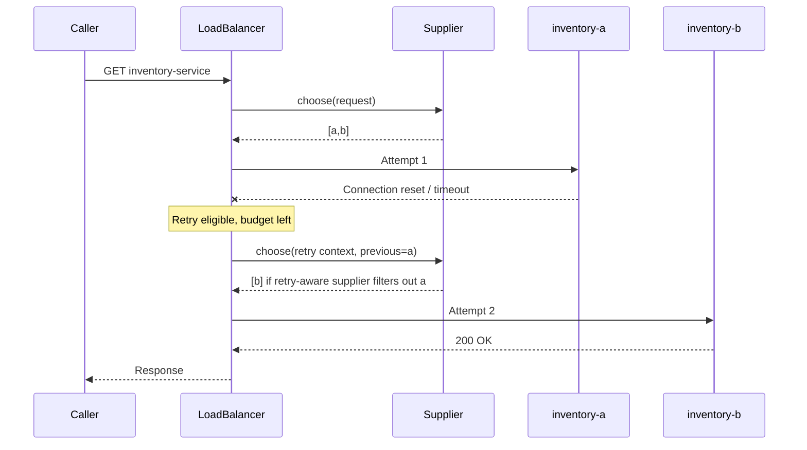

# Conditions for Enabling Retries in Blocking and Reactive Flows

In a microservices architecture, a request from `order-service` to `inventory-service` sometimes fails because a connection was reset, an instance was just reclaimed, a gateway is overloaded, or a downstream responds slowly. **Retries** can help recover from transient failures, but misconfigured retries can also double side effects, exhaust thread/connection pools, and amplify incidents. With Spring Cloud LoadBalancer, you must consider both **which conditions permit retrying** and **which instance is chosen for the retry**.

This lesson belongs to the **Retries** chapter in the **Spring Cloud Service Communication Load Balancing** module, focusing on the conditions for enabling retries on **blocking** HTTP clients (`RestTemplate`, `RestClient`, with specific notes for OpenFeign) and **reactive** HTTP clients (`WebClient`). Topics include Spring Retry, Reactor retry/backoff, service discovery, `ServiceInstanceListSupplier`, same-instance vs. next-instance retry policies, timeouts, idempotency, and how to prove through testing that the configuration actually works.

## 1. Retry is a business and operational decision, not just a config flag

Suppose a caller sends:

```http
GET /api/items/42 HTTP/1.1
Host: inventory-service
```

Spring Cloud LoadBalancer may pick `inventory-a` at `10.0.1.10:8080`. If the connection fails, a suitable retry policy can ask LoadBalancer to select `inventory-b` and resend the request. However, if the request is `POST /api/orders`, resending could create an extra order when the first attempt's response is lost.



Before enabling retries, answer **at least five questions**:

1. **Is the operation safe to execute again?** The HTTP method, business semantics, idempotency key, and ability to replay the request body must all be suitable.
2. **Is the failure likely transient?** Not every HTTP status or exception can recover by trying again.
3. **Are deadline, retry budget, and downstream capacity sufficient?** Retries must not extend indefinitely or violate the original request's SLO.
4. **Who owns the retry policy?** Retries across LoadBalancer, HTTP client, Feign, Reactor, gateway, and service mesh must not stack unintentionally.
5. **Does the next attempt have a valid target?** Switching instances only helps if discovery/health sources yield an eligible candidate without violating tenant/region/version constraints.

If any of these conditions are not met, **do not enable retries** for that request type, even if the library exposes built-in retry properties.

## 2. Distinguishing request, attempt, retry, and failover

| Concept | Meaning | Example |
|---|---|---|
| **Logical request** | A business invocation from the caller | Calling `getItem(42)` once |
| **Attempt** | One actual try by the HTTP client to send the request | Sending to `inventory-a` |
| **Retry** | An additional attempt after a prior attempt fails | Trying a second time after a connect timeout |
| **Same-instance retry** | Retrying the exact same `ServiceInstance` | `inventory-a` → `inventory-a` |
| **Next-instance retry** | Re-selecting a `ServiceInstance` for the new attempt | `inventory-a` → `inventory-b` |
| **Failover** | Switching to a backup target according to policy | Leaving zone-a to pick an instance in zone-b when allowed |
| **Backoff** | Waiting interval between attempts, usually with jitter | 100 ms then 200 ms ± jitter |

A **retry does not automatically mean switching instances**. If `max-retries-on-same-service-instance` is greater than 0, some retries go back to the same target. Conversely, retrying on the next instance does not guarantee a different IP if the list holds only one instance or selection policy cannot exclude the old target.

### 2.1. Did the failure happen before or after the server received the request?

A critical distinction determining retry safety:

- **Failure before connection succeeds** (e.g., `Connection refused`): the target server typically has not processed the request. Retries can help if another healthy instance exists.
- **Failure while streaming the body:** you cannot be sure whether the server received part or all of the payload; streaming requests may not be replayable.
- **Read/response timeout after sending:** the server **may have already processed and committed the transaction**, losing only the response on the return path.
- **HTTP 503:** the server is rejecting requests or overloaded; do not automatically hammer it with immediate retries.
- **HTTP 409:** may reflect a business conflict, not a transient error by default.

Because the caller cannot always tell whether the server already executed the business logic, **operation idempotency** matters more than assuming "timeout means nothing happened."

## 3. HTTP method and idempotency conditions

An idempotent operation yields an equivalent final business state when executed multiple times with the same request. The HTTP method is only a hint about semantics; the API implementation decides actual safety.

| Operation | Retry recommendation | Conditions to check |
|---|---|---|
| `GET /items/42` | Often suitable for transient errors | GET is truly read-only with no business side effects |
| `HEAD` / `OPTIONS` | Worth considering | Backend honors semantics, request is replayable |
| `PUT /items/42` | Potentially safe if designed idempotently | Same payload updates to same state; version/concurrency control in place |
| `DELETE /items/42` | Depends on API | Repeated deletes handled consistently; subsequent `404` may mean already deleted |
| `POST /orders` | **Do not auto-retry** without duplicate protection | Requires idempotency key/deduplication before retrying |
| `POST /payments` | High risk | Requires idempotency key, transaction state, reconciliation, and provider contract |
| Streaming upload | Usually not arbitrarily replayable | Body must be recreatable or seekable, with integrity checks |

Spring Cloud LoadBalancer has the property `spring.cloud.loadbalancer.retry.retry-on-all-operations`, which **defaults to `false`** in the current configuration reference. When disabled, retries are conservatively scoped to GET operations. Setting `true` **does not make POST safe by itself**: it merely widens which operations configuration permits retrying, while preventing duplicate execution remains the application's responsibility.

### 3.1. Idempotency key for side-effecting commands

Example order-creation call:

```http
POST /api/orders HTTP/1.1
Host: order-service
Idempotency-Key: 9e9d1d4d-55e8-42f6-99e1-7b43b765798c
Content-Type: application/json

{"sku":"BOOK-42","quantity":1}
```

To retry safely, the server must **persist and validate the key consistently**, usually scoped with caller/tenant and payload fingerprint; execute the operation once; and return the recorded result for duplicate attempts. Adding the header without server-side deduplication **does not create idempotency**.

For payments or order processing, consider atomic transactions, key TTL, concurrency locking, and `in-progress`/`completed`/`failed` state handling. Without those guarantees, returning an error may be safer than retrying automatically.

## 4. Error conditions: not every failure should be retried

| Error / HTTP status | Retryable? | Reason and conditions |
|---|---|---|
| Connect timeout, connection reset, `IOException` | Usually considered | Transient network errors, but check replayability and budget |
| Read timeout | Possibly for GET/idempotent operations | Server may have processed the request; unsafe by default for POST |
| `502 Bad Gateway` | Consider with limits | Transient gateway/upstream fault; avoid amplifying load |
| `503 Service Unavailable` | Consider + backoff/jitter | May indicate overload; reduce concurrency if needed |
| `504 Gateway Timeout` | Consider for safe requests | Upstream may still be executing; never retry unboundedly |
| `429 Too Many Requests` | Usually requires dedicated policy | Honor `Retry-After` if valid and within deadline |
| `408 Request Timeout` | Depends on client/server semantics | Identify failure phase and replayability |
| `400`, `401`, `403`, `404` | Usually **no** | Bad input, auth, or missing resource rarely resolves by retrying identically |
| `409 Conflict` | Depends on business contract | Usually requires reading state or resolving conflicts first |
| Decode/validation error from schema mismatch | Usually **no** | Trying the same data on another instance won't fix a contract mismatch |

The `502/503/504` statuses in the table are **candidates to configure**, not a claim that Spring Cloud retries all of them automatically. In the current configuration properties reference, `spring.cloud.loadbalancer.retry.retryable-status-codes` defaults to an **empty set**; when retrying by status, pick specific codes per API and verify the HTTP client's exception mapping.

Spring Cloud Commons includes commonly used retry-policy exception types such as `IOException`, `TimeoutException`, and `RetryableStatusCodeException` when no custom `retryable-exceptions` list is declared. Verify how exceptions thrown by your specific HTTP client are routed into the retry policy; there is no guarantee that any `WebClientResponseException` or arbitrary business exception will be retried automatically.

**Avoid `retry-on-all-exceptions: true`** except for verified compatibility cases: it can retry programming bugs, authentication failures, serialization errors, or validation errors that are never transient.

## 5. General conditions for replayability, deadlines, and load

Even a replayable `GET` needs a **retry budget**. Before retrying, check:

1. Request body, headers, and auth tokens can be faithfully replayed, without consuming a single-use stream or resending an expired token.
2. Sufficient time remains in the upstream request's total deadline; child calls must not outlive a canceled business call unnecessarily.
3. Limits exist for `max attempts`, total retry duration, and backoff intervals.
4. Load limits exist: connection pools, thread pools, `boundedElastic`, rate limiters, bulkheads, and server capacity.
5. **Actual attempt counts** are observable so layers do not multiply retries blindly.

### 5.1. The retry amplification math

If a gateway retries up to 3 attempts and an internal service also retries up to 3 attempts, in the worst case this can generate up to:

\[
N_{outbound} \le 3\times3=9\ \text{attempts per logical request}
\]

Adding a service mesh layer retrying twice can push the upper bound to 18 attempts if every layer's conditions trigger. This is an **illustrative upper bound**, not a formula every framework always hits. Retry traffic can push an already overloaded downstream even further into overload.

**Recommendation:** designate **one primary retry owner** per call; if multiple layers must retry, enforce a combined retry budget and verify outbound request counts in tests.

## 6. Blocking flow: RestTemplate and RestClient

`RestTemplate` and `RestClient` perform synchronous calls; callers typically wait until completion or timeout. Spring Cloud LoadBalancer supports blocking target selection via `BlockingLoadBalancerClient` and corresponding integrations.

### 6.1. Making Spring Cloud LoadBalancer retries take effect

Per Spring Cloud Commons documentation, for **load-balanced `RestTemplate`**, blocking retries do not turn on merely because LoadBalancer is present; **Spring Retry** must be on the classpath. Illustrative Maven dependencies:

```xml
<dependency>
    <groupId>org.springframework.cloud</groupId>
    <artifactId>spring-cloud-starter-loadbalancer</artifactId>
</dependency>
<dependency>
    <groupId>org.springframework.retry</groupId>
    <artifactId>spring-retry</artifactId>
</dependency>
```

Configuring `@LoadBalanced RestTemplate`:

```java
@Configuration(proxyBeanMethods = false)
class BlockingInventoryClientConfiguration {

    @Bean
    @LoadBalanced
    RestTemplate inventoryRestTemplate() {
        return new RestTemplate();
    }
}

@Service
class InventoryGateway {

    private final RestTemplate restTemplate;

    InventoryGateway(@LoadBalanced RestTemplate restTemplate) {
        this.restTemplate = restTemplate;
    }

    String readItem(long id) {
        return restTemplate.getForObject(
                "http://inventory-service/api/items/{id}", String.class, id);
    }
}
```

Spring Cloud provides retry auto-configuration for eligible blocking clients when dependencies and properties allow. **Do not assume adding the Spring Retry dependency alone proves every call path retries**: inspect the active interceptor/wrapper beans, verify service ID load balancing, and run failure-injection tests.

`RestClient` is also a blocking client and supports `@LoadBalanced RestClient.Builder`:

```java
@Bean
@LoadBalanced
RestClient.Builder loadBalancedRestClientBuilder() {
    return RestClient.builder();
}

// Inject @LoadBalanced RestClient.Builder in the gateway:
RestClient inventory = loadBalancedBuilder
        .baseUrl("http://inventory-service")
        .build();

String body = inventory.get()
        .uri("/api/items/{id}", 42)
        .retrieve()
        .body(String.class);
```

The second snippet omits the enclosing class using the builder; it illustrates constructing `RestClient`, not a standalone compilable Java file. With Spring Boot, consider `RestClientBuilderConfigurer` to preserve customizers, request factories, and observability. **Retry** integration on `RestClient` can differ in detail across Spring Cloud release trains and HTTP request factories; verify your version's retry path with tests instead of assuming parity with documented `RestTemplate` behavior.

### 6.2. Backoff in blocking flows using Spring Retry

On the Spring Retry path, Spring Cloud lets you provide a `LoadBalancedRetryFactory` supplying a `BackOffPolicy` per service ID:

```java
@Configuration(proxyBeanMethods = false)
class BlockingRetryConfiguration {

    @Bean
    LoadBalancedRetryFactory loadBalancedRetryFactory() {
        return new LoadBalancedRetryFactory() {
            @Override
            public BackOffPolicy createBackOffPolicy(String service) {
                ExponentialBackOffPolicy policy = new ExponentialBackOffPolicy();
                policy.setInitialInterval(100L);
                policy.setMultiplier(2.0);
                policy.setMaxInterval(1000L);
                return policy;
            }
        };
    }
}
```

`BackOffPolicy` and `ExponentialBackOffPolicy` come from Spring Retry; imports are omitted for brevity. This is an illustrative configuration; choose wait intervals based on deadlines and server capacity. **In blocking flows, backoff waits can hold threads while sleeping**, so measure concurrent workers, queues, connection pools, and throughput. Never set long backoffs that cause Servlet requests to outlive gateway deadlines.

## 7. Reactive flow: WebClient and Reactive LoadBalancer

`WebClient` can execute non-blocking I/O via `ReactorLoadBalancerExchangeFilterFunction` when properly configured. Reactive retries can be handled either by **Spring Cloud LoadBalancer retry integration** or by **Reactor `.retryWhen(...)`** in the application pipeline. These two mechanisms are **not automatically equivalent** and should not stack without control.

### 7.1. Configuring WebClient with LoadBalancer

```java
@Configuration(proxyBeanMethods = false)
class ReactiveInventoryClientConfiguration {

    @Bean
    @LoadBalanced
    WebClient.Builder loadBalancedWebClientBuilder() {
        return WebClient.builder();
    }

    @Bean
    WebClient inventoryWebClient(
            @LoadBalanced WebClient.Builder builder) {
        return builder.baseUrl("http://inventory-service").build();
    }
}
```

Making a GET request:

```java
Mono<ItemReply> result = inventoryWebClient.get()
        .uri("/api/items/{id}", 42)
        .retrieve()
        .bodyToMono(ItemReply.class);
```

`ItemReply` is a hypothetical DTO. Returning `Mono<ItemReply>` **does not mean retries are enabled**. Ensure the client actually passes through the reactive LB filter, has a `ServiceInstance` source, and has a retry policy configured for that call path.

### 7.2. Enabling retries at the Spring Cloud LoadBalancer layer

A deliberately conservative configuration for a `GET` API might look like:

```yaml
spring:
  cloud:
    loadbalancer:
      retry:
        enabled: true
        max-retries-on-same-service-instance: 0
        max-retries-on-next-service-instance: 1
        retry-on-all-operations: false
        retry-on-all-exceptions: false
        retryable-status-codes:
          - 503
          - 504
        backoff:
          enabled: true
          min-backoff: 100ms
          max-backoff: 1s
          jitter: 0.5
```

Meaning:

| Property | Meaning |
|---|---|
| `retry.enabled` | Flag permitting LoadBalancer retries; default in current properties docs is `true`, yet **having the flag does not mean every client retries** |
| `max-retries-on-same-service-instance: 0` | Allocates zero extra attempts to retry the same instance |
| `max-retries-on-next-service-instance: 1` | Allows at most one retry on a subsequent instance selection |
| `retry-on-all-operations: false` | Does not widen retries to non-GET operations |
| `retry-on-all-exceptions: false` | Does not retry every exception regardless of cause |
| `retryable-status-codes: [503, 504]` | Explicitly specifies HTTP statuses eligible for retry |
| `backoff.enabled: true` | Enables backoff **for reactive Retry** per configuration property semantics |
| `min-backoff`, `max-backoff`, `jitter` | Bounds and randomizes wait intervals to prevent synchronized retry spikes |

These numbers are for **lab exercises**, not production defaults. Current configuration properties documentation states defaults of `same=0`, `next=1`, `retry-on-all-operations=false`, `retry-on-all-exceptions=false`, `backoff.enabled=false`, `min-backoff=5ms`, and `jitter=0.5`; always check your pinned release train because semantics can change. Never deduce that default `enabled=true` means effective retries are active across `RestTemplate`, `RestClient`, `WebClient`, and OpenFeign simultaneously.

**Documentation reading note:** one prose passage in Spring Cloud Commons' "Retrying Failed Requests" section has a confusing phrasing regarding `backoff.enabled=false`, whereas the `Configuration Properties` table defines it as the flag enabling Reactor Retry backoff, defaulting to false. When configuring to **use backoff**, set `enabled: true` and verify actual delays with integration tests.

### 7.3. Per-service-ID configuration

Most LoadBalancer properties support overrides under `spring.cloud.loadbalancer.clients.<clientId>.*`. For example, tuning retry counts only for `inventory-service`:

```yaml
spring:
  cloud:
    loadbalancer:
      retry:
        enabled: true
        max-retries-on-next-service-instance: 0
      clients:
        inventory-service:
          retry:
            max-retries-on-next-service-instance: 1
            retryable-status-codes:
              - 503
```

Per-client configurations merge with global settings, with client-specific values taking precedence on conflicts. However, **`spring.cloud.loadbalancer.retry.enabled` is a special global switch**: when retries are disabled globally, you cannot re-enable them for a single client under `clients`; when enabled globally, you can disable them for a specific client. Always check property precedence and ensure per-service edits do not accidentally alter other services.

### 7.4. Reactive flows do not block the event loop during backoff

With reactive Retry, backoff is scheduled via a Reactor scheduler without calling `Thread.sleep()` in a filter or event loop. Even so, HTTP connection pools, inflight request counts, and downstream resources remain finite; backoff alone does not cure overload.

Never call `.block()` or `Future.get()` inside an `ExchangeFilterFunction` to implement retries. If a blocking API must run in a pipeline, offload it with bounded concurrency via `Mono.fromCallable(...).subscribeOn(Schedulers.boundedElastic())`, though true reactive I/O is preferred.

## 8. Using Reactor `.retryWhen()` when managing retries at the application layer

When you want custom retry logic on a specific caller, you can use Reactor `Retry` in the pipeline. **Disable LoadBalancer retries for that call path** so you do not accidentally multiply attempts with application-level `.retryWhen()`.

Illustrative example retrying a **GET** request with two retries and an overall timeout:

```java
private boolean isTransient(Throwable error) {
    if (error instanceof WebClientRequestException) {
        return true; // Transport error: evaluate further in production operations.
    }
    if (error instanceof WebClientResponseException response) {
        int status = response.getStatusCode().value();
        return status == 503 || status == 504;
    }
    return false;
}

public Mono<ItemReply> readWithRetry(long id) {
    return inventoryWebClient.get()
            .uri("/api/items/{id}", id)
            .retrieve()
            .bodyToMono(ItemReply.class)
            .retryWhen(Retry.backoff(2, Duration.ofMillis(100))
                    .maxBackoff(Duration.ofSeconds(1))
                    .jitter(0.5)
                    .filter(this::isTransient))
            .timeout(Duration.ofSeconds(3));
}
```

`Retry` here is `reactor.util.retry.Retry`, not Spring Retry's `@Retryable` annotation. `.retryWhen(Retry.backoff(2,...))` permits **two retries beyond the initial attempt**, meaning up to three total attempts when all match the filter. `.timeout(...)` is placed **after** `.retryWhen(...)` to bound the entire retry chain in this example; also verify connect/response timeouts on the underlying HTTP client.

`retrieve()` converts HTTP error responses into exceptions; the filter targets `503`, `504`, and transport exceptions. This is an **application-level policy**, not a Spring Cloud LoadBalancer default. If you need to honor `Retry-After`, distinguish pre-send vs. post-send failures, or handle different authentication rules, write a stricter predicate instead of `retryOnAllErrors`.

**Important:** each re-subscription can trigger the HTTP client to send a new attempt. If the client integrates LoadBalancer, instance selection may run again, though it does not guarantee picking a different instance; that still depends on suppliers, caching, and selection policy. Do not rely on `.retryWhen()` alone to guarantee failover to another zone or replica.

### 8.1. Do not create infinite retry loops in filters

```java
// AVOID: Retries every exception forever with no deadline.
return next.exchange(request).retry();
```

Or:

```java
// AVOID: Adding .retryWhen() at every layer.
return next.exchange(request)
        .retryWhen(Retry.max(3));
```

If the same HTTP client also has LoadBalancer retries active, three retries per layer can multiply attempts. A filter lower than `retrieve()` also sees errors differently from status-handling code at the service layer. **Place retries at one controlled boundary** with a conditional filter, deadline, and per-attempt metrics.

## 9. Retry on the same instance or move to the next instance?

Spring Cloud LoadBalancer provides these properties:

```yaml
spring:
  cloud:
    loadbalancer:
      retry:
        max-retries-on-same-service-instance: 0
        max-retries-on-next-service-instance: 1
        avoid-previous-instance: true
```

`max-retries-on-same-service-instance` counts additional retries on the **same** instance; `max-retries-on-next-service-instance` counts retries when **re-selecting** an instance. `RetryAwareServiceInstanceListSupplier` can try to exclude the previously tried instance from the list when alternative candidates exist and `avoid-previous-instance` is active.



This diagram shows **desired testable behavior**, not a guarantee that every retry lands on `inventory-b`. If only one instance exists, the supplier fails to receive the retry context, or zone/tenant filters leave only `inventory-a`, the retry may reuse the old target or fail depending on policy.

### 9.1. Estimating maximum attempts

In an illustrative model, if `R_same` is the number of extra retries **per selected instance** and `R_next` is the number of permitted next-instance selections, an ideal upper bound is:

\[
N_{attempt} \le (R_{next}+1)(R_{same}+1)
\]

For instance, `R_same=1` and `R_next=2` can generate up to 6 attempts under this nested model. This is merely a **budget estimate**, not a substitute for checking your framework's actual retry implementation and configuration, and execution can stop earlier due to non-retryable errors, expired deadlines, empty candidate lists, or an open circuit breaker.

Without another retry mechanism, `R_same=0`, `R_next=1` corresponds to at most **two attempts** when a retry triggers. If Reactor `.retryWhen`, a Feign retryer, a client SDK, or gateway retries are also active, recalculate total outbound attempts.

### 9.2. Hard constraints must remain intact during retries

If a request requires `tenant-a` to be processed exclusively in `region-a`, retrying onto an instance outside `region-a` is **invalid**. `RetryAwareServiceInstanceListSupplier` must operate only on candidates that already passed hard-constraint filters; never drop authorization, API version, or data residency rules just to avoid a previously tried instance.

Place caching near the discovery source, ahead of request-dependent filters; ensure retry context continues flowing through `get(Request)` on suppliers when the policy needs the previously tried instance. When every instance fails, return a controlled error instead of looping indefinitely.

## 10. Backoff, jitter, and total wait time

Without backoff, many callers can retry simultaneously right after an outage, creating a **thundering herd**. Exponential backoff with jitter spaces out and scatters attempts:

\[
D_k = \min(D_{max}, D_{base}\cdot 2^{k-1})
\]

Where `D_k` is the planned delay before the `k`-th retry; jitter varies the actual wait around this value depending on the implementation. This formula is a common model, **not an exact contract for every `RetryBackoffSpec`**.

| Attempt | State | Example delay before attempt |
|---|---|---|
| 1 | Initial call | `0 ms` |
| 2 | Retry after transient error | ~`100 ms` ± jitter |
| 3 | Further retry if budget remains | ~`200 ms` ± jitter |
| 4 | If policy still allows | ~`400 ms` ± jitter |

An overall deadline must account for connect time, response waits, connection pool waits, backoff, instance selection, and client processing:

\[
T_{total}\ \lesssim\ \sum_{i=1}^{N}
(T_{connect,i}+T_{response,i}+T_{overhead,i})
+\sum_{i=2}^{N}D_i
\]

This is a budgeting model, not an automatic limit enforced by the framework. With up to 3 attempts, 2 seconds per attempt, plus 100 ms and 200 ms backoffs, total duration can exceed 6.3 seconds. An upstream request allowing only 4 seconds will need **fewer retries or shorter per-attempt timeouts** rather than letting every attempt run to completion.

**Stop retrying when the deadline or budget expires**, even if an error remains in the retryable set. Also cap maximum inflight requests, since 10,000 requests all retrying twice can dramatically increase open connections and backend load.

## 11. Differences between blocking and reactive

| Topic | Blocking: RestTemplate/RestClient | Reactive: WebClient |
|---|---|---|
| Thread during HTTP wait | Caller thread is typically held | I/O can avoid blocking the event loop |
| Typical retry mechanism | Spring Retry with compatible LB integration; or app-managed external retry | Reactive LB retry and/or controlled Reactor `Retry` |
| Activation conditions | Spring Retry on classpath, configuration, proper interceptor/client beans | Reactive LB filter, compatible flags/config, or `.retryWhen` |
| Backoff | `BackOffPolicy` may sleep on the blocking thread | Reactor schedules asynchronously without sleeping the event loop |
| Cancellation | Interrupting caller may not abort blocked HTTP I/O | Subscription cancels, though underlying transport/blocking tasks may not stop immediately |
| Primary risks | Servlet thread pool and HTTP connection pool saturation | Stacked retry operators; blocking inside filters; excessive subscriptions/inflight calls |
| Testing tools | MockWebServer/WireMock, thread dumps, Spring Retry listeners | StepVerifier, Reactor virtual time, stub servers, Reactor Netty metrics |

**Do not conclude:** "Reactive retry is always faster" or "blocking retry is wrong." Choose the model fitting your architecture, and measure actual SLOs and resource usage. Reactive avoids holding threads during network waits, yet it cannot cure a slow backend, broken idempotency, or amplified retry traffic.

## 12. OpenFeign: checking retries in a separate layer

`@FeignClient(name = "inventory-service")` typically uses a blocking HTTP path and can integrate `FeignBlockingLoadBalancerClient` when Spring Cloud LoadBalancer is present. **Spring Cloud OpenFeign configures `Retryer.NEVER_RETRY` by default at the Feign layer**, unlike core Feign's default retryer. Even so, that **does not prove** every layer has retries disabled: LoadBalancer, HTTP transport, or external resilience layers may still have their own policies.

Example Feign client timeout configuration:

```yaml
spring:
  cloud:
    openfeign:
      client:
        config:
          inventory-service:
            connectTimeout: 1000
            readTimeout: 2500
```

Timeout values in this example are in **milliseconds** per OpenFeign configuration. When enabling retries in Feign, supply a `Retryer` or release-train-supported configuration and explicitly define attempt counts, error types, and backoff. Do not assume `spring.cloud.loadbalancer.retry.*` governs **all** Feign retries; test actual HTTP attempts, especially when a project contains both Spring Retry and a Feign retryer.

For new systems, Spring Cloud OpenFeign is feature-complete and Spring recommends considering Spring HTTP Service Clients. When migrating Feign to `RestClient` or `WebClient`, **do not blindly copy retry policies**, as timeout semantics, retry status/error mapping, and LoadBalancer integration paths can differ.

## 13. Observing and verifying retries with server-side evidence

Logging "retrying request" is not enough to prove which attempts the backend actually received. To test properly, use two fault-injectable stub instances:

```text
inventory-a :18081  -> 503 on certain requests, logs attempt-id
inventory-b :18082  -> 200 OK, logs attempt-id
Caller            -> GET http://inventory-service/api/items/42
```

`SimpleDiscoveryClient` in tests can provide a static list:

```yaml
spring:
  cloud:
    discovery:
      client:
        simple:
          instances:
            inventory-service:
              - uri: http://127.0.0.1:18081
              - uri: http://127.0.0.1:18082
```

With one next-instance retry configured, the test should observe **one logical request** producing up to two HTTP attempts when the error is retryable and the policy is active. However, round-robin ordering and filter behavior can vary; manage test state so assertions do not hardcode that the very first call always hits A.

### 13.1. Mandatory test suite

| Test case | Expectation to verify |
|---|---|
| GET hits `503` then another instance returns `200` | Retry happens only if `503` is configured and budget remains |
| GET hits `404` | No retry under a policy permitting only `503/504` |
| GET times out before connecting | Bounded retry without holding sockets/threads forever |
| Order-creation POST without idempotency key | No automatic cross-layer retry |
| POST with idempotency key, server committed but response lost | No duplicate record created on retry when server deduplicates properly |
| Only one instance remains | Do not assume next-retry guarantees selecting a different endpoint |
| Discovery source returns empty | No infinite retry loop; reports no eligible instance |
| Overall deadline expires before final retry | Stops early on deadline without attempting full retry count |
| Two retry layers enabled together | Count attempts and detect amplification |
| Many callers hit `503` simultaneously | Backoff/jitter spreads load without exceeding retry-storm thresholds |
| Failover into disallowed zone | Blocked by hard constraints even if healthy instances exist there |

### 13.2. Distinguishing three metrics when measuring

1. **Logical requests:** volume of business requests entering the caller.
2. **Outbound attempts:** number of times the HTTP client sends/attempts to send a request; rises with retries.
3. **Backend received requests:** number of times a backend actually receives a request; can be lower than attempts if failures occur pre-connect.

Attach a stable correlation ID to the logical request and a separate attempt index to each try. Avoid using user/tenant IDs as high-cardinality metric labels; use normalized groups/statuses/routes. Also track:

- Retries started, succeeded-after-retry, rejected retries, and retry budget exhausted.
- Outcomes by service ID, instance ID (within cardinality limits), status, and exception type.
- p95/p99 latency of logical requests and individual attempts; total backoff duration.
- Connection pool wait times, active HTTP connections, and thread/scheduler queues.
- Discovery/health status of instances before and after failover.

Spring Cloud LoadBalancer provides `LoadBalancerLifecycle` and integrates with Micrometer when `spring.cloud.loadbalancer.stats.micrometer.enabled=true` is set alongside a `MeterRegistry`. Do not assume every per-retry metric is enabled by default; combine server access logs with custom instrumentation to verify exact attempt counts.

## 14. Practical workflow for configuring and evaluating retries

**Step 1 — Start with zero retries.** Disable LB retries via `spring.cloud.loadbalancer.retry.enabled=false`; disable external retries if present to measure baseline errors and latency in tests.

**Step 2 — Pick an idempotent operation.** Use `GET /api/items/{id}`; never pick `POST /orders` as your first experiment.

**Step 3 — Verify the execution model.** For `RestTemplate`, check the Spring Retry dependency and retry interceptor; for `WebClient`, check the reactive LB filter. Never draw conclusions from YAML properties before observing attempts on stubs.

**Step 4 — Enable only one layer.** Choose either LB retries or application `.retryWhen`/retryer. Allow one next-instance retry; do not enable all exceptions or all HTTP operations yet.

**Step 5 — Inject faults.** Have one backend return `503` and the other `200`, test connection resets, slow responses, and `404`; cross-check `(logicalRequestId, attemptIndex)` pairs across caller and stubs.

**Step 6 — Add backoff and deadlines.** Pick min/max delays and jitter, measure p95/p99, outbound request rates, and pending connections. Ensure total request deadlines are never breached just because of retries.

**Step 7 — Test widespread outage.** When all instances return `503`, retries must not crash the caller or backend; apply bulkheads, rate limiting, and circuit breakers as appropriate.

**Step 8 — Verify rollback.** Confirm retries can be turned off quickly, error rates return to baseline, and no stray retry config remains in another layer.

## 15. Common configuration mistakes

| Symptom | Possible cause | Resolution |
|---|---|---|
| `retry.enabled=true` set, yet no blocking retries occur | Missing Spring Retry, wrong client/interceptor, or non-retryable error | Check classpath, active beans, and fault-injection tests |
| Retries happen on POST unintentionally | `.retryWhen`, Feign retryer, or gateway retries active outside LB policy | Audit all retry layers; disable or scope by method |
| GET `503` is not retried | Retryable status not configured or exception mapping mismatch | Inspect actual status/exception and configure retryable codes |
| `404` retried multiple times | `retry-on-all-exceptions` or `retryWhen` too broad | Retry only explicitly defined transient errors |
| Retries keep hitting the old instance | No other candidates or retry-aware supplier inactive | Check `avoid-previous-instance`, supplier, and filtered list |
| Backoff configured, yet latency is excessive | Sum of attempt timeouts and backoffs exceeds deadline | Reduce attempts, timeouts/backoffs, and add a global deadline |
| Raising retries increases `503`s | Downstream overloaded; retry storm | Add jitter, bulkheads, circuit breakers, and smaller retry budgets |
| Response times out yet server creates duplicate orders | Missing server-side idempotency/deduplication | Do not retry unsafe operations without duplicate protection |
| Reactive event loop slows down | `.block()`, `Thread.sleep`, or blocking SDK inside filter/retry hook | Use async composition; offload blocking calls deliberately |
| Feign doesn't retry despite LB settings | Feign uses `Retryer.NEVER_RETRY`, separate retry layers | Inspect retry beans, call path, and HTTP attempt counts |

## 16. Checklist for deciding to enable retries

- [ ] I have identified the logical request and every layer capable of retrying.
- [ ] The HTTP operation is genuinely idempotent or carries a server-enforced idempotency key.
- [ ] Request body, headers, and auth tokens can be safely replayed on the next attempt.
- [ ] Only transient failures are retried; status codes and exceptions are explicitly selected.
- [ ] Attempt limits, backoff/jitter, overall deadline, and retry budget are defined.
- [ ] It is clear whether retries target the same instance or select the next instance.
- [ ] Candidate pools preserve hard constraints for tenant, region, permissions, and API version.
- [ ] For blocking clients, Spring Retry dependency and wiring/HTTP request factory are verified.
- [ ] For reactive WebClient, the client actually uses the reactive LB filter without blocking the event loop.
- [ ] For Feign, retryer, LB retry, and gateway/mesh retries do not stack unintentionally.
- [ ] Tests cover GET 503/404, timeouts, all-instances-down, POST deduplication, and cancellation/deadlines.
- [ ] Metrics track logical requests and outbound attempts, with a safe way to disable retries.

**Conclusion:** the conditions for enabling retries in blocking and reactive flows are fundamentally the same: **the operation must be safe to repeat, the failure recoverable, time/load budget available, and a single verified retry policy in charge**. The difference lies in execution mechanics: blocking typically pairs with Spring Retry and can hold threads while waiting; reactive uses LoadBalancer/Reactor retries and must not block the event loop. In both cases, Spring Cloud LoadBalancer only assists with selecting a `ServiceInstance`; correctness of idempotency, overall deadlines, and business safety remains the application's responsibility.

## References

- [Spring Cloud Commons — Common Abstractions, Retrying Failed Requests](https://docs.spring.io/spring-cloud-commons/reference/spring-cloud-commons/common-abstractions.html): Spring Retry for blocking, reactive retries, backoff, and `RetryAwareServiceInstanceListSupplier`.
- [Spring Cloud Commons — Configuration Properties](https://docs.spring.io/spring-cloud-commons/reference/configprops.html): defaults for `spring.cloud.loadbalancer.retry.*`, same/next distinction, and retry flags.
- [Spring Cloud Commons — Spring Cloud LoadBalancer](https://docs.spring.io/spring-cloud-commons/reference/spring-cloud-commons/loadbalancer.html): per-client configuration, suppliers, caching, and metrics.
- [Spring Cloud OpenFeign — Features](https://docs.spring.io/spring-cloud-openfeign/reference/spring-cloud-openfeign.html): default `Retryer.NEVER_RETRY` and Feign configuration.
- [Project Reactor — Retry and Schedulers](https://projectreactor.io/docs/core/release/reference/coreFeatures/error-handling.html): Reactor retries, error filtering, and error signal handling.
