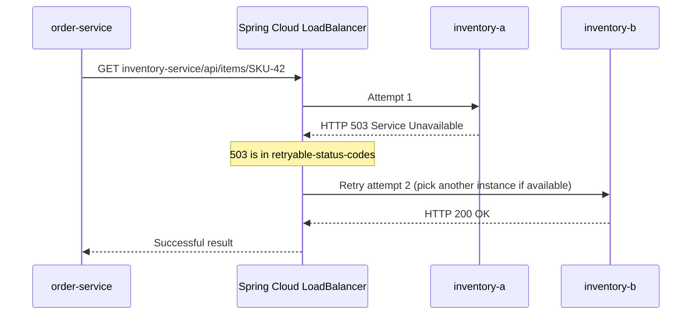
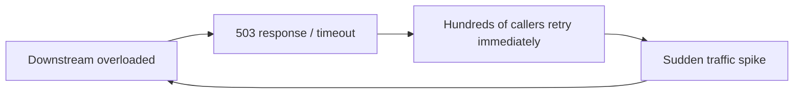

# Retryable Statuses, Exceptions, and Attempt Limits

## Objectives

When `order-service` calls `inventory-service` via `RestClient`, `RestTemplate`, `WebClient`, or OpenFeign, a replica may have just shut down, be overloaded, or be temporarily unresponsive. **Retry** helps improve the chance of completing a call if the fault is transient. However, retrying under the wrong conditions can create duplicate orders, increase traffic while downstream is overloaded, and extend caller wait times.

Spring Cloud LoadBalancer supports re-selecting a `ServiceInstance` on retry and provides key properties:

- `retryable-status-codes`: HTTP status codes that can trigger a retry.
- `retryable-exceptions`: exception classes that can trigger a retry.
- `max-retries-on-same-service-instance`: retry limit on the same instance.
- `max-retries-on-next-service-instance`: retry limit when re-selecting an instance.
- `retry-on-all-operations`, `retry-on-all-exceptions`, `avoid-previous-instance`, and backoff: additional conditions.

After this lesson, you will be able to classify responses and exceptions, design retry budgets by HTTP method, configure global and per-service-ID settings, test actual request counts sent, and avoid confusing LoadBalancer retries with separate Feign, Reactor, or gateway retries.

> Scope: Spring Cloud Commons/LoadBalancer 5.0.4 and the corresponding Spring Cloud OpenFeign release serve as the reference baseline for the described properties and behavior. Always verify against your active Release Train, as integrations and retry activation can vary across generations.

## 1. A conditional retry, not blind resending on every failure

Suppose `inventory-service` has two instances:

| Instance | Address | State at call time |
|---|---|---|
| `inventory-a` | `10.0.1.11:8080` | Overloaded, occasionally returning HTTP 503 |
| `inventory-b` | `10.0.1.12:8080` | Healthy, returning HTTP 200 |

The caller invokes:

```http
GET /api/items/SKU-42 HTTP/1.1
Host: inventory-service
Accept: application/json
```

A sensible retry can unfold as:



Retries should only happen when **multiple conditions hold simultaneously**:

1. The HTTP client is genuinely integrated with Spring Cloud LoadBalancer retry support.
2. Retries are not disabled globally or for that service ID.
3. The HTTP method/operation is permitted to re-execute.
4. The HTTP code or exception type belongs to the retryable set.
5. Attempt limits and time budget remain available.
6. The request can be safely re-sent under business rules.

Having properties in `application.yml` does not prove retries are active: inspect the dependencies, interceptors/exchange filters, and active HTTP client integration.

## 2. Retryable HTTP statuses: picking the right response codes

Not every non-`2xx` HTTP status is transient. Nor should every `5xx` be retried automatically.

| HTTP status | Common meaning | Include in retry list? |
|---|---|---|
| `200`, `201`, `204` | Request succeeded | No |
| `400` | Invalid request data | No; fix the request first |
| `401`, `403` | Unauthenticated or unauthorized | No; identical retries do not fix permissions |
| `404` | Resource not found | Usually no; check eventual-consistency contract for deliberate exceptions |
| `408` | Request Timeout returned by server/gateway | Possibly, if the request is safe to resend and policy allows |
| `409`, `422` | Conflict or invalid domain data | Usually no; handle in business logic |
| `429` | Too Many Requests / rate limit | Consider only with proper backoff honoring `Retry-After` or rate-limiting policy |
| `500` | Internal Server Error | Not transient by default; understand the root cause |
| `502` | Bad Gateway | Often a retry candidate for idempotent GETs |
| `503` | Service Unavailable | Often a retry candidate if the outage is transient |
| `504` | Gateway Timeout | Can be retried, though the backend may have already received or processed the request |

An illustrative configuration enabling retries only for HTTP `502`, `503`, and `504`:

```yaml
spring:
  cloud:
    loadbalancer:
      retry:
        enabled: true
        retryable-status-codes:
          - 502
          - 503
          - 504
```

`retryable-status-codes` is an **allowlist**, not a "retry all HTTP errors" switch. Leaving it empty does not mean all `5xx` codes will be retried. Retryable exception classes may still operate independently per policy.

### 2.1. HTTP responses differ from connection errors

The scenarios below are fundamentally different:

- **HTTP 503:** the caller connected to a backend or gateway and received a response with status 503.
- **Connect timeout:** failed to finish connecting to the chosen host/port; no HTTP request may have been received yet.
- **Read timeout:** the request may have reached the backend, yet the caller did not receive the full response in time.
- **No instances available:** LoadBalancer has no `ServiceInstance` to pick, potentially failing before any HTTP connection.

`retryable-status-codes` applies only when an **HTTP status** flows through the corresponding retry mechanism. `IOException`, timeouts, or having no selected instance do not turn into HTTP 503 on their own.

### 2.2. Retry-After does not mean automatic backoff

HTTP 429 and some 503 responses can carry the header:

```http
HTTP/1.1 429 Too Many Requests
Retry-After: 5
```

This signals that the server wants callers to wait before retrying. **Do not assume** merely listing 429 in `retryable-status-codes` makes every Spring Cloud LoadBalancer integration read and honor `Retry-After`. If you need that behavior, check the implementation or build a backoff policy at the appropriate layer. Retrying 429 immediately can worsen rate limiting.

## 3. Retryable exceptions: select only truly recoverable faults

Beyond HTTP statuses, Spring Cloud LoadBalancer lets you configure retryable exception classes via `retryable-exceptions`.

According to Spring Cloud Commons 5.0.4 documentation, when **no custom exception list is specified**, default retryable types include:

- `java.io.IOException`;
- `java.util.concurrent.TimeoutException`;
- Spring Cloud's `RetryableStatusCodeException` (supporting status-based retries).

These reflect I/O and timeout faults that are often transient. **They do not mean every Java exception is retried.**

Illustrative exception-list configuration:

```yaml
spring:
  cloud:
    loadbalancer:
      retry:
        enabled: true
        retryable-exceptions:
          - java.io.IOException
          - java.util.concurrent.TimeoutException
        retry-on-all-exceptions: false
```

When specifying `retryable-exceptions`, Spring Cloud still retains support for `RetryableStatusCodeException` so configured status codes can trigger retries. However, application-level exceptions may be wrapped in `ResourceAccessException`, `WebClientRequestException`, or other types depending on the HTTP client. Always test against the **actual root cause and wrapper** instead of guessing exception names from high-level logs.

### 3.1. Exceptions you should not retry blindly

| Fault type | Retryable? | Reason |
|---|---|---|
| Connection reset while sending GET | Possibly | If the operation is idempotent and another instance exists |
| Socket/connect timeout | Possibly | Transient network fault, but must honor the deadline |
| Read timeout after payment POST | Dangerous | Backend may have processed the payment while the response was lost |
| DTO validation error / schema mismatch | No | Resending invalid data will not fix it |
| `401`/`403` authorization failure | No | Retrying with the same credentials rarely changes the outcome |
| `NullPointerException` bug in caller logic | No | Sending another HTTP call won't fix a bug |
| `IllegalArgumentException` from bad input | No | Must fix the data or configuration |

**Do not enable `retry-on-all-exceptions: true` just to "make timeouts go away."** That flag widens retry conditions drastically; unrecoverable errors will generate extra attempts and cause overload.

### 3.2. Caution with errors that already caused side effects

Suppose `order-service` sends `POST /payments` and waits for a response. If the caller suffers a read timeout, it cannot infer that the server did not process the call: the server may have committed the transaction just before the connection dropped. Retrying could charge the customer twice.

To retry write operations safely, you need an idempotency key, a unique business key, deduplication logic, or equivalent backend guarantees. For non-idempotent requests, prefer checking transaction status instead of replaying blindly.

## 4. Retry limits on the same instance vs. another instance

Two common properties:

```yaml
spring:
  cloud:
    loadbalancer:
      retry:
        max-retries-on-same-service-instance: 0
        max-retries-on-next-service-instance: 1
```

Meaning:

- `max-retries-on-same-service-instance`: number of **retries** on the currently selected instance, excluding the initial call. Per the documentation, this is counted per selected instance.
- `max-retries-on-next-service-instance`: number of retries requiring **re-selection** of a `ServiceInstance` per LoadBalancer policy.

Both fields count **retries**, not total attempts; the first request is always the initial attempt when the call executes.

### 4.1. Minimal, easy-to-control configuration

With `same = 0` and `next = 1`:

```text
Attempt 1: inventory-a → HTTP 503 (retryable)
Attempt 2: re-select instance, preferring inventory-b if available
End: no further retries at this layer
```

In this ideal example with a single LoadBalancer retry mechanism, this means **at most two HTTP sends** for an eligible error. If Feign, Reactor, a gateway, or an SDK also retries, actual send counts can be much higher.

With `same = 1` and `next = 1`, the algorithm may retry on the same instance and then on the next selected instance. **Do not read `1` and `1` as "only one request total"**; observe actual attempts, because same-instance retries are counted per selected instance and behavior depends on implementation.

### 4.2. Next-instance retry does not guarantee a different IP

Spring Cloud provides `RetryAwareServiceInstanceListSupplier` to **avoid the previously failed instance** on re-selection when suitable alternatives exist. Property:

```yaml
spring:
  cloud:
    loadbalancer:
      retry:
        avoid-previous-instance: true
```

Its default in Spring Cloud Commons is `true` when the corresponding mechanism is active. Yet it is a **preference**, not a guarantee of a new instance:

- Registry has only one instance → the retry can still pick that same instance.
- Health check/hint/zone filter leaves one candidate → no other valid target exists.
- Retry-aware supplier is not wired properly into the chain → behavior may differ from expectations.
- Stale discovery/cache still holds a shut-down instance → the next selection may fail.

If business rules require retrying strictly on a different backend, design a stricter policy rather than treating `avoid-previous-instance: true` as an absolute guarantee.

## 5. Global configuration and per-service-ID overrides

Suppose `order-service` calls two services:

- `inventory-service`: read-only stock GET, allowing bounded retries.
- `payment-service`: duplicate-sensitive operation, LoadBalancer retries disabled.

```yaml
spring:
  cloud:
    loadbalancer:
      retry:
        enabled: true
        max-retries-on-same-service-instance: 0
        max-retries-on-next-service-instance: 1
        retry-on-all-operations: false
        retry-on-all-exceptions: false
        retryable-status-codes:
          - 502
          - 503
          - 504
        retryable-exceptions:
          - java.io.IOException
          - java.util.concurrent.TimeoutException
        avoid-previous-instance: true
      clients:
        inventory-service:
          retry:
            max-retries-on-next-service-instance: 1
        payment-service:
          retry:
            enabled: false
```

Properties under `clients.<serviceId>` **override** global values for that service ID, while unoverridden values are inherited.

**Exception to remember:** `spring.cloud.loadbalancer.retry.enabled` is a **global master switch**. If retries are disabled globally, you cannot turn them back on for `inventory-service` solely via `clients.inventory-service.retry.enabled: true`. When enabled globally, you can disable them per service as shown for `payment-service`.

`spring.cloud.loadbalancer.retry.enabled` defaults to `true` in the configuration properties table, yet **effective retries depend on the HTTP client and classpath**. For example, blocking `RestTemplate` requires Spring Retry; reactive behavior is documented separately. Never infer from a `true` default that every `RestTemplate` automatically retries even without the integration.

### 5.1. Key properties reference table

| Property (under `spring.cloud.loadbalancer.retry.`) | Default in Commons 5.0.4 | Role |
|---|---|---|
| `enabled` | `true` | Global gate for LoadBalancer retries |
| `max-retries-on-same-service-instance` | `0` | No same-instance retries by default |
| `max-retries-on-next-service-instance` | `1` | Allows one retry that re-selects an instance |
| `retryable-status-codes` | Empty | No HTTP statuses pre-selected by default |
| `retryable-exceptions` | Empty | When unset, uses the default exception set |
| `retry-on-all-exceptions` | `false` | Retries only qualifying exceptions |
| `retry-on-all-operations` | `false` | Does not retry non-GET operations by default |
| `avoid-previous-instance` | `true` | Prefers avoiding the just-failed instance when possible |
| `backoff.enabled` | `false` | Reactive backoff is off by default |
| `backoff.min-backoff` | `5ms` | Minimum backoff duration for reactive retries |
| `backoff.jitter` | `0.5` | Random variation factor for reactive backoff |

Across Spring Cloud versions, re-check property names and defaults in `configprops` for your actual version. Note the **kebab-case** naming in YAML—avoid mistyping `maxRetriesOnNextServiceInstance` when following standard config-file conventions.

## 6. HTTP methods and idempotency

The default `retry-on-all-operations: false` means LoadBalancer retries target **GET** operations only per the documentation. Do not enable retries for all HTTP methods merely to boost "success rate":

| Method | Usually safe to auto-retry? | Notes |
|---|---|---|
| `GET` | Yes, with retryable statuses/exceptions and bounded budget | GET endpoints must not cause side effects |
| `HEAD` | Idempotent per HTTP, though LoadBalancer's default flag does not include every operation | Verify policy if you want it handled |
| `PUT` | Idempotent per protocol if implemented properly | Check semantics and server handling |
| `DELETE` | Idempotent per protocol; repeated responses may differ | Verify business rules and concurrency |
| `POST` | Usually no | Requires idempotency key and deduplication |
| `PATCH` | Not by default | Depends on patch semantics and duplicate handling |

Example opening retries to operations beyond GET:

```yaml
spring:
  cloud:
    loadbalancer:
      retry:
        retry-on-all-operations: true
```

This is a **broad** switch, not "retry PUT but not POST." If you need per-method or per-endpoint policies, design a custom retry policy/HTTP client wrapper and test it instead of turning everything on globally.

### 6.1. An idempotency key is a server-side contract

For order creation, a caller may send:

```http
POST /api/orders HTTP/1.1
Host: order-service
Idempotency-Key: checkout-8412-v1
Content-Type: application/json

{"sku":"SKU-42","quantity":1}
```

When receiving the **same key and same request**, the backend must recognize the already-processed request and avoid creating a second order. Merely sending `Idempotency-Key` from the caller without server-side deduplication does **not** make retries safe.

Pay special attention to non-replayable request bodies, such as streaming uploads or single-use input streams. Retries must verify body replayability, not just HTTP method and status conditions.

## 7. Per-HTTP-client configuration

### 7.1. Blocking RestTemplate with Spring Retry

To use LoadBalancer retries on blocking `RestTemplate`, Spring Cloud documentation requires **Spring Retry** on the classpath:

```xml
<dependency>
    <groupId>org.springframework.cloud</groupId>
    <artifactId>spring-cloud-starter-loadbalancer</artifactId>
</dependency>

<dependency>
    <groupId>org.springframework.retry</groupId>
    <artifactId>spring-retry</artifactId>
</dependency>
```

Register a `@LoadBalanced` `RestTemplate` bean:

```java
import org.springframework.cloud.client.loadbalancer.LoadBalanced;
import org.springframework.context.annotation.Bean;
import org.springframework.context.annotation.Configuration;
import org.springframework.web.client.RestTemplate;

@Configuration(proxyBeanMethods = false)
class InventoryClientConfiguration {

    @Bean
    @LoadBalanced
    RestTemplate inventoryRestTemplate() {
        return new RestTemplate();
    }
}
```

And use it:

```java
import org.springframework.cloud.client.loadbalancer.LoadBalanced;
import org.springframework.stereotype.Component;
import org.springframework.web.client.RestTemplate;

@Component
class InventoryGateway {

    private final RestTemplate client;

    InventoryGateway(@LoadBalanced RestTemplate client) {
        this.client = client;
    }

    String getInventory(String sku) {
        return client.getForObject(
                "http://inventory-service/api/items/{sku}",
                String.class,
                sku
        );
    }
}
```

When Spring Retry and LoadBalancer retry integration are active, eligible statuses/exceptions can cause the call to repeat on the same or a new instance depending on configuration. A plain `RestTemplate` (`new RestTemplate()`) neither participates in Spring Cloud LoadBalancer nor inherits retry integration from a `@LoadBalanced` bean.

For blocking retries, if custom backoff is needed, Spring Cloud describes providing a `LoadBalancedRetryFactory` with a `BackOffPolicy`. Do not confuse this with `retry.backoff.enabled`, which targets the **reactive retry** branch.

### 7.2. Blocking RestClient

`RestClient` can resolve service IDs via a `@LoadBalanced RestClient.Builder` bean:

```java
import org.springframework.cloud.client.loadbalancer.LoadBalanced;
import org.springframework.context.annotation.Bean;
import org.springframework.context.annotation.Configuration;
import org.springframework.web.client.RestClient;

@Configuration(proxyBeanMethods = false)
class InventoryRestClientConfiguration {

    @Bean
    @LoadBalanced
    RestClient.Builder loadBalancedRestClientBuilder() {
        return RestClient.builder();
    }
}
```

```java
import org.springframework.cloud.client.loadbalancer.LoadBalanced;
import org.springframework.stereotype.Component;
import org.springframework.web.client.RestClient;

@Component
class InventoryRestClientGateway {

    private final RestClient client;

    InventoryRestClientGateway(@LoadBalanced RestClient.Builder builder) {
        this.client = builder.baseUrl("http://inventory-service").build();
    }

    String getInventory(String sku) {
        return client.get()
                .uri("/api/items/{sku}", sku)
                .retrieve()
                .body(String.class);
    }
}
```

Both `RestClient` and `RestTemplate` are blocking, yet interceptor wiring and retry capabilities can vary by Spring Cloud release. **Do not assume** adding `spring-retry` and a property makes every `RestClient` version behave identically to `RestTemplate`; verify interceptors and run integration tests on your deployment version.

### 7.3. Reactive WebClient and backoff

With a `@LoadBalanced` `WebClient`, reactive retries and backoff can be enabled:

```yaml
spring:
  cloud:
    loadbalancer:
      retry:
        enabled: true
        max-retries-on-same-service-instance: 0
        max-retries-on-next-service-instance: 1
        retryable-status-codes: [502, 503, 504]
        retry-on-all-operations: false
        backoff:
          enabled: true
          min-backoff: 50ms
          max-backoff: 500ms
          jitter: 0.5
```

Build the client:

```java
import org.springframework.cloud.client.loadbalancer.LoadBalanced;
import org.springframework.context.annotation.Bean;
import org.springframework.context.annotation.Configuration;
import org.springframework.web.reactive.function.client.WebClient;

@Configuration(proxyBeanMethods = false)
class InventoryWebClientConfiguration {

    @Bean
    @LoadBalanced
    WebClient.Builder loadBalancedWebClientBuilder() {
        return WebClient.builder();
    }
}
```

```java
import org.springframework.cloud.client.loadbalancer.LoadBalanced;
import org.springframework.stereotype.Component;
import org.springframework.web.reactive.function.client.WebClient;
import reactor.core.publisher.Mono;

@Component
class InventoryReactiveGateway {

    private final WebClient client;

    InventoryReactiveGateway(@LoadBalanced WebClient.Builder builder) {
        this.client = builder.baseUrl("http://inventory-service").build();
    }

    Mono<String> getInventory(String sku) {
        return client.get()
                .uri("/api/items/{sku}", sku)
                .retrieve()
                .bodyToMono(String.class);
    }
}
```

Avoid casually adding `.retryWhen(Retry.max(...))` when LoadBalancer is already retrying, because application-level Reactor retries can **replay the entire exchange chain** and push HTTP attempts beyond what you intended in LoadBalancer. If setting an overall deadline with `Mono.timeout(...)`, account for backoff, connection establishment, and backend processing time.

`WebClient.retrieve()` can translate 4xx/5xx responses into `WebClientResponseException` at the application layer; LoadBalancer's retryable statuses are evaluated at the corresponding exchange layer. Never conclude a status was not retried solely from the final exception type observed after attempts are exhausted.

### 7.4. OpenFeign has its own retry policy

Spring Cloud OpenFeign registers a **`Retryer.NEVER_RETRY`** bean by default, differing from plain Feign's default. That means retries at the **Feign Retryer layer** are off by default.

When `spring-cloud-starter-loadbalancer` is present, OpenFeign can use `FeignBlockingLoadBalancerClient`; releases with Spring Retry support may use a retry-aware variant when conditions match. Therefore, distinguish:

| Layer | Configuration / component | Role |
|---|---|---|
| Feign retry | `Retryer`, `ErrorDecoder`, Feign `RetryableException` | Retries inside Feign |
| Spring Cloud LoadBalancer retry | `spring.cloud.loadbalancer.retry.*`, corresponding integration | Retries and `ServiceInstance` selection |
| HTTP transport | Apache HC5/OkHttp connect/response timeouts | Actual connection handling; does not define all business retries |
| Gateway / resilience library | Spring Cloud CircuitBreaker, Resilience4j, or gateway retry | May add outer attempts |

`@FeignClient(name="inventory-service")` **without a fixed URL** is what routes through discovery/LoadBalancer. Setting `url = "http://localhost:8081"` calls directly without LoadBalancer selecting a new instance on failure.

Never enable both `Feign Retryer` and LoadBalancer retries without counting total attempts. For instance, one 2-attempt layer wrapping another 2-attempt layer can yield up to 4 backend calls; adding gateway retries multiplies further.

## 8. Backoff, jitter, and retry storms

If every caller retries **immediately** upon receiving 503, all callers can slam the already overloaded instances again. This phenomenon is called a **retry storm**.



Backoff widens the gap between tries; jitter adds random variance so callers do not align retries on the exact same instant.

Illustrative strategy:

```text
Attempt 1: t=0ms
Retry 1: after ~80-150ms, with jitter
Retry 2: after ~160-300ms, with jitter
Stop when attempts or deadline are exhausted
```

This is a **strategy illustration**, not an exact specification of every Reactor Retry algorithm. For Spring Cloud reactive LoadBalancer, `backoff.enabled`, `min-backoff`, `max-backoff`, and `jitter` control reactive backoff. For blocking Spring Retry, supply a `BackOffPolicy` via the appropriate integration.

When receiving 429 with `Retry-After`, factor in the server-requested wait instead of relying solely on fixed backoff. For 503 caused by system-wide overload, **failing fast** or reducing concurrency may be needed rather than simply adding more attempts.

## 9. Time budget: every retry costs time and load

A user request has a 1,500ms deadline. Suppose each attempt can take up to 600ms, with a 150ms backoff. Two attempts already consume nearly 1,350ms, **before counting** discovery, connection-pool queuing, TLS, serialization, and application overhead.

```text
Attempt 1: 600ms
Backoff:   150ms
Attempt 2: 600ms
----------------
Subtotal: 1,350ms
```

If the caller also retries at another layer, the 1,500ms deadline is easily breached. Therefore:

- Cap total attempts for **one operation**, not merely per library.
- Define explicit connect, pool-acquire, response timeouts, and total deadline.
- Leave margin for the caller to return a response or fallback.
- Throttle retries when downstream is overloaded or the circuit breaker is open.
- Track total HTTP requests hitting the backend, not just Java method invocation counts.

For example, three layers each configured with up to two attempts can multiply into **2 × 2 × 2 = 8 HTTP calls** for one user request in the worst case. That is why every layer must know its responsibility; never turn on retries everywhere—application, Feign, LoadBalancer, and gateway—at once.

## 10. Lab: proving status 503 retries onto another instance

Goal: two instances under the same service ID, one returning HTTP 503 and the other returning 200. Count requests arriving at each backend and observe whether LoadBalancer picks another instance.

### Step 1. Create the demo backend

Each `inventory-service` instance exposes this endpoint. To make tests easy to observe, pass distinct `demo.instance-id` and `demo.fail-with-503` values per process:

```java
import java.util.Map;
import java.util.concurrent.atomic.AtomicInteger;
import org.springframework.beans.factory.annotation.Value;
import org.springframework.http.HttpStatus;
import org.springframework.http.ResponseEntity;
import org.springframework.web.bind.annotation.GetMapping;
import org.springframework.web.bind.annotation.RestController;

@RestController
class InventoryDemoController {

    private final AtomicInteger hits = new AtomicInteger();
    private final String instanceId;
    private final boolean failWith503;

    InventoryDemoController(
            @Value("${demo.instance-id:unknown}") String instanceId,
            @Value("${demo.fail-with-503:false}") boolean failWith503) {
        this.instanceId = instanceId;
        this.failWith503 = failWith503;
    }

    @GetMapping("/demo/inventory")
    ResponseEntity<Map<String, Object>> inventory() {
        int hit = hits.incrementAndGet();
        var body = Map.<String, Object>of(
                "instanceId", instanceId,
                "hit", hit
        );
        return failWith503
                ? ResponseEntity.status(HttpStatus.SERVICE_UNAVAILABLE).body(body)
                : ResponseEntity.ok(body);
    }
}
```

Run two backends:

```text
inventory-a:
  --server.port=8081
  --demo.instance-id=inventory-a
  --demo.fail-with-503=true

inventory-b:
  --server.port=8082
  --demo.instance-id=inventory-b
  --demo.fail-with-503=false
```

Instance A always returns 503, and instance B returns 200. The `hit` field shows how many times each endpoint actually executed. Use this fault-injection endpoint only in local/test environments—never ship it to production.

### Step 2. Create the caller with static discovery

`order-service` `application.yml`:

```yaml
server:
  port: 8080

spring:
  application:
    name: order-service
  cloud:
    discovery:
      client:
        simple:
          instances:
            inventory-service:
              - uri: http://localhost:8081
              - uri: http://localhost:8082
    loadbalancer:
      retry:
        enabled: true
        max-retries-on-same-service-instance: 0
        max-retries-on-next-service-instance: 1
        avoid-previous-instance: true
        retry-on-all-operations: false
        retryable-status-codes: [503]
```

Include `spring-cloud-starter-loadbalancer`, `spring-retry`, and the HTTP/MVC dependency matching your Spring Boot version. With Spring Boot 4.x, an application with MVC controllers can use `spring-boot-starter-webmvc`.

### Step 3. Configure RestTemplate and caller endpoint

```java
import org.springframework.cloud.client.loadbalancer.LoadBalanced;
import org.springframework.context.annotation.Bean;
import org.springframework.context.annotation.Configuration;
import org.springframework.web.client.RestTemplate;

@Configuration(proxyBeanMethods = false)
class LoadBalancedClientConfiguration {

    @Bean
    @LoadBalanced
    RestTemplate restTemplate() {
        return new RestTemplate();
    }
}
```

```java
import org.springframework.cloud.client.loadbalancer.LoadBalanced;
import org.springframework.web.bind.annotation.GetMapping;
import org.springframework.web.bind.annotation.RestController;
import org.springframework.web.client.RestTemplate;

@RestController
class RetryDemoController {

    private final RestTemplate client;

    RetryDemoController(@LoadBalanced RestTemplate client) {
        this.client = client;
    }

    @GetMapping("/test/retry-inventory")
    String getInventory() {
        return client.getForObject(
                "http://inventory-service/demo/inventory",
                String.class
        );
    }
}
```

### Step 4. Send requests and analyze

```bash
curl -i "http://localhost:8080/test/retry-inventory"
curl -i "http://localhost:8080/test/retry-inventory"
curl -i "http://localhost:8080/test/retry-inventory"
```

When the first attempt picks `inventory-b`, the caller immediately gets 200 **with no retry needed**. When the first attempt picks `inventory-a`, status 503 is in `retryable-status-codes`, so an eligible retry integration re-selects `inventory-b` and receives 200.

**Never hardcode predictions of which instance is picked first.** Round-robin, concurrent requests, caching, and the retry-aware supplier can influence order; check `hit` counts or logs on both backends.

### Step 5. Test variations

| Experiment | What to verify |
|---|---|
| Change to `retryable-status-codes: [502]` | HTTP 503 is no longer permitted; verify the final 503 result. |
| Set `max-retries-on-next-service-instance: 0` | No instance-switching retry at the LoadBalancer layer per config. |
| Set `retry.enabled: false` | Disables LoadBalancer retries. |
| Keep only backend A running | No other instance to switch to; `avoid-previous-instance` cannot force a different target. |
| Switch backend A's error to HTTP 400 | Does not auto-retry 400 when only 503 is listed. |
| Switch HTTP method to POST | Default `retry-on-all-operations: false` does not enable retries for POST. |
| Increase backend timeout/latency | Total latency grows with each attempt duration plus backoff. |

In automated tests, include both a unit test mocking the HTTP client to return 503 then 200 while counting attempts, and an integration test with real discovery/suppliers. Do not just check that the caller received 200: it may have succeeded on the initial attempt **without retrying**.

## 11. Diagnosing retry counts and root causes

In development, enable debug logging for the relevant components:

```yaml
logging:
  level:
    org.springframework.cloud.loadbalancer: DEBUG
    org.springframework.cloud.client.loadbalancer: DEBUG
    org.springframework.retry: DEBUG
```

Actual log output varies by version and client. For reliable observability, collect:

| Signal | Question to answer |
|---|---|
| `serviceId` | Which logical service is the caller invoking? |
| `instanceId` | Which backend handled the initial attempt vs. retry attempts? |
| `attemptIndex` or total attempts | How many HTTP calls were actually sent? |
| HTTP status / root exception | Did retry trigger on 503, IOException, or timeout? |
| HTTP method and endpoint | Is the operation safe to re-execute? |
| Backoff / retry wait | Did it retry immediately or wait? |
| Overall latency / deadline | Are retries pushing the caller past SLA? |
| Retry success rate | How many operations were rescued by retries? |
| Downstream rate/CPU/queue | Are retries amplifying downstream overload? |

Spring Cloud LoadBalancer provides `LoadBalancerLifecycle` to observe instance selection and request outcomes. Distinguish **logical user requests** from **physical HTTP attempts**; keep per-instance tags within reasonable cardinality bounds.

Never log payment payloads, tokens, or headers containing sensitive data. For metrics, never use unbounded high-cardinality request IDs or dynamic URLs as tags.

## 12. Common pitfalls

| Symptom | Possible cause | Fix |
|---|---|---|
| `retryable-status-codes: [503]` set, yet no retries occur | Missing Spring Retry/integration, retries disabled, direct client call, or ineligible method | Check classpath, `@LoadBalanced`, service ID, and effective config. |
| Backend returns 500 yet multiple calls still arrive | Retries at another layer or a connection exception triggered retry | Count attempts per layer; check Feign/Resilience4j/gateway. |
| POST creates duplicates | `retry-on-all-operations` enabled or another layer retries without idempotency | Add idempotency keys and disable unsafe retries. |
| `retryable-exceptions` doesn't match logged error | Exception wrapped by HTTP client wrapper | Inspect root cause and test the exception classifier. |
| Only one instance exists yet retries still happen | No alternative instance; retry-aware supplier may re-pick old instance | Cap attempts or wait for healthy backends in discovery. |
| Raising `max-retries-on-next-service-instance` spikes latency | Each attempt incurs connect/response timeouts plus backoff | Enforce an overall deadline and reduce attempt limits. |
| `clients.inventory-service.retry.enabled=true` has no effect | Global `retry.enabled` gate is false | Enable globally and disable per service where unwanted. |
| HTTP 429 retried immediately | No backoff or `Retry-After` ignored | Build a rate-limit-aware retry policy. |
| `IOException` retried without an HTTP status | Retryable exceptions operate independently of retryable status codes | Inspect both lists. |
| OpenFeign doesn't retry as core Feign docs describe | Spring Cloud OpenFeign defaults to `Retryer.NEVER_RETRY` | Separate Feign retries from LoadBalancer retries and configure intentionally. |
| WebClient retries more times than expected | Both LB retry and `retryWhen(...)` are active | Remove one layer or enforce a combined operation attempt budget. |
| Retries overload the backend | Retry storm and unbounded queues | Add backoff+jitter, concurrency limits, and circuit breakers. |

## 13. Implementation checklist

- [ ] Distinguish HTTP statuses (`502/503/504`…) from I/O and timeout exceptions.
- [ ] List only genuinely transient statuses in `retryable-status-codes`.
- [ ] Verify exception allowlists, wrappers, and root causes.
- [ ] Never enable `retry-on-all-exceptions` without controlling side effects.
- [ ] Remember both `same instance retries` and `next instance retries` count **retries**, excluding the first attempt.
- [ ] Test `avoid-previous-instance` when only one candidate survives filtering.
- [ ] Ensure the global `retry.enabled` gate is not disabled if per-service retries are needed.
- [ ] Define dedicated policies for sensitive services such as payments.
- [ ] Open non-GET retries only after verifying idempotency, body replayability, and side-effect safety.
- [ ] Distinguish blocking Spring Retry, reactive retries, and Feign Retryer.
- [ ] Never enable additional retries in Reactor, Feign, or gateways without counting total attempts.
- [ ] Configure appropriate backoff and jitter for reactive retries; configure blocking equivalents when needed.
- [ ] Enforce connect/pool-acquire/response timeouts and an overall deadline to cap tail latency.
- [ ] Observe attempt counts, service ID, instance ID, status/exception, and downstream load.
- [ ] Include tests for 503→200, non-retried 400, 503 when attempts exhaust, connection errors, and side-effecting POSTs.

## Conclusion

Retries in Spring Cloud LoadBalancer are **a conditional policy**. `retryable-status-codes` selects potentially transient HTTP responses; `retryable-exceptions` selects eligible I/O/timeout faults; `max-retries-on-same-service-instance` and `max-retries-on-next-service-instance` bound repetitions on the same or next selected instance.

No safe retry configuration relies on a single number. You must simultaneously weigh **HTTP method, idempotency, request replayability, deadlines, backoff, available replicas, and total retry layers**. For read-only GETs, bounded retries to another instance can raise success rates. For payment or order-creation commands, blind retries risk duplicate writes and incident amplification. Always measure actual outbound HTTP attempts and test with your project's exact HTTP client.

## References

- [Spring Cloud Commons 5.0.4 — Retrying Failed Requests](https://docs.spring.io/spring-cloud-commons/reference/spring-cloud-commons/common-abstractions.html#retrying-failed-requests)
- [Spring Cloud Commons 5.0.4 — LoadBalancer Configuration Properties](https://docs.spring.io/spring-cloud-commons/reference/configprops.html)
- [Spring Cloud LoadBalancer — Configuring Individual LoadBalancerClients](https://docs.spring.io/spring-cloud-commons/reference/spring-cloud-commons/loadbalancer.html#configuring-individual-loadbalancerclients)
- [Spring Cloud OpenFeign — Retryer, ErrorDecoder, and Spring Cloud LoadBalancer](https://docs.spring.io/spring-cloud-openfeign/reference/spring-cloud-openfeign.html)
- [Spring Framework — RestClient, RestTemplate, and WebClient](https://docs.spring.io/spring-framework/reference/integration/rest-clients.html)
- [RFC 9110 — HTTP Semantics: idempotent methods and server errors](https://www.rfc-editor.org/rfc/rfc9110.html)
- [RFC 6585 — 429 Too Many Requests](https://www.rfc-editor.org/rfc/rfc6585)
